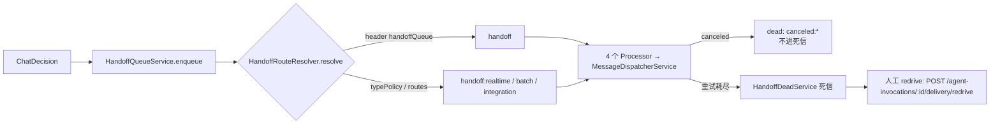

# 对话与会话域 · 运维说明（07）

**本文引用的文件**

- [packages/server-ai/src/handoff/constants.ts](file://packages/server-ai/src/handoff/constants.ts)
- [packages/server-ai/src/handoff/message-queue.processor.ts](file://packages/server-ai/src/handoff/message-queue.processor.ts)
- [packages/server-ai/src/handoff/message-queue.service.ts](file://packages/server-ai/src/handoff/message-queue.service.ts)
- [packages/server-ai/src/handoff/pending-result.service.ts](file://packages/server-ai/src/handoff/pending-result.service.ts)
- [packages/server-ai/src/handoff/dispatcher/handoff-routing-config.service.ts](file://packages/server-ai/src/handoff/dispatcher/handoff-routing-config.service.ts)
- [packages/server-ai/src/handoff/outbox-adapters.service.ts](file://packages/server-ai/src/handoff/outbox-adapters.service.ts)
- [packages/server-ai/src/handoff/README.md](file://packages/server-ai/src/handoff/README.md)
- [packages/server-ai/src/handoff/runtime-messaging/README.md](file://packages/server-ai/src/handoff/runtime-messaging/README.md)
- [packages/server-ai/src/handoff/runtime-messaging/runtime-message-transport.service.ts](file://packages/server-ai/src/handoff/runtime-messaging/runtime-message-transport.service.ts)
- [packages/server-ai/src/handoff/runtime-messaging/migrations/20261006-runtime-reliable-replies.sql](file://packages/server-ai/src/handoff/runtime-messaging/migrations/20261006-runtime-reliable-replies.sql)
- [packages/server-ai/src/chat-conversation/migrations/20260922-conversation-branch.sql](file://packages/server-ai/src/chat-conversation/migrations/20260922-conversation-branch.sql)
- [packages/server-ai/src/chat-message/migrations/20261005-message-envelope.sql](file://packages/server-ai/src/chat-message/migrations/20261005-message-envelope.sql)
- [packages/server-ai/src/chat-conversation/thread-run-control.md](file://packages/server-ai/src/chat-conversation/thread-run-control.md)
- [packages/server-ai/src/chat-conversation/summary.job.ts](file://packages/server-ai/src/chat-conversation/summary.job.ts)
- [packages/server-ai/src/chat-group/group-outbox.service.ts](file://packages/server-ai/src/chat-group/group-outbox.service.ts)
- [packages/server-ai/src/shared/stream/redis-sse.service.ts](file://packages/server-ai/src/shared/stream/redis-sse.service.ts)
- [docker/handoff-routing.example.yaml](file://docker/handoff-routing.example.yaml)
- [docs/conversation-branching.md](file://docs/conversation-branching.md)

## 目录

1. [一、环境变量与配置项](#一环境变量与配置项)
2. [二、队列与后台任务运维](#二队列与后台任务运维)
3. [三、取消与恢复的操作语义](#三取消与恢复的操作语义)
4. [四、数据库迁移](#四数据库迁移)
5. [五、日志与观测点](#五日志与观测点)
6. [六、多副本注意事项](#六多副本注意事项)
7. [七、安全运维](#七安全运维)

## 一、环境变量与配置项

| 变量名 | 用途 | 默认值 | 来源文件 |
|---|---|---|---|
| `XPERT_HANDOFF_DISPATCHER_CONCURRENCY` | handoff 调度并发（基座） | `20`（解析失败回退） | `message-queue.processor.ts` |
| `XPERT_HANDOFF_CONCURRENCY_REALTIME` | `handoff:realtime` 并发 | 取基座值 | `message-queue.processor.ts` |
| `XPERT_HANDOFF_CONCURRENCY_BATCH` | `handoff:batch` 并发 | 取基座值 | `message-queue.processor.ts` |
| `XPERT_HANDOFF_CONCURRENCY_INTEGRATION` | `handoff:integration` 并发 | 取基座值 | `message-queue.processor.ts` |
| `XPERT_HANDOFF_PENDING_TIMEOUT_MS` | `enqueueAndWait` 本进程等待上限 | `120000`（2 分钟） | `pending-result.service.ts` |
| `HANDOFF_ROUTING_CONFIG_PATH` | handoff 路由 YAML 路径（相对路径基于 `assetOptions.serverRoot`） | 未设置 → 仅 `warn`，使用内置默认快照 | `handoff-routing-config.service.ts` |
| `AI_SSE_STREAM_MAXLEN` | SSE 流最大长度 | `10000` | `redis-sse.service.ts` |
| `AI_SSE_STREAM_TTL_SECONDS` | SSE 流 TTL | `86400` | `redis-sse.service.ts` |
| `AI_SSE_LOCK_TTL_MS` | SSE 连接锁 TTL | `30000` | `redis-sse.service.ts` |
| `AI_SSE_READ_BLOCK_MS` | SSE 阻塞读窗口 | `200` | `redis-sse.service.ts` |
| `AI_SSE_READ_COUNT` | 单次读取条数 | `500` | `redis-sse.service.ts` |
| `CHATKIT_BRANCH_TEST_DATABASE_URL` | 分支真库测试开关 | 未设置即 skip | `conversation-branch.postgres.spec.ts` |
| `XPERT_PAUSE_TEST_DATABASE_URL` | 暂停/停止真库测试开关（库名须 `_test` 结尾） | 未设置即 skip | `thread-run-control.integration.spec.ts` |
| `THREAD_REFERENCE_TEST_DATABASE_URL` / `THREAD_REFERENCE_TEST_REDIS_URL` | 线程引用真库、线程游标真 Redis 测试开关 | 未设置即 skip | `thread-reference.integration.spec.ts` / `thread-cursor.store.integration.spec.ts` |
| `XPERT_EXECUTION_TEST_DATABASE_URL` / `_REDIS_URL` / `_REDIS_CONTAINER` | 队列恢复验收（库名前缀 `xpert_execution_test_`，Redis 须 `127.0.0.1`） | 未设置即 skip | `queue-recovery.worker.spec.ts` |
| `REDIS_HOST`（`REDIS_PORT`/`REDIS_DB`/`REDIS_PASSWORD`/`REDIS_USER`） | handoff e2e 用例的 Bull 连接 | `localhost` / `6379` / `db=15` | `enqueue-agent-chat-message.handler.e2e.spec.ts` |

路由与容量配置来自 YAML（`docker/handoff-routing.example.yaml` 是官方示例）：`queues[].maxInFlight`、`lanePolicy`（weight/maxConcurrent/maxQueued/mapToLane）、`typePolicies`（queue/lane/timeoutMs/idleTimeoutMs/retry/idempotency）、`routes[].match`（type/typePrefix/tenantId/organizationId/source）。

章节来源：[message-queue.processor.ts](file://packages/server-ai/src/handoff/message-queue.processor.ts)（关键符号：DEFAULT_HANDOFF_DISPATCHER_CONCURRENCY），[handoff-routing-config.service.ts](file://packages/server-ai/src/handoff/dispatcher/handoff-routing-config.service.ts)（关键符号：HandoffRoutingConfigService.resolveConfigFilePath），[handoff-routing.example.yaml](file://docker/handoff-routing.example.yaml)

## 二、队列与后台任务运维

- **4 个 Bull 队列**：`handoff`、`handoff:realtime`、`handoff:batch`、`handoff:integration`（`constants.ts`；`HandoffQueueModule` 内逐个 `BullModule.registerQueue`）。
- **job 名**：统一 `dispatch`（`XPERT_HANDOFF_JOB`）；默认 `maxAttempts=3`（`DEFAULT_HANDOFF_MAX_ATTEMPTS`，可按 `typePolicies.<type>.retry` 覆盖）。
- **消费者**：`HandoffQueueProcessor` / `HandoffQueueRealtimeProcessor` / `HandoffQueueBatchProcessor` / `HandoffQueueIntegrationProcessor`（同一基类，`processMessage` → `MessageDispatcherService.dispatch`）。
- **路由规则优先级**：消息 header `handoffQueue` > `typePolicies[type]` > `routes[].match` > `defaultQueue`；队列别名表把 `handoff/default/realtime/batch/integration` 映射到真实队列名。
- **死信与 redrive**：正常重试耗尽后由 `HandoffDeadService` 落死信；`dead(canceled:...)` 被显式排除在死信之外。等 Invocation 级别的投递失败用 `GET /api/agent-invocations/:id/delivery` 查看回执与诊断码，再用 `POST /api/agent-invocations/:id/delivery/redrive`（body `{}`）重驱；redrive 只重跑传输、不重放模型/CLI。
- **群 outbox 轮询**：`RuntimeMessageTransportService.@Interval(5000)` 触发 `HandoffOutboxAdapters.reconcile()`，`GroupOutboxService.reconcile()` 作为已注册适配器参与扫描——对 `starting/steering` 收据按 `nextAttemptAt` 重试，租约 60s，`attempts >= 9` 标 `failed`（`error='transport_unavailable'`），退避 `min(300s, 5s * 2^n)`；入队时 `maxAttempts=5`。
- **摘要队列**：Bull 队列 `conversation-summary`，消费者 `ConversationSummaryProcessor`（`@Process({concurrency: 5})`），仅对 `purpose` 为空或 `private` 且有消息的会话执行；写回通过 `ChatMessageUpdateJobCommand`。

章节来源：[constants.ts](file://packages/server-ai/src/handoff/constants.ts)（关键符号：XPERT_HANDOFF_QUEUES / DEFAULT_HANDOFF_MAX_ATTEMPTS），[group-outbox.service.ts](file://packages/server-ai/src/chat-group/group-outbox.service.ts)（关键符号：GroupOutboxService.reconcile / deliver），[summary.job.ts](file://packages/server-ai/src/chat-conversation/summary.job.ts)（关键符号：ConversationSummaryProcessor.process）

图表来源：[packages/server-ai/src/handoff/README.md](file://packages/server-ai/src/handoff/README.md)（关键符号：HandoffQueueGatewayService / MessageDispatcherService），[packages/server-ai/src/handoff/runtime-messaging/README.md](file://packages/server-ai/src/handoff/runtime-messaging/README.md)

## 三、取消与恢复的操作语义

- **协作式取消**：通过 `AbortSignal` 传导，不强杀同步 CPU 密集代码；`waiting/delayed/paused` 直接移除 Bull job，`active` 尽力 abort；结果统一 `dead(canceled:<reason>)`，**不进死信、不重试**；扫描与 abort 之间存在「任务已完成」的竞态，`active` 取消为 best-effort。
- **跨实例取消**：`HandoffCancelService` 维护进程内 `messageId → AbortController`，并用 Redis pub/sub 频道 `ai:handoff:cancel` 通知其他实例；本地等待者由 `HandoffPendingResultService` 立即释放。
- **会话取消编排**：`CancelConversationHandler` 先取消执行，再 best-effort 发 `StopHandoffMessageCommand`（`executionIds`），handoff 失败仅记录 warning，不阻断会话取消。
- **暂停**：`POST .../pause` 无 body，返回 `202` + pauseId，语义是 `pausing` 而非检查点完成；完成自然结束则转为 idle；暂停不撤销已完成操作。
- **恢复**：`POST .../resume` 必须带 `pauseId`，重新校验 graph revision + 检查点并新建执行尝试。
- **僵尸 run**：无租约的旧 run **不按时长猜死**，需显式 stop（cancel）处理；确认已暂停的 run 无活跃租约、可正常 resume。

章节来源：[handoff/README.md](file://packages/server-ai/src/handoff/README.md)（关键符号：StopHandoffMessageCommand / HandoffCancelService.cancelMessages / CancelConversationHandler），[thread-run-control.md](file://packages/server-ai/src/chat-conversation/thread-run-control.md)

## 四、数据库迁移

仓库未提供统一的 SQL 迁移 runner（根 `package.json` 无迁移脚本），需由发布流程按顺序手工执行；三份与本域直接相关的迁移均为幂等（`IF NOT EXISTS` / `BEGIN...COMMIT`）：

1. `packages/server-ai/src/chat-conversation/migrations/20260922-conversation-branch.sql`：为 `chat_message` 增 `outputCheckpoint`/`historicalAgentRuns`、`chat_conversation` 增 `branchSource` 及部分索引；**先在数据库执行，再部署后端**；可重复执行，旧消息不补锚点，回滚应用时可保留新增列。
2. `packages/server-ai/src/chat-message/migrations/20261005-message-envelope.sql`：为 `chat_message` 增 `messageEnvelope jsonb`；**在部署消息 provenance 能力之前执行**。
3. `packages/server-ai/src/handoff/runtime-messaging/migrations/20261006-runtime-reliable-replies.sql`：先执行 `xpert-project/migrations/20261006-project-task-runtime.sql`，再执行本迁移，然后启动新版宿主；新增 observation 租约列、`runtimeContinuationBlockedAt`、task 投影/dispatch 列，并建 `agent_runtime_delivery`、`agent_runtime_inbox`（唯一键 `tenantId+organizationId+ownerId+consumptionKey`）。**滚动顺序：先部署消费者，再部署生产者。**

章节来源：[20260922-conversation-branch.sql](file://packages/server-ai/src/chat-conversation/migrations/20260922-conversation-branch.sql)，[20261005-message-envelope.sql](file://packages/server-ai/src/chat-message/migrations/20261005-message-envelope.sql)，[20261006-runtime-reliable-replies.sql](file://packages/server-ai/src/handoff/runtime-messaging/migrations/20261006-runtime-reliable-replies.sql)，[conversation-branching.md](file://docs/conversation-branching.md)

## 五、日志与观测点

- **handoff 派发失败**：`message-queue.processor.ts` 在 dispatch 异常时 `console.error` 并转为重试/死信；取消类结果被规整为 `dead(canceled:...)`。
- **弃用路由告警**：`/chat-conversation/:id/goal` 每次访问打 `warn`，提示改用 `/ai/conversations/:conversation_id/goal`。
- **投递诊断**：`GET /api/agent-invocations/:id/delivery` 暴露投递/消费回执、稳定消费者执行 ID、attempts 与诊断码（如 `consumer_outcome_unknown`、`consumer_ended_without_success`）；任务侧 pending 派发错误落在 Task Execution 的 `dispatchError`。
- **运行时观测**：`RuntimeObservationMonitorService` 按租约独立观察既有句柄（只观察、不启动）；`RuntimeMessageContinuationService` 续跑与 `ProjectTaskDispatchRecoveryService` 重放已提交的派发意图，模糊启动绝不重放。
- **SSE 活性**：`ChatController` 用 `keepAlive(30000)`；线程活动流另有 `startSseHeartbeat` 与 `releaseConnection` 清理。
- **摘要与反馈**：反馈增改删后异步 `triggerSummary`，失败仅 `warn`（不阻断 HTTP 响应）。

章节来源：[message-queue.processor.ts](file://packages/server-ai/src/handoff/message-queue.processor.ts)（关键符号：BaseHandoffQueueProcessor.handleResult / handleError），[runtime-messaging/README.md](file://packages/server-ai/src/handoff/runtime-messaging/README.md)，[feedback.controller.ts](file://packages/server-ai/src/chat-message-feedback/feedback.controller.ts)（关键符号：ChatMessageFeedbackController.triggerSummary）

## 六、多副本注意事项

- **进程租约**：新 run 与 resume claim 在 thread metadata 中携带私有租约，**每 15s 续约、寿命 90s**；公开线程 DTO 不含租约元数据。替代进程在一个事务内把未收尾 run 标 `error`、中断其执行/消息状态并失效延迟续跑（不重放工具、不伪造已确认暂停）。
- **续约失败即标错**：多实例下租约续约失败会把 run 标记为错误；无租约旧 run 不会自动回收，需显式 stop。
- **`enqueueAndWait` 仅本进程**：源码明写 best-effort——worker 或 waiter 在另一实例时不会收到回调，调用方可能等到超时（`XPERT_HANDOFF_PENDING_TIMEOUT_MS`，默认 2 分钟）；跨实例请改用轮询/状态查询而非等待回调。
- **扫描并发**：`RuntimeMessageTransportService` 用 `scanning` 标志只防**本进程**重入，跨进程靠数据库租约（租约 60s、`attempts` 上限）保证不重复投递；`HandoffOutboxAdapters.reconcile()` 用 `Promise.allSettled` 隔离单个适配器故障。
- **SSE 扇出**：多副本靠 Redis pub/sub + 流 TTL/最大长度参数，副本间不共享内存；`AI_SSE_LOCK_TTL_MS` 决定连接锁在多副本下的保持时长。

章节来源：[thread-run-control.md](file://packages/server-ai/src/chat-conversation/thread-run-control.md)，[message-queue.service.ts](file://packages/server-ai/src/handoff/message-queue.service.ts)（关键符号：HandoffQueueService.enqueueAndWait），[runtime-message-transport.service.ts](file://packages/server-ai/src/handoff/runtime-messaging/runtime-message-transport.service.ts)（关键符号：RuntimeMessageTransportService.reconcile），[outbox-adapters.service.ts](file://packages/server-ai/src/handoff/outbox-adapters.service.ts)（关键符号：HandoffOutboxAdapters.reconcile）

## 七、安全运维

- **跨租户/跨组织**：会话域所有 HTTP 都经 `SuperAdminOrganizationScopeService.run(organizationId, ...)`；跨组织查询只允许 `SUPER_ADMIN` + tenant scope，其他角色直接 403。
- **群凭据边界**：群路由只接受 `USER_CONVERSATION` 绑定的 client_secret/api_key，且 `GroupScopeGuard` 对 JWT 用户直接放行——**不要用登录态直连群路由做隔离假设**；群工作台进一步校验 host、会话/线程归属与 `x-xpert-view-*` 头。
- **redrive 语义**：redrive 会重新授权原回复目标并保留 claim/phase/用户 stop 屏障；对 `consumer_outcome_unknown` 只检查同一执行身份；显式用户 stop 必须走手工轮次读取结果，不得绕过。
- **envelope 不放凭据**：`messageEnvelope` 不是授权凭证，禁止写入 prompt 文本、凭据或授权声明；`presentation='runtime'` 只是「不进入公开历史」，仍会参与模型祖先与重试，隐藏 ≠ 未参与推理。
- **凭据与日志**：投递/消费回执不暴露执行结果正文；测试与验收脚本（如 `verify-runtime-recovery.mjs`）只使用自建容器与随机端口，不接触业务库或平台凭据。

章节来源：[group-scope.guard.ts](file://packages/server-ai/src/ai/groups/group-scope.guard.ts)（关键符号：GroupScopeGuard.canActivate），[MESSAGE-ENVELOPES.md](file://packages/server-ai/src/chat-message/MESSAGE-ENVELOPES.md)，[runtime-messaging/README.md](file://packages/server-ai/src/handoff/runtime-messaging/README.md)
