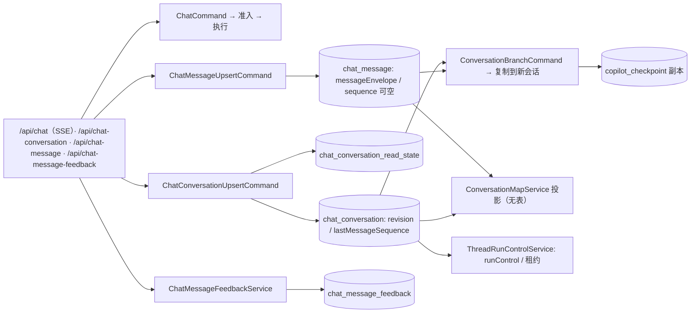
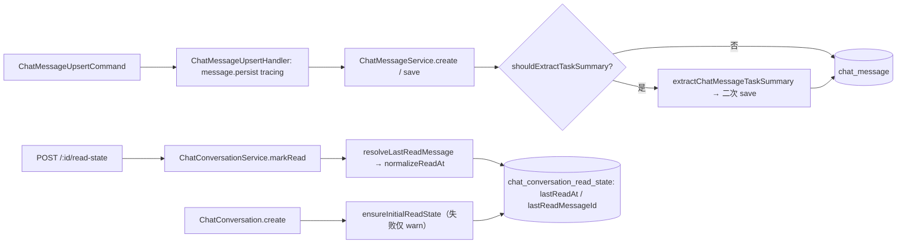
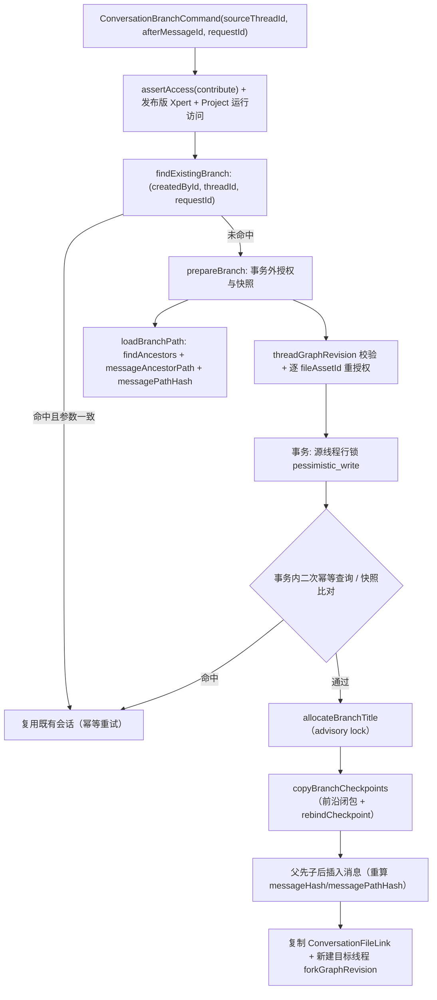
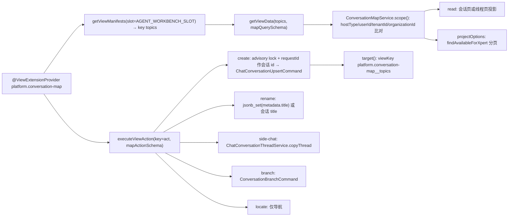
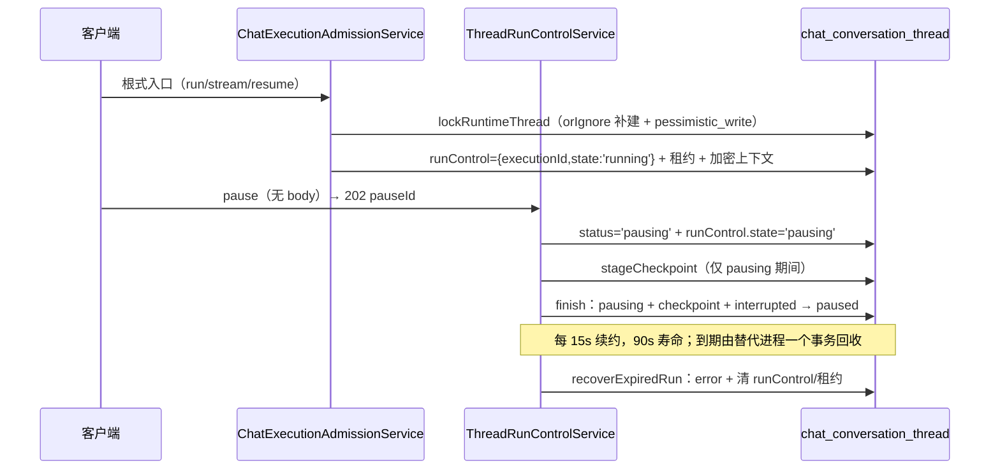

# 会话·消息·分支地图子专家 · 数据流转（03-数据流转）

**本文引用的文件**
- [packages/server-ai/src/chat-conversation/conversation.entity.ts](file://packages/server-ai/src/chat-conversation/conversation.entity.ts)
- [packages/server-ai/src/chat-conversation/conversation-thread.entity.ts](file://packages/server-ai/src/chat-conversation/conversation-thread.entity.ts)
- [packages/server-ai/src/chat-conversation/conversation-read-state.entity.ts](file://packages/server-ai/src/chat-conversation/conversation-read-state.entity.ts)
- [packages/server-ai/src/chat-conversation/goal/conversation-goal.entity.ts](file://packages/server-ai/src/chat-conversation/goal/conversation-goal.entity.ts)
- [packages/server-ai/src/chat-conversation/conversation.service.ts](file://packages/server-ai/src/chat-conversation/conversation.service.ts)
- [packages/server-ai/src/chat-conversation/conversation.subscriber.ts](file://packages/server-ai/src/chat-conversation/conversation.subscriber.ts)
- [packages/server-ai/src/chat-conversation/conversation-thread.service.ts](file://packages/server-ai/src/chat-conversation/conversation-thread.service.ts)
- [packages/server-ai/src/chat-conversation/thread-run-control.service.ts](file://packages/server-ai/src/chat-conversation/thread-run-control.service.ts)
- [packages/server-ai/src/chat-conversation/thread-run-lease.ts](file://packages/server-ai/src/chat-conversation/thread-run-lease.ts)
- [packages/server-ai/src/chat-conversation/chat-execution-admission.service.ts](file://packages/server-ai/src/chat-conversation/chat-execution-admission.service.ts)
- [packages/server-ai/src/chat-conversation/thread-run-control.md](file://packages/server-ai/src/chat-conversation/thread-run-control.md)
- [packages/server-ai/src/chat-conversation/conversation-branch/conversation-branch.service.ts](file://packages/server-ai/src/chat-conversation/conversation-branch/conversation-branch.service.ts)
- [packages/server-ai/src/chat-conversation/conversation-branch/branch-checkpoints.ts](file://packages/server-ai/src/chat-conversation/conversation-branch/branch-checkpoints.ts)
- [packages/server-ai/src/chat-conversation/conversation-branch/branch-message-references.ts](file://packages/server-ai/src/chat-conversation/conversation-branch/branch-message-references.ts)
- [packages/server-ai/src/chat-conversation/message-path.ts](file://packages/server-ai/src/chat-conversation/message-path.ts)
- [packages/server-ai/src/chat-conversation/conversation-map/service.ts](file://packages/server-ai/src/chat-conversation/conversation-map/service.ts)
- [packages/server-ai/src/chat-conversation/conversation-map/provider.ts](file://packages/server-ai/src/chat-conversation/conversation-map/provider.ts)
- [packages/server-ai/src/chat-conversation/conversation-map/presentation.ts](file://packages/server-ai/src/chat-conversation/conversation-map/presentation.ts)
- [packages/server-ai/src/chat-message/chat-message.entity.ts](file://packages/server-ai/src/chat-message/chat-message.entity.ts)
- [packages/server-ai/src/chat-message/commands/handlers/upsert.handler.ts](file://packages/server-ai/src/chat-message/commands/handlers/upsert.handler.ts)
- [packages/server-ai/src/chat-message/message-envelope.schema.ts](file://packages/server-ai/src/chat-message/message-envelope.schema.ts)
- [packages/server-ai/src/chat-message/message-branching.ts](file://packages/server-ai/src/chat-message/message-branching.ts)
- [packages/server-ai/src/chat-message/MESSAGE-ENVELOPES.md](file://packages/server-ai/src/chat-message/MESSAGE-ENVELOPES.md)
- [packages/server-ai/src/chat-message-feedback/feedback.entity.ts](file://packages/server-ai/src/chat-message-feedback/feedback.entity.ts)
- [packages/server-ai/src/chat-conversation/migrations/20260922-conversation-branch.sql](file://packages/server-ai/src/chat-conversation/migrations/20260922-conversation-branch.sql)
- [packages/server-ai/src/chat-message/migrations/20261005-message-envelope.sql](file://packages/server-ai/src/chat-message/migrations/20261005-message-envelope.sql)

## 目录
1. [链路总览](#链路总览)
2. [链一：消息写入与读状态](#链一消息写入与读状态)
3. [链二：分支复制](#链二分支复制)
4. [链三：地图投影](#链三地图投影)
5. [链四：运行控制与检查点](#链四运行控制与检查点)
6. [状态流转](#状态流转)
7. [数据变换关键节点](#数据变换关键节点)
8. [已知风险](#已知风险)

## 链路总览

图表来源：[conversation-branch.service.ts](file://packages/server-ai/src/chat-conversation/conversation-branch/conversation-branch.service.ts)（关键符号：ConversationBranchService.branch）、[service.ts](file://packages/server-ai/src/chat-conversation/conversation-map/service.ts)（关键符号：ConversationMapService.read）、[thread-run-control.service.ts](file://packages/server-ai/src/chat-conversation/thread-run-control.service.ts)（关键符号：ThreadRunControlService.locked）

- 本子域的持久化权威只有四张表（`chat_conversation`、`chat_conversation_thread`、`chat_message`、`chat_conversation_feedback`）+ 两处旁路（`chat_conversation_read_state`、`chat_conversation_goal`）+ 一个外域检查点表 `copilot_checkpoint`。
- 读侧全部是投影：脉络视图、线程可见消息、未读统计、工作台导航都不产生新表；写侧唯一新增列由两份迁移引入（`branchSource`/`outputCheckpoint`/`historicalAgentRuns`、`messageEnvelope`）。

章节来源：[20260922-conversation-branch.sql](file://packages/server-ai/src/chat-conversation/migrations/20260922-conversation-branch.sql)、[20261005-message-envelope.sql](file://packages/server-ai/src/chat-message/migrations/20261005-message-envelope.sql)

## 链一：消息写入与读状态

图表来源：[upsert.handler.ts](file://packages/server-ai/src/chat-message/commands/handlers/upsert.handler.ts)（关键符号：ChatMessageUpsertHandler.execute）、[conversation.service.ts](file://packages/server-ai/src/chat-conversation/conversation.service.ts)（关键符号：ChatConversationService.markRead / ensureInitialReadState）

- 消息写入只更新 `chat_message` 一行，但 `ChatMessage` 带 `@Tree('closure-table')` 与 `(conversationId, sequence)` 唯一索引，父链变化会额外维护闭包表。
- 读状态属于「查看者」，包括助手所有或共享 Project 会话的读者；`upsertConversationReadState` 在同一事务内按 `(tenantId,organizationId,conversationId,userId)` 唯一索引写入。
- `ChatConversationSubscriber.afterLoad` 按 `createdAt` 对 `messages` 排序，因此私有会话的转录顺序由父链 + `createdAt` 决定，而非 `sequence`（私有路径不分配）。
- 反馈链与读取链同级：`chat_message_feedback` 经 `assertTargetAccess(..., 'contribute')` 与 `assertMessageBelongsToConversation` 双重校验后写入，随后异步触发摘要任务。

章节来源：[chat-message.entity.ts](file://packages/server-ai/src/chat-message/chat-message.entity.ts)（关键符号：ChatMessage.sequence / @Tree('closure-table')）、[conversation-read-state.entity.ts](file://packages/server-ai/src/chat-conversation/conversation-read-state.entity.ts)（关键符号：ChatConversationReadState）、[conversation.subscriber.ts](file://packages/server-ai/src/chat-conversation/conversation.subscriber.ts)（关键符号：ChatConversationSubscriber.afterLoad）

## 链二：分支复制

图表来源：[conversation-branch.service.ts](file://packages/server-ai/src/chat-conversation/conversation-branch/conversation-branch.service.ts)（关键符号：ConversationBranchService.branch / prepareBranch / loadBranchPath）、[branch-checkpoints.ts](file://packages/server-ai/src/chat-conversation/conversation-branch/branch-checkpoints.ts)（关键符号：copyBranchCheckpoints）

- 边界只由检查点祖先关系定义：`messageBranching` 要求 `role==='ai'`、`status==='success'`、`outputCheckpoint.version===1` 且 `messageHash` 匹配，缺少锚点即 `checkpoint_unavailable`。
- 检查点复制走「前沿 + `visited` 去重」：先收集选中路径上每条消息的 `inputCheckpoint.checkpoint` 与 `outputCheckpoint.checkpoints/checkpoint`，再沿 `parent_id` 与 `metadata.parents` 回溯；跨线程/跨租户引用即失败；**不复制 pending writes**（新的人工输入不得恢复旧计划工作）。
- 谱系映射：`messageIds: 原 id → 新 uuid` 同时用于 `parentId` 重绑、`rebindInputCheckpoint`/`rebindOutputCheckpoint` 的线程重绑、`rebindTaskSummary` 的平台导航 id 重绑，以及检查点内 `messages` 身份的改写；模型工具调用 id 保持不变。
- 幂等：部分索引命中即返回原会话，参数不一致抛 `request_conflict`；成功创建与幂等重试都记录指标（`reason='created'|'idempotent_retry'`）。

章节来源：[message-branching.ts](file://packages/server-ai/src/chat-message/message-branching.ts)（关键符号：messageBranching / branchMessageHash / branchMessagePathHash）、[branch-message-references.ts](file://packages/server-ai/src/chat-conversation/conversation-branch/branch-message-references.ts)（关键符号：rebindTaskSummary）、[message-path.ts](file://packages/server-ai/src/chat-conversation/message-path.ts)（关键符号：messageAncestorPath）

## 链三：地图投影

图表来源：[provider.ts](file://packages/server-ai/src/chat-conversation/conversation-map/provider.ts)（关键符号：ConversationMapViewProvider.getViewData / executeViewAction）、[service.ts](file://packages/server-ai/src/chat-conversation/conversation-map/service.ts)（关键符号：ConversationMapService.read / act / target）

- 投影只保留可见内容：`turnNodes` 丢弃 `isRuntimeChatMessage` 与非 `human`/`ai` 角色，AI 段只累加纯文本到 `answer`；`humanMessageSummary` 取最近一条人类消息并截断 600 字符；`visibleText` 只提取 `type==='text'` 块，不进入工具 JSON 或 reasoning。
- `read` 的三种形态：有 `threadId` → 线程内 turn 分页；有 `conversationId` 无 `threadId` → 线程级节点（含 `parentThreadId`/`sourceMessageId`，`showHistory=false` 时过滤 `message-edit` 线程及其子线程）；无 `conversationId` → 会话级节点 + `projectOptions`，带 `search` 时按有界会话页扫描并回填 `nextSearchOffset`。
- `act` 不改写脉络结构：`create` 以 `requestId` 复用为会话 id 实现重试幂等（advisory lock 为该用户 + 该 requestId），`rename` 用 `jsonb_set` 原子更新线程 `metadata.title` 以避免覆盖并发运行时元数据，`side-chat`/`branch` 分别转 `copyThread` 与 `ConversationBranchCommand`，`locate` 只解析导航目标。

章节来源：[presentation.ts](file://packages/server-ai/src/chat-conversation/conversation-map/presentation.ts)（关键符号：turnNodes / humanMessageSummary / visibleText）、[conversation-thread.service.ts](file://packages/server-ai/src/chat-conversation/conversation-thread.service.ts)（关键符号：ChatConversationThreadService.copyThread / findVisibleMessages）

## 链四：运行控制与检查点

图表来源：[thread-run-control.service.ts](file://packages/server-ai/src/chat-conversation/thread-run-control.service.ts)（关键符号：ThreadRunControlService.requestPause / stageCheckpoint / finish / maintainLeases / recoverExpiredRun）、[chat-execution-admission.service.ts](file://packages/server-ai/src/chat-conversation/chat-execution-admission.service.ts)（关键符号：ChatExecutionAdmissionService.run）

- 受理 ≠ 完成：`requestPause` 只置 `pausing`（重复请求返回同一 `pauseId`，且要求当前 `status==='busy'`），只有 `finish` 在「`pausing` + 有检查点 + `status==='interrupted'`」时确认 `paused`；自然结束则回落 `idle`。
- 恢复校验三元组：`pauseId` + `runControl.graphRevision` + `copilot_checkpoint` 行存在，缺一即 `ThreadNotPaused`/`PausedGraphChanged`/`CheckpointUnavailable`。
- 租约只证明进程归属（`thread-run-lease.ts` 注释），不证明检查点或消息已持久化；回收动作在一个事务内完成线程/执行/消息/等待记录/会话五处状态改写，且明确不重放工具、不由 staged checkpoint 制造 `paused`。
- 自动续跑准入：`automatic` 时要求 `runControl.executionId` 与 `state==='running'`、`thread.status==='busy'` 完全匹配，否则 `RuntimeMessageBlocked`（`ChatExecutionAdmissionService.finish` 会据执行状态映射 `idle`/`interrupted`/`error`）。

章节来源：[thread-run-control.md](file://packages/server-ai/src/chat-conversation/thread-run-control.md)、[thread-run-lease.ts](file://packages/server-ai/src/chat-conversation/thread-run-lease.ts)（关键符号：RUN_LEASE_KEY / RUN_LEASE_MS / readRunLease）

## 状态流转
| 状态机 | 取值 | 驱动点 |
|---|---|---|
| `ChatConversation.status` / `ChatConversationThread.status`（`TChatConversationStatus`） | `idle · busy · pausing · paused · interrupted · error` | 准入（busy）、`requestPause`（pausing）、`finish`（paused/idle/error/interrupted）、`cancel`（interrupted）、`recoverExpiredRun`（error） |
| `TChatThreadRunControl.state` | `running · pausing · paused` | `start`/`requestPause`/`claimResume`/`releaseResume`/`finish`/`cancel` |
| `runControl.checkpoint`（`TChatCheckpointReference`） | 有/无 | `stageCheckpoint` 仅 `pausing` 阶段写入；`requestPause` 清空；`claimResume` 使用后由 `finish` 清空 |
| `encryptedRunContext` | 存在/清空 | `start` 用 `encryptSecret` 写入；`finish`/`cancel`/`recoverExpiredRun` 清空；`getResumeContext` 解密读取 |
| `ChatConversationGoal.status` | `active`（默认）等（含 `statusUpdatedAt`/`completedAt`/`blockedAt` 时间戳） | 目标服务的增改清；线程复制时按源目标状态复制 |
| `ChatConversationReadState` | `lastReadAt` + `lastReadMessageId` | `markRead`、`ensureInitialReadState`、`upsertConversationReadState` |
| `ChatMessage.status` | `thinking · reasoning · answering → aborted` | `recoverExpiredRun` 批量把在途消息置 `aborted` 并写同一错误文案 |
| `ChatMessage.followUpStatus` | `pending · consumed · canceled` | 追单可见性与投递门控（`visibleAt`/`targetExecutionId` 配套） |

章节来源：[conversation-thread.entity.ts](file://packages/server-ai/src/chat-conversation/conversation-thread.entity.ts)（关键符号：ChatConversationThread.runControl / runtimeContinuationBlockedAt / encryptedRunContext）、[conversation-goal.entity.ts](file://packages/server-ai/src/chat-conversation/goal/conversation-goal.entity.ts)（关键符号：ChatConversationGoal.status）、[chat-message.entity.ts](file://packages/server-ai/src/chat-message/chat-message.entity.ts)（关键符号：ChatMessage.status / followUpStatus）

## 数据变换关键节点
- **信封生成与校验**：可信生产者写 `options.messageEnvelope`；命令入口经 `parseChatMessageEnvelope` 一次校验（`version` 只接受字面量 `1`、`source` 为严格判别联合、`runtime` 源与 `correlation.invocationId` 必须一致），失败抛 `Error.ChatMessageEnvelopeInvalid`；持久化进 `ChatMessage.messageEnvelope` JSONB。
- **非法版本与读侧容错**：`readChatMessageEnvelope` 捕获异常返回 `undefined`；非法/未知持久化版本对公开历史隐藏，但**运行时水合仍保留**用于执行与诊断；`presentation='runtime'` 的消息不进入公开历史，却仍在模型祖先与重试路径中。
- **公开投影剥离**：`publicChatMessage` 移除 `outputCheckpoint`/`historicalAgentRuns`/`parent`/`children` 与**未校验**的 `messageEnvelope`，再以 `readChatMessageEnvelope` 回填已验证信封，并附带 `branching` 能力标记。
- **分支的谱系映射**：`messageIds` 映射驱动 `parentId`、输入/输出检查点 `threadId`、任务摘要里的 `messageId`；复制时 `createdAt`/`updatedAt` 保留原值（注释明写「复制历史不应让旧回复看起来刚发出」）；`outputCheckpoint` 的 `messageHash`/`messagePathHash` 在复制后重算，保证副本自身可再被分支。
- **脉络投影与搜索**：`turnNodes` 把人类消息作为节点、AI 消息作为 `answer` 合并；`snippet` 按命中位置截断（preview 2000 / answer 4000）；`matches` 只匹配 title/preview/answer。

章节来源：[message-envelope.schema.ts](file://packages/server-ai/src/chat-message/message-envelope.schema.ts)（关键符号：chatMessageEnvelopeSchema / parseChatMessageEnvelope / readChatMessageEnvelope）、[message-branching.ts](file://packages/server-ai/src/chat-message/message-branching.ts)（关键符号：publicChatMessage）、[MESSAGE-ENVELOPES.md](file://packages/server-ai/src/chat-message/MESSAGE-ENVELOPES.md)

## 已知风险
1. **私有路径无 `sequence`**：排序只能依赖 `createdAt`/`lastMessageSequence`，任何「按游标翻页」的新读取方都需先补分配点或显式回退。
2. **隐藏 ≠ 未参与推理**：`presentation='runtime'` 与非法版本信封不进公开历史，但仍参与模型祖先与重试；据此做「数据未被使用」的判断会失真。
3. **读侧静默容错**：`readChatMessageEnvelope` 与 `filterAuthorizedFileRelations` 都吞掉异常，读侧无法区分「没有」与「损坏/越权」，排障需回源。
4. **分支写放大与检查点闭包**：任一检查点/文件缺失即整体失败（`checkpoint_unavailable`/`files_unavailable`），且事务内逐条 `save`；长历史分支的长事务是可见的运维风险。
5. **地图读放大与搜索语义**：无 `conversationId` 时逐会话 `threadSummary`；搜索时 `page.total` 是扫描范围而非命中数，客户端需按 `searchOffset`/`nextSearchOffset` 续读。
6. **租约到期直接标错**：续约失败会把 run 置 `error` 并中断执行，属预期行为但会被误读为「模型失败」；无租约旧 run 永不自动回收，只能显式 stop。
7. **附件双路径可见性差异**：新写入走 `FileAsset`/`ConversationFileLink`，读取同时解析 legacy `attachments`，两路径授权结果可能不一致（旧路径按所有者、新路径按会话授权）。
8. **地图 `create` 的幂等前提**：以客户端 `requestId` 直接作为会话 id，复用同名 id 的不同意图会被判为同一会话（并校验 `createdById` 与 `projectId` 一致，否则 403）。

章节来源：[chat-message.entity.ts](file://packages/server-ai/src/chat-message/chat-message.entity.ts)（关键符号：ChatMessage.sequence / attachments / fileAssets）、[conversation-branch.service.ts](file://packages/server-ai/src/chat-conversation/conversation-branch/conversation-branch.service.ts)（关键符号：ConversationBranchService.branch 的幂等与文件授权分支）、[service.ts](file://packages/server-ai/src/chat-conversation/conversation-map/service.ts)（关键符号：ConversationMapService.act / read）
