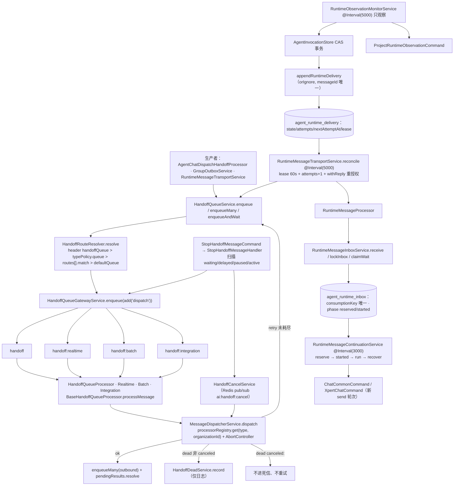

# 投递队列与运行时消息子专家 · 架构（01-架构）

**本文引用的文件**
- [packages/server-ai/src/handoff/README.md](file://packages/server-ai/src/handoff/README.md)
- [packages/server-ai/src/handoff/runtime-messaging/README.md](file://packages/server-ai/src/handoff/runtime-messaging/README.md)
- [packages/server-ai/src/handoff/constants.ts](file://packages/server-ai/src/handoff/constants.ts)
- [packages/server-ai/src/handoff/message-queue.module.ts](file://packages/server-ai/src/handoff/message-queue.module.ts)
- [packages/server-ai/src/handoff/message-queue.service.ts](file://packages/server-ai/src/handoff/message-queue.service.ts)
- [packages/server-ai/src/handoff/message-queue.processor.ts](file://packages/server-ai/src/handoff/message-queue.processor.ts)
- [packages/server-ai/src/handoff/message-dispatcher.service.ts](file://packages/server-ai/src/handoff/message-dispatcher.service.ts)
- [packages/server-ai/src/handoff/message-context.ts](file://packages/server-ai/src/handoff/message-context.ts)
- [packages/server-ai/src/handoff/dispatcher/handoff-route-resolver.service.ts](file://packages/server-ai/src/handoff/dispatcher/handoff-route-resolver.service.ts)
- [packages/server-ai/src/handoff/dispatcher/handoff-routing-config.service.ts](file://packages/server-ai/src/handoff/dispatcher/handoff-routing-config.service.ts)
- [packages/server-ai/src/handoff/dispatcher/handoff-queue-gateway.service.ts](file://packages/server-ai/src/handoff/dispatcher/handoff-queue-gateway.service.ts)
- [packages/server-ai/src/handoff/dead-letter.service.ts](file://packages/server-ai/src/handoff/dead-letter.service.ts)
- [packages/server-ai/src/handoff/handoff-cancel.service.ts](file://packages/server-ai/src/handoff/handoff-cancel.service.ts)
- [packages/server-ai/src/handoff/pending-result.service.ts](file://packages/server-ai/src/handoff/pending-result.service.ts)
- [packages/server-ai/src/handoff/local-sync-task.service.ts](file://packages/server-ai/src/handoff/local-sync-task.service.ts)
- [packages/server-ai/src/handoff/cancel-reason.ts](file://packages/server-ai/src/handoff/cancel-reason.ts)
- [packages/server-ai/src/handoff/handoff-permission.ts](file://packages/server-ai/src/handoff/handoff-permission.ts)
- [packages/server-ai/src/handoff/outbox-adapters.service.ts](file://packages/server-ai/src/handoff/outbox-adapters.service.ts)
- [packages/server-ai/src/handoff/commands/handlers/stop-handoff-message.handler.ts](file://packages/server-ai/src/handoff/commands/handlers/stop-handoff-message.handler.ts)
- [packages/server-ai/src/handoff/runtime-messaging/runtime-message-outbox.ts](file://packages/server-ai/src/handoff/runtime-messaging/runtime-message-outbox.ts)
- [packages/server-ai/src/handoff/runtime-messaging/runtime-message-transport.service.ts](file://packages/server-ai/src/handoff/runtime-messaging/runtime-message-transport.service.ts)
- [packages/server-ai/src/handoff/runtime-messaging/runtime-message-inbox.service.ts](file://packages/server-ai/src/handoff/runtime-messaging/runtime-message-inbox.service.ts)
- [packages/server-ai/src/handoff/runtime-messaging/runtime-message-continuation.service.ts](file://packages/server-ai/src/handoff/runtime-messaging/runtime-message-continuation.service.ts)
- [packages/server-ai/src/handoff/runtime-messaging/runtime-observation-monitor.service.ts](file://packages/server-ai/src/handoff/runtime-messaging/runtime-observation-monitor.service.ts)
- [packages/server-ai/src/handoff/runtime-messaging/runtime-message-access.service.ts](file://packages/server-ai/src/handoff/runtime-messaging/runtime-message-access.service.ts)
- [packages/server-ai/src/handoff/runtime-messaging/runtime-message.entity.ts](file://packages/server-ai/src/handoff/runtime-messaging/runtime-message.entity.ts)
- [packages/server-ai/src/handoff/runtime-messaging/runtime-delivery.controller.ts](file://packages/server-ai/src/handoff/runtime-messaging/runtime-delivery.controller.ts)
- [packages/server-ai/src/agent-invocation/agent-invocation.module.ts](file://packages/server-ai/src/agent-invocation/agent-invocation.module.ts)
- [packages/server-ai/src/agent-invocation/typeorm-invocation.store.ts](file://packages/server-ai/src/agent-invocation/typeorm-invocation.store.ts)
- [packages/server-ai/src/chat-group/group-outbox.service.ts](file://packages/server-ai/src/chat-group/group-outbox.service.ts)

## 目录
1. [子域职责边界](#子域职责边界)
2. [内部分层](#内部分层)
3. [依赖关系](#依赖关系)
4. [关键不变量](#关键不变量)
5. [架构总览](#架构总览)
6. [结论](#结论)

## 子域职责边界
**做什么**：把「已决定要执行的工作」变成「可在多副本下安全投递、可重试、可取消、可观测」的异步消息——注册 4 个 Bull 队列与 4 个消费者、按 header/typePolicy/匹配规则解析目标队列、提供入队与等待入口、扫描式取消、重试耗尽落死信；运行时侧维护 `agent_runtime_delivery`（outbox）→ 队列 → `agent_runtime_inbox`（inbox）→ 续跑/观测的闭环，并提供 owner 级投递回执查询与 redrive。

**不做什么**：不注册第二个执行器，不推断 Task 完成，不拥有 Invocation 事实与业务决策；不执行模型/CLI；不做恰一次投递；不保存结果正文（只保存引用）。

**跨域交叉引用（避免双计）**：
- `delivery` / `delivery/redrive` 的 HTTP 入口 `RuntimeDeliveryController` **物理注册在** `agent-invocation.module.ts` 的 `controllers` 中，按目录归属执行链域；inbox/delivery 实体与服务仍在本子域源码树。
- 群聊 `GroupOutboxService` 是**相邻生产者**：它把收据改写为 `agent.chat.dispatch` 后复用本子域队列，并通过 `HandoffOutboxAdapters.register` 挂到本子域的扫描器上。
- `ProjectTaskDispatchRecoveryService`（`xpert-project/runtime`）与 `DeliverGroupTaskResultCommand`（群任务）是续跑链的下游消费者，归属各自专家域。

章节来源：[runtime-messaging/README.md](file://packages/server-ai/src/handoff/runtime-messaging/README.md)（关键符号：Invocation remains the runtime ledger）、[runtime-delivery.controller.ts](file://packages/server-ai/src/handoff/runtime-messaging/runtime-delivery.controller.ts)（关键符号：RuntimeDeliveryController）、[outbox-adapters.service.ts](file://packages/server-ai/src/handoff/outbox-adapters.service.ts)（关键符号：HandoffOutboxAdapter）、[agent-invocation.module.ts](file://packages/server-ai/src/agent-invocation/agent-invocation.module.ts)（关键符号：AgentInvocationModule.controllers）

## 内部分层
### 队列定义层
`constants.ts` 定义 4 个队列名（`handoff`、`handoff:realtime`、`handoff:batch`、`handoff:integration`）、统一 job 名 `XPERT_HANDOFF_JOB='dispatch'` 与默认 `DEFAULT_HANDOFF_MAX_ATTEMPTS=3`；`message-queue.module.ts` 以 `@Global()` 模块逐个 `BullModule.registerQueue`，导出 `HandoffOutboxAdapters`、`HandoffQueueService`、`AgentChatRealtimeService`、`AgentChatDispatchHandoffProcessor`，并把 `HandoffQueueService` 绑定到 `HANDOFF_QUEUE_SERVICE_TOKEN` 供插件使用。

章节来源：[constants.ts](file://packages/server-ai/src/handoff/constants.ts)（关键符号：XPERT_HANDOFF_QUEUES / XPERT_HANDOFF_JOB / DEFAULT_HANDOFF_MAX_ATTEMPTS）、[message-queue.module.ts](file://packages/server-ai/src/handoff/message-queue.module.ts)（关键符号：HandoffQueueModule）

### 处理基类与分发层
4 个 `@Processor(...)` 类共用一个抽象基类 `BaseHandoffQueueProcessor`：`processMessage` → `runWithHandoffMessageContext`（从消息信封重建 tenant/organization/user/language 上下文）→ `MessageDispatcherService.dispatch`（`processorRegistry.get(type, organizationId)`、注册 `AbortController`、总超时/空闲超时定时器）→ `handleResult`/`handleError` 归一为 `ok`/`retry`/`dead`。并发在模块加载时从 `process.env` 读取。

章节来源：[message-queue.processor.ts](file://packages/server-ai/src/handoff/message-queue.processor.ts)（关键符号：BaseHandoffQueueProcessor.processMessage / handleResult / handleError）、[message-dispatcher.service.ts](file://packages/server-ai/src/handoff/message-dispatcher.service.ts)（关键符号：MessageDispatcherService.dispatch）、[message-context.ts](file://packages/server-ai/src/handoff/message-context.ts)（关键符号：runWithHandoffMessageContext）

### 路由与配置层
`HandoffRouteResolver.resolve` 只做纯解析：队列 = header `handoffQueue`（兼容 `queue` 别名）> `typePolicies[type].queue` > 命中 `routes[].match` 的 `target.queue` > `defaultQueue`；lane/timeout/idleTimeout 同级优先。配置来自 `HandoffRoutingConfigService` 在 `onModuleInit` 加载的 YAML 快照（队列别名表 + `lanePolicy` + `typePolicies` + `routes`）。

章节来源：[handoff-route-resolver.service.ts](file://packages/server-ai/src/handoff/dispatcher/handoff-route-resolver.service.ts)（关键符号：HandoffRouteResolver.resolve）、[handoff-routing-config.service.ts](file://packages/server-ai/src/handoff/dispatcher/handoff-routing-config.service.ts)（关键符号：HandoffRoutingConfigService.loadConfig / normalizeConfig）

### 网关、取消与等待者层
`HandoffQueueGatewayService` 是唯一的 Bull 接触面（`enqueue`/`enqueueMany`/`findJobs`/`removeJobs`，`add` 选项 `removeOnComplete: true`、`removeOnFail: false`）。取消链由 `StopHandoffMessageHandler`（扫描 waiting/delayed/paused/active）+ `HandoffCancelService`（进程内 `messageId → AbortController` 注册表 + Redis pub/sub `ai:handoff:cancel` 跨实例）+ `HandoffPendingResultService`（本进程 waiter）+ `cancel-reason.ts`（`canceled:` 前缀归一）组成；死信由 `HandoffDeadService.record` 承担。

章节来源：[handoff-queue-gateway.service.ts](file://packages/server-ai/src/handoff/dispatcher/handoff-queue-gateway.service.ts)（关键符号：HandoffQueueGatewayService.enqueue / findJobs / removeJobs）、[handoff-cancel.service.ts](file://packages/server-ai/src/handoff/handoff-cancel.service.ts)（关键符号：HandoffCancelService.cancelMessages）、[dead-letter.service.ts](file://packages/server-ai/src/handoff/dead-letter.service.ts)（关键符号：HandoffDeadService.record）

### runtime-messaging 三件套（outbox · transport · inbox）
outbox：`appendRuntimeDelivery(manager, invocation)` 在 Invocation CAS 事务内 `orIgnore` 写 `agent_runtime_delivery`，只为 Invocation 事实派生事件（终态 `result`、`waiting`+interaction `input_request`）。transport：`RuntimeMessageTransportService.reconcile`（`@Interval(5000)`）扫描 due 行、`deliver` 用 60s 租约 claim 后 `RuntimeMessageAccessService.withReply` 重授权并 enqueue。inbox：`RuntimeMessageInboxService.receive` 校验 delivery/事件/收件人一致后同事务 `lockInbox` + 置 delivery `received`，`claimWait` 供有界等待认领。

章节来源：[runtime-message-outbox.ts](file://packages/server-ai/src/handoff/runtime-messaging/runtime-message-outbox.ts)（关键符号：appendRuntimeDelivery / runtimeObservationEvent）、[runtime-message-transport.service.ts](file://packages/server-ai/src/handoff/runtime-messaging/runtime-message-transport.service.ts)（关键符号：RuntimeMessageTransportService.deliver）、[runtime-message-inbox.service.ts](file://packages/server-ai/src/handoff/runtime-messaging/runtime-message-inbox.service.ts)（关键符号：RuntimeMessageInboxService.receive / lockInbox / claimWait）

### 续跑与观测层
`RuntimeMessageContinuationService.reconcile`（`@Interval(3000)`）走 `reserve`（与 inbox 认领同事务预留 execution + 抢线程写者）→ `phase='started'` → `run`（`ChatCommonCommand`/`XpertChatCommand` 新 `send` 轮次）→ `recover`（只查该 execution）。`RuntimeObservationMonitorService.reconcile`（`@Interval(5000)`）独立租约观察既有 Invocation 句柄、绝不启动；`RuntimeMessageAccessService` 是唯一的运行时重授权入口。

章节来源：[runtime-message-continuation.service.ts](file://packages/server-ai/src/handoff/runtime-messaging/runtime-message-continuation.service.ts)（关键符号：RuntimeMessageContinuationService.reserve / run / recover）、[runtime-observation-monitor.service.ts](file://packages/server-ai/src/handoff/runtime-messaging/runtime-observation-monitor.service.ts)（关键符号：RuntimeObservationMonitorService.observe）、[runtime-message-access.service.ts](file://packages/server-ai/src/handoff/runtime-messaging/runtime-message-access.service.ts)（关键符号：RuntimeMessageAccessService.withReply）

## 依赖关系
**出向**：`@xpert-ai/plugin-sdk`（`HandoffMessage`/`ProcessResult`/`HandoffProcessorRegistry`/`HandoffProcessorStrategy`/`AGENT_RUNTIME_EVENT_MESSAGE_TYPE`/`agentRuntimeEventSchema`/`agentRuntimeResultConsumptionKey`）；`@xpert-ai/server-core`（`RedisModule`/`REDIS_CLIENT`/`TenantOrganizationBaseEntity`/`loadYamlFile`/`ZodValidationPipe`）；`@xpert-ai/server-config`（`ConfigService.assetOptions.serverRoot` 解析路由 YAML 相对路径）；`@xpert-ai/contracts`（`XpertAgentExecutionStatusEnum`/`TChatMessageEnvelope`）；NestJS `BullModule`/`CqrsModule`/`DiscoveryModule`/`@Interval`；TypeORM `DataSource`/`EntityManager`。

**入向**：`agent-invocation`（`TypeOrmAgentInvocationStore.replace` 在 CAS 事务内调用 `appendRuntimeDelivery`；`agent-invocation.module.ts` 提供 inbox/transport/continuation/observation 服务并注册 `RuntimeDeliveryController`）；`chat-group`（`GroupOutboxService` 注册 outbox 适配器，`GroupMessageProcessor` 走 `@HandoffProcessorStrategy`）；`chat-conversation`（`CancelConversationHandler` 发 `StopHandoffMessageCommand`；续跑使用 `lockRuntimeThread` 与 `ChatCommonCommand`/`XpertChatCommand`）；`xpert-project`（`DeliverGroupTaskResultCommand`、`ProjectTaskDispatchRecoveryService`）；插件方（`HANDOFF_QUEUE_SERVICE_TOKEN`/`HANDOFF_PERMISSION_SERVICE_TOKEN`）。

章节来源：[typeorm-invocation.store.ts](file://packages/server-ai/src/agent-invocation/typeorm-invocation.store.ts)（关键符号：TypeOrmAgentInvocationStore.replace → appendRuntimeDelivery）、[handoff-permission.ts](file://packages/server-ai/src/handoff/handoff-permission.ts)（关键符号：registerHandoffPluginServicePermissionHandler）、[runtime-message-continuation.service.ts](file://packages/server-ai/src/handoff/runtime-messaging/runtime-message-continuation.service.ts)（关键符号：lockRuntimeThread 调用点）

## 关键不变量
1. **Invocation 是运行时账本**：Project Task 保留业务决策；本设施不注册另一个执行器，也**不从传输成功推断 Task 完成**。
2. **观测与 outbox 同事务**：`TypeOrmAgentInvocationStore` 在一个事务里提交 observation 与 `agent_runtime_delivery`；事件只含引用；`progress` 留在 Invocation observations 且**不唤醒父级**。
3. **传输不构成回执**：transport 从当前租户成员关系恢复原始 actor，重校验绑定与收件人，入队稳定事件 ID；enqueue **不确认送达**，丢失 ack 会导致同一通知重发（消费必须幂等）。
4. **inbox 与 received 回执一起提交**：`RuntimeMessageProcessor` 对既有 outbox 校验、授权固定收件人；`input_request` 是阻塞通知，**不能批准交互**；已解决的输入请求被最终 `result` 标为 `processed/superseded`。
5. **同一消费键竞争**：有界等待与异步追单共享 scoped 唯一 result-consumption key；状态读取不认领结果；`wait` 记录当前父执行，`follow_up` 在与 inbox 认领及线程写者同一事务中预留新 execution。
6. **busy 线程结果挂起 pending**；空闲线程在已授权原会话上收到新的 `send` 轮次；`paused`/`interrupted`、审批与显式用户 stop 阻断自动续跑；持久 stop 时间戳保护后续手工轮次之前的旧回复。
7. **`reserved` 可复用同一 execution ID，`started` 后只查该执行**：已知终态修复剩余 writer claim；模糊结果 `consumer_outcome_unknown` 被阻断；传输重试与 redrive 都**不重启 CLI、不分配替代消费者**。
8. **只提供可重试投递与幂等消费，不是 exactly-once**：轮询是持久恢复机制，本地事件与队列投递只是加速。
9. **旧回复不自动唤醒**：历史终态调用不自动唤醒，只有新提交的观测才创建投递意图；无捕获投影版本的旧尝试不覆盖 Task 决策。
10. **取消是协作式的**：通过 `AbortSignal` 传导，不强杀同步 CPU 密集代码；`waiting`/`delayed`/`paused` 直接移除 Bull job，`active` 尽力 abort。
11. **取消结果 `dead(canceled:...)` 不进死信、不重试**；`active` 取消为 best-effort 且对竞态敏感（扫描与 abort 之间完成的作业可能正常结束）。
12. **队列查找用扫描而非 Redis 索引**：低频 stop 更简单可靠，成本与当前 job 量成正比。
13. **会话取消是 best-effort 组合**：`CancelConversationHandler` 先取消执行，再执行 `StopHandoffMessageCommand`，handoff 失败仅记 warning、不阻断。
14. **所有权与查询边界**：`RuntimeDeliveryController` 仅返回 owner 作用域回执，redrive 只重排 blocked/failed 传输，保留 claim/phase/用户 stop 屏障。
15. **滚动升级顺序**：迁移先应用 `project-task-runtime.sql` 再 `20261006-runtime-reliable-replies.sql`，且**先部署消费者再部署生产者**。

章节来源：[runtime-messaging/README.md](file://packages/server-ai/src/handoff/runtime-messaging/README.md)（关键符号：Commit and recovery boundaries / Operations / Validation）、[README.md](file://packages/server-ai/src/handoff/README.md)（关键符号：Cancellation Principles / Design Tradeoffs）、[runtime-delivery.controller.ts](file://packages/server-ai/src/handoff/runtime-messaging/runtime-delivery.controller.ts)（关键符号：RuntimeDeliveryController.redrive）

## 架构总览

图表来源：[message-queue.module.ts](file://packages/server-ai/src/handoff/message-queue.module.ts)（关键符号：HandoffQueueModule）、[message-queue.processor.ts](file://packages/server-ai/src/handoff/message-queue.processor.ts)（关键符号：BaseHandoffQueueProcessor.handleResult）、[runtime-message-transport.service.ts](file://packages/server-ai/src/handoff/runtime-messaging/runtime-message-transport.service.ts)（关键符号：RuntimeMessageTransportService.reconcile）、[runtime-message-continuation.service.ts](file://packages/server-ai/src/handoff/runtime-messaging/runtime-message-continuation.service.ts)（关键符号：RuntimeMessageContinuationService.consume）

## 结论
本子域是「会话/群聊/执行」三条链的公共异步底座：队列与消费者极薄（4 个同名 `dispatch` job 共用一个基类），复杂度集中在**路由解析、取消归一、以及 delivery→inbox→continuation 的持久化状态机**。设计主线是「账本优先」：Invocation 是事实，delivery/inbox 只是派生回执；因此系统明确接受 at-least-once 投递 + 幂等消费，并以「观测与 outbox 同事务 + 轮询恢复 + 只观察不启动」替代分布式事务与自动重放。主要架构风险是三处：取消不进死信导致失败可见性依赖日志、`enqueueAndWait` 的进程内语义与多副本现实不匹配、以及运行时事件的 HTTP 边界物理上落在 `agent-invocation.module.ts` 造成的装配/审计盲点。

章节来源：[README.md](file://packages/server-ai/src/handoff/README.md)（关键符号：Design Tradeoffs）、[runtime-messaging/README.md](file://packages/server-ai/src/handoff/runtime-messaging/README.md)（关键符号：Operations）、[message-queue.service.ts](file://packages/server-ai/src/handoff/message-queue.service.ts)（关键符号：HandoffQueueService.enqueueAndWait）
