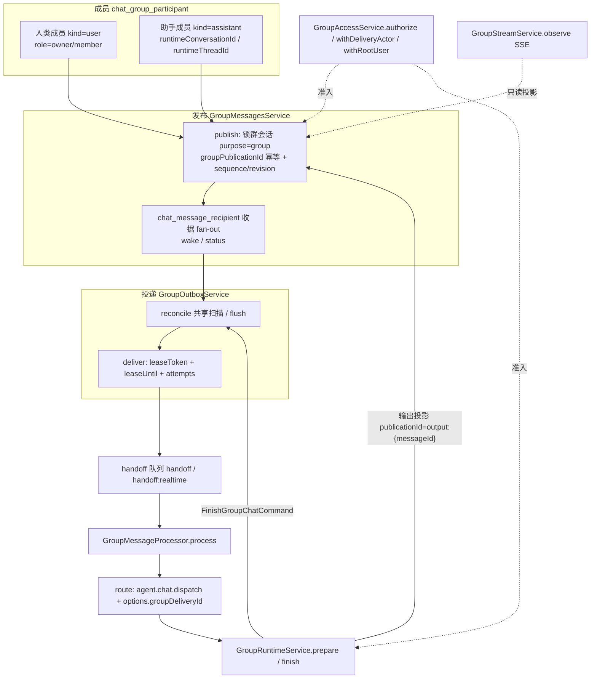

# 群聊协作子专家 · 架构（01-架构）

**本文引用的文件**
- [packages/server-ai/src/chat-group/chat-group.module.ts](file://packages/server-ai/src/chat-group/chat-group.module.ts)
- [packages/server-ai/src/chat-group/group.entities.ts](file://packages/server-ai/src/chat-group/group.entities.ts)
- [packages/server-ai/src/chat-group/group.entity.ts](file://packages/server-ai/src/chat-group/group.entity.ts)
- [packages/server-ai/src/chat-group/group-messages.service.ts](file://packages/server-ai/src/chat-group/group-messages.service.ts)
- [packages/server-ai/src/chat-group/group-outbox.service.ts](file://packages/server-ai/src/chat-group/group-outbox.service.ts)
- [packages/server-ai/src/chat-group/group-access.service.ts](file://packages/server-ai/src/chat-group/group-access.service.ts)
- [packages/server-ai/src/chat-group/group-members.service.ts](file://packages/server-ai/src/chat-group/group-members.service.ts)
- [packages/server-ai/src/chat-group/group-interactions.service.ts](file://packages/server-ai/src/chat-group/group-interactions.service.ts)
- [packages/server-ai/src/chat-group/group-control.service.ts](file://packages/server-ai/src/chat-group/group-control.service.ts)
- [packages/server-ai/src/chat-group/group-runtime.service.ts](file://packages/server-ai/src/chat-group/group-runtime.service.ts)
- [packages/server-ai/src/chat-group/group-stream.service.ts](file://packages/server-ai/src/chat-group/group-stream.service.ts)
- [packages/server-ai/src/chat-group/group-composer.service.ts](file://packages/server-ai/src/chat-group/group-composer.service.ts)
- [packages/server-ai/src/chat-group/group-catalog.service.ts](file://packages/server-ai/src/chat-group/group-catalog.service.ts)
- [packages/server-ai/src/chat-group/group-tools.service.ts](file://packages/server-ai/src/chat-group/group-tools.service.ts)
- [packages/server-ai/src/chat-group/group-runtime-view.service.ts](file://packages/server-ai/src/chat-group/group-runtime-view.service.ts)
- [packages/server-ai/src/chat-group/group-runtime-context.ts](file://packages/server-ai/src/chat-group/group-runtime-context.ts)
- [packages/server-ai/src/chat-group/group-delivery-context.handler.ts](file://packages/server-ai/src/chat-group/group-delivery-context.handler.ts)
- [packages/server-ai/src/chat-group/group-dispatch.commands.ts](file://packages/server-ai/src/chat-group/group-dispatch.commands.ts)
- [packages/server-ai/src/chat-group/group.schema.ts](file://packages/server-ai/src/chat-group/group.schema.ts)
- [packages/server-ai/src/chat-group/group-project/group-task-target.service.ts](file://packages/server-ai/src/chat-group/group-project/group-task-target.service.ts)
- [packages/server-ai/src/ai/groups/index.ts](file://packages/server-ai/src/ai/groups/index.ts)
- [packages/server-ai/src/ai/groups/group.controller.ts](file://packages/server-ai/src/ai/groups/group.controller.ts)
- [packages/server-ai/src/ai/groups/group-scope.guard.ts](file://packages/server-ai/src/ai/groups/group-scope.guard.ts)
- [packages/server-ai/src/ai/groups/group-workbench.guard.ts](file://packages/server-ai/src/ai/groups/group-workbench.guard.ts)
- [packages/server-ai/src/handoff/outbox-adapters.service.ts](file://packages/server-ai/src/handoff/outbox-adapters.service.ts)
- [packages/server-ai/src/handoff/message-queue.service.ts](file://packages/server-ai/src/handoff/message-queue.service.ts)
- [packages/server-ai/src/chat-conversation/conversation.entity.ts](file://packages/server-ai/src/chat-conversation/conversation.entity.ts)
- [packages/server-ai/src/chat-message/chat-message.entity.ts](file://packages/server-ai/src/chat-message/chat-message.entity.ts)

## 目录
1. [子域职责边界](#子域职责边界)
2. [内部分层](#内部分层)
3. [依赖关系](#依赖关系)
4. [关键不变量](#关键不变量)
5. [架构总览](#架构总览)
6. [结论](#结论)

## 子域职责边界
**做什么**：群成员模型与准入（`GroupAccessService`、`GroupMembersService`、`GroupCatalogService`）；公开消息发布与幂等（`GroupMessagesService.publish`）、成员可见投影（`snapshot`）与个人偏好（`preferences`）；投递收据与 outbox（`GroupOutboxService` + `GroupMessageProcessor`）；运行时准入与收尾（`GroupRuntimeService.prepare/finish` 与 `PrepareGroupChatHandler`/`FinishGroupChatHandler`）；HITL 交互登记与领取（`GroupInteractionsService`）；运行控制与撤回（`GroupControlService`）；SSE 观察者流（`GroupStreamService`）；composer 校验（`GroupComposerService`）；群任务目标解析（`GroupTaskTargetService`）。

**不做什么**：不拥有任何 HTTP 适配器（群接口全部注册在 `ai/groups/`，归属「Assistant 定义与运行时专家」）；不拥有 handoff 队列实现与取消语义；不执行模型、不写助手私有运行时线程的业务正文（运行时输出由既有 chat dispatch 落在 `purpose='group_assistant_runtime'` 会话，本域只读并投影）；不拥有会话/消息/线程本身的 CRUD。

**与 `ai/groups/` 适配器的分工**：`chat-group.module.ts` 类注释明写「Owns group policy, delivery and runtime handlers; AIModule hosts only the authenticated HTTP adapters.」适配器侧只做 Zod 边界校验与转发（`GroupsController.send` → `messages.submit` + `outbox.flush`；`stream` → `streams.observe`），并把控制器族聚合为 `GROUP_CONTROLLERS`。守卫 `GroupScopeGuard` 注释明写「共享 ChatKit 鉴权先跑，此守卫只把 conversation grant 收紧到单群路由」；`GroupWorkbenchGuard` 额外把群凭据绑到已发布主 Assistant 的私有运行时。

**与 handoff 投递域的分工**：本域实现 `HandoffOutboxAdapter`（`GroupOutboxService.onModuleInit` 注册、`onModuleDestroy` 反注册），由 handoff 的共享扫描（`HandoffOutboxAdapters.reconcile`）驱动；队列选择、job 归一化、重试与取消都复用 `HandoffQueueService`。收据注释明写「recipient rows are durable delivery receipts, not a second queue」。群消费者的策略注册 `@HandoffProcessorStrategy(GROUP_MESSAGE_TYPE, { policy: { lane: 'main' } })` 也在本域。

章节来源：[chat-group.module.ts](file://packages/server-ai/src/chat-group/chat-group.module.ts)（关键符号：ChatGroupModule / GROUP_ENTITIES）、[group-scope.guard.ts](file://packages/server-ai/src/ai/groups/group-scope.guard.ts)（关键符号：GroupScopeGuard.canActivate）、[group-outbox.service.ts](file://packages/server-ai/src/chat-group/group-outbox.service.ts)（关键符号：GroupOutboxService.onModuleInit / GroupMessageProcessor）

## 内部分层
- **准入层**：`GroupAccessService`（`scope`/`user`/`authorize`/`assistant`/`withDeliveryActor`/`withRootUser`）、`GroupMembersService`（`create`/`add`/`remove` + `publicMember`/`publicMembers`）、`GroupCatalogService`（`list`/`candidates`）。
- **发布层**：`GroupMessagesService`（`send`/`submit`/`publish`/`snapshot`/`preferences` + `publicMessage` 投影）、`group-mentions.groupMentionRecipients`、`group.schema` 的 Zod 判别联合、`GroupToolsService`（助手侧 `send_group_message` 工具）。
- **投递层**：`GroupOutboxService`（`reconcile`/`flush`/`deliver`/`message`/`route`）与 `GroupMessageProcessor`；命令 `PrepareGroupChatCommand`/`FinishGroupChatCommand`/`ResolveGroupDeliveryContextCommand`。
- **运行时层**：`GroupRuntimeService.prepare/finish` + `PrepareGroupChatHandler`/`FinishGroupChatHandler`/`ResolveGroupDeliveryContextHandler`；提示构造 `group-context.groupModelInput`；执行者解析 `group-delivery-actor.groupDeliveryUserId`。
- **交互层**：`GroupInteractionsService`（`register`/`claim`/`respond`）+ `group-interactions.schema`。
- **控制与观察层**：`GroupControlService.act/cancelDelivery`、`GroupStreamService.observe`、`GroupRuntimeViewService.get`、`GetGroupConversationEntryHandler`。
- **组合层**：`GroupComposerService`（`member`/`context`/`validate`/`resourceCatalog`/`capabilities`/`files`）+ `group-composer.schema`。
- **相邻层（群项目任务）**：`group-project/` 的 `GroupProjectService`、`GroupTaskTargetService`、`ExecuteGroupTaskHandler`、`DeliverGroupTaskResultHandler`。

章节来源：[group-messages.service.ts](file://packages/server-ai/src/chat-group/group-messages.service.ts)（关键符号：GroupMessagesService.publish / publicMessage）、[group-runtime.service.ts](file://packages/server-ai/src/chat-group/group-runtime.service.ts)（关键符号：GroupRuntimeService.prepare / finish / PrepareGroupChatHandler）、[group-composer.service.ts](file://packages/server-ai/src/chat-group/group-composer.service.ts)（关键符号：GroupComposerService.member / validate）

## 依赖关系
**出向**：`CqrsModule`（命令处理器）、`TypeOrmModule.forFeature(GROUP_ENTITIES)`、`HandoffQueueModule`（入队）、`SseStreamModule`（`RedisSseStreamService`）、`AgentPluginModule`（`RuntimeResourceService`）、`XpertProjectModule`/`XpertWorkspaceModule`（项目与工作区授权、文件目录）、`forwardRef(() => XpertModule)`（`PublishedXpertAccessService`、`XpertPrincipalService`）、`forwardRef(() => ChatConversationModule)`（`ChatConversation`/`ChatConversationThread`/`ThreadRunControlService`）；并直引 `ChatMessage`、`XpertAgentExecution`、`Xpert`、`User`/`UserOrganization` 实体。

**入向**：`ai/groups/*` 控制器族调用本域服务与命令；handoff 的 outbox 扫描与派发链驱动本域适配器与命令；`chat-conversation` 通过 `GetGroupConversationEntryCommand` 复用群入口投影。

**与 `ai/` 目录的引用方向**：本域源码不 import `ai/**`，反向依赖只存在于适配器侧（`ai/groups/*.ts` import `../../chat-group/*`），因此群业务可跨模块以 CQRS 复用，而 HTTP 只出现一次。

章节来源：[chat-group.module.ts](file://packages/server-ai/src/chat-group/chat-group.module.ts)（关键符号：ChatGroupModule.imports / exports）、[group-task-target.service.ts](file://packages/server-ai/src/chat-group/group-project/group-task-target.service.ts)（关键符号：GroupTaskTargetService.authorizeCaller）、[index.ts](file://packages/server-ai/src/ai/groups/index.ts)（关键符号：GROUP_CONTROLLERS）

## 关键不变量
1. **群会话 `purpose='group'` 行锁**：`publish`、`GroupRuntimeService.prepare`、`GroupControlService`、`Interactions.claim/respond` 的事务内都先对 `ChatConversation`（`id+tenantId+organizationId+purpose='group'`）取 `pessimistic_write`；`lastMessageSequence`/`revision` 只在该锁下自增。
2. **`groupPublicationId` 幂等**：唯一索引 `(conversationId, groupPublicationId)`，键为 `publicationId ?? "{authorId}:{clientMessageId}"`；命中后逐字段比对（内容/发送者/intent/composer/projectTask/runtimeResult/replyTo），不一致即 `groupConflict()`。
3. **收据 fan-out 是可见性投影的账本**：每消息为目标成员各写一行 `chat_message_recipient`（唯一 `(messageId,participantId)`）；`wake=true` 且 `status='pending'` 才允许入队，`snapshot`/`publicMessage` 只输出公开字段（`runtimeParticipantIds`、`deliveries`），不泄露 `executionId`/`threadId`。
4. **成员 `runtimeConversationId` 归属**：一个助手在同一群内只有一个私有运行时会话（`purpose='group_assistant_runtime'`）+ 一条群私有线程；`withDeliveryActor`、`GroupRuntimeViewService.get`、`GroupWorkbenchGuard.resolve` 都以该绑定为校验条件。
5. **HITL claim 唯一性**：`interactionId = "{executionId}:{sha256(requests)}"` 配合唯一 `(groupId, interactionId)`（`orIgnore` 幂等插入）；`claim`/`respond` 都要求 `assignedUserId = 当前人类` 且 `claimId` 一致，第二个标签页被 `groupConflict()` 拒绝。
6. **outbox lease 语义**：`deliver` 用 `leaseToken`+`leaseUntil`(now+60s) + `attempts+1` 的 UPDATE-claim 抢占，`enqueue` 成功只推后 `nextAttemptAt`（+30s），「Enqueue is not receipt acknowledgement」；失败按 `min(300s, 5s*2^n)` 退避，`attempts>=9` 置 `failed`。
7. **执行者身份来自绑定而非文本**：`groupDeliveryUserId(source)` 取人类 creator 或因果根 `rootUserId`；`publish` 的 `author` 参数只能由服务端绑定提供，HTTP 不接受作者字段。
8. **反爆炸阈值**：`hop <= 8`、同一 `rootMessageId` 的群消息数 `< 32`、成员上限 32（`GroupMembersService.add` 的 `count >= 32`）。

章节来源：[group-messages.service.ts](file://packages/server-ai/src/chat-group/group-messages.service.ts)（关键符号：GroupMessagesService.publish / snapshot）、[group-outbox.service.ts](file://packages/server-ai/src/chat-group/group-outbox.service.ts)（关键符号：GroupOutboxService.deliver / route）、[group-interactions.service.ts](file://packages/server-ai/src/chat-group/group-interactions.service.ts)（关键符号：GroupInteractionsService.claim）

## 架构总览

图表来源：[group-messages.service.ts](file://packages/server-ai/src/chat-group/group-messages.service.ts)（关键符号：GroupMessagesService.publish / snapshot）、[group-outbox.service.ts](file://packages/server-ai/src/chat-group/group-outbox.service.ts)（关键符号：GroupOutboxService.reconcile / deliver / route）、[group-runtime.service.ts](file://packages/server-ai/src/chat-group/group-runtime.service.ts)（关键符号：GroupRuntimeService.prepare / finish）、[group-access.service.ts](file://packages/server-ai/src/chat-group/group-access.service.ts)（关键符号：GroupAccessService.authorize）、[group-stream.service.ts](file://packages/server-ai/src/chat-group/group-stream.service.ts)（关键符号：GroupStreamService.observe）

## 结论
群聊协作是一个「**单写者 + 收据账本 + 共享投递**」的子域：所有公开写入都必须穿过 `GroupMessagesService.publish` 的群会话行锁与 `groupPublicationId` 幂等键，所有可见性都由收据（`chat_message_recipient`）派生，所有执行都复用 handoff 队列与 chat dispatch，本域只负责准备（`prepare`）与对账（`finish`）。架构上的三条硬边界值得长期守住：群会话 `purpose='group'` 与助手私有 `purpose='group_assistant_runtime'` 不可混用；运行时身份必须来自持久化绑定（`withDeliveryActor`/`withRootUser`/`groupDeliveryUserId`）；私有载荷（工具、审批、执行 ID）永不进入公开投影。风险点集中在适配器分散在 `ai/groups/`（含对 JWT 直接放行的 `GroupScopeGuard`）、outbox 恢复完全依赖 5s 轮询，以及群表没有 FK 级联（清理靠应用层）。
章节来源：[group-access.service.ts](file://packages/server-ai/src/chat-group/group-access.service.ts)（关键符号：GroupAccessService.withDeliveryActor / withRootUser）、[group-members.service.ts](file://packages/server-ai/src/chat-group/group-members.service.ts)（关键符号：GroupMembersService.create / remove）、[group-workbench.guard.ts](file://packages/server-ai/src/ai/groups/group-workbench.guard.ts)（关键符号：GroupWorkbenchGuard.resolve）
