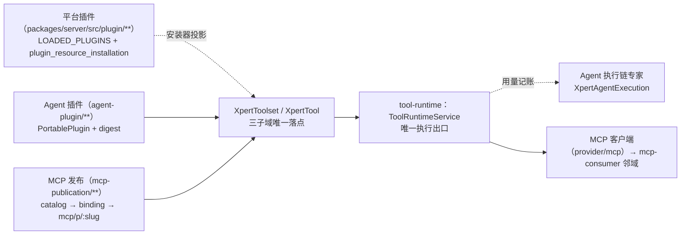

# 工具与 MCP 专家 —— C0 使用总览

> **资产基线**：`2026-10-16 · commit 80f5676fd`（批次 5 第 10 专家）。实测范围：`packages/server-ai/src/xpert-toolset`（104 非 spec / 17 spec）、`xpert-tool`（13 / 2）、`mcp`（14 / 0，**无表**）、`mcp-publication`（43 / 24）、`agent-plugin`（50 / 30）＝ **224 非 spec + 73 spec + 14 张自有表**；HTTP 前缀 `/api/xpert-toolset`、`/api/xpert-tool`、`mcp/sse` + `mcp/messages`、`/api/mcp/...`、`/api/agent-plugins`。

**本文引用的文件**（相对仓库根，链接均为 `file://`）

- [packages/server-ai/src/xpert-toolset/xpert-toolset.controller.ts](file://packages/server-ai/src/xpert-toolset/xpert-toolset.controller.ts)
- [packages/server-ai/src/xpert-toolset/xpert-toolset.service.ts](file://packages/server-ai/src/xpert-toolset/xpert-toolset.service.ts)
- [packages/server-ai/src/xpert-toolset/xpert-toolset.module.ts](file://packages/server-ai/src/xpert-toolset/xpert-toolset.module.ts)
- [packages/server-ai/src/xpert-toolset/xpert-toolset.entity.ts](file://packages/server-ai/src/xpert-toolset/xpert-toolset.entity.ts)
- [packages/server-ai/src/xpert-toolset/guards/toolset.guard.ts](file://packages/server-ai/src/xpert-toolset/guards/toolset.guard.ts)
- [packages/server-ai/src/xpert-toolset/mcp-runtime.controller.ts](file://packages/server-ai/src/xpert-toolset/mcp-runtime.controller.ts)
- [packages/server-ai/src/xpert-toolset/mcp-runtime-audit.service.ts](file://packages/server-ai/src/xpert-toolset/mcp-runtime-audit.service.ts)
- [packages/server-ai/src/xpert-toolset/mcp-runtime-instance.entity.ts](file://packages/server-ai/src/xpert-toolset/mcp-runtime-instance.entity.ts)
- [packages/server-ai/src/xpert-toolset/provider/builtin/index.ts](file://packages/server-ai/src/xpert-toolset/provider/builtin/index.ts)
- [packages/server-ai/src/xpert-toolset/provider/mcp/types.ts](file://packages/server-ai/src/xpert-toolset/provider/mcp/types.ts)
- [packages/server-ai/src/xpert-toolset/provider/mcp/mcp-toolset.ts](file://packages/server-ai/src/xpert-toolset/provider/mcp/mcp-toolset.ts)
- [packages/server-ai/src/xpert-toolset/provider/mcp/mcp-stdio-runtime.ts](file://packages/server-ai/src/xpert-toolset/provider/mcp/mcp-stdio-runtime.ts)
- [packages/server-ai/src/xpert-tool/xpert-tool.controller.ts](file://packages/server-ai/src/xpert-tool/xpert-tool.controller.ts)
- [packages/server-ai/src/xpert-tool/xpert-tool.service.ts](file://packages/server-ai/src/xpert-tool/xpert-tool.service.ts)
- [packages/server-ai/src/xpert-tool/commands/handlers/tool-invoke.handler.ts](file://packages/server-ai/src/xpert-tool/commands/handlers/tool-invoke.handler.ts)
- [packages/server-ai/src/tool-runtime/tool-runtime.service.ts](file://packages/server-ai/src/tool-runtime/tool-runtime.service.ts)
- [packages/server-ai/src/tool-runtime/capability-descriptor.ts](file://packages/server-ai/src/tool-runtime/capability-descriptor.ts)
- [packages/server-ai/src/mcp/mcp.module.ts](file://packages/server-ai/src/mcp/mcp.module.ts)
- [packages/server-ai/src/mcp/mcp.service.ts](file://packages/server-ai/src/mcp/mcp.service.ts)
- [packages/server-ai/src/mcp-publication/mcp-publication-management.controller.ts](file://packages/server-ai/src/mcp-publication/mcp-publication-management.controller.ts)
- [packages/server-ai/src/mcp-publication/mcp-publication.controller.ts](file://packages/server-ai/src/mcp-publication/mcp-publication.controller.ts)
- [packages/server-ai/src/mcp-publication/mcp-publication-runtime.service.ts](file://packages/server-ai/src/mcp-publication/mcp-publication-runtime.service.ts)
- [packages/server-ai/src/mcp-publication/mcp-capability-catalog.service.ts](file://packages/server-ai/src/mcp-publication/mcp-capability-catalog.service.ts)
- [packages/server-ai/src/mcp-publication/mcp-api-key.service.ts](file://packages/server-ai/src/mcp-publication/mcp-api-key.service.ts)
- [packages/server-ai/src/mcp-publication/mcp-task.service.ts](file://packages/server-ai/src/mcp-publication/mcp-task.service.ts)
- [packages/server-ai/src/agent-plugin/agent-plugin.controller.ts](file://packages/server-ai/src/agent-plugin/agent-plugin.controller.ts)
- [packages/server-ai/src/agent-plugin/agent-plugin.service.ts](file://packages/server-ai/src/agent-plugin/agent-plugin.service.ts)
- [packages/server-ai/src/agent-plugin/agent-plugin-parser.ts](file://packages/server-ai/src/agent-plugin/agent-plugin-parser.ts)
- [packages/server-ai/src/agent-plugin/runtime-resource.service.ts](file://packages/server-ai/src/agent-plugin/runtime-resource.service.ts)
- [packages/server-ai/src/plugin-resource/plugin-resource-installer.service.ts](file://packages/server-ai/src/plugin-resource/plugin-resource-installer.service.ts)

## 目录

1. [专家定位](#专家定位)
2. [何时找这个专家](#何时找这个专家)
3. [契约自足声明](#契约自足声明)
4. [能力清单表](#能力清单表)
5. [边界](#边界)
6. [已知问题与常见坑](#已知问题与常见坑)
7. [延伸阅读](#延伸阅读)

## 专家定位

本专家负责 **Agent 的能力供给面**：一条从「工具集 → 工具执行 → 能力对外发布 / 插件装配」的单向管道。
**上游（声明与配置）**：`XpertToolset`/`XpertTool` 两表承载工具集实例与单条工具，四个 provider 实现（`provider/builtin`、`OpenAPIToolset`、`ODataToolset`、`MCPToolset`）负责工具发现与 schema 生成；`xpert-toolset`/`xpert-tool` 两个模块提供 HTTP 与 CQRS 面。
**中游（执行）**：`ToolRuntimeService` 是**唯一执行出口**（`loadToolsets`/`executeTool`/`describeCapabilities` 与 MCP 能力四件套），助手、Agent 运行时、API 预览、MCP 发布与长任务全部经它。
**下游（对外与装配）**：`mcp-publication` 把工具集能力反向投影为对外 MCP Server（`/api/mcp/p/:slug` + API Key/OAuth + 调用审计 + 长任务）；`agent-plugin` 把便携包（`PortablePlugin`）投影为工具集/技能/连接器；`mcp` 模块是通用 MCP 服务端 SDK 封装。
**一句话口径**：执行只经 `ToolRuntimeService`，环境、存储策略与发布配置一律由宿主提供，**绝不来自工具参数**（源码注释逐字：`Validated Publication configuration supplied by the host, never tool arguments.`）。

章节来源：[tool-runtime.service.ts](file://packages/server-ai/src/tool-runtime/tool-runtime.service.ts)（关键符号：ToolRuntimeService.executeTool / ToolRuntimeEnvironment）、[xpert-toolset.service.ts](file://packages/server-ai/src/xpert-toolset/xpert-toolset.service.ts)（关键符号：XpertToolsetService.createBuiltinToolset）、[mcp-publication-runtime.service.ts](file://packages/server-ai/src/mcp-publication/mcp-publication-runtime.service.ts)（关键符号：McpPublicationRuntimeService.handle）

## 何时找这个专家

- 要改**工具集/工具本体**：`XpertToolset` 的 `category`/`type`/`options`/`schema`、`XpertTool` 的 `enabled`/`disabled` 双列、工具集与标签的 M2M（`tag_xpert_toolset`）。
- 要改 **provider 与 schema 生成**：`BUILTIN_TOOLSET_REPOSITORY` 静态注册表与未命中回落 `CreateToolsetCommand`、OpenAPI/OData 的远端拉取与解析、MCP 的 `POST provider/mcp/tools` 探测。
- 要改**工具执行链**：`ToolInvokeHandler` 的快照构造与作用域断言、`ToolRuntimeService.executeTool` 的三分支寻址、`GET /xpert-tool/:id/faker` 的参数样例生成。
- 要**调试 MCP 客户端与 stdio 运行时**：`createMCPClient` 的 http/sse/stdio 分流、`mcpStdioRuntimeManager` 的策略钳制、`mcp_runtime_instance` 审计字段与 `operations/mcp-runtimes` 停机阀。
- 要做 **MCP 发布与 Key/OAuth**：发布单草稿 → 能力快照 → 审核 → `apiMethods`，Key 的签发/轮换/吊销，OAuth policy 与 `.well-known` 元数据。
- 要排查**调用审计与长任务**：`mcp_invocation_audit` 一次调用一条、`mcp_task` 的 `idempotencyKey`+`inputHash` 重放、队列 `mcp-publication/execute-tool` 堆积。
- 要**装/改 Agent 插件**：`POST agent-plugins/git|zip` 导入、digest 幂等、绑定（`agent_plugin`/`middleware`/`external_xpert`）、模板引用保留与 `cleanup` 回收。
- 要**查工具相关接口**：`/api/xpert-toolset`（18+7+3 条）、`/api/xpert-tool`（3 条）、`/api/mcp/...`、`/api/agent-plugins`（12+4+6 条）的路由、守卫与错误码。
- 要排查**凭据与脱敏**：`credentials` 的 `@Exclude({toPlainOnly:true})`、`keyHash`/`encryptedSecret` 的 `select:false`、唯一凭据出口 `GET :id/credentials` 与 `ToolsetGuard`。
- 要区分**平台插件与 Agent 插件**：两者共用 `PluginResourceInstallerService` 落库，靠 `options.pluginManaged` 与 `options.runtimeSource` 标记来源。
- 要改**运行时资源注入**：`RuntimeResourceService.resolve` 产出的 `{selection, skillIds, toolsetIds}`，以及 Agent 侧 `dynamicResources?.toolsetIds` 的补装点。
- 要改**环境变量与门禁**：`XPERT_MCP_STDIO_*`、`SECRETS_ENCRYPTION_KEY`、`environment.mcpOAuthEnabled`（本仓库两套 environment 均硬编码 `false`）。

章节来源：[xpert-toolset.controller.ts](file://packages/server-ai/src/xpert-toolset/xpert-toolset.controller.ts)（关键符号：createBuiltinInstance / getMCPTools / getCredentials）、[agent-plugin.service.ts](file://packages/server-ai/src/agent-plugin/agent-plugin.service.ts)（关键符号：importGit / importZip / importStagedDirectory）、[plugin-resource-installer.service.ts](file://packages/server-ai/src/plugin-resource/plugin-resource-installer.service.ts)（关键符号：ensureMcpToolset）

## 契约自足声明

本专家的 `C0`（使用总览）+ `C1`（能力契约）构成该子域**完整契约面**：HTTP 入口索引、服务方法签名与参数行为语义、返回与异常、MCP 协议会话与运行时审计字段、代码示例均在本层可查，无需阅读实现层即可完成集成与排障；实现细节（算法、私有方法、表结构逐列）只在需要定位时按 `file://` 链接回源码。**逐端点明细**（完整字段、分页、错误码全集、控制器逐条清单）见 [implementation/05-接口.md](file://.module-experts/后端专题/工具与 MCP 专家/implementation/05-接口.md)，本文不复制。凡未标 `[推测]` 的结论均取自源码或本域实现层文档。

| 项 | 值 |
|---|---|
| 基线时点 / commit | `2026-10-16` · `80f5676fd`（批次 5 第 10 专家） |
| 规模实测 | 224 非 spec 文件（104 + 13 + 14 + 43 + 50）、73 spec（17 + 2 + 0 + 24 + 30）、**13 张自有表**（工具集与工具 3 张含 1 张 M2M、MCP 发布 8 张、Agent 插件 2 张） |
| 子域 | ① 工具集与工具 ② MCP 协议与发布 ③ Agent 插件 |
| 路由前缀 | `/api/xpert-toolset`、`/api/xpert-tool`、`/api/mcp/sse` + `/api/mcp/messages`、`/api/mcp-publications`、`/api/mcp/p/:slug`、`/api/agent-plugins`、`/api/assistants/:id/resources*` |
| 契约入口 | 本文件 + [C1-能力契约.md](file://.module-experts/后端专题/工具与 MCP 专家/C1-能力契约.md) |
| 实现层 | [01-架构](file://.module-experts/后端专题/工具与 MCP 专家/implementation/01-架构.md) · [02-实现](file://.module-experts/后端专题/工具与 MCP 专家/implementation/02-实现.md) · [03-数据流转](file://.module-experts/后端专题/工具与 MCP 专家/implementation/03-数据流转.md) · [04-模型](file://.module-experts/后端专题/工具与 MCP 专家/implementation/04-模型.md) · [05-接口](file://.module-experts/后端专题/工具与 MCP 专家/implementation/05-接口.md) · [06-测试](file://.module-experts/后端专题/工具与 MCP 专家/implementation/06-测试.md) · [07-运维](file://.module-experts/后端专题/工具与 MCP 专家/implementation/07-运维.md) |

章节来源：[xpert-toolset.module.ts](file://packages/server-ai/src/xpert-toolset/xpert-toolset.module.ts)（关键符号：XpertToolsetModule / RouterModule.register）、[mcp.module.ts](file://packages/server-ai/src/mcp/mcp.module.ts)（关键符号：MCPModule.register）、[xpert-toolset.entity.ts](file://packages/server-ai/src/xpert-toolset/xpert-toolset.entity.ts)（关键符号：XpertToolset.credentials）

## 能力清单表

| 能力 | 入口 | 一句话 |
|---|---|---|
| 工具集 CRUD 与工作区视图 | `GET/POST/PUT/PATCH/DELETE /api/xpert-toolset`、`by-workspace/:workspaceId`、`tags` | 所有出网点先 `afterLoad` 回填内置 tag 与工具 schema，再包 `ToolsetPublicDTO` |
| 内置 provider 目录与实例化 | `GET providers`、`provider/:name`、`POST builtin-provider/:name/instance` | 先 `validateCredentials` 再 `category=BUILTIN`/`type=provider` 落库 |
| OpenAPI / OData 远端与解析 | `POST provider/openapi/{remote,schema,test}`、`POST provider/odata/{remote,schema}` | 远端拉取走 Query，解析走 `ParserOpenAPISchemaCommand`/`ParserODataSchemaCommand` |
| MCP 工具探测 | `POST provider/mcp/tools`（**`@Sse`**） | 流式返回 `{tools, logs}`，`keepAlive(30000)` + `takeUntilClose(res)` |
| 凭据读写边界 | `GET :id/credentials`（`ToolsetGuard`）、实体 `@Exclude` | 唯一凭据出口；加密步骤仍被注释，落库为明文 |
| 工具详情 / 试跑 / 参数样例 | `GET /api/xpert-tool/:id`、`POST /test`、`GET /:id/faker` | 试跑经 `ToolInvokeCommand` 落到统一执行面，非并行实现 |
| 统一执行面 | `ToolRuntimeService.loadToolsets/executeTool` | 唯一出口；`toolsetSnapshots` 仅 `source='api'` 允许 |
| 能力面（资源/提示/补全） | `describeCapabilities`、`executeMcpCapability/executeMcpResource/executeMcpPrompt/completeMcpCapability` | `MCPToolset` 直连，其它 provider 走 `getMcpCapabilityDefinitions()` |
| MCP 客户端 | `xpert-toolset/provider/mcp/**` | `MultiServerMCPClient` + `McpConsumer` 包装；`filterMcpTools` 过滤 |
| MCP stdio 运行时与审计 | `mcpStdioRuntimeManager`、`mcp_runtime_instance`、`operations/mcp-runtimes` | 策略钳制 + 生命周期审计 + SUPER_ADMIN 停机阀 |
| MCP 服务端封装 | `mcp/sse`、`mcp/messages` | 通用 SDK 封装，**不落库**，且全仓无装配点 |
| MCP 发布管理 | `/api/mcp-publications`、`/api/mcp-api-keys`、`/api/mcp-capability-catalog` | 22 条端点全部 `SUPER_ADMIN`，DTO 白名单拒多余字段 |
| 能力台账与绑定 | `mcp_capability_catalog`、`mcp_publication_capability` | 台账整体 replace，绑定带 `descriptorHash` + `descriptorSnapshot` |
| 发布运行时 | `ALL /api/mcp/p/:slug`、`/files`、`.well-known/oauth-protected-resource` | streamable-http；认证/授权/限流/审计逐请求执行 |
| API Key 与 OAuth | `mcp_api_key`、`mcp_oauth_policy` | 前缀 `xpert_mcp_`，`secret` 只回一次；OAuth 属 Pro 门禁 |
| 调用审计与长任务 | `mcp_invocation_audit`、`mcp_task`、队列 `mcp-publication/execute-tool` | `requestId` 唯一一次一条；任务双唯一键 + `inputHash` |
| Agent 插件目录/导入/绑定/维护 | `/api/agent-plugins/**`（12 + 4） | git/zip 导入、digest 幂等、绑定三态、更新与清理 |
| 运行时资源 | `assistants/:id/resources*`、`conversations/:id/runtime-resources` | `@Public` + `ApiKeyOrClientSecretAuthGuard`，机器对机器接口 |

章节来源：[xpert-toolset.controller.ts](file://packages/server-ai/src/xpert-toolset/xpert-toolset.controller.ts)（关键符号：getMCPTools / createBuiltinInstance / getCredentials）、[mcp-publication-management.controller.ts](file://packages/server-ai/src/mcp-publication/mcp-publication-management.controller.ts)（关键符号：McpPublicationManagementController）、[agent-plugin.controller.ts](file://packages/server-ai/src/agent-plugin/agent-plugin.controller.ts)（关键符号：importGit / importZip / bind）

## 边界

**做什么**：工具集与工具全生命周期、四个 provider 的发现与 schema、统一执行面、MCP 客户端与 stdio 运行时、MCP 服务端 SDK 封装、MCP 发布全链（草稿/能力/审核/凭据/审计/长任务）、Agent 插件的发现与装配。

**不做什么（5~7 条边界）**

1. **三类「插件」必须分清**：① **平台插件**（`packages/server/src/plugin/**`、`plugin_resource_installation`，`LOADED_PLUGINS` 驱动的已加载 bundle）→ 归**平台插件与技能专家**；② **Agent 插件**（`agent-plugin/**`，便携包 `PortablePlugin`）→ **本域**；③ **MCP 发布**（`mcp-publication/**`，8 表）→ **本域**。三者共用 `XpertToolset`/`XpertTool` 作为落点，但准入、来源与生命周期互不相同。
2. **Agent 执行的记账不属本域**：`ToolRuntimeService` 只经 `XpertAgentExecutionRecordUsageCommand` 把用量写进 Agent 执行账本（且仅当有 `executionId`），执行行的状态机与租约归 **Agent 执行链专家**。
3. **平台级插件安装不属本域**：`PluginResourceInstallerService` 的写入虽在本域可见，但组件来源（bundle 清单、安装台账状态机）归**平台插件与技能专家**；本域只做「落库投影」与反向读。
4. **助手挂载关系不属本域**：`xpert_to_toolset` 的 M2M 写入入口由助手域维护，本域只提供读模型（`XpertToolsetService.getAllByWorkspace` + `afterLoad` 生成的 `ToolsetCatalogItem`）。
5. **技能包内容不属本域**：`skill_package` 归技能专家；本域只在 Agent 插件投影时经安装器写一行（迁移新增 `runtimeResourceOnly` 标记）。
6. **`mcp-consumer` / `mcp-app-runtime` 属邻域**：本域仅经 `XpertToolsetModule` 注册其控制器与实体（`McpConsumerOAuthController`/`McpConsumerCapabilitiesController`、`McpAppAudit`/`McpAppHistory` 等），协议实现与 App 实例生命周期归各自专家。
7. **租户/组织/工作区权限模型不属本域**：本域只消费 `RequestContext`、`ToolsetGuard`、`WorkspaceAuthoringGuard`；角色与组织成员判定归对应专家。

图表来源：[plugin-resource-installer.service.ts](file://packages/server-ai/src/plugin-resource/plugin-resource-installer.service.ts)（关键符号：PluginResourceInstallerService.buildPluginManagedMcpToolsetEntity）、[agent-plugin.service.ts](file://packages/server-ai/src/agent-plugin/agent-plugin.service.ts)（关键符号：PortablePlugin / digest）、[tool-runtime.service.ts](file://packages/server-ai/src/tool-runtime/tool-runtime.service.ts)（关键符号：ToolRuntimeService.executeTool）

章节来源：[xpert-toolset.module.ts](file://packages/server-ai/src/xpert-toolset/xpert-toolset.module.ts)（关键符号：controllers / TypeOrmModule.forFeature）、[plugin-resource-installer.service.ts](file://packages/server-ai/src/plugin-resource/plugin-resource-installer.service.ts)（关键符号：installRuntimeComponent）、[mcp-publication-runtime.service.ts](file://packages/server-ai/src/mcp-publication/mcp-publication-runtime.service.ts)（关键符号：McpPublicationRuntimeService.createServer）

## 已知问题与常见坑

1. **`ToolsetGuard` 是 5 分钟用户级缓存**：`cacheKey = userToolset_${tenantId}_${user.id}_${toolsetId}`，命中即直接返回；**只缓存允许结果**（拒绝路径每次穿透），且全仓**没有任何主动清除调用点**——撤权后有最长 5 分钟窗口。
   - 契约来源：[toolset.guard.ts](file://packages/server-ai/src/xpert-toolset/guards/toolset.guard.ts)（关键符号：ToolsetGuard.canActivate）。
2. **`select:false` + `@Exclude` 常被误判为「数据缺失」**：`McpApiKey.keyHash`/`encryptedSecret` 默认查询根本不取列，读取密文必须显式 `.addSelect(...)`；序列化层再去掉一次。发现字段为空先确认是脱敏而非缺数据。
   - 契约来源：[mcp-api-key.entity.ts](file://packages/server-ai/src/mcp-publication/entities/mcp-api-key.entity.ts)、[mcp-api-key.service.ts](file://packages/server-ai/src/mcp-publication/mcp-api-key.service.ts)。
3. **`McpRuntimeController` 的 `SUPER_ADMIN` 是手写断言不是守卫**：三个端点各自先 `assertSuperAdmin()`（`RequestContext.hasRole`），失败文案固定；因此不存在可复用的 `@Roles` 元数据，别按 `RoleGuard` 方式排查。
   - 契约来源：[mcp-runtime.controller.ts](file://packages/server-ai/src/xpert-toolset/mcp-runtime.controller.ts)（关键符号：assertSuperAdmin / stop / kill）。
4. **能力幂等键 + `descriptorHash`**：`mcp_publication_capability` 唯一 `(publicationId, toolsetId, capabilityType, capabilityKey)` 与唯一 `(publicationId, publicName)`；descriptor 改了哈希即变，但**只有 breaking 变更才置 `reviewStatus='required'`**（`compareMcpCapabilityDescriptors` 分类），别把一切哈希变化当破坏性变更。
   - 契约来源：[mcp-publication-capability.entity.ts](file://packages/server-ai/src/mcp-publication/entities/mcp-publication-capability.entity.ts)、[capability-descriptor.ts](file://packages/server-ai/src/tool-runtime/capability-descriptor.ts)。
5. **`mcp_task` 双唯一键 + `inputHash`**：唯一 `taskId` 与唯一 `(publicationId, idempotencyKey)`；同键同指纹幂等返回原任务，同键异指纹按协议错误拒绝（`assertIdempotentReplay`）；`revision` 只是普通 int 列，**不是乐观锁**。
   - 契约来源：[mcp-task.entity.ts](file://packages/server-ai/src/mcp-publication/entities/mcp-task.entity.ts)、[mcp-task.service.ts](file://packages/server-ai/src/mcp-publication/mcp-task.service.ts)。
6. **Agent 插件同 digest 重装幂等靠应用层，DB 不兜底**：`(tenantId, organizationId, digest)` 上的索引**不是 UNIQUE**，去重由 `findOne + packageIntact` 在事务 + `lockPackageScope` 内完成；并发导入理论上有重复包窗口 `[推测]`。
   - 契约来源：[agent-plugin.service.ts](file://packages/server-ai/src/agent-plugin/agent-plugin.service.ts)（关键符号：importStagedDirectory / portablePackageDigest）。
7. **`mcp` 模块不持久化**：目录内 0 个 `@Entity`，状态只在 `NestSSEAdapter.activeTransports` 内存 Map 与可选 stdio transport 里——**没有表可查**，会话问题只能看进程内存。
   - 契约来源：[mcp.service.ts](file://packages/server-ai/src/mcp/mcp.service.ts)（关键符号：MCPService.onModuleInit / scanAndRegisterProviders）。
8. **邻域控制器被本模块注册**：`mcp-consumer` 的 OAuth/Capabilities 控制器挂在 `xpert-toolset.module.ts` 的 `controllers` 里（实际路径 `/api/xpert-toolset/mcp-consumer/oauth`），所以「改工具集模块」会牵动消费侧路由。
   - 契约来源：[xpert-toolset.module.ts](file://packages/server-ai/src/xpert-toolset/xpert-toolset.module.ts)（关键符号：McpConsumerOAuthController / McpConsumerCapabilitiesController）。
9. **`POST provider/mcp/tools` 是流式**：`@Sse` + `text/event-stream`，结果以 `MessageEvent{type:MESSAGE}` 下发、中间事件 `type:EVENT`，失败走流内 error 事件——**不会**变成 4xx/5xx JSON 响应体，客户端必须处理事件与断流。
   - 契约来源：[xpert-toolset.controller.ts](file://packages/server-ai/src/xpert-toolset/xpert-toolset.controller.ts)（关键符号：getMCPTools / keepAlive / takeUntilClose）。
10. **4 个模块无 migrations**：仅 `agent-plugin` 有 3 份 SQL，`xpert-toolset`/`xpert-tool`/`mcp`/`mcp-publication` 均无 DDL 文件，表结构只能靠宿主同步策略或平台统一迁移线；宿主关闭 `synchronize` 时这批表不会自动出现。
    - 契约来源：[20260921-agent-plugins.sql](file://packages/server-ai/src/agent-plugin/migrations/20260921-agent-plugins.sql)、[mcp-runtime-instance.entity.ts](file://packages/server-ai/src/xpert-toolset/mcp-runtime-instance.entity.ts)。
11. **无 `@VersionColumn`，软删只覆盖工具集**：五个模块目录内 `@VersionColumn` 0 命中；`@DeleteDateColumn` 只来自 `WorkspaceBaseEntity.deletedAt`，因此**仅 `xpert_toolset` 可软删**（`xpert_tool`、MCP 发布八表、Agent 插件两表都无软删）。
    - 契约来源：[xpert-toolset.entity.ts](file://packages/server-ai/src/xpert-toolset/xpert-toolset.entity.ts)、[xpert-tool.controller.ts](file://packages/server-ai/src/xpert-tool/xpert-tool.controller.ts)。
12. **`@Public` 在本域工具集面只用于 avatar/icon**：`GET :id/avatar` 与 `GET builtin-provider/:name/icon`；其余 `@Public` 集中在协议/运行面（`mcp/p/*`、`.well-known/*`、`assistants/:id/resources*`、`BaseMCPController`）——`@Public` 只跳过全局 JWT，不等于放行。
    - 契约来源：[xpert-toolset.controller.ts](file://packages/server-ai/src/xpert-toolset/xpert-toolset.controller.ts)、[mcp-publication.controller.ts](file://packages/server-ai/src/mcp-publication/mcp-publication.controller.ts)。
13. **`credentials` 明文落库**：`createBuiltinToolset` 内 `// encrypt credentials` 与加密调用两行被注释，落库即明文 json；当前防线只保护**回显**（`@Exclude` + `ToolsetGuard`），不保护**存储**。
    - 契约来源：[xpert-toolset.service.ts](file://packages/server-ai/src/xpert-toolset/xpert-toolset.service.ts)（关键符号：createBuiltinToolset）。
14. **`MCPModule` 声明 `global: true` 却全仓无装配点**：检索 `MCPModule` 仅命中 `mcp.module.ts` 自身，`mcp/sse`、`mcp/messages` 在当前组装方式下不会挂载（若宿主改 `register(...)`，路径为 `/api/mcp/sse`、`/api/mcp/messages`）。
    - 契约来源：[mcp.module.ts](file://packages/server-ai/src/mcp/mcp.module.ts)（关键符号：MCPModule.register / registerAsync）。
15. **MCP OAuth 属 Pro**：三个 OAuth 端点与 `.well-known` 元数据都先 `assertMcpOAuthEnabled()`，且仓库两套 `environment` 均把 `mcpOAuthEnabled` 固定为 `false` → 一律 403（`Error.McpOAuthProOnly`）。
    - 契约来源：[mcp-oauth-feature.ts](file://packages/server-ai/src/mcp-publication/mcp-oauth-feature.ts)（关键符号：assertMcpOAuthEnabled）。
16. **工具失败按错误名识别**：`ToolInvokeHandler` 用 `error.name === 'ToolException'` 判定并转 `ToolInvokeError`（注释逐字：「The MCP adapter identifies tool failures by name but does not export its error class.」），上游改类名即静默降级为非 400。
    - 契约来源：[tool-invoke.handler.ts](file://packages/server-ai/src/xpert-tool/commands/handlers/tool-invoke.handler.ts)（关键符号：ToolInvokeHandler.execute）。

章节来源：[toolset.guard.ts](file://packages/server-ai/src/xpert-toolset/guards/toolset.guard.ts)（关键符号：canActivate / cacheManager.set）、[mcp-task.service.ts](file://packages/server-ai/src/mcp-publication/mcp-task.service.ts)（关键符号：assertIdempotentReplay）、[mcp-stdio-runtime.ts](file://packages/server-ai/src/xpert-toolset/provider/mcp/mcp-stdio-runtime.ts)（关键符号：McpRuntimeStatus / closeRuntime）

## 延伸阅读

- 域内端点全集、鉴权矩阵与错误语义（13 节）：[implementation/05-接口.md](file://.module-experts/后端专题/工具与 MCP 专家/implementation/05-接口.md)
- 端到端数据流（工具集发现、执行、API 测试、MCP 客户端/服务端、发布链、Agent 插件链、平台安装器八链）：[implementation/03-数据流转.md](file://.module-experts/后端专题/工具与 MCP 专家/implementation/03-数据流转.md)
- 装配与跨子域共享文件（`XpertToolsetModule` 单点重装配、`MCPModule` 未接线）：[implementation/01-架构.md](file://.module-experts/后端专题/工具与 MCP 专家/implementation/01-架构.md)
- 13 张自有表 + 6 张邻域表的列、唯一索引与脱敏边界：[implementation/04-模型.md](file://.module-experts/后端专题/工具与 MCP 专家/implementation/04-模型.md)
- 运维口径（stdio 环境变量、3 份 SQL、密钥轮换、发布排障顺序）：[implementation/07-运维.md](file://.module-experts/后端专题/工具与 MCP 专家/implementation/07-运维.md)
- 测试与缺口（`mcp` 模块 0 spec、守卫无 spec、进程级覆盖缺失）：[implementation/06-测试.md](file://.module-experts/后端专题/工具与 MCP 专家/implementation/06-测试.md)

章节来源：[xpert-toolset.service.ts](file://packages/server-ai/src/xpert-toolset/xpert-toolset.service.ts)（关键符号：XpertToolsetService）、[runtime-resource.service.ts](file://packages/server-ai/src/agent-plugin/runtime-resource.service.ts)（关键符号：RuntimeResourceService.resolve）、[mcp-capability-catalog.service.ts](file://packages/server-ai/src/mcp-publication/mcp-capability-catalog.service.ts)（关键符号：discoverAndReplaceMcpToolset）
