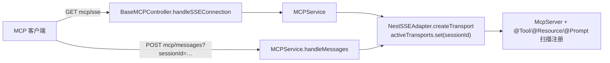

# 工具与 MCP 专家 —— C1 能力契约

> 契约层 CR2 / CR5 / CR7。只写「对外可依赖的语义」：入口、参数行为、返回、异常与约束；路径均为仓库根相对 `file://` 引用。
> **资产基线**：`2026-10-16 · commit 80f5676fd`（批次 5 第 10 专家）。**逐端点明细**（完整字段、分页、错误码全集）见 [implementation/05-接口.md](file://.module-experts/后端专题/工具与 MCP 专家/implementation/05-接口.md)，本文不复制。

**本文引用的文件**（相对仓库根，链接均为 `file://`）

- [packages/server-ai/src/xpert-toolset/xpert-toolset.controller.ts](file://packages/server-ai/src/xpert-toolset/xpert-toolset.controller.ts)
- [packages/server-ai/src/xpert-toolset/xpert-toolset.service.ts](file://packages/server-ai/src/xpert-toolset/xpert-toolset.service.ts)
- [packages/server-ai/src/xpert-toolset/guards/toolset.guard.ts](file://packages/server-ai/src/xpert-toolset/guards/toolset.guard.ts)
- [packages/server-ai/src/xpert-toolset/mcp-apps.controller.ts](file://packages/server-ai/src/xpert-toolset/mcp-apps.controller.ts)
- [packages/server-ai/src/xpert-toolset/mcp-runtime.controller.ts](file://packages/server-ai/src/xpert-toolset/mcp-runtime.controller.ts)
- [packages/server-ai/src/xpert-toolset/mcp-runtime-audit.service.ts](file://packages/server-ai/src/xpert-toolset/mcp-runtime-audit.service.ts)
- [packages/server-ai/src/xpert-toolset/provider/builtin/index.ts](file://packages/server-ai/src/xpert-toolset/provider/builtin/index.ts)
- [packages/server-ai/src/xpert-toolset/provider/openapi/openapi-toolset.ts](file://packages/server-ai/src/xpert-toolset/provider/openapi/openapi-toolset.ts)
- [packages/server-ai/src/xpert-toolset/provider/mcp/types.ts](file://packages/server-ai/src/xpert-toolset/provider/mcp/types.ts)
- [packages/server-ai/src/xpert-toolset/provider/mcp/pro.ts](file://packages/server-ai/src/xpert-toolset/provider/mcp/pro.ts)
- [packages/server-ai/src/xpert-toolset/provider/mcp/mcp-toolset.ts](file://packages/server-ai/src/xpert-toolset/provider/mcp/mcp-toolset.ts)
- [packages/server-ai/src/xpert-toolset/provider/mcp/mcp-stdio-runtime.ts](file://packages/server-ai/src/xpert-toolset/provider/mcp/mcp-stdio-runtime.ts)
- [packages/server-ai/src/xpert-tool/xpert-tool.controller.ts](file://packages/server-ai/src/xpert-tool/xpert-tool.controller.ts)
- [packages/server-ai/src/xpert-tool/xpert-tool.service.ts](file://packages/server-ai/src/xpert-tool/xpert-tool.service.ts)
- [packages/server-ai/src/xpert-tool/commands/handlers/tool-invoke.handler.ts](file://packages/server-ai/src/xpert-tool/commands/handlers/tool-invoke.handler.ts)
- [packages/server-ai/src/tool-runtime/tool-runtime.service.ts](file://packages/server-ai/src/tool-runtime/tool-runtime.service.ts)
- [packages/server-ai/src/tool-runtime/capability-descriptor.ts](file://packages/server-ai/src/tool-runtime/capability-descriptor.ts)
- [packages/server-ai/src/mcp/mcp.module.ts](file://packages/server-ai/src/mcp/mcp.module.ts)
- [packages/server-ai/src/mcp/mcp.service.ts](file://packages/server-ai/src/mcp/mcp.service.ts)
- [packages/server-ai/src/mcp/controllers/base-mcp.controller.ts](file://packages/server-ai/src/mcp/controllers/base-mcp.controller.ts)
- [packages/server-ai/src/mcp/transport/sse-transport.ts](file://packages/server-ai/src/mcp/transport/sse-transport.ts)
- [packages/server-ai/src/mcp-publication/mcp-publication.controller.ts](file://packages/server-ai/src/mcp-publication/mcp-publication.controller.ts)
- [packages/server-ai/src/mcp-publication/mcp-publication-management.controller.ts](file://packages/server-ai/src/mcp-publication/mcp-publication-management.controller.ts)
- [packages/server-ai/src/mcp-publication/mcp-publication.service.ts](file://packages/server-ai/src/mcp-publication/mcp-publication.service.ts)
- [packages/server-ai/src/mcp-publication/mcp-publication-runtime.service.ts](file://packages/server-ai/src/mcp-publication/mcp-publication-runtime.service.ts)
- [packages/server-ai/src/mcp-publication/mcp-capability-catalog.service.ts](file://packages/server-ai/src/mcp-publication/mcp-capability-catalog.service.ts)
- [packages/server-ai/src/mcp-publication/mcp-api-key.service.ts](file://packages/server-ai/src/mcp-publication/mcp-api-key.service.ts)
- [packages/server-ai/src/mcp-publication/mcp-task.service.ts](file://packages/server-ai/src/mcp-publication/mcp-task.service.ts)
- [packages/server-ai/src/mcp-publication/mcp-runtime-protocol.ts](file://packages/server-ai/src/mcp-publication/mcp-runtime-protocol.ts)
- [packages/server-ai/src/agent-plugin/agent-plugin.controller.ts](file://packages/server-ai/src/agent-plugin/agent-plugin.controller.ts)
- [packages/server-ai/src/agent-plugin/agent-plugin.service.ts](file://packages/server-ai/src/agent-plugin/agent-plugin.service.ts)
- [packages/server-ai/src/agent-plugin/agent-plugin-installations.service.ts](file://packages/server-ai/src/agent-plugin/agent-plugin-installations.service.ts)
- [packages/server-ai/src/agent-plugin/runtime-resource.service.ts](file://packages/server-ai/src/agent-plugin/runtime-resource.service.ts)
- [packages/contracts/src/ai/mcp-publication.model.ts](file://packages/contracts/src/ai/mcp-publication.model.ts)
- [packages/contracts/src/ai/mcp-capability.model.ts](file://packages/contracts/src/ai/mcp-capability.model.ts)

## 目录

1. [§1 HTTP 入口索引](#§1-http-入口索引)
2. [§2 服务能力契约](#§2-服务能力契约)
3. [§3 MCP 协议契约](#§3-mcp-协议契约)
4. [§4 代码示例（真实调用方）](#§4-代码示例真实调用方)
5. [§5 契约来源索引](#§5-契约来源索引)

## §1 HTTP 入口索引

全局前缀 `api`（`exclude` 含 `.well-known/oauth-protected-resource/(.*)`，因此该路径不带 `/api`）；`xpert-toolset`/`xpert-tool` 走 `RouterModule.register`，其余模块控制器自带路径段。

| 模块 · 控制器 | 方法 / 路径 | 鉴权 | 用途 |
|---|---|---|---|
| xpert-toolset | GET `/api/xpert-toolset`、`/tags`、`/providers`、`/by-workspace/:workspaceId` | 登录态；`by-workspace` 加 `WorkspaceAuthoringGuard` | 列表（`afterLoad` 回填）、内置 tag、内置 provider 目录、工作区分页（`published` 过滤） |
| xpert-toolset | GET `/api/xpert-toolset/:toolsetId/tools` | 登录态 | 单工具集工具清单（`relations:['tools']` + `afterLoad`） |
| xpert-toolset | GET `/api/xpert-toolset/:id/credentials` | **`ToolsetGuard`**（5 分钟用户级缓存） | 唯一凭据出口；越权即 403 `Access denied` |
| xpert-toolset | GET/POST/PUT/PATCH/DELETE `/api/xpert-toolset`（`CrudController` 基类） | 登录态 | 标准 CRUD；`credentials` 因 `@Exclude` 不出网 |
| xpert-toolset | POST `/provider/openapi/remote`、`/provider/openapi/schema`、`/provider/openapi/test` | 登录态 | 远端拉取 OpenAPI / 解析 schema / 单条试跑 |
| xpert-toolset | POST `/provider/odata/remote`、`/provider/odata/schema` | 登录态 | OData `$metadata` 拉取与 schema 解析 |
| xpert-toolset | POST `/provider/mcp/tools` | 登录态；**`@Sse` 流式** | MCP 工具探测（`MCPToolsBySchemaCommand`），流内 error 事件收尾 |
| xpert-toolset | GET `/provider/:name`、`/builtin-provider/:name/tools`、`/builtin-provider/:name/credentials-schema`、POST `/builtin-provider/:name/instance` | 登录态 | provider 元数据与候选工具/凭据表单；建实例（异常统一包成 500） |
| xpert-toolset | GET `/api/xpert-toolset/:id/avatar`、GET `/builtin-provider/:name/icon` | **`@Public()`** | 头像（5 分钟缓存）与图标二进制 |
| xpert-toolset · McpApps | GET `/:appInstanceId/history`、POST `.../resume`、GET `.../resource`、POST `.../rpc`、POST `.../approvals/:approvalId/approve\|reject`、DELETE `/:appInstanceId` | 登录态 | App 会话历史/恢复/资源/RPC/审批/拆除（7 条） |
| xpert-toolset · McpRuntime | GET `/operations/mcp-runtimes`、POST `/:runtimeId/stop`、POST `/kill` | 手写 `assertSuperAdmin()` → 403 | stdio 运行时审计列表（库内 + 活体合并）与停机阀（3 条） |
| xpert-tool | POST `/api/xpert-tool/test`、GET `/:id`、GET `/:id/faker` | 登录态（无自定义守卫） | 工具试跑 / 详情 / 参数样例（3 条） |
| `mcp` · BaseMCPController | GET `/api/mcp/sse`、POST `/api/mcp/messages` | 类级 `@Public()` | MCP 服务端协议会话（**`MCPModule` 全仓无装配点**） |
| mcp-publication · 管理 | POST/GET `mcp-publications`、GET/PATCH/DELETE `mcp-publications/:id`、POST `:id/enable\|disable` | 类级 `RoleGuard` + `@Roles(SUPER_ADMIN)` | 发布单 CRUD 与启停（`assertCanEnable` 三重前置） |
| mcp-publication · 管理 | GET `:id/available-capabilities`、`:id/available-capability-sources`、POST `mcp-capability-catalog/toolsets/:toolsetId/discover`、PUT `:id/capabilities`、PATCH `:id/capabilities/:capabilityId` | 同上 | 能力发现、整体替换绑定、单条改名/启停/策略 |
| mcp-publication · 管理 | POST/GET `:id/api-keys`、POST `mcp-api-keys/:keyId/revoke\|rotate` | 同上 | Key 签发/列表/吊销/轮换（新 `secret` 只回一次） |
| mcp-publication · 管理 | GET/PUT `:id/oauth-policy`、POST `:id/oauth-policy/test` | 同上 + `assertMcpOAuthEnabled()` | OAuth 策略读写与自检（非 Pro 一律 403） |
| mcp-publication · 管理 | GET `:id/audit`、POST `:id/test`、GET `:id/connection-info` | 同上 | 调用审计分页、四项 checks 自检、客户端接入信息 |
| mcp-publication · 运行 | ALL `/api/mcp/p/:slug` | 类级 `@Public()`；Bearer 由运行时段校验（API Key / OAuth） | streamable-http 入口，含 `tasks/get\|update\|cancel` 长任务协议 |
| mcp-publication · 文件 | POST/GET `/api/mcp/p/:slug/files` | `@Public()` + `McpFilesGuard` | 个人文件上传/下载（单文件上限 256MB） |
| mcp-publication · 元数据 | GET `/.well-known/oauth-protected-resource/api/mcp/p/:slug` | `@Public()` + `assertMcpOAuthEnabled()` | OAuth Protected Resource Metadata（**不带 `/api` 前缀**） |
| agent-plugin | POST/GET `/api/agent-plugins/defaults`、GET `/catalog`、`/workspace-options`、`/workspaces/:id`、POST `/workspaces/:id/plugins`、GET `/options`、GET ``、POST `/git`、`/zip`、`/bindings`、PUT `/bindings/:id` | 无控制器守卫；服务层 `requireResourceAdmin()` + `resourceScope()` | 目录/导入（git/zip）/绑定（12 条） |
| agent-plugin · 维护 | GET `/updates`、POST `/packages/:id/update`、GET/POST `/packages/:id/cleanup` | 同上 | 更新收据、跟随 branch 更新、清理预览与执行（4 条） |
| agent-plugin · 运行时资源 | POST `/assistants/:id/resources/commands`、GET `/assistants/:id/resources`、POST `.../validate`、`.../authorize`、GET/PUT `/conversations/:id/runtime-resources` | `@Public()` + `ApiKeyOrClientSecretAuthGuard` + `@AllowClientSecretBindings(ENTERPRISE_XPERT)` | 机器对机器资源目录/校验/授权/会话选择（6 条） |

**逐端点明细见 [implementation/05-接口.md](file://.module-experts/后端专题/工具与 MCP 专家/implementation/05-接口.md)**（含每条的权限点、主要错误与状态码）。

章节来源：[xpert-toolset.controller.ts](file://packages/server-ai/src/xpert-toolset/xpert-toolset.controller.ts)（关键符号：createBuiltinInstance / getMCPTools / getCredentials / getMCPAvatar）、[mcp-publication-management.controller.ts](file://packages/server-ai/src/mcp-publication/mcp-publication-management.controller.ts)（关键符号：McpPublicationManagementController 的类级守卫与 ValidatePipe）、[agent-plugin.controller.ts](file://packages/server-ai/src/agent-plugin/agent-plugin.controller.ts)（关键符号：importGit / importZip / bind）

## §2 服务能力契约

| `类.方法(签名)` | 用途 | 参数行为语义 | 返回 | 异常 / 约束 |
|---|---|---|---|---|
| `XpertToolsetService.createBuiltinToolset(provider, entity)` | 建内置工具集实例（`POST builtin-provider/:name/instance`） | 先 `ListBuiltinToolProvidersQuery` 取 provider，再 `validateCredentials(entity.credentials)`；命中注册表即实例化，未命中回落 `CreateToolsetCommand`；落库强制 `category=BUILTIN`、`type=provider`，注入 `env` 与 `modelRuntime` | `XpertToolset` | provider 不存在 404；控制器把其余异常包成 **500** `InternalServerErrorException(err.message)` |
| `XpertToolsetService.getAllByWorkspace(workspaceId, data, published, user)` / `afterLoad(toolsets)` / `updateToolset(id, entity)` / `create` / `save` | 工具集读模型与写入口 | `workspaceId ∈ {'null','undefined',''}` 退化为 `workspaceId IS NULL AND createdById=user.id`，否则 `assertWorkspaceAuthoringAccess`；`published=true` 追加 `publishAt IS NOT NULL`；`afterLoad` 回填内置 tag 并用 `??=` 语义补 `label/description/schema`（不覆盖库值）；`create`/`save` 前统一 `assertValidTagAssociations(..., TagCategoryEnum.TOOLSET)` | 分页 / 工具集数组 / `XpertToolset` | 403（authoring）；tag 类别不符抛错 |
| `XpertToolService.testTool(body)` / `getTool(id, options)` / `getParamsFaker(id)` | 工具试跑、详情与参数样例 | `testTool` 按 `toolsetId`/`id` 取行后浅合并交 `ToolInvokeCommand`；`getTool` 支持 `relations`，内置工具用 `ListBuiltinToolsQuery` 回填；`faker` 内置走 zod→JSONSchemaFaker，非内置走 `ToolsetGetToolsCommand` 后 `finally close()` | 调用结果 / `XpertTool` / 样例对象 | 工具不存在 404；参数非法 400 |
| `ToolInvokeHandler.execute(command: ToolInvokeCommand)` | HTTP 侧唯一执行调用方 | 断言 `toolset && tenantId && toolset.workspaceId` 齐备，否则 `BadRequestException(Error.McpToolInvocationScopeRequired)`；按 `tool.schema.parameters` 分桶 `llm`/`form` 并 `convertPropertyValueType`；用 `Object.assign(new XpertToolset(), ...tools:[tool])` 造快照 | `events.length ? { events, result } : result` | `ToolException` → `ToolInvokeError(description:'Bad Request')`；其余原样上抛 |
| `ToolRuntimeService.loadToolsets(request: LoadToolsetsRequest)` / `executeTool(request: ExecuteToolRequest)` | 装配与执行唯一出口 | 空 `toolsetIds` 直接返回 `[]`；`resolveToolsets` 用 `persistedToolsetWhere` + scope 约束，`toolsetSnapshots` 仅 `source='api'` 允许（否则 `McpToolsetSnapshotApiOnly`）；`executeTool` 取回单个 toolset，找不到抛 `ToolNotFoundError`；有 `executionId` 时经 `XpertAgentExecutionRecordUsageCommand` 记账 | `_BaseToolset[]` / `XpertToolResult` | `ToolNotFoundError`、`ToolProviderNotFoundError`、`McpToolsetSnapshotApiOnly`；`finally` 无条件 `toolset.close()` |
| `ToolRuntimeService.describeCapabilities(request)` / `executeMcpCapability` / `executeMcpResource` / `executeMcpPrompt` / `completeMcpCapability` | 能力描述与 MCP 能力调用 | `describeCapabilities` 从 `McpCapabilityCatalog` 读 `enabled: true` 的 descriptor；其余四者统一走 `withCapabilityToolset`：`MCPToolset` 直连，其它 provider 经 `requireCapabilityProvider(toolset).getMcpCapabilityDefinitions()` | `McpCapabilityDescriptor[]` / 各自结果类型 | 能力不存在或 provider 未声明抛错；环境/发布配置只来自宿主参数 |
| `ToolsetGuard.canActivate(context)` | 工具集级准入（仅 `/credentials`） | 读 `request.params.id` 与当前用户；`cacheKey = userToolset_${tenantId}_${user.id}_${toolsetId}`，命中直接返回；未命中判 `createdById === user.id` 或 `workspaceService.canAccess(toolset.workspaceId, user.id)` | `boolean` | 拒绝路径 `ForbiddenException('Access denied')`（403）且**不写缓存**；允许结果缓存 5 分钟 |
| `mcpStdioRuntimeManager.prepareServer(...)` / `list(filter)` / `touchClient(client)` / `isClientRuntimeUsable(client)` / `closeClient(client, reason)` / `closeRuntime(runtimeId, reason)` / `killByFilter(filter, reason)` | stdio 运行时注册表 | 策略由 `TMcpStdioRuntimePolicy` 收敛（`provider`/`startupTimeoutMs`/`idleTimeoutMs`/`maxLifetimeMs`/`allowedCommands`）并由服务端按平台与租户安全设置收紧 | `ManagedServerResult` / `McpStdioRuntimeSnapshot[]` / `void` | 总开关 `XPERT_MCP_STDIO_RUNTIME_ENABLED` 默认关闭即抛 disabled；越白名单命令拒绝 |
| `McpRuntimeAuditService.recordStarting/recordRunning/recordClosed/recordAppInstance` / `toRuntimeManagerFilter(query)` / `list(query, liveSnapshots)`；`McpRuntimeController.assertSuperAdmin()` | 运行时生命周期审计与停机 | `recordStarting` 首插（`commandLabel`/`commandHash`/`policySnapshot`，并按 `findResourceInstallation` 回填 `resourceInstallationId`）；`recordAppInstance` 条件 UPDATE（`appInstanceId IS NULL`）；`list` 合并库内历史与内存活体 | 审计行 / 合并列表 | `assertSuperAdmin()` 不满足即 `ForbiddenException('Only SUPER_ADMIN users can manage MCP stdio runtimes')` |
| `McpPublicationService.create/update/enable/disable/remove/replaceCapabilities/patchCapability/test` | 发布单管理面 | `create` 先 `assertNameAndSlug` → `assertSlugAvailable`，落 `status:'draft'`、`authMethods` 默认 `['api_key']`、`runtime` 经 `parseMcpRuntimeConfiguration`、`protocolVersion: MCP_PROTOCOL_VERSION`；`replaceCapabilities` 事务内 delete + save + `markPublicationCapabilitiesCurrent`；`enable` 走 `assertCanEnable`（`reviewStatus`/enabled 能力/OAuth 策略三重） | 发布单 / 绑定数组 / 自检结果 | 400 `Error.McpPublicationReviewRequired`/`RequiresCapability`/`RequiresOAuthPolicy`；跨 scope 404 |
| `McpPublicationService.findActiveBySlug(slug)` / `resolveRuntimeCapabilities(publication)` / `availableCapabilities(id, toolsetId?)` / `availableCapabilitySources(id)`；`McpPublicationRuntimeService.handle(slug, req, res, body)` | 运行时解析与协议入口 | `resolveRuntimeCapabilities` 逐条比对 `binding.descriptorHash === catalog.descriptorHash`，不同则 `compareMcpCapabilityDescriptors(binding.descriptorSnapshot, item.descriptor)`，**仅 breaking 才写 `reviewStatus='required'`**；`handle` 每请求 `createMcpHandler(() => createServer(...), {legacy:'stateless', responseMode:'auto', bus})` + `toNodeHandler`，并在 `runWithCapturedRequestContext` 内只恢复本次验证过的用户 | 能力解析结果 / HTTP 流 | 401 回 `WWW-Authenticate`；403 `Error.McpPublicationAccessDenied` |
| `McpCapabilityCatalogService.discoverAndReplaceMcpToolset(toolsetId)` / `replaceToolsetCapabilities(input)` / `getToolsetCapabilitySnapshot(toolsetId)` | 能力台账发现与整体替换 | `discoverAndReplaceMcpToolset` = 发现 + 替换；替换在单事务内 `delete + save`（≤1000 条），`assertValidMcpCapabilityDescriptor` 校验、`hashMcpCapabilityDescriptor` 生成 `char(64)`；替换前按 `bindingRepository.find({where:{toolsetId}})` 通知受影响发布（`publishCatalogChanged`）；内部 `replacePreparedToolsetCapabilities` 为私有 | 台账行 / 快照 | `Error.McpToolsetNoCapabilities`；`assertToolsetInCurrentScope` 要求 tenant+organization 双向一致 |
| `McpApiKeyService.create(publicationId, input)` / `list` / `revoke(keyId)` / `rotate(keyId)` / `authenticate(publication, authorization?)` / `getOrCreateRevealableCredential(publication, organizationId, input)`；`McpAuthenticationService.authenticate` / `McpPublicationAuthorizationService.assertCanRun` / `McpPublicationAccessService.enable/disable/isEnabled/assertEnabled` / `assertMcpOAuthEnabled()` | 凭据与运行时准入族 | Key：前缀 `xpert_mcp_`、`keyPrefix` 24 字符、`keyHash` sha256，`CreatedMcpApiKey = { apiKey, secret }`（`secret` 只回显一次）；`authenticate` 要求 `authMethods` 含 `api_key`，`timingSafeEqual` 比对且过期即拒；`assertCanRun` 校验 tenant/publication/organization 三者与共享发布准入；OAuth 三入口先过 Pro 门禁 | `CreatedMcpApiKey` / `McpPrincipal` / `McpPublicationAccess` | 401 `Error.McpApiKeyUnauthorized`；400 `Error.McpApiKeyNotFound`；403 `Error.McpPublicationAccessDenied` / `Error.McpOAuthProOnly` |
| `McpTaskService.create/get/update/cancel`；`McpTaskProcessor.process(payload)`；`McpInvocationAuditService.start/succeeded/failed` | 长任务与调用审计 | `create` 先算 `idempotencyKey`（publication/subject/requestId/rpcRequestId/publicName 的 sha256）与 `inputHash = hashJson(arguments)`，命中即 `assertIdempotentReplay`（同键异指纹拒），否则校验队列健康后落 `status:'working'`；`get` 对过期非终态就地判 `failed` + `MCP_TASK_EXPIRED`；`update` 只接受 `input_required`；审计 `requestId` 唯一 ⇒ 一次调用一条，`ForbiddenException` 记 `denied` | `McpDetailedTask` / 审计行 | `-32602`（重放指纹不符）、`-32603 McpTaskQueueUnavailable`、`Error.McpTaskInvalidParams` |
| `AgentPluginService.importGit(input)` / `importZip(buffer)` / `importStagedDirectory(root, source, activate?, manager?)` / `createBinding(input)` | Agent 插件导入与绑定 | 两入口先 `requireResourceAdmin()`；git 只接受 HTTPS 无内嵌凭据、zip 限 100MB/1 文件；统一产出 staging 目录后在本方法内 `parseAgentPlugin(root)` + `portablePackageDigest(root)`，在事务 + `lockPackageScope` 内 `findOne({...scope, digest})` 去重（命中且 `packageIntact` 复用 `rootPath` 只更新 `descriptor`） | `{...item, importStatus: 'imported'\|'existing'\|'repaired'}` | 统一包成 `BadRequestException(Error.AgentPluginImportFailed)`；无 organization 上下文 `Error.AgentResourceOrganizationRequired` |
| `AgentPluginInstallationsService.installedCatalog(workspaceId?)` / `catalog(language?)` / `reference(reference, workspaceId?, manager?)` / `prepare(reference, assistant)` / `retainTemplateReference(reference)`；`RuntimeResourceService.catalog/resolve/authorize/read/update` | 目录可见性、模板引用保留与运行时资源 | 可见性限当前 scope；`retainTemplateReference` 用 `pg_advisory_xact_lock(hashtext(...))` 串行化；`resolve(assistantId, selection, projectId?)` 产出 `{selection, skillIds, toolsetIds}`；`read/update` 走会话域准入 | 目录项 / `ResolvedRuntimeResources` / 会话选择 | 403 `Error.AgentResourceUnavailable`；配置缺失 400 `Error.AgentResourceConfigurationRequired` |

章节来源：[xpert-toolset.service.ts](file://packages/server-ai/src/xpert-toolset/xpert-toolset.service.ts)（关键符号：createBuiltinToolset / afterLoad / updateToolset）、[tool-runtime.service.ts](file://packages/server-ai/src/tool-runtime/tool-runtime.service.ts)（关键符号：LoadToolsetsRequest / ExecuteToolRequest / ToolRuntimeEnvironment）、[mcp-publication.service.ts](file://packages/server-ai/src/mcp-publication/mcp-publication.service.ts)（关键符号：replaceCapabilities / resolveRuntimeCapabilities / assertCanEnable）、[agent-plugin.service.ts](file://packages/server-ai/src/agent-plugin/agent-plugin.service.ts)（关键符号：importStagedDirectory / createBinding）

## §3 MCP 协议契约

**服务端会话（`mcp/sse` + `mcp/messages`，本模块不落库）**

| 项 | 契约 |
|---|---|
| 模块装配 | `MCPModule.register(options)` / `registerAsync(options)` 返回 `global: true` 动态模块，`useFactory` 手工 `new MCPService(...)`，仅导出 `MCPService`；**全仓检索 `MCPModule` 只命中 `mcp.module.ts` 自身 ⇒ 当前无装配点**，宿主改 `register(...)` 后路径为 `/api/mcp/sse`、`/api/mcp/messages` |
| 端点与鉴权 | `BaseMCPController` 类级 `@Public()` + `@Controller()`：`@Get('mcp/sse')` → `handleSSEConnection`，`@Post('mcp/messages')` → `handleMessages`；「鉴权」是协议层会话而不是 `@Permissions` |
| 会话建立 | `NestSSEAdapter.createTransport(res)` 以 `${globalApiPrefix}/${messagesEndpoint}` 构造 `SSEServerTransport`，`_sessionId` 存入 `activeTransports`，`res.on('close')` 删会话；传输不手动 start，由 `server.connect(transport)` 启动 |
| 会话消耗 | `POST mcp/messages` 从 `req.query.sessionId` 取键，未命中即 404 `Session not found`，命中后 `transport.handlePostMessage(req, res, req.body)` |
| 能力注册 | `onModuleInit` → `scanAndRegisterProviders()`：`DiscoveryService.getProviders()` + `MetadataScanner.getAllFilteredMethodNames` + `Reflector` 读 `MetadataKey.MCP_RESOURCE/MCP_TOOL/MCP_PROMPT`；resource 用 `ResourceTemplate('<name>://{id}')`；tool 参数经 `convertParametersToZod`（未知类型回落 `z.any()`） |
| 协议版本 | **`mcp` 模块自身不定义版本常量**；版本由发布域持有：契约 `MCP_PROTOCOL_VERSION = '2026-07-28'`、`MCP_TASK_EXTENSION_ID = 'io.modelcontextprotocol/tasks'`，服务端信息 `MCP_SERVER_VERSION = '1.0.0'` 且 `name = publication.slug` |
| 任务扩展 | 请求头 `mcp-protocol-version` 与 `_meta['io.modelcontextprotocol/protocolVersion']` 必须同时等于 `MCP_PROTOCOL_VERSION`，否则按 `invalidTaskProtocolRequest()` 拒；旧版本客户端走 legacy 兼容层（spec 以 `2025-03-26` 作对照） |
| 体积上限 | `MAX_TOOL_ARGUMENT_BYTES`/`MAX_TOOL_RESULT_BYTES`/`MAX_PROMPT_RESULT_BYTES`/`MAX_COMPLETION_RESULT_BYTES` 均 2 MiB，`MAX_TOOL_CONTENT_BLOCKS`/`MAX_PROMPT_MESSAGES` = 100，`MAX_SERVER_INSTRUCTIONS_LENGTH` = 16000 |



图表来源：[base-mcp.controller.ts](file://packages/server-ai/src/mcp/controllers/base-mcp.controller.ts)（关键符号：sseHandler / messagesHandler）、[mcp.service.ts](file://packages/server-ai/src/mcp/mcp.service.ts)（关键符号：handleSSEConnection / handleMessages / convertParametersToZod）、[sse-transport.ts](file://packages/server-ai/src/mcp/transport/sse-transport.ts)（关键符号：NestSSEAdapter.createTransport）

**stdio 运行时（`mcp-stdio-runtime`/`mcp-stdio-runner`）启动与审计字段**

| 阶段 | 契约 |
|---|---|
| 启动 | `mcpStdioRuntimeManager.prepareServer()` 组装 spec → `spawn` runner（`mcp-stdio-runner.js`，spec 经 `XPERT_MCP_STDIO_RUNNER_SPEC` 传 base64 JSON）→ runner 内再 `spawn` 真实 server（`detached: true`、`shell: false`）；宿主与 child 之间 stdio 双向 pipe |
| 状态与来源 | `McpRuntimeStatus = 'starting'\|'running'\|'closing'\|'closed'\|'failed'`；`McpRuntimeOrigin = 'agent-toolset'\|'mcp-app-host'`；句柄 `McpStdioRuntimeHandle`（`id`/`startedAt`/`runnerPid`/`childPid`/`stderrTail`/`closedAt`/`closeReason`） |
| 审计字段 | `runnerPid`（宿主 spawn 的 pid）、`childPid`（runner stderr 的 `CHILD_PID_MARKER` 解析）、`stderrTail`（16KB 截断）、`commandLabel`（args 命中 `token\|secret\|password\|passwd\|key=` 替换 `[redacted]`、绝对路径留 basename、超 120 字符截断）、`commandHash = sha256({command,args})`、`policySnapshot`（白名单五字段）、`startupDurationMs`/`durationMs`/`closeReason` |
| 收尾语义 | `onApplicationBootstrap` 把残留 `starting\|running\|closing` 批量置 `closed` + `closeReason='host-restart-or-lost'`（预期行为）；宿主关闭走 `transport.close()`，失败才 SIGTERM runner 与 `killProcessGroup(childPid)`；runner 侧先 `process.kill(-child.pid, SIGTERM)`，3 秒后补 SIGKILL |
| 策略与门禁 | `XPERT_MCP_STDIO_RUNTIME_ENABLED` **默认关闭（fail closed）**；`XPERT_MCP_STDIO_STARTUP_TIMEOUT_MS` 默认 15000（clamp ≤60000）、`IDLE_TIMEOUT_MS` 默认 30 分钟、`MAX_LIFETIME_MS` 默认 2 小时（后两者 clamp ≤24h）、`MAX_CONCURRENT_PER_TENANT` 默认 10；`allowedCommands` 生产必须命中白名单；`initScripts` 默认 `!environment.production` |

**客户端工厂（`provider/mcp/types.ts` 与 `pro.ts`；测试文件名为 `client-factory.spec.ts`）**

| 项 | 契约 |
|---|---|
| `createMCPClient(toolset, schema, envState, xpertId?, runtimeContext?)` | 遍历 `schema.servers ?? schema.mcpServers`，按 `server.type` 或字段特征三分流：`http` → `transport:'http'` + `resolveRemoteHeaders` + `resolveMcpConsumerAuthProvider`；`sse`（或无 type 但有 url）→ `useNodeEventSource: true` 且**明确禁止 oauth/connector**（`MCP OAuth requires Streamable HTTP`）；`stdio`（或无 type 但有 command）→ 先 `assertInitScriptsAllowed` 再按需 `runScript(initScripts)` 并派发 `ON_CHAT_EVENT` |
| `createProMCPClient(...)` | 仅切换 Pro 客户端实现；`MCPToolset.initTools()` 按 `environment.pro` 择一 |
| `MCPToolset.initTools()` / `wrapMCPTool` | 产出 `DynamicStructuredTool`（全部 `verboseParsingErrors = true`）；每次调用 `mcpStdioRuntimeManager.touchClient(client)`，并按结果注册 MCP App 实例（`registerMcpAppInstance` + `waitForMcpAppInstancePersistence`）；`close()` 先 detach App 实例，再 `forceCloseMCPClientTransports`，最后 `destroy?.()` |
| 过滤与长任务 | `filterMcpTools` 按 `toolset.tools` 与 `options` 过白/黑名单；长任务走 `callMcpTaskTool`（`timeout`/`tasks.start`/`wait(onStatus)`/`result`）；elicitation 仅接受 `elicitation/create` 且 `mode ∈ {url, form}` |

章节来源：[mcp-stdio-runtime.ts](file://packages/server-ai/src/xpert-toolset/provider/mcp/mcp-stdio-runtime.ts)（关键符号：McpRuntimeStatus / McpRuntimeOrigin / McpRuntimeAuditSink / McpStdioRuntimeHandle）、[mcp-runtime-audit.service.ts](file://packages/server-ai/src/xpert-toolset/mcp-runtime-audit.service.ts)（关键符号：recordStarting / recordRunning / recordClosed / recordAppInstance）、[mcp-runtime-protocol.ts](file://packages/server-ai/src/mcp-publication/mcp-runtime-protocol.ts)（关键符号：MCP_SERVER_VERSION / MAX_TOOL_ARGUMENT_BYTES）、[types.ts](file://packages/server-ai/src/xpert-toolset/provider/mcp/types.ts)（关键符号：createMCPClient）、[mcp-toolset.ts](file://packages/server-ai/src/xpert-toolset/provider/mcp/mcp-toolset.ts)（关键符号：MCPToolset.initTools / callMcpTaskTool）

## §4 代码示例（真实调用方）

### ① 建一个工具集并发现工具（内置实例 + MCP 流式探测）

```ts
// 真实调用方：packages/server-ai/src/xpert-toolset/xpert-toolset.controller.ts
@Post('builtin-provider/:name/instance')
async createBuiltinInstance(@Param('name') provider: string, @Body() body: Partial<IXpertToolset>) {
    try {
        return await this.service.createBuiltinToolset(provider, body)
    } catch (err) {
        throw new InternalServerErrorException(err.message)   // 注意：其余异常统一 500
    }
}

/** @Post @Sse There is a priority order. */
@Post('provider/mcp/tools')
@Sse()
getMCPTools(@Res() res: Response, @Body() toolset: Partial<IXpertToolset>) {
    return new Observable<MessageEvent>((subscriber) => {
        RunnableLambda.from(async (toolset) => {
            const result = await this.commandBus.execute(new MCPToolsBySchemaCommand(toolset))
            subscriber.next({ data: { type: ChatMessageTypeEnum.MESSAGE, data: result } } as MessageEvent)
            subscriber.complete()
        }).invoke(toolset, { callbacks: [{ handleCustomEvent(eventName, data) { /* → type:EVENT */ } }] })
    }).pipe(keepAlive(30000), takeUntilClose(res))
}
```

要点：内置实例走 `validateCredentials` → `category=BUILTIN`/`type=provider`；MCP 探测是**流式**，插件托管工具集在探测前会强制回库校验 `pluginName`/`componentKey` 一致。

### ② 执行一次工具并处理结果（统一执行面 + 错误归一）

```ts
// 真实调用方：packages/server-ai/src/xpert-tool/commands/handlers/tool-invoke.handler.ts
const snapshot = Object.assign(new XpertToolset(), toolset, {
    id: toolset.id ?? randomUUID(), tenantId, organizationId: organizationId ?? null, workspaceId, tools: [tool]
})
try {
    const result = await this.toolRuntime.executeTool({
        source: 'api',
        principal: userId ? { type: 'user', id: userId, userId } : { type: 'service_account', id: 'api-tool-invoke' },
        tenantId, organizationId, workspaceId,
        toolsetId: toolset.id ?? randomUUID(), toolName: tool.name,
        arguments: parameters.llm ?? {},
        executionId: originId, requestId: originId,
        env: envState,
        configurable: { user: RequestContext.currentUser(), subscriber },
        toolsetSnapshots: [snapshot]        // 唯一允许快照的 source:'api' 通道
    })
    return events.length ? { events, result } : result
} catch (error) {
    // The MCP adapter identifies tool failures by name but does not export its error class.
    if (error instanceof Error && error.name === 'ToolException') {
        throw new ToolInvokeError(error.message, { cause: error, description: 'Bad Request' })
    }
    throw error
}
```

要点：`tenantId` 与 `toolset.workspaceId` 必须齐备，否则 400 `Error.McpToolInvocationScopeRequired`；`ToolRuntimeService` 在 `finally` 里 `close()` 工具集。

### ③ 发布一个 MCP 能力并用 API Key 调用

```ts
// 真实调用方：packages/server-ai/src/mcp-publication/mcp-publication-management.controller.ts
@Controller() @UseGuards(RoleGuard) @Roles(RolesEnum.SUPER_ADMIN)
@UsePipes(new ValidationPipe({ forbidNonWhitelisted: true, transform: true, whitelist: true }))
export class McpPublicationManagementController {
    @Post('mcp-publications')
    create(@Body() input: CreateMcpPublicationInput) { return this.publications.create(input) }

    @Post('mcp-capability-catalog/toolsets/:toolsetId/discover')
    discoverToolsetCapabilities(@Param('toolsetId') toolsetId: string) {
        return this.capabilityCatalog.discoverAndReplaceMcpToolset(toolsetId)   // catalog 整体替换
    }

    @Put('mcp-publications/:id/capabilities')
    replaceCapabilities(@Param('id') id: string, @Body(new ParseArrayPipe({ items: McpCapabilityBindingInput })) input: McpCapabilityBindingInput[]) {
        return this.publications.replaceCapabilities(id, input)                 // 事务内 delete + save，写 descriptorHash/Snapshot
    }

    @Post('mcp-publications/:id/api-keys')
    createApiKey(@Param('id') id: string, @Body() input: CreateMcpApiKeyInput) {
        return this.apiKeys.create(id, input)                                    // 返回 { apiKey, secret }，secret 只回一次
    }
}
```

```ts
// 真实调用方：packages/server-ai/src/mcp-publication/mcp-publication.controller.ts
@Public() @Controller('mcp/p')
export class McpPublicationController {
    @All(':slug')
    handle(@Param('slug') slug: string, @Req() request: Request, @Res() response: Response, @Body() body: unknown) {
        return this.runtime.handle(slug, request, response, body)   // 认证 → 授权 → 限流 → 审计 → 协议
    }
}
```

要点：调用方以 `Authorization: Bearer xpert_mcp_…` 访问 `/api/mcp/p/<slug>`（前缀常量 `xpert_mcp_`，`McpApiKeyService.authenticate` 用 `keyPrefix` 命中 + `timingSafeEqual` 比对 sha256）；任务语义挂在协议 `tasks/get|update|cancel` 上，**没有 REST 轮询端点**；`enable` 前置为「`reviewStatus` 非 required + 有 enabled 能力 + 若含 oauth 则有 enabled 策略」。

### ④ 装一个 Agent 插件（digest 幂等）

```ts
// 真实调用方：packages/server-ai/src/agent-plugin/agent-plugin.service.ts
async importGit(input: { url: string; ref: string; subdirectory?: string }) {
    requireResourceAdmin()
    const staged = await stagePortableGit(input.url, input.ref, input.subdirectory)
    try {
        return await this.importStagedDirectory(staged.root, { kind: 'git', ...input, commit: staged.commit })
    } finally {
        await rm(staged.temp, { recursive: true, force: true })
    }
}

async importStagedDirectory(root: string, source: AgentPluginPackage['source'], activate = false, manager = this.packages.manager) {
    const scope = requireResourceAdmin()
    const descriptor = await parseAgentPlugin(root)         // Ajv 2020 + zod 双校验，路径必须落在包根内
    const digest = await portablePackageDigest(root)        // digest 即包身份
    return manager.transaction(async (manager) => {
        await lockPackageScope(manager, scope)              // 同 scope 串行化
        const existing = await repository.findOne({ where: { ...agentPluginScopeWhere(scope), digest } })
        const intact = existing && (await packageIntact(existing.rootPath, digest, scope))
        // Never rewrite package identity, creation time or bindings during repair/reimport.
        return existing ? repository.save({ ...existing, descriptor, rootPath }) : repository.save(repository.create({ ...scope, rootPath, digest, descriptor, source }))
    })
}
```

要点：`(tenantId, organizationId, digest)` 上的索引**非唯一**，幂等由应用层 `findOne + packageIntact` 保证；返回 `importStatus ∈ {imported, existing, repaired}`；绑定侧 `definition.kind ∈ {agent_plugin, middleware, external_xpert}`，`version = sha256(JSON.stringify({ ...input, expertVersions, digest }))`；真正注入点是 Agent 执行链的 `dynamicResources?.toolsetIds`（仅动态资源失败时容错）。

章节来源：[xpert-toolset.controller.ts](file://packages/server-ai/src/xpert-toolset/xpert-toolset.controller.ts)（关键符号：createBuiltinInstance / getMCPTools）、[tool-invoke.handler.ts](file://packages/server-ai/src/xpert-tool/commands/handlers/tool-invoke.handler.ts)（关键符号：ToolInvokeHandler.execute / toolsetSnapshots）、[mcp-publication-management.controller.ts](file://packages/server-ai/src/mcp-publication/mcp-publication-management.controller.ts)（关键符号：create / discoverToolsetCapabilities / replaceCapabilities / createApiKey）、[agent-plugin.service.ts](file://packages/server-ai/src/agent-plugin/agent-plugin.service.ts)（关键符号：importGit / importStagedDirectory / portablePackageDigest）

## §5 契约来源索引

| 契约条目 | 来源 |
|---|---|
| 工具集 CRUD、provider 元数据、OpenAPI/OData/MCP 探测、凭据出口、头像/图标 | `packages/server-ai/src/xpert-toolset/xpert-toolset.controller.ts`、`xpert-toolset.service.ts` |
| 工具集准入（5 分钟缓存）与工作区 authoring | `packages/server-ai/src/xpert-toolset/guards/toolset.guard.ts`；`packages/server-ai/src/xpert-workspace/**`（邻域） |
| provider 家族（builtin/openapi/odata/mcp）与工具发现 | `packages/server-ai/src/xpert-toolset/provider/**`、`shared/tools/toolset.ts`（`_BaseToolset` 基类） |
| 工具详情/试跑/参数样例与执行入口 | `packages/server-ai/src/xpert-tool/{xpert-tool.controller.ts,xpert-tool.service.ts}`、`commands/handlers/tool-invoke.handler.ts` |
| 统一执行面、能力面与信任边界 | `packages/server-ai/src/tool-runtime/tool-runtime.service.ts`、`tool-runtime/capability-descriptor.ts` |
| stdio 运行时（策略、句柄、runner）与生命周期审计 | `packages/server-ai/src/xpert-toolset/provider/mcp/{mcp-stdio-runtime.ts,mcp-stdio-runner.js,plugin-managed-runtime.ts}`、`xpert-toolset/mcp-runtime-audit.service.ts`、`xpert-toolset/mcp-runtime-instance.entity.ts` |
| MCP 客户端（工厂、工具集、_meta 桥） | `packages/server-ai/src/xpert-toolset/provider/mcp/{types.ts,pro.ts,mcp-toolset.ts,mcp-tool-filter.ts,app-support.ts}` |
| MCP 服务端会话与装饰器元数据扫描 | `packages/server-ai/src/mcp/{mcp.module.ts,mcp.service.ts}`、`mcp/controllers/base-mcp.controller.ts`、`mcp/transport/sse-transport.ts` |
| 发布单/能力台账/绑定快照/漂移分类 | `packages/server-ai/src/mcp-publication/{mcp-publication.service.ts,mcp-capability-catalog.service.ts}`、`entities/{mcp-publication.entity.ts,mcp-publication-capability.entity.ts,mcp-capability-catalog.entity.ts}` |
| 发布运行时、协议版本与任务扩展校验 | `packages/server-ai/src/mcp-publication/{mcp-publication.controller.ts,mcp-publication-runtime.service.ts,mcp-runtime-protocol.ts}`、`packages/contracts/src/ai/mcp-publication.model.ts` |
| Key/OAuth/组织准入/审计/长任务 | `packages/server-ai/src/mcp-publication/{mcp-api-key.service.ts,mcp-authentication.service.ts,mcp-publication-authorization.service.ts,mcp-publication-access.service.ts,mcp-oauth-feature.ts,mcp-invocation-audit.service.ts,mcp-task.service.ts,mcp-task.processor.ts}` |
| 文件能力与 OAuth 元数据端点 | `packages/server-ai/src/mcp-publication/{mcp-files.controller.ts,mcp-files.service.ts,mcp-oauth-metadata.controller.ts}` |
| Agent 插件导入/绑定/维护/模板引用 | `packages/server-ai/src/agent-plugin/{agent-plugin.controller.ts,agent-plugin.service.ts,agent-plugin-source.ts,agent-plugin-parser.ts,agent-plugin-installations.service.ts}`、`maintenance/**` |
| 运行时资源目录/解析/授权与会话选择 | `packages/server-ai/src/agent-plugin/{runtime-resource.service.ts,runtime-resource.controller.ts}`、`packages/server-ai/src/ai/ai.module.ts` |
| 跨域共用落库安装器 | `packages/server-ai/src/plugin-resource/plugin-resource-installer.service.ts` |
| 逐端点明细与错误语义全集 | [implementation/05-接口.md](file://.module-experts/后端专题/工具与 MCP 专家/implementation/05-接口.md)（本文不复制） |

章节来源：[mcp-publication-runtime.service.ts](file://packages/server-ai/src/mcp-publication/mcp-publication-runtime.service.ts)（关键符号：handle / createMcpHandler / toNodeHandler）、[mcp-api-key.service.ts](file://packages/server-ai/src/mcp-publication/mcp-api-key.service.ts)（关键符号：CreatedMcpApiKey / authenticate）、[runtime-resource.service.ts](file://packages/server-ai/src/agent-plugin/runtime-resource.service.ts)（关键符号：RuntimeResourceService.resolve / authorize）、[provider/index.ts](file://packages/server-ai/src/xpert-toolset/provider/index.ts)（关键符号：OpenAPIToolset / createBuiltinToolset / ODataToolset / MCPToolset）
