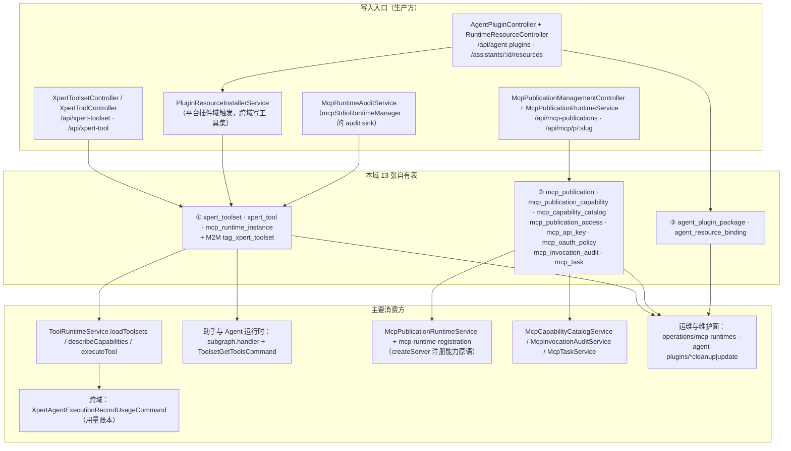
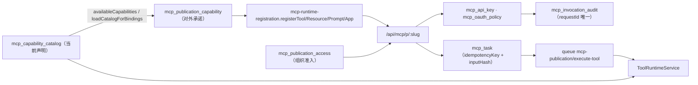

# C4 数据流向与消费（工具与 MCP 专家）

> 口径：表结构与索引以实现层 [04-模型.md](file://.module-experts/后端专题/工具与 MCP 专家/implementation/04-模型.md) 与源码实体为准；**逐条实测 `@Entity(...)` 计数为 `xpert-toolset` 2 + `xpert-tool` 1 + `mcp` 0 + `mcp-publication` 8 + `agent-plugin` 2 = 13 张自有表**，另有 1 张由 `@JoinTable` 声明的 M2M 联接表 `tag_xpert_toolset`（无实体类，不计入 13）。`mcp` 模块**0 表**。
> 消费方为模块级/类级概括，跨 3 个以上消费者时归纳为模块族；未能证实处标 `[推测]`。

**本文引用的文件**
- [xpert-toolset/xpert-toolset.entity.ts](file://packages/server-ai/src/xpert-toolset/xpert-toolset.entity.ts) · [xpert-toolset/mcp-runtime-instance.entity.ts](file://packages/server-ai/src/xpert-toolset/mcp-runtime-instance.entity.ts) · [xpert-toolset/mcp-runtime-audit.service.ts](file://packages/server-ai/src/xpert-toolset/mcp-runtime-audit.service.ts) · [xpert-toolset/xpert-toolset.module.ts](file://packages/server-ai/src/xpert-toolset/xpert-toolset.module.ts)
- [xpert-tool/xpert-tool.entity.ts](file://packages/server-ai/src/xpert-tool/xpert-tool.entity.ts) · [xpert-tool/xpert-tool.service.ts](file://packages/server-ai/src/xpert-tool/xpert-tool.service.ts)
- [mcp-publication/entities/index.ts](file://packages/server-ai/src/mcp-publication/entities/index.ts) · [mcp-publication.entity.ts](file://packages/server-ai/src/mcp-publication/entities/mcp-publication.entity.ts) · [mcp-publication-capability.entity.ts](file://packages/server-ai/src/mcp-publication/entities/mcp-publication-capability.entity.ts) · [mcp-capability-catalog.entity.ts](file://packages/server-ai/src/mcp-publication/entities/mcp-capability-catalog.entity.ts)
- [mcp-publication-access.entity.ts](file://packages/server-ai/src/mcp-publication/entities/mcp-publication-access.entity.ts) · [mcp-api-key.entity.ts](file://packages/server-ai/src/mcp-publication/entities/mcp-api-key.entity.ts) · [mcp-oauth-policy.entity.ts](file://packages/server-ai/src/mcp-publication/entities/mcp-oauth-policy.entity.ts) · [mcp-invocation-audit.entity.ts](file://packages/server-ai/src/mcp-publication/entities/mcp-invocation-audit.entity.ts) · [mcp-task.entity.ts](file://packages/server-ai/src/mcp-publication/entities/mcp-task.entity.ts)
- [mcp-publication/mcp-publication.module.ts](file://packages/server-ai/src/mcp-publication/mcp-publication.module.ts) · [mcp-capability-catalog.service.ts](file://packages/server-ai/src/mcp-publication/mcp-capability-catalog.service.ts) · [mcp-task.service.ts](file://packages/server-ai/src/mcp-publication/mcp-task.service.ts) · [mcp-publication-runtime.service.ts](file://packages/server-ai/src/mcp-publication/mcp-publication-runtime.service.ts)
- [agent-plugin/agent-plugin.entity.ts](file://packages/server-ai/src/agent-plugin/agent-plugin.entity.ts) · [agent-plugin/agent-plugin.module.ts](file://packages/server-ai/src/agent-plugin/agent-plugin.module.ts) · [agent-plugin/migrations/20260921-agent-plugins.sql](file://packages/server-ai/src/agent-plugin/migrations/20260921-agent-plugins.sql)
- [plugin-resource/plugin-resource-installer.service.ts](file://packages/server-ai/src/plugin-resource/plugin-resource-installer.service.ts) · [plugin-resource/plugin-resource-installation.entity.ts](file://packages/server-ai/src/plugin-resource/plugin-resource-installation.entity.ts) · [skill-package/skill-package.entity.ts](file://packages/server-ai/src/skill-package/skill-package.entity.ts)
- [tool-runtime/tool-runtime.service.ts](file://packages/server-ai/src/tool-runtime/tool-runtime.service.ts) · [xpert/xpert.entity.ts](file://packages/server-ai/src/xpert/xpert.entity.ts) · [xpert-agent/commands/handlers/subgraph.handler.ts](file://packages/server-ai/src/xpert-agent/commands/handlers/subgraph.handler.ts) · [core/entities/base.entity.ts](file://packages/server-ai/src/core/entities/base.entity.ts)

## 目录
1. [总览：写入入口 → 表 → 消费方](#总览写入入口--表--消费方)
2. [子域① 工具集与工具（3 张自有表 + 1 张 M2M）](#子域-工具集与工具3-张自有表--1-张-m2m)
3. [子域② MCP 发布（8 张表）](#子域-mcp-发布8-张表)
4. [子域③ Agent 插件（2 张表）](#子域-agent-插件2-张表)
5. [本域写 vs 跨域投影写](#本域写-vs-跨域投影写)
6. [口径核对与未确认项](#口径核对与未确认项)

## 总览：写入入口 → 表 → 消费方

图表来源：[xpert-toolset.module.ts](file://packages/server-ai/src/xpert-toolset/xpert-toolset.module.ts)（关键符号：TypeOrmModule.forFeature 实体清单）、[mcp-publication.module.ts](file://packages/server-ai/src/mcp-publication/mcp-publication.module.ts)（关键符号：MCP_PUBLICATION_ENTITIES）、[agent-plugin.module.ts](file://packages/server-ai/src/agent-plugin/agent-plugin.module.ts)（关键符号：forFeature）、[plugin-resource-installer.service.ts](file://packages/server-ai/src/plugin-resource/plugin-resource-installer.service.ts)（关键符号：ensureMcpToolset）

四个互不重叠的持久面：① 工具集/工具（配置 + 标记 + M2M 标签）② stdio 运行时审计（只增改，业务侧不读）③ MCP 发布八表（台账/快照/密钥/审计/任务）④ Agent 插件两表（包清单 + 可执行绑定）。`mcp/**` 自身**完全不落库**——它是通用 MCP 服务端 SDK 封装，会话状态只在 `NestSSEAdapter.activeTransports` 内存 Map 中。

章节来源：[mcp-publication.module.ts](file://packages/server-ai/src/mcp-publication/mcp-publication.module.ts)（关键符号：TypeOrmModule.forFeature / XpertToolset / User）、[mcp.service.ts](file://packages/server-ai/src/mcp/mcp.service.ts)（关键符号：MCPService / NestSSEAdapter.activeTransports）

## 子域① 工具集与工具（3 张自有表 + 1 张 M2M）

| 实体 / 表名 | 结构（关键列 · 唯一索引 · `select:false`/脱敏） | 生产方 | 主要消费方 | 用途 |
|---|---|---|---|---|
| `XpertToolset` / `xpert_toolset` | `name`、`type`(varchar 50)、`category`(varchar 10)、`description`、`avatar`(json)、`options`(json)、**`credentials`(json，`@Exclude({toPlainOnly:true})`，库内明文)**、`schema`(text)、`schemaType`、`privacyPolicy`、`customDisclaimer`；继承 `workspaceId`/`publishAt`/**`deletedAt`（软删）**；**无 name 唯一索引、无 `status` 列** | `XpertToolsetService.create/createBuiltinToolset/updateToolset`、`PluginResourceInstallerService`（`createBuiltinToolset` / 直写） | `ToolRuntimeService.loadToolsets`、`XpertToolService`、`McpCapabilityCatalogService.discover*`、`xpert-publication` 侧只读绑定、助手侧只读 `ToolsetCatalogItem` | 助手可挂载的工具集实例：provider 身份 + 凭据 + OpenAPI/OData/MCP schema 载体 |
| M2M `tag_xpert_toolset`（**无实体类**） | 由 `@ManyToMany(() => Tag, { cascade:true, eager:true })` + `@JoinTable({ name:'tag_xpert_toolset' })` 声明 | `XpertToolsetService.create/save`（经 `assertValidTagAssociations(..., TagCategoryEnum.TOOLSET)`） | 列表/详情接口（`eager` 自动带出） | 工具集 ↔ 标签联接表；`cascade:true` 意味着保存工具集会级联写标签 |
| `XpertTool` / `xpert_tool` | `name`、`label`(json)、`description`、`avatar`(json)、**`enabled`（`@deprecated use disabled`）与 `disabled` 双列**、`schema`(json)、`parameters`(json)、`options`(json)；`toolset` = `ManyToOne(XpertToolset, { onDelete:'CASCADE' })` + 冗余 `toolsetId`；**无唯一索引** | `XpertToolset.tools` 级联写入（`cascade: insert/update/remove/soft-remove/recover`）、`PluginResourceInstallerService`（`toolRepo.delete` 后重建）、`XpertToolSubscriber` 校验 | `XpertToolService.getTool/testTool/getParamsFaker`、`tool-runtime` 的 `toolset.getTool(name)` | 工具集下单条可禁用、可筛选的工具实例；权限粒度低于工具集 |
| `McpRuntimeInstanceEntity` / `mcp_runtime_instance` | `serverName`(必填)、`status`(`starting\|running\|closing\|closed\|failed`)、`origin`(默认 `agent-toolset`)、`startedAt`/`readyAt`/`idleExpiresAt`/`maxLifetimeExpiresAt`/`closedAt`/`closeReason`、`startupDurationMs`/`durationMs`、`runnerPid`/`childPid`、**`stderrTail`(text，16KB 截断)**、**`commandLabel`（args 命中 `/(token\|secret\|password\|passwd\|key)=/i` 替换 `[redacted]`；绝对路径只留 basename；超 120 字符截断）**、`commandHash`(sha256)、`policySnapshot`(jsonb，白名单 5 字段)；裸列 `workspaceId`/`toolsetId`/`xpertId`/`executionId`/`appInstanceId`；**5 个复合索引** | `McpRuntimeAuditService.recordStarting/recordRunning/recordClosed/recordAppInstance`（由 `mcpStdioRuntimeManager.setAuditSink` 驱动） | `GET/POST operations/mcp-runtimes`（含 `xpert_workspace` 原生 join 取展示名） | MCP stdio 运行时**生命周期审计**：起停时间、PID、退出原因、命令指纹与策略快照 |

- **该表只增改、无清理作业**：`recordRunning`/`recordClosed` 都是按 id `update`，从不 `delete`；默认查询窗口 180 天（`DEFAULT_RUNTIME_AUDIT_RETENTION_DAYS`），过期行只是不被列出。
- **软删边界**：本域走 `WorkspaceBaseEntity` 的只有 `XpertToolset`（唯一可软删）；`xpert_tool`、MCP 发布八表、Agent 插件两表均为 `TenantOrganizationBaseEntity`，无 `deletedAt`、无 `workspaceId` 基列。

章节来源：[xpert-toolset.entity.ts](file://packages/server-ai/src/xpert-toolset/xpert-toolset.entity.ts)（关键符号：XpertToolset.credentials / tags / @JoinTable）、[xpert-tool.entity.ts](file://packages/server-ai/src/xpert-tool/xpert-tool.entity.ts)（关键符号：XpertTool.enabled / disabled / toolsetId）、[mcp-runtime-instance.entity.ts](file://packages/server-ai/src/xpert-toolset/mcp-runtime-instance.entity.ts)（关键符号：McpRuntimeInstanceEntity / commandLabel / policySnapshot）、[mcp-runtime-audit.service.ts](file://packages/server-ai/src/xpert-toolset/mcp-runtime-audit.service.ts)（关键符号：sanitizeCommandArg / commandHash）

## 子域② MCP 发布（8 张表）

8 张表由 `MCP_PUBLICATION_ENTITIES` 常量一次性注册（`entities/index.ts`），forFeature 时另加 `XpertToolset` 与 `User`（**被注册 ≠ 本域自有表**）。

| 实体 / 表名 | 结构（关键列 · 唯一索引 · `select:false`/脱敏） | 生产方 | 主要消费方 | 用途 |
|---|---|---|---|---|
| `McpPublication` / `mcp_publication` | `name`(191)、`slug`(191)、`status`(`draft\|active\|disabled`，默认 `draft`)、`authMethods`(json 默认 `[]`)、`instructions`(text)、`runtime`(json)、`protocolVersion`(默认 `MCP_PROTOCOL_VERSION`)、`reviewStatus`(`current\|required`)、`reviewReason`、`reviewedAt`/`reviewedById`；**唯一 `IDX_mcp_publication_slug(slug)`** + `IDX_mcp_publication_scope_status(tenantId,organizationId,status)` | `McpPublicationService.create`（`draft` + `current`） | `McpPublicationRuntimeService.findActiveBySlug`、管理控制器、API Key / OAuth / Task 服务 | 对外 MCP 服务端的发布单；`slug` 是唯一对外地址 |
| `McpPublicationCapability` / `mcp_publication_capability` | `publicationId`(`ManyToOne(onDelete:'CASCADE')`)、**`toolsetId`(uuid，故意无外键)**、`capabilityType`(40)、`capabilityKey`(191)、`publicName`(191)、`enabled`(默认 true)、`policy`(json)、**`descriptorHash`(char 64)**、**`descriptorSnapshot`(json 非空，可读可出网)**、`pluginVersion`(64)；**唯一 `(publicationId, publicName)`** + **唯一 `(publicationId, toolsetId, capabilityType, capabilityKey)`** | `McpPublicationService.replaceCapabilities` / `replaceCapabilitiesWithCatalog`（事务内整体替换） | `McpPublicationRuntimeService`（注册器逐条注册）、`McpCapabilityCatalogService`（漂移审核回写 `reviewStatus`） | 发布单 ↔ 能力的**绑定 + 描述符快照**；唯一索引即幂等键 |
| `McpCapabilityCatalog` / `mcp_capability_catalog` | `toolsetId`(uuid，**注释明确 intentionally not a FK**)、`capabilityType`(40)、`capabilityKey`(191)、**`descriptorHash`(char 64)**、`descriptor`(json 非空)、`enabled`(默认 true)；**唯一 `(toolsetId, capabilityType, capabilityKey)`** | `McpCapabilityCatalogService.replacePreparedToolsetCapabilities`（事务 delete + save）、`PluginResourceInstallerService.replaceToolsetCapabilities` | `ToolRuntimeService.describeCapabilities`、`McpPublicationService.availableCapabilities/loadCatalogForBindings` | 工具集**当前声明**的能力台账（发现结果），是绑定可选项的来源 |
| `McpPublicationAccess` / `mcp_publication_access` | `publicationId`(`onDelete:'CASCADE'`, not null)、`enabled`(默认 true)、`enabledById`、`disabledAt`/`disabledById`；**唯一 `(publicationId, organizationId)`** | `McpPublicationAccessService.enable/disable`（唯一冲突竞态重取） | `McpPublicationAuthorizationService.assertCanRun`、`McpPublicationService.list`（共享发布合并） | 组织级**准入开关**；**无 HTTP 端点**，只在服务层调用 |
| `McpApiKey` / `mcp_api_key` | `publicationId`(`CASCADE`)、`name`(100)、**`keyPrefix`(32，明文可检索)**、**`keyHash`(char 64，`select:false` + `@Exclude`)**、**`encryptedSecret`(text，`select:false` + `@Exclude`)**、`subjectType`(24)/`subjectId`、`scopes`(json)、`expiresAt`、`lastUsedAt`、`revokedAt`/`revokedById`；**唯一 `keyHash`** + **唯一 `keyPrefix`** | `McpApiKeyService.createForPublication`（生成 `xpert_mcp_` + base64url(32B)）、`rotate` | `McpAuthenticationService.authenticate`、管理面 `GET :id/api-keys` | 调用方凭据：**哈希用于校验、密文用于一次性回显**，两列默认不出网 |
| `McpOAuthPolicy` / `mcp_oauth_policy` | `publicationId`(**`OneToOne(nullable:false, CASCADE)`**)、`issuer`/`audience`(text)、`requiredScopes`(json)、`subjectMapping`(json)、`introspectionEnabled`、`introspectionEndpoint`/`introspectionClientId`、**`introspectionClientSecretEncrypted`(text，`select:false`，**无** `@Exclude`)**、**`introspectionClientSecretConfigured`(布尔位)**、`enabled`；**唯一 `(publicationId)`** | `McpOAuthService`（`PUT mcp-publications/:id/oauth-policy`；`clientSecret` 省略=保留、`null`=清除、新值=轮换） | `McpOAuthService.authenticate/challenge`、`McpAuthenticationService` | 发布单的 OAuth 资源服务器策略（与 publication 一对一并唯一） |
| `McpInvocationAudit` / `mcp_invocation_audit` | `publicationId`(**`ManyToOne(nullable:false, onDelete:'RESTRICT')`——全表唯一 RESTRICT**)、`capabilityId`/`toolsetId`、`capabilityKey`/`publicName`、`authMethod`(20)、`subjectType`/`subjectId`、`clientName`、`requestId`(uuid)、`traceId`、`status`(`started\|succeeded\|failed\|denied`)、`durationMs`、`errorCode`、**`argumentSummary`(json，`select:false`，只存 key 列表与字节数)** | `McpInvocationAuditService.start/succeeded/failed` | 管理端点 `GET mcp-publications/:id/audit`、`McpPublicationService.list`（MAX(createdAt) 报表） | 逐次调用审计：`requestId` 唯一 ⇒ **一次调用恰一条** |
| `McpTask` / `mcp_task` | `publicationId`(`CASCADE`)、**`taskId`(uuid)**、`capabilityId`/`executionId`、`requestId`(191)、`toolName`、**`idempotencyKey`(191)**、**`inputHash`(char 64)**、`subjectType`/`subjectId`、`queueJobId`、`status`(`working\|input_required\|completed\|failed\|cancelled`)、`progress`、`pollIntervalMs`、**`inputRequests`/`inputResponses`/`requestPayload`/`resultRef`/`error` 均 json `select:false`**、**`revision`(int 默认 0，普通列不是 `@VersionColumn`)**、`expiresAt`(非空)；**唯一 `taskId`** + **唯一 `(publicationId, idempotencyKey)`** | `McpTaskService.create`（`idempotencyKey = hashText(...)`、`inputHash = hashJson(arguments)`） | `McpTaskService.get/update/cancel`、`McpTaskProcessor`（`@PluginJobProcessor` queue `mcp-publication` job `execute-tool`） | 长任务台账：幂等键 + 输入指纹 + 过期时间构成可重放契约 |

图表来源：[mcp-capability-catalog.entity.ts](file://packages/server-ai/src/mcp-publication/entities/mcp-capability-catalog.entity.ts)（关键符号：IDX_mcp_capability_catalog_binding）、[mcp-publication-capability.entity.ts](file://packages/server-ai/src/mcp-publication/entities/mcp-publication-capability.entity.ts)（关键符号：descriptorHash / descriptorSnapshot / toolsetId）、[mcp-task.entity.ts](file://packages/server-ai/src/mcp-publication/entities/mcp-task.entity.ts)（关键符号：IDX_mcp_task_idempotency / inputHash）

- **外键语义分化**：`RESTRICT`（审计，发布单不可带审计被硬删）、`CASCADE`（能力绑定/准入/API Key/OAuth/任务）、**完全无外键**（`mcp_capability_catalog.toolsetId` 与 `mcp_publication_capability.toolsetId`——刻意的可诊断性取舍，注释写明 `intentionally not a FK so broken bindings stay diagnosable`，且「工具集身份即使日后被删除也保留」）。
- **可重建投影 vs 只追加台账**：catalog 与 binding 是可重建投影（delete + save 整体替换）；`mcp_invocation_audit`（`requestId` 唯一）与 `mcp_task`（幂等键去重）是只追加/低改台账；`mcp_publication_access`/`mcp_api_key` 用时间戳字段（`disabledAt`/`revokedAt`）表达撤销而非删行。

章节来源：[mcp-publication.entity.ts](file://packages/server-ai/src/mcp-publication/entities/mcp-publication.entity.ts)（关键符号：IDX_mcp_publication_slug / reviewStatus）、[mcp-api-key.entity.ts](file://packages/server-ai/src/mcp-publication/entities/mcp-api-key.entity.ts)（关键符号：keyHash / encryptedSecret / select:false）、[mcp-oauth-policy.entity.ts](file://packages/server-ai/src/mcp-publication/entities/mcp-oauth-policy.entity.ts)（关键符号：introspectionClientSecretConfigured）、[mcp-invocation-audit.entity.ts](file://packages/server-ai/src/mcp-publication/entities/mcp-invocation-audit.entity.ts)（关键符号：McpInvocationAudit / RESTRICT / argumentSummary）

## 子域③ Agent 插件（2 张表）

| 实体 / 表名 | 结构（关键列 · 唯一索引 · `select:false`/脱敏） | 生产方 | 主要消费方 | 用途 |
|---|---|---|---|---|
| `AgentPluginPackage` / `agent_plugin_package`（迁移 `20260921` 建表） | `rootPath`(非空)、`digest`(非空)、`descriptor`(jsonb 非空，类型 `PortablePlugin`)、`source`(jsonb：`{ kind:'git'\|'zip', url?, ref?, commit?, subdirectory? }`)；**`@Index(['tenantId','organizationId','digest'])` 非唯一**（迁移同名 `IDX_agent_plugin_package_scope` 亦非 UNIQUE）；迁移另加 `tenantId NOT NULL REFERENCES tenant(id) ON DELETE CASCADE` | `AgentPluginService` 事务内 `create/save`（git/zip 两入口 + 维护面 `packages/:id/update`） | `AgentPluginInstallationsService.installedCatalog/saveTemplateCatalog`、`AgentPluginService.list`、更新/清理服务 | 便携插件包清单：**行身份即 (scope, digest)**；去重靠应用层 `findOne(...)` + `packageIntact` 校验，DB 不兜底 |
| `AgentResourceBinding` / `agent_resource_binding`（迁移同批建表） | `title`、`description`、`version`(非空)、`workspaceIds`(jsonb)、`definition`(jsonb 非空，`kind ∈ agent_plugin\|middleware\|external_xpert`)、`installations`(jsonb 默认 `{}`，形如 `{ [workspaceId]: { skills, toolsets, connectors? } }`)、`expertVersions`(jsonb 默认 `{}`)、`enabled`(默认 true)、**`cleanupEligible`(默认 false，迁移 `20261015` 新增)**、**`supersededById`(uuid)**；`@Index(['tenantId','organizationId','enabled'])` | `AgentPluginService.createAuthorizedBinding`（`version = sha256(JSON.stringify({ ...input, expertVersions, digest }))`） | `AgentPluginInstallationsService`、`subgraph.handler` 的 `options.runtimeResources`、模板/清理/更新服务 | 可执行引用：把包投影到工作区、专家版本与安装结果，并保留被取代版本链 |

- **`digest` 是版本而非主键**：`definitionHash = pkg.digest` 会被透传进插件组件（skills 与 `mcp.json`），因此「同 digest 视为不可变包」是整条链的隐含前提；实体注释逐字要求「Never rewrite package identity, creation time or bindings during repair/reimport.」。
- **回收边界**：`cleanupEligible` 注释逐字「Only automatic catalog defaults may be collected; selecting a template reserves the reference.」——保留引用由 `retainTemplateReference`（`pg_advisory_xact_lock(hashtext(...))`）串行化。
- **`runtimeResourceOnly` 是迁移新增列**（`ALTER TABLE skill_package`），标记由本域投影产生的技能包（表属技能域）。

章节来源：[agent-plugin.entity.ts](file://packages/server-ai/src/agent-plugin/agent-plugin.entity.ts)（关键符号：AgentPluginPackage / AgentResourceBinding / installations / cleanupEligible / supersededById）、[agent-plugin.service.ts](file://packages/server-ai/src/agent-plugin/agent-plugin.service.ts)（关键符号：portablePackageDigest / createAuthorizedBinding）、[20260921-agent-plugins.sql](file://packages/server-ai/src/agent-plugin/migrations/20260921-agent-plugins.sql)（关键符号：IDX_agent_plugin_package_scope / runtimeResourceOnly）

## 本域写 vs 跨域投影写

| 方向 | 表 / 事实 | 写入者 | 说明与证据 |
|---|---|---|---|
| 本域写 | `xpert_toolset` / `xpert_tool` / `tag_xpert_toolset` | `XpertToolsetService`、`XpertToolService`、`XpertToolsetSubscriber`/`XpertToolSubscriber` | 唯一配置面；`tag_*` 由 `@JoinTable` + `cascade:true` 隐式维护 |
| 本域写 | `mcp_runtime_instance` | `McpRuntimeAuditService`（audit sink） | 只增改；业务侧不读，仅运维端点与过滤器消费 |
| 本域写 | `mcp_capability_catalog` | `McpCapabilityCatalogService`（事务整体 replace） | `PluginResourceInstallerService` 复用同一服务刷新 |
| 本域写 | `mcp_publication` / `_capability` / `_access` / `mcp_api_key` / `mcp_oauth_policy` / `mcp_invocation_audit` / `mcp_task` | `McpPublicationService`、`McpApiKeyService`、`McpPublicationAccessService`、`McpOAuthService`、`McpInvocationAuditService`、`McpTaskService` | 管理面 `@Roles(SUPER_ADMIN)` + 运行面 `@Public`（Bearer 自校验） |
| 本域写 | `agent_plugin_package` / `agent_resource_binding` | `AgentPluginService`、`AgentPluginInstallationsService` | 服务层 `requireResourceAdmin()` + `resourceScope()` 强制 organization |
| 跨域投影写（邻域触发本域表） | `xpert_toolset` / `xpert_tool` | `PluginResourceInstallerService`（平台插件域）：`ensureNativeToolset` 走 `createBuiltinToolset`；`ensureMcpToolset` 直接写并**先 `toolRepo.delete({toolsetId})` 再 `updateToolset`** | 本域与平台插件域共用同一张配置表；`runtimeSource:'agent-plugin'` / `pluginManaged` 标记来源 |
| 跨域投影写（本域触发） | `mcp_capability_catalog`（经 `capabilityCatalog.replaceToolsetCapabilities`） | 同上安装器 | 安装完成后刷新能力目录，供发布绑定可选 |
| 跨域投影写（本域触发） | `plugin_resource_installation` | 同上安装器（邻域表，注册于 `XpertToolsetModule.forFeature`） | 安装台账；`McpRuntimeAuditService.findResourceInstallation` 反查它回填 `resourceInstallationId` |
| 跨域投影写（本域触发） | `skill_package`（含迁移新增 `runtimeResourceOnly`） | 同上安装器（`skillPackageService.syncPluginSkillBundle`） | Agent 插件只**声明** skills，安装时才落库 |
| 跨域写（本域读） | `xpert_agent_execution`（用量） | `ToolRuntimeService` → `XpertAgentExecutionRecordUsageCommand` | 仅当存在 `executionId` 时记账 |
| 跨域读 | `xpert_workspace`、`user`、`organization` | `ToolsetGuard`、`McpRuntimeAuditService`（原生 join `xpert_workspace` 取展示名）、`McpPublicationModule.forFeature(User)` | 仅权限判定与展示 |
| 助手侧**只读挂载**（跨域持有） | M2M `xpert_to_toolset` 与 `XpertAgent.toolsetIds` | **助手域**（`xpert.entity.ts` 的 `@JoinTable`） | 本域只提供读模型：`XpertAuthoringService` 用 `getAllByWorkspace` + `afterLoad` 生成 `ToolsetCatalogItem`；运行时统一走 `ToolsetGetToolsCommand` |
| 邻域写邻域表（本模块注册） | `mcp_consumer_oauth_*`、`mcp_app_audit`/`mcp_app_history` | `xpert-toolset` 模块 forFeature 注册的邻域实体与控制器 | 本批次范围外，仅登记归属 |

- **冲突面收敛在一处**：平台插件与 Agent 插件共享 `PluginResourceInstallerService` 这一个落库器；「谁写了这行工具集」靠 `options` 上的 `pluginManaged` / `runtimeSource` 字符串约定区分——**任何绕过安装器直接建工具集的代码都会落进「无来源」灰区**。

章节来源：[xpert-toolset.module.ts](file://packages/server-ai/src/xpert-toolset/xpert-toolset.module.ts)（关键符号：forFeature / controllers / providers）、[plugin-resource-installer.service.ts](file://packages/server-ai/src/plugin-resource/plugin-resource-installer.service.ts)（关键符号：ensureRuntime / ensureNativeToolset / buildPluginManagedMcpToolsetEntity）、[xpert.entity.ts](file://packages/server-ai/src/xpert/xpert.entity.ts)（关键符号：Xpert.toolsets / @JoinTable('xpert_to_toolset')）、[xpert-authoring.service.ts](file://packages/server-ai/src/xpert/middlewares/xpert-authoring.service.ts)（关键符号：getAvailableToolsetsFromContext）

## 口径核对与未确认项

1. **表数口径 = 13**：`@Entity(...)` 逐条实测为 `xpert-toolset` 2（`XpertToolset`、`McpRuntimeInstanceEntity`）+ `xpert-tool` 1 + `mcp` **0** + `mcp-publication` 8 + `agent-plugin` 2；M2M `tag_xpert_toolset`（全仓仅命中 `xpert-toolset.entity.ts`）不计入。
2. **`forFeature` 长度 ≠ 自有表数**：`xpert-toolset` 注册 9 项、`mcp-publication` 注册 `[...MCP_PUBLICATION_ENTITIES, XpertToolset, User]`——它们是「模块装配面」，含邻域表；本文件一律以实体声明归属为准。
3. **`mcp` 模块 0 表**：目录仅 service/controller/decorators/transport/types，会话状态在 `NestSSEAdapter.activeTransports` 内存 Map 与 `@Optional` stdio transport 中；`MCPModule` 全仓无装配点（未确认而非「不存在」）。
4. **`xpert_toolset` 无 `status` 列**（实测确认）：生命周期由 `publishAt`（`Not(IsNull())` = 已发布）与 `deletedAt`（软删）表达。
5. **`tag_xpert_toolset` 之外无其他本域 M2M**：`xpert_to_toolset` 由助手域 `@JoinTable` 声明，属跨域读面。
6. **`McpAppAudit`/`McpAppHistory`/`McpConsumerOAuthCredential`/`McpConsumerOAuthSession` 的列未逐条核对**：它们由 `xpert-toolset` 模块 forFeature 注册并挂控制器，属本批次范围外。
7. **索引基线 DDL 不在仓库**：`xpert_toolset`、`xpert_tool`、MCP 发布八表无 `migrations/*.sql`，实体装饰器是唯一权威来源。

章节来源：[04-模型.md](file://.module-experts/后端专题/工具与 MCP 专家/implementation/04-模型.md)（关键符号：实体基类与作用域 / 校验规则 / 迁移与 DDL）、[mcp-publication.module.ts](file://packages/server-ai/src/mcp-publication/mcp-publication.module.ts)（关键符号：MCP_PUBLICATION_ENTITIES）、[base.entity.ts](file://packages/server-ai/src/core/entities/base.entity.ts)（关键符号：WorkspaceBaseEntity.deletedAt / TenantOrganizationBaseEntity）
