# 工具与 MCP 域 · 架构（01-架构）

**本文引用的文件**
- [packages/server-ai/src/app.module.ts](file://packages/server-ai/src/app.module.ts)
- [packages/server-ai/src/xpert-toolset/xpert-toolset.module.ts](file://packages/server-ai/src/xpert-toolset/xpert-toolset.module.ts)
- [packages/server-ai/src/xpert-toolset/xpert-toolset.controller.ts](file://packages/server-ai/src/xpert-toolset/xpert-toolset.controller.ts)
- [packages/server-ai/src/xpert-toolset/xpert-toolset.service.ts](file://packages/server-ai/src/xpert-toolset/xpert-toolset.service.ts)
- [packages/server-ai/src/xpert-toolset/xpert-toolset.entity.ts](file://packages/server-ai/src/xpert-toolset/xpert-toolset.entity.ts)
- [packages/server-ai/src/xpert-toolset/xpert-toolset.subscriber.ts](file://packages/server-ai/src/xpert-toolset/xpert-toolset.subscriber.ts)
- [packages/server-ai/src/xpert-toolset/guards/toolset.guard.ts](file://packages/server-ai/src/xpert-toolset/guards/toolset.guard.ts)
- [packages/server-ai/src/xpert-toolset/mcp-apps.controller.ts](file://packages/server-ai/src/xpert-toolset/mcp-apps.controller.ts)
- [packages/server-ai/src/xpert-toolset/mcp-runtime.controller.ts](file://packages/server-ai/src/xpert-toolset/mcp-runtime.controller.ts)
- [packages/server-ai/src/xpert-toolset/mcp-runtime-audit.service.ts](file://packages/server-ai/src/xpert-toolset/mcp-runtime-audit.service.ts)
- [packages/server-ai/src/xpert-toolset/mcp-runtime-instance.entity.ts](file://packages/server-ai/src/xpert-toolset/mcp-runtime-instance.entity.ts)
- [packages/server-ai/src/xpert-toolset/provider/index.ts](file://packages/server-ai/src/xpert-toolset/provider/index.ts)
- [packages/server-ai/src/xpert-toolset/provider/builtin/index.ts](file://packages/server-ai/src/xpert-toolset/provider/builtin/index.ts)
- [packages/server-ai/src/xpert-toolset/provider/mcp/mcp-toolset.ts](file://packages/server-ai/src/xpert-toolset/provider/mcp/mcp-toolset.ts)
- [packages/server-ai/src/xpert-toolset/provider/mcp/mcp-stdio-runtime.ts](file://packages/server-ai/src/xpert-toolset/provider/mcp/mcp-stdio-runtime.ts)
- [packages/server-ai/src/xpert-tool/xpert-tool.module.ts](file://packages/server-ai/src/xpert-tool/xpert-tool.module.ts)
- [packages/server-ai/src/xpert-tool/xpert-tool.entity.ts](file://packages/server-ai/src/xpert-tool/xpert-tool.entity.ts)
- [packages/server-ai/src/xpert-tool/xpert-tool.controller.ts](file://packages/server-ai/src/xpert-tool/xpert-tool.controller.ts)
- [packages/server-ai/src/tool-runtime/tool-runtime.service.ts](file://packages/server-ai/src/tool-runtime/tool-runtime.service.ts)
- [packages/server-ai/src/tool-runtime/capability-descriptor.ts](file://packages/server-ai/src/tool-runtime/capability-descriptor.ts)
- [packages/server-ai/src/mcp/mcp.module.ts](file://packages/server-ai/src/mcp/mcp.module.ts)
- [packages/server-ai/src/mcp/mcp.service.ts](file://packages/server-ai/src/mcp/mcp.service.ts)
- [packages/server-ai/src/mcp/controllers/base-mcp.controller.ts](file://packages/server-ai/src/mcp/controllers/base-mcp.controller.ts)
- [packages/server-ai/src/mcp-publication/mcp-publication.module.ts](file://packages/server-ai/src/mcp-publication/mcp-publication.module.ts)
- [packages/server-ai/src/mcp-publication/mcp-publication-management.controller.ts](file://packages/server-ai/src/mcp-publication/mcp-publication-management.controller.ts)
- [packages/server-ai/src/mcp-publication/mcp-publication.controller.ts](file://packages/server-ai/src/mcp-publication/mcp-publication.controller.ts)
- [packages/server-ai/src/mcp-publication/mcp-publication-runtime.service.ts](file://packages/server-ai/src/mcp-publication/mcp-publication-runtime.service.ts)
- [packages/server-ai/src/mcp-publication/mcp-files.controller.ts](file://packages/server-ai/src/mcp-publication/mcp-files.controller.ts)
- [packages/server-ai/src/mcp-publication/entities/mcp-publication-capability.entity.ts](file://packages/server-ai/src/mcp-publication/entities/mcp-publication-capability.entity.ts)
- [packages/server-ai/src/mcp-publication/entities/mcp-api-key.entity.ts](file://packages/server-ai/src/mcp-publication/entities/mcp-api-key.entity.ts)
- [packages/server-ai/src/mcp-publication/entities/mcp-task.entity.ts](file://packages/server-ai/src/mcp-publication/entities/mcp-task.entity.ts)
- [packages/server-ai/src/mcp-publication/entities/mcp-capability-catalog.entity.ts](file://packages/server-ai/src/mcp-publication/entities/mcp-capability-catalog.entity.ts)
- [packages/server-ai/src/agent-plugin/agent-plugin.module.ts](file://packages/server-ai/src/agent-plugin/agent-plugin.module.ts)
- [packages/server-ai/src/agent-plugin/agent-plugin.entity.ts](file://packages/server-ai/src/agent-plugin/agent-plugin.entity.ts)
- [packages/server-ai/src/agent-plugin/agent-plugin.controller.ts](file://packages/server-ai/src/agent-plugin/agent-plugin.controller.ts)
- [packages/server-ai/src/agent-plugin/agent-plugin-parser.ts](file://packages/server-ai/src/agent-plugin/agent-plugin-parser.ts)
- [packages/server-ai/src/plugin-resource/plugin-resource-installer.service.ts](file://packages/server-ai/src/plugin-resource/plugin-resource-installer.service.ts)
- [packages/server-ai/src/xpert/xpert.entity.ts](file://packages/server-ai/src/xpert/xpert.entity.ts)
- [packages/server-ai/src/xpert-agent/commands/handlers/subgraph.handler.ts](file://packages/server-ai/src/xpert-agent/commands/handlers/subgraph.handler.ts)
- [packages/contracts/src/ai/xpert-toolset.model.ts](file://packages/contracts/src/ai/xpert-toolset.model.ts)
- [packages/contracts/src/ai/mcp-publication.model.ts](file://packages/contracts/src/ai/mcp-publication.model.ts)
- [packages/contracts/src/ai/mcp-capability.model.ts](file://packages/contracts/src/ai/mcp-capability.model.ts)

## 目录
1. [专家域职责边界](#专家域职责边界)
2. [子专家划分说明](#子专家划分说明)
3. [跨子域共享文件清单](#跨子域共享文件清单)
4. [子模块清单](#子模块清单)
5. [分层结构](#分层结构)
6. [依赖关系](#依赖关系)
7. [关键不变量](#关键不变量)
8. [架构总览](#架构总览)
9. [组件详细分析](#组件详细分析)
10. [结论](#结论)

## 专家域职责边界
**做什么**：工具集与工具的全生命周期（`XpertToolsetService.createBuiltinToolset`/`updateToolset`/`getAllByWorkspace`/`afterLoad`、`XpertToolService.getTool`/`testTool`/`getParamsFaker`）；四类工具集 provider 的工具发现与 schema 生成（`provider/{builtin,openapi,odata,mcp}`）；统一工具执行面（`ToolRuntimeService.loadToolsets`/`executeTool`/`executeMcpCapability`/`executeMcpResource`/`executeMcpPrompt`/`completeMcpCapability`/`describeCapabilities`）；MCP 协议双方向（客户端 `provider/mcp/**` 走 `McpConsumer`，服务端 `mcp/**` + `mcp-publication/**` 走 `createMcpHandler`）；MCP 发布域全链（草稿 → 能力快照 → 审核 → API Key/OAuth → 调用审计 → 长任务）；MCP stdio 运行时实例的审计与停止；Agent 便携插件的发现、装配与动态资源注入。

**不做什么**：不做模型推理与 Agent 图编排（分别是助手域与 `xpert-agent` 的职责）；不拥有平台插件 bundle 的加载（`LOADED_PLUGINS`、`plugin_resource_installation` 属平台插件域）；不拥有技能包内容（`skill_package` 属技能专家域，本域只经安装器投影写入一行）；不拥有会话与消息持久化（`chat-message`/`chat-conversation` 承担）；不拥有 `XpertToolset`↔助手关系的写入入口（M2M 关系表 `xpert_to_toolset` 由助手域维护）。

**三类「插件」必须分清**：① **平台插件**（`packages/server/src/plugin/**`、`plugin-resource/**`，组件类型枚举 `PLUGIN_COMPONENT_TYPE`）：已加载 bundle 的组件安装 → 归**平台插件与技能专家**；② **Agent 插件**（`agent-plugin/**`，便携包 `PortablePlugin`）：git/zip 导入的声明式资源包 → **本域**；③ **MCP 发布**（`mcp-publication/**`，`mcp_publication` 等 8 表）：把工具集能力反向发布为对外的 MCP Server → **本域**。三者共用 `XpertToolset`/`XpertTool` 作为落点，但准入、来源与生命周期完全不同。

章节来源：[xpert-toolset.service.ts](file://packages/server-ai/src/xpert-toolset/xpert-toolset.service.ts)（关键符号：XpertToolsetService.createBuiltinToolset）、[tool-runtime.service.ts](file://packages/server-ai/src/tool-runtime/tool-runtime.service.ts)（关键符号：ToolRuntimeService.executeTool）、[agent-plugin-parser.ts](file://packages/server-ai/src/agent-plugin/agent-plugin-parser.ts)（关键符号：PortablePlugin）

## 子专家划分说明
① **工具集与工具**：`xpert-toolset/**` 主体（entity/service/controller/subscriber、`mcp-apps.*`、`mcp-runtime.*`、`guards/`、`dto/`、`commands/{5}`、`queries/{7}`、`provider/{builtin,openapi,odata}`）+ `xpert-tool/**` + `tool-runtime/**`。核心类：`XpertToolsetService`、`XpertToolService`、`ToolRuntimeService`。
② **MCP 协议与发布**：`mcp/**`（服务端 SDK 封装）+ `mcp-publication/**`（发布域）+ `xpert-toolset/provider/mcp/**`（客户端）。核心类：`McpPublicationService`、`McpPublicationRuntimeService`、`McpCapabilityCatalogService`、`McpTaskService`、`MCPToolset`。邻域交叉引用：`mcp-consumer/**`（`McpConsumer` 协议层）、`mcp-app-runtime/**`。
③ **Agent 插件**：`agent-plugin/**`（含 `defaults/`、`maintenance/`、`templates/`、`schemas/`）＋平台侧对照面 `plugin-resource/**`、`skill-package/**`。核心类：`AgentPluginService`、`RuntimeResourceService`、`AgentPluginInstallationsService`、`PluginResourceInstallerService`。

章节来源：[xpert-toolset.module.ts](file://packages/server-ai/src/xpert-toolset/xpert-toolset.module.ts)（关键符号：XpertToolsetModule）、[mcp-publication.module.ts](file://packages/server-ai/src/mcp-publication/mcp-publication.module.ts)（关键符号：McpPublicationModule）、[agent-plugin.module.ts](file://packages/server-ai/src/agent-plugin/agent-plugin.module.ts)（关键符号：AgentPluginModule）

## 跨子域共享文件清单

> **展开范围**：下表中第 7 项（4 个 contracts model）由 ② 展开、第 8 项（`shared/tools/toolset.ts` + `middleware-runtime/index.ts`）由 ① 与 ② 展开，③ 侧语义通过 `PortablePlugin` descriptor 承接；三侧各自 `01-架构` 已标注归属。
以下 8 处同时被两个以上子域读写，任一侧改动必须双边复核：
1. `packages/server-ai/src/tool-runtime/*`：①②③ 都经它执行/发现能力——`executeTool` 由 `ToolInvokeHandler` 调用，`describeCapabilities` 由发布链消费。
2. `xpert-toolset/xpert-toolset.entity.ts`：②的 forFeature（`[...MCP_PUBLICATION_ENTITIES, XpertToolset, User]`）与③的安装投影（`toolsetRepo.save/create`）都写它。
3. `xpert-tool/xpert-tool.entity.ts`：①的 `@OneToMany` 子实体，③经 `toolRepo.delete({toolsetId})` 后按策略重建。
4. `xpert-toolset/xpert-toolset.module.ts`：②的实体与服务/控制器被①模块**直接注册**——`McpCapabilityCatalog`/`McpPublicationCapability`/`McpSubscriptionService` 在①的 forFeature/providers 中，`McpConsumerOAuthController`/`McpConsumerCapabilitiesController` 在①的 controllers 中。
5. `plugin-resource/plugin-resource-installer.service.ts`：①③ 共用安装器（`ensureNativeToolset` 走 `createBuiltinToolset`；`ensureMcpToolset` 写 `XpertToolset`/`XpertTool`，并调 `capabilityCatalog.replaceToolsetCapabilities`）。
6. `xpert-agent/commands/handlers/subgraph.handler.ts` 与 `xpert-agent/queries/handlers/{get-variables,complete-tool-calls}.handler.ts`：① 的消费方，③ 的动态资源注入点（`dynamicResources?.toolsetIds` 额外装配工具集）。
7. `packages/contracts/src/ai/{xpert-toolset.model.ts,mcp-publication.model.ts,mcp-capability.model.ts,mcp-auth.model.ts}`：三子域共用枚举与 DTO 契约。
8. `shared/tools/toolset.ts` + `shared/agent/middleware-runtime/index.ts`：`_BaseToolset` 是三子域工具集实现共同基类；`AgentMiddlewareRuntimeService.createScopedApi` 被①（`createBuiltinToolset` 生成 `modelRuntime`）与执行面共用。

章节来源：[xpert-toolset.module.ts](file://packages/server-ai/src/xpert-toolset/xpert-toolset.module.ts)（关键符号：XpertToolsetModule 的 controllers/providers）、[plugin-resource-installer.service.ts](file://packages/server-ai/src/plugin-resource/plugin-resource-installer.service.ts)（关键符号：PluginResourceInstallerService.ensureMcpToolset）、[subgraph.handler.ts](file://packages/server-ai/src/xpert-agent/commands/handlers/subgraph.handler.ts)（关键符号：dynamicResources.toolsetIds）

## 子模块清单
| 目录 / 模块 | 模块类与入口 | 路由前缀 | 对外接口 |
|---|---|---|---|
| `xpert-toolset/` | `XpertToolsetModule`（无 @Global） | `/api/xpert-toolset` | 自声明 18 条 + mcp-apps 7 条 + mcp-runtimes 3 条 |
| `xpert-toolset/provider/mcp/` | 无 Nest 模块（类库） | — | `MCPToolset`（客户端实现）+ `mcpStdioRuntimeManager` 单例 |
| `xpert-tool/` | `XpertToolModule` | `/api/xpert-tool` | 3 条 + `CrudController` 继承端点 |
| `mcp/` | `MCPModule.register()/registerAsync()`（`global: true`） | `mcp/sse`、`mcp/messages`（无 RouterModule） | 2 条；**全仓未找到注册调用点** |
| `mcp-publication/` | `McpPublicationModule`（无 RouterModule、无 @Global） | 控制器各带显式路径：`mcp/p`、`mcp-publications`、`mcp-api-keys` 等 | ≈26 条（4 控制器） |
| `agent-plugin/` | `AgentPluginModule`（`@Global()`） | `agent-plugins` + 空前缀 | 12 + 4 + 6 条 |
| `tool-runtime/` | 无 Nest 模块；`ToolRuntimeService` 由 `XpertToolsetModule` 提供并导出 | — | 8 个公开方法（load/execute/describe 系列） |
| `plugin-resource/plugin-resource-installer.service.ts` | 平台插件域的安装器，被③调用 | — | `installRuntimeComponent`/`installToWorkspace`/`installToXpert` |

章节来源：[xpert-toolset.module.ts](file://packages/server-ai/src/xpert-toolset/xpert-toolset.module.ts)（关键符号：RouterModule.register）、[mcp.module.ts](file://packages/server-ai/src/mcp/mcp.module.ts)（关键符号：MCPModule.register）、[mcp-publication-management.controller.ts](file://packages/server-ai/src/mcp-publication/mcp-publication-management.controller.ts)（关键符号：McpPublicationManagementController）、[agent-plugin.controller.ts](file://packages/server-ai/src/agent-plugin/agent-plugin.controller.ts)（关键符号：AgentPluginController）

## 分层结构
- **控制器层**：`XpertToolsetController extends CrudController`（`@Controller()` 空前缀 + `@ApiBearerAuth`，`@Public()` 只用于 `:id/avatar` 与 `builtin-provider/:name/icon`，`WorkspaceAuthoringGuard` 用于 `by-workspace/:workspaceId`，`ToolsetGuard` 用于 `:id/credentials`）；`McpAppsController('mcp-apps')`；`McpRuntimeController('operations/mcp-runtimes')`；`McpPublicationController('mcp/p')` + `McpPublicationManagementController()` + `McpOAuthMetadataController('.well-known/oauth-protected-resource')` + `McpFilesController('mcp/p')`；`AgentPluginController('agent-plugins')` + `AgentPluginMaintenanceController('agent-plugins')` + `RuntimeResourceController()`；`XpertToolController extends CrudController`。
- **服务层**：工具集侧 `XpertToolsetService`（继承 `XpertWorkspaceBaseService`）、`McpAppsService`、`McpRuntimeAuditService`；工具侧 `XpertToolService`；执行侧 `ToolRuntimeService`；发布侧 `McpPublicationService`、`McpCapabilityCatalogService`、`McpApiKeyService`、`McpOAuthService`、`McpPublicationRuntimeService`、`McpTaskService`、`McpInvocationAuditService`、`McpPublicationAccessService`、`McpRateLimitService`、`McpElicitationService`、`McpSubscriptionService`、`McpAppBundleService`；插件侧 `AgentPluginService`、`RuntimeResourceService`、`AgentPluginInstallationsService`、`AgentPluginConnectorService`、`AgentPluginTemplateService` + `maintenance/` 三件。
- **提供者层（`provider/`）**：`provider/index.ts` 导出四件——`OpenAPIToolset`（`providerType = API`）、`createBuiltinToolset`（内置注册表）、`ODataToolset`、`MCPToolset`（`providerType = MCP`）。
- **运行时层（`tool-runtime/`）**：`tool-runtime.service.ts`（执行/装配/能力描述）、`capability-descriptor.ts`（descriptor 校验、`hashMcpCapabilityDescriptor`、`compareMcpCapabilities`）、`toolset-scope.ts`、`workspace-scope.ts`。
- **传输层（`mcp/`）**：`mcp.service.ts`（`McpServer` + provider 扫描注册）、`controllers/base-mcp.controller.ts`（SSE/messages 端点）、`transport/sse-transport.ts`（`NestSSEAdapter`）、`decorators/`（`@Tool/@Resource/@Prompt`）。
- **装配语义（两处关键）**：`MCPModule.register(options)` 返回 `{global: true, module: MCPModule, imports: [DiscoveryModule], controllers: [BaseMCPController], providers: [MCP_OPTIONS, MetadataScanner, Reflector, MCPService], exports: [MCPService]}`——`global: true` 使 `MCPService` 在被任一模块 import 后全局可注入，不必重复 import；`registerAsync` 同构（额外 `createAsyncProviders`）。**当前全仓搜索 `MCPModule` 只命中 `mcp.module.ts` 自身**，即该动态模块尚无装配点，`BaseMCPController` 的 `mcp/sse`/`mcp/messages` 未接线。
- **`xpert-toolset.module.ts` 为何注册邻域控制器与实体**：它把①的自身面（`XpertToolsetController`/`McpAppsController`/`McpRuntimeController`）与②③的邻域资产一起吞下——controllers 含 `McpConsumerOAuthController`/`McpConsumerCapabilitiesController`；forFeature 含②的 `McpCapabilityCatalog`/`McpPublicationCapability`、MCP App 的 `McpAppAudit`/`McpAppHistory`、③的 `PluginResourceInstallation`、消费侧的 `McpConsumerOAuthCredential`/`McpConsumerOAuthSession`；providers 含②的 `McpSubscriptionService` 与执行面的 `ToolRuntimeService`。这是本域 DI 图的**单点重装配**。

章节来源：[xpert-toolset.module.ts](file://packages/server-ai/src/xpert-toolset/xpert-toolset.module.ts)（关键符号：XpertToolsetModule 的 imports/controllers/providers/exports）、[mcp.module.ts](file://packages/server-ai/src/mcp/mcp.module.ts)（关键符号：MCPModule.register 的 global 语义）、[provider/index.ts](file://packages/server-ai/src/xpert-toolset/provider/index.ts)（关键符号：provider 导出清单）

## 依赖关系
**出向（本域依赖）**：`@xpert-ai/server-core`（`RequestContext`、`CrudController`、`RoleGuard`/`Roles`、`TenantModule`/`RedisModule`、`Public`、`LOADED_PLUGINS`）；`@xpert-ai/plugin-sdk`（`ToolsetRegistry`、`XpertToolProviderCoordinator`、`McpCapabilityRuntimeProvider`、`ManagedQueueService`、`RuntimeCapabilityResolver`、`ToolHostApi`/`ToolPrincipal`）；`@modelcontextprotocol/{sdk,server,node}`（`McpServer`、`StdioServerTransport`、`createMcpHandler`、`toNodeHandler`）与 `@langchain/mcp-adapters`（`MultiServerMCPClient`）。跨域出向：`xpert`（助手挂载侧复用 `XpertToolsetService`）、`xpert-agent`（`ToolsetGetToolsCommand` 的消费方）、`xpert-workspace`（`XpertWorkspaceBaseService`、`canAccess`、`WorkspaceAuthoringGuard`）、`tool-runtime`、`shared/agent/middleware-runtime`（`AgentMiddlewareRuntimeService.createScopedApi` 生成 `modelRuntime`）、`plugin-resource`（`PluginResourceInstallerService`、`PluginResourceInstallation`）、`mcp-consumer`（`McpConsumer`、`LangChainMcpConnection`、`resolveMcpConsumerAuthProvider`）、`mcp-app-runtime`（App 实例与审批）、`xpert-agent-execution`（`XpertAgentExecutionRecordUsageCommand`）、`chat-message`、`copilot`（`forwardRef`）。

**入向（依赖本域）**：`app.module.ts` 同时注册 `XpertToolModule`、`XpertToolsetModule`、`AgentPluginModule`、`McpPublicationModule`；`chat.module.ts`、`ai.module.ts`、`xpert.module.ts`（`forwardRef`）引入 `XpertToolsetModule`；`xpert-tool.module.ts` 引入 `XpertToolsetModule`；`plugin-resource.module.ts` 以 `forwardRef` 引入 `XpertToolsetModule` 并直接引入 `McpPublicationModule`；`chat-group.module.ts` 引入 `AgentPluginModule`；`xpert-agent/commands/handlers/subgraph.handler.ts` 与 `queries/handlers/{get-variables,complete-tool-calls}.handler.ts` 派发 `ToolsetGetToolsCommand`；`xpert/middlewares/xpert-authoring.service.ts` 注入 `XpertToolsetService` 生成 `ToolsetCatalogItem`。

章节来源：[tool-runtime.service.ts](file://packages/server-ai/src/tool-runtime/tool-runtime.service.ts)（关键符号：ToolRuntimeService.loadToolsets）、[mcp-toolset.ts](file://packages/server-ai/src/xpert-toolset/provider/mcp/mcp-toolset.ts)（关键符号：MCPToolset.initTools）、[xpert.entity.ts](file://packages/server-ai/src/xpert/xpert.entity.ts)（关键符号：Xpert.toolsets）

## 关键不变量
1. **`ToolsetGuard` 的用户级 5 分钟缓存**：`cacheKey = userToolset_${tenantId}_${user.id}_${toolsetId}`，命中即直接返回；未命中时才走 `createdById === user.id || workspaceService.canAccess(toolset.workspaceId, user.id)`，并且**只缓存允许结果**（`if (isAuthorized) cacheManager.set(..., 5 * 60 * 1000)`），拒绝路径不写缓存。
2. **凭据与密钥的三层脱敏边界**：`XpertToolset.credentials` 带 `@Exclude({ toPlainOnly: true })`（序列化即剔除），读端点 `GET :id/credentials` 再叠一层 `ToolsetGuard`；`McpApiKey.keyHash` 与 `encryptedSecret` 同时带 `@Exclude({ toPlainOnly: true })` 与 `select: false`（默认查询根本不取列）；`McpOAuthPolicy.introspectionClientSecretEncrypted` 同样 `select: false`。
3. **`McpRuntimeController` 的 SUPER_ADMIN 断言**：三个端点（`GET`、`:runtimeId/stop`、`kill`）每个都先调 `assertSuperAdmin()`，内部 `RequestContext.hasRole(RolesEnum.SUPER_ADMIN)` 不满足即 `ForbiddenException('Only SUPER_ADMIN users can manage MCP stdio runtimes')`。
4. **能力幂等键 + 描述符指纹**：`mcp_publication_capability` 上 `IDX_..._binding(publicationId, toolsetId, capabilityType, capabilityKey)` 唯一，同时 `descriptorHash` 为 `char(64)`、`descriptorSnapshot` 为 json 快照；哈希由 `hashMcpCapabilityDescriptor`（sha256 over canonical-semantic JSON）产出。
5. **`mcp_task` 双唯一键 + 输入指纹**：`IDX_mcp_task_task_id(taskId)` 唯一、`IDX_mcp_task_idempotency(publicationId, idempotencyKey)` 唯一，`inputHash` 为 `char(64)`；重放时 `assertIdempotentReplay` 同时比对 `subjectType`/`subjectId`/`inputHash`，不一致即 `-32602` 协议错误。
6. **`agent_plugin_package` 的 scope+digest 唯一与 `PortablePlugin` 描述符**：`@Index(['tenantId', 'organizationId', 'digest'])`，`descriptor` 为 `jsonb` 的 `PortablePlugin`（解析边界由 `agent-plugin-parser.ts` 首行注释划定：「Portable discovery is intentionally separate from the native Xpert module loader.」）。
7. **`mcp` 模块不持久化**：`packages/server-ai/src/mcp/**` 内无任何 `@Entity`（目录仅 service/controller/decorators/transport/types），`MCPService` 只持有内存态 `McpServer` + `NestSSEAdapter` + 可选 `StdioServerTransport`——它是通用 MCP **服务端 SDK 封装**，不落库。

章节来源：[toolset.guard.ts](file://packages/server-ai/src/xpert-toolset/guards/toolset.guard.ts)（关键符号：ToolsetGuard.canActivate）、[xpert-toolset.entity.ts](file://packages/server-ai/src/xpert-toolset/xpert-toolset.entity.ts)（关键符号：XpertToolset.credentials）、[mcp-api-key.entity.ts](file://packages/server-ai/src/mcp-publication/entities/mcp-api-key.entity.ts)（关键符号：McpApiKey.keyHash）、[mcp-runtime.controller.ts](file://packages/server-ai/src/xpert-toolset/mcp-runtime.controller.ts)（关键符号：McpRuntimeController.assertSuperAdmin）、[mcp-publication-capability.entity.ts](file://packages/server-ai/src/mcp-publication/entities/mcp-publication-capability.entity.ts)（关键符号：McpPublicationCapability.descriptorHash）、[mcp-task.entity.ts](file://packages/server-ai/src/mcp-publication/entities/mcp-task.entity.ts)（关键符号：McpTask.idempotencyKey）、[agent-plugin.entity.ts](file://packages/server-ai/src/agent-plugin/agent-plugin.entity.ts)（关键符号：AgentPluginPackage.descriptor）、[mcp.service.ts](file://packages/server-ai/src/mcp/mcp.service.ts)（关键符号：MCPService.onModuleInit）

## 架构总览

```mermaid
flowchart TB
  subgraph A["① 工具集与工具（/api/xpert-toolset · /api/xpert-tool）"]
    TC[XpertToolsetController<br/>CrudController + ToolsetGuard] --> TSVC[XpertToolsetService]
    TSVC --> BUILT[provider/builtin<br/>BUILTIN_TOOLSET_REPOSITORY]
    TSVC --> OA[provider/openapi · OpenAPIToolset]
    TSVC --> OD[provider/odata · ODataToolset]
    TSVC --> MCPT[provider/mcp · MCPToolset]
    TTOOL[XpertToolController] --> TS[XpertToolService]
    TS --> TR[ToolRuntimeService<br/>tool-runtime/]
    MRA[McpRuntimeAuditService] --> MRE[McpRuntimeInstanceEntity]
    MRC[McpRuntimeController<br/>SUPER_ADMIN] --> MRA
  end
  subgraph B["② MCP 协议与发布（mcp/** · mcp-publication/**）"]
    SVC[MCPService<br/>McpServer + NestSSEAdapter] --> BASE[BaseMCPController<br/>mcp/sse + mcp/messages]
    PUB[McpPublicationController<br/>mcp/p/:slug] --> RT[McpPublicationRuntimeService]
    MGMT[McpPublicationManagementController<br/>SUPER_ADMIN] --> PSVC[McpPublicationService]
    RT --> REG[mcp-runtime-registration<br/>registerTool/Resource/Prompt/App]
    PSVC --> CAT[McpCapabilityCatalogService]
    PSVC --> AKEY[McpApiKeyService] --> OAUTH[McpOAuthService]
    RT --> TASK[McpTaskService] --> TQ[McpTaskProcessor<br/>queue mcp-publication/execute-tool]
    RT --> AUD[McpInvocationAuditService]
    RT --> ACC[McpPublicationAccessService]
  end
  subgraph C["③ Agent 插件（/api/agent-plugins）"]
    APC[AgentPluginController] --> APS[AgentPluginService]
    APS --> SRC[agent-plugin-source<br/>stagePortableGit / extractPortableZip]
    APS --> PARSER[agent-plugin-parser<br/>PortablePlugin]
    APS --> BIND[AgentResourceBinding]
    APC --> INST[AgentPluginInstallationsService]
    RRC[RuntimeResourceController] --> RRS[RuntimeResourceService]
  end
  subgraph X["跨域承载（归属其他专家域）"]
    XRP[Xpert 助手 · xpert_to_toolset M2M]
    AGT[subgraph.handler<br/>ToolsetGetToolsCommand]
    MW[shared/agent/middleware-runtime]
    PRI[plugin-resource-installer<br/>PluginResourceInstallerService]
    CONS[mcp-consumer · McpConsumer]
    APPR[mcp-app-runtime]
  end
  TR --> MCPT
  CAT --> TR
  PRI -->|写 XpertToolset/XpertTool| TSVC
  PRI --> CAT
  APS --> PRI
  INST --> PRI
  MCPT --> CONS
  RT --> TR
  AGT -->|挂载 toolsetIds| TSVC
  AGT --> TR
  TSVC --> MW
  XRP -.M2M.-> TSVC
  TR --> APPR
```

图表来源：[xpert-toolset.module.ts](file://packages/server-ai/src/xpert-toolset/xpert-toolset.module.ts)（关键符号：XpertToolsetModule）、[mcp-publication-runtime.service.ts](file://packages/server-ai/src/mcp-publication/mcp-publication-runtime.service.ts)（关键符号：McpPublicationRuntimeService.handle）、[plugin-resource-installer.service.ts](file://packages/server-ai/src/plugin-resource/plugin-resource-installer.service.ts)（关键符号：PluginResourceInstallerService.installRuntimeComponent）、[mcp-toolset.ts](file://packages/server-ai/src/xpert-toolset/provider/mcp/mcp-toolset.ts)（关键符号：MCPToolset.initTools）

## 组件详细分析
### 工具集与执行面
`XpertToolsetService` 继承 `XpertWorkspaceBaseService<XpertToolset>`，写入前统一经 `assertValidTagAssociations`（`create`/`save` 重写），`update` 被显式收窄到 `updateToolset`（注释：隔离 TypeORM 递归更新类型，保持 ts-node 推断有界）；`createBuiltinToolset` 先经 provider 的 `validateCredentials`，再以 provider identity 生成默认 name/avatar 并强制 `category = BUILTIN`、`type = provider`；`afterLoad` 回填内置 tag 与内置工具 schema。执行面 `ToolRuntimeService` 是唯一出口：`loadToolsets` 记录模型用量、`executeTool` 只接受 `source`/`principal`/显式 `toolsetId`，`executeMcpCapability`/`executeMcpResource`/`executeMcpPrompt`/`completeMcpCapability` 走 `withCapabilityToolset` 分流（`MCPToolset` 直连，其它 provider 走 `getMcpCapabilityDefinitions()`）。
章节来源：[xpert-toolset.service.ts](file://packages/server-ai/src/xpert-toolset/xpert-toolset.service.ts)（关键符号：XpertToolsetService.updateToolset）、[tool-runtime.service.ts](file://packages/server-ai/src/tool-runtime/tool-runtime.service.ts)（关键符号：ToolRuntimeService.executeMcpCapability）

### MCP 双方向
客户端方向：`MCPToolset.initTools()` 按 `environment.pro` 择 `createProMCPClient` 或 `createMCPClient`，再用 `new McpConsumer(new LangChainMcpConnection(client))` 包装，工具经 `filterMcpTools` 过滤 + `wrapMCPTool` 包一层（注入 MCP App 实例注册与 `ON_TOOL_MESSAGE` 事件）。服务端方向：`MCPService.onModuleInit` 扫描 `DiscoveryService` 上带 `@Tool/@Resource/@Prompt` 的方法并注册进 `McpServer`；发布方向则完全独立，由 `McpPublicationRuntimeService.handle` 为每个请求 `createMcpHandler(() => this.createServer(...))` + `toNodeHandler` 组装，并按 `mcp-runtime-registration.ts` 的 `registerTool/registerResource/registerResourceTemplate/registerPrompt/registerApp` 把能力快照注册成 MCP 原语。
章节来源：[mcp-toolset.ts](file://packages/server-ai/src/xpert-toolset/provider/mcp/mcp-toolset.ts)（关键符号：MCPToolset.getMcpConsumer）、[mcp.service.ts](file://packages/server-ai/src/mcp/mcp.service.ts)（关键符号：MCPService.scanAndRegisterProviders）、[mcp-publication-runtime.service.ts](file://packages/server-ai/src/mcp-publication/mcp-publication-runtime.service.ts)（关键符号：McpPublicationRuntimeService.handle）

### Agent 插件与安装投影
`AgentPluginService` 以 `requireResourceAdmin()`（SUPER_ADMIN/ADMIN）+ `resourceScope()`（强制带 organizationId）作为服务层准入（控制器本身无守卫），`importGit` 只接受 HTTPS 无内嵌凭据的 URL，`importZip` 限制单文件 100MB；解析由 `agent-plugin-parser.ts` 用 Ajv 2020 + zod v3 双校验（manifest schema、MCP schema、connectors schema、commands schema），任何真实路径都必须落在包根内（`relativePath.startsWith('..')` 即拒）。装配侧 `AgentPluginInstallationsService` 把绑定翻译成运行时资源，最终经 `PluginResourceInstallerService` 投影：native 组件走 `createBuiltinToolset`，MCP 组件走 `ensureMcpToolset`（写 `XpertToolset` + `XpertTool` 并刷新 `mcp_capability_catalog`）。
章节来源：[agent-plugin.service.ts](file://packages/server-ai/src/agent-plugin/agent-plugin.service.ts)（关键符号：AgentPluginService.requireResourceAdmin）、[agent-plugin-parser.ts](file://packages/server-ai/src/agent-plugin/agent-plugin-parser.ts)（关键符号：PortablePlugin）、[plugin-resource-installer.service.ts](file://packages/server-ai/src/plugin-resource/plugin-resource-installer.service.ts)（关键符号：PluginResourceInstallerService.ensureNativeToolset）

## 结论
本域的结构主线是「**一个落点、两个方向、三种插件**」：`XpertToolset`/`XpertTool` 是三子域唯一的持久化落点；MCP 同时存在客户端（`provider/mcp`）与服务端（`mcp/` + `mcp-publication/`）两个方向，且两方向的技术栈共享 `@modelcontextprotocol/*` 与 `@langchain/mcp-adapters`；平台插件、Agent 插件、MCP 发布三类「插件」共用落点但准入、来源与生命周期互不相同。装配上最大的特征是**不对称**：`XpertToolsetModule` 吞下大量邻域资产（②的实体与服务、③的 `PluginResourceInstallation`、MCP App 与 consumer 的实体），而 `MCPModule` 虽声明 `global: true` 却全仓无装配点。三处一致性支点值得长期守住：能力以 `descriptorHash` + `descriptorSnapshot` 成对固化（不可只写哈希）；密钥与凭据只写不回（`@Exclude` + `select: false` + 守卫）；执行只经 `ToolRuntimeService`，环境与配置一律由宿主提供、绝不来自工具参数。
章节来源：[xpert-toolset.module.ts](file://packages/server-ai/src/xpert-toolset/xpert-toolset.module.ts)（关键符号：XpertToolsetModule）、[capability-descriptor.ts](file://packages/server-ai/src/tool-runtime/capability-descriptor.ts)（关键符号：hashMcpCapabilityDescriptor）、[tool-runtime.service.ts](file://packages/server-ai/src/tool-runtime/tool-runtime.service.ts)（关键符号：ToolRuntimeEnvironment）
