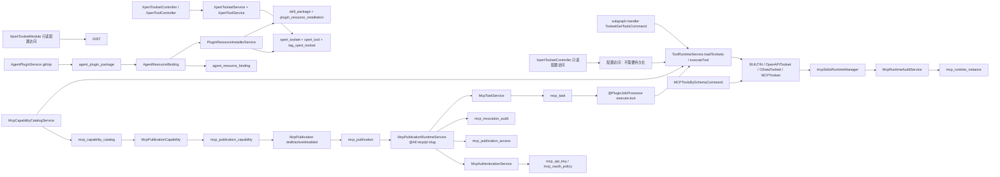
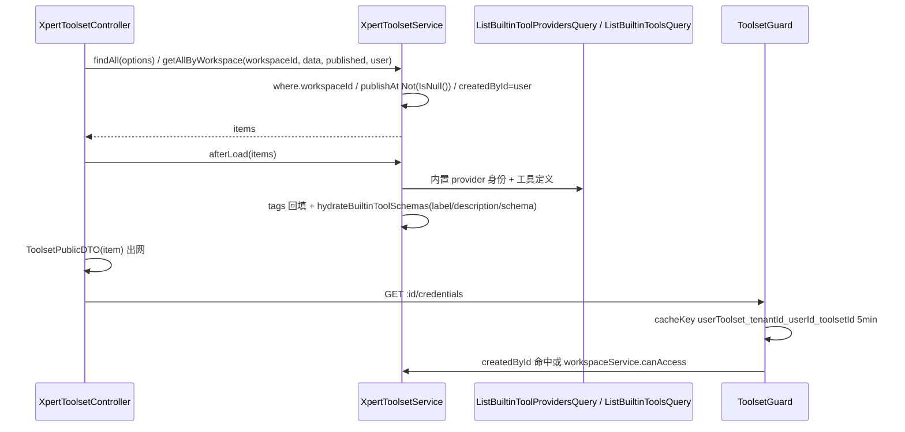
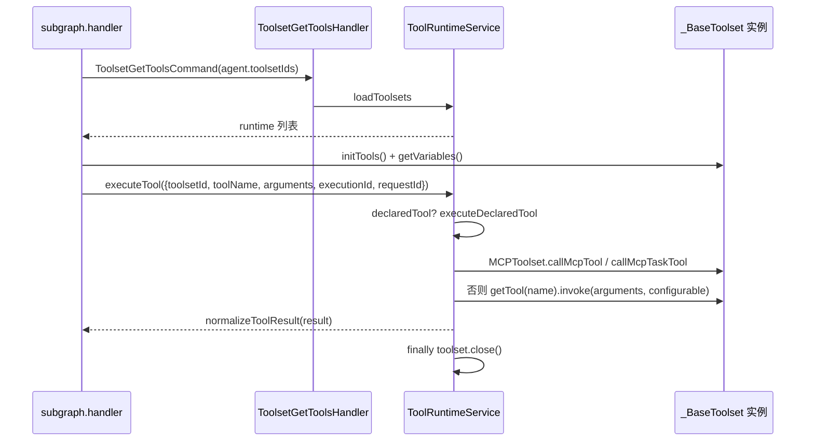
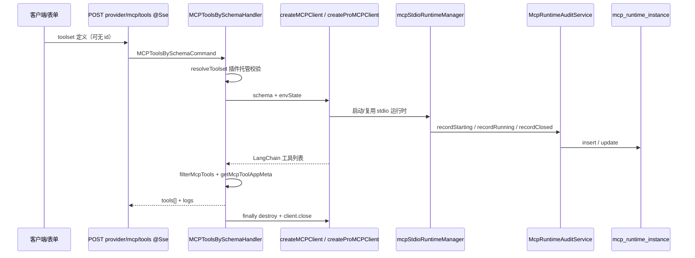
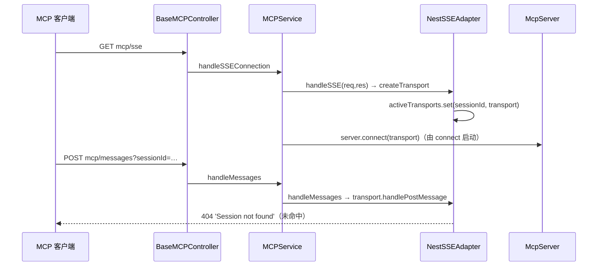
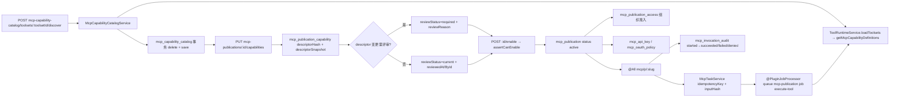
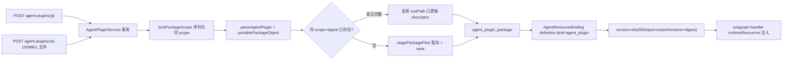
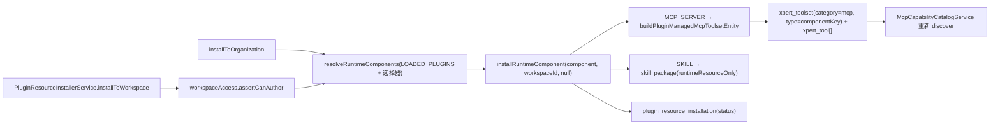

# 工具与 MCP 域 · 数据流转

> 只读梳理（commit `80f5676fd`）。范围：`packages/server-ai/src/xpert-toolset/**`（18 条自声明端点）、`src/xpert-tool/**`（3 条）、`src/mcp/**`（2 条服务端 SDK 端点，**0 表**）、`src/mcp-publication/**`（≈26 条）、`src/agent-plugin/**`（≈22 条），合计 **13 张自有表**；HTTP 前缀 `/api/xpert-toolset`、`/api/xpert-tool`、`/api/mcp/...`、`/api/agent-plugins`。引用为仓库根相对路径；未能证实处标 `[推测]`。

**本文引用的文件**

- [xpert-toolset/xpert-toolset.controller.ts](file://packages/server-ai/src/xpert-toolset/xpert-toolset.controller.ts)
- [xpert-toolset/xpert-toolset.service.ts](file://packages/server-ai/src/xpert-toolset/xpert-toolset.service.ts)
- [xpert-toolset/xpert-toolset.module.ts](file://packages/server-ai/src/xpert-toolset/xpert-toolset.module.ts)
- [xpert-toolset/guards/toolset.guard.ts](file://packages/server-ai/src/xpert-toolset/guards/toolset.guard.ts)
- [xpert-toolset/mcp-runtime.controller.ts](file://packages/server-ai/src/xpert-toolset/mcp-runtime.controller.ts)
- [xpert-toolset/mcp-runtime-audit.service.ts](file://packages/server-ai/src/xpert-toolset/mcp-runtime-audit.service.ts)
- [xpert-toolset/provider/mcp/mcp-stdio-runtime.ts](file://packages/server-ai/src/xpert-toolset/provider/mcp/mcp-stdio-runtime.ts)
- [xpert-toolset/commands/handlers/get-tools.handler.ts](file://packages/server-ai/src/xpert-toolset/commands/handlers/get-tools.handler.ts)
- [xpert-toolset/commands/handlers/mcp-tools-schema.handler.ts](file://packages/server-ai/src/xpert-toolset/commands/handlers/mcp-tools-schema.handler.ts)
- [xpert-tool/xpert-tool.controller.ts](file://packages/server-ai/src/xpert-tool/xpert-tool.controller.ts)
- [xpert-tool/xpert-tool.service.ts](file://packages/server-ai/src/xpert-tool/xpert-tool.service.ts)
- [xpert-tool/commands/handlers/tool-invoke.handler.ts](file://packages/server-ai/src/xpert-tool/commands/handlers/tool-invoke.handler.ts)
- [xpert-tool/commands/handlers/test-openapi.handler.ts](file://packages/server-ai/src/xpert-tool/commands/handlers/test-openapi.handler.ts)
- [tool-runtime/tool-runtime.service.ts](file://packages/server-ai/src/tool-runtime/tool-runtime.service.ts)
- [mcp/mcp.service.ts](file://packages/server-ai/src/mcp/mcp.service.ts)
- [mcp/transport/sse-transport.ts](file://packages/server-ai/src/mcp/transport/sse-transport.ts)
- [mcp-publication/mcp-publication.controller.ts](file://packages/server-ai/src/mcp-publication/mcp-publication.controller.ts)
- [mcp-publication/mcp-publication-management.controller.ts](file://packages/server-ai/src/mcp-publication/mcp-publication-management.controller.ts)
- [mcp-publication/mcp-publication-runtime.service.ts](file://packages/server-ai/src/mcp-publication/mcp-publication-runtime.service.ts)
- [mcp-publication/mcp-publication.service.ts](file://packages/server-ai/src/mcp-publication/mcp-publication.service.ts)
- [mcp-publication/mcp-capability-catalog.service.ts](file://packages/server-ai/src/mcp-publication/mcp-capability-catalog.service.ts)
- [mcp-publication/mcp-publication-access.service.ts](file://packages/server-ai/src/mcp-publication/mcp-publication-access.service.ts)
- [mcp-publication/mcp-authentication.service.ts](file://packages/server-ai/src/mcp-publication/mcp-authentication.service.ts)
- [mcp-publication/mcp-api-key.service.ts](file://packages/server-ai/src/mcp-publication/mcp-api-key.service.ts)
- [mcp-publication/mcp-invocation-audit.service.ts](file://packages/server-ai/src/mcp-publication/mcp-invocation-audit.service.ts)
- [mcp-publication/mcp-task.service.ts](file://packages/server-ai/src/mcp-publication/mcp-task.service.ts)
- [mcp-publication/mcp-task.processor.ts](file://packages/server-ai/src/mcp-publication/mcp-task.processor.ts)
- [mcp-publication/mcp-publication.module.ts](file://packages/server-ai/src/mcp-publication/mcp-publication.module.ts)
- [agent-plugin/agent-plugin.service.ts](file://packages/server-ai/src/agent-plugin/agent-plugin.service.ts)
- [agent-plugin/agent-plugin-installations.service.ts](file://packages/server-ai/src/agent-plugin/agent-plugin-installations.service.ts)
- [agent-plugin/agent-plugin.module.ts](file://packages/server-ai/src/agent-plugin/agent-plugin.module.ts)
- [plugin-resource/plugin-resource-installer.service.ts](file://packages/server-ai/src/plugin-resource/plugin-resource-installer.service.ts)
- [xpert-agent/commands/handlers/subgraph.handler.ts](file://packages/server-ai/src/xpert-agent/commands/handlers/subgraph.handler.ts)
- [contracts/src/ai/mcp-publication.model.ts](file://packages/contracts/src/ai/mcp-publication.model.ts)
- [contracts/src/ai/mcp-capability.model.ts](file://packages/contracts/src/ai/mcp-capability.model.ts)

## 目录

- [总览与读写面](#总览与读写面)
- [链路一 工具集发现与加载链](#链路一-工具集发现与加载链)
- [链路二 工具执行链](#链路二-工具执行链)
- [链路三 API 工具测试链](#链路三-api-工具测试链)
- [链路四 MCP 客户端链](#链路四-mcp-客户端链)
- [链路五 MCP 服务端会话链](#链路五-mcp-服务端会话链)
- [链路六 MCP 发布链](#链路六-mcp-发布链)
- [链路七 Agent 插件链](#链路七-agent-插件链)
- [链路八 平台插件安装器链](#链路八-平台插件安装器链)
- [状态机汇总](#状态机汇总)
- [本域写 vs 跨域写](#本域写-vs-跨域写)
- [已知风险](#已知风险)

## 总览与读写面

五个模块构成一条**「工具能力 → 运行时 → MCP 对外发布」**的单向管道：`xpert-toolset`/`xpert-tool` 是能力与配置的存量面，`tool-runtime` 是所有执行路径（助手、Agent、API 预览、MCP 发布与任务）的**唯一出口**，`mcp-publication` 把工具集能力投影成对外协议面，`agent-plugin` 把便携包投影成工具集。

图表来源：[xpert-toolset.controller.ts](file://packages/server-ai/src/xpert-toolset/xpert-toolset.controller.ts)、[tool-runtime.service.ts](file://packages/server-ai/src/tool-runtime/tool-runtime.service.ts)、[mcp-capability-catalog.service.ts](file://packages/server-ai/src/mcp-publication/mcp-capability-catalog.service.ts)、[agent-plugin.service.ts](file://packages/server-ai/src/agent-plugin/agent-plugin.service.ts)

四条互不重叠的持久面：① 工具集/工具（配置 + 标记 + M2M 标签）② stdio 运行时审计（只写不读业务）③ MCP 发布八表（快照/台账/密钥/审计/任务）④ Agent 插件两表（包 + 绑定）。`mcp` 模块自身**完全不落库**，只做服务端 SDK 封装。

章节来源：[xpert-toolset.module.ts](file://packages/server-ai/src/xpert-toolset/xpert-toolset.module.ts)（关键符号：XpertToolsetModule / TypeOrmModule.forFeature）、[mcp-publication.module.ts](file://packages/server-ai/src/mcp-publication/mcp-publication.module.ts)（关键符号：McpPublicationModule / MCP_PUBLICATION_ENTITIES）、[agent-plugin.module.ts](file://packages/server-ai/src/agent-plugin/agent-plugin.module.ts)（关键符号：AgentPluginModule / forFeature）

## 链路一 工具集发现与加载链

图表来源：[xpert-toolset.controller.ts](file://packages/server-ai/src/xpert-toolset/xpert-toolset.controller.ts)、[xpert-toolset.service.ts](file://packages/server-ai/src/xpert-toolset/xpert-toolset.service.ts)、[toolset.guard.ts](file://packages/server-ai/src/xpert-toolset/guards/toolset.guard.ts)

- 列表两入口：`GET /xpert-toolset`（`findAll`）与 `GET /xpert-toolset/by-workspace/:workspaceId`（`WorkspaceAuthoringGuard` + `getAllByWorkspace`）。后者在 `workspaceId ∈ {'null','undefined',''}` 时退化为 `workspaceId IS NULL AND createdById = user.id`，否则先 `assertWorkspaceAuthoringAccess`；`published=true` 追加 `publishAt IS NOT NULL`。
- **详情即二次装配**：所有出网点都经 `afterLoad(toolsets)`——内置工具集先按 `type` 批量取 provider 身份并回填 tags，再由 `hydrateBuiltinToolSchemas` 用 `ListBuiltinToolsQuery` 以 `??=` 语义补齐 `label/description/schema`（**不覆盖库里已有值**），最后映射 `ToolsetPublicDTO`。
- **凭据读取是独立守卫面**：`GET /xpert-toolset/:id/credentials` 挂 `ToolsetGuard`，缓存键 `userToolset_${tenantId}_${user.id}_${toolsetId}`、TTL 5 分钟；授权判定为「创建者本人」或「工作区可访问（`workspaceService.canAccess`）」，失败抛 `ForbiddenException`。写侧 `xpert_toolset.credentials` 带 `@Exclude({toPlainOnly:true})`，凭据加密步骤在 `createBuiltinToolset` 中被注释掉（见「已知风险」）。
- 工具发现端点族：`GET providers`、`GET provider/:name`、`GET builtin-provider/:name/tools`、`.../credentials-schema`、`.../icon`（`@Public`）、`POST provider/openapi/remote`、`POST provider/openapi/schema`（`ParserOpenAPISchemaCommand`）、`POST provider/odata/remote`、`POST provider/odata/schema`（`ParserODataSchemaCommand`）。
- **单工具集工具视图**：`GET /xpert-toolset/:toolsetId/tools` = `findOne(relations:['tools'])` → `afterLoad` → 返回补全后的 `tools`（不套 DTO）。
- **运行时加载**（真正的装配点）：`ToolsetGetToolsCommand` → `ToolsetGetToolsHandler` → `ToolRuntimeService.loadToolsets`，按 `category` 分派：`builtin → createBuiltinToolset`、`api + openapi → OpenAPIToolset`、`api + odata → ODataToolset`、`mcp → MCPToolset`、其它抛 `ToolProviderNotFoundError`；每个 runtime 绑定 `ToolHostApi`（`createToolCredentialsApi(toolset.credentials)`、订阅 events、model 客户端）并 `attachDeclaredToolAdapters`。

章节来源：[xpert-toolset.controller.ts](file://packages/server-ai/src/xpert-toolset/xpert-toolset.controller.ts)（关键符号：getAllByWorkspace / findAllTools / getToolsetTools / getCredentials）、[xpert-toolset.service.ts](file://packages/server-ai/src/xpert-toolset/xpert-toolset.service.ts)（关键符号：afterLoad / hydrateBuiltinToolSchemas）

## 链路二 工具执行链

图表来源：[subgraph.handler.ts](file://packages/server-ai/src/xpert-agent/commands/handlers/subgraph.handler.ts)、[tool-runtime.service.ts](file://packages/server-ai/src/tool-runtime/tool-runtime.service.ts)、[get-tools.handler.ts](file://packages/server-ai/src/xpert-toolset/commands/handlers/get-tools.handler.ts)

- **助手/Agent 侧装配**：`subgraph.handler.ts` 以 `new ToolsetGetToolsCommand(agent.toolsetIds ?? [], toolsetOptions)` 取运行时；随后把 Agent Plugin 动态资源的 `dynamicToolsetIds` 补装（**仅动态资源失败时容错**：catch 内 `toolset.close()` 后跳过，静态工具集失败仍抛错）；逐工具集 `initTools()` + `getVariables()`，并在工具重名时收缩（`new Set(withTools.map(t => t.name)).size !== withTools.length`）。
- **工具寻址三分支**（`executeTool`）：① 声明式工具（`declaredToolDefinition`）→ `executeDeclaredTool`；② `MCPToolset` 且同时给出 `serverName` + `remoteName` → 按 `remoteTaskMode` 走 `callMcpTaskTool` 或 `callMcpTool`；③ 其余 → `toolset.getTool(toolName)`，未命中抛 `ToolNotFoundError`，命中则 `tool.invoke(arguments, { configurable: { ...executionContext, tool_call_id: requestId, toolExecutionContext } })`。
- **作用域强约束**：`resolveToolsets` 中 `toolsetSnapshots` 只在 `source === 'api'` 时允许（否则 `McpToolsetSnapshotApiOnly`），且快照身份必须与请求 id 一致；`ToolRuntimeEnvironment` 注释逐字声明 `workspaceDataScope` 等派生目录字段 `are never accepted from callers`。
- **结果与错误回流**：成功统一 `normalizeToolResult`；失败原样上抛（`ToolNotFoundError`/`ToolProviderNotFoundError`），`finally` 无条件 `toolset.close()`。
- **记账回流**：`loadToolsets` 在存在 executionId 时创建 `createExecutionModelUsageRecorder`，用量经 `XpertAgentExecutionRecordUsageCommand` 写入 Agent 执行账本（跨域写）。
- **测试数据路径（faker）**：`GET /xpert-tool/:id/faker` → `XpertToolService.getParamsFaker` → `getTool(id, {relations:['toolset']})`；内置类目走 `ToolSchemaParser.parseZodToJsonSchema` + `JSONSchemaFaker.generate`；非内置走 `ToolsetGetToolsCommand([toolsetId], {workspaceId})` → `initTools()` → `getTool(tool.name)` → `lc_kwargs.schema ?? parseZodToJsonSchema`，`finally close()`。**该路径同样经 tool-runtime，不是并行实现。**

章节来源：[tool-runtime.service.ts](file://packages/server-ai/src/tool-runtime/tool-runtime.service.ts)（关键符号：ToolRuntimeService.loadToolsets / executeTool / resolveToolsets）、[subgraph.handler.ts](file://packages/server-ai/src/xpert-agent/commands/handlers/subgraph.handler.ts)（关键符号：ToolsetGetToolsCommand / initTools）

## 链路三 API 工具测试链

图表来源：[xpert-tool.controller.ts](file://packages/server-ai/src/xpert-tool/xpert-tool.controller.ts)、[xpert-tool.service.ts](file://packages/server-ai/src/xpert-tool/xpert-tool.service.ts)、[tool-invoke.handler.ts](file://packages/server-ai/src/xpert-tool/commands/handlers/tool-invoke.handler.ts)、[test-openapi.handler.ts](file://packages/server-ai/src/xpert-tool/commands/handlers/test-openapi.handler.ts)

- 前端测试入口 `POST /xpert-tool/test` → `testTool(body)`：按 `body.toolsetId`/`body.id` 分别取工具集与工具行，浅合并后交 `ToolInvokeCommand`；OpenAPI 专用入口 `POST /xpert-toolset/provider/openapi/test` 只是 `TestOpenAPICommandHandler` 转一次 `ToolInvokeCommand`，**两条入口共用同一 handler**。
- `ToolInvokeHandler` 前置断言：`!toolset || !tenantId || !toolset.workspaceId` → `BadRequestException(server-ai:Error.McpToolInvocationScopeRequired)`；因此**测试链也要求显式租户与工作区**。
- 参数按 `tool.schema.parameters` 分桶：`form`/`llm` 两路，值经 `ApiBasedToolSchemaParser.convertPropertyValueType(param.schema, value)` 转类型；无 schema 时回落 `{ llm: tool.parameters ?? {}, form: {} }`。
- 快照构造：`Object.assign(new XpertToolset(), toolset, { id: toolset.id ?? randomUUID(), tenantId, organizationId, workspaceId, tools: [tool] })`，作为 `toolsetSnapshots` 传入——这正是 tool-runtime 中**唯一允许快照的 `source:'api'` 通道**。
- 主体：`principal` 为登录用户，否则 `{ type:'service_account', id:'api-tool-invoke' }`；`executionId = requestId = randomUUID()`；`env` 来自 `EnvStateQuery(workspaceId)`；返回 `events.length ? { events, result } : result`。
- 错误归一：仅当 `error.name === 'ToolException'`（适配器不导出错误类，只能按 name 识别）时转 `ToolInvokeError(description:'Bad Request')`。

章节来源：[tool-invoke.handler.ts](file://packages/server-ai/src/xpert-tool/commands/handlers/tool-invoke.handler.ts)（关键符号：ToolInvokeHandler.execute / stringFormValue）、[xpert-tool.service.ts](file://packages/server-ai/src/xpert-tool/xpert-tool.service.ts)（关键符号：XpertToolService.testTool / getParamsFaker）

## 链路四 MCP 客户端链

图表来源：[mcp-tools-schema.handler.ts](file://packages/server-ai/src/xpert-toolset/commands/handlers/mcp-tools-schema.handler.ts)、[mcp-runtime-audit.service.ts](file://packages/server-ai/src/xpert-toolset/mcp-runtime-audit.service.ts)、[mcp-stdio-runtime.ts](file://packages/server-ai/src/xpert-toolset/provider/mcp/mcp-stdio-runtime.ts)

- 工具集 `category=mcp` 时，运行时装配产出 `MCPToolset(toolset, context)`；`POST /xpert-toolset/provider/mcp/tools` 走 `@Sse` 长连（`keepAlive(30000)` + `takeUntilClose(res)`），执行体是 `RunnableLambda.from(...)` 包 `MCPToolsBySchemaCommand`。
- `MCPToolsBySchemaHandler` 先 `resolveToolset`：若解析出「插件托管 MCP」选项，则必须带 `toolset.id`，且 `pluginName`/`componentKey` 与**已安装**实体逐字一致，否则 `BadRequestException('Plugin-managed MCP discovery must use the installed plugin component')`——防止用未安装配置探测运行时。
- 客户端按 `isPro()` 分叉：Pro 走 `createProMCPClient`，否则 `createMCPClient`；`toolset.schema` 需为 JSON 字符串。工具列表经 `filterMcpTools`（按 policy 白/黑名单）→ 逐个置 `verboseParsingErrors = true`，`schema` 取 `lc_kwargs.schema ?? parseZodToJsonSchema(tool.schema)`，MCP App 元数据经 `getMcpToolAppMeta` 投影为 `{ mcp: { serverName, name, displayName, visibility, ui }, _meta }`（`_meta` 桥接是临时兼容层）。
- **stdio 运行时审计面**：`mcpStdioRuntimeManager`（进程内单例）通过 `setAuditSink(this)` 把 `McpRuntimeAuditService` 接到生命周期钩子上——`recordStarting`（首插，含 `commandLabel`/`commandHash: sha256(command+args)`/`policySnapshot`）、`recordRunning`（`readyAt`/`startupDurationMs`/`runnerPid`/`childPid`/`stderrTail`）、`recordClosed`（`closedAt`/`closeReason`/`durationMs`）、`recordAppInstance`（仅在 `appInstanceId IS NULL` 时补写）。
- 运维端点（`@Controller('operations/mcp-runtimes')`，全部 `SUPER_ADMIN` 断言）：`GET`（库内记录 + 进程内活快照 merge）、`POST :runtimeId/stop`（`closeRuntime(id,'admin-stop')`）、`POST kill`（`killByFilter(...,'admin-kill')`）。默认查询窗口 180 天；启动钩子 `onApplicationBootstrap` 把 `starting|running|closing` 全部收尾为 `closed` + `closeReason='host-restart-or-lost'`。
- App 实例历史另有 `GET /xpert-toolset/mcp-apps/:appInstanceId/history`（`McpAppsController`）。

章节来源：[mcp-tools-schema.handler.ts](file://packages/server-ai/src/xpert-toolset/commands/handlers/mcp-tools-schema.handler.ts)（关键符号：MCPToolsBySchemaHandler.execute / resolveToolset）、[mcp-runtime.controller.ts](file://packages/server-ai/src/xpert-toolset/mcp-runtime.controller.ts)（关键符号：McpRuntimeController.list / stop / kill）

## 链路五 MCP 服务端会话链

图表来源：[mcp.service.ts](file://packages/server-ai/src/mcp/mcp.service.ts)、[sse-transport.ts](file://packages/server-ai/src/mcp/transport/sse-transport.ts)

- `MCPModule` 是 `global: true` 的动态模块（`register()` / `registerAsync()`），控制器仅 `BaseMCPController`（`@Public()`），导出 `MCPService`；`MCPService` 在 `onModuleInit` 里 `new McpServer({name, version, capabilities})`，再建 `NestSSEAdapter`（端点默认 `mcp/sse` ↔ `mcp/messages`）。
- 建连：`handleSSEConnection` → `sseAdapter.handleSSE(req,res)` → `createTransport(res)` 以 `${globalApiPrefix}/${messagesEndpoint}` 构造 `SSEServerTransport`，把 `_sessionId` 存进 `activeTransports`，并监听 `res.on('close')` 删除会话；**传输不手动 start**，由 `server.connect(transport)` 启动。
- 收发：`POST mcp/messages` 从 `req.query.sessionId` 取键，未命中直接 404 `Session not found`，命中后 `transport.handlePostMessage(req, res, req.body)`；异常时若未发头则 500。
- 能力注册：`scanAndRegisterProviders` 用 `DiscoveryService.getProviders()` + `MetadataScanner.getAllFilteredMethodNames` + `Reflector` 读 `MetadataKey.MCP_RESOURCE/MCP_TOOL/MCP_PROMPT`，映射到 `server.resource/tool/prompt`；参数类型（string/number/boolean/array/object/zod）在 `convertParametersToZod` 逐项转换，未知类型回落 `z.any()`。
- **协议版本**：`mcp` 模块自身**未定义**协议版本常量；版本由发布域持有——契约 `MCP_PROTOCOL_VERSION` 与 `mcp_publication.protocolVersion` 默认值同源（见链路六）。
- 该模块**无任何实体与迁移**，也不写库；会话状态仅存在于 `activeTransports` 内存 Map 中。

章节来源：[mcp.service.ts](file://packages/server-ai/src/mcp/mcp.service.ts)（关键符号：MCPService.handleSSEConnection / handleMessages / scanAndRegisterProviders / convertParametersToZod）、[sse-transport.ts](file://packages/server-ai/src/mcp/transport/sse-transport.ts)（关键符号：NestSSEAdapter.createTransport / handleMessages）

## 链路六 MCP 发布链

图表来源：[mcp-capability-catalog.service.ts](file://packages/server-ai/src/mcp-publication/mcp-capability-catalog.service.ts)、[mcp-publication.service.ts](file://packages/server-ai/src/mcp-publication/mcp-publication.service.ts)、[mcp-task.service.ts](file://packages/server-ai/src/mcp-publication/mcp-task.service.ts)、[mcp-task.processor.ts](file://packages/server-ai/src/mcp-publication/mcp-task.processor.ts)

- **能力台账（catalog）与发布绑定（binding）是两级投影**：`mcp_capability_catalog` 记录「某工具集当前声明了哪些能力」（replace 语义，唯一键 `(toolsetId, capabilityType, capabilityKey)`），`mcp_publication_capability` 记录「某发布要对外暴露哪些能力」（唯一键 `(publicationId, publicName)` 与 `(publicationId, toolsetId, capabilityType, capabilityKey)`）。**唯一索引即幂等键**——重复 discover/绑定在同一键上收敛为同一行。
- discover 路径：MCP 类或无 category 的工具集走 `consumerCapabilities.discover`（外部 MCP，要求 `workspaceId`，否则 `McpConsumerWorkspaceRequired`）；其余走 `loadToolsets` 后 `getMcpCapabilityDefinitions()`/`getMcpCapabilitySource?.()`，`finally` 关闭所有 runtime。校验含 1000 条上限、`assertValidMcpCapabilityDescriptor`、`capabilityType:capabilityKey` 去重、`tool.appResourceKey` 必须存在对应 `app:` 能力。
- 台账替换在**单事务内 `delete + save`**，随后仅对受影响 publication 发 `subscriptions.publishCatalogChanged(publicationId, types)`（订阅通知，不直接改绑定）。快照能力由 `getToolsetCapabilitySnapshot` / `restoreToolsetCapabilitySnapshot` 提供；作用域断言 `assertToolsetInCurrentScope` 要求 tenantId 与 organizationId 双向一致。
- **审核面**：`mcp_publication.reviewStatus ∈ current|required`。descriptor 变化经 `compareMcpCapabilityDescriptors` 分类，需审时写 `reviewStatus='required'` + `reviewReason`；`assertCanEnable` 在 `reviewStatus === 'required'` 时抛 `McpPublicationReviewRequired` 阻止 enable；审核通过把 `reviewStatus='current'`、`reviewReason=null`、`reviewedAt`、`reviewedById` 一次写入。
- **访问授权面**：`McpPublicationAccessService.enable/disable` 维护 `(publicationId, organizationId)` 唯一行；`enable` 先读后存，捕获唯一冲突（`isUniqueConstraintError`）后重取再存以吸收并发；两侧都发 `subscriptions.publishAccessInvalidated(publicationId)`；`isEnabled` 只看 `enabled=true`。共享发布（`organizationId IS NULL`）在 `list()` 中与自有发布合并去重。
- **认证面**：`McpAuthenticationService.authenticate` 解析裸 Bearer，token 以 `xpert_mcp_` 开头走 API Key 校验，否则 `assertMcpOAuthEnabled()` 后走 OAuth；`challenge` 依据 `authMethods.includes('oauth')` 与 Pro 开关返回 OAuth 挑战或裸 `Bearer`。API Key 物化：前缀常量 `xpert_mcp_`、存储前缀长度 24、`keyHash char(64)` 与 `keyPrefix` 各唯一，本表查询显式 `addSelect('apiKey.encryptedSecret')` 才可能带出密文。OAuth 策略与 publication 一对一唯一，`introspectionClientSecretEncrypted` 为 `select:false`，另有布尔位 `introspectionClientSecretConfigured` 供 UI 判断。
- **调用审计面**：`start` 写 `status='started'` + 脱敏 `argumentSummary`（`select:false`）；`succeeded` 写 `durationMs`；`failed` 时 `ForbiddenException → 'denied'`，其余 → `'failed'` + `errorCode`。`requestId` 唯一 ⇒ **一次调用恰一条**。
- **长任务面**：`create` 先算 `idempotencyKey = sha256(publicationId \0 subjectType \0 subjectId \0 requestId \0 typeof rpcRequestId \0 String(rpcRequestId) \0 capability.publicName)` 与 `inputHash = hashJson(arguments)`；命中 `(publicationId, idempotencyKey)` 唯一索引即 `assertIdempotentReplay` 后原样返回既有 task（并发插入冲突也走同一兜底）。队列健康检查失败抛 `-32603 McpTaskQueueUnavailable`；payload 上限 2 MiB；`lifetime` 默认 1h、上限 24h 写入 `expiresAt`；初始 `status='working'`、`revision=0`、`pollIntervalMs=2000`。`update` 只在 `input_required` 时合并 `inputResponses`，齐全则 `revision += 1` 并重新入队；`get` 对「已过期且非终态」就地判 `failed` + `MCP_TASK_EXPIRED`。处理器为 `@PluginJobProcessor({ pluginName:'@xpert-ai/platform', queueName:'mcp-publication', jobName:'execute-tool', concurrency:4 })`，最终仍调 `toolRuntime` 执行。
- 对外协议面：`@Public() @Controller('mcp/p') @All(':slug')` 全量交给 `McpPublicationRuntimeService.handle(slug, req, res, body)`（内含 traceparent/tracestate/baggage 提取与流式注册器）；`McpOAuthMetadataController` 暴露 `.well-known/oauth-protected-resource`；`McpFilesController` 由 `McpFilesGuard` 守住 `mcp/p` 下的文件能力。

章节来源：[mcp-capability-catalog.service.ts](file://packages/server-ai/src/mcp-publication/mcp-capability-catalog.service.ts)（关键符号：McpCapabilityCatalogService.discoverAndReplaceMcpToolset / replacePreparedToolsetCapabilities / externalCapabilityKey）、[mcp-publication-runtime.service.ts](file://packages/server-ai/src/mcp-publication/mcp-publication-runtime.service.ts)（关键符号：McpPublicationRuntimeService.handle）

## 链路七 Agent 插件链

图表来源：[agent-plugin.service.ts](file://packages/server-ai/src/agent-plugin/agent-plugin.service.ts)、[agent-plugin-installations.service.ts](file://packages/server-ai/src/agent-plugin/agent-plugin-installations.service.ts)、[subgraph.handler.ts](file://packages/server-ai/src/xpert-agent/commands/handlers/subgraph.handler.ts)

- 入库路径统一在**一个事务 + `lockPackageScope` 内**：`parseAgentPlugin(root)` 产出 `PortablePlugin`，`portablePackageDigest(root)` 产出 `digest`；随后 `findOne({ ...agentPluginScopeWhere(scope), digest })` 去重，命中且 `packageIntact` 时复用原 `rootPath` 只更新 `descriptor`，否则 `stagePackageFiles` 落盘新目录。源码注释逐字约束：`Never rewrite package identity, creation time or bindings during repair/reimport.`（**digest 表内不是唯一约束，去重靠应用层 + 该索引**）。
- descriptor 作为 `jsonb` 整块保存；`source` 记录 `{ kind:'git'|'zip', url?, ref?, commit?, subdirectory? }`。含 `activate` 时另走 `currentPackageBinding` / `activatePackage`，并在「绑定来源切换」时替换 binding。
- **绑定（binding）是唯一可执行引用**：`agent_resource_binding.definition.kind ∈ agent_plugin|middleware|external_xpert`；`version` 为 `sha256(JSON.stringify({ ...input, expertVersions, digest }))`；`installations[workspaceId] = { skills, toolsets, connectors }`；`expertVersions` 拍平发布版本（`publishedResourceVersion(...publishAt)`）。并发修订冲突由 `supersededById` + `ConflictException(AgentResourceRevisionConflict)` 表达，且 `enabled=false` 的旧绑定保留下来供审计。
- **装配与注入点**：Agent 启动时 `subgraph.handler` 读 `options.runtimeResources`（`isStart && !leaderKey` 才生效）→ `dynamicResources.toolsetIds` 经 `ToolsetGetToolsCommand` 补装 runtime、`skillSources` 进 `RUNTIME_RESOURCE_SKILLS`、`templates` 建子代理中间件，并挂 `runtimeResourceAuthorization` 中间件在调用前 `runtimeResourceService.resolve(...)` 兜底授权。
- 维护面：`GET agent-plugins/updates`、`POST agent-plugins/packages/:id/update`、`GET|POST agent-plugins/packages/:id/cleanup`；清理豁免由 `cleanupEligible` 表达——只有自动目录默认可回收，显式选择模板会保留引用。

章节来源：[agent-plugin.service.ts](file://packages/server-ai/src/agent-plugin/agent-plugin.service.ts)（关键符号：AgentPluginService.importPortable / lockPackageScope / createAuthorizedBinding）、[agent-plugin-installations.service.ts](file://packages/server-ai/src/agent-plugin/agent-plugin-installations.service.ts)（关键符号：AgentPluginInstallationsService.installedCatalog / saveTemplateCatalog）

## 链路八 平台插件安装器链

图表来源：[plugin-resource-installer.service.ts](file://packages/server-ai/src/plugin-resource/plugin-resource-installer.service.ts)、[agent-plugin-installations.service.ts](file://packages/server-ai/src/agent-plugin/agent-plugin-installations.service.ts)

- 安装器注入了四个仓库：`PluginResourceInstallation`、`SkillPackage`、`XpertToolset`、`XpertTool`，外加 `XpertToolsetService`、`McpCapabilityCatalogService`、`XpertService`、`XpertToolProviderRegistry` 与 `@Optional() @Inject(LOADED_PLUGINS)`。**它是本域唯一把插件组件投影为工具集/工具的写入口。**
- 工具集投影（`buildPluginManagedMcpToolsetEntity`）：`category = MCP`、`type = component.componentKey`、`name = '<componentKey> MCP'`、`schema = JSON.stringify({ mcpServers: { [componentKey]: portableServer ?? parsed.server } })`、`options = { disableToolDefault, needSandbox, pluginManaged, runtimeSource, pluginName, componentKey, xpertId?, definitionHash, mcpRuntime?, policy }`；`tools` 由 `policy.enabledTools` 展开为 `{ name, enabled:true, disabled:false, options:{ approvalMode } }`。
- 两种安装作用域：`installToWorkspace`（先 `assertCanAuthor(workspaceId)`，逐个组件安装并单独收集 `PENDING_AUTH`）与 `installToOrganization`（无 workspace）。Agent 插件侧经 `AgentPluginInstallationsService` 间接调用安装器；其文件头逐字声明 `Catalog reads do not install skills, toolsets or Connector bindings.`
- 对外契约：Agent 插件**只声明**要安装的 skills/toolsets/connectors，安装时才落 `xpert_toolset`/`xpert_tool`/`skill_package`；因此「Agent 插件域」与「平台插件域」共享同一投影器，**冲突面在这一层收敛**。

章节来源：[plugin-resource-installer.service.ts](file://packages/server-ai/src/plugin-resource/plugin-resource-installer.service.ts)（关键符号：PluginResourceInstallerService.installToWorkspace / installToOrganization / buildPluginManagedMcpToolsetEntity）

## 状态机汇总

| 载体 | 字段与取值 | 迁移规则 |
|---|---|---|
| `xpert_toolset` | **无 `status` 列**（实测实体无该字段） | 生命周期由继承字段表达：`publishAt`（`Not(IsNull())` 即「已发布」筛选）、`deletedAt`（`@DeleteDateColumn` 软删）；前端筛选 `published` 即查 `publishAt` |
| `xpert_tool` | `disabled`（有效）、`enabled`（`@deprecated use disabled`，两者同表共存） | `XpertToolSubscriber` 在 insert/update 强制工具名合法性；软删/恢复由 `XpertToolset.tools` 的 `cascade: insert/update/remove/soft-remove/recover` 驱动 |
| `mcp_runtime_instance` | `status: starting → running → closing → closed \| failed`；`origin: agent-toolset \| mcp-app-host` | `recordStarting/Running/Closed` 单向前进；宿主重启把残留 `starting\|running\|closing` 统一收尾 `closed` + `host-restart-or-lost`；`idleExpiresAt`/`maxLifetimeExpiresAt` 约束存活 |
| `mcp_publication` | `status: draft → active → disabled`；`reviewStatus: current \| required` | 创建即 `draft` + `current`；`assertCanEnable` 拒绝 `required` 上架；descriptor 变更可回退到 `required`；审核通过写 `reviewedAt`/`reviewedById` 并回 `current` |
| `mcp_publication_access` | `enabled` + `disabledAt`/`disabledById` 成对 | enable/disable 幂等 upsert；两侧都发订阅失效通知 |
| `mcp_api_key` | 「有效」= `revokedAt IS NULL AND (expiresAt IS NULL OR expiresAt > now())` | `revokedAt`/`revokedById` 一次性吊销；`lastUsedAt` 只读回写；`rotate` 端点建新键 |
| `mcp_oauth_policy` | `enabled`（默认 false）、`introspectionEnabled`（默认 false）、`introspectionClientSecretConfigured` | 与 publication 一对一；改策略需 Pro 能力校验 |
| `mcp_invocation_audit` | `status: started → succeeded \| failed \| denied` | 单次调用单条（`requestId` 唯一）；`ForbiddenException` 归 `denied` |
| `mcp_task` | `status: working → input_required → working → completed \| failed \| cancelled`；`revision` 单调 +1 | 过期非终态在 `get()` 就地判 `failed`；入队失败也落 `failed`；`idempotencyKey` 命中即重放 |
| `agent_plugin_package` | **无状态列**；身份即 `(scope, digest)` | 重导入复用行、只更新 `descriptor`；同 scope 同 digest 视为同一包 |
| `agent_resource_binding` | `enabled`（有效位）、`cleanupEligible`（默认 false）、`supersededById` | 修订冲突用 `supersededById` 串联版本链；`cleanupEligible` 决定能否被目录清理回收 |

章节来源：[xpert-toolset.entity.ts](file://packages/server-ai/src/xpert-toolset/xpert-toolset.entity.ts)（关键符号：XpertToolset）、[mcp-stdio-runtime.ts](file://packages/server-ai/src/xpert-toolset/provider/mcp/mcp-stdio-runtime.ts)（关键符号：McpRuntimeStatus / McpRuntimeOrigin）、[mcp-publication.service.ts](file://packages/server-ai/src/mcp-publication/mcp-publication.service.ts)（关键符号：assertCanEnable）

## 本域写 vs 跨域写

| 方向 | 表 | 写入者 | 说明 |
|---|---|---|---|
| 本域写 | `xpert_toolset` / `xpert_tool` / `tag_xpert_toolset` | `XpertToolsetService`、`XpertToolService`、`XpertToolsetSubscriber` / `XpertToolSubscriber` | 唯一配置面；`tag_*` 由 `@JoinTable` 隐式维护 |
| 本域写 | `mcp_runtime_instance` | `McpRuntimeAuditService` | 只增改，业务侧不读；仅运维端点与过滤器消费 |
| 本域写 | `mcp_capability_catalog` | `McpCapabilityCatalogService` | 事务内整体 replace |
| 本域写 | `mcp_publication` / `_capability` / `_access` / `mcp_api_key` / `mcp_oauth_policy` / `mcp_invocation_audit` / `mcp_task` | `McpPublicationService`、`McpApiKeyService`、`McpPublicationAccessService`、`McpOAuthService`、`McpInvocationAuditService`、`McpTaskService` | 全部带 `@Roles(SUPER_ADMIN)` 管理面或 `@Public` 运行面 |
| 本域写 | `agent_plugin_package` / `agent_resource_binding` | `AgentPluginService`、`AgentPluginInstallationsService` | 服务层 `requireResourceAdmin()` + `resourceScope()` 强制 organization |
| 跨域写（本域触发） | `plugin_resource_installation` | `PluginResourceInstallerService` | 与平台插件域共用安装台账 |
| 跨域写（本域触发） | `skill_package` | `PluginResourceInstallerService` | 迁移新增 `runtimeResourceOnly` 标记本域投影 |
| 跨域写（本域读） | `xpert_agent_execution`（用量） | `ToolRuntimeService` → `XpertAgentExecutionRecordUsageCommand` | executionId 存在才记账 |
| 跨域写（邻域回写本域） | `xpert_toolset` / `xpert_tool` | `PluginResourceInstallerService`（平台插件域触发） | 本域与平台插件域共用同一张配置表 |
| 跨域读 | `xpert_workspace`、`user`、`organization` | `ToolsetGuard`、`McpRuntimeAuditService`（原生 join `xpert_workspace`） | 仅权限与展示名 |
| 邻域写本域表 | `mcp_consumer_oauth_*`、`mcp_app_*` | `xpert-toolset` 模块直接注册的邻域实体/控制器 | 本批次范围外，仅登记归属 |

章节来源：[xpert-toolset.module.ts](file://packages/server-ai/src/xpert-toolset/xpert-toolset.module.ts)（关键符号：TypeOrmModule.forFeature）、[plugin-resource-installer.service.ts](file://packages/server-ai/src/plugin-resource/plugin-resource-installer.service.ts)（关键符号：PluginResourceInstallerService 构造函数）

## 已知风险

1. **凭据未加密**：`createBuiltinToolset` 中 `// encrypt credentials` / `// credentials = tool_configuration.encrypt_tool_credentials(credentials)` 两行被注释，`xpert_toolset.credentials` 以明文 json 落库，仅靠 `@Exclude({toPlainOnly:true})` 与 `ToolsetGuard` 做出口收敛——**落库态无加密防护**。
2. **缓存授权滞后**：`ToolsetGuard` 命中即返回，TTL 5 分钟；期间工作区权限被回收仍放行，且「未授权」不入缓存（每次穿透）→ 撤销权限有最长 5 分钟窗口。
3. **MCP 服务端模块未接线**：全仓仅 `mcp.module.ts` 自身命中 `MCPModule`，**未找到注册调用点**；`mcp/sse`、`mcp/messages` 是否可达取决于宿主装配，需与部署事实核对。
4. **台账可整表删**：`replacePreparedToolsetCapabilities` 在事务内先 `delete` 再 `save`；若 save 失败虽回滚，但并发 discover 与绑定变更之间没有乐观锁（`mcp_capability_catalog` 无 `@VersionColumn`），后写覆盖前写。
5. **绑定悬空可诊断但不可执行**：`mcp_publication_capability.toolsetId` 与 `mcp_capability_catalog.toolsetId` 均**故意不建外键**，注释写明 `intentionally not a FK so broken bindings stay diagnosable`；工具集删除后绑定仍在，执行期才会失败。
6. **审计参数摘要脱敏程度未确认**：`argumentSummary` 由 `summarizeArguments` 生成且 `select:false`，但具体截断/脱敏策略未在本轮逐一核对 `[推测]`。
7. **导出面与凭据面的耦合**：`ToolsetPublicDTO` 与 `@Exclude` 是两道独立防线，新增字段若忘记走 DTO/装饰器即可泄漏 `credentials`——属结构性风险而非当前缺陷。
8. **`mcp_task` 载荷明文入库**：`requestPayload`/`inputRequests`/`inputResponses` 虽 `select:false`，但仍以 json 明文持久化且上限 2 MiB，可能承载第三方工具入参。
9. **`resourceScope()` 强依赖 organization**：无 organization 上下文时 Agent 插件所有写操作直接 `ForbiddenException`，迁移 `20261012` 才把两个 FK 列改为可空——部署顺序错会导致安装失败。

章节来源：[xpert-toolset.service.ts](file://packages/server-ai/src/xpert-toolset/xpert-toolset.service.ts)（关键符号：createBuiltinToolset）、[toolset.guard.ts](file://packages/server-ai/src/xpert-toolset/guards/toolset.guard.ts)（关键符号：ToolsetGuard.canActivate）、[mcp-task.service.ts](file://packages/server-ai/src/mcp-publication/mcp-task.service.ts)（关键符号：McpTaskService.create / MAX_TASK_PAYLOAD_BYTES）
