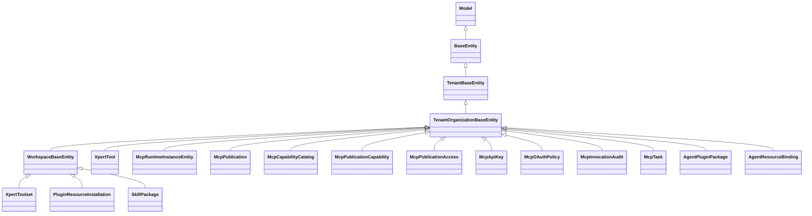

# 工具与 MCP 域 · 数据模型

> 只读梳理（commit `80f5676fd`）。源码根 `packages/server-ai/src/`（下称 `src/`），引用为仓库根相对路径。本域 **14 张自有表**（工具集与工具 **4 张**＝`xpert_toolset`(含 M2M `tag_xpert_toolset`) / `xpert_tool` / `mcp_runtime_instance` ＋ 其余，MCP 发布 **8 张**，Agent 插件 **2 张**；4+8+2=14）+ **9 张**被注册/被写的邻域表。列极多者只列关键列。未能证实处标 `[推测]`。

**本文引用的文件**

- [core/entities/base.entity.ts](file://packages/server-ai/src/core/entities/base.entity.ts)
- [xpert-toolset/xpert-toolset.entity.ts](file://packages/server-ai/src/xpert-toolset/xpert-toolset.entity.ts)
- [xpert-toolset/mcp-runtime-instance.entity.ts](file://packages/server-ai/src/xpert-toolset/mcp-runtime-instance.entity.ts)
- [xpert-toolset/xpert-toolset.module.ts](file://packages/server-ai/src/xpert-toolset/xpert-toolset.module.ts)
- [xpert-toolset/provider/mcp/mcp-stdio-runtime.ts](file://packages/server-ai/src/xpert-toolset/provider/mcp/mcp-stdio-runtime.ts)
- [xpert-toolset/mcp-runtime-audit.service.ts](file://packages/server-ai/src/xpert-toolset/mcp-runtime-audit.service.ts)
- [xpert-tool/xpert-tool.entity.ts](file://packages/server-ai/src/xpert-tool/xpert-tool.entity.ts)
- [xpert-tool/xpert-tool.service.ts](file://packages/server-ai/src/xpert-tool/xpert-tool.service.ts)
- [mcp-publication/entities/index.ts](file://packages/server-ai/src/mcp-publication/entities/index.ts)
- [mcp-publication/entities/mcp-publication.entity.ts](file://packages/server-ai/src/mcp-publication/entities/mcp-publication.entity.ts)
- [mcp-publication/entities/mcp-publication-capability.entity.ts](file://packages/server-ai/src/mcp-publication/entities/mcp-publication-capability.entity.ts)
- [mcp-publication/entities/mcp-capability-catalog.entity.ts](file://packages/server-ai/src/mcp-publication/entities/mcp-capability-catalog.entity.ts)
- [mcp-publication/entities/mcp-publication-access.entity.ts](file://packages/server-ai/src/mcp-publication/entities/mcp-publication-access.entity.ts)
- [mcp-publication/entities/mcp-api-key.entity.ts](file://packages/server-ai/src/mcp-publication/entities/mcp-api-key.entity.ts)
- [mcp-publication/entities/mcp-oauth-policy.entity.ts](file://packages/server-ai/src/mcp-publication/entities/mcp-oauth-policy.entity.ts)
- [mcp-publication/entities/mcp-invocation-audit.entity.ts](file://packages/server-ai/src/mcp-publication/entities/mcp-invocation-audit.entity.ts)
- [mcp-publication/entities/mcp-task.entity.ts](file://packages/server-ai/src/mcp-publication/entities/mcp-task.entity.ts)
- [mcp-publication/mcp-publication.module.ts](file://packages/server-ai/src/mcp-publication/mcp-publication.module.ts)
- [mcp-publication/mcp-capability-catalog.service.ts](file://packages/server-ai/src/mcp-publication/mcp-capability-catalog.service.ts)
- [mcp-publication/mcp-task.service.ts](file://packages/server-ai/src/mcp-publication/mcp-task.service.ts)
- [mcp-publication/mcp-api-key.service.ts](file://packages/server-ai/src/mcp-publication/mcp-api-key.service.ts)
- [mcp-publication/mcp-invocation-audit.service.ts](file://packages/server-ai/src/mcp-publication/mcp-invocation-audit.service.ts)
- [agent-plugin/agent-plugin.entity.ts](file://packages/server-ai/src/agent-plugin/agent-plugin.entity.ts)
- [agent-plugin/agent-plugin.module.ts](file://packages/server-ai/src/agent-plugin/agent-plugin.module.ts)
- [agent-plugin/agent-plugin.service.ts](file://packages/server-ai/src/agent-plugin/agent-plugin.service.ts)
- [agent-plugin/migrations/20260921-agent-plugins.sql](file://packages/server-ai/src/agent-plugin/migrations/20260921-agent-plugins.sql)
- [plugin-resource/plugin-resource-installation.entity.ts](file://packages/server-ai/src/plugin-resource/plugin-resource-installation.entity.ts)
- [plugin-resource/plugin-resource-installer.service.ts](file://packages/server-ai/src/plugin-resource/plugin-resource-installer.service.ts)
- [skill-package/skill-package.entity.ts](file://packages/server-ai/src/skill-package/skill-package.entity.ts)
- [mcp/mcp.service.ts](file://packages/server-ai/src/mcp/mcp.service.ts)

## 目录

- [实体基类与作用域](#实体基类与作用域)
- [① 工具集与工具子域](#-工具集与工具子域)
- [② MCP 发布子域](#-mcp-发布子域)
- [③ Agent 插件子域](#-agent-插件子域)
- [被注册与被写的邻域表](#被注册与被写的邻域表)
- [建模边界：快照、台账与密钥材料](#建模边界快照台账与密钥材料)
- [校验规则](#校验规则)
- [迁移与 DDL](#迁移与-ddl)
- [未确认项与「实测确认为无」](#未确认项与实测确认为无)

## 实体基类与作用域

图表来源：[base.entity.ts](file://packages/server-ai/src/core/entities/base.entity.ts)、[xpert-toolset.entity.ts](file://packages/server-ai/src/xpert-toolset/xpert-toolset.entity.ts)、[agent-plugin.entity.ts](file://packages/server-ai/src/agent-plugin/agent-plugin.entity.ts)

- `WorkspaceBaseEntity`（`src/core/entities/base.entity.ts`）：`workspace`（`ManyToOne(XpertWorkspace)`，`onUpdate:'CASCADE'` + `onDelete:'CASCADE'`，**nullable**）、`workspaceId`（`@Index()`，可空）、`publishAt`（timestamptz，可空）、`deletedAt`（**`@DeleteDateColumn` 软删**）。本域仅 `XpertToolset` 走这条线，因此**只有工具集可软删**；`xpert_tool` 与 MCP 发布八表、Agent 插件两表均为 `TenantOrganizationBaseEntity`，**无 `deletedAt`、无 `workspaceId` 基列**。
- 隔离键：所有表都有 `tenantId`（可空，`@Index()`）与 `organizationId`（可空，`@Index()`）；域内服务普遍用 `organizationId ?? IsNull()` 收敛作用域（发布、能力台账、API Key、任务、审计一致）。
- **`mcp_runtime_instance` 是例外**：它继承 `TenantOrganizationBaseEntity` 却**自行声明 `workspaceId`、`toolsetId`、`xpertId` 等一串裸 `@Column` 字符串**（非外键、无 `@RelationId`），因为它是审计投影而非业务实体。

章节来源：[base.entity.ts](file://packages/server-ai/src/core/entities/base.entity.ts)（关键符号：WorkspaceBaseEntity / publishAt / deletedAt）、[mcp-runtime-instance.entity.ts](file://packages/server-ai/src/xpert-toolset/mcp-runtime-instance.entity.ts)（关键符号：McpRuntimeInstanceEntity）

## ① 工具集与工具子域

| 实体类 / 表名 | 关键列（唯一索引·外键·隐藏列） | 生产方 | 主要消费方 | 用途 |
|---|---|---|---|---|
| `XpertToolset` / `xpert_toolset` | `name`、`type`(varchar 50)、`category`(varchar 10)、`description`、`avatar`(json)、`options`(json)、**`credentials`(json, `@Exclude({toPlainOnly:true})`)**、`schema`(text)、`schemaType`(varchar)、`privacyPolicy`、`customDisclaimer`；继承 `workspaceId`/`publishAt`/`deletedAt`；**无 name 唯一索引** | `XpertToolsetService.create`/`createBuiltinToolset`/`updateToolset`、`PluginResourceInstallerService` | `ToolRuntimeService`、`XpertToolService`、`McpCapabilityCatalogService`、`mcp-publication`（跨域 forFeature 只读工具集） | 助手可挂载的工具集实例：provider 类型 + 凭据 + OpenAPI/OData schema 载体 |
| M2M `tag_xpert_toolset`（无实体类） | 由 `@ManyToMany(() => Tag, { cascade:true, eager:true })` + `@JoinTable({ name:'tag_xpert_toolset' })` 声明 | `XpertToolsetService.create/save`（经 `assertValidTagAssociations(..., TagCategoryEnum.TOOLSET)`） | 列表/详情接口（`eager` 自动带出） | 工具集 ↔ 标签联接表；`cascade:true` 意味着保存工具集会级联写标签 |
| `XpertTool` / `xpert_tool` | `name`、`label`(json)、`description`、`avatar`(json)、**`enabled`（`@deprecated use disabled`）**、`disabled`、`schema`(json)、`parameters`(json)、`options`(json)；`toolset` → `ManyToOne(XpertToolset, { onDelete:'CASCADE' })` + `JoinColumn()`；`toolsetId`（`@RelationId`，裸 `@Column` 冗余列）；**无唯一索引** | `XpertToolset.tools` 级联写入（`cascade: insert/update/remove/soft-remove/recover`）、`PluginResourceInstallerService`（`xpert_tool` 仓库）、`XpertToolSubscriber` 校验 | `XpertToolService.getTool/testTool/getParamsFaker`、`tool-runtime` 的 `toolset.getTool(name)` | 工具集下**单条可禁用、可筛选**的工具实例；权限粒度低于工具集 |
| `McpRuntimeInstanceEntity` / `mcp_runtime_instance` | `serverName`(必填)、`pluginManaged`(默认 false)、`pluginName`/`componentKey`/`pluginRuntimeId`/`resourceInstallationId`/`xpertId`/`agentKey`/`executionId`/`conversationId`/`appInstanceId`（均裸列）、`origin`(varchar 默认 `agent-toolset`)、`status`(varchar)、`startedAt`(必填)、`idleExpiresAt`/`maxLifetimeExpiresAt`/`readyAt`/`closedAt`、`closeReason`、`startupDurationMs`/`durationMs`/`runnerPid`/`childPid`(int)、`stderrTail`(text)、`commandLabel`/`commandHash`、`policySnapshot`(jsonb)、`toolsetName`、`workspaceId`/`toolsetId`(裸列)；**5 个复合索引**：`(tenantId,workspaceId,toolsetId)`、`(pluginName,componentKey)`、`(status,startedAt)`、`(executionId)`、`(appInstanceId)` | `McpRuntimeAuditService.recordStarting/recordRunning/recordClosed/recordAppInstance`（由 `mcpStdioRuntimeManager.setAuditSink` 驱动） | `POST /operations/mcp-runtimes/:runtimeId/stop`、`GET /operations/mcp-runtimes`（含 `xpert_workspace` 原生 join 取展示名） | MCP stdio 运行时**生命周期审计**：起停时间、PID、退出原因、命令指纹与策略快照 |

- `commandHash = sha256(JSON.stringify({ command, args }))`，而展示用 `commandLabel` 逐参数过 `sanitizeCommandArg`：命中 `/(token|secret|password|passwd|key)=/i` 的值替换为 `[redacted]`、绝对路径只留 basename、超 120 字符截断——**这是本域唯一带内建脱敏的列**。
- `policySnapshot` 只白名单 `provider`/`startupTimeoutMs`/`idleTimeoutMs`/`maxLifetimeMs`/`allowedCommands`（后者只留 basename）。
- **该表只增不改业务语义**：`recordRunning`/`recordClosed` 都是按 id `update`，从不 `delete`；默认查询窗口 180 天（`DEFAULT_RUNTIME_AUDIT_RETENTION_DAYS`），过期行只是不被列出，**无清理任务**。

章节来源：[xpert-toolset.entity.ts](file://packages/server-ai/src/xpert-toolset/xpert-toolset.entity.ts)（关键符号：XpertToolset / tools / tags）、[xpert-tool.entity.ts](file://packages/server-ai/src/xpert-tool/xpert-tool.entity.ts)（关键符号：XpertTool / enabled / disabled / toolset / toolsetId）、[mcp-runtime-audit.service.ts](file://packages/server-ai/src/xpert-toolset/mcp-runtime-audit.service.ts)（关键符号：McpRuntimeAuditService.recordStarting / policySnapshot / commandHash）

## ② MCP 发布子域

8 张表由 `MCP_PUBLICATION_ENTITIES` 常量一次性注册（`entities/index.ts`），forFeature 时另加 `XpertToolset` 与 `User`。

| 实体类 / 表名 | 关键列（唯一索引·外键·隐藏列） | 生产方 | 主要消费方 | 用途 |
|---|---|---|---|---|
| `McpPublication` / `mcp_publication` | `name`(191)、`slug`(191)、`status`(20 默认 `draft`)、`authMethods`(json 默认 `[]`)、`instructions`(text)、`runtime`(json)、`protocolVersion`(20 默认 `MCP_PROTOCOL_VERSION`)、`reviewStatus`(20 默认 `current`)、`reviewReason`(text)、`reviewedAt`、`reviewedById`(uuid)；**唯一 `IDX_mcp_publication_slug(slug)`** + `IDX_mcp_publication_scope_status(tenantId,organizationId,status)`；`@OneToMany` capabilities（**未声明 cascade**） | `McpPublicationService.create`（`status:'draft'`、`reviewStatus:'current'`） | `McpPublicationRuntimeService`（`findActiveBySlug`）、管理控制器、`McpApiKeyService`/`McpOAuthService`/`McpTaskService` | 对外 MCP 服务端的发布单：slug 是唯一对外地址 |
| `McpPublicationCapability` / `mcp_publication_capability` | `publicationId`(uuid，`ManyToOne(McpPublication,{onDelete:'CASCADE'})`+`JoinColumn`)、`toolsetId`(uuid，**故意无外键**)、`capabilityType`(40)、`capabilityKey`(191)、`publicName`(191)、`enabled`(默认 true)、`policy`(json)、**`descriptorHash`(char 64)**、**`descriptorSnapshot`(json，非空，无 select:false)**、`pluginVersion`(64)；**唯一 `(publicationId, publicName)`** + **唯一 `(publicationId, toolsetId, capabilityType, capabilityKey)`** + `(tenantId,organizationId,enabled)` | `McpPublicationService.replaceCapabilities` / `replaceCapabilitiesWithCatalog` | `McpPublicationRuntimeService`（注册器逐条注册）、`McpCapabilityCatalogService`（catalog 变更时回写 review）、`McpTaskService` | 发布单 ↔ 能力的**绑定 + 描述符快照**：唯一索引即幂等键，快照用于变更分类 |
| `McpCapabilityCatalog` / `mcp_capability_catalog` | `toolsetId`(uuid，**注释明确 intentionally not a FK**)、`capabilityType`(40)、`capabilityKey`(191)、**`descriptorHash`(char 64)**、`descriptor`(json 非空)、`enabled`(默认 true)；**唯一 `IDX_mcp_capability_catalog_binding(toolsetId, capabilityType, capabilityKey)`** + `(tenantId,organizationId,enabled)` | `McpCapabilityCatalogService.replacePreparedToolsetCapabilities`（事务 delete + save）、`PluginResourceInstallerService` | `ToolRuntimeService.describeCapabilities`、`McpPublicationService.availableCapabilities/loadCatalogForBindings` | 工具集**当前声明**的能力台账（发现结果），是绑定可选项的来源 |
| `McpPublicationAccess` / `mcp_publication_access` | `publicationId`(uuid，`ManyToOne({nullable:false, onDelete:'CASCADE'})`)、`enabled`(默认 true)、`enabledById`(uuid)、`disabledAt`、`disabledById`(uuid)；**唯一 `IDX_mcp_publication_access_organization(publicationId, organizationId)`** + `(tenantId,organizationId,enabled)` | `McpPublicationAccessService.enable/disable`（唯一冲突竞态重取） | `McpPublicationAuthorizationService`、`McpPublicationService.list`（共享发布合并） | 组织级**准入开关**：决定某组织能否用共享发布 |
| `McpApiKey` / `mcp_api_key` | `publicationId`(`onDelete:'CASCADE'`)、`name`(100)、`keyPrefix`(32)、**`keyHash`(char 64, `select:false` + `@Exclude({toPlainOnly:true})`)**、**`encryptedSecret`(text, `select:false` + `@Exclude`)**、`subjectType`(24)、`subjectId`(uuid)、`scopes`(json 默认 `[]`)、`expiresAt`、`lastUsedAt`、`revokedAt`、`revokedById`；**唯一 `IDX_mcp_api_key_hash(keyHash)`** + **唯一 `IDX_mcp_api_key_prefix(keyPrefix)`** + `(tenantId,publicationId,revokedAt,expiresAt)` | `McpApiKeyService.createForPublication`（前缀常量 `xpert_mcp_`、`STORED_PREFIX_LENGTH=24`） | `McpAuthenticationService.authenticate`、管理控制器 `rotate` | 调用方凭据：**哈希用于校验、密文用于回显**，两列都默认不出网 |
| `McpOAuthPolicy` / `mcp_oauth_policy` | `publicationId`(**`OneToOne(McpPublication,{nullable:false, onDelete:'CASCADE'})`**)、`issuer`(text)、`audience`(text)、`requiredScopes`(json 默认 `[]`)、`subjectMapping`(json 非空)、`introspectionEnabled`(默认 false)、`introspectionEndpoint`、`introspectionClientId`、**`introspectionClientSecretEncrypted`(text, `select:false`，无 `@Exclude`)**、`introspectionClientSecretConfigured`(默认 false)、`enabled`(默认 false)；**唯一 `IDX_mcp_oauth_policy_publication(publicationId)`** | `McpOAuthService`（管理端点 `PUT mcp-publications/:id/oauth-policy`） | `McpOAuthService.authenticate/challenge`、`McpAuthenticationService` | 发布单的 OAuth 资源服务器策略，含与 publication 一对一的唯一约束 |
| `McpInvocationAudit` / `mcp_invocation_audit` | `publicationId`(uuid，**`ManyToOne({nullable:false, onDelete:'RESTRICT'})`**——全表唯一 RESTRICT)、`capabilityId`/`toolsetId`(uuid 可空)、`capabilityKey`/`publicName`(191 可空)、`authMethod`(20)、`subjectType`(24)、`subjectId`(uuid)、`clientName`(191)、`requestId`(uuid)、`traceId`(64)、`status`(20)、`durationMs`(int)、`errorCode`(100)、**`argumentSummary`(json, `select:false`)**；**唯一 `IDX_mcp_invocation_audit_request(requestId)`** + `(tenantId,publicationId,createdAt)` + `(tenantId,subjectId,createdAt)` | `McpInvocationAuditService.start/succeeded/failed` | 管理端点 `GET mcp-publications/:id/audit`、`McpPublicationService.list`（MAX(createdAt) 报表） | 逐次调用审计：一次调用一条，`RESTRICT` 保证发布单不可带审计被硬删 |
| `McpTask` / `mcp_task` | `publicationId`(`onDelete:'CASCADE'`)、`taskId`(uuid)、`capabilityId`(uuid)、`executionId`(uuid)、`requestId`(191)、`toolName`(191)、`idempotencyKey`(191)、**`inputHash`(char 64)**、`subjectType`(24)、`subjectId`(uuid)、`queueJobId`(191)、`status`(24)、`statusMessage`(500)、`progress`(numeric 5,4)、`pollIntervalMs`(int)、**`inputRequests`/`inputResponses`/`requestPayload`/`resultRef`/`error` 均 json `select:false`**、`revision`(int 默认 0，**普通列不是 `@VersionColumn`**)、`expiresAt`(非空)；**唯一 `IDX_mcp_task_task_id(taskId)`** + **唯一 `IDX_mcp_task_idempotency(publicationId, idempotencyKey)`** + `(tenantId,publicationId,status,expiresAt)` + `(tenantId,publicationId,subjectType,subjectId,updatedAt)` | `McpTaskService.create`（`idempotencyKey` 与 `inputHash` 由 service 计算） | `McpTaskService.get/update/cancel`、`McpTaskProcessor`（`@PluginJobProcessor` queue `mcp-publication` job `execute-tool`） | 长任务台账：幂等键 + 输入指纹 + 可选修订号 + 过期时间构成完整的可重放契约 |

- **幂等键口径**：`idempotencyKey = sha256(publicationId \0 subjectType \0 subjectId \0 requestId \0 typeof rpcRequestId \0 String(rpcRequestId) \0 capability.publicName)`；`inputHash = hashJson(arguments)`。命中唯一索引时 `assertIdempotentReplay` 校验主体与指纹后**返回既有任务**，不新建行。
- **`revision` 不是并发控制**：仅在 `input_required → working` 的补充输入路径 `revision += 1`，用于让客户端识别状态推进；`mcp_task` 无 `@VersionColumn`，真正的并发保护来自唯一索引与单 worker（concurrency 4）。
- **外键语义分化明显**：`RESTRICT`（审计）、`CASCADE`（能力绑定、准入、API Key、OAuth、任务）、**完全无外键**（`mcp_capability_catalog.toolsetId`、`mcp_publication_capability.toolsetId`）。后两者是刻意的可诊断性取舍。

章节来源：[mcp-publication.entity.ts](file://packages/server-ai/src/mcp-publication/entities/mcp-publication.entity.ts)（关键符号：McpPublication / IDX_mcp_publication_slug）、[mcp-task.entity.ts](file://packages/server-ai/src/mcp-publication/entities/mcp-task.entity.ts)（关键符号：McpTask / IDX_mcp_task_idempotency / inputHash）、[mcp-api-key.entity.ts](file://packages/server-ai/src/mcp-publication/entities/mcp-api-key.entity.ts)（关键符号：McpApiKey / keyHash）

## ③ Agent 插件子域

| 实体类 / 表名 | 关键列（唯一索引·外键·隐藏列） | 生产方 | 主要消费方 | 用途 |
|---|---|---|---|---|
| `AgentPluginPackage` / `agent_plugin_package` | `rootPath`(varchar 非空)、`digest`(varchar 非空)、`descriptor`(jsonb 非空，类型 `PortablePlugin`)、`source`(jsonb 非空，`{ kind:'git'|'zip', url?, ref?, commit?, subdirectory? }`)；**`@Index(['tenantId','organizationId','digest'])` 非唯一**（迁移同名 `IDX_agent_plugin_package_scope` 亦非 UNIQUE） | `AgentPluginService` 事务内 `repository.create/save`（`git`/`zip` 两入口 + 维护面 `packages/:id/update`） | `AgentPluginInstallationsService.installedCatalog/saveTemplateCatalog`、`AgentPluginService.list`、更新/清理服务 | 便携插件包清单：**行身份即 (scope, digest)**，去重靠应用层 `findOne({ ...scope, digest })` + `packageIntact` 校验 |
| `AgentResourceBinding` / `agent_resource_binding` | `title`、`description`、`version`(非空)、`workspaceIds`(jsonb)、`definition`(jsonb 非空，`RuntimeResourceDefinition`，`kind ∈ agent_plugin|middleware|external_xpert`)、`installations`(jsonb 默认 `{}`，`{ [workspaceId]: { skills, toolsets, connectors? } }`)、`expertVersions`(jsonb 默认 `{}`)、`enabled`(默认 true)、**`cleanupEligible`(默认 false)**、`supersededById`(uuid)；`@Index(['tenantId','organizationId','enabled'])`（迁移同名 `IDX_agent_resource_binding_scope`） | `AgentPluginService.createAuthorizedBinding`（`version = sha256(JSON.stringify({...input, expertVersions, digest}))`） | `AgentPluginInstallationsService`、`subgraph.handler` 的 `runtimeResources`、模板/清理/更新服务 | 可执行引用：把包投影到工作区、专家版本与安装结果，并保留被取代版本链 |

- `definition.kind` 三值由控制器 DTO 校验（`agent_plugin` 走包投影、`middleware` 走中间件注册表校验、`external_xpert` 引用外部发布专家）。
- `cleanupEligible` 的注释逐字规定回收边界：`Only automatic catalog defaults may be collected; selecting a template reserves the reference.`
- **`digest` 是版本而非主键**：`definitionHash = pkg.digest` 会被透传进插件组件（skills 与 `mcp.json` 组件），因此「同 digest 视为不可变包」是整条链的隐含前提。
- 迁移给 `agent_plugin_package`/`agent_resource_binding` 都建了 `tenantId NOT NULL REFERENCES tenant(id) ON DELETE CASCADE`，`organizationId` 为 `REFERENCES organization(id) ON DELETE CASCADE` 且可空——与实体的可空 `organizationId` 一致。

章节来源：[agent-plugin.entity.ts](file://packages/server-ai/src/agent-plugin/agent-plugin.entity.ts)（关键符号：AgentPluginPackage / AgentResourceBinding / cleanupEligible / supersededById）、[agent-plugin.service.ts](file://packages/server-ai/src/agent-plugin/agent-plugin.service.ts)（关键符号：portablePackageDigest / createAuthorizedBinding）

## 被注册与被写的邻域表

这些表**不属于本域 14 张**，但被本域模块注册进 forFeature 或直接写入，必须一起理解。

| 实体类 / 表名 | 归属 | 与本域的关系 | 关键列（节选） |
|---|---|---|---|
| `PluginResourceInstallation` / `plugin_resource_installation` | 平台插件域 | 注册于 `XpertToolsetModule.forFeature`；由 `PluginResourceInstallerService` 写；`McpRuntimeAuditService.findResourceInstallation` 反查它补 `resourceInstallationId` | `pluginName`、`componentType`(varchar)、`componentKey`、`xpertId?`、`agentKey?`、`runtimeType`、`runtimeId?`、`runtimeNodeKey?`、`definitionHash`、`status`、`config`(jsonb)、`enabled`(默认 true)；`@Index(['workspaceId','xpertId','agentKey','pluginName','componentType','componentKey'])`；继承 `WorkspaceBaseEntity`（可软删） |
| `SkillPackage` / `skill_package` | 技能域 | `PluginResourceInstallerService` 注入 `Repository<SkillPackage>` 直接写 | `runtimeResourceOnly`(默认 false，**由 `20260921` 迁移新增**)、`skillIndexId` + `ManyToOne(SkillRepositoryIndex,{onDelete:'CASCADE', nullable:true})`、`name`(json)、`visibility`(varchar 默认 `private`)、`packagePath`、`sharedSkillId`、`sharedPackagePath`、`metadata`(json)、`instructions`(json) |
| `XpertToolset` / `XpertTool` | **本域** | 被 `McpPublicationModule.forFeature` 反向注册（发布域只读工具集与凭据）；被 `PluginResourceInstallerService` 跨域写入 | 见 ① 子域表 |
| `User` | 核心域 | 被 `McpPublicationModule.forFeature([...MCP_PUBLICATION_ENTITIES, XpertToolset, User])` 注册 | 供审计/审核人展示 `[推测：仅展示与关系解析用途]` |
| `McpCapabilityCatalog` / `McpPublicationCapability` | **本域（②）** | 被 `XpertToolsetModule.forFeature` 反向注册，供工具集模块内 `ToolRuntimeService` 读能力台账 | 见 ② 子域表 |
| `McpAppAudit` / `McpAppHistory` / `McpConsumerOAuthCredential` / `McpConsumerOAuthSession` | MCP App 与消费端邻域 | 由 `xpert-toolset` 模块 forFeature 注册并挂 `McpAppsController`/`McpConsumer*Controller`；**不在本批次范围** | 未逐列核对 |

章节来源：[xpert-toolset.module.ts](file://packages/server-ai/src/xpert-toolset/xpert-toolset.module.ts)（关键符号：TypeOrmModule.forFeature / PluginResourceInstallation / McpCapabilityCatalog）、[plugin-resource-installation.entity.ts](file://packages/server-ai/src/plugin-resource/plugin-resource-installation.entity.ts)（关键符号：PluginResourceInstallation）、[skill-package.entity.ts](file://packages/server-ai/src/skill-package/skill-package.entity.ts)（关键符号：SkillPackage / runtimeResourceOnly）

## 建模边界：快照、台账与密钥材料

- **快照（snapshot）**：`mcp_publication_capability.descriptorSnapshot`（json，非空，**可读可出网**）与 `mcp_capability_catalog.descriptor`（json，非空）。两者都配 `descriptorHash char(64)`，注释说明用途是 `Required to classify descriptor changes instead of treating every hash change as breaking.`——即**哈希用于变更分类而非强判失败**。另有 `mcp_runtime_instance.policySnapshot`（运行策略白名单快照）与 `agent_plugin_package.descriptor`/`source`（包清单与来源快照）。
- **台账（ledger）**：`mcp_capability_catalog`（能力发现台账，整体 replace）、`mcp_invocation_audit`（调用台账，`requestId` 唯一 ⇒ 只追加）、`mcp_task`（长任务台账，幂等键去重）、`mcp_runtime_instance`（运行时生命周期台账）、`plugin_resource_installation`（安装台账）。台账共同特征：**可追溯、极少改、以唯一键防重**。
- **密钥材料与脱敏边界**（三层）：
  1. **库内不加密**：`xpert_toolset.credentials`（json 明文，仅 `@Exclude({toPlainOnly:true})`）。
  2. **库内加密 + 双重隐藏**：`mcp_api_key.keyHash`（char 64，`select:false` + `@Exclude`）与 `mcp_api_key.encryptedSecret`（text，`select:false` + `@Exclude`）；读取密文必须显式 `.addSelect('apiKey.encryptedSecret')`。
  3. **库内加密 + 仅 `select:false`（无 `@Exclude`）**：`mcp_oauth_policy.introspectionClientSecretEncrypted`。另有布尔位 `introspectionClientSecretConfigured` 让 UI 在不读密文的情况下判断「是否已配置」——这是本域最干净的密钥建模。
- **审计脱敏**：`mcp_invocation_audit.argumentSummary`（json，`select:false`）由 `summarizeArguments` 生成；`mcp_task.requestPayload`/`inputRequests`/`inputResponses`（json，`select:false`）承载完整入参与 elicitation 往返，**属高敏感载荷**（单条上限 2 MiB）。运行时的 `commandLabel` 是全域唯一带内建字符串脱敏的列。
- **不可变 vs 可变**：`agent_plugin_package` 的 `digest`/身份字段视为不可变（重导入只更新 `descriptor` 与 `rootPath`）；`mcp_capability_catalog` 与 `mcp_publication_capability` 是可重建投影（delete + save）；`mcp_publication_access`/`mcp_api_key` 用时间戳字段（`disabledAt`/`revokedAt`）表达撤销而非删行。

章节来源：[mcp-publication-capability.entity.ts](file://packages/server-ai/src/mcp-publication/entities/mcp-publication-capability.entity.ts)（关键符号：descriptorHash / descriptorSnapshot / toolsetId 注释）、[mcp-api-key.entity.ts](file://packages/server-ai/src/mcp-publication/entities/mcp-api-key.entity.ts)（关键符号：keyHash / encryptedSecret / select:false）、[mcp-oauth-policy.entity.ts](file://packages/server-ai/src/mcp-publication/entities/mcp-oauth-policy.entity.ts)（关键符号：introspectionClientSecretConfigured）

## 校验规则

- **唯一约束（冲突即幂等键）**：`mcp_publication.slug`；`mcp_publication_capability (publicationId, publicName)` 与 `(publicationId, toolsetId, capabilityType, capabilityKey)`；`mcp_capability_catalog (toolsetId, capabilityType, capabilityKey)`；`mcp_publication_access (publicationId, organizationId)`；`mcp_api_key.keyHash` 与 `.keyPrefix`；`mcp_oauth_policy.publicationId`（一对一）；`mcp_invocation_audit.requestId`；`mcp_task.taskId` 与 `(publicationId, idempotencyKey)`。
- **非唯一但承担去重语义**：`agent_plugin_package` 的 `(tenantId, organizationId, digest)`；去重必须由应用层 `findOne({ ...scope, digest })` + `packageIntact` 完成，**DB 不兜底**，并发导入理论上可产生重复包 `[推测]`。
- **枚举与取值范围**：`mcp_publication.status ∈ draft|active|disabled`、`reviewStatus ∈ current|required`、`authMethods ⊆ {api_key, oauth}`；`capabilityType ∈ tool|resource|resource_template|prompt|app`；`mcp_task.status ∈ working|input_required|completed|failed|cancelled`；`mcp_runtime_instance.status ∈ starting|running|closing|closed|failed`、`origin ∈ agent-toolset|mcp-app-host`；`mcp_invocation_audit.status ∈ started|succeeded|failed|denied`（`ForbiddenException` → `denied`）；`xpert_toolset.category ∈ builtin|api|mcp|workflow(@deprecated) | command`；`plugin_resource_installation.status/componentType/runtimeType` 由 `PLUGIN_RESOURCE_*` 常量 + `@IsIn` 双重约束；`agent_resource_binding.definition.kind ∈ agent_plugin|middleware|external_xpert`。**注意：这些枚举在库内多为 varchar，无 CHECK 约束，靠 DTO/服务层保证。**
- **slug 与公开名格式**：`PUBLICATION_SLUG_PATTERN = /^[a-z0-9]+(?:-[a-z0-9]+)*$/`、`PUBLIC_NAME_PATTERN = /^[a-zA-Z0-9_-]+$/`（服务层正则，非 DB 约束）。
- **json schema 与描述符校验**：`assertValidMcpCapabilityDescriptor(descriptor)` + `hashMcpCapabilityDescriptor(descriptor)`；`capabilityType:capabilityKey` 唯一性、`tool.appResourceKey` 必须存在对应 `app:` 能力、单工具集能力数 ≤ 1000；工具 schema 由 `zodToJsonSchema` → JSON 往返（`zodMcpSchema`，非对象/非 JSON 值直接 `BadRequestException`）；`outputSchema` 强制补 `type:'object'`（严格输出联合体没有根 type）。
- **`char(64)` hash 约定**：`mcp_capability_catalog.descriptorHash`、`mcp_publication_capability.descriptorHash`、`mcp_api_key.keyHash`、`mcp_task.inputHash` 四列统一 `char(64)`，对应 sha256 十六进制摘要；`mcp_runtime_instance.commandHash` 无长度约束（同为 sha256 hex）`[推测：列定义未加 char(64)]`。
- **`@Entity` 数量实测**：`xpert-toolset` 2 个（`XpertToolset`、`McpRuntimeInstanceEntity`）+ M2M `tag_xpert_toolset`（仅出现在 `xpert-toolset.entity.ts`，全仓唯一命中）、`xpert-tool` 1 个、`mcp` **0 个**、`mcp-publication` 8 个、`agent-plugin` 2 个 ⇒ 合计 **13**。
- **带外校验（订阅者/断言）**：`XpertToolsetSubscriber`、`XpertToolSubscriber` 在 TypeORM 生命周期上强制约束（工具名合法性、标签关联）；`assertValidTagAssociations(..., TagCategoryEnum.TOOLSET)` 在 `create`/`save` 双入口调用。

章节来源：[mcp-capability-catalog.service.ts](file://packages/server-ai/src/mcp-publication/mcp-capability-catalog.service.ts)（关键符号：prepareToolsetCapabilities / externalCapabilityKey / zodMcpSchema）、[mcp-publication.service.ts](file://packages/server-ai/src/mcp-publication/mcp-publication.service.ts)（关键符号：PUBLICATION_SLUG_PATTERN / PUBLIC_NAME_PATTERN）、[mcp-task.service.ts](file://packages/server-ai/src/mcp-publication/mcp-task.service.ts)（关键符号：McpTaskService.create / hashText / hashJson）

## 迁移与 DDL

- **仅 `agent-plugin` 有 `migrations/*.sql`**，三份（按文件名时间序）：
- `20260921-agent-plugins.sql`：`CREATE TABLE IF NOT EXISTS agent_plugin_package`（含 `tenantId NOT NULL REFERENCES tenant(id) ON DELETE CASCADE`、`organizationId REFERENCES organization(id) ON DELETE CASCADE`、`createdById`/`updatedById REFERENCES "user"(id)`、时间戳默认 `now()`）→ 建索引 `IDX_agent_plugin_package_scope`；`CREATE TABLE IF NOT EXISTS agent_resource_binding`（同基列 + `installations jsonb NOT NULL DEFAULT '{}'`、`enabled boolean NOT NULL DEFAULT true`）→ 建索引 `IDX_agent_resource_binding_scope`；`ALTER TABLE skill_package ADD COLUMN IF NOT EXISTS "runtimeResourceOnly" boolean NOT NULL DEFAULT false`；追加 `supersededById uuid` 与 `expertVersions jsonb NOT NULL DEFAULT '{}'`。文件首行注释 `-- Apply in a transaction before enabling composer.resources.`
- `20261012-agent-plugin-installation-scope.sql`：把两条 FK 列的 `organizationId DROP NOT NULL`（事务包裹）——**放宽组织维度**，与实体可空定义对齐。
- `20261015-agent-plugin-maintenance.sql`：`cleanupEligible boolean NOT NULL DEFAULT false`。
- **其余 4 个模块（xpert-toolset / xpert-tool / mcp / mcp-publication）无 `migrations/*.sql`**：表结构完全由 TypeORM 实体定义驱动，索引名（`IDX_*`）在实体装饰器里显式命名，因此 `synchronize` 关闭时依赖一次性的基线建表（**该基线 DDL 不在仓库内**）。
- 迁移与实体的一致性风险：`agent_plugin_package.digest` 在实体是普通 varchar、迁移是 `varchar NOT NULL`，两侧都**不唯一**；`runtimeResourceOnly` 只在迁移出现（实体的 `SkillPackage` 已同步该列），若跳过迁移则实体与库不一致。

章节来源：[20260921-agent-plugins.sql](file://packages/server-ai/src/agent-plugin/migrations/20260921-agent-plugins.sql)（关键符号：agent_plugin_package / IDX_agent_plugin_package_scope / runtimeResourceOnly）、[agent-plugin.module.ts](file://packages/server-ai/src/agent-plugin/agent-plugin.module.ts)（关键符号：TypeOrmModule.forFeature）

## 未确认项与「实测确认为无」

以下「无」是**扫描 + 定向搜索双重确认的结论**，不是遗漏：

- **`mcp` 模块 0 表、0 Command/Query handler**：目录内无任何 `@Entity`，文件仅 service/controller/decorators/transport/types —— 它是通用 MCP **服务端 SDK 封装**，状态只存在于 `NestSSEAdapter.activeTransports` 内存 Map 与 `@Optional` stdio transport 中。**实测确认为无**。
- **`mcp` 模块注册调用点**：全仓搜 `MCPModule` 仅命中 `mcp.module.ts` 自身 ⇒ 未找到接线点。这是「未确认」而非「不存在」（可能由动态模块在宿主侧按需 `register()`）。
- **`@VersionColumn` / `@DeleteDateColumn`（本 5 模块目录内）**：各目录搜索均 0 命中。但 `WorkspaceBaseEntity.deletedAt` 是 `@DeleteDateColumn`，定义在 `src/core/entities/base.entity.ts` ⇒ **`xpert_toolset`（及邻域 `plugin_resource_installation`、`skill_package`）具备软删能力**，而 `xpert_tool`、MCP 发布八表、`agent-plugin` 两表**均无软删**。`mcp_task.revision` 是普通 int 列，**不是 `@VersionColumn`** ⇒ 全域无乐观锁。**「无 `@VersionColumn`」实测确认为无**。
- **无队列 / 无定时任务（除一处）**：本 5 模块内未找到 `@Cron` / `@Interval` / `@EventPattern` / `@OnEvent`，也未找到 `@Processor`（bull）。唯一的队列入口是 `mcp-publication` 的 `@PluginJobProcessor({ pluginName:'@xpert-ai/platform', queueName:'mcp-publication', jobName:'execute-tool', concurrency:4 })`。**「无 `@Cron`/`@EventPattern`」实测确认为无**；`mcp_runtime_instance` 的 180 天保留期**只有查询侧窗口，没有清理作业**。
- **无「agent-plugin 5 表」的源码常量**：源码中不存在该常量清单。已核实的集合是「**2 张自有 + 3 张被写邻域表**」(`plugin_resource_installation`、`skill_package`、`xpert_toolset`/`xpert_tool`)。**实测确认为无**。
- **`xpert-toolset` 9 表 / `mcp-publication` 10 表的口径**：这两个数字是各自 `forFeature` 列表长度（`xpert-toolset.module.ts` 的 9 项、`mcp-publication.module.ts` 的 `[...MCP_PUBLICATION_ENTITIES, XpertToolset, User]`），**不等于「某模块自有表」**。本文件一律以实体声明归属为准。
- **`mcp_publication.status` 的历史取值**：契约侧仅 `draft|active|disabled` 三值，未找到第四态（如 `archived`）；`reviewStatus` 仅 `current|required` 两值。
- **`xpert_toolset` 是否有独立 `status` 列**：**实测确认为无**（实体只有 `name`/`type`/`category`/`description`/`avatar`/`options`/`credentials`/`schema`/`schemaType`/`privacyPolicy`/`customDisclaimer` + 继承字段），「已发布」语义由 `publishAt` 承担。
- **`McpAppAudit` / `McpAppHistory` / `McpConsumerOAuthCredential` / `McpConsumerOAuthSession` / `mcp-app-runtime` / `mcp-consumer` 的列未逐条核对**：它们被 `xpert-toolset` 模块 forFeature 注册并挂控制器，属本批次范围外；`mcp_consumer_*` 的端点数亦未逐条核对。
- **索引基线 DDL 不在仓库**：`xpert_toolset`、`xpert_tool`、MCP 发布八表的建表语句未找到（无 migrations），实体装饰器是唯一权威来源 ⇒ 若生产库与实体漂移，仓库内无对照物。

章节来源：[mcp.service.ts](file://packages/server-ai/src/mcp/mcp.service.ts)（关键符号：MCPService / NestSSEAdapter）、[mcp-task.processor.ts](file://packages/server-ai/src/mcp-publication/mcp-task.processor.ts)（关键符号：McpTaskProcessor / PluginJobProcessor）、[base.entity.ts](file://packages/server-ai/src/core/entities/base.entity.ts)（关键符号：WorkspaceBaseEntity.deletedAt）
