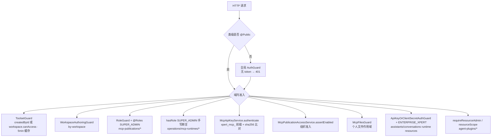

# 工具与 MCP 专家 · 接口说明（05）

**本文引用的文件**

- [packages/server-ai/src/xpert-toolset/xpert-toolset.module.ts](file://packages/server-ai/src/xpert-toolset/xpert-toolset.module.ts)
- [packages/server-ai/src/xpert-toolset/xpert-toolset.controller.ts](file://packages/server-ai/src/xpert-toolset/xpert-toolset.controller.ts)
- [packages/server-ai/src/xpert-toolset/mcp-apps.controller.ts](file://packages/server-ai/src/xpert-toolset/mcp-apps.controller.ts)
- [packages/server-ai/src/xpert-toolset/mcp-runtime.controller.ts](file://packages/server-ai/src/xpert-toolset/mcp-runtime.controller.ts)
- [packages/server-ai/src/xpert-toolset/mcp-runtime-audit.service.ts](file://packages/server-ai/src/xpert-toolset/mcp-runtime-audit.service.ts)
- [packages/server-ai/src/xpert-toolset/guards/toolset.guard.ts](file://packages/server-ai/src/xpert-toolset/guards/toolset.guard.ts)
- [packages/server-ai/src/shared/tools/errors.ts](file://packages/server-ai/src/shared/tools/errors.ts)
- [packages/server-ai/src/xpert-tool/xpert-tool.module.ts](file://packages/server-ai/src/xpert-tool/xpert-tool.module.ts)
- [packages/server-ai/src/xpert-tool/xpert-tool.controller.ts](file://packages/server-ai/src/xpert-tool/xpert-tool.controller.ts)
- [packages/server-ai/src/mcp/mcp.module.ts](file://packages/server-ai/src/mcp/mcp.module.ts)
- [packages/server-ai/src/mcp/controllers/base-mcp.controller.ts](file://packages/server-ai/src/mcp/controllers/base-mcp.controller.ts)
- [packages/server-ai/src/mcp-publication/mcp-publication.module.ts](file://packages/server-ai/src/mcp-publication/mcp-publication.module.ts)
- [packages/server-ai/src/mcp-publication/mcp-publication-management.controller.ts](file://packages/server-ai/src/mcp-publication/mcp-publication-management.controller.ts)
- [packages/server-ai/src/mcp-publication/mcp-publication.controller.ts](file://packages/server-ai/src/mcp-publication/mcp-publication.controller.ts)
- [packages/server-ai/src/mcp-publication/mcp-files.controller.ts](file://packages/server-ai/src/mcp-publication/mcp-files.controller.ts)
- [packages/server-ai/src/mcp-publication/mcp-oauth-metadata.controller.ts](file://packages/server-ai/src/mcp-publication/mcp-oauth-metadata.controller.ts)
- [packages/server-ai/src/mcp-publication/mcp-publication.dto.ts](file://packages/server-ai/src/mcp-publication/mcp-publication.dto.ts)
- [packages/server-ai/src/mcp-publication/mcp-publication.service.ts](file://packages/server-ai/src/mcp-publication/mcp-publication.service.ts)
- [packages/server-ai/src/mcp-publication/mcp-publication-authorization.service.ts](file://packages/server-ai/src/mcp-publication/mcp-publication-authorization.service.ts)
- [packages/server-ai/src/mcp-publication/mcp-publication-access.service.ts](file://packages/server-ai/src/mcp-publication/mcp-publication-access.service.ts)
- [packages/server-ai/src/mcp-publication/mcp-api-key.service.ts](file://packages/server-ai/src/mcp-publication/mcp-api-key.service.ts)
- [packages/server-ai/src/mcp-publication/mcp-capability-catalog.service.ts](file://packages/server-ai/src/mcp-publication/mcp-capability-catalog.service.ts)
- [packages/server-ai/src/mcp-publication/mcp-oauth-feature.ts](file://packages/server-ai/src/mcp-publication/mcp-oauth-feature.ts)
- [packages/server-ai/src/mcp-publication/mcp-runtime-protocol.ts](file://packages/server-ai/src/mcp-publication/mcp-runtime-protocol.ts)
- [packages/server-ai/src/mcp-publication/mcp-task.service.ts](file://packages/server-ai/src/mcp-publication/mcp-task.service.ts)
- [packages/server-ai/src/agent-plugin/agent-plugin.module.ts](file://packages/server-ai/src/agent-plugin/agent-plugin.module.ts)
- [packages/server-ai/src/agent-plugin/agent-plugin.controller.ts](file://packages/server-ai/src/agent-plugin/agent-plugin.controller.ts)
- [packages/server-ai/src/agent-plugin/maintenance/agent-plugin-maintenance.controller.ts](file://packages/server-ai/src/agent-plugin/maintenance/agent-plugin-maintenance.controller.ts)
- [packages/server-ai/src/agent-plugin/runtime-resource.controller.ts](file://packages/server-ai/src/agent-plugin/runtime-resource.controller.ts)
- [packages/server-ai/src/agent-plugin/agent-plugin.service.ts](file://packages/server-ai/src/agent-plugin/agent-plugin.service.ts)
- [packages/server-ai/src/ai/ai.module.ts](file://packages/server-ai/src/ai/ai.module.ts)
- [packages/server/src/bootstrap/index.ts](file://packages/server/src/bootstrap/index.ts)
- [apps/cloud/src/app/@core/constants/app.constants.ts](file://apps/cloud/src/app/@core/constants/app.constants.ts)
- [apps/desktop/electron/plugin-library.cjs](file://apps/desktop/electron/plugin-library.cjs)

## 目录

1. [一、总览：模块、前缀与端点数](#一总览模块前缀与端点数)
2. [二、XpertToolsetController：工具集本体与工作区视图](#二xperttoolsetcontroller工具集本体与工作区视图)
3. [三、XpertToolsetController：provider 探测与凭据](#三xperttoolsetcontrollerprovider-探测与凭据)
4. [四、McpAppsController（7 端点）](#四mcpappscontroller7-端点)
5. [五、McpRuntimeController（3 端点，SUPER_ADMIN 断言）](#五mcpruntimecontroller3-端点super_admin-断言)
6. [六、XpertToolController（3 端点）](#六xperttoolcontroller3-端点)
7. [七、mcp：MCP 服务端协议端点（不是 REST 资源）](#七mcpmcp-服务端协议端点不是-rest-资源)
8. [八、mcp-publication：发布管理（22 端点）](#八mcp-publication发布管理22-端点)
9. [九、mcp-publication：对外运行时、文件与 OAuth 元数据](#九mcp-publication对外运行时文件与-oauth-元数据)
10. [十、agent-plugin：目录、导入与绑定（12 端点）](#十agent-plugin目录导入与绑定12-端点)
11. [十一、agent-plugin：维护（4）与运行时资源（6）](#十一agent-plugin维护4与运行时资源6)
12. [十二、鉴权与准入矩阵](#十二鉴权与准入矩阵)
13. [十三、错误语义](#十三错误语义)

## 一、总览：模块、前缀与端点数

全局前缀由宿主设置：`app.setGlobalPrefix('api', { exclude: ['a', 'a/(.*)', '.well-known/oauth-protected-resource/(.*)'] })`，因此除 `.well-known` 外所有路由都带 `/api`。

| 模块 | `RouterModule` / 控制器前缀 | 真实路由前缀 | 自声明端点 |
|---|---|---|---|
| `xpert-toolset` | `RouterModule.register([{ path: '/xpert-toolset', module: XpertToolsetModule }])`；`XpertToolsetController` `@Controller()` | `/api/xpert-toolset` | 18 |
| `xpert-toolset` | `McpAppsController` `@Controller('mcp-apps')` | `/api/xpert-toolset/mcp-apps` | 7 |
| `xpert-toolset` | `McpRuntimeController` `@Controller('operations/mcp-runtimes')` | `/api/xpert-toolset/operations/mcp-runtimes` | 3 |
| `xpert-tool` | `RouterModule.register([{ path: '/xpert-tool', module: XpertToolModule }])`；`XpertToolController` `@Controller()` | `/api/xpert-tool` | 3 |
| `mcp` | `MCPModule`（动态模块，`controllers: [BaseMCPController]`），`BaseMCPController` `@Controller()` | `/api/mcp/sse`、`/api/mcp/messages`（**模块未被注册，见第七节**） | 2 |
| `mcp-publication` | 无 `RouterModule`，4 个控制器各自带前缀 | `/api/mcp-publications`、`/api/mcp-api-keys`、`/api/mcp-capability-catalog`、`/api/mcp/p`、`/.well-known/oauth-protected-resource` | 26 |
| `agent-plugin` | 无 `RouterModule`；`@Global()` 模块 | `/api/agent-plugins`、`/api/assistants/:id/resources*`、`/api/conversations/:id/runtime-resources` | 22 |

两点口径必须写清：

1. `XpertToolsetController`、`XpertToolController` 都 `extends CrudController`，基类的标准 CRUD 路由（列表/单条/创建/更新/删除等）同样生效；上表 "18 / 3" 只统计**子类自己声明**的方法，不含基类路由，也**不含同名覆盖**。
2. `XpertToolsetModule` 的 `controllers` 数组还注册了 `McpConsumerOAuthController`、`McpConsumerCapabilitiesController`（源目录 `../mcp-consumer`，本批次范围外），前端常量证实其路径为 `/api/xpert-toolset/mcp-consumer/oauth`。因此 `/api/xpert-toolset/*` 的实际端点数大于 28。

章节来源：[xpert-toolset.module.ts](file://packages/server-ai/src/xpert-toolset/xpert-toolset.module.ts)（关键符号：RouterModule.register / controllers / McpConsumerOAuthController），[xpert-tool.module.ts](file://packages/server-ai/src/xpert-tool/xpert-tool.module.ts)（关键符号：RouterModule.register），[bootstrap/index.ts](file://packages/server/src/bootstrap/index.ts)（关键符号：setGlobalPrefix / exclude），[app.constants.ts](file://apps/cloud/src/app/@core/constants/app.constants.ts)（关键符号：API_XPERT_TOOLSET / API_MCP_RUNTIMES / API_MCP_PUBLICATIONS / API_MCP_API_KEYS / API_XPERT_TOOL / API_MCP_CONSUMER_OAUTH）

## 二、XpertToolsetController：工具集本体与工作区视图

类级只有 `@ApiBearerAuth()` 与 `TransformInterceptor`，无类级守卫；返回体统一包成 `ToolsetPublicDTO`，`credentials` 因实体 `@Exclude({ toPlainOnly: true })` 不会出现在响应里。

| 方法 | 路径 | 用途与关键行为 | 守卫与鉴权 | 主要错误 |
|---|---|---|---|---|
| GET | `/` | 分页列表，`ParseJsonPipe` 解析 `data`；`afterLoad` 回填内置 provider 的 tags/icon | 登录态（`@ApiBearerAuth`） | — |
| GET | `/by-workspace/:workspaceId` | 工作区分页，`published` 过滤；`afterLoad` 后转 `ToolsetPublicDTO` | `WorkspaceAuthoringGuard` | 403（无权 authoring） |
| GET | `/tags` | `getAllTags()` 返回内置 tag 常量 | 登录态 | — |
| GET | `/providers` | 内置 provider 目录（`ListBuiltinToolProvidersQuery`），头像 URL 由 `baseUrl` 拼装 | 登录态 | — |
| GET | `/:toolsetId/tools` | 单工具集下工具清单（`relations: ['tools']` + `afterLoad` 水合） | 登录态 | 记录不存在时的查询异常 |

`GET /by-workspace/:workspaceId` 与 `GET /:toolsetId/tools` 的路由顺序敏感：前者必须在 `:id` 通配之前声明（源码顺序即如此）。

章节来源：[xpert-toolset.controller.ts](file://packages/server-ai/src/xpert-toolset/xpert-toolset.controller.ts)（关键符号：getAllByWorkspace / findAllTools / getAllTags / getAllToolProviders / getToolsetTools / ToolsetPublicDTO），[xpert-toolset.service.ts](file://packages/server-ai/src/xpert-toolset/xpert-toolset.service.ts)（关键符号：getAllByWorkspace / afterLoad / hydrateBuiltinToolSchemas）

## 三、XpertToolsetController：provider 探测与凭据

这一组是"导入工具集"流程的核心：schema 解析、远端拉取、工具探测、凭据读回。

| 方法 | 路径 | 用途与关键行为 | 守卫与鉴权 | 主要错误 |
|---|---|---|---|---|
| POST | `/provider/openapi/remote` | 按 `{url, credentials}` 拉远端 OpenAPI schema（`GetOpenAPIRemoteSchemaQuery`） | 登录态 | 远端不可达/凭据错误由 query 抛出，控制器不兜底 |
| POST | `/provider/openapi/schema` | OpenAPI → 工具 JSON Schema（`ParserOpenAPISchemaCommand`） | 登录态 | 解析失败抛错（`ToolApiSchemaError` 家族） |
| POST | `/provider/openapi/test` | 直接调用单条 OpenAPI 工具（`TestOpenAPICommand`） | 登录态 | 参数校验失败 400 |
| GET | `/provider/:name` | 单个内置 provider 元数据 | 登录态 | `ToolProviderNotFoundError` → **404** |
| POST | `/provider/odata/remote` | OData `$metadata` 远端拉取（`GetODataRemoteMetadataQuery`） | 登录态 | 同上 |
| POST | `/provider/odata/schema` | OData → 工具 schema（`ParserODataSchemaCommand`） | 登录态 | — |
| POST | `/provider/mcp/tools` | **`@Sse` 流式**：`text/event-stream`＋`Connection: keep-alive`，执行 `MCPToolsBySchemaCommand`，把结果作为 `MessageEvent{type:MESSAGE}` 下发，中间事件以 `type:EVENT` 下发；`keepAlive(30000)` 心跳、`takeUntilClose(res)` 断开 | 登录态 | 失败走 `subscriber.error(err)`（SSE 错误事件，不是 JSON 状态码） |
| GET | `/builtin-provider/:name/tools` | 内置 provider 的候选工具清单 | 登录态 | — |
| GET | `/builtin-provider/:name/credentials-schema` | 该 provider 的凭据表单 schema | 登录态 | — |
| POST | `/builtin-provider/:name/instance` | 创建内置工具集实例：先 `validateCredentials`，再 `create`（`category=BUILTIN`、`type=provider`） | 登录态 | provider 不存在 404；其余异常被包成 **500** `InternalServerErrorException(err.message)` |
| GET | `/:id/avatar` | `@Public()` 免鉴权头像；`tenant` 缺省时回落 scope→当前租户→默认租户；`cache-manager` 键 `toolset:avatar:{tenantId}:{id}`，TTL 5 分钟 | `@Public()` | 无默认租户 → 404；记录不存在 → 404 |
| GET | `/builtin-provider/:name/icon` | `@Public()` 图标二进制，`Content-Type` 来自 `ToolProviderIconQuery` | `@Public()` | 无图标 → 404 `Icon not found` |
| GET | `/:id/credentials` | 读回凭据 json 列 | **`ToolsetGuard`** | 非 owner 且无工作区访问权 → **403** `Access denied` |

凭据语义（务必与 07 对读）：`createBuiltinToolset` 只做校验，**加密步骤在源码中被注释掉**（`// encrypt credentials`），落库即明文；`getCredentials` 是唯一直接回吐凭据的端点，且它是**读接口**（GET），越权即等价于凭据泄露。

章节来源：[xpert-toolset.controller.ts](file://packages/server-ai/src/xpert-toolset/xpert-toolset.controller.ts)（关键符号：getOpenAPISchema / parseOpenAPISchema / testOpenAPI / getToolProvider / getODataMetadata / parseODataSchema / getMCPTools / getBuiltinTools / getBuiltinCredentialsSchema / createBuiltinInstance / getMCPAvatar / getProviderIcon / getCredentials），[xpert-toolset.service.ts](file://packages/server-ai/src/xpert-toolset/xpert-toolset.service.ts)（关键符号：createBuiltinToolset / findPublicAvatar / validateCredentials），[errors.ts](file://packages/server-ai/src/shared/tools/errors.ts)（关键符号：ToolProviderNotFoundError / ToolProviderCredentialValidationError）

## 四、McpAppsController（7 端点）

`@Controller('mcp-apps')`，实际 `/api/xpert-toolset/mcp-apps/*`；类级仅 `@ApiBearerAuth()`。查询入参用 `mcpAppHistoryQuerySchema` 做 Zod 校验，失败统一 400 `Error.McpAppHistoryQueryInvalid`。

| 方法 | 路径 | 用途 | 主要错误 |
|---|---|---|---|
| GET | `/:appInstanceId/history` | 拉取 MCP App 会话消息历史（需 `messageId`） | 400 校验失败 |
| POST | `/:appInstanceId/resume` | 从指定消息恢复 App 会话 | 400；实例不存在 |
| GET | `/:appInstanceId/resource` | 读取 App 资源（HTML bundle） | 资源超限/不存在 |
| POST | `/:appInstanceId/rpc` | App 侧 RPC 通道（`body` 透传） | 业务错误 |
| POST | `/:appInstanceId/approvals/:approvalId/approve` | 人工批准工具调用 | 审批不存在/已过时 |
| POST | `/:appInstanceId/approvals/:approvalId/reject` | 人工拒绝 | 同上 |
| DELETE | `/:appInstanceId` | 拆除 App 实例 | — |

章节来源：[mcp-apps.controller.ts](file://packages/server-ai/src/xpert-toolset/mcp-apps.controller.ts)（关键符号：getHistory / resume / getResource / rpc / approve / reject / teardown / McpAppReviveQuery）

## 五、McpRuntimeController（3 端点，SUPER_ADMIN 断言）

`@Controller('operations/mcp-runtimes')`（`/api/xpert-toolset/operations/mcp-runtimes`）。**没有使用 `RoleGuard`／`@Roles`**，而是在每个方法里手写 `assertSuperAdmin()`：`RequestContext.hasRole(RolesEnum.SUPER_ADMIN)` 为假即 `ForbiddenException('Only SUPER_ADMIN users can manage MCP stdio runtimes')`。

| 方法 | 路径 | 用途 | 主要错误 |
|---|---|---|---|
| GET | `/` | 运行时审计列表：DB 记录（`mcp_runtime_instance`）与内存活体快照合并，附带 `options`（workspace/toolset/plugin/execution/appInstance 过滤项）；`limit` 上限 500，默认窗口 180 天 | 403 |
| POST | `/:runtimeId/stop` | 关闭单个运行时（`closeRuntime(runtimeId, 'admin-stop')`，返回 `{stopped}`） | 403 |
| POST | `/kill` | 按过滤条件批量杀（`killByFilter(filter, 'admin-kill')`） | 403 |

租户/组织维度由 `McpRuntimeAuditService.resolveScope` 从 `RequestContext` 取值，query 可覆盖。

章节来源：[mcp-runtime.controller.ts](file://packages/server-ai/src/xpert-toolset/mcp-runtime.controller.ts)（关键符号：list / stop / kill / assertSuperAdmin），[mcp-runtime-audit.service.ts](file://packages/server-ai/src/xpert-toolset/mcp-runtime-audit.service.ts)（关键符号：toRuntimeManagerFilter / list / recordStarting / recordRunning / recordClosed）

## 六、XpertToolController（3 端点）

`@Controller()` + `/xpert-tool` 前缀 → `/api/xpert-tool/*`；`@ApiBearerAuth()`，无自定义守卫。

| 方法 | 路径 | 用途 | 主要错误 |
|---|---|---|---|
| POST | `/test` | `testTool(body)` 单条工具试跑（走 `ToolInvokeCommand` → `ToolRuntimeService.executeTool`） | 工具不存在 404；参数非法 400；调用失败 400 |
| GET | `/:id` | 单工具详情（`getTool(id, {relations})`，内置工具用 `ListBuiltinToolsQuery` 回填 label/schema） | `UUIDValidationPipe` 失败 400 |
| GET | `/:id/faker` | 由 schema 生成参数样例（内置走 zod→JSONSchemaFaker；其余走 `ToolsetGetToolsCommand` 后 `close()`） | 400/500 |

章节来源：[xpert-tool.controller.ts](file://packages/server-ai/src/xpert-tool/xpert-tool.controller.ts)（关键符号：test / findById / paramsFaker），[xpert-tool.service.ts](file://packages/server-ai/src/xpert-tool/xpert-tool.service.ts)（关键符号：testTool / getTool / getParamsFaker）

## 七、mcp：MCP 服务端协议端点（不是 REST 资源）

| 方法 | 路径 | 用途 |
|---|---|---|
| GET | `mcp/sse` | SSE 握手/事件流：`mcpService.handleSSEConnection(req, res)` |
| POST | `mcp/messages` | JSON-RPC 消息投递：`mcpService.handleMessages(req, res)` |

两点必须写明：

1. **这是 MCP 协议端（服务端方向）**，不是 CRUD 资源。类级 `@Public()`；消息语义由 `MCPService`＋`NestSSEAdapter` 承载，`onModuleInit` 扫描 `DiscoveryService` 上带 `@Tool/@Resource/@Prompt` 的 provider 方法并注册。因此它的"鉴权"是协议层会话，不是 `@Permissions`。
2. **本 commit 内 `MCPModule` 未被任何模块注册**：全仓检索 `MCPModule` 仅命中 `mcp.module.ts` 自身（`register()`/`registerAsync()` 内部 `module: MCPModule` 自引用）。结论：这两个端点在当前组装方式下不会实际挂载；若宿主改为 `MCPModule.register(...)`，路径会变成 `/api/mcp/sse`、`/api/mcp/messages`（全局 `api` 前缀生效，且不在 exclude 列表内）。

对照：**消费方向**的 MCP 客户端在 `xpert-toolset/provider/mcp/*`（`mcp-toolset.ts`、`client-factory`、`mcp-stdio-runtime.ts`），与本节的服务端封装是两套代码。

章节来源：[base-mcp.controller.ts](file://packages/server-ai/src/mcp/controllers/base-mcp.controller.ts)（关键符号：BaseMCPController / sseHandler / messagesHandler），[mcp.module.ts](file://packages/server-ai/src/mcp/mcp.module.ts)（关键符号：MCPModule.register / registerAsync / controllers / exports MCPService）

## 八、mcp-publication：发布管理（22 端点）

`@Controller()`（空前缀），类级 `@UseGuards(RoleGuard)` + `@Roles(RolesEnum.SUPER_ADMIN)` + `new ValidationPipe({ forbidNonWhitelisted: true, transform: true, whitelist: true })`。**22 个端点全部要求平台超级管理员**，且 DTO 白名单拒绝多余字段。

| 方法 | 路径 | 用途与关键行为 | 主要错误 |
|---|---|---|---|
| POST | `mcp-publications` | 建发布：`slug` 必须匹配 `^[a-z0-9]+(?:-[a-z0-9]+)*$`；`status` 默认 `draft`、`reviewStatus` 由能力评审派生、`protocolVersion` 取 `MCP_PROTOCOL_VERSION` | 400（slug/name 非法、slug 重复） |
| GET | `mcp-publications` | 列表摘要：能力数、API Key 数、OAuth 是否启用、最近调用/最近错误时间、共享组织的准入情况 | — |
| GET | `mcp-publications/:id` | 管理视图（带 `capabilities` 关系） | 越 scope → 404 |
| PATCH | `mcp-publications/:id` | 改 name/slug/authMethods/instructions/status/runtime | 400 |
| DELETE | `mcp-publications/:id` | 删除发布 | 404 |
| POST | `mcp-publications/:id/enable` | 启用：`assertCanEnable` 三重前置 —— `reviewStatus==='required'` 拒；无 enabled 能力拒；`authMethods` 含 `oauth` 但无 enabled OAuth 策略拒 | 400 `Error.McpPublicationReviewRequired` / `RequiresCapability` / `RequiresOAuthPolicy` |
| POST | `mcp-publications/:id/disable` | 置 `disabled` 并广播 access 失效 | — |
| GET | `mcp-publications/:id/available-capabilities` | 可绑能力（可按 `toolsetId` 收窄），来源为 `mcp_capability_catalog` | — |
| GET | `mcp-publications/:id/available-capability-sources` | 可绑工具集清单＋各自能力计数（管理范围过滤） | — |
| POST | `mcp-capability-catalog/toolsets/:toolsetId/discover` | 发现并整体替换该工具集的 MCP 能力快照 | `Error.McpToolsetNoCapabilities` 等 |
| PUT | `mcp-publications/:id/capabilities` | 整体替换绑定（`ParseArrayPipe` + `forbidNonWhitelisted`）；事务内先删后插，写 `descriptorHash`（char64）/`descriptorSnapshot`/`policy` | 数组校验 400；唯一键冲突 |
| PATCH | `mcp-publications/:id/capabilities/:capabilityId` | 改 publicName/enabled/policy；改名前预检 publicName 重复 | 400 |
| POST | `mcp-publications/:id/api-keys` | 签发 Key：`secret = 'xpert_mcp_' + base64url(32B)`，落 `keyPrefix`(24)+`keyHash`(sha256)，`encryptedSecret` 仅"可回显"路径写入 | 400 `InvalidInput`/`InvalidExpiry`/`InvalidScope` |
| GET | `mcp-publications/:id/api-keys` | Key 列表（`keyHash`/`encryptedSecret` 为 `select:false` 且 `@Exclude`） | — |
| POST | `mcp-api-keys/:keyId/revoke` | 撤销：写 `revokedAt`/`revokedById` 并广播 access 失效 | 400 `Error.McpApiKeyNotFound` |
| POST | `mcp-api-keys/:keyId/rotate` | 轮换 = 先撤销旧 Key，再按同 name/subject/scopes/expiresAt 新建（**新 secret 只返回一次**） | 400 同上 |
| GET | `mcp-publications/:id/oauth-policy` | 读 OAuth 策略（issuer/audience/subjectMapping/introspection） | 403 `Error.McpOAuthProOnly` |
| PUT | `mcp-publications/:id/oauth-policy` | 写入/更新策略；`clientSecret` 省略=保留、`null`=清除、新值=轮换 | 同上；400 `McpOAuthInvalidAudience` 等 |
| POST | `mcp-publications/:id/oauth-policy/test` | OAuth 策略自检（发现/内省连通性） | 同上；`McpOAuthDiscoveryFailed`/`PrivateNetworkDenied` |
| GET | `mcp-publications/:id/audit` | 调用审计分页（`skip`/`take`；共享发布按当前组织收窄） | — |
| POST | `mcp-publications/:id/test` | 发布自检：协议版本、能力数、启用状态、评审状态四项 checks，返回 `{ready, checks, ...}` | — |
| GET | `mcp-publications/:id/connection-info` | 给客户端接入信息：`protocolVersion`、`transport:'streamable-http'`、`endpoint = <baseUrl>/api/mcp/p/<slug>`、`authorization:'Bearer'`、serverInstructions | — |

**"访问授权"（`mcp_publication_access`）没有 HTTP 端点**：`McpPublicationAccessService` 只提供 `enable/disable/isEnabled/findConfigured/listConfigured/assertEnabled`，由 `McpPublicationService.findCurrentScopeById`（组织可见性）、`McpPublicationAuthorizationService.assertCanRun`（运行时准入）、`plugin-resource/PluginMcpServerService`（插件生命周期）在**服务层**调用。管理列表中展示的准入信息也来自服务层 `listConfigured`。据此排查"某组织看不到发布"时应走服务层而非 HTTP。

章节来源：[mcp-publication-management.controller.ts](file://packages/server-ai/src/mcp-publication/mcp-publication-management.controller.ts)（关键符号：create / list / get / update / remove / enable / disable / availableCapabilities / availableCapabilitySources / discoverToolsetCapabilities / replaceCapabilities / patchCapability / createApiKey / revokeApiKey / rotateApiKey / oauthPolicy / upsertOAuthPolicy / testOAuthPolicy / auditLog / test / connectionInfo），[mcp-publication.service.ts](file://packages/server-ai/src/mcp-publication/mcp-publication.service.ts)（关键符号：assertCanEnable / setStatus / findActiveBySlug / resolveRuntimeCapabilities / getManagementView），[mcp-api-key.service.ts](file://packages/server-ai/src/mcp-publication/mcp-api-key.service.ts)（关键符号：create / revoke / rotate / authenticate / createRevealable），[mcp-publication-access.service.ts](file://packages/server-ai/src/mcp-publication/mcp-publication-access.service.ts)（关键符号：enable / disable / assertEnabled / listConfigured）

## 九、mcp-publication：对外运行时、文件与 OAuth 元数据

| 方法 | 路径 | 守卫与鉴权 | 用途与主要错误 |
|---|---|---|---|
| ALL | `/api/mcp/p/:slug` | 类级 `@Public()`；**Bearer 由运行时段自行校验**（API Key 或 OAuth） | streamable-http 入口：先 `findActiveBySlug`，再 `authenticate` → `assertCanRun` → 限流 → 审计；支持工具/资源/提示词调用、subscription(SSE)、elicitation、**长任务**协议方法 `tasks/get`、`tasks/update`、`tasks/cancel`。401 时回 `WWW-Authenticate` 挑战；403 `Error.McpPublicationAccessDenied`；❌**没有 REST 形式的"任务轮询/取消"端点**——任务语义挂在 MCP 协议 `tasks/*` 上 |
| POST | `/api/mcp/p/:slug/files` | 类级 `@Public()` + `McpFilesGuard`（`McpFilesService.authorize`） | 上传个人文件；`FileInterceptor` 限 `MCP_FILE_MAX_BYTES`(256MB)、1 文件、0 字段；错误 `Error.McpFileRequired`/`FileNameInvalid`/`FileAccessDenied` |
| GET | `/api/mcp/p/:slug/files` | 同上 | 下载文件，响应头 `Cache-Control: no-store`、`X-Content-Type-Options: nosniff`；`filePath` 必须是相对路径否则 `Error.McpFilePathInvalid` |
| GET | `/.well-known/oauth-protected-resource/api/mcp/p/:slug` | `@Public()`；`assertMcpOAuthEnabled()` | OAuth Protected Resource Metadata（该路径在全局前缀 exclude 列表内，**不带 `/api` 前缀**）；`mcpOAuthEnabled=false` 时 403 `Error.McpOAuthProOnly` |

长任务协议细节（供 07 对读）：`mcp_task` 唯一 `taskId` + 唯一 `(publicationId, idempotencyKey)`，`inputHash` char64 做输入指纹；`create` 命中同键同指纹直接返回原任务，`assertIdempotentReplay` 负责同键异指纹的拒绝；队列常量 `pluginName='@xpert-ai/platform'`、`queueName='mcp-publication'`、`jobName='execute-tool'`。

章节来源：[mcp-publication.controller.ts](file://packages/server-ai/src/mcp-publication/mcp-publication.controller.ts)（关键符号：McpPublicationController / handle / @All(':slug')），[mcp-files.controller.ts](file://packages/server-ai/src/mcp-publication/mcp-files.controller.ts)（关键符号：McpFilesGuard / upload / download），[mcp-oauth-metadata.controller.ts](file://packages/server-ai/src/mcp-publication/mcp-oauth-metadata.controller.ts)（关键符号：metadata），[mcp-runtime-protocol.ts](file://packages/server-ai/src/mcp-publication/mcp-runtime-protocol.ts)（关键符号：assertModernTaskExtensionRequest / MCP_PROTOCOL_VERSION），[mcp-task.service.ts](file://packages/server-ai/src/mcp-publication/mcp-task.service.ts)（关键符号：create / assertIdempotentReplay / cancel / MCP_TASK_QUEUE_NAME）

## 十、agent-plugin：目录、导入与绑定（12 端点）

`@Controller('agent-plugins')` → `/api/agent-plugins/*`；**无控制器级守卫**，权限在方法经 `requireResourceAdmin()`（`SUPER_ADMIN|ADMIN`）与 `resourceScope()`（必须有 organizationId）落到服务层，通常表现为 403 `Error.AgentResourceAdminRequired` / `Error.AgentResourceOrganizationRequired`；入参走 Zod `parseResourceInput` → 400（`BadRequestException(error.flatten())`）。

| 方法 | 路径 | 用途与关键行为 |
|---|---|---|
| POST | `/defaults` | **202** 启动官方默认插件导入后台作业（`{}` 新建，`{operationId}` 轮询/续跑） |
| GET | `/defaults` | 读当前 scope 的导入收据（进度/Pinned commit） |
| GET | `/catalog` | **只读**目录（`@I18nLang` 本地化）；README 明写"目录读取不安装 skills/toolsets/连接器" |
| GET | `/workspace-options` | 绑定可选项（工作区/专家/中间件） |
| GET | `/workspaces/:id` | 某工作区目录（`id` 为 uuid 校验） |
| POST | `/workspaces/:id/plugins` | 往工作区加插件（`{packageId, experts}`，旧流程保留） |
| GET | `/options` | 同上选项（兼容入口） |
| GET | `` | 包＋绑定列表（含默认可见项） |
| POST | `/git` | `{url(https), ref, subdirectory?}` 导入；`ref` 不得以 `-` 开头、不得含换行 |
| POST | `/zip` | ZIP 导入，`FileInterceptor` 限 **100MB / 1 文件**；无文件 → 400 `Error.AgentPluginZipRequired` |
| POST | `/bindings` | 建绑定，`definition` 为 discriminated union（`agent_plugin`/`middleware`/`external_xpert`），`.strict()`；`workspaceIds` ≤100 |
| PUT | `/bindings/:id` | 仅切 `enabled`（事务内连带处理 superseded 链） |

消费方：`apps/cloud` 插件设置页（断言命中 `/agent-plugins/defaults`、`/agent-plugins/updates`）、`apps/desktop` 的 `plugin-library.cjs` 调 `/api/agent-plugins/catalog`。README 明确要求 **API 与 Web 同批发布**（异步响应契约变更）。

章节来源：[agent-plugin.controller.ts](file://packages/server-ai/src/agent-plugin/agent-plugin.controller.ts)（关键符号：importDefaults / defaultImportStatus / catalog / workspaceOptions / workspaceCatalog / addToWorkspace / options / list / importGit / importZip / bind / setEnabled / bindingSchema），[agent-plugin.service.ts](file://packages/server-ai/src/agent-plugin/agent-plugin.service.ts)（关键符号：requireResourceAdmin / resourceScope / createBinding / setEnabled / workspaceCatalog / options），[README.md](file://packages/server-ai/src/agent-plugin/README.md)（关键符号：Default import progress / Catalog reads do not install）

## 十一、agent-plugin：维护（4）与运行时资源（6）

**维护控制器**`@Controller('agent-plugins')`（同前缀，`ZodValidationPipe` 校验）：

| 方法 | 路径 | 用途 | 状态码 |
|---|---|---|---|
| GET | `/updates` | 读当前 scope 的更新收据 | 200 |
| POST | `/packages/:id/update` | `{branch}` 触发更新作业（跟随 `refs/heads/<branch>`）；ZIP 包走重传 | **202** |
| GET | `/packages/:id/cleanup` | 预览可清理的历史版本（保守扫描） | 200 |
| POST | `/packages/:id/cleanup` | `{packageIds}` 实际清理（加锁复核） | **200** |

**运行时资源控制器**（`@Controller()`，注册在 `ai.module.ts`，不在 `AgentPluginModule.controllers` 内）：`@Public()` + `@AllowClientSecretBindings(SecretTokenBindingType.ENTERPRISE_XPERT)` + `@UseGuards(ApiKeyOrClientSecretAuthGuard)` + `TransformInterceptor`。**这一组是"给运行时/外部企业助手"的机器对机器接口**，不是浏览器会话接口。

| 方法 | 路径 | 用途 |
|---|---|---|
| POST | `/assistants/:id/resources/commands` | 列出可用运行时命令（`runtimeResources` + 可选 `projectId`） |
| GET | `/assistants/:id/resources` | 资源目录（`projectId/search/kind/purpose/offset/limit(≤100)`） |
| POST | `/assistants/:id/resources/validate` | 校验选择集（返回解析后的 `selection`） |
| POST | `/assistants/:id/resources/authorize` | 授权某个绑定版本＋serverName（OAuth/连接器） |
| GET | `/conversations/:id/runtime-resources` | 读会话级运行时资源选择 |
| PUT | `/conversations/:id/runtime-resources` | 写会话级选择（`runtimeResourcesSchema`） |

章节来源：[agent-plugin-maintenance.controller.ts](file://packages/server-ai/src/agent-plugin/maintenance/agent-plugin-maintenance.controller.ts)（关键符号：status / update / preview / remove），[runtime-resource.controller.ts](file://packages/server-ai/src/agent-plugin/runtime-resource.controller.ts)（关键符号：commandsCatalog / catalog / validate / authorize / read / update / AllowClientSecretBindings），[ai.module.ts](file://packages/server-ai/src/ai/ai.module.ts)（关键符号：controllers.RuntimeResourceController），[agent-plugin.module.ts](file://packages/server-ai/src/agent-plugin/agent-plugin.module.ts)（关键符号：@Global / controllers / 'XpertAgentPluginService'）

## 十二、鉴权与准入矩阵

本域的准入**不是一套统一守卫链**，而是"类级守卫 + 方法级守卫 + 服务层断言"三处混合：

| 机制 | 判定依据 | 失败行为 | 适用面 |
|---|---|---|---|
| `ToolsetGuard` | 缓存键 `userToolset_{tenantId}_{user.id}_{toolsetId}`；`toolset.createdById === user.id` 直接放行，否则 `workspaceService.canAccess(toolset.workspaceId, user.id)`；命中缓存时**直接返回缓存值**（缓存 5 分钟，且缓存的是 `true`） | `ForbiddenException('Access denied')` → 403 | `GET /:id/credentials`（本域唯一） |
| `WorkspaceAuthoringGuard` | 来自 `../xpert-workspace`，对 `:workspaceId` 做 authoring 权限判定 | 403 | `GET /by-workspace/:workspaceId` |
| `RoleGuard` + `@Roles(SUPER_ADMIN)` | 平台角色 | 403 | `McpPublicationManagementController` 类级（22 端点） |
| `RequestContext.hasRole(SUPER_ADMIN)` | 手写断言（**非守卫**） | 403 明确文案 | `McpRuntimeController` 全部 3 端点 |
| `@Public()` | 免登录 | — | `/api/mcp/p/*`、`/:id/avatar`、`/builtin-provider/:name/icon`、`.well-known/*`、运行时资源控制器 |
| `McpApiKeyService.authenticate` | `publication.authMethods` 必含 `api_key`；Bearer 必须以 `xpert_mcp_` 开头且 ≥24 字符；按 `keyPrefix` 命中未撤销行，`timingSafeEqual` 比对 sha256；过期即拒 | 401 `Error.McpApiKeyUnauthorized`（运行时回 `WWW-Authenticate`） | `ALL /api/mcp/p/:slug` |
| `McpPublicationAuthorizationService.assertCanRun` | tenant/publication/organization 三者必须匹配；共享发布再查 `mcp_publication_access.enabled`；`service_account` 跳过用户校验；用户必须存在且组织成员 `isActive` | 403 `Error.McpPublicationAccessDenied` | 运行时每次调用（含 SSE 订阅续期） |
| `McpFilesGuard` → `McpFilesService.authorize` | 按 slug + 主体解析个人文件作用域 | `Error.McpFileAccessDenied` | `/api/mcp/p/:slug/files` |
| `ApiKeyOrClientSecretAuthGuard` + `@AllowClientSecretBindings(ENTERPRISE_XPERT)` | 允许企业 client_secret 绑定主体 | 401/403 | `RuntimeResourceController` 全部 6 端点 |
| 服务层 `requireResourceAdmin()` / `resourceScope()` | 角色 ∈ {SUPER_ADMIN, ADMIN}；必须有 organizationId | 403 `Error.AgentResourceAdminRequired` / `Error.AgentResourceOrganizationRequired` | `agent-plugins/*` 全部 |

图表来源：[toolset.guard.ts](file://packages/server-ai/src/xpert-toolset/guards/toolset.guard.ts)（关键符号：ToolsetGuard.canActivate / cacheKey），[mcp-publication-authorization.service.ts](file://packages/server-ai/src/mcp-publication/mcp-publication-authorization.service.ts)（关键符号：assertCanRun），[mcp-publication-access.service.ts](file://packages/server-ai/src/mcp-publication/mcp-publication-access.service.ts)（关键符号：assertEnabled），[mcp-runtime.controller.ts](file://packages/server-ai/src/xpert-toolset/mcp-runtime.controller.ts)（关键符号：assertSuperAdmin）

章节来源：[toolset.guard.ts](file://packages/server-ai/src/xpert-toolset/guards/toolset.guard.ts)（关键符号：ToolsetGuard / canAccess / cacheManager.set），[mcp-api-key.service.ts](file://packages/server-ai/src/mcp-publication/mcp-api-key.service.ts)（关键符号：authenticate / hashMatches / bearerToken），[agent-plugin.service.ts](file://packages/server-ai/src/agent-plugin/agent-plugin.service.ts)（关键符号：requireResourceAdmin / resourceScope），[runtime-resource.controller.ts](file://packages/server-ai/src/agent-plugin/runtime-resource.controller.ts)（关键符号：@AllowClientSecretBindings / ApiKeyOrClientSecretAuthGuard）

## 十三、错误语义

- **工具集/provider**：provider 不存在 → 404 `ToolProviderNotFoundError`（`GET /provider/:name`、`createBuiltinToolset`）；凭据不合法 → 400 `ToolProviderCredentialValidationError` 家族（`shared/tools/errors.ts` 全部继承 Nest 异常）；但 `POST /builtin-provider/:name/instance` 把任何异常包成 **500** `InternalServerErrorException(err.message)`——排查时不要只看状态码，要看 message。
- **凭据缺失 / 只出不回**：`xpert_toolset.credentials` 是 json 列 + `@Exclude({ toPlainOnly: true })`，仅 `GET /:id/credentials`（`ToolsetGuard` 保护）回吐；`createBuiltinToolset` 的加密步骤被注释，**库里是明文**（见 07 第五节）。
- **provider 不可达**：`/provider/openapi/remote`、`/provider/odata/remote` 的错误由 Query 层抛出，控制器不做包装；MCP 探测（`POST /provider/mcp/tools`）走 SSE，失败以流内 error 事件结束，**不会**变成 4xx/5xx 的 JSON 响应体。
- **MCP 握手 / 协议版本不匹配**：协议版本常量 `MCP_PROTOCOL_VERSION`（发布表默认值同源）；任务扩展要求 `mcp-protocol-version` 请求头与 `_meta['io.modelcontextprotocol/protocolVersion']` 同时等于该值，否则按 `invalidTaskProtocolRequest()` 拒绝；旧版本客户端走 legacy 兼容层（spec 中用 `2025-03-26` 作对照）。`initialize` 阶段的版本/会话不匹配由 MCP SDK 处理器负责，错误经 `protocol.mcpMetricStatus(error)` 归到审计/metrics 的 `error` 状态。
- **能力冲突（幂等键）**：`mcp_publication_capability` 唯一 `(publicationId, publicName)` 与唯一 `(publicationId, toolsetId, capabilityType, capabilityKey)`；`mcp_capability_catalog` 唯一 `(toolsetId, capabilityType, capabilityKey)`。`PUT capabilities` 是"整体替换"（事务内先删后插），重复 body 是幂等的；冲突主要来自改名撞 `publicName` 或并发重放。descriptor 变化靠 `descriptorHash` 分类，不视为破坏性变更。
- **任务重复 / `idempotencyKey`**：`mcp_task` 唯一 `taskId`、唯一 `(publicationId, idempotencyKey)`。同键同 `inputHash` → 幂等返回原任务；同键不同输入指纹 → 协议错误拒绝；`tasks/get|update|cancel` 均需能力可见性与匹配的协议版本，否则 `Error.McpTaskInvalidParams`。
- **Key 撤销 / 失效**：401 覆盖"缺失、前缀不合法、未命中、已撤销（`revokedAt`）、已过期、hash 不匹配"六类，文案统一 `Error.McpApiKeyUnauthorized`；管理侧操作未知 Key 是 400 `Error.McpApiKeyNotFound`（不是 404）。`rotate` = 旧 Key 立刻撤销 + 新 Key 只回显一次，`.revokedAt` 不会删除行。
- **发布准入**：非当前 scope 的 `:id` → **404**（不是 403，避免探测存在性）；运行时主体不匹配 → 403 `Error.McpPublicationAccessDenied`；OAuth 相关全部先过 `assertMcpOAuthEnabled()` → 403 `Error.McpOAuthProOnly`（本仓库 `packages/config` 两套 environment 均把 `mcpOAuthEnabled` 固定为 `false`）；OAuth 还有 `InvalidAudience`/`InvalidClaim`/`DiscoveryFailed`/`Unauthorized`/`InvalidUrl`/`HttpsRequired`/`UnsafeUrl`/`PrivateNetworkDenied`/`IntrospectionCredentials`/`InvalidScope`。
- **工具调用准入**：`Error.McpToolScopeDenied`、`Error.McpToolApprovalRequired`（approvalMode=`confirm` 且未授权时 403 文案带工具名）、elicitation 家族 `Error.McpElicitationInvalidState`/`InvalidRequest`/`SensitiveField`/`Declined`。
- **文件**：上限 256MB；`Error.McpFileRequired`/`McpFileNameInvalid`/`McpFilePathInvalid`/`McpFileAccessDenied`。

章节来源：[shared/tools/errors.ts](file://packages/server-ai/src/shared/tools/errors.ts)（关键符号：ToolProviderNotFoundError / ToolProviderCredentialValidationError / ToolApiSchemaError），[mcp-publication.dto.ts](file://packages/server-ai/src/mcp-publication/mcp-publication.dto.ts)（关键符号：CreateMcpPublicationInput / PUBLICATION_SLUG_PATTERN / McpCapabilityPolicyInput），[mcp-oauth-feature.ts](file://packages/server-ai/src/mcp-publication/mcp-oauth-feature.ts)（关键符号：isMcpOAuthEnabled / assertMcpOAuthEnabled），[mcp-runtime-protocol.ts](file://packages/server-ai/src/mcp-publication/mcp-runtime-protocol.ts)（关键符号：assertModernTaskExtensionRequest / MCP_SERVER_VERSION）
