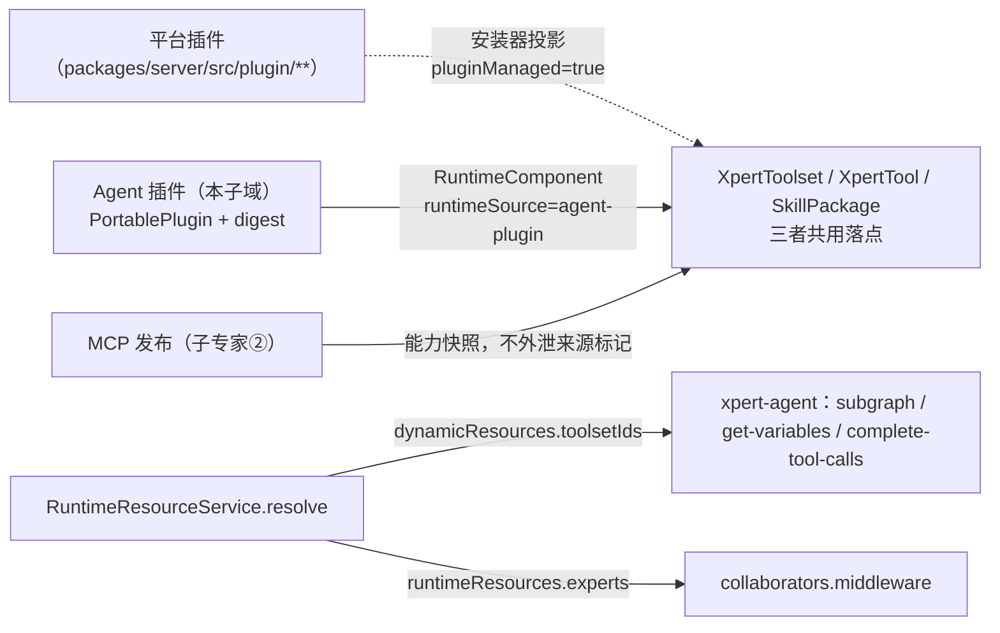

# Agent 插件子专家 —— C0 使用总览

> **资产基线**：`2026-10-16 · commit 80f5676fd`（批次 5 第 10 专家 · 子专家③），继承父域 [C0-使用总览.md](file://.module-experts/后端专题/工具与 MCP 专家/C0-使用总览.md)。**范围**：`packages/server-ai/src/agent-plugin/**`（50 非 spec / 30 spec，**2 张自有表** `agent_plugin_package`、`agent_resource_binding`，另有 3 份手工迁移 SQL）＋ 平台侧**对照面**（交叉引用：`plugin-resource/**`、`skill-package/**`、`xpert-template/**`）；HTTP 前缀 `/api/agent-plugins`、`/api/assistants/:id/resources*`、`/api/conversations/:id/runtime-resources`。工具集本体与执行面归 [子专家①](file://.module-experts/后端专题/工具与 MCP 专家/sub-experts/工具集与工具子专家/C0-使用总览.md)，MCP 协议与发布归 [子专家②](file://.module-experts/后端专题/工具与 MCP 专家/sub-experts/MCP协议与发布子专家/C0-使用总览.md)。未证实处标 `[推测]`。

**本文引用的文件**（相对仓库根，链接均为 `file://`）

- [packages/server-ai/src/agent-plugin/agent-plugin.controller.ts](file://packages/server-ai/src/agent-plugin/agent-plugin.controller.ts)
- [packages/server-ai/src/agent-plugin/agent-plugin.service.ts](file://packages/server-ai/src/agent-plugin/agent-plugin.service.ts)
- [packages/server-ai/src/agent-plugin/agent-plugin.entity.ts](file://packages/server-ai/src/agent-plugin/agent-plugin.entity.ts)
- [packages/server-ai/src/agent-plugin/agent-plugin.module.ts](file://packages/server-ai/src/agent-plugin/agent-plugin.module.ts)
- [packages/server-ai/src/agent-plugin/agent-plugin-parser.ts](file://packages/server-ai/src/agent-plugin/agent-plugin-parser.ts)
- [packages/server-ai/src/agent-plugin/agent-plugin-source.ts](file://packages/server-ai/src/agent-plugin/agent-plugin-source.ts)
- [packages/server-ai/src/agent-plugin/agent-plugin-installations.service.ts](file://packages/server-ai/src/agent-plugin/agent-plugin-installations.service.ts)
- [packages/server-ai/src/agent-plugin/installed-plugin-catalog.ts](file://packages/server-ai/src/agent-plugin/installed-plugin-catalog.ts)
- [packages/server-ai/src/agent-plugin/runtime-resource.service.ts](file://packages/server-ai/src/agent-plugin/runtime-resource.service.ts)
- [packages/server-ai/src/agent-plugin/runtime-resource.controller.ts](file://packages/server-ai/src/agent-plugin/runtime-resource.controller.ts)
- [packages/server-ai/src/agent-plugin/maintenance/agent-plugin-maintenance.controller.ts](file://packages/server-ai/src/agent-plugin/maintenance/agent-plugin-maintenance.controller.ts)
- [packages/server-ai/src/agent-plugin/maintenance/package-storage.ts](file://packages/server-ai/src/agent-plugin/maintenance/package-storage.ts)
- [packages/server-ai/src/agent-plugin/migrations/20260921-agent-plugins.sql](file://packages/server-ai/src/agent-plugin/migrations/20260921-agent-plugins.sql)
- [packages/server-ai/src/plugin-resource/plugin-resource-installer.service.ts](file://packages/server-ai/src/plugin-resource/plugin-resource-installer.service.ts)
- [packages/server-ai/src/xpert-agent/commands/handlers/subgraph.handler.ts](file://packages/server-ai/src/xpert-agent/commands/handlers/subgraph.handler.ts)
- [packages/server/src/plugin/plugin-management.service.ts](file://packages/server/src/plugin/plugin-management.service.ts)
- [packages/contracts/src/agent-plugin.ts](file://packages/contracts/src/agent-plugin.ts)

## 目录

1. [定位](#定位)
2. [何时找这个子专家](#何时找这个子专家)
3. [三类插件对照与边界](#三类插件对照与边界)
4. [能力清单表](#能力清单表)
5. [已知问题与常见坑](#已知问题与常见坑)
6. [延伸阅读](#延伸阅读)

## 定位

本子专家负责 **「便携插件包（`PortablePlugin`）怎么进库、怎么被解析、怎么变成可用的资源」**：来源获取（Git / ZIP / 官方源）、内容寻址 digest、解析与能力枚举、幂等入库（`agent_plugin_package`）、按 scope 的可见性与配置（`agent_resource_binding`）、运行时资源目录与解析（`RuntimeResourceService.catalog/resolve/authorize/read/update/prepare`）、插件 Skill 指令与命令元数据、连接器需求登记与运行凭据解析、以及 Git 分支更新与保守清理。

**一句话口径**：`PortablePlugin` 是唯一内容契约，**digest 是唯一版本身份**；本子域只产 `RuntimeComponent`，**所有宿主表写入都交给 `PluginResourceInstallerService`**（`runtimeSource: 'agent-plugin'` → `needSandbox=false`/`pluginManaged=false`）；「引用 ≠ 授权」——每次 run/call 都重解析 actor、scope、workspace 与 connector grant。

章节来源：[agent-plugin-parser.ts](file://packages/server-ai/src/agent-plugin/agent-plugin-parser.ts)（关键符号：parseAgentPlugin / PortablePlugin / containedPath）、[agent-plugin-source.ts](file://packages/server-ai/src/agent-plugin/agent-plugin-source.ts)（关键符号：portablePackageDigest / stagePortableGit / extractPortableZip）、[runtime-resource.service.ts](file://packages/server-ai/src/agent-plugin/runtime-resource.service.ts)（关键符号：resolve / authorize / ResolvedRuntimeResources）

## 何时找这个子专家

- 要**装 / 改 Agent 插件包**：`POST agent-plugins/git`、`POST agent-plugins/zip`（`FileInterceptor` 100MB/1 文件）、官方默认导入 `POST agent-plugins/defaults`（202 + 收据）；三者最终都收敛到 `AgentPluginService.importStagedDirectory`。
- 要**解析 descriptor**：`plugin.json`（Ajv 2020 + zod 双轨）、`extensions.xpertai`（旧别名 `cn.xpertai`）、`skills/**/SKILL.md` frontmatter、`mcp.json` 的 `$defs/server` 校验与 `unsupported_transport` 降级、`templates/**` 与 `normalizeAssistantTemplate`。
- 要**排查动态资源注入**：`RuntimeResourceService.resolve(assistantId, selection, projectId)` 的 `{selection, skillIds, toolsetIds, middlewares, experts}`、`applyRuntimeResourceGraph` 的执行期 overlay、`subgraph.handler.ts` 的 `dynamicResources?.toolsetIds` 追加点。
- 要**区分三类插件**：平台插件（`packages/server/src/plugin/**`）vs 本子域（`agent-plugin/**`）vs MCP 发布（`mcp-publication/**`）——共用宿主表，靠 `options` 字符串标记分流（见下节对照表）。
- 要**做版本 / 重装**：digest 幂等（`importStatus ∈ imported|existing|repaired`）、`POST agent-plugins/packages/:id/update`（git 分支，202 + 收据，`descriptor.name` 必须不变）、`GET/POST agent-plugins/packages/:id/cleanup`（保守引用扫描）。
- 要**改来源（git / zip）校验**：`stagePortableGit` 的 HTTPS/无凭据/ref 白名单/depth=1/120s，`extractPortableZip` 的遏制规则与自动下钻一层，`packageIntact` 的 digest 复查。
- 要**改 Agent 插件与平台插件的装配分工**：本子域只构造 `RuntimeComponent`（`runtimeSource: 'agent-plugin'`、`portableServer`、`pluginName = agent-plugin-<pkgId>-<digest 前 12>`），落库全程交给 `PluginResourceInstallerService`。
- 要**改运行时资源契约**：`RuntimeResourceController` 6 条机器对机器端点（`@Public` + `ApiKeyOrClientSecretAuthGuard` + `@AllowClientSecretBindings(ENTERPRISE_XPERT)`）与会话资源 CAS（`Error.AgentResourceRevisionConflict`）。

章节来源：[agent-plugin.service.ts](file://packages/server-ai/src/agent-plugin/agent-plugin.service.ts)（关键符号：importGit / importZip / importStagedDirectory / createBinding）、[agent-plugin-installations.service.ts](file://packages/server-ai/src/agent-plugin/agent-plugin-installations.service.ts)（关键符号：catalog / reference / prepare）、[runtime-resource.controller.ts](file://packages/server-ai/src/agent-plugin/runtime-resource.controller.ts)（关键符号：catalog / validate / authorize / read / update / commandsCatalog）

## 三类插件对照与边界

| 维度 | ① 平台插件（宿主 bundle） | ② Agent 插件（**本子域**） | ③ MCP 发布（对外 Server） |
|---|---|---|---|
| 归属专家域 | 平台插件与技能专家 | 工具与 MCP 专家 · [子专家③](file://.module-experts/后端专题/工具与 MCP 专家/sub-experts/Agent插件子专家/C0-使用总览.md) | 工具与 MCP 专家 · [子专家②](file://.module-experts/后端专题/工具与 MCP 专家/sub-experts/MCP协议与发布子专家/C0-使用总览.md) |
| 代码入口 | `packages/server/src/plugin/**`、`PluginManagementService.installPlugin` | `agent-plugin/agent-plugin.controller.ts`（`agent-plugins`）+ `maintenance/agent-plugin-maintenance.controller.ts` | `mcp-publication/mcp-publication.controller.ts`（`@All(':slug')`）+ 管理控制器 |
| 来源形态 | 已加载的 npm/目录 bundle（`LOADED_PLUGINS`、bundle manifest） | 便携包 `plugin.json` + `skills/**/SKILL.md` + `mcp.json`（Git / ZIP） | 已存在的 `XpertToolset` 能力快照 |
| 持久化 | `plugin_instance`；组件投影落 `plugin_resource_installation` / `XpertToolset` / `XpertTool` / `SkillPackage` | `agent_plugin_package`（descriptor = `PortablePlugin`）+ `agent_resource_binding` | `mcp_publication` 等 8 张（能力绑定 `mcp_publication_capability`） |
| 装配点 | `PluginManagementService` 三段式（ORM metadata → `lazyLoader.load` → 注册路由/策略） | `AgentPluginInstallationsService.prepare` → `PluginResourceInstallerService.installRuntimeComponent` | `McpPublicationRuntimeService.handle` 每请求 `createMcpHandler` + `toNodeHandler` |
| 准入 | `PluginScopeGuard` + level / `requiresPluginRestart` | `requireResourceAdmin()` + `agentPluginScope()`（tenant 级 = `organizationId IS NULL`） | `RoleGuard` + `@Roles(SUPER_ADMIN)`（管理面）/ 认证+授权+限流（运行面） |
| 生效时机 | 视 `runtimePolicy` 与 level：热装或等重启 | 立即：安装即落 `XpertToolset`/`SkillPackage`，执行前 `prepare` 只校验 | 立即：读路径即注册 MCP 原语 |
| 区分标记（共用落点） | `XpertToolset.options.pluginManaged = true` | `options.runtimeSource = 'agent-plugin'` + `pluginManaged = false` + `needSandbox = false` | 不外泄：能力以快照形式发布 |

**边界（做什么 / 不做什么）**

- **做什么**：便携包来源获取与遏制、digest 内容寻址与幂等入库、descriptor 解析与能力枚举、binding 生命周期（启用/禁用/工作区增删/专家版本冻结）、运行时资源目录与解析、Skill 指令与命令、连接器需求与运行凭据、Git 更新与保守清理、官方默认导入。
- **不做什么**：不实现工具集主体与执行面（→ ①）；不实现 MCP 协议与发布（→ ②）；不拥有宿主 bundle 加载与 level 归属（→ 平台插件与技能专家）；不拥有助手/会话挂载关系（`xpert_to_toolset` 归助手域）；**本子域没有「卸载插件」端点**（README 逐字：`This is not a force-uninstall or cascading deletion feature.`）。
- **HTTP 面不暴露 `rootPath`**：`list()` 明确把 `rootPath` 从响应里剥掉；包内相对路径一律经 `containedPath` 做 realpath 遏制。

图表来源：[plugin-resource-installer.service.ts](file://packages/server-ai/src/plugin-resource/plugin-resource-installer.service.ts)（关键符号：RuntimeComponent.runtimeSource / buildPluginManagedMcpToolsetEntity / findPluginManagedToolset）、[runtime-resource.service.ts](file://packages/server-ai/src/agent-plugin/runtime-resource.service.ts)（关键符号：resolve / applyRuntimeResourceGraph）、[subgraph.handler.ts](file://packages/server-ai/src/xpert-agent/commands/handlers/subgraph.handler.ts)（关键符号：dynamicResources.toolsetIds）

章节来源：[plugin-management.service.ts](file://packages/server/src/plugin/plugin-management.service.ts)（关键符号：PluginManagementService.installPlugin）、[agent-plugin.module.ts](file://packages/server-ai/src/agent-plugin/agent-plugin.module.ts)（关键符号：imports / exports）、[plugin-resource-installer.service.ts](file://packages/server-ai/src/plugin-resource/plugin-resource-installer.service.ts)（关键符号：findPluginManagedToolset 的两条 where 断言）

## 能力清单表

| 能力 | 入口 | 一句话 |
|---|---|---|
| 来源导入（Git / ZIP） | `POST /api/agent-plugins/git`、`POST /api/agent-plugins/zip` | 统一 staging 目录 → `parseAgentPlugin` + `portablePackageDigest` → 幂等 upsert |
| 官方默认插件导入 | `POST /api/agent-plugins/defaults`（202）、`GET /defaults` | 官方源硬编码，收据 + 两级 advisory lock（短控制锁 / 长 worker 锁） |
| 目录与可见性 | `GET /api/agent-plugins`、`/catalog`、`/workspace-options`、`/workspaces/:id`、`GET /options` | 组织级安装**遮蔽**租户级；无持久 binding 的包由 `importedPluginBinding` 派生合成引用 |
| 绑定（配置） | `POST /api/agent-plugins/bindings`、`PUT /bindings/:id` | `definition.kind ∈ {agent_plugin, middleware, external_xpert}`；`version = sha256({...input, expertVersions, digest})` |
| 工作区装配 | `POST /api/agent-plugins/workspaces/:id/plugins` | 已启用返回 `{status:'already_added'}`，存在但禁用 409 `Error.AgentPluginWorkspaceDisabled` |
| 版本更新（Git） | `POST /api/agent-plugins/packages/:id/update`（202）、`GET /updates` | 强制 `source.kind === 'git'`；`descriptor.name` 变化即 `Error.AgentPluginUpdateIdentityChanged` |
| 保守清理 | `GET/POST /api/agent-plugins/packages/:id/cleanup` | 只清理 `reason === 'unreferenced'` 的包；`configured` 含 `!cleanupEligible \|\| installations` 非空 |
| descriptor 解析与能力枚举 | `parseAgentPlugin`、`AgentPluginInstallationsService.catalog` | 五类能力：`assistant_template`/`skill`/`mcp`/`middleware`/`external_xpert`；组件级失败降级为 `diagnostics` |
| 运行时资源目录与解析 | `POST /api/assistants/:id/resources/commands`、`GET /api/assistants/:id/resources`、`POST .../validate`、`.../authorize` | `@Public` + `ApiKeyOrClientSecretAuthGuard`；`resolve` 产出 `{selection, skillIds, toolsetIds}` |
| 会话资源读写 | `GET/PUT /api/conversations/:id/runtime-resources` | 走会话域准入；CAS 冲突为 `Error.AgentResourceRevisionConflict` |
| 连接器需求与凭据 | `AgentPluginConnectorService.provider` | 每次凭据解析都重查 scope/user/execution 一致性 + 工具集 + owner binding + schema 全等 |
| 跨域落库投影 | `PluginResourceInstallerService.installRuntimeComponent` / `installComponentsForXpert` | 唯一落库器；`runtimeSource: 'agent-plugin'` 派生 `needSandbox=false`/`pluginManaged=false` |

章节来源：[agent-plugin.controller.ts](file://packages/server-ai/src/agent-plugin/agent-plugin.controller.ts)（关键符号：importDefaults / catalog / addToWorkspace / importGit / importZip / bind / setEnabled）、[agent-plugin-maintenance.controller.ts](file://packages/server-ai/src/agent-plugin/maintenance/agent-plugin-maintenance.controller.ts)（关键符号：status / update / preview / remove）、[agent-plugin-installations.service.ts](file://packages/server-ai/src/agent-plugin/agent-plugin-installations.service.ts)（关键符号：installedCatalog / reference / prepare）

## 已知问题与常见坑

1. **「同 scope 同 digest 唯一」是应用层约定，DB 不设唯一约束**：实体是 `@Index(['tenantId','organizationId','digest'])`（**无 `unique`**），迁移是 `CREATE INDEX IF NOT EXISTS "IDX_agent_plugin_package_scope" ON agent_plugin_package ("tenantId","organizationId",digest)`（**非 UNIQUE**）。幂等由事务 + `lockPackageScope` 内的 `findOne({...scope, digest}) + packageIntact` 保证，因此实现层「唯一即幂等」的表述应读作**语义层约定**，与父级 [C0 已知坑 6](file://.module-experts/后端专题/工具与 MCP 专家/C0-使用总览.md)「DB 不兜底」一致；并发导入理论上存在重复包窗口 `[推测]`。
   - 契约来源：[agent-plugin.entity.ts](file://packages/server-ai/src/agent-plugin/agent-plugin.entity.ts)、[20260921-agent-plugins.sql](file://packages/server-ai/src/agent-plugin/migrations/20260921-agent-plugins.sql)。
2. **`PortablePlugin` 的契约边界是「包内解析 + 路径遏制 + 失败隔离」**：`parseAgentPlugin` 首两行注释划定边界（`Portable discovery is intentionally separate from the native Xpert module loader.`）；`templateCatalog` 标注 `Server-generated import snapshot. Never accepted from plugin.json.`；所有文件读取先过 `containedPath`（realpath + `relative` 白名单），JSON ≤4MB、`SKILL.md` ≤1MB；manifest 非法**整体抛错**，组件级非法只进 `diagnostics`（`invalid_skill`/`invalid_server`/`invalid_template`/`unsupported_transport`/`unknown_field`/`unsafe_path`）。
   - 契约来源：[agent-plugin-parser.ts](file://packages/server-ai/src/agent-plugin/agent-plugin-parser.ts)、[agent-plugin-mcp.ts](file://packages/server-ai/src/agent-plugin/agent-plugin-mcp.ts)。
3. **`source {kind:'git'|'zip'}` 两条来源的硬校验不可放宽**：Git 必须 `https:` 且无 username/password/hash，ref 不得以 `-` 开头或含 CR/LF/NUL，执行带 `protocol.file.allow=never`、`core.hooksPath=/dev/null`、`GIT_CONFIG_GLOBAL=/dev/null`、`--depth=1`，超时 120s；ZIP 限 100MB / 10000 条目，拒绝符号链接、重复项、反斜杠、绝对路径与越界项，并逐项校验解压后大小；**ZIP 来源无法自动更新**（`AgentPluginUpdateService.target` 强制 git）。
   - 契约来源：[agent-plugin-source.ts](file://packages/server-ai/src/agent-plugin/agent-plugin-source.ts)、[agent-plugin-update.service.ts](file://packages/server-ai/src/agent-plugin/maintenance/agent-plugin-update.service.ts)。
4. **装配分工固定为「声明在包里、落库在安装器」**：本子域只产 `RuntimeComponent`（`componentType ∈ {skill, mcp_server}`、`pluginName = agent-plugin-<pkgId>-<digest 前 12>`、`pluginVersion = digest`、`rootDir = pkg.rootPath`）；`findPluginManagedToolset` 用 `options ->> 'runtimeSource' = 'agent-plugin'`（Agent 插件）与 `options ->> 'pluginManaged' = 'true'`（平台插件）分流 ⇒ **任何绕过安装器直写 `xpert_toolset` 的代码都会落进「无来源」灰区**。
   - 契约来源：[plugin-resource-installer.service.ts](file://packages/server-ai/src/plugin-resource/plugin-resource-installer.service.ts)（关键符号：findPluginManagedToolset / buildPluginManagedMcpToolsetEntity）。
5. **注入点只有三处，且插件 MCP 走全等校验**：`subgraph.handler.ts` 用 `dynamicResources?.toolsetIds` 逐个追加（失败仅告警）；`queries/handlers/{get-variables,complete-tool-calls}.handler.ts` 同构；`collaborators.middleware.ts` 消费 `runtimeResources.experts`。MCP 工具集在 `resolve` 时用 `matchesPortableMcpSchema` 做 `isEqual` **全等**比对（`category==='MCP'` + `needSandbox===false` + `pluginManaged===false`），任一不符抛 403 `Error.AgentResourceUnavailable`——宿主侧任何对 `schema`/`options` 的额外写入都会让资源直接不可用，而不是降级。
   - 契约来源：[runtime-resource.service.ts](file://packages/server-ai/src/agent-plugin/runtime-resource.service.ts)（关键符号：resolve / assertToolsetAccess / matchesPortableMcpSchema 判定分支）。
6. **无 `@VersionColumn`，并发语义全靠 PG advisory lock + jsonb 写入纪律**：包 scope 锁 `agent-plugin-packages:<tenantId>:<organizationId|_tenant>`（`lockPackageScope`）、binding 锁 `agent-plugin:<bindingId>`、工作区添加锁 `(<tenant>:<org>, <workspaceId>:<pluginName>)`；`agent_resource_binding.installations` 是 jsonb，绕过 `prepare`/`registerTemplateMcp`/`createAuthorizedBinding` 直 `save(binding)` 会丢并发投影（无 DB 约束兜底）；两表均无 `@DeleteDateColumn`。
   - 契约来源：[agent-plugin.entity.ts](file://packages/server-ai/src/agent-plugin/agent-plugin.entity.ts)、[package-storage.ts](file://packages/server-ai/src/agent-plugin/maintenance/package-storage.ts)（关键符号：lockPackageScope / assertPackagePath）。
7. **装配点与路由分处两个模块**：`AgentPluginModule` 是 `@Global()`，`controllers` 只含两个控制器；`RuntimeResourceController` 由 `ai.module.ts` 注册（`[推测]`：为规避 `ai` 与 `agent-plugin` 的循环依赖）⇒ 读「本子域路由全景」必须两处并读；`exports` 只含 `RuntimeResourceCommandsService`、`AgentPluginService`、`RuntimeResourceService` 与两个字符串 token。
   - 契约来源：[agent-plugin.module.ts](file://packages/server-ai/src/agent-plugin/agent-plugin.module.ts)、[packages/server-ai/src/ai/ai.module.ts](file://packages/server-ai/src/ai/ai.module.ts)。
8. **导入 ≠ 配置，且清理是保守的**：`git`/`zip` 不传 `activate` ⇒ 默认不产生持久 binding，目录里出现的是合成 binding；`cleanupEligible` 只有 `activatePackage` 会置 true（`setEnabled` 与 `retainTemplateReference` 都强制 false）；`collectPackageGarbage` 的删除失败只留在 `tenant_setting` 队列里静默重试；存储根取 `process.env.XPERT_AGENT_PLUGIN_PATH || 'storage/agent-plugins'`，多副本部署的共享与持久化由运维承担。
   - 契约来源：[agent-plugin.service.ts](file://packages/server-ai/src/agent-plugin/agent-plugin.service.ts)、[package-garbage.ts](file://packages/server-ai/src/agent-plugin/maintenance/package-garbage.ts)、[package-storage.ts](file://packages/server-ai/src/agent-plugin/maintenance/package-storage.ts)。

章节来源：[agent-plugin.service.ts](file://packages/server-ai/src/agent-plugin/agent-plugin.service.ts)（关键符号：importStagedDirectory / setEnabled / addToWorkspace）、[agent-plugin-installations.service.ts](file://packages/server-ai/src/agent-plugin/agent-plugin-installations.service.ts)（关键符号：prepare / pluginRuntimeComponents）、[runtime-resource.service.ts](file://packages/server-ai/src/agent-plugin/runtime-resource.service.ts)（关键符号：resolve / matchesPortableMcpSchema / Error.AgentResourceConflict）

## 延伸阅读

- 父域端点全集、鉴权矩阵与错误语义：[implementation/05-接口.md](file://.module-experts/后端专题/工具与 MCP 专家/implementation/05-接口.md)
- Recipe（Agent 插件安装与装配 / 排障合集）：父域 [C2-使用流程.md](file://.module-experts/后端专题/工具与 MCP 专家/C2-使用流程.md) Recipe 9 / 10
- 2 张自有表、跨域投影写与消费方：父域 [C4-数据流向与消费.md](file://.module-experts/后端专题/工具与 MCP 专家/C4-数据流向与消费.md) 子域③ / 本域写 vs 跨域投影写
- 决策与逐字注释证据（digest 幂等 + PortablePlugin、邻域装配、无 migrations）：父域 [C5-关键决策.md](file://.module-experts/后端专题/工具与 MCP 专家/C5-关键决策.md) D9 / D10 / D11
- 本子专家端点分组、服务契约与平台插件侧接口面：[C1-能力契约.md](file://.module-experts/后端专题/工具与 MCP 专家/sub-experts/Agent插件子专家/C1-能力契约.md)
- 实现层（职责与边界、入库链与解析、数据流转、spec 与缺口）：[01-架构.md](file://.module-experts/后端专题/工具与 MCP 专家/sub-experts/Agent插件子专家/implementation/01-架构.md)、[02-实现.md](file://.module-experts/后端专题/工具与 MCP 专家/sub-experts/Agent插件子专家/implementation/02-实现.md)、[03-数据流转.md](file://.module-experts/后端专题/工具与 MCP 专家/sub-experts/Agent插件子专家/implementation/03-数据流转.md)、[06-测试.md](file://.module-experts/后端专题/工具与 MCP 专家/sub-experts/Agent插件子专家/implementation/06-测试.md)

章节来源：[installed-plugin-catalog.ts](file://packages/server-ai/src/agent-plugin/installed-plugin-catalog.ts)（关键符号：installedPluginBindings / importedPluginBinding）、[agent-plugin-connector.service.ts](file://packages/server-ai/src/agent-plugin/agent-plugin-connector.service.ts)（关键符号：configureMcpConnectorAuthProviderResolver / provider）、[packages/contracts/src/agent-plugin.ts](file://packages/contracts/src/agent-plugin.ts)（关键符号：RuntimeResourceDefinition / RuntimeResourceBindingInput）
