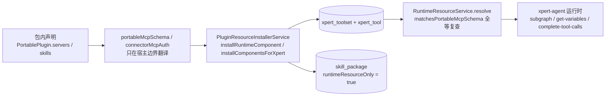

# Agent 插件子专家 —— C1 能力契约

> 契约层 CR2 / CR5 / CR7。只写「对外可依赖的语义」：入口、参数行为、返回、异常与约束；路径均为仓库根相对 `file://` 引用。
> **资产基线**：`2026-10-16 · commit 80f5676fd`（批次 5 第 10 专家 · 子专家③），继承父域 [C1-能力契约.md](file://.module-experts/后端专题/工具与 MCP 专家/C1-能力契约.md)。**逐端点明细**（完整字段、分页、错误码全集）见父域 [implementation/05-接口.md](file://.module-experts/后端专题/工具与 MCP 专家/implementation/05-接口.md)，本文不复制。§1 中每条前缀均回源码核实（`@Controller(...)` 取值 + 注册模块）。

**本文引用的文件**（相对仓库根，链接均为 `file://`）

- [packages/server-ai/src/agent-plugin/agent-plugin.controller.ts](file://packages/server-ai/src/agent-plugin/agent-plugin.controller.ts)
- [packages/server-ai/src/agent-plugin/maintenance/agent-plugin-maintenance.controller.ts](file://packages/server-ai/src/agent-plugin/maintenance/agent-plugin-maintenance.controller.ts)
- [packages/server-ai/src/agent-plugin/runtime-resource.controller.ts](file://packages/server-ai/src/agent-plugin/runtime-resource.controller.ts)
- [packages/server-ai/src/agent-plugin/agent-plugin.service.ts](file://packages/server-ai/src/agent-plugin/agent-plugin.service.ts)
- [packages/server-ai/src/agent-plugin/agent-plugin.entity.ts](file://packages/server-ai/src/agent-plugin/agent-plugin.entity.ts)
- [packages/server-ai/src/agent-plugin/agent-plugin.module.ts](file://packages/server-ai/src/agent-plugin/agent-plugin.module.ts)
- [packages/server-ai/src/agent-plugin/agent-plugin-parser.ts](file://packages/server-ai/src/agent-plugin/agent-plugin-parser.ts)
- [packages/server-ai/src/agent-plugin/agent-plugin-source.ts](file://packages/server-ai/src/agent-plugin/agent-plugin-source.ts)
- [packages/server-ai/src/agent-plugin/agent-plugin-scope.ts](file://packages/server-ai/src/agent-plugin/agent-plugin-scope.ts)
- [packages/server-ai/src/agent-plugin/agent-plugin-installations.service.ts](file://packages/server-ai/src/agent-plugin/agent-plugin-installations.service.ts)
- [packages/server-ai/src/agent-plugin/agent-plugin-connector.service.ts](file://packages/server-ai/src/agent-plugin/agent-plugin-connector.service.ts)
- [packages/server-ai/src/agent-plugin/installed-plugin-catalog.ts](file://packages/server-ai/src/agent-plugin/installed-plugin-catalog.ts)
- [packages/server-ai/src/agent-plugin/runtime-resource.service.ts](file://packages/server-ai/src/agent-plugin/runtime-resource.service.ts)
- [packages/server-ai/src/agent-plugin/runtime-resource-discovery.ts](file://packages/server-ai/src/agent-plugin/runtime-resource-discovery.ts)
- [packages/server-ai/src/agent-plugin/runtime-resource-graph.ts](file://packages/server-ai/src/agent-plugin/runtime-resource-graph.ts)
- [packages/server-ai/src/agent-plugin/commands/runtime-resource-commands.service.ts](file://packages/server-ai/src/agent-plugin/commands/runtime-resource-commands.service.ts)
- [packages/server-ai/src/agent-plugin/maintenance/package-storage.ts](file://packages/server-ai/src/agent-plugin/maintenance/package-storage.ts)
- [packages/server-ai/src/plugin-resource/plugin-resource-installer.service.ts](file://packages/server-ai/src/plugin-resource/plugin-resource-installer.service.ts)
- [packages/contracts/src/agent-plugin.ts](file://packages/contracts/src/agent-plugin.ts)

## 目录

1. [§1 HTTP 入口索引](#§1-http-入口索引)
2. [§2 服务契约](#§2-服务契约)
3. [§3 与平台插件侧的接口面](#§3-与平台插件侧的接口面)
4. [§4 示例](#§4-示例)
5. [§5 契约来源](#§5-契约来源)

## §1 HTTP 入口索引

全局前缀 `api`；`AgentPluginController` 与 `AgentPluginMaintenanceController` 均为 `@Controller('agent-plugins')`（同前缀两个控制器，后者在 `maintenance/` 目录），`RuntimeResourceController` 为 `@Controller()` 空前缀、由 `ai.module.ts` 注册。**两个 `agent-plugins` 控制器都没有控制器级守卫**，准入由服务层 `requireResourceAdmin()`（SUPER_ADMIN/ADMIN）+ `resourceScope()`（强制 `organizationId`）承担。

| 控制器（源码 `@Controller` 值） | 方法 / 路径 | 鉴权 | 用途 |
|---|---|---|---|
| `AgentPluginController`（`agent-plugins`） | POST `/api/agent-plugins/git` | 服务层 `requireResourceAdmin()` | Git HTTPS 导入（`{url, ref, subdirectory?}`，zod `.strict()`） |
| 同上 | POST `/api/agent-plugins/zip` | 同上 | ZIP 导入；`FileInterceptor('file', { limits:{ fileSize: 100MB, files: 1 } })`，缺文件即 400 `Error.AgentPluginZipRequired` |
| 同上 | POST `/api/agent-plugins/defaults`（**202**）、GET `/defaults` | 同上 | 官方源后台导入收据的创建/续传与状态查询 |
| 同上 | GET `/api/agent-plugins`、`/catalog`、`/options`、`/workspace-options`、`/workspaces/:id` | 同上 | 包列表 / 目录（按语言）/ 能力选项 / 可管理工作区 / 工作区视图 |
| 同上 | POST `/api/agent-plugins/workspaces/:id/plugins` | 同上（另走 `XpertWorkspaceAccessService.assertCanWrite`） | 把插件加入工作区（`{packageId, experts}`） |
| 同上 | POST `/api/agent-plugins/bindings`、PUT `/api/agent-plugins/bindings/:id` | 同上 | 建绑定（kind 判别联合，`.strict()`）/ 启用·禁用 |
| `AgentPluginMaintenanceController`（`agent-plugins`） | GET `/api/agent-plugins/updates` | 服务层 `requireResourceAdmin()` | 更新作业状态 |
| 同上 | POST `/api/agent-plugins/packages/:id/update`（**202**） | 同上 | 跟随 Git 分支更新（`{branch}`；固定 commit 来源必须显式给 branch） |
| 同上 | GET `/api/agent-plugins/packages/:id/cleanup`、POST `/api/agent-plugins/packages/:id/cleanup`（200） | 同上 | 旧版本清理预览（`reason` 标注）与执行 |
| `RuntimeResourceController`（`@Controller()`，`@Public()` + `@UseGuards(ApiKeyOrClientSecretAuthGuard)` + `@AllowClientSecretBindings(ENTERPRISE_XPERT)` + `TransformInterceptor`） | POST `/api/assistants/:id/resources/commands` | 机器对机器（API Key / client secret） | Skill 命令与指令目录（`runtimeResources` + 可选 `projectId`） |
| 同上 | GET `/api/assistants/:id/resources` | 同上 | 资源目录（`projectId`/`search`/`kind`/`purpose`/`offset`/`limit`≤100） |
| 同上 | POST `/api/assistants/:id/resources/validate` | 同上 | 解析并回吐规范化 `selection` |
| 同上 | POST `/api/assistants/:id/resources/authorize` | 同上 | 授权探测（`bindingId` + `version` + `serverName` + 可选 `projectId`） |
| 同上 | GET `/api/conversations/:id/runtime-resources`、PUT `/api/conversations/:id/runtime-resources` | 同上（读写走会话域准入） | 会话级运行时资源选择（CAS，冲突 `Error.AgentResourceRevisionConflict`） |

**路由归属提醒（已回源码核实）**：`RuntimeResourceController` **不在** `AgentPluginModule.controllers` 里，实际注册在 `packages/server-ai/src/ai/ai.module.ts`；本子域模块的 `controllers` 只有上面两个 `agent-plugins` 控制器。

**逐端点明细见父域 [implementation/05-接口.md](file://.module-experts/后端专题/工具与 MCP 专家/implementation/05-接口.md)**（含每条的权限点、主要错误与状态码）。

章节来源：[agent-plugin.controller.ts](file://packages/server-ai/src/agent-plugin/agent-plugin.controller.ts)（关键符号：importDefaults / importGit / importZip / bind / setEnabled / addToWorkspace / parseResourceInput）、[agent-plugin-maintenance.controller.ts](file://packages/server-ai/src/agent-plugin/maintenance/agent-plugin-maintenance.controller.ts)（关键符号：status / update / preview / remove）、[runtime-resource.controller.ts](file://packages/server-ai/src/agent-plugin/runtime-resource.controller.ts)（关键符号：commandsCatalog / catalog / validate / authorize / read / update）

## §2 服务契约

| `类.方法` | 用途 | 参数行为语义 · 异常 |
|---|---|---|
| `AgentPluginService.importGit(input)` / `importZip(buffer)` / `importStagedDirectory(root, source, activate=false, manager?)` | 导入编排 | 两入口先 `requireResourceAdmin()`；git 只接受 HTTPS 无内嵌凭据、zip 限 100MB/1 文件；统一产出 staging 目录后在本方法内 `parseAgentPlugin(root)` + `portablePackageDigest(root)`，在事务 + `lockPackageScope` 内 `findOne({...scope, digest})` 去重（命中且 `packageIntact` 复用 `rootPath` 只更新 `descriptor`）；注释逐字 `Never rewrite package identity, creation time or bindings during repair/reimport.`；返回带 `importStatus ∈ {imported, existing, repaired}`；错误统一包成 400 `Error.AgentPluginImportFailed` |
| `AgentPluginService.createBinding(input)` / `setEnabled(id, enabled)` / `workspaceOptions()` / `workspaceCatalog()` / `addToWorkspace(id, input)` / `list()` / `components()` | 绑定生命周期与目录 | `createBinding` 补 `connectorServers ??= descriptor.extension.connectors`、拒绝旧式 `oauthServers`（要求走 workspace connection）、逐专家冻结 `publishedResourceVersion(publishAt)`，`version = sha256(JSON.stringify({...input, expertVersions, digest}))`，带 `workspaceIds` 时才逐 workspace 调安装器；`setEnabled` 同时强制 `cleanupEligible = false`；`addToWorkspace` 已启用返回 `{status:'already_added'}`、存在但禁用 409 `Error.AgentPluginWorkspaceDisabled`；包不存在 `NotFoundException Error.AgentPluginNotFound` |
| `AgentPluginInstallationsService.installedCatalog(workspaceId?)` / `catalog(language?)` / `reference(reference, workspaceId?, manager?)` / `prepare(reference, assistant)` / `pluginRuntimeComponents(pkg, version)` | 可见目录、引用解析与安装 | 可见性限当前 scope，组织级安装（含 disabled）**遮蔽**租户级，`supersededById` 非空的行剔除；`reference` 要求 binding+version 命中 + `enabled` + scope 级当前配置仍 enabled；`prepare` 用 `pg_advisory_xact_lock(hashtext('agent-plugin:<bindingId>'))` 串行化，`installations[workspaceId]` 已存在且各 connector `bindingId` 未变则**直接返回既有 installation**，否则逐个 `installer.installRuntimeComponent`；`prepare` 还要求 `binding.expertVersions` 完整，否则 400 `Error.AgentResourceConfigurationRequired` |
| `parseAgentPlugin(root)` / `containedPath(root, relative)` | 包内解析与路径遏制 | 产出 `PortablePlugin = {name, version?, description?, extension?, skills[], servers[], templates?, templateCatalog?, diagnostics[]}`；manifest 剔除未声明键并记 `unknown_field`、Ajv 2020 失败即整体抛错；skill 要求 `name === 目录名` 且 `description` 1..1024；server 只接受 `type === 'streamable-http'`、URL 必须 `https:`（`http:` 仅 localhost/`[::1]`/`127.x`）且无凭据、header 名过 token 字符集且禁 `authorization`/`cookie`/`x-api-key`；单条失败只进 `diagnostics`（状态降 `partial`） |
| `stagePortableGit(url, ref, subdirectory?)` / `extractPortableZip(buffer, root)` / `portablePackageDigest(root)` / `copyPortablePackage` / `walkPortablePackage` | 来源暂存与内容寻址 | Git：`new URL` 断言 `https:` 与无凭据、ref 白名单、`git fetch --depth=1 -- <url> <ref>` + `rev-parse FETCH_HEAD` + `checkout --detach`，超时 120s；ZIP：流式逐条写盘、拒绝符号链接/重复项/反斜杠/绝对路径/越界项并逐条校验声明大小，单层目录且无 `plugin.json` 时自动下钻一层；digest 按「路径 \0 内容 \0」累积 sha256（跳过 `.git`），遍历中文件大小变化抛 `Plugin changed during import`；上限 100MB / 10000 文件 |
| `lockPackageScope(manager, scope)` / `packageIntact(rootPath, digest, scope)` / `stagePackageFiles` / `removePackageFiles` / `assertPackagePath` | 并发与存储纪律 | 包 scope 锁键 `agent-plugin-packages:<tenantId>:<organizationId\|_tenant>`；`packageIntact` 用 `portablePackageDigest(path) === digest` 复查磁盘；修复走「拷到新 UUID 目录 → 复查 digest → 库内切 `rootPath` → 原路径入 `tenant_setting` 队列」；存储根 `process.env.XPERT_AGENT_PLUGIN_PATH \|\| 'storage/agent-plugins'` |
| `RuntimeResourceService.catalog` / `resolve(assistantId, selection, projectId?)` / `authorize` / `read` / `update` / `prepare` / `assertToolsetAccess` / `describe` | 运行时资源解析与授权 | 首行注释 `A reference is not an authorization grant. Resolve the actor and scope again on every run/call.`；`resolve` 产出 `ResolvedRuntimeResources = {selection, skillIds, skillSources, toolsetIds, middlewares, experts, templates}`，middleware node key 为 `resource_<bindingId>[_<key>]`，`packages` 按 `definition` 去重（同 packageId 不同 definition 抛 `Error.AgentResourceConflict`），Skill 的 `runtimePath = agent-plugins/<pkgId>/<skillKey>`、`version = digest`；MCP 工具集逐个 `matchesPortableMcpSchema` 全等复查，不符即 403 `Error.AgentResourceUnavailable` |
| `applyRuntimeResourceGraph(...)`（`runtime-resource-graph.ts`） | 执行期 overlay | 只产出执行期副本（注释逐字 `Never mutates a published or draft graph.`），必要时挂 `runtime_resource_skills` 中间件节点 |
| `AgentPluginConnectorService.provider` / `configureMcpConnectorAuthProviderResolver` | 连接器需求与运行凭据 | 每次凭据解析都重查 scope/user/execution 一致性、工具集、owner binding、有效目录与 schema 全等后才取运行凭据；缺失即 `Error.AgentPluginConnectorConfiguration`，使用 workspace connection 抛 `Error.ConnectorWorkspaceConnectionRequired`；解析器在 `onApplicationBootstrap` 挂、`onModuleDestroy` 摘 |
| `installedPluginBindings(packages, bindings, scope, workspaceId)` / `importedPluginBinding(pkg)` | 目录可见性与合成引用 | 按 `descriptor.name` 分组、组织遮蔽租户、`supersededById` 剔除；无持久 binding 的包派生合成 binding（id 由 `sha256('installed-agent-plugin:<tenantId>:<pkgId>')` 掩成 UUID 形状，`version` 由 `[id, digest, definition]` 派生）⇒ **导入即有稳定目录引用** |
| `AgentPluginUpdateService.start(id, input)` / `run(...)`；`AgentPluginCleanupService.inspect` / `preview` / `cleanup` | 更新与保守清理 | `start` 在 `store.control` 内创建/续传收据（`phase:'updating'`），`run` 抢 worker 长锁后 `stagePortableGit(url, progress.commit ?? 'refs/heads/<branch>')` → 校验新包 `descriptor.name` 与旧一致（否则 `Error.AgentPluginUpdateIdentityChanged`）→ `importStagedDirectory(activate=true)`；`inspect` 为同 name 每个包标 `reason ∈ {current, updating, configured, referenced, unreferenced}`，只有 `unreferenced` 且被请求的才删；收据冲突 `Error.AgentPluginUpdateChanged`/`Error.AgentPluginUpdateBusy` |
| `RuntimeResourceCommandsService.list` / `instructions` | Skill 命令元数据与指令正文 | 指令正文 ≤256KB；Skill 指令源变化抛 `Error.PluginCommandSourceChanged`；只读回落 `readRuntimeResourceSkillFile` 走 realpath 遏制读 `SKILL.md`（≤1MB） |

章节来源：[agent-plugin.service.ts](file://packages/server-ai/src/agent-plugin/agent-plugin.service.ts)（关键符号：importStagedDirectory / createBinding / setEnabled / addToWorkspace）、[agent-plugin-installations.service.ts](file://packages/server-ai/src/agent-plugin/agent-plugin-installations.service.ts)（关键符号：reference / prepare / pluginRuntimeComponents）、[agent-plugin-parser.ts](file://packages/server-ai/src/agent-plugin/agent-plugin-parser.ts)（关键符号：parseAgentPlugin / containedPath）

## §3 与平台插件侧的接口面

| 接口 | 契约（源码可查事实） |
|---|---|
| `PluginResourceInstallerService.installRuntimeComponent(runtimeComponent, workspaceId)` | 唯一安装入口（注释逐字 `Internal service entry for validated, administrator-installed portable components.`）；按组件类型分流 `native` / `mcp_server` / `skill`，MCP 分支先 `parseMcpServer` + `loadMcpCapabilities`，再 `findPluginManagedToolset` 定位既有行后 `buildPluginManagedMcpToolsetEntity` 落库 |
| `PluginResourceInstallerService.installComponentsForXpert(xpert, runtimeComponents)` | 按助手维度安装同一批组件；模板链 `InstallAgentPluginTemplateResourcesHandler` 走此入口并 `registerTemplateMcp` 记录 toolsets + connectors |
| `RuntimeComponent` 结构 | `runtimeSource?: 'agent-plugin'`、`portableServer?`（注释逐字 `Host-resolved portable server, including an authorized Connector reference, never credentials.`）、`pluginName`、`pluginVersion`、`component.componentKey`、`rootDir` |
| 来源标记（写侧） | `options = { disableToolDefault, needSandbox: runtimeSource !== 'agent-plugin', pluginManaged: runtimeSource !== 'agent-plugin', ...(runtimeSource ? { runtimeSource } : {}), pluginName, componentKey }` ⇒ Agent 插件恒为 `needSandbox=false` + `pluginManaged=false` + `runtimeSource='agent-plugin'` |
| 来源标记（读侧） | `findPluginManagedToolset` 的 where 断言：`runtimeSource === 'agent-plugin'` 时用 `toolset.options ->> 'runtimeSource' = 'agent-plugin'`，否则用 `toolset.options ->> 'pluginManaged' = 'true'`，并全等校验 `pluginManaged`/`pluginName`/`componentKey` ⇒ 平台插件与 Agent 插件**同一 workspace 下可并存而不互相覆盖** |
| 技能侧落点 | Skill 组件经安装器 `skillPackageService.syncPluginSkillBundle` 落 `skill_package`，本子域随后置 `runtimeResourceOnly = true`（迁移 `20260921` 新增该列），语义为「只服务运行时资源，不进技能仓库目录」 |
| 运行时会话标记 | 安装后回写 `toolset.schema = JSON.stringify(portableMcpSchema(...))` 与 `options`，运行前再用 `matchesPortableMcpSchema`（`isEqual`）复查 ⇒ **改动 `XpertToolset.schema`/`options` 的其它路径必须同步考虑这条硬闸门** |
| 平台侧反向读取 | 平台侧 `packages/server-ai/src/plugin-resource/queries/handlers/list-component-states.handler.ts` 注入 `McpPublicationAccess` 仓库，把发布侧组织准入状态并入组件状态视图（② 子域无对应控制器） |



图表来源：[plugin-resource-installer.service.ts](file://packages/server-ai/src/plugin-resource/plugin-resource-installer.service.ts)（关键符号：installRuntimeComponent / installComponentsForXpert / buildPluginManagedMcpToolsetEntity / findPluginManagedToolset）、[agent-plugin-mcp.ts](file://packages/server-ai/src/agent-plugin/agent-plugin-mcp.ts)（关键符号：portableMcpSchema / connectorMcpAuth / matchesPortableMcpSchema）、[runtime-resource.service.ts](file://packages/server-ai/src/agent-plugin/runtime-resource.service.ts)（关键符号：resolve / assertToolsetAccess）

章节来源：[plugin-resource-installer.service.ts](file://packages/server-ai/src/plugin-resource/plugin-resource-installer.service.ts)（关键符号：RuntimeComponent.runtimeSource / needSandbox / pluginManaged / findPluginManagedToolset）、[agent-plugin-mcp.ts](file://packages/server-ai/src/agent-plugin/agent-plugin-mcp.ts)、[install-template-resources.handler.ts](file://packages/server-ai/src/agent-plugin/templates/install-template-resources.handler.ts)

## §4 示例

### ① 入库一个 zip 插件（digest 幂等）

```ts
// 真实调用方：packages/server-ai/src/agent-plugin/agent-plugin.controller.ts
@Post('zip')
@UseInterceptors(FileInterceptor('file', { limits: { fileSize: 100 * 1024 * 1024, files: 1 } }))
importZip(@UploadedFile() file?: { buffer: Buffer }) {
    if (!file?.buffer) throw new BadRequestException(t('server-ai:Error.AgentPluginZipRequired'))
    return this.service.importZip(file.buffer)          // → extractPortableZip → importStagedDirectory
}
```

```ts
// 真实调用方：packages/server-ai/src/agent-plugin/agent-plugin.service.ts
async importStagedDirectory(root: string, source: AgentPluginPackage['source'], activate = false, manager = this.packages.manager) {
    const scope = requireResourceAdmin()                 // SUPER_ADMIN / ADMIN
    const descriptor = await parseAgentPlugin(root)       // Ajv 2020 + zod v3；路径必须落在包根内
    const digest = await portablePackageDigest(root)      // digest 即包身份（路径有序 sha256）
    return manager.transaction(async (manager) => {
        await lockPackageScope(manager, scope)            // 同 scope 串行化
        const existing = await repository.findOne({ where: { ...agentPluginScopeWhere(scope), digest } })
        const intact = existing && (await packageIntact(existing.rootPath, digest, scope))
        // Never rewrite package identity, creation time or bindings during repair/reimport.
        return existing ? repository.save({ ...existing, descriptor, rootPath })
                        : repository.save(repository.create({ ...scope, rootPath, digest, descriptor, source }))
    })
}
```

要点：**不传 `activate` 时导入 ≠ 配置**（目录里出现的是合成 binding，需再调 `POST agent-plugins/bindings`）；`(tenantId, organizationId, digest)` 上的索引在实体与迁移里都**不是 UNIQUE**，幂等由应用层在锁内完成；返回 `importStatus ∈ {imported, existing, repaired}`，同 digest 命中不是错误。

### ② 解析 descriptor 并列出能力（五类枚举 + 控件级降级）

```ts
// 真实调用方：packages/server-ai/src/agent-plugin/runtime-resource.service.ts + agent-plugin-installations.service.ts
const plugin = await parseAgentPlugin(root)
// PortablePlugin = { name, version?, description?, extension?, skills[], servers[], templates?, templateCatalog?, diagnostics[] }
// 能力固定五类（catalog/describe 都按此顺序拼 components）：
//   assistant_template ← templates
//   skill              ← skills/**/SKILL.md（name 必须等于目录名，description 1..1024）
//   mcp                ← mcp.json servers（只接受 type === 'streamable-http'）
//   middleware         ← extension.middlewares
//   external_xpert     ← extension.experts
// 组件级失败不抛错，只进 diagnostics：invalid_skill | invalid_server | invalid_template
//   | unsupported_transport | unknown_field | unsafe_path（目录状态降为 partial）
const bindings = installedPluginBindings(packages, bindings, scope, workspaceId)   // 组织遮蔽租户 + supersededById 剔除
```

要点：`manifest` 非法**整体抛错**（上抛为 `Error.AgentPluginImportFailed`），而单条 skill/server/template 非法只降级；`servers` 的 `authorization`/`cookie`/`x-api-key` 等 header 一律拒绝（注释口径：`Configure credentials through the host, not package headers`）。

### ③ 在 Agent 运行时消费插件的资源

```ts
// 真实调用方：packages/server-ai/src/agent-plugin/runtime-resource.service.ts + xpert-agent/commands/handlers/subgraph.handler.ts
const resolved = await this.runtimeResources.resolve(assistantId, selection, projectId)
// A reference is not an authorization grant. Resolve the actor and scope again on every run/call.
// → { selection, skillIds, skillSources, toolsetIds, middlewares, experts, templates }
// MCP 工具集逐个复查：matchesPortableMcpSchema ⇒ category==='MCP' && needSandbox===false && pluginManaged===false
//   任一不符即 ForbiddenException: Error.AgentResourceUnavailable
// 注入点：subgraph.handler 用 dynamicResources?.toolsetIds 逐个追加工具集（失败仅告警）
//        queries/handlers/{get-variables,complete-tool-calls}.handler.ts 同构
//        collaborators.middleware.ts 消费 runtimeResources.experts
applyRuntimeResourceGraph(...)          // 只产出执行期 overlay：Never mutates a published or draft graph.
```

要点：`prepare` 只在 workspace 无安装记录或 connector `bindingId` 变化时才真正重装组件；`installations` jsonb 的每次写入都必须在 binding 锁内，否则并发投影丢写；会话侧选择走 `RuntimeResourceService.update` 的 CAS（冲突 `Error.AgentResourceRevisionConflict`）。

章节来源：[agent-plugin.controller.ts](file://packages/server-ai/src/agent-plugin/agent-plugin.controller.ts)（关键符号：importZip）、[agent-plugin.service.ts](file://packages/server-ai/src/agent-plugin/agent-plugin.service.ts)（关键符号：importStagedDirectory / portablePackageDigest）、[runtime-resource.service.ts](file://packages/server-ai/src/agent-plugin/runtime-resource.service.ts)（关键符号：resolve / assertToolsetAccess）、[installed-plugin-catalog.ts](file://packages/server-ai/src/agent-plugin/installed-plugin-catalog.ts)（关键符号：installedPluginBindings / importedPluginBinding）

## §5 契约来源

| 契约条目 | 来源 |
|---|---|
| 导入（git/zip/defaults）12 端点、binding 生命周期与目录 | `packages/server-ai/src/agent-plugin/{agent-plugin.controller.ts,agent-plugin.service.ts}` |
| 更新与保守清理 4 端点 | `packages/server-ai/src/agent-plugin/maintenance/{agent-plugin-maintenance.controller.ts,agent-plugin-update.service.ts,agent-plugin-cleanup.service.ts,package-storage.ts,package-garbage.ts,package-references.ts}` |
| descriptor 解析、能力枚举与路径遏制 | `packages/server-ai/src/agent-plugin/{agent-plugin-parser.ts,agent-plugin-mcp.ts,schemas/plugin.schema.ts,schemas/mcp.schema.ts}` |
| 来源获取与内容寻址 | `packages/server-ai/src/agent-plugin/agent-plugin-source.ts`、`maintenance/package-storage.ts` |
| scope 与准入 | `packages/server-ai/src/agent-plugin/agent-plugin-scope.ts`、`agent-plugin.service.ts`（`requireResourceAdmin` / `resourceScope`） |
| 可见目录、引用解析与安装 | `packages/server-ai/src/agent-plugin/{agent-plugin-installations.service.ts,installed-plugin-catalog.ts,workspace-plugin-catalog.ts}` |
| 连接器需求与运行凭据 | `packages/server-ai/src/agent-plugin/{agent-plugin-connector.service.ts,agent-plugin-connector.schema.ts,agent-plugin-connector-providers.ts}` |
| 运行时资源目录/解析/授权/会话读写与 overlay | `packages/server-ai/src/agent-plugin/{runtime-resource.controller.ts,runtime-resource.service.ts,runtime-resource-selection.ts,runtime-resource-discovery.ts,runtime-resource-graph.ts,runtime-resource-skill-file.ts}` |
| Skill 命令与指令正文 | `packages/server-ai/src/agent-plugin/commands/{runtime-resource-commands.service.ts,agent-plugin-commands.schema.ts}` |
| 模板导出与依赖锁 | `packages/server-ai/src/agent-plugin/templates/{agent-plugin-template.handler.ts,install-template-resources.handler.ts}` |
| 两张自有表与手工迁移 | `packages/server-ai/src/agent-plugin/{agent-plugin.entity.ts,migrations/20260921-agent-plugins.sql,migrations/20261012-agent-plugin-installation-scope.sql,migrations/20261015-agent-plugin-maintenance.sql}` |
| 平台插件侧写入面（跨域） | `packages/server-ai/src/plugin-resource/plugin-resource-installer.service.ts`（归属见 [C0 §三类插件对照](file://.module-experts/后端专题/工具与 MCP 专家/sub-experts/Agent插件子专家/C0-使用总览.md)） |
| 逐端点明细与错误语义全集 | 父域 [implementation/05-接口.md](file://.module-experts/后端专题/工具与 MCP 专家/implementation/05-接口.md)（本文不复制） |

章节来源：[agent-plugin.module.ts](file://packages/server-ai/src/agent-plugin/agent-plugin.module.ts)（关键符号：AgentPluginModule 的 imports/controllers/providers/exports）、[agent-plugin.entity.ts](file://packages/server-ai/src/agent-plugin/agent-plugin.entity.ts)（关键符号：AgentPluginPackage / AgentResourceBinding 的 @Index 与 jsonb 列）、[plugin-resource-installer.service.ts](file://packages/server-ai/src/plugin-resource/plugin-resource-installer.service.ts)（关键符号：installRuntimeComponent / installComponentsForXpert）
