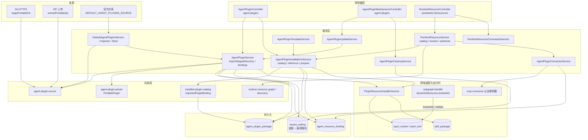

# Agent 插件子域 · 架构（01-架构）

**本文引用的文件**
- [packages/server-ai/src/agent-plugin/agent-plugin.module.ts](file://packages/server-ai/src/agent-plugin/agent-plugin.module.ts)
- [packages/server-ai/src/agent-plugin/agent-plugin.entity.ts](file://packages/server-ai/src/agent-plugin/agent-plugin.entity.ts)
- [packages/server-ai/src/agent-plugin/agent-plugin.service.ts](file://packages/server-ai/src/agent-plugin/agent-plugin.service.ts)
- [packages/server-ai/src/agent-plugin/agent-plugin.controller.ts](file://packages/server-ai/src/agent-plugin/agent-plugin.controller.ts)
- [packages/server-ai/src/agent-plugin/agent-plugin-parser.ts](file://packages/server-ai/src/agent-plugin/agent-plugin-parser.ts)
- [packages/server-ai/src/agent-plugin/agent-plugin-source.ts](file://packages/server-ai/src/agent-plugin/agent-plugin-source.ts)
- [packages/server-ai/src/agent-plugin/agent-plugin-scope.ts](file://packages/server-ai/src/agent-plugin/agent-plugin-scope.ts)
- [packages/server-ai/src/agent-plugin/agent-plugin-installations.service.ts](file://packages/server-ai/src/agent-plugin/agent-plugin-installations.service.ts)
- [packages/server-ai/src/agent-plugin/agent-plugin-connector.service.ts](file://packages/server-ai/src/agent-plugin/agent-plugin-connector.service.ts)
- [packages/server-ai/src/agent-plugin/agent-plugin-mcp.ts](file://packages/server-ai/src/agent-plugin/agent-plugin-mcp.ts)
- [packages/server-ai/src/agent-plugin/installed-plugin-catalog.ts](file://packages/server-ai/src/agent-plugin/installed-plugin-catalog.ts)
- [packages/server-ai/src/agent-plugin/runtime-resource.service.ts](file://packages/server-ai/src/agent-plugin/runtime-resource.service.ts)
- [packages/server-ai/src/agent-plugin/runtime-resource.controller.ts](file://packages/server-ai/src/agent-plugin/runtime-resource.controller.ts)
- [packages/server-ai/src/agent-plugin/runtime-resource-discovery.ts](file://packages/server-ai/src/agent-plugin/runtime-resource-discovery.ts)
- [packages/server-ai/src/agent-plugin/runtime-resource-graph.ts](file://packages/server-ai/src/agent-plugin/runtime-resource-graph.ts)
- [packages/server-ai/src/agent-plugin/maintenance/agent-plugin-update.service.ts](file://packages/server-ai/src/agent-plugin/maintenance/agent-plugin-update.service.ts)
- [packages/server-ai/src/agent-plugin/maintenance/agent-plugin-cleanup.service.ts](file://packages/server-ai/src/agent-plugin/maintenance/agent-plugin-cleanup.service.ts)
- [packages/server-ai/src/agent-plugin/maintenance/package-storage.ts](file://packages/server-ai/src/agent-plugin/maintenance/package-storage.ts)
- [packages/server-ai/src/agent-plugin/maintenance/package-garbage.ts](file://packages/server-ai/src/agent-plugin/maintenance/package-garbage.ts)
- [packages/server-ai/src/agent-plugin/migrations/20260921-agent-plugins.sql](file://packages/server-ai/src/agent-plugin/migrations/20260921-agent-plugins.sql)
- [packages/server-ai/src/agent-plugin/migrations/20261012-agent-plugin-installation-scope.sql](file://packages/server-ai/src/agent-plugin/migrations/20261012-agent-plugin-installation-scope.sql)
- [packages/server-ai/src/agent-plugin/migrations/20261015-agent-plugin-maintenance.sql](file://packages/server-ai/src/agent-plugin/migrations/20261015-agent-plugin-maintenance.sql)
- [packages/server-ai/src/agent-plugin/README.md](file://packages/server-ai/src/agent-plugin/README.md)
- [packages/server-ai/src/plugin-resource/plugin-resource-installer.service.ts](file://packages/server-ai/src/plugin-resource/plugin-resource-installer.service.ts)
- [packages/server-ai/src/app.module.ts](file://packages/server-ai/src/app.module.ts)
- [packages/server-ai/src/ai/ai.module.ts](file://packages/server-ai/src/ai/ai.module.ts)
- [packages/server-ai/src/chat-group/chat-group.module.ts](file://packages/server-ai/src/chat-group/chat-group.module.ts)
- [packages/server-ai/src/xpert-agent/commands/handlers/subgraph.handler.ts](file://packages/server-ai/src/xpert-agent/commands/handlers/subgraph.handler.ts)
- [packages/server-ai/src/xpert-agent/collaborators/collaborators.middleware.ts](file://packages/server-ai/src/xpert-agent/collaborators/collaborators.middleware.ts)
- [packages/server/src/plugin/plugin-management.service.ts](file://packages/server/src/plugin/plugin-management.service.ts)
- [packages/server/src/plugin/plugin-instance.entity.ts](file://packages/server/src/plugin/plugin-instance.entity.ts)
- [packages/server-ai/src/mcp-publication/mcp-publication.controller.ts](file://packages/server-ai/src/mcp-publication/mcp-publication.controller.ts)
- [packages/server-ai/src/mcp-publication/mcp-publication-runtime.service.ts](file://packages/server-ai/src/mcp-publication/mcp-publication-runtime.service.ts)
- [packages/contracts/src/plugin.ts](file://packages/contracts/src/plugin.ts)
- [packages/contracts/src/agent-plugin.ts](file://packages/contracts/src/agent-plugin.ts)
- [packages/contracts/src/default-agent-plugins.ts](file://packages/contracts/src/default-agent-plugins.ts)

## 目录
1. [子域职责与边界](#子域职责与边界)
2. [三类插件对照表](#三类插件对照表)
3. [目录结构与分层](#目录结构与分层)
4. [依赖关系](#依赖关系)
5. [关键不变量](#关键不变量)
6. [架构总览](#架构总览)
7. [结论](#结论)

## 子域职责与边界
本子域 = `packages/server-ai/src/agent-plugin/**`（50 个非 spec 源文件 + 30 个 `*.spec.ts`），加上平台侧**对照面**（交叉引用、不在本子域实现）：`plugin-resource/**`（共用安装器）、`skill-package/**`（技能包落点）、`xpert-template/**`（模板规范化与依赖锁）。

**做什么**：便携插件包（`PortablePlugin`）的来源获取（Git / ZIP）、内容寻址 digest、解析与能力枚举、幂等入库（`agent_plugin_package`）、按 scope 的可见性与配置（`agent_resource_binding`）、插件资源目录与解析（`RuntimeResourceService.catalog/resolve/authorize/read/update/prepare`）、插件 Skill 指令与命令元数据、连接器（Connector）需求登记与运行时凭据解析、官方默认插件导入、Git 分支更新与保守清理，以及与 `xpert-template` 的模板导出/依赖锁。

**不做什么**：不实现工具集主体与执行面（属① 子专家：`xpert-toolset/**`、`xpert-tool/**`、`tool-runtime/**`）；不实现 MCP 协议与发布（属② 子专家：`mcp/**`、`mcp-publication/**`、`xpert-toolset/provider/mcp/**`）；不拥有宿主 bundle 的加载与 level 归属（平台插件与技能专家）；不拥有助手/会话的挂载关系（`xpert_to_toolset` 由助手域持有）。

**边界细则**：HTTP 永不接受 `rootPath`（`list()` 明确把 `rootPath` 从响应里剥掉）；包内相对路径一律经 `containedPath` 做 realpath 遏制；`/agent-plugins` 两个自声明控制器**无控制器守卫**，准入由服务层 `requireResourceAdmin()`（SUPER_ADMIN/ADMIN）+ `resourceScope()`（强制 organizationId）承担；`RuntimeResourceController` 相反是类级 `@Public()` + `ApiKeyOrClientSecretAuthGuard`，供助手客户端与模板执行链调用。

章节来源：[agent-plugin.service.ts](file://packages/server-ai/src/agent-plugin/agent-plugin.service.ts)（关键符号：requireResourceAdmin / resourceScope / importStagedDirectory）、[runtime-resource.service.ts](file://packages/server-ai/src/agent-plugin/runtime-resource.service.ts)（关键符号：RuntimeResourceService.resolve）、[agent-plugin.controller.ts](file://packages/server-ai/src/agent-plugin/agent-plugin.controller.ts)（关键符号：AgentPluginController.importZip）

## 三类插件对照表
| 维度 | ① 平台插件（宿主 bundle） | ② Agent 插件（**本子域**） | ③ MCP 发布（对外 Server） |
|---|---|---|---|
| 归属专家域 | 平台插件与技能专家 | 工具与 MCP 专家 · ③ Agent 插件 | 工具与 MCP 专家 · ② MCP 协议与发布 |
| 代码入口 | `packages/server/src/plugin/**`；`PluginModule.init()`、`PluginManagementService.installPlugin` | `agent-plugin/agent-plugin.controller.ts`（`agent-plugins`）+ `maintenance/agent-plugin-maintenance.controller.ts` | `mcp-publication/mcp-publication.controller.ts`（`@All(':slug')`）+ 管理控制器 |
| 来源形态 | 已加载的 npm/目录 bundle（`LOADED_PLUGINS`、bundle manifest） | 便携包 `plugin.json` + `skills/**/SKILL.md` + `mcp.json`（Git / ZIP） | 已存在的 `XpertToolset` 能力快照 |
| 持久化实体 | `plugin_instance`；组件投影落 `plugin_resource_installation` / `XpertToolset` / `XpertTool` / `SkillPackage` | `agent_plugin_package`（descriptor = `PortablePlugin`）+ `agent_resource_binding` | `mcp_publication` 等 8 张（能力绑定 `mcp_publication_capability`） |
| 装配点 | `PluginManagementService` 三段式（ORM metadata → `lazyLoader.load` → 注册路由/策略） | `AgentPluginInstallationsService.prepare` → `PluginResourceInstallerService.installRuntimeComponent` | `McpPublicationRuntimeService.handle` 每请求 `createMcpHandler` + `toNodeHandler` |
| 准入 | `PluginScopeGuard` + level/`requiresPluginRestart` | `requireResourceAdmin()` + `agentPluginScope()`（tenant 级 = `organizationId IS NULL`） | `RoleGuard` + `@Roles(SUPER_ADMIN)`（管理面）/ 认证+授权+限流（运行面） |
| 生效时机 | 视 `runtimePolicy` 与 level：热装或等重启 | 立即：安装即落 `XpertToolset`/`SkillPackage`，执行前 `prepare` 只校验 | 立即：读路径即注册 MCP 原语 |
| 共用落点与区分标记 | `XpertToolset.options.pluginManaged = true` | `XpertToolset.options.runtimeSource = 'agent-plugin'` + `pluginManaged = false` + `needSandbox = false` | 不外泄：能力以快照形式发布 |

**三者共同点**：最终都收敛到 `XpertToolset` / `XpertTool` / `SkillPackage` 三个宿主表，因此「来源」只能靠 `options` 上的字符串标记区分——安装器的 `findPluginManagedToolset` 正是用 `options ->> 'runtimeSource' = 'agent-plugin'`（Agent 插件）与 `options ->> 'pluginManaged' = 'true'`（平台插件）分流反查。任何绕过安装器直接写 `xpert_toolset` 的代码都会落进「无来源」灰区。

章节来源：[plugin-resource-installer.service.ts](file://packages/server-ai/src/plugin-resource/plugin-resource-installer.service.ts)（关键符号：RuntimeComponent.runtimeSource / findPluginManagedToolset / buildPluginManagedMcpToolsetEntity）、[plugin-management.service.ts](file://packages/server/src/plugin/plugin-management.service.ts)（关键符号：PluginManagementService.installPlugin）、[mcp-publication.controller.ts](file://packages/server-ai/src/mcp-publication/mcp-publication.controller.ts)（关键符号：McpPublicationController）

## 目录结构与分层
**七层，依赖自上而下单向**：

1. **控制器层（3 个）**：`AgentPluginController('agent-plugins')`（12 端点：imports/defaults/catalog/git/zip/bindings）、`AgentPluginMaintenanceController('agent-plugins')`（updates/update/cleanup preview/cleanup）、`RuntimeResourceController()`（6 端点，`assistants/:id/resources*` 与 `conversations/:id/runtime-resources`）。仅做 zod 解析与转调。
2. **编排服务层**：`AgentPluginService`（导入编排、binding 生命周期、中间件校验）、`RuntimeResourceService`（目录/解析/授权/会话读写）、`AgentPluginInstallationsService`（可见目录、引用解析、`prepare` 安装）。
3. **子域服务层**：`AgentPluginConnectorService`（connector 需求 → 宿主 Connector API）、`AgentPluginTemplateService`（模板导出 + 依赖锁）、`RuntimeResourceCommandsService`（Skill 命令与指令正文）、`DefaultAgentPluginsService/Importer/Store`、`AgentPluginUpdateService/Store`、`AgentPluginCleanupService`。
4. **机制层**：`agent-plugin-source.ts`（`stagePortableGit`/`extractPortableZip`/`portablePackageDigest`/`copyPortablePackage`/`walkPortablePackage`）、`agent-plugin-parser.ts`（`parseAgentPlugin`/`containedPath`）、`agent-plugin-mcp.ts`（`portableMcpSchema`/`matchesPortableMcpSchema`/`connectorMcpAuth`）、`installed-plugin-catalog.ts`、`workspace-plugin-catalog.ts`、`agent-plugin-scope.ts`、`published-resource-version.ts`、`runtime-resource-{selection,discovery,graph,middleware-config,context,skill-file}.ts`。
5. **维护层（`maintenance/`）**：`package-storage.ts`（`lockPackageScope`/`assertPackagePath`/`packageIntact`/`stagePackageFiles`/`removePackageFiles`）、`package-garbage.ts`（废弃路径队列与回收）、`package-references.ts`（保守引用扫描）、`activate-package.ts`（默认 binding 生成）、`agent-plugin-maintenance.{controller,schema}.ts`。
6. **配置与 schema 层**：`schemas/plugin.schema.ts`（manifest，Ajv 2020）、`schemas/mcp.schema.ts`（`$defs/server`）、`agent-plugin-connector.schema.ts`、`commands/agent-plugin-commands.schema.ts`。
7. **持久化层**：`agent-plugin.entity.ts` 两实体 + `migrations/*.sql` 三份；进度与垃圾队列复用 `tenant_setting`（`default-agent-plugins.store.ts`、`package-garbage.ts`）。

**装配语义两处要点**：① `AgentPluginModule` 为 `@Global()`，`imports: [CqrsModule, TypeOrmModule.forFeature([AgentPluginPackage, AgentResourceBinding]), ConnectorModule, PluginResourceModule]`，`exports` 只含 `RuntimeResourceCommandsService`、`AgentPluginService`、`RuntimeResourceService` 与两个字符串 token（`'XpertAgentPluginService'`、`'XpertRuntimeResourceService'`）；② `RuntimeResourceController` **不在本模块 controllers 里**，而由 `ai.module.ts` 注册——控制器归属与模块归属分离。

章节来源：[agent-plugin.module.ts](file://packages/server-ai/src/agent-plugin/agent-plugin.module.ts)（关键符号：AgentPluginModule 的 imports/controllers/providers/exports）、[ai.module.ts](file://packages/server-ai/src/ai/ai.module.ts)（关键符号：controllers 中的 RuntimeResourceController）、[installed-plugin-catalog.ts](file://packages/server-ai/src/agent-plugin/installed-plugin-catalog.ts)（关键符号：importedPluginBinding / installedPluginBindings）

## 依赖关系
**出向（本子域依赖）**：
- `@nestjs/{common,core,cqrs}` 与 TypeORM（`Repository`/`EntityManager`/`DataSource`）；`@xpert-ai/server-core`（`RequestContext`、`TenantOrganizationBaseEntity`、`TenantSetting`、`ZodValidationPipe`、`Public`、`ApiKeyOrClientSecretAuthGuard`、`AllowClientSecretBindings`）；`@xpert-ai/plugin-sdk`（`AgentMiddlewareRegistry`、`ConnectorStrategyRegistry`、`getErrorMessage`）；`@xpert-ai/contracts`（`PLUGIN_COMPONENT_TYPE`、`AgentPluginConnector*`、`RuntimeResource*`、`DEFAULT_AGENT_PLUGINS_SOURCE`）。
- 文件系统与子进程：`node:fs/promises`（`mkdtemp`/`realpath`/`lstat`/`open`）、`node:child_process.execFile`（git）、`unzipper`（ZIP）、`yaml`、`zod/v3`、`ajv/dist/2020` + `ajv-formats`。
- **`plugin-resource`（安装器，跨域单向）**：`PluginResourceInstallerService.installRuntimeComponent` / `installComponentsForXpert`，由 `AgentPluginService`、`AgentPluginInstallationsService`、`InstallAgentPluginTemplateResourcesHandler` 三处调用——本子域只构造 `RuntimeComponent`，落库全程交给安装器。
- `xpert-agent`（动态资源注入点）：`subgraph.handler.ts` 用 `dynamicResources?.toolsetIds` 追加工具集；`collaborators.middleware.ts` 消费 `runtimeResources.experts`；`agent-invocation` 侧持有 `RuntimeResourceService` 实例。
- 邻域读写：`connector/**`（Connector 绑定与运行凭据）、`mcp-consumer/auth/mcp-consumer-auth.registry`（`configureMcpConnectorAuthProviderResolver`）、`skill-package`（`SkillPackage.runtimeResourceOnly`）、`xpert-toolset`（`XpertToolset` 的 `schema`/`options`）、`chat-conversation`（会话 `options.runtimeResources`）、`xpert-template`（`normalizeAssistantTemplate`）、`xpert-workspace`/`xpert-project`/`ai`（access service，动态 `moduleRef.get`）。

**入向（谁依赖本子域）**：`app.module.ts` 注册 `AgentPluginModule`；`chat-group.module.ts` 直接 `imports: [AgentPluginModule, ...]`（其 spec 断言 `AgentPluginModule` exports 含 `RuntimeResourceService`）；`ai.module.ts` 注册 `RuntimeResourceController`；`xpert-agent` / `agent-invocation` / `chat-conversation` 经 `RuntimeResourceService` 与两个 token 取服务。

章节来源：[agent-plugin-installations.service.ts](file://packages/server-ai/src/agent-plugin/agent-plugin-installations.service.ts)（关键符号：AgentPluginInstallationsService.prepare）、[agent-plugin-connector.service.ts](file://packages/server-ai/src/agent-plugin/agent-plugin-connector.service.ts)（关键符号：configureMcpConnectorAuthProviderResolver）、[chat-group.module.ts](file://packages/server-ai/src/chat-group/chat-group.module.ts)（关键符号：imports 中的 AgentPluginModule）

## 关键不变量
1. **`(tenantId, organizationId, digest)` 唯一即幂等**：`@Index(['tenantId','organizationId','digest'])` + 迁移索引 `IDX_agent_plugin_package_scope`。同 scope 同 digest 视为同一物理包；重复导入只改 `descriptor`（`unknown_field` 等诊断可变化）与 `rootPath`（仅在损坏时修复），**绝不重写 id / createdAt / bindings**。
2. **`descriptor jsonb = PortablePlugin` 的契约边界**：解析入口 `parseAgentPlugin` 首两行注释划定边界（「Portable discovery is intentionally separate from the native Xpert module loader.」）；`templateCatalog` 标注为 `Server-generated import snapshot. Never accepted from plugin.json.`；任何文件读取都先过 `containedPath`（realpath + `relative` 白名单），JSON 上限 4MB、`SKILL.md` 上限 1MB。
3. **`source {kind:'git'|'zip'}` 两种来源各有硬校验**：Git 必须 `https:` 且无 username/password/hash，ref 不得以 `-` 开头、不得含 CR/LF/NUL，执行时带 `protocol.file.allow=never`、`core.hooksPath=/dev/null`、`GIT_CONFIG_GLOBAL=/dev/null`、`--depth=1`，超时 120s；ZIP 限 100MB / 10000 条目，拒绝符号链接、重复项、反斜杠、绝对路径与越界项，并逐项校验解压后大小与声明一致。
4. **装配分工：声明在包里，落库在安装器**：本子域只产出 `RuntimeComponent`（`componentType ∈ {skill, mcp_server}`、`pluginName = agent-plugin-<pkgId>-<digest 前 12>`、`pluginVersion = digest`、`rootDir = pkg.rootPath`），所有 `XpertToolset`/`XpertTool`/`SkillPackage` 写入都经 `PluginResourceInstallerService`，并由 `runtimeSource: 'agent-plugin'` 反向派生 `needSandbox=false` / `pluginManaged=false`。
5. **引用不等于授权**：`runtime-resource.service.ts` 首行注释「A reference is not an authorization grant. Resolve the actor and scope again on every run/call.」——`resolve`/`authorize`/`prepare`/`assertToolsetAccess` 每次重解析 actor、scope、workspace、connector grant；`prepare` 还要求 `binding.expertVersions` 完整，否则 `Error.AgentResourceConfigurationRequired`。
6. **热更新/重装语义**：激活式导入（`activate=true`，用于 Git 更新与默认导入）只**新增**一条默认 binding（`cleanupEligible=true`），并把旧默认通过 `supersededById` 链接；历史 binding 的 `id/version/installations/expertVersions` 不被重写；`prepare` 仅在 workspace 无安装记录或 connector `bindingId` 变化时才重装组件，否则直接返回既有 `installation`。
7. **写侧串行化全靠 PG advisory lock**：包 scope 锁 `agent-plugin-packages:<tenantId>:<organizationId|_tenant>`（`lockPackageScope`）、binding 锁 `agent-plugin:<bindingId>`、工作区添加锁 `(<tenant>:<org>, <workspaceId>:<pluginName>)`；默认导入另有 control 短锁 + worker 长锁（`pg_try_advisory_lock` + `pg_advisory_unlock`）两级。
8. **磁盘与库的双向一致靠 digest 复查**：`packageIntact` 用 `portablePackageDigest(path) === digest` 判断，修复走「拷到新 UUID 目录 → 复查 digest → 库内切 `rootPath` → 原路径进 `tenant_setting` 队列」；删除只在事务外 best-effort 执行（失败可重试，绝不因清理失败回滚修复）。

章节来源：[agent-plugin.entity.ts](file://packages/server-ai/src/agent-plugin/agent-plugin.entity.ts)（关键符号：AgentPluginPackage 的 @Index / descriptor / source）、[agent-plugin-source.ts](file://packages/server-ai/src/agent-plugin/agent-plugin-source.ts)（关键符号：stagePortableGit / extractPortableZip / portablePackageDigest）、[package-storage.ts](file://packages/server-ai/src/agent-plugin/maintenance/package-storage.ts)（关键符号：lockPackageScope / packageIntact / stagePackageFiles）、[activate-package.ts](file://packages/server-ai/src/agent-plugin/maintenance/activate-package.ts)（关键符号：activatePackage）

## 架构总览

图表来源：[agent-plugin.service.ts](file://packages/server-ai/src/agent-plugin/agent-plugin.service.ts)（关键符号：importStagedDirectory）、[agent-plugin-installations.service.ts](file://packages/server-ai/src/agent-plugin/agent-plugin-installations.service.ts)（关键符号：prepare）、[runtime-resource.service.ts](file://packages/server-ai/src/agent-plugin/runtime-resource.service.ts)（关键符号：resolve）、[plugin-resource-installer.service.ts](file://packages/server-ai/src/plugin-resource/plugin-resource-installer.service.ts)（关键符号：installRuntimeComponent）

图中「来源 → 机制层 → 持久化」是同步 HTTP 路径（含 digest 计算与文件拷贝）；「服务层 → 跨域装配」是本子域唯一触碰宿主表的方向，且必须经过 `PluginResourceInstallerService`。注意 `tenant_setting` 承担了两个非业务用途：默认导入/更新的**收据**与废弃路径的**删除队列**——本子域因此没有任何自有队列表或 worker 框架依赖。

章节来源：[agent-plugin-update.service.ts](file://packages/server-ai/src/agent-plugin/maintenance/agent-plugin-update.service.ts)（关键符号：AgentPluginUpdateService.start / run）、[package-garbage.ts](file://packages/server-ai/src/agent-plugin/maintenance/package-garbage.ts)（关键符号：retirePackageFiles / collectPackageGarbage）、[default-agent-plugins.store.ts](file://packages/server-ai/src/agent-plugin/defaults/default-agent-plugins.store.ts)（关键符号：DefaultAgentPluginsStore.control / acquire）

## 结论
本子域的架构主线是「**一个描述符、两个 scope、三种来源**」：`PortablePlugin` 是唯一的内容契约（解析在包内、遏制在 realpath、失败隔离为 `diagnostics`）；`agent_plugin_package` 按 `(tenantId, organizationId, digest)` 内容寻址，`agent_resource_binding` 按 scope 承载「谁可用、给哪些 workspace、用哪些专家版本」；来源只有 Git、ZIP 与官方仓库三条，全部收敛到同一个 `importStagedDirectory`。

与相邻三面的边界是理解本子域的关键：对**平台插件**，本子域是「下游消费者」——复用其安装器但走 `runtimeSource: 'agent-plugin'` 通道；对**工具集与执行面**，本子域是「生产者」——只落 `XpertToolset`/`SkillPackage`，执行仍由 `ToolRuntimeService` 统一；对**MCP 发布**，两者只有在「能力快照」层面擦肩，本子域不参与发布。

最需要防守的三处：① 包 scope 锁与 binding 锁必须覆盖每一次 `installations` jsonb 写入，否则并发投影丢写；② `digest` 是唯一版本身份，任何「原地改包再复用 digest」的做法都会让 `matchesPortableMcpSchema` 与 `loadRuntimeTemplate` 的复查失效；③ 清理链的保守扫描是「宁可多留」的设计，改动它等于改动可回滚性。

章节来源：[agent-plugin-parser.ts](file://packages/server-ai/src/agent-plugin/agent-plugin-parser.ts)（关键符号：PortablePlugin / containedPath）、[agent-plugin-mcp.ts](file://packages/server-ai/src/agent-plugin/agent-plugin-mcp.ts)（关键符号：matchesPortableMcpSchema）、[runtime-resource.service.ts](file://packages/server-ai/src/agent-plugin/runtime-resource.service.ts)（关键符号：ResolvedRuntimeResources）
