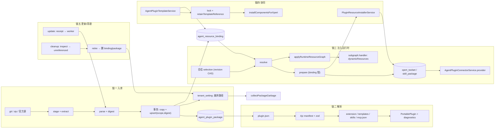
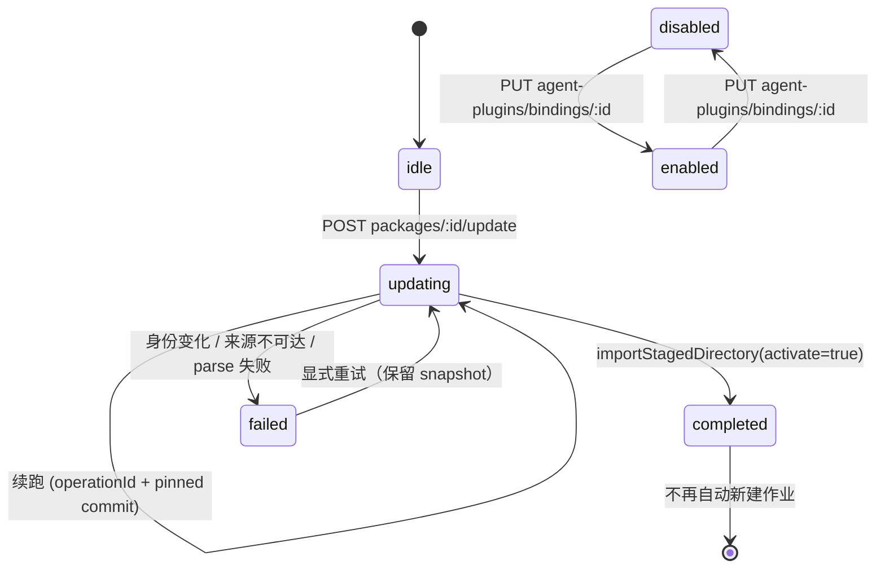

# Agent 插件子域 · 数据流转（03-数据流转）

**本文引用的文件**
- [packages/server-ai/src/agent-plugin/agent-plugin.service.ts](file://packages/server-ai/src/agent-plugin/agent-plugin.service.ts)
- [packages/server-ai/src/agent-plugin/agent-plugin.controller.ts](file://packages/server-ai/src/agent-plugin/agent-plugin.controller.ts)
- [packages/server-ai/src/agent-plugin/agent-plugin-source.ts](file://packages/server-ai/src/agent-plugin/agent-plugin-source.ts)
- [packages/server-ai/src/agent-plugin/agent-plugin-parser.ts](file://packages/server-ai/src/agent-plugin/agent-plugin-parser.ts)
- [packages/server-ai/src/agent-plugin/agent-plugin-mcp.ts](file://packages/server-ai/src/agent-plugin/agent-plugin-mcp.ts)
- [packages/server-ai/src/agent-plugin/agent-plugin-scope.ts](file://packages/server-ai/src/agent-plugin/agent-plugin-scope.ts)
- [packages/server-ai/src/agent-plugin/installed-plugin-catalog.ts](file://packages/server-ai/src/agent-plugin/installed-plugin-catalog.ts)
- [packages/server-ai/src/agent-plugin/agent-plugin-installations.service.ts](file://packages/server-ai/src/agent-plugin/agent-plugin-installations.service.ts)
- [packages/server-ai/src/agent-plugin/agent-plugin-connector.service.ts](file://packages/server-ai/src/agent-plugin/agent-plugin-connector.service.ts)
- [packages/server-ai/src/agent-plugin/runtime-resource.service.ts](file://packages/server-ai/src/agent-plugin/runtime-resource.service.ts)
- [packages/server-ai/src/agent-plugin/runtime-resource-graph.ts](file://packages/server-ai/src/agent-plugin/runtime-resource-graph.ts)
- [packages/server-ai/src/agent-plugin/runtime-resource-skill-file.ts](file://packages/server-ai/src/agent-plugin/runtime-resource-skill-file.ts)
- [packages/server-ai/src/agent-plugin/commands/runtime-resource-commands.service.ts](file://packages/server-ai/src/agent-plugin/commands/runtime-resource-commands.service.ts)
- [packages/server-ai/src/agent-plugin/templates/agent-plugin-template.handler.ts](file://packages/server-ai/src/agent-plugin/templates/agent-plugin-template.handler.ts)
- [packages/server-ai/src/agent-plugin/templates/install-template-resources.handler.ts](file://packages/server-ai/src/agent-plugin/templates/install-template-resources.handler.ts)
- [packages/server-ai/src/agent-plugin/maintenance/agent-plugin-update.service.ts](file://packages/server-ai/src/agent-plugin/maintenance/agent-plugin-update.service.ts)
- [packages/server-ai/src/agent-plugin/maintenance/agent-plugin-cleanup.service.ts](file://packages/server-ai/src/agent-plugin/maintenance/agent-plugin-cleanup.service.ts)
- [packages/server-ai/src/agent-plugin/maintenance/package-garbage.ts](file://packages/server-ai/src/agent-plugin/maintenance/package-garbage.ts)
- [packages/server-ai/src/agent-plugin/maintenance/package-storage.ts](file://packages/server-ai/src/agent-plugin/maintenance/package-storage.ts)
- [packages/server-ai/src/agent-plugin/maintenance/package-references.ts](file://packages/server-ai/src/agent-plugin/maintenance/package-references.ts)
- [packages/server-ai/src/agent-plugin/defaults/default-agent-plugins.importer.ts](file://packages/server-ai/src/agent-plugin/defaults/default-agent-plugins.importer.ts)
- [packages/server-ai/src/agent-plugin/defaults/default-agent-plugins.store.ts](file://packages/server-ai/src/agent-plugin/defaults/default-agent-plugins.store.ts)
- [packages/server-ai/src/plugin-resource/plugin-resource-installer.service.ts](file://packages/server-ai/src/plugin-resource/plugin-resource-installer.service.ts)
- [packages/server-ai/src/xpert-agent/commands/handlers/subgraph.handler.ts](file://packages/server-ai/src/xpert-agent/commands/handlers/subgraph.handler.ts)
- [packages/server-ai/src/xpert-agent/collaborators/collaborators.middleware.ts](file://packages/server-ai/src/xpert-agent/collaborators/collaborators.middleware.ts)
- [packages/contracts/src/agent-plugin-maintenance.ts](file://packages/contracts/src/agent-plugin-maintenance.ts)

## 目录
1. [链一 插件包入库与幂等](#链一-插件包入库与幂等)
2. [链二 descriptor 解析与能力枚举](#链二-descriptor-解析与能力枚举)
3. [链三 注入到 Agent 运行时](#链三-注入到-agent-运行时)
4. [链四 与平台插件及模板的协同](#链四-与平台插件及模板的协同)
5. [链五 更新与卸载](#链五-更新与卸载)
6. [总览](#总览)
7. [状态机](#状态机)
8. [已知风险](#已知风险)
9. [结论](#结论)

## 链一 插件包入库与幂等
**触发**：`POST agent-plugins/git`（`{url, ref, subdirectory?}`）、`POST agent-plugins/zip`（multipart，100MB/1 文件）、官方默认导入（`DefaultAgentPluginsImporter`）、Git 更新（`AgentPluginUpdateService`）。四者最终都调 `AgentPluginService.importStagedDirectory(root, source, activate, manager)`。

**数据流**：
1. `stagePortableGit(url, ref, subdirectory)` → `{temp, root, commit}`；`extractPortableZip(buffer, dir)` → 目录（必要时下钻单层）。两者都只产**临时**目录，调用方在 `finally` 里 `rm`。
2. `parseAgentPlugin(root)` → `PortablePlugin`（含 `diagnostics`）。
3. `portablePackageDigest(root)` → `sha256(路径 \0 内容 \0 ...)` = `digest`（64 hex）。
4. 事务内：`lockPackageScope(manager, scope)` → 可选的 `currentPackageBinding(manager, scope, descriptor.name)`（仅 `activate`）→ `repository.findOne({...agentPluginScopeWhere(scope), digest})`：
   - 命中且 `packageIntact(existing.rootPath, digest, scope)` → 复用磁盘与行，`importStatus='existing'`；
   - 命中但磁盘损坏 → `stagePackageFiles(root, digest, scope)` 写新 UUID 目录（`copyPortablePackage` + digest 复查），旧 `rootPath` 交 `retirePackageFiles` 入队，`importStatus='repaired'`；
   - 未命中 → 同上 staging，`repository.create({...scope, rootPath, digest, descriptor, source})`，`importStatus='imported'`；
   - 两条「命中」分支的 `save` 都**只更新 `descriptor`/`rootPath`（及 `activate` 时的 `source`）**，保留 `id/createdAt/bindings`。
5. `activate` 且默认 binding 变更 → `activatePackage(manager, saved, previous)`：生成新 UUID 的默认 binding（`cleanupEligible=true`、`availability:'scope'`、继承 `title/description/enabled/expertVersions`、`createdAt` 取 `max(now, previous.createdAt+1)` 以保证排序）。
6. 提交后另起事务 `collectPackageGarbage`（失败被吞）；若主事务未提交且已落盘 → `removePackageFiles(stagedPath, scope)`。

**落点**：`agent_plugin_package`（一行一 digest）、`storage/agent-plugins/<tenantId>/<organizationId|_tenant>/<uuid>/`、`tenant_setting`（废弃路径队列）。

章节来源：[agent-plugin.service.ts](file://packages/server-ai/src/agent-plugin/agent-plugin.service.ts)（关键符号：importStagedDirectory）、[agent-plugin-source.ts](file://packages/server-ai/src/agent-plugin/agent-plugin-source.ts)（关键符号：portablePackageDigest）、[package-storage.ts](file://packages/server-ai/src/agent-plugin/maintenance/package-storage.ts)（关键符号：stagePackageFiles / packageIntact）

## 链二 descriptor 解析与能力枚举
**触发**：链一的第 2 步（每次导入/修复/更新都会重新解析）。

**数据流**（`plugin.json` 在包内的降级路径）：
1. `containedPath(root,'plugin.json')` → `stat.isFile()`（否则错）→ `size ≤ 4MB` → `JSON.parse` → 必须是对象。
2. 未在 `manifestSchema.properties` 声明的顶层键被删除并记 `unknown_field` 诊断。
3. `extensions` 命名空间选择：有 `xpertai` 用 `xpertai`，否则 `cn.xpertai`（旧别名）。
4. Ajv 2020 `validateManifest`（失败即整体抛错）→ zod `manifestShape` → `{name, version?, description?}`。
5. `extensionShape.safeParse`（`commands` 先剔除）→ 成功写 `plugin.extension`，失败记 `invalid_extension`。
6. `templates[]`：`containedPath` + ≤4MB + `normalizeAssistantTemplate`；`legacy` 为真即报错；成功写 `plugin.templates` 与 `templateCatalog[key]={name,title,description,avatar,type}`。
7. `skills/`：`readdir` 每个目录 → `skills/<dir>/SKILL.md`（≤1MB）→ frontmatter 正则切片 → zod 校验 `{name,description}` → `name === 目录名` 才写 `plugin.skills.push({key,description,path})`。
8. `extension.commands`（若有）→ `parseAgentPluginCommands(commands, plugin.skills, report)`。
9. `mcp.json`：`$schema`/`mcpServers` 结构校验 → 每个 server `validateServer` → `type !== 'streamable-http'` 记 `unsupported_transport` 跳过 → URL/header 安全校验 → `plugin.servers.push({key, config:{type,url,headers?}})`。

**能力枚举结果**（后续两处消费者共享同一顺序与命名）：`descriptor.templates`（assistant_template）、`descriptor.skills`（skill）、`descriptor.servers`（mcp）、`descriptor.extension.middlewares`（middleware）、`descriptor.extension.experts`（external_xpert）。失败项以 `diagnostics[{component,code,message}]` 形式随包体落库（`jsonb` 的 `descriptor.diagnostics`），并驱动目录状态 `partial`。

章节来源：[agent-plugin-parser.ts](file://packages/server-ai/src/agent-plugin/agent-plugin-parser.ts)（关键符号：parseAgentPlugin / PortablePlugin.diagnostics）、[runtime-resource.service.ts](file://packages/server-ai/src/agent-plugin/runtime-resource.service.ts)（关键符号：describe 的 components 组装）

## 链三 注入到 Agent 运行时
**触发**：会话/助手的资源选择（`PUT conversations/:id/runtime-resources`、`POST assistants/:id/resources/validate`）与执行前的 `prepare`。

**数据流**：
1. 选择持久化：`RuntimeResourceService.update(conversationId, selection)` 先 `resolve` 预校验，再在事务里 `pessimistic_write` 锁会话、比对 `selection.revision === locked.options.runtimeResources.revision`（不等即 409），写入 `{revision+1, resources}`。
2. 解析：`resolve(assistantId, selection, projectId)` → `parseRuntimeResources` 校验形状 → 逐 reference：查 `bindings.findOneBy({...scope, id, version, enabled:true})` → 回落 `installations.reference()` → 再回落自动发现候选（版本必须全等）→ workspace 归属检查（非 `agent_plugin` 才校验 `workspaceIds`）→ 按 `definition.kind` 分流：
   - `middleware` → `addMiddleware('resource_<bindingId>', provider, options)`（先 `validateMiddleware`，再 `normalizeMiddlewareProvider`）；
   - `external_xpert` → `addExpert(xpertId, binding.expertVersions[xpertId])`；
   - `agent_plugin` → 去重（同 packageId 不同 definition 抛 `Error.AgentResourceConflict`）→ 拒绝 `oauthServers` → 取 `pkg` → 追加 `runtimeTemplateDescriptors` → 展开包内 middlewares/experts → `installations.prepare(reference, assistant)` 拿 `installation` → 推 `skillIds`/`skillSources`（`rootPath=join(pkg.rootPath, dirname(skill.path))`、`runtimePath=agent-plugins/<pkgId>/<skillKey>`、`version=digest`）→ 逐 server 复查 `matchesPortableMcpSchema` + `category===MCP` + `needSandbox===false` + `pluginManaged===false`，通过才推 `toolsetIds`。
3. overlay：`applyRuntimeResourceGraph(assistant.graph, assistant.agent, result, middlewareMeta)` 生成执行期图副本（新增/合并中间件节点，`required:true`；有 skillIds 时确保 `skills` 中间件存在或置 `required`）。
4. 消费：
   - `subgraph.handler.ts` 用 `dynamicResources?.toolsetIds` 在 `agent.toolsetIds` 之外追加工具集装配，失败只告警（`Agent Plugin MCP component unavailable`）并回 `AgentResourceUnavailable` 事件；
   - `collaborators.middleware.ts` 用 `runtimeResources.experts` 追加协作者；
   - 模板子代理侧把 `RuntimeTemplateDescriptor` 带进子代理编译。
5. 凭据：MCP 调用前由 `AgentPluginConnectorService.provider(request)` 解析——校验 `runtimeScope`（xpertId/conversationId/executionId 齐备且 tenant/user/organization 与 `RequestContext` 一致）→ 查工具集与 owner binding（`installations[workspaceId].toolsets` 含该 id、`connectors[serverName].bindingId` 相等）→ 复查「有效目录仍 enabled」→ 校验 `server.config.url` 与 `matchesPortableMcpSchema` → 才取 `getRuntimeConnectorCredentialForScope`。
6. Skill 正文：`RuntimeResourceCommandsService.instructions` 先用 `readRuntimeResourceSkillFile` 读 `SKILL.md`（realpath 遏制、≤1MB），累计 ≤256KB 输出。

章节来源：[runtime-resource.service.ts](file://packages/server-ai/src/agent-plugin/runtime-resource.service.ts)（关键符号：resolve / update / prepare）、[agent-plugin-connector.service.ts](file://packages/server-ai/src/agent-plugin/agent-plugin-connector.service.ts)（关键符号：provider / authorization）、[runtime-resource-graph.ts](file://packages/server-ai/src/agent-plugin/runtime-resource-graph.ts)（关键符号：applyRuntimeResourceGraph）

## 链四 与平台插件及模板的协同
**与平台插件的两处交汇**：
1. **共用安装器**：Agent 插件只构造 `RuntimeComponent`（`pluginName='agent-plugin-<pkgId>-<digest[:12]>'`、`pluginVersion=digest`、`rootDir=pkg.rootPath`、`definitionHash=digest`），落库一律由 `PluginResourceInstallerService.installRuntimeComponent` 完成；该服务据 `runtimeSource` 写 `options.needSandbox=false` + `options.pluginManaged=false`，并据此与平台插件路径（`options.pluginManaged=true`）分流反查。
2. **共用落点、不同来源标记**：Skill → `skill_package`（并置 `runtimeResourceOnly=true`）；MCP → `xpert_toolset`（`category=MCP`、`schema` 由 `portableMcpSchema` 生成、`options` 追加 `pluginManaged:false`）。

**与 `xpert-template` 的三段协作**：
1. **导出**：`AgentPluginTemplateService.templates()` 把包内模板翻成 `TXpertTemplate`（id=`agent-plugin/<name>/<key>`、`source:'agent-plugin'`、`contentHash=sha256(export_data)`、`pluginVersion=descriptor.version||digest`）；`summaryOnly` 时优先读已落库的 `descriptor.templateCatalog` 快照，否则每条都先 `verify(pkg)`（digest 复查）再读文件。
2. **解析锁**：`ResolveAgentPluginTemplateDependencyCommand` → `templatePackage(name, digest?, workspaceId)`（可按 digest pin 到历史包）→ `verify` → 定位组件 → `retainTemplateReference`（置 `cleanupEligible=false`）→ 返回 `{component:{...resource, runtimeSource:'agent-plugin', targetAgentKey}, lock:{pluginName, version:digest, source:{kind:'agent-plugin', name, digest, bindingId, bindingVersion}, components:[{type,key,hash}]}}`。
3. **安装与复核**：`InstallAgentPluginTemplateResourcesHandler` 按 `lock.source.bindingId/bindingVersion` 重解析并比对 `resolved.pkg.digest === source.digest`（否则 `Error.TemplateDependencyChanged`），把 `portableServer`（含 `connectorMcpAuth`）写回组件 → `installComponentsForXpert` → `registerTemplateMcp` 落 toolsets + connectors；之后每次执行前 `AssertAgentPluginTemplateDependencyCommand` 再比对 `name/digest/lock.version/providers/components[].hash`。

章节来源：[plugin-resource-installer.service.ts](file://packages/server-ai/src/plugin-resource/plugin-resource-installer.service.ts)（关键符号：installRuntimeComponent / runtimeSource 分流）、[agent-plugin-template.handler.ts](file://packages/server-ai/src/agent-plugin/templates/agent-plugin-template.handler.ts)（关键符号：resolve / assert / retainTemplateReference）、[install-template-resources.handler.ts](file://packages/server-ai/src/agent-plugin/templates/install-template-resources.handler.ts)（关键符号：InstallAgentPluginTemplateResourcesHandler.execute）

## 链五 更新与卸载
**更新（Git 分支）**：`POST agent-plugins/packages/:id/update {branch?, operationId?}` → 202 收据。
- `start`：`store.control` 内读收据 → 有 `operationId` 则要求 `operationId` 与 `packageId` 全等（否则 `Error.AgentPluginUpdateChanged`）；无 `operationId` 且 `phase='updating'` 则要求 `packageId`/`branch` 一致（否则 `Error.AgentPluginUpdateBusy`）；否则校验 `source.kind==='git' && url`，推出 branch（官方源默认 `DEFAULT_AGENT_PLUGINS_SOURCE.ref`，其它默认 `source.ref`，40/64 位 hex 判为不可用分支）并写 `{operationId, packageId, branch, commit:null, phase:'updating'}`。
- `run`：`store.acquire` 抢长锁 → 重读收据（`operationId`/`phase` 不符即退出）→ `stagePortableGit(url, commit ?? 'refs/heads/<branch>', subdirectory)` → 先落 `commit`（续跑复用同一 commit）→ `parseAgentPlugin(root).name` 必须等于旧包 `descriptor.name` → `importStagedDirectory(root, {...source, ref:branch, commit}, activate=true, manager)` → `result={packageId,status}` + `phase='completed'`；异常写 `phase='failed'` + `error`；`finally` 释放 worker 锁。

**清理旧版本（唯一「卸载」形态）**：
- 预览 `GET agent-plugins/packages/:id/cleanup`：`lockPackageScope` → `inspect` 取同 `descriptor.name` 家族（按 createdAt DESC）→ 为家族的全部合成/持久引用 id 逐个取 `agent-plugin:<id>` 锁 → 重查 bindings → 标注 `reason ∈ {current, updating, configured, referenced, unreferenced}`。
- 执行 `POST`：锁内 `inspect` 重算 → 只处理 `reason==='unreferenced'` 且出现在 `packageIds` 的包 → `assertPackagePath` → `retirePackageFiles`（入队）→ 删对应 `agent_resource_binding` → 删 `agent_plugin_package` → 事务外 `collectPackageGarbage` 真删目录。
- 禁用：`PUT agent-plugins/bindings/:id {enabled}` → `setEnabled`（两把锁 + `cleanupEligible=false`）。

章节来源：[agent-plugin-update.service.ts](file://packages/server-ai/src/agent-plugin/maintenance/agent-plugin-update.service.ts)（关键符号：start / run）、[agent-plugin-cleanup.service.ts](file://packages/server-ai/src/agent-plugin/maintenance/agent-plugin-cleanup.service.ts)（关键符号：inspect / cleanup）、[package-garbage.ts](file://packages/server-ai/src/agent-plugin/maintenance/package-garbage.ts)（关键符号：retirePackageFiles / collectPackageGarbage）

## 总览

图表来源：[agent-plugin.service.ts](file://packages/server-ai/src/agent-plugin/agent-plugin.service.ts)（关键符号：importStagedDirectory）、[runtime-resource.service.ts](file://packages/server-ai/src/agent-plugin/runtime-resource.service.ts)（关键符号：resolve / prepare）、[plugin-resource-installer.service.ts](file://packages/server-ai/src/plugin-resource/plugin-resource-installer.service.ts)（关键符号：installRuntimeComponent）、[agent-plugin-update.service.ts](file://packages/server-ai/src/agent-plugin/maintenance/agent-plugin-update.service.ts)（关键符号：AgentPluginUpdateService.run）

五条链共享两类写侧资源：`agent_plugin_package`（只有链一/链五写）与 `agent_resource_binding`（链一 `activate`、链三 `prepare`、链四 `registerTemplateMcp`、链五 `cleanup` 都会写），后者是并发热点，任何写入都必须持有 `agent-plugin:<bindingId>` 锁。

章节来源：[agent-plugin-installations.service.ts](file://packages/server-ai/src/agent-plugin/agent-plugin-installations.service.ts)（关键符号：registerTemplateMcp / prepare）、[installed-plugin-catalog.ts](file://packages/server-ai/src/agent-plugin/installed-plugin-catalog.ts)（关键符号：importedPluginBinding）

## 状态机
| 状态集合 | 载体 | 取值 | 迁移触发 |
|---|---|---|---|
| 导入结果 | `importStagedDirectory` 返回值（非表列） | `imported` / `existing` / `repaired` | 是否命中同 digest、磁盘是否完整 |
| Git 更新收据 | `tenant_setting`（`AgentPluginUpdateProgress.phase`） | `idle` → `updating` → `completed` / `failed` | `start` 建档；`run` 成功/异常写终态 |
| 默认导入收据 | `tenant_setting`（`DefaultAgentPluginsImportProgress.phase`） | `idle` → `fetching` → `importing` → `completed` / `failed` | `start` 建/续；`importer.run` 逐项推进 |
| 已安装目录状态 | 派生（`InstalledAgentPlugin.status`） | `available` / `configuration_required` / `disabled` | `enabled`、`missingExperts` 判定 |
| 目录项状态 | 派生（`RuntimeResourceCatalogItem.status`） | `ready` / `partial` / `unavailable` / `requires_auth` / `configuration_required` | `diagnostics`、connector `status()`、schema 全等复查 |
| 废弃路径队列 | `tenant_setting`（`agent-plugin-garbage:<tenant>:<org>`） | 入队 → 事务外删除 → 成功移除 / 失败留队 | `retirePackageFiles` / `collectPackageGarbage` |

图表来源：[agent-plugin-maintenance.ts](file://packages/contracts/src/agent-plugin-maintenance.ts)（关键符号：AgentPluginUpdateProgress.phase）、[agent-plugin-update.service.ts](file://packages/server-ai/src/agent-plugin/maintenance/agent-plugin-update.service.ts)（关键符号：start / run）、[default-agent-plugins.service.ts](file://packages/server-ai/src/agent-plugin/defaults/default-agent-plugins.service.ts)（关键符号：DefaultAgentPluginsService.start）

章节来源：[agent-plugin-update.service.ts](file://packages/server-ai/src/agent-plugin/maintenance/agent-plugin-update.service.ts)（关键符号：phase 写入点）、[default-agent-plugins.importer.ts](file://packages/server-ai/src/agent-plugin/defaults/default-agent-plugins.importer.ts)（关键符号：run 的 phase 推进）、[agent-plugin.entity.ts](file://packages/server-ai/src/agent-plugin/agent-plugin.entity.ts)（关键符号：cleanupEligible / enabled）

## 已知风险
1. **`installations` 丢写**：`agent_resource_binding.installations` 是「读-改-写」的 jsonb 映射，正确性完全依赖调用方持有 `pg_advisory_xact_lock('agent-plugin:<bindingId>')`；没有 DB 约束或版本号兜底，`[推测]` 任何新增写路径若忘记取锁会静默丢投影。
2. **全等校验脆弱**：`matchesPortableMcpSchema` 用 `isEqual` 比对 `XpertToolset.schema` 与期望值，`options.needSandbox!==false || options.pluginManaged!==false` 也直接判不可用；任何宿主侧对工具集 schema/options 的附加写入都会让资源在运行期变 403，而不是降级。
3. **保守扫描无索引**：`referencedPackages` 对全库 `json/jsonb/simple-json` 列做 `CAST(... AS text) LIKE '%token%'`（token 含 id/digest/bindingId/version），随库增长线性变慢；注释明确「can retain extra versions rather than risk removing a reference」，即**清理会偏保守**。
4. **旧包磁盘占用单调增长**：升级不重写旧引用，旧包必须留到显式 `cleanup`；且 `cleanup` 只处理 `reason==='unreferenced'`，历史模板锁/会话选择会长期保留对应版本。
5. **删除失败静默**：`collectPackageGarbage` 把失败路径留在 `tenant_setting` 队列，无指标、无告警、无重试次数上限；`[推测]` 权限/挂载问题会造成无感堆积。
6. **`descriptor.diagnostics` 会随重解析变化**：`existing` 分支也 `save({descriptor})`，因此同一 digest 行的 `descriptor` 可能被不同解析环境（如临时文件不可读）覆盖为带更多诊断的版本，`[推测]` 期间同一包的状态展示可能抖动。
7. **`source` 无校验器**：`agent_plugin_package.source` 是裸 jsonb，只有 update service 消费且强制 `kind==='git'`；zip 包与手工写的 source 只能靠约定，`[推测]` 出现 `kind:'zip'` 之外的取值不会被任何校验拦住。
8. **收据与 scope 强绑定**：progress 键为 `xpert:agent-plugin-defaults:<tenantId>:<organizationId>`，而 `resourceScope()` 强制 organizationId；无组织上下文的导入路径（`resourceScope` 抛 `Error.AgentResourceOrganizationRequired`）无法写收据，而 `importStagedDirectory` 自身用的是允许 `organizationId=null` 的 `agentPluginScope()`——两条路径的 scope 口径不同，`[推测]` 这是租户级包与组织级流程并存的遗留。
9. **多副本存储共享是运维前提**：`packageScopeDirectory` 依赖 `XPERT_AGENT_PLUGIN_PATH`，README 明说 storage root 必须位于 API worker 共享的持久存储；代码不做探测或降级。
10. **无卸载即无级联清理**：README 逐字「It always retains … every package with a user configuration, reserved template reference or workspace installation … This is not a force-uninstall or cascading deletion feature.」——派生 Skills/MCP 工具/Connector 授权与用户数据永不随包删除，需要人工另行处置。

章节来源：[package-references.ts](file://packages/server-ai/src/agent-plugin/maintenance/package-references.ts)（关键符号：referencedPackages）、[agent-plugin-mcp.ts](file://packages/server-ai/src/agent-plugin/agent-plugin-mcp.ts)（关键符号：matchesPortableMcpSchema）、[agent-plugin-scope.ts](file://packages/server-ai/src/agent-plugin/agent-plugin-scope.ts)（关键符号：agentPluginScope / visibleAgentPluginScopes）

## 结论
五条链的分工很清晰：**链一决定「包是什么」（内容寻址 + scope 幂等），链二决定「包声明了什么」（严格校验 + 组件级降级），链三决定「这次运行能用什么」（每次重解析 + 全等复查），链四决定「谁把声明变成宿主资源」（安装器）与「谁钉住引用」（模板锁），链五决定「什么可以被回收」（保守扫描 + 显式清理）**。跨链的硬约束只有三条：`digest` 是版本身份、`agent-plugin:<bindingId>` 是 `installations` 的写锁、`runtimeSource: 'agent-plugin'` 是与平台插件共存的来源标记。

排障时可按这个顺序看：包是否在（`agent_plugin_package` 的 scope+digest）→ 目录是否可见（`installedPluginBindings` 的组织遮蔽与 `supersededById`）→ 引用是否还有效（`reference()` 里 scope 级 enabled）→ 安装投影是否完整（`installations[workspaceId]` 的 skills/toolsets/connectors）→ 运行时复查是否通过（`matchesPortableMcpSchema` 与 connector `status()`）。

章节来源：[installed-plugin-catalog.ts](file://packages/server-ai/src/agent-plugin/installed-plugin-catalog.ts)（关键符号：installedPluginBindings）、[agent-plugin-installations.service.ts](file://packages/server-ai/src/agent-plugin/agent-plugin-installations.service.ts)（关键符号：reference / prepare）、[runtime-resource-skill-file.ts](file://packages/server-ai/src/agent-plugin/runtime-resource-skill-file.ts)（关键符号：readRuntimeResourceSkillFile）
