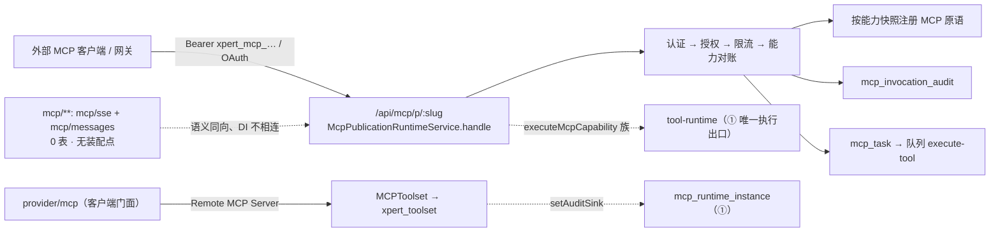

# MCP 协议与发布子专家 —— C0 使用总览

> **资产基线**：`2026-10-16 · commit 80f5676fd`（批次 5 第 10 专家 · 子专家②），继承父域 [C0-使用总览.md](file://.module-experts/后端专题/工具与 MCP 专家/C0-使用总览.md)。**范围**：`packages/server-ai/src/mcp/**`（14 非 spec / **0 spec** / **0 表**）、`packages/server-ai/src/mcp-publication/**`（43 非 spec / 24 spec / **8 张自有表**）、`packages/server-ai/src/xpert-toolset/provider/mcp/**`（客户端，11 非 spec / 9 spec）；邻域 `mcp-consumer/**`、`mcp-app-runtime/**` 仅交叉引用。工具集本体与执行面归 [子专家①](file://.module-experts/后端专题/工具与 MCP 专家/sub-experts/工具集与工具子专家/C0-使用总览.md)，`agent-plugin/**` 归 [子专家③](file://.module-experts/后端专题/工具与 MCP 专家/sub-experts/Agent插件子专家/C0-使用总览.md)。未证实处标 `[推测]`。

**本文引用的文件**（相对仓库根，链接均为 `file://`）

- [packages/server-ai/src/mcp/mcp.module.ts](file://packages/server-ai/src/mcp/mcp.module.ts)
- [packages/server-ai/src/mcp/mcp.service.ts](file://packages/server-ai/src/mcp/mcp.service.ts)
- [packages/server-ai/src/mcp/controllers/base-mcp.controller.ts](file://packages/server-ai/src/mcp/controllers/base-mcp.controller.ts)
- [packages/server-ai/src/mcp/transport/sse-transport.ts](file://packages/server-ai/src/mcp/transport/sse-transport.ts)
- [packages/server-ai/src/mcp-publication/mcp-publication.controller.ts](file://packages/server-ai/src/mcp-publication/mcp-publication.controller.ts)
- [packages/server-ai/src/mcp-publication/mcp-publication-management.controller.ts](file://packages/server-ai/src/mcp-publication/mcp-publication-management.controller.ts)
- [packages/server-ai/src/mcp-publication/mcp-publication-runtime.service.ts](file://packages/server-ai/src/mcp-publication/mcp-publication-runtime.service.ts)
- [packages/server-ai/src/mcp-publication/mcp-publication.service.ts](file://packages/server-ai/src/mcp-publication/mcp-publication.service.ts)
- [packages/server-ai/src/mcp-publication/mcp-capability-catalog.service.ts](file://packages/server-ai/src/mcp-publication/mcp-capability-catalog.service.ts)
- [packages/server-ai/src/mcp-publication/mcp-api-key.service.ts](file://packages/server-ai/src/mcp-publication/mcp-api-key.service.ts)
- [packages/server-ai/src/mcp-publication/mcp-task.service.ts](file://packages/server-ai/src/mcp-publication/mcp-task.service.ts)
- [packages/server-ai/src/mcp-publication/entities/index.ts](file://packages/server-ai/src/mcp-publication/entities/index.ts)
- [packages/server-ai/src/mcp-publication/mcp-oauth-feature.ts](file://packages/server-ai/src/mcp-publication/mcp-oauth-feature.ts)
- [packages/server-ai/src/xpert-toolset/provider/mcp/types.ts](file://packages/server-ai/src/xpert-toolset/provider/mcp/types.ts)
- [packages/server-ai/src/xpert-toolset/provider/mcp/mcp-stdio-runtime.ts](file://packages/server-ai/src/xpert-toolset/provider/mcp/mcp-stdio-runtime.ts)
- [packages/server-ai/src/xpert-toolset/xpert-toolset.module.ts](file://packages/server-ai/src/xpert-toolset/xpert-toolset.module.ts)
- [packages/contracts/src/ai/mcp-publication.model.ts](file://packages/contracts/src/ai/mcp-publication.model.ts)

## 目录

1. [定位](#定位)
2. [何时找这个子专家](#何时找这个子专家)
3. [能力清单表](#能力清单表)
4. [边界](#边界)
5. [已知问题与常见坑](#已知问题与常见坑)
6. [延伸阅读](#延伸阅读)

## 定位

本子专家负责 MCP 的**三段互不重叠的实现**：① **协议侧**（`mcp/**`）——把 NestJS provider 通过 `@Tool`/`@Resource`/`@Prompt` 装饰器暴露成 MCP Server 的通用壳，`MCPModule.register()` + `MCPService.scanAndRegisterProviders()` + `NestSSEAdapter` 的 `mcp/sse` + `mcp/messages` 双端点，**目录内 0 个 `@Entity`**；② **发布侧**（`mcp-publication/**`）——把工具集能力反向发布为对外 streamable-http MCP Server（`/api/mcp/p/:slug`），含草稿 → 能力快照 → 审核 → 激活 → API Key/OAuth → 调用审计 → 长任务闭环，独占 8 张表；③ **客户端侧**（`provider/mcp/**`）——把远端 MCP Server 接成助手可用工具集（建连分流、工具过滤与包装、stdio 子进程托管、MCP App 桥接、长任务状态回传）。

**一句话口径**：`mcp/**` 是**不落库、全仓无装配点**的能力储备；`mcp-publication/**` 是唯一落库的对外面，其「能力快照（`descriptorSnapshot` + `descriptorHash`）→ 绑定 → 台账对齐 → 密钥 → 审计 → 长任务」构成闭环；`provider/mcp/**` 是 ① 与 ② 的**唯一接口面**，也是 stdio 子进程与审计字段的真实产生地。信任只来自宿主：审批、`runtime` 配置、文件作用域、组织准入四处都在延迟节点**重校验**。

章节来源：[mcp.service.ts](file://packages/server-ai/src/mcp/mcp.service.ts)（关键符号：MCPService.onModuleInit / scanAndRegisterProviders）、[mcp-publication-runtime.service.ts](file://packages/server-ai/src/mcp-publication/mcp-publication-runtime.service.ts)（关键符号：McpPublicationRuntimeService.handle）、[mcp-stdio-runtime.ts](file://packages/server-ai/src/xpert-toolset/provider/mcp/mcp-stdio-runtime.ts)（关键符号：McpStdioRuntimeManager.prepareServer）

## 何时找这个子专家

- 要**接一个 MCP 服务器（stdio）**：`createMCPClient` 的 `http`/`sse`/`stdio` 三分流、`mcpStdioRuntimeManager.prepareServer` 的策略收敛、`XPERT_MCP_STDIO_*` 门禁与 `mcp-stdio-runner.js` 的六类终止路径。
- 要**调 MCP 协议端点**：`@Get('mcp/sse')` 建连 + `@Post('mcp/messages')` 复用会话（`activeTransports` 内存 Map、未命中 404 `Session not found`）；注意 `MCPModule` 当前**无装配点**。
- 要**做 MCP 发布**：草稿（`status:'draft'`）→ 能力快照（`PUT :id/capabilities`）→ 审核（`reviewStatus`）→ 激活（`POST :id/enable`）→ 授权（API Key / OAuth policy）。
- 要**排查调用审计与长任务**：`mcp_invocation_audit` 一次调用一条（`requestId` 唯一、`argumentSummary` 只存 keys/bytes）、`GET mcp-publications/:id/audit` 分页、`mcp_task` 的 `idempotencyKey` + `inputHash` 重放、队列 `mcp-publication/execute-tool`。
- 要**做 API Key 轮换与撤销**：`POST mcp-publications/:id/api-keys`、`POST mcp-api-keys/:keyId/{revoke,rotate}`；前缀 `xpert_mcp_`、`secret` 只回一次、`rotate` 是「先撤销再新建」。
- 要**改 OAuth introspection 与元数据**：`GET/PUT :id/oauth-policy` + `POST :id/oauth-policy/test`（Pro 门禁）与 `/.well-known/oauth-protected-resource/api/mcp/p/:slug`（**不带 `/api` 前缀**）。
- 要**弄懂邻域 consumer 的控制器为何在工具集模块里**：`McpConsumerCapabilitiesService` 依赖 ① 提供的 `ToolRuntimeService`，`mcp-consumer` 自身**不含 Nest 模块**，必须由宿主模块承载。
- 要**改组织维度访问授权**：`mcp_publication_access` 唯一 `(publicationId, organizationId)`；共享发布时才要求 `access.assertEnabled`，HTTP 面**不在本子域**而在平台侧 `plugin-resource`。
- 要**改文件能力**：`POST/GET /api/mcp/p/:slug/files`（`McpFilesGuard`、单文件 256 MiB、要求 `subjectType==='user'` 与 `runtime.files.type==='user'`）。
- 要**改环境门禁与密钥**：`XPERT_MCP_STDIO_RUNTIME_ENABLED`（默认关闭）、`environment.mcpOAuthEnabled`（本仓库两套 environment 均 `false`）、`SECRETS_ENCRYPTION_KEY`。

章节来源：[types.ts](file://packages/server-ai/src/xpert-toolset/provider/mcp/types.ts)（关键符号：createMCPClient / resolveRemoteHeaders）、[mcp-publication-management.controller.ts](file://packages/server-ai/src/mcp-publication/mcp-publication-management.controller.ts)（关键符号：create / enable / replaceCapabilities / createApiKey / revokeApiKey / rotateApiKey）、[xpert-toolset.module.ts](file://packages/server-ai/src/xpert-toolset/xpert-toolset.module.ts)（关键符号：controllers 含 McpConsumerOAuthController / McpConsumerCapabilitiesController）

## 能力清单表

| 能力 | 入口 | 一句话 |
|---|---|---|
| MCP 服务端协议会话（通用壳） | `GET /api/mcp/sse`、`POST /api/mcp/messages` | `BaseMCPController` 类级 `@Public()`；会话状态纯内存，多副本不可共享 |
| 装饰器扫描注册 | `MCPService.onModuleInit` → `scanAndRegisterProviders` | 读 `MCP_RESOURCE`/`MCP_TOOL`/`MCP_PROMPT` 元数据；参数经 `convertParametersToZod`（未知类型回落 `z.any()`） |
| MCP 客户端建连 | `provider/mcp/types.ts` 的 `createMCPClient` | 按 `server.type` 或字段特征三分流；`sse` 明确禁止 oauth/connector |
| MCP 客户端工具集 | `MCPToolset.initTools` / `wrapMCPTool` / `filterMcpTools` | 产出 `DynamicStructuredTool`；白/黑名单 + 工具级启用态三重过滤 |
| stdio 运行时托管与审计 | `mcpStdioRuntimeManager.prepareServer/list/closeRuntime/killByFilter` | 策略钳制 + 并发上限 + 空闲/寿命计时；审计落 ① 的 `mcp_runtime_instance` |
| 发布单管理 | `/api/mcp-publications`（CRUD + `enable`/`disable`） | 22 条管理端点全部 `SUPER_ADMIN`，DTO 白名单拒多余字段 |
| 能力发现与绑定 | `POST mcp-capability-catalog/toolsets/:toolsetId/discover`、`GET :id/available-capabilities`、`PUT/PATCH :id/capabilities[/:capabilityId]` | 台账整体 replace；绑定带 `descriptorHash` + `descriptorSnapshot` |
| 发布运行时 | `ALL /api/mcp/p/:slug` | streamable-http；认证 → 授权 → 限流 → 能力对账 → 审计逐请求执行 |
| API Key | `mcp_api_key`、`POST/GET :id/api-keys`、`revoke`/`rotate` | 前缀 `xpert_mcp_`、`keyHash` sha256、`secret` 只回一次、撤销优先于删除 |
| OAuth 策略与元数据 | `:id/oauth-policy` 三端点、`.well-known/oauth-protected-resource/...` | OIDC 发现 + JWKS 校验 + 可选 introspection；属 Pro 门禁 |
| 调用审计 | `mcp_invocation_audit`、`GET :id/audit` | `requestId` 唯一 ⇒ 一次调用一条、只追加；`ForbiddenException` 记 `denied` |
| 长任务 | `mcp_task` + `tasks/get\|update\|cancel` + 队列 `mcp-publication/execute-tool` | 双唯一键 + `inputHash` 幂等；worker 侧二次授权与 `runtime` 全等断言 |
| 组织访问授权 | `mcp_publication_access`、`McpPublicationAccessService` | 唯一 `(publicationId, organizationId)`；HTTP 面在平台侧 `plugin-resource` |
| 文件能力 | `POST/GET /api/mcp/p/:slug/files` | `McpFilesGuard` 先鉴权再绑定存储到已验证用户；单文件 256 MiB |
| 跨副本事件广播 | `McpSubscriptionService`（Redis 频道 `xpert:mcp:publication-events`） | `publishCatalogChanged`/`publishTaskUpdated`/`publishAccessInvalidated` |

章节来源：[mcp.module.ts](file://packages/server-ai/src/mcp/mcp.module.ts)（关键符号：MCPModule.register 的 global:true）、[mcp-publication.service.ts](file://packages/server-ai/src/mcp-publication/mcp-publication.service.ts)（关键符号：create / replaceCapabilities / resolveRuntimeCapabilities / assertCanEnable）、[mcp-task.service.ts](file://packages/server-ai/src/mcp-publication/mcp-task.service.ts)（关键符号：create / assertIdempotentReplay）、[mcp-api-key.service.ts](file://packages/server-ai/src/mcp-publication/mcp-api-key.service.ts)（关键符号：createForPublication / authenticate / rotate）

## 边界

**做什么**：MCP 客户端接入（建连/过滤/包装/Ap p 桥接/长任务状态）、stdio 子进程运行时与审计上报、MCP 服务端 SDK 封装（0 表）、发布单全生命周期、能力台账与绑定快照、API Key 与 OAuth、调用审计、长任务、文件能力。

**不做什么**

- **不含工具集实体、工具实体与统一执行面**：`XpertToolsetService`/`XpertToolService`/`ToolRuntimeService` 归 [子专家①](file://.module-experts/后端专题/工具与 MCP 专家/sub-experts/工具集与工具子专家/C0-使用总览.md)；本子域只**消费**其 `loadToolsets` 与 `executeMcpCapability` 族，并把 `mcp_runtime_instance` 的写入交给 ① 的 `McpRuntimeAuditService`。
- **不含 Agent 便携插件**：`agent-plugin/**` 归 [子专家③](file://.module-experts/后端专题/工具与 MCP 专家/sub-experts/Agent插件子专家/C0-使用总览.md)。
- **不拥有平台插件 bundle 加载**：`LOADED_PLUGINS` 归平台插件与技能专家；本子域仅在 `McpAppBundleService` 中**只读**它解析 App 的 HTML 入口（realpath 遏制 + `size <= 2 MiB`）。
- **不实现会话/消息持久化**：归对话域；本子域只经 `dispatchCustomEvent` 发射 `ON_CHAT_EVENT`/`ON_TOOL_MESSAGE`。
- **`mcp-consumer/**` 与 `mcp-app-runtime/**` 属邻域**：实体、连接与 App 实例生命周期归各自专家；本子域只经 ① 的模块注册它们的控制器，并交叉引用其认证解析器与实例存储。
- **变更分类的实现不在本子域**：`hashMcpCapabilityDescriptor`/`compareMcpCapabilityDescriptors` 位于 `tool-runtime/capability-descriptor.ts`（① 的包），本子域只调用。

图表来源：[mcp-publication.controller.ts](file://packages/server-ai/src/mcp-publication/mcp-publication.controller.ts)（关键符号：@Public / @Controller('mcp/p') / @All(':slug')）、[mcp-publication-runtime.service.ts](file://packages/server-ai/src/mcp-publication/mcp-publication-runtime.service.ts)（关键符号：handle / createMcpHandler / toNodeHandler）、[mcp-stdio-runtime.ts](file://packages/server-ai/src/xpert-toolset/provider/mcp/mcp-stdio-runtime.ts)（关键符号：setAuditSink / closeRuntime）

章节来源：[mcp-publication.module.ts](file://packages/server-ai/src/mcp-publication/mcp-publication.module.ts)（关键符号：imports 不含 ../mcp）、[mcp-publication-runtime.service.ts](file://packages/server-ai/src/mcp-publication/mcp-publication-runtime.service.ts)（关键符号：createServer / invokeToolCore）、[entities/index.ts](file://packages/server-ai/src/mcp-publication/entities/index.ts)（关键符号：MCP_PUBLICATION_ENTITIES 八项）

## 已知问题与常见坑

1. **`mcp` 模块不持久化且全仓无装配点**：目录内 0 个 `@Entity`，会话只在 `NestSSEAdapter.activeTransports` 内存 Map；检索 `MCPModule` 只命中 `mcp.module.ts` 自身 ⇒ `mcp/sse`、`mcp/messages` 在当前组装方式下**不会挂载**，会话问题只能看进程内存。
   - 契约来源：[mcp.module.ts](file://packages/server-ai/src/mcp/mcp.module.ts)（关键符号：MCPModule.register 返回值）、[sse-transport.ts](file://packages/server-ai/src/mcp/transport/sse-transport.ts)（关键符号：NestSSEAdapter.createTransport / handleMessages）。
2. **能力绑定的两个唯一键 + `descriptorHash` 语义**：唯一 `UQ(publicationId, toolsetId, capabilityType, capabilityKey)`，另有唯一 `(publicationId, publicName)`；`descriptorHash` 是 `char(64)` sha256，配非空 `descriptorSnapshot`。**hash 变化不等于破坏性变更**——只有 `compareMcpCapabilityDescriptors` 判为 breaking 才置 `reviewStatus='required'`，兼容变更就地更新绑定。
   - 契约来源：[mcp-publication-capability.entity.ts](file://packages/server-ai/src/mcp-publication/entities/mcp-publication-capability.entity.ts)、[capability-descriptor.ts](file://packages/server-ai/src/tool-runtime/capability-descriptor.ts)。
3. **台账与发布能力表必须成对演进**：`mcp_capability_catalog` 用「事务 delete + save」整体替换（≤1000 条），随后回调 `replaceCapabilitiesWithCatalog`；读取期 `resolveRuntimeCapabilities` 逐条对账，三条触发 `required` 的理由分别是「源工具集不可用」「源能力不可用」「hash 不等且 breaking」。
   - 契约来源：[mcp-capability-catalog.service.ts](file://packages/server-ai/src/mcp-publication/mcp-capability-catalog.service.ts)、[mcp-publication.service.ts](file://packages/server-ai/src/mcp-publication/mcp-publication.service.ts)（关键符号：resolveRuntimeCapabilities）。
4. **密钥材料全 `select:false`，审计摘要不写值**：`McpApiKey.keyHash`/`encryptedSecret` 与 `McpOAuthPolicy.introspectionClientSecretEncrypted` 默认查询不取列，必须显式 `.addSelect(...)`；`McpInvocationAudit.argumentSummary` 也 `select:false`，内容只有 `{keys: ≤100, bytes}` 或 `{type}`——**从不写参数值**，`errorCode` 只取 `error.code`/`error.name`。
   - 契约来源：[mcp-api-key.entity.ts](file://packages/server-ai/src/mcp-publication/entities/mcp-api-key.entity.ts)、[mcp-oauth-policy.entity.ts](file://packages/server-ai/src/mcp-publication/entities/mcp-oauth-policy.entity.ts)、[mcp-invocation-audit.service.ts](file://packages/server-ai/src/mcp-publication/mcp-invocation-audit.service.ts)（关键符号：summarizeArguments）。
5. **`mcp_task` 的幂等与过期语义**：唯一 `taskId` 与唯一 `(publicationId, idempotencyKey)`；`idempotencyKey = sha256(publicationId 0 subjectType 0 subjectId 0 requestId 0 typeof rpcRequestId 0 String(rpcRequestId) 0 publicName)`、`inputHash = hashJson(arguments)`；同键同指纹返回原任务、异指纹按 `-32602` 拒；`get()` 对过期非终态**就地判 `failed` + `MCP_TASK_EXPIRED`**；`revision` 是普通 int，**不是乐观锁**。
   - 契约来源：[mcp-task.entity.ts](file://packages/server-ai/src/mcp-publication/entities/mcp-task.entity.ts)、[mcp-task.service.ts](file://packages/server-ai/src/mcp-publication/mcp-task.service.ts)（关键符号：assertIdempotentReplay / clampLifetime）。
6. **发布域 FK 语义必须逐表记忆**：八表中**仅 `mcp_invocation_audit.publication` 用 `RESTRICT`**（持有审计即不可硬删发布单）；能力/授权/Key/OAuth/任务为 `CASCADE`；`mcp_capability_catalog.toolsetId` 与 `mcp_publication_capability.toolsetId` **刻意不建 FK**，注释逐字「intentionally not a FK so broken bindings stay diagnosable」⇒ 被删工具集的残绑定只能靠读取期对账暴露。
   - 契约来源：[mcp-invocation-audit.entity.ts](file://packages/server-ai/src/mcp-publication/entities/mcp-invocation-audit.entity.ts)、[mcp-capability-catalog.entity.ts](file://packages/server-ai/src/mcp-publication/entities/mcp-capability-catalog.entity.ts)、[mcp-publication-capability.entity.ts](file://packages/server-ai/src/mcp-publication/entities/mcp-publication-capability.entity.ts)。
7. **协议版本口径不统一**：发布侧固定 `MCP_PROTOCOL_VERSION = '2026-07-28'`（表列默认同值）与 `MCP_TASK_EXTENSION_ID`；**协议侧 `mcp/**` 不定义版本常量**，`name`/`version`/`capabilities` 全来自宿主 `MCP_OPTIONS`。任务扩展要求请求头 `mcp-protocol-version` 与 `_meta['io.modelcontextprotocol/protocolVersion']` 同时等于该常量。
   - 契约来源：[mcp-runtime-protocol.ts](file://packages/server-ai/src/mcp-publication/mcp-runtime-protocol.ts)、[packages/contracts/src/ai/mcp-publication.model.ts](file://packages/contracts/src/ai/mcp-publication.model.ts)。
8. **访问授权是 org 维度且 HTTP 面不在本子域**：唯一 `(publicationId, organizationId)`；`assertCanRun` 只在「共享发布」（`publication.organizationId` 为空）且 principal 带组织时才要求 `access.assertEnabled`，`subjectType==='service_account'` 直接返回 `null`；`mcp-publication` 目录内**没有** access 控制器，读写方在平台侧 `plugin-resource`（`list-component-states` 注入 `McpPublicationAccess`）。
   - 契约来源：[mcp-publication-authorization.service.ts](file://packages/server-ai/src/mcp-publication/mcp-publication-authorization.service.ts)、[mcp-publication-access.service.ts](file://packages/server-ai/src/mcp-publication/mcp-publication-access.service.ts)、[list-component-states.handler.ts](file://packages/server-ai/src/plugin-resource/queries/handlers/list-component-states.handler.ts)。
9. **stdio 子进程是双跳启动且默认关闭**：宿主 `spawn` runner（spec 经 `XPERT_MCP_STDIO_RUNNER_SPEC` 传 base64 JSON）→ runner 内再 `spawn` 真实 server（`detached`、`shell:false`）；`XPERT_MCP_STDIO_RUNTIME_ENABLED` **未设即抛 disabled（fail closed）**，`initScripts` 默认仅非生产可用；`runnerPid`/`childPid`/`stderrTail` 是审计列，改动 runner 路径要同步 ① 的字段解析。
   - 契约来源：[mcp-stdio-runtime.ts](file://packages/server-ai/src/xpert-toolset/provider/mcp/mcp-stdio-runtime.ts)、[mcp-stdio-runner.js](file://packages/server-ai/src/xpert-toolset/provider/mcp/mcp-stdio-runner.js)、[mcp-runtime-audit.service.ts](file://packages/server-ai/src/xpert-toolset/mcp-runtime-audit.service.ts)。
10. **邻域控制器由 ① 的模块注册，DI 图不自洽**：`McpConsumerOAuthController`/`McpConsumerCapabilitiesController` 挂在 `xpert-toolset.module.ts` 的 `controllers`（实际路径 `/api/xpert-toolset/mcp-consumer/**`），两个实体与 `McpSubscriptionService` 也在其 `forFeature`/`providers`；读本子域的装配必须同时读该模块。
    - 契约来源：[xpert-toolset.module.ts](file://packages/server-ai/src/xpert-toolset/xpert-toolset.module.ts)、[mcp-consumer-capabilities.controller.ts](file://packages/server-ai/src/mcp-consumer/mcp-consumer-capabilities.controller.ts)。
11. **OAuth 属 Pro 且元数据端点不带 `/api`**：三个 `oauth-policy` 端点与 metadata 端点都先 `assertMcpOAuthEnabled()`，仓库两套 `environment` 均把 `mcpOAuthEnabled` 固定 `false` ⇒ 一律 403；metadata 控制器自身声明 `.well-known/oauth-protected-resource`，靠全局前缀 `exclude` 生效。
    - 契约来源：[mcp-oauth-feature.ts](file://packages/server-ai/src/mcp-publication/mcp-oauth-feature.ts)、[mcp-oauth-metadata.controller.ts](file://packages/server-ai/src/mcp-publication/mcp-oauth-metadata.controller.ts)。
12. **`_meta` 桥与 Pro 客户端都是临时/桩状态**：`meta-artifact-bridge.ts`/`app-support.ts` 以 `Reflect` 读 `@langchain/mcp-adapters` 内部字段（`_transportInstances`/`_abortController`/`_eventSource`/`_sessionId`），升级适配器即可能失效；`createProMCPClient` 当前是桩（返回 `{client:null}`），`environment.pro === true` 时 `initTools` 会拿到 `null` client `[推测：Pro 实现位于闭源分支]`。
    - 契约来源：[meta-artifact-bridge.ts](file://packages/server-ai/src/xpert-toolset/provider/mcp/meta-artifact-bridge.ts)、[pro.ts](file://packages/server-ai/src/xpert-toolset/provider/mcp/pro.ts)（关键符号：createProMCPClient）。

章节来源：[mcp-publication.service.ts](file://packages/server-ai/src/mcp-publication/mcp-publication.service.ts)（关键符号：resolveRuntimeCapabilities / assertCanEnable）、[mcp-capability-catalog.service.ts](file://packages/server-ai/src/mcp-publication/mcp-capability-catalog.service.ts)（关键符号：discoverAndReplaceMcpToolset）、[mcp-oauth.service.ts](file://packages/server-ai/src/mcp-publication/mcp-oauth.service.ts)（关键符号：upsert / authenticate / introspectToken）

## 延伸阅读

- 父域端点全集、鉴权矩阵与错误语义：[implementation/05-接口.md](file://.module-experts/后端专题/工具与 MCP 专家/implementation/05-接口.md)
- Recipe（MCP 客户端接入与 stdio 审计 / MCP 服务端会话 / 发布全流程 / Key 轮换与撤销 / 排障合集）：父域 [C2-使用流程.md](file://.module-experts/后端专题/工具与 MCP 专家/C2-使用流程.md) Recipe 5 / 6 / 7 / 8 / 10
- 8 张表与消费方：[C4-数据流向与消费.md](file://.module-experts/后端专题/工具与 MCP 专家/C4-数据流向与消费.md) 子域②
- 决策与逐字注释证据（stdio 子进程 + 审计、`mcp` 不持久化、能力台账双表、发布认证双模、长任务幂等、邻域装配）：父域 [C5-关键决策.md](file://.module-experts/后端专题/工具与 MCP 专家/C5-关键决策.md) D4 / D5 / D6 / D7 / D8 / D11
- 本子专家端点分组、服务契约与协议/认证契约：[C1-能力契约.md](file://.module-experts/后端专题/工具与 MCP 专家/sub-experts/MCP协议与发布子专家/C1-能力契约.md)
- 实现层（职责与边界、客户端/协议/发布三段、8 表模型、spec 与缺口）：[01-架构.md](file://.module-experts/后端专题/工具与 MCP 专家/sub-experts/MCP协议与发布子专家/implementation/01-架构.md)、[02-实现.md](file://.module-experts/后端专题/工具与 MCP 专家/sub-experts/MCP协议与发布子专家/implementation/02-实现.md)、[04-模型.md](file://.module-experts/后端专题/工具与 MCP 专家/sub-experts/MCP协议与发布子专家/implementation/04-模型.md)、[06-测试.md](file://.module-experts/后端专题/工具与 MCP 专家/sub-experts/MCP协议与发布子专家/implementation/06-测试.md)

章节来源：[mcp-publication-management.controller.ts](file://packages/server-ai/src/mcp-publication/mcp-publication-management.controller.ts)（关键符号：McpPublicationManagementController）、[mcp-files.controller.ts](file://packages/server-ai/src/mcp-publication/mcp-files.controller.ts)（关键符号：McpFilesGuard / upload / download）、[mcp-subscription.service.ts](file://packages/server-ai/src/mcp-publication/mcp-subscription.service.ts)（关键符号：publishCatalogChanged / publishAccessInvalidated）
