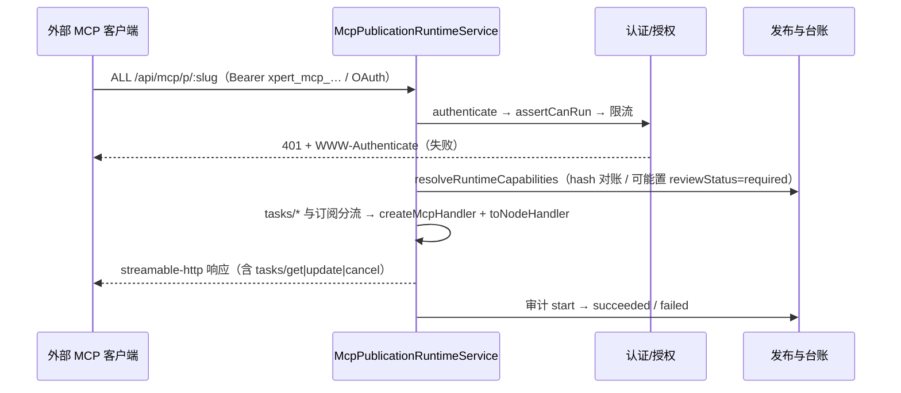

# MCP 协议与发布子专家 —— C1 能力契约

> 契约层 CR2 / CR5 / CR7。只写「对外可依赖的语义」：入口、参数行为、返回、异常与约束；路径均为仓库根相对 `file://` 引用。
> **资产基线**：`2026-10-16 · commit 80f5676fd`（批次 5 第 10 专家 · 子专家②），继承父域 [C1-能力契约.md](file://.module-experts/后端专题/工具与 MCP 专家/C1-能力契约.md)。**逐端点明细**（完整字段、分页、错误码全集）见父域 [implementation/05-接口.md](file://.module-experts/后端专题/工具与 MCP 专家/implementation/05-接口.md)，本文不复制。§1 中每条前缀均回源码核实（`@Controller(...)` 取值与模块路由段）。

**本文引用的文件**（相对仓库根，链接均为 `file://`）

- [packages/server-ai/src/mcp-publication/mcp-publication.controller.ts](file://packages/server-ai/src/mcp-publication/mcp-publication.controller.ts)
- [packages/server-ai/src/mcp-publication/mcp-publication-management.controller.ts](file://packages/server-ai/src/mcp-publication/mcp-publication-management.controller.ts)
- [packages/server-ai/src/mcp-publication/mcp-oauth-metadata.controller.ts](file://packages/server-ai/src/mcp-publication/mcp-oauth-metadata.controller.ts)
- [packages/server-ai/src/mcp-publication/mcp-files.controller.ts](file://packages/server-ai/src/mcp-publication/mcp-files.controller.ts)
- [packages/server-ai/src/mcp/controllers/base-mcp.controller.ts](file://packages/server-ai/src/mcp/controllers/base-mcp.controller.ts)
- [packages/server-ai/src/mcp/mcp.service.ts](file://packages/server-ai/src/mcp/mcp.service.ts)
- [packages/server-ai/src/mcp/transport/sse-transport.ts](file://packages/server-ai/src/mcp/transport/sse-transport.ts)
- [packages/server-ai/src/mcp-publication/mcp-publication.service.ts](file://packages/server-ai/src/mcp-publication/mcp-publication.service.ts)
- [packages/server-ai/src/mcp-publication/mcp-publication-runtime.service.ts](file://packages/server-ai/src/mcp-publication/mcp-publication-runtime.service.ts)
- [packages/server-ai/src/mcp-publication/mcp-capability-catalog.service.ts](file://packages/server-ai/src/mcp-publication/mcp-capability-catalog.service.ts)
- [packages/server-ai/src/mcp-publication/mcp-api-key.service.ts](file://packages/server-ai/src/mcp-publication/mcp-api-key.service.ts)
- [packages/server-ai/src/mcp-publication/mcp-oauth.service.ts](file://packages/server-ai/src/mcp-publication/mcp-oauth.service.ts)
- [packages/server-ai/src/mcp-publication/mcp-task.service.ts](file://packages/server-ai/src/mcp-publication/mcp-task.service.ts)
- [packages/server-ai/src/mcp-publication/mcp-task-execution.service.ts](file://packages/server-ai/src/mcp-publication/mcp-task-execution.service.ts)
- [packages/server-ai/src/mcp-publication/mcp-runtime-protocol.ts](file://packages/server-ai/src/mcp-publication/mcp-runtime-protocol.ts)
- [packages/server-ai/src/mcp-publication/entities/index.ts](file://packages/server-ai/src/mcp-publication/entities/index.ts)
- [packages/server-ai/src/xpert-toolset/provider/mcp/types.ts](file://packages/server-ai/src/xpert-toolset/provider/mcp/types.ts)
- [packages/server-ai/src/xpert-toolset/provider/mcp/mcp-toolset.ts](file://packages/server-ai/src/xpert-toolset/provider/mcp/mcp-toolset.ts)
- [packages/server-ai/src/xpert-toolset/provider/mcp/mcp-stdio-runtime.ts](file://packages/server-ai/src/xpert-toolset/provider/mcp/mcp-stdio-runtime.ts)
- [packages/contracts/src/ai/mcp-publication.model.ts](file://packages/contracts/src/ai/mcp-publication.model.ts)

## 目录

1. [§1 HTTP 入口索引](#§1-http-入口索引)
2. [§2 服务契约](#§2-服务契约)
3. [§3 协议与认证契约](#§3-协议与认证契约)
4. [§4 示例](#§4-示例)
5. [§5 契约来源](#§5-契约来源)

## §1 HTTP 入口索引

全局前缀 `api`（`exclude` 含 `.well-known/oauth-protected-resource/(.*)`，该路径**不带 `/api`**）；`mcp-publication` 三个控制器各自声明路径段，`McpPublicationManagementController` 为 `@Controller()` 空前缀。

| 控制器（源码 `@Controller` 值） | 方法 / 路径 | 鉴权 | 用途 |
|---|---|---|---|
| `McpPublicationManagementController`（`@Controller()`） | POST/GET `/api/mcp-publications`、GET/PATCH/DELETE `/api/mcp-publications/:id` | 类级 `RoleGuard` + `@Roles(SUPER_ADMIN)` + `ValidationPipe(whitelist, forbidNonWhitelisted)` | 发布单 CRUD 与 `getManagementView(['capabilities'])` |
| 同上 | POST `/api/mcp-publications/:id/enable`、`/disable` | 同上 | 启停；`enable` 走 `assertCanEnable` 三重前置 |
| 同上 | GET `/api/mcp-publications/:id/available-capabilities`（`?toolsetId=`）、`/available-capability-sources` | 同上 | 按工具集懒加载可选能力与来源 |
| 同上 | POST `/api/mcp-capability-catalog/toolsets/:toolsetId/discover` | 同上 | 能力台账发现 + 整体替换（台账入口） |
| 同上 | PUT `/api/mcp-publications/:id/capabilities`、PATCH `/api/mcp-publications/:id/capabilities/:capabilityId` | 同上 | 事务内整体替换绑定 / 单条改名·启停·策略 |
| 同上 | POST/GET `/api/mcp-publications/:id/api-keys`、POST `/api/mcp-api-keys/:keyId/revoke`、`/rotate` | 同上 | Key 签发（`secret` 只回一次）/ 列表 / 吊销 / 轮换 |
| 同上 | GET/PUT `/api/mcp-publications/:id/oauth-policy`、POST `/api/mcp-publications/:id/oauth-policy/test` | 同上 + `assertMcpOAuthEnabled()` | OAuth 策略读写与自检；非 Pro 一律 403 |
| 同上 | GET `/api/mcp-publications/:id/audit`（`take`≤500 / `skip`）、POST `/api/mcp-publications/:id/test`、GET `/api/mcp-publications/:id/connection-info` | 同上 | 调用审计分页、四项 checks 自检、客户端接入信息（`transport:'streamable-http'`） |
| `McpPublicationController`（`@Controller('mcp/p')`，`@Public()`） | **ALL** `/api/mcp/p/:slug` | 运行时校验 Bearer（API Key / OAuth） | streamable-http 入口；协议内含 `tasks/get\|update\|cancel` 与 SSE 任务订阅 |
| `McpFilesController`（`@Controller('mcp/p')`，`@Public()` + `@UseGuards(McpFilesGuard)`） | POST/GET `/api/mcp/p/:slug/files` | `McpFilesGuard` → `McpFilesService.authorize` | 个人文件上传 / 下载（单文件上限 256 MiB） |
| `McpOAuthMetadataController`（`@Controller('.well-known/oauth-protected-resource')`，`@Public()`） | GET `/.well-known/oauth-protected-resource/api/mcp/p/:slug` | `@Public()` + `assertMcpOAuthEnabled()` | OAuth Protected Resource Metadata（**注意不带 `/api` 前缀**） |
| `BaseMCPController`（`@Controller()`，`@Public()`） | GET `/api/mcp/sse`、POST `/api/mcp/messages` | 类级 `@Public()`；协议层会话即「鉴权」 | 通用 MCP 服务端会话；**`MCPModule` 全仓无装配点**，当前不生效 |
| 邻域注册（无本子域控制器） | `/api/xpert-toolset/mcp-consumer/oauth`、`/api/xpert-toolset/mcp-consumer` | `WorkspaceGuard`/`WorkspaceOwnerGuard`/`@Public` | `mcp-consumer` 的 OAuth 与能力控制器由 `xpert-toolset.module.ts` 注册 |

**访问授权无 HTTP 端点（已回源码核实）**：`mcp-publication` 目录内不存在 access 控制器，`McpPublicationAccessService` 只被 `mcp-publication.service.ts`、`mcp-publication-authorization.service.ts` 与平台侧 `packages/server-ai/src/plugin-resource/**`（`list-component-states` 注入 `McpPublicationAccess` 仓库）调用。

**逐端点明细见父域 [implementation/05-接口.md](file://.module-experts/后端专题/工具与 MCP 专家/implementation/05-接口.md)**（含每条的权限点、主要错误与状态码）。

章节来源：[mcp-publication-management.controller.ts](file://packages/server-ai/src/mcp-publication/mcp-publication-management.controller.ts)（关键符号：create / enable / disable / discoverToolsetCapabilities / replaceCapabilities / createApiKey / revokeApiKey / rotateApiKey / connectionInfo）、[mcp-publication.controller.ts](file://packages/server-ai/src/mcp-publication/mcp-publication.controller.ts)（关键符号：handle）、[mcp-files.controller.ts](file://packages/server-ai/src/mcp-publication/mcp-files.controller.ts)（关键符号：McpFilesGuard / upload / download）

## §2 服务契约

| `类.方法` | 用途 | 参数行为语义 · 异常 |
|---|---|---|
| `MCPService.onModuleInit` / `scanAndRegisterProviders` / `handleSSEConnection` / `handleMessages` | 协议侧通用服务端（0 表） | 扫描 `DiscoveryService.getProviders()` + `MetadataScanner` + `Reflector` 读 `MCP_RESOURCE`/`MCP_TOOL`/`MCP_PROMPT`；resource 用 `ResourceTemplate('<name>://{id}')`；tool 参数经 `convertParametersToZod`（未知类型回落 `z.any()`）；`options.enableStdio` 为真时连 `StdioServerTransport`，失败即 `throw` |
| `NestSSEAdapter.createTransport` / `handleMessages` | SSE 会话 Map | 用 `${globalApiPrefix}/${messagesEndpoint}` 构造 `SSEServerTransport`，`_sessionId` 存 `activeTransports`；`res.on('close')` 删会话；`req.query.sessionId` 未命中 ⇒ 404 `Session not found` |
| `McpPublicationService.create` / `update` / `enable` / `disable` / `remove` / `replaceCapabilities` / `patchCapability` / `test` | 发布单管理面 | `create`：`assertNameAndSlug` → `assertAuthMethods`（含 `oauth` 时先 `assertMcpOAuthEnabled`）→ `assertSlugAvailable`，落 `status:'draft'`、`authMethods` 默认 `['api_key']`、`protocolVersion: MCP_PROTOCOL_VERSION`、`runtime` 经 zod `.strict()` 解析（当前只允许 `{files:{type:'user'}}`）；`enable` 走 `assertCanEnable`；`replaceCapabilities` 事务内 delete + save + `markPublicationCapabilitiesCurrent` |
| `McpPublicationService.findActiveBySlug` / `resolveRuntimeCapabilities` / `availableCapabilities` / `availableCapabilitySources` | 运行时解析与对账 | `resolveRuntimeCapabilities` 逐条比对 `binding.descriptorHash === catalog.descriptorHash`，不等时 `compareMcpCapabilityDescriptors(binding.descriptorSnapshot, item.descriptor)`；兼容变更**就地更新**绑定并 `publishCatalogChanged`，breaking 才写 `reviewStatus='required'` + `reviewReason` |
| `McpPublicationRuntimeService.handle(slug, req, res, body)` | 运行面唯一入口 | 固定次序：`findActiveBySlug` → trace/`requestId` → `authentication.authenticate`（401 时写 `WWW-Authenticate`）→ `assertCanRun` → `rateLimit.assertWithinLimit` → `resolveRuntimeCapabilities` → 能力过滤排序 → 先试任务订阅、再试 `tasks/*` → 落 `createMcpHandler(..., {legacy:'stateless', responseMode:'auto', bus})` + `toNodeHandler`；`finally` 关 handler 并记指标与一行 JSON 日志 |
| `McpCapabilityCatalogService.discoverAndReplaceMcpToolset` / `replaceToolsetCapabilities` / `getToolsetCapabilitySnapshot` | 能力台账 | 单事务「delete + save」（≤1000 条）；`assertValidMcpCapabilityDescriptor` 校验 + `hashMcpCapabilityDescriptor` 生成 `char(64)`；替换后按 `bindingRepository.find({where:{toolsetId}})` 通知受影响发布；`assertToolsetInCurrentScope` 要求 tenant + organization 双向一致；异常 `Error.McpToolsetNoCapabilities` |
| `McpApiKeyService.createForPublication` / `list` / `revoke` / `rotate` / `authenticate` / `getOrCreateRevealableCredential` | 凭据族 | `secret = 'xpert_mcp_' + randomBytes(32).toString('base64url')`，落 `keyPrefix = secret.slice(0,24)`、`keyHash = sha256(secret)`（`select:false`）、`encryptedSecret = revealable ? encryptSecret(...) : null`、`scopes` 默认 `['tools:list','tools:call']`；`authenticate` 用 `keyPrefix` 定位 + `timingSafeEqual` 比对并更新 `lastUsedAt`；**`rotate` = 先撤销旧行再新建**；`getOrCreateRevealableCredential` 要求当前 user/organization 一致 |
| `McpAuthenticationService.authenticate` / `challenge` | 入口分流 | 严格 `Bearer <token>` 两段；`xpert_mcp_` 前缀走 API Key，否则 `assertMcpOAuthEnabled()` 后走 OAuth；`challenge` 在 OAuth 关闭或发布单未启用 `oauth` 时返回裸 `Bearer` |
| `McpOAuthService.upsert` / `authenticate` / `introspectToken` / `discover` / `protectedResourceMetadata` | OAuth 策略与验证 | 规范化 `issuer`（`normalizeTrustedUrl` + 去尾斜杠）、`audience` ≤500、`subjectMapping` 三个 claim 名过 `CLAIM_NAME_PATTERN`（默认 `sub`/`email`/`azp`）；`introspection.clientSecret` 三态（省略=保留、`null`=清空、新值=轮换），对外只暴露 `introspectionClientSecretConfigured` 布尔位；验证链为 OIDC metadata → `createRemoteJWKSet`（`customFetch: guardedOAuthFetch`）→ `jwtVerify`（`clockTolerance: 30`）→ 可选 introspection 且要求 `introspection.subject === tokenSubject` → scopes 校验；失败统一 401 |
| `McpPublicationAuthorizationService.assertCanRun` / `McpPublicationAccessService.enable`/`disable`/`isEnabled`/`assertEnabled` | 组织维度准入 | 三元（tenant/publication/organization）一致；`publication.organizationId` 为空时走 `access.assertEnabled`；解析用户并要求其在 `organizations` 中含 `isActive` 的目标组织；`service_account` 返回 `null`；`enable` 以唯一冲突重取做竞态兜底（`23505`/`SQLITE_CONSTRAINT`/`ER_DUP_ENTRY`） |
| `McpInvocationAuditService.start` / `succeeded` / `failed` / `search` | 调用审计 | `start` 一次调用一行（`status:'started'`），`capabilityId`/`toolsetId`/`capabilityKey`/`publicName` 从绑定拷入，`clientName = clientName ?? principal.credentialPrefix`；`succeeded`/`failed` 只改 `status`/`durationMs`/`errorCode`（`ForbiddenException` → `denied`）；`search(id, skip, take)` 支持共享发布叠加当前 `organizationId` 过滤 |
| `McpTaskService.create` / `get` / `update` / `cancel` / `process`；`McpTaskExecutionService.run`；`McpTaskProcessor` | 长任务 | `create` 先 `findByIdempotency`，命中即 `assertIdempotentReplay`（同键异指纹 `-32602`），`saveTask` 唯一冲突时**再查一次**兜底；入队前 `managedQueue.getExecutionPoolHealth({executionPool:'default'})`，不可用 `-32603`；`update` 只处理 `input_required → working`（`revision += 1`）；`run` 在 worker 侧重做全部校验并要求 `JSON.stringify(runtime)` 与入队时一致 |
| `McpRateLimitService.assertWithinLimit` / `McpFilesService.authorize`/`upload`/`download` | 限流与文件能力 | 限流用 Redis 定窗计数，key `mcp:rate:${publicationId}:${subjectId}:${capabilityId\|'server'}:${bucket}`，默认 120 次/60 秒，超限 429 + `retryAfterSeconds`；文件要求 `subjectType==='user'`、scope 含 `files:read`/`files:write`/`*`、发布单 `runtime.files.type==='user'` |
| 客户端 `createMCPClient` / `createProMCPClient` / `MCPToolset.initTools`/`callMcpTaskTool`/`close` / `filterMcpTools` / `mcpStdioRuntimeManager.*` | 远端接入与子进程托管 | `createMCPClient` 按 `server.type` 分流：`http` → headers + `resolveMcpConsumerAuthProvider`；`sse` → `useNodeEventSource: true` 且**禁止 oauth/connector**；`stdio` → `assertInitScriptsAllowed` → `runScript(initScripts, 超时 10 分钟)` → `prepareServer`；`close()` 顺序为 detach App 实例 → `forceCloseMCPClientTransports` → `destroy?.()` → `client.close()` |

章节来源：[mcp.service.ts](file://packages/server-ai/src/mcp/mcp.service.ts)（关键符号：scanAndRegisterProviders / convertParametersToZod）、[mcp-publication.service.ts](file://packages/server-ai/src/mcp-publication/mcp-publication.service.ts)（关键符号：create / assertCanEnable / resolveRuntimeCapabilities）、[mcp-task.service.ts](file://packages/server-ai/src/mcp-publication/mcp-task.service.ts)（关键符号：create / assertIdempotentReplay / update / cancel）

## §3 协议与认证契约

| 契约项 | 值 / 语义 |
|---|---|
| 协议版本 | `MCP_PROTOCOL_VERSION = '2026-07-28'`（发布单列默认同值，`connection-info` 回参与之一致）；任务扩展 `MCP_TASK_EXTENSION_ID = 'io.modelcontextprotocol/tasks'`；服务端信息 `MCP_SERVER_VERSION = '1.0.0'` 且 `name = publication.slug` |
| 任务协议前置 | 请求头 `mcp-protocol-version` 与 `_meta['io.modelcontextprotocol/protocolVersion']` **必须同时**等于 `MCP_PROTOCOL_VERSION`，否则按 `invalidTaskProtocolRequest()` 拒；旧版本客户端走 legacy 兼容层 |
| 传输 | 发布面：每请求 `createMcpHandler(() => createServer(...), { legacy:'stateless', responseMode:'auto', bus })` + `toNodeHandler`，端点为 streamable-http；协议面：长连 SSE（`GET mcp/sse` 建连 + `POST mcp/messages?sessionId=`），会话存 `NestSSEAdapter.activeTransports`，进程内、多副本不共享 |
| 体积上限 | `MAX_TOOL_ARGUMENT_BYTES`/`MAX_TOOL_RESULT_BYTES`/`MAX_PROMPT_RESULT_BYTES`/`MAX_COMPLETION_RESULT_BYTES` 均 2 MiB；`MAX_TOOL_CONTENT_BLOCKS`/`MAX_PROMPT_MESSAGES` = 100；`MAX_SERVER_INSTRUCTIONS_LENGTH` = 16000；文件 256 MiB；任务载荷另有 `MAX_TASK_PAYLOAD_BYTES` |
| API Key 头 | `Authorization: Bearer xpert_mcp_<base64url>`；前缀常量 `xpert_mcp_`、库内 `keyPrefix` 取前 24 字符、`keyHash = sha256(secret)` 且 `keyPrefix` 命中后 `timingSafeEqual` 比对；`scopes` 默认 `['tools:list','tools:call']`，空串或 >191 抛错；`revokedAt` 非空即拒 |
| OAuth policy 字段 | `issuer`（规范化 URL）、`audience`（≤500）、`subjectMapping`（`subjectClaim`/`emailClaim`/`azpClaim`，默认 `sub`/`email`/`azp`）、`requiredScopes`（归一存储）、`introspection`（`enabled`/`endpoint`/`clientId`/`clientSecret` 三态/`clientSecretConfigured` 布尔位）；`assertAuthMethods` 在 `authMethods` 含 `oauth` 时先过 Pro 门禁 |
| 挑战头 | 认证失败且为 `UnauthorizedException` 时回 `WWW-Authenticate`：OAuth 关闭或发布单未启用 `oauth` ⇒ 裸 `Bearer`；否则带 `resource_metadata` 指向 `/.well-known/oauth-protected-resource/api/mcp/p/:slug` |
| 组织与主体 | `McpPrincipal` 携带 `subjectType`（`user`/`service_account`）、`subjectId`、`organizationId`、`credentialPrefix`；`service_account` 不解析用户身份（`assertCanRun` 返回 `null`），文件与任务协议因此要求 `user` 主体 |
| 会话与任务订阅 | 任务取消/状态刷新走 `subscriptions.subscribeTasks(publicationId, ...)` 通知 + 4000 ms 轮询双通道；跨副本经 Redis 频道 `xpert:mcp:publication-events`（Redis 缺失降级为进程内） |



图表来源：[mcp-publication-runtime.service.ts](file://packages/server-ai/src/mcp-publication/mcp-publication-runtime.service.ts)（关键符号：handle / invokeToolCore / handleTaskProtocolRequest）、[mcp-authentication.service.ts](file://packages/server-ai/src/mcp-publication/mcp-authentication.service.ts)（关键符号：authenticate / challenge）、[mcp-runtime-protocol.ts](file://packages/server-ai/src/mcp-publication/mcp-runtime-protocol.ts)（关键符号：MCP_PROTOCOL_VERSION / canExposeCapability / assertSerializedSize）

章节来源：[mcp-runtime-protocol.ts](file://packages/server-ai/src/mcp-publication/mcp-runtime-protocol.ts)（关键符号：MCP_SERVER_VERSION / MAX_TOOL_ARGUMENT_BYTES / invalidTaskProtocolRequest）、[mcp-api-key.service.ts](file://packages/server-ai/src/mcp-publication/mcp-api-key.service.ts)（关键符号：API_KEY_PREFIX / STORED_PREFIX_LENGTH / authenticate）、[mcp-oauth.service.ts](file://packages/server-ai/src/mcp-publication/mcp-oauth.service.ts)（关键符号：upsert / introspectToken / protectedResourceMetadata）

## §4 示例

### ① 接一个 stdio MCP 服务器（三分流 + 受管运行时）

```ts
// 真实调用方：packages/server-ai/src/xpert-toolset/provider/mcp/types.ts
// 遍历 schema.servers ?? schema.mcpServers，按 server.type 或字段特征三分流：
//   http  → transport:'http' + resolveRemoteHeaders + resolveMcpConsumerAuthProvider
//   sse   → useNodeEventSource: true，且 auth.type 为 oauth/connector 时直接抛
//           （MCP OAuth requires Streamable HTTP; server '…' uses legacy SSE）
//   stdio → mcpStdioRuntimeManager.assertInitScriptsAllowed →
//           runScript(initScripts, /* 超时 10 分钟 */) → prepareServer(...)
const client = new MultiServerMCPClient({
    throwOnLoadError: true,
    prefixToolNameWithServerName: false,
    outputHandling: { resource: 'artifact' }
})
await mcpStdioRuntimeManager.attachClient(client, stdioRuntimes)
```

要点：stdio 的 spec 经 `XPERT_MCP_STDIO_RUNNER_SPEC`（base64 JSON）交给 `mcp-stdio-runner.js`，runner 内再 `spawn`（`detached`、`shell:false`）；`XPERT_MCP_STDIO_RUNTIME_ENABLED` **未设即抛 disabled**，`initScripts` 默认仅非生产可用；起停在 `mcp_runtime_instance` 留审计（`runnerPid`/`childPid`/`stderrTail`/`policySnapshot`）。

### ② 发布一个能力并用 API Key 调用

```ts
// 真实调用方：packages/server-ai/src/mcp-publication/mcp-publication-management.controller.ts
@Post('mcp-publications')                       // → /api/mcp-publications
create(@Body() input: CreateMcpPublicationInput) { return this.publications.create(input) }

@Post('mcp-capability-catalog/toolsets/:toolsetId/discover')
discoverToolsetCapabilities(@Param('toolsetId') toolsetId: string) {
    return this.capabilityCatalog.discoverAndReplaceMcpToolset(toolsetId)   // 台账整体替换
}

@Put('mcp-publications/:id/capabilities')
replaceCapabilities(@Param('id') id: string, @Body(new ParseArrayPipe({ items: McpCapabilityBindingInput })) input) {
    return this.publications.replaceCapabilities(id, input)                 // 事务 delete + save，写 hash/snapshot
}

@Post('mcp-publications/:id/api-keys')
createApiKey(@Param('id') id: string, @Body() input: CreateMcpApiKeyInput) {
    return this.apiKeys.createForPublication(id, input)                      // 返回 { apiKey, secret }，secret 只回一次
}
```

```ts
// 真实调用方：packages/server-ai/src/mcp-publication/mcp-publication.controller.ts
@Public() @Controller('mcp/p')
export class McpPublicationController {
    @All(':slug')
    handle(@Param('slug') slug: string, @Req() request: Request, @Res() response: Response, @Body() body: unknown) {
        return this.runtime.handle(slug, request, response, body)   // 认证 → 授权 → 限流 → 对账 → 审计 → 协议
    }
}
```

要点：`enable` 前置为「`reviewStatus` 非 required + 至少一条 `enabled` 能力 + 若含 `oauth` 则有 `enabled` 策略」；调用方用 `Authorization: Bearer xpert_mcp_…` 访问 `/api/mcp/p/<slug>`；`rotate` 是**先撤销旧行再新建**，轮换后旧 secret 立即失效。

### ③ 轮询一个长任务（没有 REST 轮询端点）

```ts
// 真实调用方：packages/server-ai/src/mcp-publication/mcp-task.service.ts + mcp-task-execution.service.ts
const idempotencyKey = sha256([publicationId, subjectType, subjectId, requestId,
    typeof rpcRequestId, String(rpcRequestId ?? ''), capability.publicName].join('\0'))
const inputHash = hashJson(arguments)                       // 同键异指纹 → -32602
const existing = await this.findByIdempotency(publicationId, idempotencyKey)
if (existing) return this.assertIdempotentReplay(existing, { subjectType, subjectId, inputHash })
const health = await this.managedQueue.getExecutionPoolHealth({ executionPool: 'default' })
if (!health.ok) throw queueUnavailable()                    // -32603 McpTaskQueueUnavailable
// 落 status:'working' → 入队 'mcp-publication/execute-tool'（concurrency: 4）
// 客户端侧：在 /api/mcp/p/:slug 上走协议 tasks/get | tasks/update（input_required）| tasks/cancel
```

要点：任务**没有 REST 端点**，读写都挂在 `/api/mcp/p/:slug` 的协议方法上；`get()` 对 `expiresAt <= now` 的非终态**就地判 `failed` + `MCP_TASK_EXPIRED`**；worker 侧 `McpTaskExecutionService.run` 会重做全部校验（发布单仍 `active`、绑定仍 `enabled`、审批模式 `confirm` 要求 `approvalGranted === true`、`JSON.stringify(runtime)` 与入队时一致）。

章节来源：[types.ts](file://packages/server-ai/src/xpert-toolset/provider/mcp/types.ts)（关键符号：createMCPClient / resolvePluginManagedMcpSchema）、[mcp-publication-management.controller.ts](file://packages/server-ai/src/mcp-publication/mcp-publication-management.controller.ts)（关键符号：create / discoverToolsetCapabilities / replaceCapabilities / createApiKey）、[mcp-task.service.ts](file://packages/server-ai/src/mcp-publication/mcp-task.service.ts)（关键符号：create / assertIdempotentReplay / clampLifetime）

## §5 契约来源

| 契约条目 | 来源 |
|---|---|
| 协议侧模块、装饰器扫描、SSE 会话与 404 语义 | `packages/server-ai/src/mcp/{mcp.module.ts,mcp.service.ts}`、`mcp/controllers/base-mcp.controller.ts`、`mcp/transport/sse-transport.ts` |
| 发布单管理 22 端点、能力替换与自检 | `packages/server-ai/src/mcp-publication/{mcp-publication-management.controller.ts,mcp-publication.service.ts,mcp-publication.dto.ts}` |
| 运行面入口、能力注册、任务订阅与四类 invoke | `packages/server-ai/src/mcp-publication/{mcp-publication.controller.ts,mcp-publication-runtime.service.ts,mcp-runtime-registration.ts}` |
| 能力台账与绑定快照、漂移分类 | `packages/server-ai/src/mcp-publication/{mcp-capability-catalog.service.ts,entities/mcp-capability-catalog.entity.ts,entities/mcp-publication-capability.entity.ts}`、`packages/server-ai/src/tool-runtime/capability-descriptor.ts`（① 的包） |
| API Key / OAuth / 入口分流 / 组织准入 | `packages/server-ai/src/mcp-publication/{mcp-api-key.service.ts,mcp-oauth.service.ts,mcp-authentication.service.ts,mcp-publication-authorization.service.ts,mcp-publication-access.service.ts,mcp-oauth-feature.ts}` |
| 审计、限流、长任务与 worker 重授权 | `packages/server-ai/src/mcp-publication/{mcp-invocation-audit.service.ts,mcp-rate-limit.service.ts,mcp-task.service.ts,mcp-task-execution.service.ts,mcp-task.processor.ts}` |
| 协议版本、任务扩展、体积上限与 CORS 头 | `packages/server-ai/src/mcp-publication/mcp-runtime-protocol.ts`、`packages/contracts/src/ai/{mcp-publication.model.ts,mcp-capability.model.ts,mcp-auth.model.ts}` |
| 文件能力与 OAuth 元数据端点 | `packages/server-ai/src/mcp-publication/{mcp-files.controller.ts,mcp-files.service.ts,mcp-oauth-metadata.controller.ts}` |
| 客户端建连、工具集门面、stdio 运行时与桥接 | `packages/server-ai/src/xpert-toolset/provider/mcp/{types.ts,pro.ts,mcp-toolset.ts,mcp-tool-filter.ts,mcp-stdio-runtime.ts,mcp-stdio-runner.js,app-support.ts,meta-artifact-bridge.ts}` |
| 8 张表清单与邻域注册 | `packages/server-ai/src/mcp-publication/entities/index.ts`（`MCP_PUBLICATION_ENTITIES`）、`packages/server-ai/src/xpert-toolset/xpert-toolset.module.ts` |
| 访问授权的 HTTP 落点（平台侧） | `packages/server-ai/src/plugin-resource/queries/handlers/list-component-states.handler.ts`（注入 `McpPublicationAccess`） |
| 逐端点明细与错误语义全集 | 父域 [implementation/05-接口.md](file://.module-experts/后端专题/工具与 MCP 专家/implementation/05-接口.md)（本文不复制） |

章节来源：[mcp-publication-runtime.service.ts](file://packages/server-ai/src/mcp-publication/mcp-publication-runtime.service.ts)（关键符号：McpPublicationRuntimeService.handle）、[mcp-api-key.service.ts](file://packages/server-ai/src/mcp-publication/mcp-api-key.service.ts)（关键符号：CreatedMcpApiKey / authenticate）、[mcp-stdio-runtime.ts](file://packages/server-ai/src/xpert-toolset/provider/mcp/mcp-stdio-runtime.ts)（关键符号：McpStdioRuntimeManager / mcpStdioRuntimeManager）
