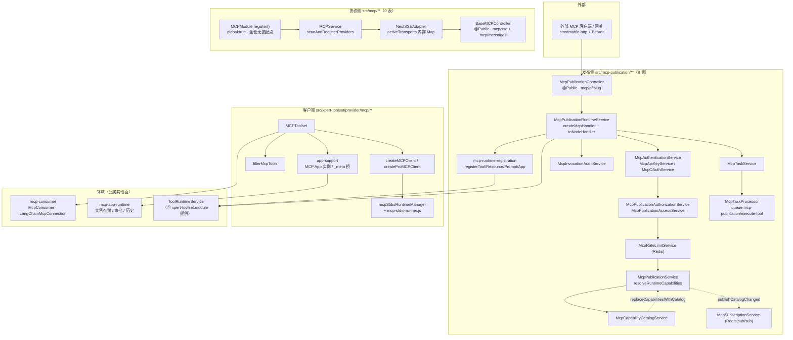

# MCP 协议与发布子专家 · 架构

> 只读梳理（commit `80f5676fd`）。本子域覆盖 `packages/server-ai/src/mcp/**`（服务端 SDK 封装，**14 非 spec 文件、0 表**）、`packages/server-ai/src/mcp-publication/**`（发布域，**43 非 spec / 24 spec、8 张自有表**）、`packages/server-ai/src/xpert-toolset/provider/mcp/**`（客户端，11 非 spec / 9 spec）。邻域交叉引用 `packages/server-ai/src/mcp-consumer/**`（29 文件）与 `packages/server-ai/src/mcp-app-runtime/**`（25 文件）。引用为仓库根相对路径，源码根简称 `src/`。未能证实处标 `[推测]`。

**本文引用的文件**

- [packages/server-ai/src/mcp/mcp.module.ts](file://packages/server-ai/src/mcp/mcp.module.ts)
- [packages/server-ai/src/mcp/mcp.service.ts](file://packages/server-ai/src/mcp/mcp.service.ts)
- [packages/server-ai/src/mcp/controllers/base-mcp.controller.ts](file://packages/server-ai/src/mcp/controllers/base-mcp.controller.ts)
- [packages/server-ai/src/mcp/transport/sse-transport.ts](file://packages/server-ai/src/mcp/transport/sse-transport.ts)
- [packages/server-ai/src/mcp/types/mcp-options.interface.ts](file://packages/server-ai/src/mcp/types/mcp-options.interface.ts)
- [packages/server-ai/src/mcp-publication/mcp-publication.module.ts](file://packages/server-ai/src/mcp-publication/mcp-publication.module.ts)
- [packages/server-ai/src/mcp-publication/mcp-publication.controller.ts](file://packages/server-ai/src/mcp-publication/mcp-publication.controller.ts)
- [packages/server-ai/src/mcp-publication/mcp-publication-management.controller.ts](file://packages/server-ai/src/mcp-publication/mcp-publication-management.controller.ts)
- [packages/server-ai/src/mcp-publication/mcp-oauth-metadata.controller.ts](file://packages/server-ai/src/mcp-publication/mcp-oauth-metadata.controller.ts)
- [packages/server-ai/src/mcp-publication/mcp-files.controller.ts](file://packages/server-ai/src/mcp-publication/mcp-files.controller.ts)
- [packages/server-ai/src/mcp-publication/mcp-publication.service.ts](file://packages/server-ai/src/mcp-publication/mcp-publication.service.ts)
- [packages/server-ai/src/mcp-publication/mcp-publication-runtime.service.ts](file://packages/server-ai/src/mcp-publication/mcp-publication-runtime.service.ts)
- [packages/server-ai/src/mcp-publication/mcp-capability-catalog.service.ts](file://packages/server-ai/src/mcp-publication/mcp-capability-catalog.service.ts)
- [packages/server-ai/src/mcp-publication/mcp-api-key.service.ts](file://packages/server-ai/src/mcp-publication/mcp-api-key.service.ts)
- [packages/server-ai/src/mcp-publication/mcp-oauth.service.ts](file://packages/server-ai/src/mcp-publication/mcp-oauth.service.ts)
- [packages/server-ai/src/mcp-publication/mcp-authentication.service.ts](file://packages/server-ai/src/mcp-publication/mcp-authentication.service.ts)
- [packages/server-ai/src/mcp-publication/mcp-publication-authorization.service.ts](file://packages/server-ai/src/mcp-publication/mcp-publication-authorization.service.ts)
- [packages/server-ai/src/mcp-publication/mcp-publication-access.service.ts](file://packages/server-ai/src/mcp-publication/mcp-publication-access.service.ts)
- [packages/server-ai/src/mcp-publication/mcp-invocation-audit.service.ts](file://packages/server-ai/src/mcp-publication/mcp-invocation-audit.service.ts)
- [packages/server-ai/src/mcp-publication/mcp-task.service.ts](file://packages/server-ai/src/mcp-publication/mcp-task.service.ts)
- [packages/server-ai/src/mcp-publication/mcp-task.processor.ts](file://packages/server-ai/src/mcp-publication/mcp-task.processor.ts)
- [packages/server-ai/src/mcp-publication/mcp-runtime-registration.ts](file://packages/server-ai/src/mcp-publication/mcp-runtime-registration.ts)
- [packages/server-ai/src/mcp-publication/mcp-runtime-protocol.ts](file://packages/server-ai/src/mcp-publication/mcp-runtime-protocol.ts)
- [packages/server-ai/src/mcp-publication/mcp-legacy-sessions.ts](file://packages/server-ai/src/mcp-publication/mcp-legacy-sessions.ts)
- [packages/server-ai/src/mcp-publication/entities/index.ts](file://packages/server-ai/src/mcp-publication/entities/index.ts)
- [packages/server-ai/src/xpert-toolset/provider/mcp/mcp-toolset.ts](file://packages/server-ai/src/xpert-toolset/provider/mcp/mcp-toolset.ts)
- [packages/server-ai/src/xpert-toolset/provider/mcp/types.ts](file://packages/server-ai/src/xpert-toolset/provider/mcp/types.ts)
- [packages/server-ai/src/xpert-toolset/provider/mcp/mcp-stdio-runtime.ts](file://packages/server-ai/src/xpert-toolset/provider/mcp/mcp-stdio-runtime.ts)
- [packages/server-ai/src/xpert-toolset/provider/mcp/mcp-stdio-runner.js](file://packages/server-ai/src/xpert-toolset/provider/mcp/mcp-stdio-runner.js)
- [packages/server-ai/src/xpert-toolset/xpert-toolset.module.ts](file://packages/server-ai/src/xpert-toolset/xpert-toolset.module.ts)
- [packages/server-ai/src/app.module.ts](file://packages/server-ai/src/app.module.ts)
- [packages/server-ai/src/plugin-resource/plugin-resource.module.ts](file://packages/server-ai/src/plugin-resource/plugin-resource.module.ts)
- [packages/server-ai/src/tool-runtime/capability-descriptor.ts](file://packages/server-ai/src/tool-runtime/capability-descriptor.ts)
- [packages/contracts/src/ai/mcp-publication.model.ts](file://packages/contracts/src/ai/mcp-publication.model.ts)
- [packages/contracts/src/ai/mcp-capability.model.ts](file://packages/contracts/src/ai/mcp-capability.model.ts)
- [packages/contracts/src/ai/mcp-auth.model.ts](file://packages/contracts/src/ai/mcp-auth.model.ts)

## 目录

- [1. 子域职责与边界](#1-子域职责与边界)
- [2. 协议侧与发布侧的关系](#2-协议侧与发布侧的关系)
- [3. 目录结构与分层](#3-目录结构与分层)
- [4. 依赖关系](#4-依赖关系)
- [5. 关键不变量](#5-关键不变量)
- [6. 架构总览](#6-架构总览)
- [7. 结论](#7-结论)

## 1. 子域职责与边界

**做什么**（三段互不重叠的实现）：

1. **协议侧（通用服务端 SDK 封装）**：`src/mcp/**` 提供 `MCPModule.register()/registerAsync()` 动态模块、`MCPService` 的 provider 扫描注册（`@Tool` / `@Resource` / `@Prompt` 装饰器元数据）、`NestSSEAdapter` 的 SSE + messages 双端点传输、可选 `StdioServerTransport`。它是「把 NestJS provider 暴露成 MCP Server」的通用壳，**目录内 0 个 `@Entity`，不落任何库**。
2. **发布侧（能力对外）**：`src/mcp-publication/**` 把工具集能力（tool / resource / resource_template / prompt / app）反向发布为对外的 streamable-http MCP Server，端点 `/api/mcp/p/:slug`；含草稿 → 能力快照 → 审核 → 激活 → API Key / OAuth → 调用审计 → 长任务的完整生命周期，独占 **8 张表**（`MCP_PUBLICATION_ENTITIES`）。
3. **客户端侧**：`src/xpert-toolset/provider/mcp/**` 把远端 MCP Server 接成助手可用工具集——`MCPToolset.initTools()` 建连、`filterMcpTools` 过滤、`wrapMCPTool` 包装、stdio 子进程运行时托管、MCP App 实例桥接、长任务状态回传。

**不做什么**：
- 不做工具集实体、工具实体与统一执行面（`XpertToolsetService` / `XpertToolService` / `ToolRuntimeService` 归 ① 子专家；本子域只**消费**其 `catalog` 与 `execute*`）。
- 不做 Agent 便携插件（`agent-plugin/**` 归 ③）。
- 不拥有平台插件 bundle 加载（`LOADED_PLUGINS`、`plugin_resource_installation` 归平台插件域；本子域仅在 `McpAppBundleService` 中只读 `LOADED_PLUGINS` 解析 App 的 HTML 入口）。
- 不实现会话/消息持久化（`chat-message` 域承担；本子域只经 `dispatchCustomEvent` 发射 `ON_CHAT_EVENT` / `ON_TOOL_MESSAGE`）。
- 不定义 `mcp-consumer/**` 与 `mcp-app-runtime/**`（邻域，仅交叉引用）。

**与 ① 的接口面 = `provider/mcp` 客户端**：① 侧只经 `provider/index.ts` 拿到 `MCPToolset` 类与 `mcpStdioRuntimeManager` 单例；运行时执行经 `ToolRuntimeService.executeMcpCapability/executeMcpResource/executeMcpPrompt/completeMcpCapability` 分流回 `MCPToolset`。本子域的 stdio 运行时审计（`mcpStdioRuntimeManager.setAuditSink`）反过来写 ① 的 `mcp_runtime_instance`。

章节来源：[mcp.module.ts](file://packages/server-ai/src/mcp/mcp.module.ts)（关键符号：MCPModule.register / registerAsync）、[mcp-publication.module.ts](file://packages/server-ai/src/mcp-publication/mcp-publication.module.ts)（关键符号：McpPublicationModule.providers）、[entities/index.ts](file://packages/server-ai/src/mcp-publication/entities/index.ts)（关键符号：MCP_PUBLICATION_ENTITIES）、[mcp-toolset.ts](file://packages/server-ai/src/xpert-toolset/provider/mcp/mcp-toolset.ts)（关键符号：MCPToolset.initTools）

## 2. 协议侧与发布侧的关系

两条链路**完全独立**，唯一共享面是 `@modelcontextprotocol/*` 依赖与「服务端方向」这一语义：

| 维度 | 协议侧 `src/mcp/**` | 发布侧 `src/mcp-publication/**` |
|---|---|---|
| 持久化 | 0 表；状态只在 `NestSSEAdapter.activeTransports` 内存 Map | 8 表（含能力台账、密钥、审计、任务） |
| 模块语义 | `MCPModule.register()` 返回 `{ global: true, ... }` 动态模块 | `McpPublicationModule` 静态模块，无 `@Global`、无 `RouterModule` |
| 装配点 | 全仓搜 `MCPModule` **仅命中 `mcp.module.ts` 自身** ⇒ 未找到接线点 | `app.module.ts` 与 `plugin-resource.module.ts` 各注册一次 |
| 协议装配 | 长连 SSE：先 `GET mcp/sse` 建连，再 `POST mcp/messages` 复用会话 | 每请求 `createMcpHandler(() => createServer(...))` + `toNodeHandler`，`legacy:'stateless'`、`responseMode:'auto'` |
| 能力来源 | `DiscoveryService` 扫描带装饰器的 provider 方法 | `mcp_publication_capability` 绑定 × `mcp_capability_catalog` 台账 |
| 认证 | `@Controller()` + `@Public()`，无鉴权 | `McpAuthenticationService`（API Key / OAuth）+ `McpPublicationAuthorizationService` |
| 协议版本 | 无显式版本声明（`options.version` 由宿主提供） | `MCP_PROTOCOL_VERSION = '2026-07-28'`，表列默认同值 |
| 兼容层 | 无 | `mcp-legacy-sessions.ts`（旧版会话，TTL 30 分钟 / 上限 256） |

`McpPublicationModule.imports` 只含 `TypeOrmModule.forFeature`、`RedisModule`、`WorkspaceFilesRuntimeModule`、`XpertToolsetModule`——**不含 `../mcp`**，两模块在 DI 图上无连线。协议侧是「通用能力」，发布侧是「已落库的产品化能力」；发布侧不复用协议侧的 `MCPService`，而是在 `mcp-runtime-registration.ts` 内自行按能力快照注册 MCP 原语。

章节来源：[mcp.module.ts](file://packages/server-ai/src/mcp/mcp.module.ts)（关键符号：MCPModule.register 的 global 语义）、[mcp-publication.module.ts](file://packages/server-ai/src/mcp-publication/mcp-publication.module.ts)（关键符号：McpPublicationModule.imports）、[mcp-publication-runtime.service.ts](file://packages/server-ai/src/mcp-publication/mcp-publication-runtime.service.ts)（关键符号：McpPublicationRuntimeService.handle / createMcpHandler）、[mcp-runtime-registration.ts](file://packages/server-ai/src/mcp-publication/mcp-runtime-registration.ts)（关键符号：registerTool / registerResourceTemplate / registerApp）、[mcp-legacy-sessions.ts](file://packages/server-ai/src/mcp-publication/mcp-legacy-sessions.ts)（关键符号：McpLegacySessions.handle / legacySessionSnapshot）

## 3. 目录结构与分层

**`src/mcp/**`（14 非 spec，0 spec）**
- 装配层：`mcp.module.ts`（动态模块 + `'MCP_OPTIONS'` 提供者 + `MCPService` 工厂 + `exports: [MCPService]`）。
- 服务层：`mcp.service.ts`（`onModuleInit` → `scanAndRegisterProviders()` → 建 `NestSSEAdapter` → `setupStdioTransport()`；`handleSSEConnection` / `handleMessages`）。
- 控制器层：`controllers/base-mcp.controller.ts`（`@Public()` + `@Controller()`，`GET mcp/sse` / `POST mcp/messages`）。
- 传输层：`transport/sse-transport.ts`（`NestSSEAdapter.createTransport` 用 `SSEServerTransport`，按 `_sessionId` 存 Map）。
- 声明层：`decorators/{tool,resource,prompt}.decorator.ts` + `types/{mcp-options,mcp-async-options,mcp-options-factory,metadata}.ts`。

**`src/mcp-publication/**`（43 非 spec）**
- 实体层：`entities/` 8 实体 + `index.ts`（`MCP_PUBLICATION_ENTITIES`）。
- 控制器层：`mcp-publication.controller.ts`（`@Public` `@Controller('mcp/p')` + `@All(':slug')`）、`mcp-publication-management.controller.ts`（`@Controller()` + `RoleGuard` + `@Roles(SUPER_ADMIN)` + `ValidationPipe(whitelist, forbidNonWhitelisted)`，22 端点）、`mcp-oauth-metadata.controller.ts`（`@Public` `@Controller('.well-known/oauth-protected-resource')`）、`mcp-files.controller.ts`（`@Public` `@Controller('mcp/p')` + `McpFilesGuard` + `FileInterceptor`）。
- 服务层：`McpPublicationService`（发布单 + 能力绑定 + 管理视图 + 变更分类）、`McpPublicationRuntimeService`（请求入口）、`McpCapabilityCatalogService`（能力台账）、`McpApiKeyService`、`McpAuthenticationService`、`McpOAuthService`、`McpPublicationAuthorizationService`、`McpPublicationAccessService`、`McpInvocationAuditService`、`McpTaskService` + `McpTaskExecutionService` + `McpTaskProcessor`、`McpRateLimitService`、`McpElicitationService`、`McpSubscriptionService`、`McpAppBundleService`、`McpFilesService`。
- 协议辅助层：`mcp-runtime-protocol.ts`（32 KB，纯函数）、`mcp-runtime-registration.ts`、`mcp-resource-uri-template.ts`、`mcp-input-schema.ts`（Ajv 2020 替换 SDK 默认校验器）、`mcp-runtime-configuration.ts`（zod 严格解析）、`mcp-publication-url.ts`、`mcp-legacy-sessions.ts`、`mcp-legacy-publication-context.ts`、`mcp-oauth-feature.ts`、`mcp-app-tool-result.ts`、`mcp-publication.dto.ts`。
- 兼容层定位：`mcp-legacy-*` 两份是旧协议版本的适配层，非主链路。

**`src/xpert-toolset/provider/mcp/**`（11 非 spec + 1 资源）**
- `mcp-toolset.ts`（客户端门面，`MCPToolset extends _BaseToolset`）、`types.ts`（非 pro 的 `createMCPClient`）、`pro.ts`（Pro 分支，开源版直接返回 `{client:null}`）、`client-factory.spec.ts` 为 `types.ts` 的测试。
- `mcp-stdio-runtime.ts`（26.8 KB 管理器单例）+ `mcp-stdio-runner.js`（4.3 KB 子进程包装脚本）。
- 桥接与过滤：`app-support.ts`（65 KB MCP App 实例/令牌/`` _meta `` 桥）、`meta-artifact-bridge.ts`、`mcp-tool-filter.ts`、`headers.ts`、`plugin-managed-runtime.ts`、`mcp-task-status.ts`。

章节来源：[mcp.service.ts](file://packages/server-ai/src/mcp/mcp.service.ts)（关键符号：MCPService.onModuleInit / scanAndRegisterProviders）、[sse-transport.ts](file://packages/server-ai/src/mcp/transport/sse-transport.ts)（关键符号：NestSSEAdapter.createTransport）、[mcp-publication-management.controller.ts](file://packages/server-ai/src/mcp-publication/mcp-publication-management.controller.ts)（关键符号：McpPublicationManagementController）、[mcp-stdio-runtime.ts](file://packages/server-ai/src/xpert-toolset/provider/mcp/mcp-stdio-runtime.ts)（关键符号：McpStdioRuntimeManager）、[pro.ts](file://packages/server-ai/src/xpert-toolset/provider/mcp/pro.ts)（关键符号：createProMCPClient）

## 4. 依赖关系

**出向（第三方）**：`@modelcontextprotocol/{sdk,server,node}`（`McpServer`、`ResourceTemplate`、`StdioServerTransport`、`SSEServerTransport`、`NodeStreamableHTTPServerTransport`、`createMcpHandler`、`toNodeHandler`、`InMemoryServerEventBus`、`fromJsonSchema`）、`@langchain/mcp-adapters`（`MultiServerMCPClient`）、`@langchain/core`（`DynamicStructuredTool`、`PromptTemplate`、`dispatchCustomEvent`）、`jose`（`jwtVerify` / `createRemoteJWKSet`）、`ajv` + `ajv-formats`、`zod`。

**出向（同仓）**：
- `@xpert-ai/server-core`：`RequestContext`、`RoleGuard`/`Roles`、`RedisModule`、`REDIS_CLIENT`、`Public`、`encryptSecret`/`decryptSecret`、`runScript`、`runWithCapturedRequestContext`、`LOADED_PLUGINS`、`closeRedisSubscriber`、`runShutdownStep`。
- `@xpert-ai/plugin-sdk`：`ManagedQueueService`、`PluginJobProcessor`、`ToolEventsApi`/`CapabilityChangeEvent`、`WorkspaceFilesApi`、`GLOBAL_ORGANIZATION_SCOPE`。
- `@xpert-ai/server-config`：`environment.pro`（客户端 Pro 分支）、`environment.mcpOAuthEnabled`（OAuth 特性开关）、`environment.secretsEncryptionKey`、`ConfigService`（公网 URL 拼接）。
- 跨域：`xpert-toolset`（`XpertToolset` 实体 + `XpertToolsetModule` 导出的 `ToolRuntimeService`）、`tool-runtime`（`capability-descriptor.ts` 的 `hashMcpCapabilityDescriptor` / `compareMcpCapabilityDescriptors`、`workspace-scope`）、`shared/tools/toolset`（`_BaseToolset`）、`shared/runtime/workspace-files-runtime.module`、`shared/request-context`、`metrics`、`tracing`、`mcp-consumer`（`McpConsumer`、`LangChainMcpConnection`、`resolveMcpConsumerAuthProvider`、`McpConsumerElicitationHandler`）、`mcp-app-runtime`（`readMcpAppExecutionContext`、`McpAppInstanceStore`）。

**出向（契约包）**：`packages/contracts/src/ai/{mcp-publication.model.ts, mcp-capability.model.ts, mcp-auth.model.ts, mcp-audit.model.ts}`——`MCP_PROTOCOL_VERSION`、`MCP_TASK_EXTENSION_ID`、`MCP_HTTP_CORS_*_HEADERS`、四组状态枚举、`McpCapabilityDescriptor` 五型联合、`McpPrincipal`、`McpCapabilityPolicy`、`defaultMcpToolApprovalMode` / `canAllowMcpToolDirectly`。

**入向（依赖本子域）**：`app.module.ts` 注册 `McpPublicationModule`；`plugin-resource.module.ts` 引入 `McpPublicationModule`（获取已导出服务）；`xpert-toolset.module.ts` 反向注册本子域的 `McpCapabilityCatalog` / `McpPublicationCapability` 实体与 `McpSubscriptionService`；**外部 MCP 客户端与网关**经 `@Public` 的 `/api/mcp/p/:slug`（streamable-http）、`/.well-known/oauth-protected-resource/api/mcp/p/:slug`、`/api/mcp/p/:slug/files` 进入。

**依赖方向的关键不对称**：`MCPModule` 声明 `global: true` 却全仓无装配点；`McpPublicationModule` 无 `@Global` 却有两处装配点，且其两个实体被 ① 模块反向 forFeature。本子域的 DI 图不是自洽闭环，而由 ① 的 `xpert-toolset.module.ts` 单点重装配（含 `McpConsumerOAuthController` / `McpConsumerCapabilitiesController` 与对应实体）。

章节来源：[mcp-publication.module.ts](file://packages/server-ai/src/mcp-publication/mcp-publication.module.ts)（关键符号：McpPublicationModule.imports / exports）、[xpert-toolset.module.ts](file://packages/server-ai/src/xpert-toolset/xpert-toolset.module.ts)（关键符号：TypeOrmModule.forFeature 含 McpCapabilityCatalog / McpSubscriptionService）、[app.module.ts](file://packages/server-ai/src/app.module.ts)（关键符号：McpPublicationModule 注册）、[mcp-publication.model.ts](file://packages/contracts/src/ai/mcp-publication.model.ts)（关键符号：MCP_PROTOCOL_VERSION / MCP_PUBLICATION_STATUSES / IMcpPublicationSummary）

## 5. 关键不变量

1. **`mcp` 模块 `global: true` + `BaseMCPController` 的 `sse` + `messages` 会话**：`register()` 返回 `{ global: true, module: MCPModule, imports:[DiscoveryModule], controllers:[BaseMCPController], providers:[MCP_OPTIONS, MetadataScanner, Reflector, MCPService], exports:[MCPService] }`。`handleSSEConnection` 里 transport **不手动 `start()`**（注释：`This will automatically start the transport`），`handleMessages` 从 `req.query.sessionId` 查 `activeTransports`，未命中 404，`res.on('close')` 时删除。会话状态**纯内存**，多副本不可共享。
2. **能力幂等键 `UQ(publicationId, toolsetId, capabilityType, capabilityKey)` 与 descriptorHash**：`IDX_mcp_publication_capability_binding` 唯一；另有 `IDX_mcp_publication_capability_public_name(publicationId, publicName)` 唯一。`descriptorHash` 为 `char(64)`（sha256 hex），配 `descriptorSnapshot` 非空 json；注释逐字说明用途 `Required to classify descriptor changes instead of treating every hash change as breaking.`
3. **目录表 `mcp_capability_catalog` 与发布能力表的同步**：`McpCapabilityCatalogService` 以「事务 delete + save」整体替换台账（`IDX_mcp_capability_catalog_binding(toolsetId, capabilityType, capabilityKey)` 唯一），随后回调 `McpPublicationService.replaceCapabilitiesWithCatalog`；读取侧 `resolveRuntimeCapabilities` 在每次请求对齐绑定与台账的 hash——**兼容变更就地更新 binding，breaking 变更则把发布单置 `reviewStatus='required'` 并写 `reviewReason`**，同时 `publishCatalogChanged` 广播。
4. **访问授权 `mcp_publication_access` 的 org 维度**：唯一 `(publicationId, organizationId)`；`McpPublicationAuthorizationService.assertCanRun` 只在「共享发布」（`publication.organizationId` 为空）且 principal 带 `organizationId` 时才要求 `access.assertEnabled`；同租户 + 同 publication + 组织一致是前置断言，`service_account` 主体不解析用户身份（返回 `null`）。`enable` 用唯一冲突重取做竞态兜底（`23505` / `SQLITE_CONSTRAINT` / `ER_DUP_ENTRY`）。
5. **密钥材料全 `select:false`**：`McpApiKey.keyHash`（`char(64)`，`select:false` + `@Exclude({toPlainOnly:true})`）、`McpApiKey.encryptedSecret`（`text`，`select:false` + `@Exclude`）、`McpOAuthPolicy.introspectionClientSecretEncrypted`（`text`，`select:false`，**无 `@Exclude`**）。读取密钥必须显式 `.addSelect('apiKey.keyHash')` / `.addSelect('apiKey.encryptedSecret')`——`getOrCreateRevealableCredential` 与 `authenticate` 各有一处。
6. **`mcp_task` 幂等（`idempotencyKey` + `inputHash`）与 `expiresAt` / `revision`**：唯一 `taskId` 与 `(publicationId, idempotencyKey)`；`idempotencyKey = sha256(publicationId \0 subjectType \0 subjectId \0 requestId \0 typeof rpcRequestId \0 String(rpcRequestId) \0 publicName)`、`inputHash = hashJson(arguments)`；`assertIdempotentReplay` 校验后返回既有任务。`expiresAt` 非空、`clampLifetime` 收敛；`revision` 是普通 `int`（**不是 `@VersionColumn`**，全域无乐观锁）。
7. **审计 `mcp_invocation_audit` 的唯一 `requestId` 与 `argumentSummary(select:false)`**：`IDX_mcp_invocation_audit_request(requestId)` 唯一 ⇒ 一次调用一条、只追加；`summarizeArguments` 只写 `{ keys: [...≤100], bytes }`（数组/标量只写 `{ type }`），**绝不写值**；`ForbiddenException` 映射为 `denied`，其余为 `failed`。
8. **发布 FK `onDelete: RESTRICT` 的语义**：八表中**仅 `mcp_invocation_audit.publication` 用 `RESTRICT`**——发布单不可在持有审计记录时被硬删；`mcp_publication_capability` / `mcp_publication_access` / `mcp_api_key` / `mcp_oauth_policy`（`OneToOne`）/ `mcp_task` 均为 `CASCADE`；`mcp_capability_catalog.toolsetId` 与 `mcp_publication_capability.toolsetId` **刻意不建 FK**（注释：`Concrete toolset instance; intentionally not a FK so broken bindings stay diagnosable.` 与 `The concrete toolset identity is retained even if that toolset is later deleted.`）。

章节来源：[mcp.module.ts](file://packages/server-ai/src/mcp/mcp.module.ts)（关键符号：MCPModule.register 返回值）、[sse-transport.ts](file://packages/server-ai/src/mcp/transport/sse-transport.ts)（关键符号：NestSSEAdapter.handleMessages / activeTransports）、[mcp-publication-capability.entity.ts](file://packages/server-ai/src/mcp-publication/entities/mcp-publication-capability.entity.ts)（关键符号：IDX_mcp_publication_capability_binding / descriptorHash / descriptorSnapshot）、[mcp-capability-catalog.entity.ts](file://packages/server-ai/src/mcp-publication/entities/mcp-capability-catalog.entity.ts)（关键符号：toolsetId 的「intentionally not a FK」注释）、[mcp-api-key.entity.ts](file://packages/server-ai/src/mcp-publication/entities/mcp-api-key.entity.ts)（关键符号：keyHash / encryptedSecret / select:false）、[mcp-oauth-policy.entity.ts](file://packages/server-ai/src/mcp-publication/entities/mcp-oauth-policy.entity.ts)（关键符号：introspectionClientSecretEncrypted）、[mcp-invocation-audit.entity.ts](file://packages/server-ai/src/mcp-publication/entities/mcp-invocation-audit.entity.ts)（关键符号：onDelete RESTRICT / requestId 唯一）、[mcp-task.entity.ts](file://packages/server-ai/src/mcp-publication/entities/mcp-task.entity.ts)（关键符号：IDX_mcp_task_idempotency / inputHash / revision）、[mcp-publication.service.ts](file://packages/server-ai/src/mcp-publication/mcp-publication.service.ts)（关键符号：resolveRuntimeCapabilities / compareMcpCapabilityDescriptors）、[mcp-invocation-audit.service.ts](file://packages/server-ai/src/mcp-publication/mcp-invocation-audit.service.ts)（关键符号：summarizeArguments）、[mcp-task.service.ts](file://packages/server-ai/src/mcp-publication/mcp-task.service.ts)（关键符号：assertIdempotentReplay / clampLifetime）

## 6. 架构总览

图表来源：[mcp.module.ts](file://packages/server-ai/src/mcp/mcp.module.ts)（关键符号：MCPModule.register 的 global:true）、[mcp-publication-runtime.service.ts](file://packages/server-ai/src/mcp-publication/mcp-publication-runtime.service.ts)（关键符号：McpPublicationRuntimeService.handle / invokeTool / createServer）、[mcp-publication.service.ts](file://packages/server-ai/src/mcp-publication/mcp-publication.service.ts)（关键符号：resolveRuntimeCapabilities / replaceCapabilitiesWithCatalog）、[mcp-toolset.ts](file://packages/server-ai/src/xpert-toolset/provider/mcp/mcp-toolset.ts)（关键符号：MCPToolset.initTools / getMcpConsumer）、[mcp-stdio-runtime.ts](file://packages/server-ai/src/xpert-toolset/provider/mcp/mcp-stdio-runtime.ts)（关键符号：mcpStdioRuntimeManager）

## 7. 结论

本子域的架构主线是「**一个协议壳 + 一条发布链 + 一个客户端门面**」，三者共享 `@modelcontextprotocol/*` 但**不共享 DI**：`src/mcp/**` 是 0 表、全仓无装配点的通用服务端封装（其价值是「把 NestJS provider 暴露为 MCP Server」的能力储备）；`src/mcp-publication/**` 是唯一落库的对外面，8 张表把「能力快照（`descriptorSnapshot` + `descriptorHash`）→ 绑定 → 台账对齐 → 密钥 → 审计 → 长任务」串成闭环；`provider/mcp/**` 是 ① 与 ② 的唯一接口面，承担建连、过滤、包装、stdio 子进程托管与 MCP App 桥接。

三处结构性张力值得长期守住：
1. **两套服务端实现并存**：协议侧走长连 SSE 双端点与会话 Map，发布侧走每请求 `createMcpHandler` + `legacy:'stateless'` + 进程内旧版会话缓存。二者协议版本口径不同（协议侧无显式版本声明，发布侧固定 `2026-07-28`），任何协议面改动必须双边评估。
2. **快照与台账必须同时演进**：`descriptorSnapshot` 与 `descriptorHash` 成对写入，变更分类依赖 `compareMcpCapabilityDescriptors`（属 ① 的 `tool-runtime`）；只写哈希会让「兼容变更」被误判为 breaking，只写快照则会丢失快速比对能力。
3. **装配点不对称是最大认知成本**：`MCPModule` 声明 `global: true` 却无装配点；`McpPublicationModule` 的两个实体与 `McpSubscriptionService` 由 ① 模块反向注册，`McpConsumerOAuthController` / `McpConsumerCapabilitiesController` 也挂在 ① 的 controllers 里。读本子域的 DI 图必须同时读 `xpert-toolset.module.ts`。

章节来源：[xpert-toolset.module.ts](file://packages/server-ai/src/xpert-toolset/xpert-toolset.module.ts)（关键符号：XpertToolsetModule.controllers / providers / exports）、[mcp-publication.module.ts](file://packages/server-ai/src/mcp-publication/mcp-publication.module.ts)（关键符号：McpPublicationModule）、[capability-descriptor.ts](file://packages/server-ai/src/tool-runtime/capability-descriptor.ts)（关键符号：hashMcpCapabilityDescriptor / compareMcpCapabilityDescriptors）、[mcp-publication.model.ts](file://packages/contracts/src/ai/mcp-publication.model.ts)（关键符号：MCP_PROTOCOL_VERSION）
