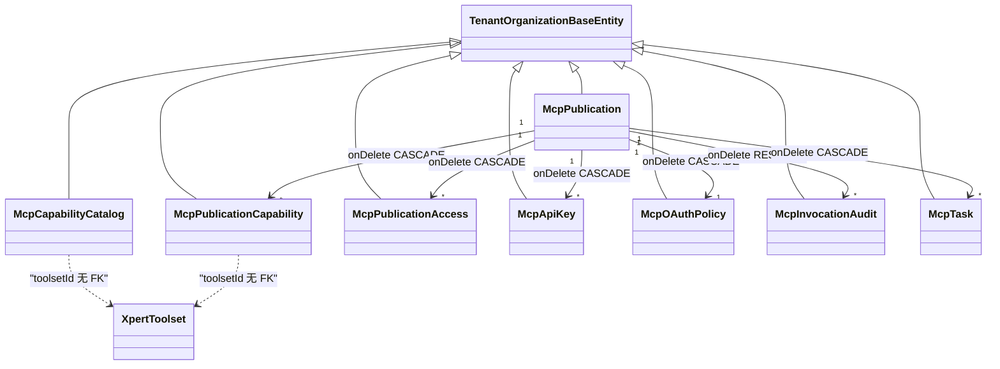

# MCP 协议与发布子专家 · 数据模型

> 只读梳理（commit `80f5676fd`）。本子域 **8 张自有表**（`mcp-publication/entities/` 全量，由 `MCP_PUBLICATION_ENTITIES` 一次性注册）+ 邻域表若干。`packages/server-ai/src/mcp/**` **0 表**（实测确认为无）。列极多者只列关键列；未验证处标 `[推测]`。

**本文引用的文件**

- [packages/server-ai/src/core/entities/base.entity.ts](file://packages/server-ai/src/core/entities/base.entity.ts)
- [packages/server-ai/src/mcp-publication/entities/index.ts](file://packages/server-ai/src/mcp-publication/entities/index.ts)
- [packages/server-ai/src/mcp-publication/entities/mcp-publication.entity.ts](file://packages/server-ai/src/mcp-publication/entities/mcp-publication.entity.ts)
- [packages/server-ai/src/mcp-publication/entities/mcp-publication-capability.entity.ts](file://packages/server-ai/src/mcp-publication/entities/mcp-publication-capability.entity.ts)
- [packages/server-ai/src/mcp-publication/entities/mcp-capability-catalog.entity.ts](file://packages/server-ai/src/mcp-publication/entities/mcp-capability-catalog.entity.ts)
- [packages/server-ai/src/mcp-publication/entities/mcp-publication-access.entity.ts](file://packages/server-ai/src/mcp-publication/entities/mcp-publication-access.entity.ts)
- [packages/server-ai/src/mcp-publication/entities/mcp-api-key.entity.ts](file://packages/server-ai/src/mcp-publication/entities/mcp-api-key.entity.ts)
- [packages/server-ai/src/mcp-publication/entities/mcp-oauth-policy.entity.ts](file://packages/server-ai/src/mcp-publication/entities/mcp-oauth-policy.entity.ts)
- [packages/server-ai/src/mcp-publication/entities/mcp-invocation-audit.entity.ts](file://packages/server-ai/src/mcp-publication/entities/mcp-invocation-audit.entity.ts)
- [packages/server-ai/src/mcp-publication/entities/mcp-task.entity.ts](file://packages/server-ai/src/mcp-publication/entities/mcp-task.entity.ts)
- [packages/server-ai/src/mcp-publication/mcp-publication.module.ts](file://packages/server-ai/src/mcp-publication/mcp-publication.module.ts)
- [packages/server-ai/src/mcp-publication/mcp-publication.service.ts](file://packages/server-ai/src/mcp-publication/mcp-publication.service.ts)
- [packages/server-ai/src/mcp-publication/mcp-capability-catalog.service.ts](file://packages/server-ai/src/mcp-publication/mcp-capability-catalog.service.ts)
- [packages/server-ai/src/mcp-publication/mcp-api-key.service.ts](file://packages/server-ai/src/mcp-publication/mcp-api-key.service.ts)
- [packages/server-ai/src/mcp-publication/mcp-task.service.ts](file://packages/server-ai/src/mcp-publication/mcp-task.service.ts)
- [packages/server-ai/src/mcp-publication/mcp-invocation-audit.service.ts](file://packages/server-ai/src/mcp-publication/mcp-invocation-audit.service.ts)
- [packages/server-ai/src/mcp-publication/mcp-publication-access.service.ts](file://packages/server-ai/src/mcp-publication/mcp-publication-access.service.ts)
- [packages/server-ai/src/mcp-publication/mcp-oauth.service.ts](file://packages/server-ai/src/mcp-publication/mcp-oauth.service.ts)
- [packages/server-ai/src/mcp-publication/entities/entities.spec.ts](file://packages/server-ai/src/mcp-publication/entities/entities.spec.ts)
- [packages/server-ai/src/mcp-publication/mcp-publication.dto.ts](file://packages/server-ai/src/mcp-publication/mcp-publication.dto.ts)
- [packages/server-ai/src/mcp-publication/mcp-input-schema.ts](file://packages/server-ai/src/mcp-publication/mcp-input-schema.ts)
- [packages/server-ai/src/tool-runtime/capability-descriptor.ts](file://packages/server-ai/src/tool-runtime/capability-descriptor.ts)
- [packages/server-ai/src/xpert-toolset/xpert-toolset.entity.ts](file://packages/server-ai/src/xpert-toolset/xpert-toolset.entity.ts)
- [packages/server-ai/src/xpert-toolset/xpert-toolset.module.ts](file://packages/server-ai/src/xpert-toolset/xpert-toolset.module.ts)
- [packages/server-ai/src/mcp-consumer/auth/mcp-consumer-oauth-credential.entity.ts](file://packages/server-ai/src/mcp-consumer/auth/mcp-consumer-oauth-credential.entity.ts)
- [packages/server-ai/src/mcp-consumer/auth/mcp-consumer-oauth-session.entity.ts](file://packages/server-ai/src/mcp-consumer/auth/mcp-consumer-oauth-session.entity.ts)
- [packages/server-ai/src/mcp-app-runtime/mcp-app-audit.entity.ts](file://packages/server-ai/src/mcp-app-runtime/mcp-app-audit.entity.ts)
- [packages/server-ai/src/mcp-app-runtime/mcp-app-history.entity.ts](file://packages/server-ai/src/mcp-app-runtime/mcp-app-history.entity.ts)
- [packages/contracts/src/ai/mcp-publication.model.ts](file://packages/contracts/src/ai/mcp-publication.model.ts)
- [packages/contracts/src/ai/mcp-capability.model.ts](file://packages/contracts/src/ai/mcp-capability.model.ts)
- [packages/contracts/src/ai/mcp-auth.model.ts](file://packages/contracts/src/ai/mcp-auth.model.ts)

## 目录

- [1. 建模基类与作用域](#1-建模基类与作用域)
- [2. 八张自有表](#2-八张自有表)
- [3. 邻域表](#3-邻域表)
- [4. 建模边界：快照、台账与密钥材料](#4-建模边界快照台账与密钥材料)
- [5. 校验规则](#5-校验规则)
- [6. 未确认项](#6-未确认项)
- [7. 结论](#7-结论)

## 1. 建模基类与作用域

八张表**全部继承 `TenantOrganizationBaseEntity`**——即全部带 `tenantId`（可空、`@Index()`）与 `organizationId`（可空、`@Index()`），**均无 `workspaceId`、无 `deletedAt` 软删、无 `publishAt`**。这与 ① 的 `XpertToolset`（走 `WorkspaceBaseEntity`、可软删）形成结构性差异：发布域的记录不能被软删，只能被硬删或通过状态位/时间戳「关闭」。

域内服务的组织维度收敛模式高度一致：`organizationId ?? IsNull()`。可见于 `McpPublicationService.list` / `resolveRuntimeCapabilities` / `availableCapabilities` / `loadCatalogForBindings`、`McpApiKeyService`（`sharedPublicationOrganization` 决定组织列）、`McpPublicationAccessService.find`、`McpInvocationAuditService.search`。这条模式也是「共享发布（tenant 级）+ 按组织准入」的建模基础：`mcp_publication.organizationId` 为空 ⇒ 租户级共享发布，需靠 `mcp_publication_access` 逐组织放行。

图表来源：[mcp-publication.entity.ts](file://packages/server-ai/src/mcp-publication/entities/mcp-publication.entity.ts)（关键符号：McpPublication / @OneToMany capabilities）、[mcp-invocation-audit.entity.ts](file://packages/server-ai/src/mcp-publication/entities/mcp-invocation-audit.entity.ts)（关键符号：onDelete RESTRICT）、[mcp-api-key.entity.ts](file://packages/server-ai/src/mcp-publication/entities/mcp-api-key.entity.ts)（关键符号：ManyToOne McpPublication onDelete CASCADE）、[base.entity.ts](file://packages/server-ai/src/core/entities/base.entity.ts)（关键符号：TenantOrganizationBaseEntity）

章节来源：[base.entity.ts](file://packages/server-ai/src/core/entities/base.entity.ts)（关键符号：TenantOrganizationBaseEntity）、[mcp-publication.module.ts](file://packages/server-ai/src/mcp-publication/mcp-publication.module.ts)（关键符号：TypeOrmModule.forFeature([...MCP_PUBLICATION_ENTITIES, XpertToolset, User])）、[mcp-publication.service.ts](file://packages/server-ai/src/mcp-publication/mcp-publication.service.ts)（关键符号：currentScope / organizationId ?? IsNull()）

## 2. 八张自有表

| # | 实体 / 表名 | 关键列（唯一索引 · FK onDelete · 隐藏列） | 生产方 | 主要消费方 | 用途 |
|---|---|---|---|---|---|
| 1 | `McpPublication` / `mcp_publication` | `name`(191)、`slug`(191)、`status`(20 默认 `draft`)、`authMethods`(json 默认 `[]`)、`instructions`(text)、`runtime`(json)、`protocolVersion`(20 默认 `MCP_PROTOCOL_VERSION`)、`reviewStatus`(20 默认 `current`)、`reviewReason`(text)、`reviewedAt`、`reviewedById`；**唯一 `IDX_mcp_publication_slug(slug)`** + `IDX_mcp_publication_scope_status(tenantId, organizationId, status)`；`@OneToMany capabilities`（**未声明 cascade**） | `McpPublicationService.create`（`status:'draft'`、`reviewStatus:'current'`） | `findActiveBySlug`（运行时）、管理控制器、`McpApiKeyService`/`McpOAuthService`/`McpTaskService`/`McpTaskExecutionService` | 对外 MCP 服务端的发布单；`slug` 即唯一对外地址 `/api/mcp/p/:slug` |
| 2 | `McpPublicationCapability` / `mcp_publication_capability` | `publicationId`(uuid，`ManyToOne(McpPublication,{nullable:false,onDelete:'CASCADE'})`)、`toolsetId`(uuid，**刻意无 FK**)、`capabilityType`(40)、`capabilityKey`(191)、`publicName`(191)、`enabled`(默认 true)、`policy`(json)、**`descriptorHash`(char 64)**、**`descriptorSnapshot`(json 非空，无 select:false)**、`pluginVersion`(64)；**唯一 `IDX_..._public_name(publicationId, publicName)`** + **唯一 `IDX_..._binding(publicationId, toolsetId, capabilityType, capabilityKey)`** + `IDX_..._scope(tenantId, organizationId, enabled)` | `McpPublicationService.replaceCapabilities` / `replaceCapabilitiesWithCatalog`（事务整体替换） | `McpPublicationRuntimeService`（逐条注册 MCP 原语）、`McpTaskExecutionService.canExecute`、`McpSubscriptionService` | 发布单 ↔ 能力的**绑定 + 描述符快照**；唯一索引即幂等键 |
| 3 | `McpCapabilityCatalog` / `mcp_capability_catalog` | `toolsetId`(uuid，注释 `intentionally not a FK so broken bindings stay diagnosable.`)、`capabilityType`(40)、`capabilityKey`(191)、**`descriptorHash`(char 64)**、`descriptor`(json 非空)、`enabled`(默认 true)；**唯一 `IDX_mcp_capability_catalog_binding(toolsetId, capabilityType, capabilityKey)`** + `IDX_mcp_capability_catalog_scope(tenantId, organizationId, enabled)` | `McpCapabilityCatalogService.replacePreparedToolsetCapabilities`（事务 delete+save） | `McpPublicationService.availableCapabilities` / `loadCatalogForBindings` / `resolveRuntimeCapabilities`、`ToolRuntimeService.describeCapabilities`（①） | 工具集**当前声明**的能力台账（能力发现结果），是绑定可选项与对账基准 |
| 4 | `McpPublicationAccess` / `mcp_publication_access` | `publicationId`(uuid，`ManyToOne({nullable:false,onDelete:'CASCADE'})`)、`enabled`(默认 true)、`enabledById`(uuid)、`disabledAt`、`disabledById`(uuid)；**唯一 `IDX_mcp_publication_access_organization(publicationId, organizationId)`** + `IDX_mcp_publication_access_scope(tenantId, organizationId, enabled)` | `McpPublicationAccessService.enable/disable`（唯一冲突 `23505`/`SQLITE_CONSTRAINT`/`ER_DUP_ENTRY` 竞态重取） | `McpPublicationAuthorizationService.assertCanRun`、`McpPublicationService.list`（共享发布合并） | 组织级**准入开关**：决定某组织能否使用租户级共享发布 |
| 5 | `McpApiKey` / `mcp_api_key` | `publicationId`(`onDelete:'CASCADE'`)、`name`(100)、`keyPrefix`(32)、**`keyHash`(char 64，`select:false` + `@Exclude({toPlainOnly:true})`)**、**`encryptedSecret`(text，`select:false` + `@Exclude`)**、`subjectType`(24)、`subjectId`(uuid)、`scopes`(json 默认 `[]`)、`expiresAt`、`lastUsedAt`、`revokedAt`、`revokedById`；**唯一 `IDX_mcp_api_key_hash(keyHash)`** + **唯一 `IDX_mcp_api_key_prefix(keyPrefix)`** + `IDX_mcp_api_key_publication(tenantId, publicationId, revokedAt, expiresAt)` | `McpApiKeyService.createForPublication`（`API_KEY_PREFIX='xpert_mcp_'`、`STORED_PREFIX_LENGTH=24`）；`rotate` = 撤旧 + 建新 | `McpApiKeyService.authenticate`（按 prefix 定位 + `timingSafeEqual`）、管理端点 `rotate`/`revoke` | 调用方凭据：**哈希用于校验、密文用于显式授权回显**，两列默认不出网、不默认查询 |
| 6 | `McpOAuthPolicy` / `mcp_oauth_policy` | `publicationId`(**`OneToOne(McpPublication,{nullable:false,onDelete:'CASCADE'})`**)、`issuer`(text)、`audience`(text)、`requiredScopes`(json 默认 `[]`)、`subjectMapping`(json 非空)、`introspectionEnabled`(默认 false)、`introspectionEndpoint`、`introspectionClientId`、**`introspectionClientSecretEncrypted`(text，`select:false`，无 `@Exclude`)**、`introspectionClientSecretConfigured`(默认 false)、`enabled`(默认 false)；**唯一 `IDX_mcp_oauth_policy_publication(publicationId)`** | `McpOAuthService.upsert`（`PUT mcp-publications/:id/oauth-policy`） | `McpOAuthService.authenticate/challenge/protectedResourceMetadata/test`、`McpAuthenticationService` | 发布单的 OAuth 资源服务器策略；一对一唯一约束由 `IDX` 表达 |
| 7 | `McpInvocationAudit` / `mcp_invocation_audit` | `publicationId`(uuid，**`ManyToOne({nullable:false, onDelete:'RESTRICT'})`——八表中唯一 RESTRICT**)、`capabilityId`/`toolsetId`(uuid 可空)、`capabilityKey`/`publicName`(191 可空)、`authMethod`(20)、`subjectType`(24)、`subjectId`(uuid)、`clientName`(191)、`requestId`(uuid)、`traceId`(64)、`status`(20)、`durationMs`(int)、`errorCode`(100)、**`argumentSummary`(json，`select:false`)**；**唯一 `IDX_mcp_invocation_audit_request(requestId)`** + `IDX_..._publication_created(tenantId, publicationId, createdAt)` + `IDX_..._subject_created(tenantId, subjectId, createdAt)` | `McpInvocationAuditService.start/succeeded/failed`（三阶段更新同一行） | 管理端点 `GET mcp-publications/:id/audit`、`McpPublicationService.list`（最近调用/最近错误报表） | 逐次调用审计：一次调用一行；`RESTRICT` 保证发布单不可带审计被硬删 |
| 8 | `McpTask` / `mcp_task` | `publicationId`(`onDelete:'CASCADE'`)、`taskId`(uuid)、`capabilityId`(uuid)、`executionId`(uuid)、`requestId`(191)、`toolName`(191)、`idempotencyKey`(191)、**`inputHash`(char 64)**、`subjectType`(24)、`subjectId`(uuid)、`queueJobId`(191)、`status`(24)、`statusMessage`(500)、`progress`(numeric 5,4)、`pollIntervalMs`(int)、**`inputRequests`/`inputResponses`/`requestPayload`/`resultRef`/`error` 均 json `select:false`**、`revision`(int 默认 0，**普通列**)、`expiresAt`(非空)；**唯一 `IDX_mcp_task_task_id(taskId)`** + **唯一 `IDX_mcp_task_idempotency(publicationId, idempotencyKey)`** + `IDX_mcp_task_publication_status(tenantId, publicationId, status, expiresAt)` + `IDX_mcp_task_subject(tenantId, publicationId, subjectType, subjectId, updatedAt)` | `McpTaskService.create`（service 计算 `idempotencyKey` 与 `inputHash`） | `McpTaskService.get/update/cancel`、`McpTaskExecutionService.run`、`McpTaskProcessor`、`McpSubscriptionService` | 长任务台账：幂等键 + 输入指纹 + 修订号 + 过期时间构成可重放契约 |

**表间语义要点**：
- **幂等键口径**：`idempotencyKey = sha256(publicationId \0 subjectType \0 subjectId \0 requestId \0 typeof rpcRequestId \0 String(rpcRequestId ?? '') \0 capability.publicName)`；`inputHash = hashJson(arguments)`。命中唯一索引时 `assertIdempotentReplay` 比对主体与指纹后**返回既有任务**，不新建行；`saveTask` 抛唯一冲突时再查一次做并发兜底。
- **`revision` 不是并发控制**：仅在 `input_required → working` 的补充输入路径 `revision += 1`，用于让客户端识别状态推进。
- **`reviewedById` / `enabledById` / `disabledById` / `revokedById` 均为裸 uuid 列**（无 FK 到 `user`），`createdById`/`updatedById` 来自基类。
- **`progress` 为 `numeric(5,4)`**——即 0.0000 ~ 9.9999，`clampProgress` 在服务层收敛到 [0,1]。

章节来源：[mcp-publication.entity.ts](file://packages/server-ai/src/mcp-publication/entities/mcp-publication.entity.ts)（关键符号：IDX_mcp_publication_slug / reviewStatus）、[mcp-publication-capability.entity.ts](file://packages/server-ai/src/mcp-publication/entities/mcp-publication-capability.entity.ts)（关键符号：IDX_mcp_publication_capability_binding / descriptorSnapshot）、[mcp-capability-catalog.entity.ts](file://packages/server-ai/src/mcp-publication/entities/mcp-capability-catalog.entity.ts)（关键符号：IDX_mcp_capability_catalog_binding）、[mcp-publication-access.entity.ts](file://packages/server-ai/src/mcp-publication/entities/mcp-publication-access.entity.ts)（关键符号：IDX_mcp_publication_access_organization）、[mcp-api-key.entity.ts](file://packages/server-ai/src/mcp-publication/entities/mcp-api-key.entity.ts)（关键符号：keyPrefix / keyHash / encryptedSecret）、[mcp-oauth-policy.entity.ts](file://packages/server-ai/src/mcp-publication/entities/mcp-oauth-policy.entity.ts)（关键符号：introspectionClientSecretConfigured）、[mcp-invocation-audit.entity.ts](file://packages/server-ai/src/mcp-publication/entities/mcp-invocation-audit.entity.ts)（关键符号：requestId 唯一 / onDelete RESTRICT）、[mcp-task.entity.ts](file://packages/server-ai/src/mcp-publication/entities/mcp-task.entity.ts)（关键符号：IDX_mcp_task_idempotency / inputHash / revision / expiresAt）、[mcp-task.service.ts](file://packages/server-ai/src/mcp-publication/mcp-task.service.ts)（关键符号：hashText / hashJson / assertIdempotentReplay）

## 3. 邻域表

这些表**不属于本子域 8 张**，但被本子域模块注册、被本子域代码读写或与其强相关。

| 实体 / 表名 | 归属 | 与本子域的关系 | 关键列（节选） |
|---|---|---|---|
| `XpertToolset` / `xpert_toolset` | ① 工具集子域 | 被 `McpPublicationModule.forFeature([...MCP_PUBLICATION_ENTITIES, XpertToolset, User])` 注册；`McpPublicationService` 注入其仓库做台账与绑定的作用域校验（`organizationId ?? IsNull()` + `workspaceId: IsNull()`）；① 的 `xpert-toolset.module` 反向注册本域的 `McpCapabilityCatalog` / `McpPublicationCapability` | 见 ① 文档；关键列 `type`/`category`/`options`/`credentials`(`@Exclude`)、`workspaceId`、`deletedAt` |
| `User` | 核心/认证域 | 被同一个 `forFeature` 注册；`McpPublicationAuthorizationService` 用 `findOne({ where: { id, tenantId }, relations: ['organizations'] })` 校验组织成员；`McpOAuthService.resolveUser` 用它按 subject/email 反查 | `id` / `tenantId` / `organizations`（M2M 关系） |
| `McpConsumerOAuthCredential` / `mcp-consumer-oauth-credential` | `mcp-consumer/**`（邻域） | 由 `xpert-toolset.module` 的 `forFeature` 注册；与发布侧 `mcp_api_key` / `mcp_oauth_policy` **命名相近但语义相反**（客户端凭据 vs 服务端策略） | `packages/server-ai/src/mcp-consumer/auth/mcp-consumer-oauth-credential.entity.ts`（**未逐列核对**） |
| `McpConsumerOAuthSession` / `mcp-consumer-oauth-session` | `mcp-consumer/**`（邻域） | 同上（客户端 OAuth 会话） | `packages/server-ai/src/mcp-consumer/auth/mcp-consumer-oauth-session.entity.ts`（**未逐列核对**） |
| `McpAppAudit` / `mcp-app-audit.entity.ts` | `mcp-app-runtime/**`（邻域） | 由 `xpert-toolset.module` 的 `forFeature` 注册，由 `McpAppsController` 暴露；与客户端 `app-support.ts` 的实例注册/审批链路相关 | `packages/server-ai/src/mcp-app-runtime/mcp-app-audit.entity.ts`（**未逐列核对**） |
| `McpAppHistory` / `mcp-app-history.entity.ts` | `mcp-app-runtime/**`（邻域） | 同上；由 `McpAppHistoryStoreService` / `McpAppHistoryService` 读写 | `packages/server-ai/src/mcp-app-runtime/mcp-app-history.entity.ts`（**未逐列核对**） |
| `McpRuntimeInstanceEntity` / `mcp_runtime_instance` | ① 工具集子域 | **本子域客户端写它**：`mcpStdioRuntimeManager.setAuditSink` → `McpRuntimeAuditService.recordStarting/recordRunning/recordClosed/recordAppInstance`；5 个复合索引，`policySnapshot`/`commandHash`/`commandLabel` | 见 ① 文档 |
| `PluginResourceInstallation` / `PluginResourceInstallation` | 平台插件域 | 被 ① 的 `forFeature` 注册；`McpAppBundleService` 只读 `LOADED_PLUGINS`（非本表）解析 App 入口 | 未在本子域使用 |

**实测确认为无**：`packages/server-ai/src/mcp/**` 目录内 **0 个 `@Entity`**——14 个非 spec 文件全部是 module/service/controller/transport/decorator/types，**协议侧不落任何库**，状态只存在 `NestSSEAdapter.activeTransports`（内存 Map）与可选 `stdioTransport` 中。这是本子域最重要的一条「无」。

章节来源：[mcp-publication.module.ts](file://packages/server-ai/src/mcp-publication/mcp-publication.module.ts)（关键符号：forFeature([...MCP_PUBLICATION_ENTITIES, XpertToolset, User])）、[xpert-toolset.module.ts](file://packages/server-ai/src/xpert-toolset/xpert-toolset.module.ts)（关键符号：forFeature 含 McpCapabilityCatalog / McpPublicationCapability / McpAppAudit / McpAppHistory / McpConsumerOAuthCredential / McpConsumerOAuthSession）、[mcp-publication-authorization.service.ts](file://packages/server-ai/src/mcp-publication/mcp-publication-authorization.service.ts)（关键符号：assertCanRun / relations: ['organizations']）、[mcp-oauth.service.ts](file://packages/server-ai/src/mcp-publication/mcp-oauth.service.ts)（关键符号：resolveUser）、[mcp-stdio-runtime.ts](file://packages/server-ai/src/xpert-toolset/provider/mcp/mcp-stdio-runtime.ts)（关键符号：setAuditSink / notifyAudit）

## 4. 建模边界：快照、台账与密钥材料

**快照（snapshot）——可读、可出网、成对配 hash**
- `mcp_publication_capability.descriptorSnapshot`（`json` 非空，**无 `select:false`**）+ `descriptorHash`（`char(64)`）。实体注释逐字说明：`Required to classify descriptor changes instead of treating every hash change as breaking.` ——快照的用途是**变更分类**：读取期 `resolveRuntimeCapabilities` 用 `compareMcpCapabilityDescriptors(binding.descriptorSnapshot, item.descriptor)` 判定 `breaking`，兼容则就地更新快照与哈希，breaking 则把发布单升级为 `reviewStatus='required'` 并写 `reviewReason`。
- `mcp_capability_catalog.descriptor`（`json` 非空）+ `descriptorHash`（`char(64)`）：台账侧同构快照。
- `mcp_runtime_instance.policySnapshot`（① 的表）：stdio 运行策略白名单快照，本子域客户端只写不读。

**台账（ledger）——以唯一键防重、极少改、可追溯**
- `mcp_capability_catalog`：能力发现台账，**整体替换**（事务 delete + save），唯一键 `(toolsetId, capabilityType, capabilityKey)`。
- `mcp_publication_capability`：绑定台账，**整体替换**，唯一键 `(publicationId, toolsetId, capabilityType, capabilityKey)` 与 `(publicationId, publicName)`。
- `mcp_invocation_audit`：调用台账，`requestId` 唯一 ⇒ **只追加**；三阶段 `start → succeeded|failed` 是对同一行的 `save`。
- `mcp_task`：长任务台账，幂等键去重；`expiresAt` 与 `revision` 组成可重放契约。
- `mcp_publication_access`：准入台账，唯一键 `(publicationId, organizationId)`，用 `enabled` + 时间戳表达开闭。

**密钥材料与脱敏边界（三层，逐层收紧）**
1. **库内不加密，仅序列化剔除**：`xpert_toolset.credentials`（① 的表，`@Exclude({toPlainOnly:true})`；① 侧还有一行被注释掉的加密步骤）。
2. **库内加密 + 双重隐藏**：`mcp_api_key.keyHash`（`char(64)`，`select:false` + `@Exclude`）与 `encryptedSecret`（`text`，`select:false` + `@Exclude`）。读取必须显式 `.addSelect('apiKey.keyHash')`（`authenticate`）或 `.addSelect('apiKey.encryptedSecret')`（`getOrCreateRevealableCredential`）；返回时用 `toPublicApiKey` 与对象解构 `const { keyHash, encryptedSecret, ...apiKey } = entity` 二次剔除。
3. **库内加密 + 仅 `select:false`（无 `@Exclude`）**：`mcp_oauth_policy.introspectionClientSecretEncrypted`。配套布尔位 `introspectionClientSecretConfigured` 让 UI 在不读密文时判断「是否已配置」——本子域最干净的密钥建模。`upsert` 接受 `introspection.clientSecret` 三态（省略 = 保留、`null` = 清空、新值 = 轮换）。

**审计脱敏（`select:false` 的载荷列）**
- `mcp_invocation_audit.argumentSummary`：`summarizeArguments` 只写 `{ keys: [...≤100], bytes }`；数组/标量只写 `{ type }`；`null`/`undefined` 写 `null`。**从不写入参数值**。
- `mcp_task.requestPayload`：完整 `McpTaskJobPayload`（含 `arguments`、`principal`、`runtime`、`approvalGranted`），单条上限 `MAX_TASK_PAYLOAD_BYTES`。**属高敏感载荷**。
- `mcp_task.inputRequests` / `inputResponses`：elicitation 往返与补充输入，`select:false`。
- `mcp_task.resultRef` / `error`：结果引用与错误体，`select:false`。

**不可变 vs 可变**：`mcp_publication_capability` 与 `mcp_capability_catalog` 是**可重建投影**（delete + save）；`mcp_publication_access` / `mcp_api_key` 用 `disabledAt` / `revokedAt` 表达撤销而**不删行**；`mcp_invocation_audit` 只增不改语义（`RESTRICT` 保护）；`mcp_task` 的 `expiresAt` 是唯一的时间边界，到期未完成会被改写为 `failed` + `MCP_TASK_EXPIRED`。

章节来源：[mcp-publication-capability.entity.ts](file://packages/server-ai/src/mcp-publication/entities/mcp-publication-capability.entity.ts)（关键符号：descriptorHash / descriptorSnapshot 注释）、[mcp-capability-catalog.entity.ts](file://packages/server-ai/src/mcp-publication/entities/mcp-capability-catalog.entity.ts)（关键符号：descriptor）、[mcp-api-key.service.ts](file://packages/server-ai/src/mcp-publication/mcp-api-key.service.ts)（关键符号：addSelect('apiKey.keyHash') / addSelect('apiKey.encryptedSecret') / toPublicApiKey）、[mcp-oauth.service.ts](file://packages/server-ai/src/mcp-publication/mcp-oauth.service.ts)（关键符号：normalizeIntrospectionPolicy / introspectionClientSecretConfigured）、[mcp-invocation-audit.service.ts](file://packages/server-ai/src/mcp-publication/mcp-invocation-audit.service.ts)（关键符号：summarizeArguments）、[mcp-task.service.ts](file://packages/server-ai/src/mcp-publication/mcp-task.service.ts)（关键符号：MAX_TASK_PAYLOAD_BYTES / assertJsonSize）、[mcp-publication.service.ts](file://packages/server-ai/src/mcp-publication/mcp-publication.service.ts)（关键符号：resolveRuntimeCapabilities / compareMcpCapabilityDescriptors）

## 5. 校验规则

**唯一约束（冲突即幂等键）**
- `mcp_publication.slug`（全局唯一，非 scope 内唯一）。
- `mcp_publication_capability`：`(publicationId, publicName)` 与 `(publicationId, toolsetId, capabilityType, capabilityKey)`。
- `mcp_capability_catalog`：`(toolsetId, capabilityType, capabilityKey)`。
- `mcp_publication_access`：`(publicationId, organizationId)`。
- `mcp_api_key`：`keyHash` 与 `keyPrefix` 各自唯一。
- `mcp_oauth_policy`：`publicationId`（一对一）。
- `mcp_invocation_audit`：`requestId`。
- `mcp_task`：`taskId` 与 `(publicationId, idempotencyKey)`。

**枚举与取值范围**（`packages/contracts/src/ai/`，**库内多为 varchar，无 CHECK 约束**，靠 DTO/服务层保证）
- `MCP_PUBLICATION_STATUSES = ['draft','active','disabled']`；`MCP_PUBLICATION_REVIEW_STATUSES = ['current','required']`；`MCP_AUTH_METHODS = ['api_key','oauth']`；`MCP_CAPABILITY_APPROVAL_MODES = ['deny','allow','confirm']`。
- `MCP_CAPABILITY_TYPES = ['tool','resource','resource_template','prompt','app']`；`MCP_TOOL_RISKS = ['read','write','dangerous']`；`MCP_TOOL_SIDE_EFFECTS = ['none','reversible','irreversible']`；`MCP_TOOL_IDEMPOTENCY = ['safe','idempotent','non_idempotent']`。
- `MCP_TASK_STATUSES = ['working','input_required','completed','failed','cancelled']`。
- `MCP_API_KEY_SUBJECT_TYPES = ['user','service_account']`。
- 管理端 DTO（`mcp-publication.dto.ts`）用 `@IsIn` + `@Matches` + `@ArrayUnique` + `@ArrayMaxSize` 逐字段约束；`McpPublicationManagementController` 统一 `ValidationPipe({ whitelist: true, forbidNonWhitelisted: true, transform: true })`，能力数组用 `ParseArrayPipe(items: McpCapabilityBindingInput)`。

**格式与长度约束（服务层正则，非 DB 约束）**
- `PUBLICATION_SLUG_PATTERN = /^[a-z0-9]+(?:-[a-z0-9]+)*$/`（`publiation.service.ts` 与 `dto` 双侧定义）。
- `PUBLIC_NAME_PATTERN = /^[a-zA-Z0-9_-]+$/`。
- `CLAIM_NAME_PATTERN = /^[A-Za-z0-9_.:-]+$/`（`issuer` claim 名）。
- 长度：`name`/`slug`/`capabilityKey`/`publicName` ≤191；`publication.name`(191)、`api_key.name`(100)、`keyPrefix`(32)、`subjectType`(24)、`capabilityType`(40)、`pluginVersion`(64)、`traceId`(64)、`errorCode`(100)、`statusMessage`(500)、`instructions` ≤8000、`oauth.issuer` ≤2048、`audience` ≤500、`introspection.clientSecret` ≤4096、scopes 单项 ≤191 且数组 ≤100。

**`char(64)` hash 约定**：`mcp_publication_capability.descriptorHash`、`mcp_capability_catalog.descriptorHash`、`mcp_api_key.keyHash`、`mcp_task.inputHash` 四列统一 `char(64)` + sha256 hex。`keyPrefix` 是 `varchar(32)` 实际存 24 字符（`STORED_PREFIX_LENGTH`）。

**json 形态约束**：`descriptorSnapshot` / `descriptor` / `subjectMapping` **非空**；`authMethods` / `requiredScopes` / `scopes` 默认 `[]`；`policy` / `runtime` / `instructions` / `reviewReason` 可空。`runtime` 由 `parseMcpRuntimeConfiguration` 的 zod `.strict()` 解析（只允许 `{ files: { type: 'user' } }`），管理入口与持久化读回**都过同一函数**（注释：`Parse management input and persisted JSON before granting host capabilities.`）。

**描述符与 schema 校验**：`assertValidMcpCapabilityDescriptor` + `hashMcpCapabilityDescriptor`（① 的 `tool-runtime/capability-descriptor.ts`）；`McpCapabilityCatalogService` 侧用 `zodMcpSchema` 做 JSON 往返并强制 `outputSchema.type = 'object'`；运行期入参用 `mcp-input-schema.ts` 的 Ajv 三方言校验器，失败只报 `path`/`code`/`message`/`allowedAnswers` 类信息不回显值。

章节来源：[mcp-publication.model.ts](file://packages/contracts/src/ai/mcp-publication.model.ts)（关键符号：MCP_PUBLICATION_STATUSES / MCP_AUTH_METHODS / MCP_TASK_STATUSES / MCP_HTTP_CORS_REQUEST_HEADERS）、[mcp-capability.model.ts](file://packages/contracts/src/ai/mcp-capability.model.ts)（关键符号：MCP_CAPABILITY_TYPES / McpCapabilityDescriptor / defaultMcpToolApprovalMode）、[mcp-auth.model.ts](file://packages/contracts/src/ai/mcp-auth.model.ts)（关键符号：MCP_API_KEY_SUBJECT_TYPES / IMcpOAuthPolicy.subjectMapping）、[mcp-publication.dto.ts](file://packages/server-ai/src/mcp-publication/mcp-publication.dto.ts)（关键符号：PUBLICATION_SLUG_PATTERN / PUBLIC_NAME_PATTERN / CLAIM_NAME_PATTERN / McpCapabilityBindingInput）、[mcp-runtime-configuration.ts](file://packages/server-ai/src/mcp-publication/mcp-runtime-configuration.ts)（关键符号：parseMcpRuntimeConfiguration）、[mcp-capability-catalog.service.ts](file://packages/server-ai/src/mcp-publication/mcp-capability-catalog.service.ts)（关键符号：prepareToolsetCapabilities / zodMcpSchema）、[entities.spec.ts](file://packages/server-ai/src/mcp-publication/entities/entities.spec.ts)（关键符号：columns 断言 keyHash/argumentSummary/requestPayload 的 select:false）

## 6. 未确认项

以下「无」是**扫描 + 定向搜索双重确认的结论**，不是遗漏；其余为待确认。

**实测确认为无**
- **`packages/server-ai/src/mcp/**` 0 表**：14 个非 spec 文件中无任何 `@Entity`，状态只在 `NestSSEAdapter.activeTransports` 内存 Map。**实测确认为无**。
- **八表无 `@DeleteDateColumn` / `@VersionColumn`**：`deletedAt` 定义在 `core/entities/base.entity.ts` 的 `WorkspaceBaseEntity`，本子域八表继承的是 `TenantOrganizationBaseEntity` ⇒ **不可软删、无乐观锁**。`mcp_task.revision` 是普通 `int`。**实测确认为无**。
- **`mcp-publication` 无 `migrations/*.sql`**：表结构完全由实体定义驱动，索引名（`IDX_*`）在装饰器中显式命名；**基线建表 DDL 不在仓库内**。
- **八表无 `CHECK` 约束**：全部枚举为 varchar，约束只在 contracts + DTO + 服务层。
- **无清理作业**：本子域未见 `@Cron` / `@Interval`；唯一的队列入口是 `McpTaskProcessor` 的 `@PluginJobProcessor`。

**属本域但需显式标注归属的关联表**
- **`mcp_publication_capability` 是否算「关联表」**：它在物理上是「发布单 ↔ 工具集能力」的多对多解析表，但因为**自带 `descriptorSnapshot` / `descriptorHash` / `policy` / `enabled` / `pluginVersion` 五列业务属性**，本文件按「带属性的关联实体」处理，计入 8 张自有表。
- **`mcp.applications` 一类的关联表**：在 `mcp-publication/entities/` 与 `MCP_PUBLICATION_ENTITIES` 中**不存在**该名字的实体或常量；若曾存在则已不在当前实体集内。**实测确认为无**。
- **`mcp-consumer` 的 2 张表归属**：`McpConsumerOAuthCredential` / `McpConsumerOAuthSession` 由 `xpert-toolset.module` 的 `forFeature` 注册，但实体文件位于 `src/mcp-consumer/auth/` ⇒ **归属 `mcp-consumer`（邻域），不是本子域 8 张**。其列**未逐条核对**。
- **`mcp-app-runtime` 的 2 张表归属**：`McpAppAudit` / `McpAppHistory` 同样由 `xpert-toolset.module` 注册，实体在 `src/mcp-app-runtime/` ⇒ **归属 `mcp-app-runtime`（邻域）**。列**未逐条核对**。
- **`McpRuntimeInstanceEntity` 被本子域写**：实体在 ① 的目录（`src/xpert-toolset/mcp-runtime-instance.entity.ts`），**归属 ①**；本子域仅经 `mcpStdioRuntimeManager.setAuditSink` 触发写入。
- **`User` 被注册的用途**：`McpPublicationModule.forFeature` 收进它，实际由 `McpPublicationAuthorizationService`（关系解析 `organizations`）与 `McpOAuthService.resolveUser` 使用。`[推测：不含其他用途]`

**其他未逐条核对**
- `packages/contracts/src/ai/mcp-audit.model.ts`（941 B）存在但未逐列/逐枚举核对。
- `mcp-publication` 的 24 个 spec 中的 fixture 细节未逐条核对（见 `06-测试.md`）。
- `mcp_publication_capability.pluginVersion` 的来源链：`resolveRuntimeCapabilities` 取 `item.descriptor.source.pluginVersion`，但最终写值取决于各 provider 是否填充该字段。`[推测：多由插件托管工具集填充]`

章节来源：[mcp.service.ts](file://packages/server-ai/src/mcp/mcp.service.ts)（关键符号：NestSSEAdapter.activeTransports 语义 / MCPService）、[base.entity.ts](file://packages/server-ai/src/core/entities/base.entity.ts)（关键符号：WorkspaceBaseEntity.deletedAt / TenantOrganizationBaseEntity）、[xpert-toolset.module.ts](file://packages/server-ai/src/xpert-toolset/xpert-toolset.module.ts)（关键符号：forFeature 的 9 项清单）、[mcp-publication.module.ts](file://packages/server-ai/src/mcp-publication/mcp-publication.module.ts)（关键符号：forFeature([...MCP_PUBLICATION_ENTITIES, XpertToolset, User])）、[index.ts](file://packages/server-ai/src/mcp-publication/entities/index.ts)（关键符号：MCP_PUBLICATION_ENTITIES 八项）、[mcp-task.processor.ts](file://packages/server-ai/src/mcp-publication/mcp-task.processor.ts)（关键符号：PluginJobProcessor mcp-publication/execute-tool）

## 7. 结论

本子域的建模主线是「**一个聚合根 + 六张从属表 + 一张无 FK 的对外台账**」。`mcp_publication` 是唯一聚合根（`slug` 全局唯一即对外地址），其下六张表各自承担一种治理语义：能力绑定（快照 + 幂等键）、能力台账（发现结果，工具集维度）、组织准入（共享发布的放行开关）、密钥（双重隐藏）、OAuth 策略（一对一双重隐藏）、审计（`RESTRICT` 保护只追加）、任务（幂等 + 过期）。八表全部继承 `TenantOrganizationBaseEntity`，因此**既不可软删也无乐观锁**，一致性完全依赖唯一索引 + 服务层对账。

三条建模判断值得长期守住：
1. **`toolsetId` 刻意无 FK 是「可诊断性优先」的取舍**——注释写明 `broken bindings stay diagnosable`，代价是残绑定只能靠 `resolveRuntimeCapabilities` 的读取期对账暴露（升级为 `reviewStatus='required'`），DB 不会级联清理。
2. **快照与指纹必须成对**——`descriptorSnapshot`（非空 json，可读可出网）+ `descriptorHash`（`char(64)`）是「区分兼容变更与 breaking 变更」的唯一依据；`mcp_capability_catalog` 同构。
3. **密钥材料分三档收紧**——`keyHash`/`encryptedSecret` 是 `select:false` + `@Exclude` 的最严档；`introspectionClientSecretEncrypted` 是 `select:false` 单档，并用 `introspectionClientSecretConfigured` 布尔位避免读密文判断配置状态。

最大的口径风险是**「归属 vs 注册」的错位**：`xpert-toolset.module` 注册了本域 2 张表、邻域 4 张表、平台插件域 1 张表；`McpPublicationModule` 又反向注册 `XpertToolset` 与 `User`。任何按 `forFeature` 长度推断「某模块有几张表」的做法都会得出错误结论——本文件一律以**实体声明所在目录**为归属判据。

章节来源：[mcp-publication.module.ts](file://packages/server-ai/src/mcp-publication/mcp-publication.module.ts)（关键符号：McpPublicationModule.forFeature）、[xpert-toolset.module.ts](file://packages/server-ai/src/xpert-toolset/xpert-toolset.module.ts)（关键符号：XpertToolsetModule.forFeature 跨域注册）、[mcp-publication-capability.entity.ts](file://packages/server-ai/src/mcp-publication/entities/mcp-publication-capability.entity.ts)（关键符号：descriptorSnapshot / descriptorHash）、[mcp-api-key.entity.ts](file://packages/server-ai/src/mcp-publication/entities/mcp-api-key.entity.ts)（关键符号：keyHash / encryptedSecret / select:false）、[mcp-oauth-policy.entity.ts](file://packages/server-ai/src/mcp-publication/entities/mcp-oauth-policy.entity.ts)（关键符号：introspectionClientSecretConfigured）
