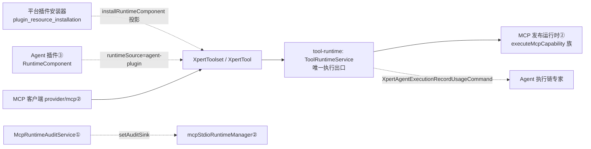

# 工具集与工具子专家 —— C0 使用总览

> **资产基线**：`2026-10-16 · commit 80f5676fd`（批次 5 第 10 专家 · 子专家①），继承父域 [C0-使用总览.md](file://.module-experts/后端专题/工具与 MCP 专家/C0-使用总览.md)。**范围**：`packages/server-ai/src/xpert-toolset/**` 的**工具集主体**（模块 / 实体 / 服务 / 控制器 / 守卫 / `mcp-apps.*` / `mcp-runtime.*` / `provider/{builtin,openapi,odata}` / CQRS / `dto`）＋ `packages/server-ai/src/xpert-tool/**` ＋ `packages/server-ai/src/tool-runtime/**`（执行面）；自有表 2 张（`xpert_toolset`（含 M2M `tag_xpert_toolset`）、`mcp_runtime_instance`）＋ `xpert_tool`；HTTP 前缀 `/api/xpert-toolset`、`/api/xpert-tool`。`provider/mcp/**`、`mcp/**`、`mcp-publication/**` 归 [子专家②](file://.module-experts/后端专题/工具与 MCP 专家/sub-experts/MCP协议与发布子专家/C0-使用总览.md)，`agent-plugin/**` 归 [子专家③](file://.module-experts/后端专题/工具与 MCP 专家/sub-experts/Agent插件子专家/C0-使用总览.md)。未证实处标 `[推测]`。

**本文引用的文件**（相对仓库根，链接均为 `file://`）

- [packages/server-ai/src/xpert-toolset/xpert-toolset.controller.ts](file://packages/server-ai/src/xpert-toolset/xpert-toolset.controller.ts)
- [packages/server-ai/src/xpert-toolset/xpert-toolset.service.ts](file://packages/server-ai/src/xpert-toolset/xpert-toolset.service.ts)
- [packages/server-ai/src/xpert-toolset/xpert-toolset.module.ts](file://packages/server-ai/src/xpert-toolset/xpert-toolset.module.ts)
- [packages/server-ai/src/xpert-toolset/xpert-toolset.entity.ts](file://packages/server-ai/src/xpert-toolset/xpert-toolset.entity.ts)
- [packages/server-ai/src/xpert-toolset/guards/toolset.guard.ts](file://packages/server-ai/src/xpert-toolset/guards/toolset.guard.ts)
- [packages/server-ai/src/xpert-toolset/mcp-apps.controller.ts](file://packages/server-ai/src/xpert-toolset/mcp-apps.controller.ts)
- [packages/server-ai/src/xpert-toolset/mcp-runtime.controller.ts](file://packages/server-ai/src/xpert-toolset/mcp-runtime.controller.ts)
- [packages/server-ai/src/xpert-toolset/mcp-runtime-audit.service.ts](file://packages/server-ai/src/xpert-toolset/mcp-runtime-audit.service.ts)
- [packages/server-ai/src/xpert-toolset/mcp-runtime-instance.entity.ts](file://packages/server-ai/src/xpert-toolset/mcp-runtime-instance.entity.ts)
- [packages/server-ai/src/xpert-toolset/provider/builtin/index.ts](file://packages/server-ai/src/xpert-toolset/provider/builtin/index.ts)
- [packages/server-ai/src/xpert-tool/xpert-tool.service.ts](file://packages/server-ai/src/xpert-tool/xpert-tool.service.ts)
- [packages/server-ai/src/xpert-tool/commands/handlers/tool-invoke.handler.ts](file://packages/server-ai/src/xpert-tool/commands/handlers/tool-invoke.handler.ts)
- [packages/server-ai/src/tool-runtime/tool-runtime.service.ts](file://packages/server-ai/src/tool-runtime/tool-runtime.service.ts)
- [packages/server-ai/src/tool-runtime/{toolset-scope.ts,workspace-scope.ts,capability-descriptor.ts}](file://packages/server-ai/src/tool-runtime/toolset-scope.ts)
- [packages/server-ai/src/plugin-resource/plugin-resource-installer.service.ts](file://packages/server-ai/src/plugin-resource/plugin-resource-installer.service.ts)

## 目录

1. [定位](#定位)
2. [何时找这个子专家](#何时找这个子专家)
3. [能力清单表](#能力清单表)
4. [边界](#边界)
5. [已知问题与常见坑](#已知问题与常见坑)
6. [延伸阅读](#延伸阅读)

## 定位

本子专家负责 **「工具集是什么、有哪些工具、怎么被装配与执行」**：`XpertToolset` 实例的全生命周期（`create`/`save`/`updateToolset`/`getAllByWorkspace`/`createBuiltinToolset`/`afterLoad`/`hydrateBuiltinToolSchemas`/`findPublicAvatar`）、工具实例面（`XpertToolService.getTool`/`testTool`/`getParamsFaker` ＋ `XpertToolSubscriber` 的名称强制）、**非 MCP 的 provider 体系**（`BUILTIN_TOOLSET_REPOSITORY` 静态注册表 + `OpenAPIToolset`/`ODataToolset` 与 `ApiBasedToolSchemaParser`）、**统一工具执行面** `ToolRuntimeService`、MCP App 的 HTTP 面（`McpAppsController`/`McpAppsService`）、MCP stdio 运行时的审计与停机阀（`McpRuntimeAuditService`/`McpRuntimeInstanceEntity`/`McpRuntimeController`），以及读路径准入与脱敏（`ToolsetGuard`/`WorkspaceAuthoringGuard`/`ToolsetPublicDTO`）。

**一句话口径**：`xpert_toolset` 是**唯一落点**（可软删、带 `tag_xpert_toolset` M2M、带明文 `credentials`），`xpert_tool` 是其级联子表；两条消费路径共用 `loadToolsets` 但生命周期完全不同——**Agent 装配路径**（`ToolsetGetToolsCommand` → `_BaseToolset[]` → LangChain 直调）与 **API/测试路径**（`ToolInvokeHandler` → `executeTool` → 逐次建连并 `close()`）；`category`+`type` 决定由谁构造实例、库内 `xpert_tool` 行决定暴露哪些工具。

章节来源：[xpert-toolset.service.ts](file://packages/server-ai/src/xpert-toolset/xpert-toolset.service.ts)（关键符号：createBuiltinToolset / afterLoad / updateToolset / getAllByWorkspace）、[tool-runtime.service.ts](file://packages/server-ai/src/tool-runtime/tool-runtime.service.ts)（关键符号：loadToolsets / executeTool / ToolRuntimeEnvironment）、[xpert-toolset.module.ts](file://packages/server-ai/src/xpert-toolset/xpert-toolset.module.ts)（关键符号：RouterModule.register / controllers / forFeature）

## 何时找这个子专家

- 要**改工具集本体与类型 / provider 选择**：`category`/`type`/`options`/`schema`/`schemaType`；`createBuiltinToolset` 强制 `category=BUILTIN`、`type=provider`；实体列还额外允许 `'command'`。
- 要**改工具发现与 schema 生成**：`afterLoad` 回填 provider tag 与 `hydrateBuiltinToolSchemas` 覆盖 `schema`；`ListBuiltinToolsQuery`（插件注册表优先、yaml 回落、per-provider 内存 Map）；`ApiBasedToolSchemaParser`；OpenAPI 三端点 / OData 两端点；`POST provider/mcp/tools`（`@Sse` 流式探测，实现体在 ②）。
- 要**改工具执行链（`tool-runtime`）**：`persistedToolsetWhere` 的租户/工作区/组织三重收敛、`toolsetSnapshots` 仅 `source='api'`、`toolsetWorkspaceId` 越界拒绝、`executeTool` 的 declared / MCP 任务 / 普通工具三分支与 `finally close()`、`normalizeToolResult`。
- 要**改工具测试与参数样例**：`POST /api/xpert-tool/test`（入参可覆盖库内行）、`GET /api/xpert-tool/:id`（内置工具回填 `provider`/`label`/`description`/`schema`）、`GET /api/xpert-tool/:id/faker`（非内置工具会真实建连）。
- 要**改 MCP apps**：`McpAppsController` 7 条端点与 `McpAppsService` 的按实例鉴权 / 复活 / JSON-RPC 分派 / 审批；实体与存储来自 `mcp-app-runtime` 邻域。
- 要**改运行时实例与停止阀**：`McpRuntimeAuditService`（`recordStarting`/`recordRunning`/`recordClosed`/`recordAppInstance`、`closeLostActiveRecords`、`list` 的库内历史 + 内存活体合并）、`operations/mcp-runtimes` 三端点。
- 要**改凭据与脱敏**：`credentials` 的 `@Exclude({toPlainOnly:true})` + `ToolsetPublicDTO` + `ToolsetGuard` 唯一读出口 `GET :id/credentials`；`isEnableTool` 对 `enabled`/`disabled` 双列的归一。
- 要**改平台插件 / Agent 插件写工具集的投影**：`PluginResourceInstallerService.buildPluginManagedMcpToolsetEntity` / `installRuntimeComponent` 的 `pluginManaged`、`runtimeSource`、`needSandbox` 三标记。
- 要**改守卫与工作区读模型**：`ToolsetGuard`（5 分钟允许缓存）、`WorkspaceAuthoringGuard`、`getAllByWorkspace` 的「无 workspace → `workspaceId IS NULL AND createdById = user.id`」私有工具集语义。
- 要**排查**：凭据读不到（`ToolsetGuard` 403）、工具列不出来（绕过 `service.afterLoad` 的仓储直读）、`provider/mcp/tools` 没有 JSON 错误体（流式）、`GET :id/faker` 超时（真实建连）、stop 端点越权文案固定。

章节来源：[xpert-toolset.controller.ts](file://packages/server-ai/src/xpert-toolset/xpert-toolset.controller.ts)（关键符号：createBuiltinInstance / getMCPTools / getToolsetTools / getCredentials / getMCPAvatar）、[xpert-tool.service.ts](file://packages/server-ai/src/xpert-tool/xpert-tool.service.ts)（关键符号：getTool / testTool / getParamsFaker）、[mcp-runtime.controller.ts](file://packages/server-ai/src/xpert-toolset/mcp-runtime.controller.ts)（关键符号：list / stop / kill / assertSuperAdmin）

## 能力清单表

| 能力 | 入口 | 一句话 |
|---|---|---|
| 工具集 CRUD 与工作区视图 | `GET/POST/PUT/PATCH/DELETE /api/xpert-toolset`、`GET by-workspace/:workspaceId`、`GET tags` | 写面继承 `CrudController`；出网点先 `afterLoad` 再包 `ToolsetPublicDTO` |
| 内置 provider 目录与实例化 | `GET providers`、`GET provider/:name`、`POST builtin-provider/:name/instance` | 先 `validateCredentials` 再强制 `category=BUILTIN`/`type=provider`；其余异常被控制器包成 500 |
| OpenAPI / OData 远端与解析 | `POST provider/openapi/{remote,schema,test}`、`POST provider/odata/{remote,schema}` | 远端拉取走 Query、解析走 Command；`test` 直接派 `TestOpenAPICommand` |
| MCP 工具探测（流式） | `POST provider/mcp/tools`（`@Sse`） | `MESSAGE` 下发结果、`EVENT` 下发进度，`keepAlive(30000)` + `takeUntilClose(res)` |
| 凭据读写边界 | `GET :id/credentials`（`ToolsetGuard`）+ 实体 `@Exclude` | 唯一凭据出口；加密步骤仍是注释，落库为明文 json |
| 工具详情 / 试跑 / 参数样例 | `POST /api/xpert-tool/test`、`GET /:id`、`GET /:id/faker` | 试跑经 `ToolInvokeCommand` 落到统一执行面，不是并行实现 |
| 统一执行面 | `ToolRuntimeService.loadToolsets` / `executeTool` | 唯一出口；装配与执行都在这里收敛 scope、快照、能力与用量 |
| 能力面（资源/提示/补全） | `describeCapabilities`、`executeMcpCapability/Resource/Prompt`、`completeMcpCapability` | `MCPToolset` 直连，其它 provider 走 `getMcpCapabilityDefinitions()` 声明 |
| MCP App 面 | `/api/xpert-toolset/mcp-apps/*`（7 条） | 历史 / 恢复 / 资源 / RPC / 审批 / 拆除，按实例鉴权 + 复活 |
| MCP stdio 运行时审计与停机阀 | `McpRuntimeAuditService`、`/api/xpert-toolset/operations/mcp-runtimes` | 审计 sink + 启动期收敛 + 历史/活体合并读 + SUPER_ADMIN 停机 |
| 读路径准入与脱敏 | `ToolsetGuard`、`WorkspaceAuthoringGuard`、`ToolsetPublicDTO` | `ToolsetGuard` 只护 `:id/credentials`，5 分钟用户级允许缓存 |
| 平台插件 / Agent 插件投影落点 | `PluginResourceInstallerService.installRuntimeComponent` | 跨域写 `xpert_toolset`/`xpert_tool`，靠 `options` 标记区分来源 |

章节来源：[xpert-toolset.controller.ts](file://packages/server-ai/src/xpert-toolset/xpert-toolset.controller.ts)（关键符号：getAllByWorkspace / getAllToolProviders / parseOpenAPISchema / createBuiltinInstance / getCredentials）、[mcp-apps.controller.ts](file://packages/server-ai/src/xpert-toolset/mcp-apps.controller.ts)（关键符号：getHistory / resume / getResource / rpc / approve / reject / teardown）、[plugin-resource-installer.service.ts](file://packages/server-ai/src/plugin-resource/plugin-resource-installer.service.ts)（关键符号：installRuntimeComponent / buildPluginManagedMcpToolsetEntity）

## 边界

**做什么**：工具集与工具的全生命周期、非 MCP provider 的发现与 schema 生成、统一执行面（`tool-runtime/**`）、MCP App 的 HTTP 与审批面、MCP stdio 运行时审计与停机阀、读路径准入与凭据回显边界、跨域安装器在本域的落库投影面。

**不做什么**

- **不含 `provider/mcp/**`**（`MCPToolset`、`createMCPClient`、`mcpStdioRuntimeManager`、`app-support`）→ [子专家②](file://.module-experts/后端专题/工具与 MCP 专家/sub-experts/MCP协议与发布子专家/C0-使用总览.md)；① 只以 `instanceof MCPToolset` 做**只读分支**，并以单例做停止/列表。
- **不含 `mcp/**`（服务端 SDK 封装，0 表）** → ②；① 不 import 它，也不注册 `BaseMCPController`。
- **不含 `mcp-publication/**`（发布域 8 表）** → ②；① 只读 `mcp_capability_catalog`（`describeCapabilities`），不写 `mcp_publication_capability` 的 `descriptorSnapshot`。
- **不含 `agent-plugin/**`（便携包解析与装配）** → [子专家③](file://.module-experts/后端专题/工具与 MCP 专家/sub-experts/Agent插件子专家/C0-使用总览.md)；③ 的安装器会写本域的表。
- **不含平台插件 bundle 加载**：`LOADED_PLUGINS`、`plugin_resource_installation` 台账归**平台插件与技能专家**；`PluginResourceInstallerService` 在本域的可见写入属「投影面」而非来源归属。
- **不含助手挂载关系**：`xpert_to_toolset` M2M 由助手域维护，本域只提供 `ToolsetCatalogItem` 读模型。
- **不含技能包内容**：`skill_package` 归技能专家；本域只在安装器投影时经 `syncPluginSkillBundle` 间接写一行。

图表来源：[plugin-resource-installer.service.ts](file://packages/server-ai/src/plugin-resource/plugin-resource-installer.service.ts)（关键符号：RuntimeComponent.runtimeSource / findPluginManagedToolset）、[tool-runtime.service.ts](file://packages/server-ai/src/tool-runtime/tool-runtime.service.ts)（关键符号：executeTool / withCapabilityToolset）、[mcp-runtime-audit.service.ts](file://packages/server-ai/src/xpert-toolset/mcp-runtime-audit.service.ts)（关键符号：McpRuntimeAuditService.recordStarting / list）

章节来源：[tool-runtime.service.ts](file://packages/server-ai/src/tool-runtime/tool-runtime.service.ts)（关键符号：loadToolsets / describeCapabilities）、[xpert-toolset.module.ts](file://packages/server-ai/src/xpert-toolset/xpert-toolset.module.ts)（关键符号：controllers 含 McpConsumerOAuthController / McpConsumerCapabilitiesController）、[xpert-toolset.controller.ts](file://packages/server-ai/src/xpert-toolset/xpert-toolset.controller.ts)（关键符号：getMCPTools 的 Sse 流）

## 已知问题与常见坑

1. **`ToolsetGuard` 是 5 分钟用户级缓存且无失效通道**：`cacheKey = userToolset_${tenantId}_${user.id}_${toolsetId}`，命中即返回；**只缓存允许结果**（拒绝路径每次穿透），全仓未见主动清除调用点 ⇒ 被移出工作区/被转交的工具集在窗口内仍可读凭据。
   - 契约来源：[toolset.guard.ts](file://packages/server-ai/src/xpert-toolset/guards/toolset.guard.ts)（关键符号：canActivate / cacheManager.get / cacheManager.set）。
2. **`credentials` 是「三层脱敏 + 明文落库」**：实体列 `@Exclude({toPlainOnly:true})`、`ToolsetPublicDTO.credentials` 再次 `@Exclude`、唯一读出口 `GET :id/credentials` 叠 `ToolsetGuard`；但 `createBuiltinToolset` 内加密两行仍是注释 ⇒ 该边界保护**回显**而非**存储**。
   - 契约来源：[xpert-toolset.service.ts](file://packages/server-ai/src/xpert-toolset/xpert-toolset.service.ts)（关键符号：createBuiltinToolset）、[xpert-toolset.entity.ts](file://packages/server-ai/src/xpert-toolset/xpert-toolset.entity.ts)（关键符号：XpertToolset.credentials）。
3. **工具集↔工具的级联集合是显式列举的**：`XpertToolset.tools` 的 `cascade` 为 `insert/update/remove/soft-remove/recover` 五项，配合 `XpertTool.toolset` 的 `onDelete:'CASCADE'`；但 `xpert_tool` **无 `deletedAt`**（继承 `TenantOrganizationBaseEntity`），软删语义只落在工具集侧。
   - 契约来源：[xpert-toolset.entity.ts](file://packages/server-ai/src/xpert-toolset/xpert-toolset.entity.ts)（关键符号：@OneToMany tools 的 cascade）、[packages/server-ai/src/xpert-tool/xpert-tool.entity.ts](file://packages/server-ai/src/xpert-tool/xpert-tool.entity.ts)。
4. **`tag_xpert_toolset` M2M 是写入口而非只读投影**：`@ManyToMany(() => Tag, { cascade: true, eager: true })` + `@JoinTable({ name: 'tag_xpert_toolset' })`，保存工具集会级联写标签；`create` 与 `save` **两个入口**都先 `assertValidTagAssociations(..., TagCategoryEnum.TOOLSET)`。
   - 契约来源：[xpert-toolset.entity.ts](file://packages/server-ai/src/xpert-toolset/xpert-toolset.entity.ts)（关键符号：tags / @JoinTable）、[xpert-toolset.service.ts](file://packages/server-ai/src/xpert-toolset/xpert-toolset.service.ts)（关键符号：create / save / assertValidTagAssociations）。
5. **`mcp_runtime_instance` 是「只增不改语义」的审计表**：5 个复合索引；`policySnapshot` 只写白名单五字段；`commandLabel` 逐参数过 `sanitizeCommandArg`（`token|secret|password|passwd|key=` → `[redacted]`、相对路径取 basename）、`commandHash = sha256(command+args)`；`runnerPid`/`childPid`/`stderrTail`（16KB 截断）都是**审计列**，进程本体在 ② 的 runner 里；保留期常量只作用于**查询窗口**，无清理作业。
   - 契约来源：[mcp-runtime-instance.entity.ts](file://packages/server-ai/src/xpert-toolset/mcp-runtime-instance.entity.ts)、[mcp-runtime-audit.service.ts](file://packages/server-ai/src/xpert-toolset/mcp-runtime-audit.service.ts)（关键符号：sanitizeCommandArg / DEFAULT_RUNTIME_AUDIT_RETENTION_DAYS）。
6. **停机阀的 `SUPER_ADMIN` 是手写断言不是守卫**：三个端点各自先 `assertSuperAdmin()`（`RequestContext.hasRole`），失败文案固定 `Only SUPER_ADMIN users can manage MCP stdio runtimes`；因此**不存在**可复用的 `@Roles` 元数据，别按 `RoleGuard` 方式排查。
   - 契约来源：[mcp-runtime.controller.ts](file://packages/server-ai/src/xpert-toolset/mcp-runtime.controller.ts)（关键符号：assertSuperAdmin / stop / kill）。
7. **`@Public` 在本域只用于 avatar/icon，且流式端点不会返回 JSON 错误体**：`GET :id/avatar` 与 `GET builtin-provider/:name/icon` 是仅有的两处 `@Public()`（前者另有 5 分钟 `toolset:avatar:` 缓存）；`POST provider/mcp/tools` 的失败走**流内 error 事件**，不是 4xx/5xx。
   - 契约来源：[xpert-toolset.controller.ts](file://packages/server-ai/src/xpert-toolset/xpert-toolset.controller.ts)（关键符号：getMCPAvatar / getProviderIcon / getMCPTools）。
8. **无 `@VersionColumn`，软删只覆盖 `xpert_toolset`**：`updateToolset` 是「读-改-写全量浅合并」（`findOne` + `assign` + `save`），无并发控制，`[推测]` 并发编辑存在丢写；`xpert_tool`/`mcp_runtime_instance` 都无 `@DeleteDateColumn`。
   - 契约来源：[xpert-toolset.service.ts](file://packages/server-ai/src/xpert-toolset/xpert-toolset.service.ts)（关键符号：updateToolset 的隔离注释）、[xpert-tool.entity.ts](file://packages/server-ai/src/xpert-tool/xpert-tool.entity.ts)。
9. **`enabled`/`disabled` 双列在 provider 间判定不一致**：`xpert_tool.enabled` 标 `@deprecated use disabled`，`isEnableTool` 做归一，但 `OpenAPIToolset` 用 `isEnableTool`，而 `ODataToolset` 与内置 provider 的 `initTools()` 直接筛 `_.enabled` ⇒ 同库数据在两类 provider 下可用性判定可能不同。
   - 契约来源：[packages/server-ai/src/xpert-tool/xpert-tool.entity.ts](file://packages/server-ai/src/xpert-tool/xpert-tool.entity.ts)、[provider/odata/odata-toolset.ts](file://packages/server-ai/src/xpert-toolset/provider/odata/odata-toolset.ts)（关键符号：ODataToolset 构造 / getToolsSchema）。
10. **`XpertToolController` 无自定义守卫 + 模块吞邻域资产**：`test`/`:id`/`:id/faker` 仅依赖全局 `@ApiBearerAuth`，工具集级准入**不下沉**；同时 `XpertToolsetModule` 的 `forFeature` 与 `controllers` 收进了 ②③ 与邻域的实体/控制器（`McpCapabilityCatalog`、`McpPublicationCapability`、`McpAppAudit`、`McpConsumerOAuthController`、`McpConsumerCapabilitiesController`）——改本模块会牵动邻域路由。
    - 契约来源：[xpert-tool.controller.ts](file://packages/server-ai/src/xpert-tool/xpert-tool.controller.ts)、[xpert-toolset.module.ts](file://packages/server-ai/src/xpert-toolset/xpert-toolset.module.ts)（关键符号：controllers / forFeature）。

章节来源：[xpert-toolset.service.ts](file://packages/server-ai/src/xpert-toolset/xpert-toolset.service.ts)（关键符号：afterLoad / createBuiltinToolset / getAllByWorkspace）、[tool-runtime.service.ts](file://packages/server-ai/src/tool-runtime/tool-runtime.service.ts)（关键符号：persistedToolsetWhere / toolsetSnapshots 校验 / finally close）、[toolset.guard.ts](file://packages/server-ai/src/xpert-toolset/guards/toolset.guard.ts)（关键符号：canActivate / 5 分钟缓存）

## 延伸阅读

- 父域端点全集、鉴权矩阵与错误语义：[implementation/05-接口.md](file://.module-experts/后端专题/工具与 MCP 专家/implementation/05-接口.md)
- Recipe（建工具集与 provider 选择 / 工具发现与 schema / 工具执行 / 工具测试与 faker / 排障合集）：父域 [C2-使用流程.md](file://.module-experts/后端专题/工具与 MCP 专家/C2-使用流程.md) Recipe 1 / 2 / 3 / 4 / 10
- 表结构与消费方（`xpert_toolset` + M2M + `xpert_tool` + `mcp_runtime_instance`）：父域 [C4-数据流向与消费.md](file://.module-experts/后端专题/工具与 MCP 专家/C4-数据流向与消费.md) 子域①
- 决策与逐字注释证据（provider 化、凭据三层边界、5 分钟缓存、无 migrations）：父域 [C5-关键决策.md](file://.module-experts/后端专题/工具与 MCP 专家/C5-关键决策.md) D1 / D2 / D3 / D10
- 本子专家端点分组、服务契约与执行契约：[C1-能力契约.md](file://.module-experts/后端专题/工具与 MCP 专家/sub-experts/工具集与工具子专家/C1-能力契约.md)
- 实现层（职责/边界、工具集与执行链、数据流转、spec 与运行命令）：[01-架构.md](file://.module-experts/后端专题/工具与 MCP 专家/sub-experts/工具集与工具子专家/implementation/01-架构.md)、[02-实现.md](file://.module-experts/后端专题/工具与 MCP 专家/sub-experts/工具集与工具子专家/implementation/02-实现.md)、[03-数据流转.md](file://.module-experts/后端专题/工具与 MCP 专家/sub-experts/工具集与工具子专家/implementation/03-数据流转.md)、[06-测试.md](file://.module-experts/后端专题/工具与 MCP 专家/sub-experts/工具集与工具子专家/implementation/06-测试.md)

章节来源：[shared/tools/toolset.ts](file://packages/server-ai/src/shared/tools/toolset.ts)（关键符号：_BaseToolset.initTools / getTool / close）、[capability-descriptor.ts](file://packages/server-ai/src/tool-runtime/capability-descriptor.ts)（关键符号：hashMcpCapabilityDescriptor / compareMcpCapabilityDescriptors）、[xpert-toolset.module.ts](file://packages/server-ai/src/xpert-toolset/xpert-toolset.module.ts)（关键符号：providers / exports）
