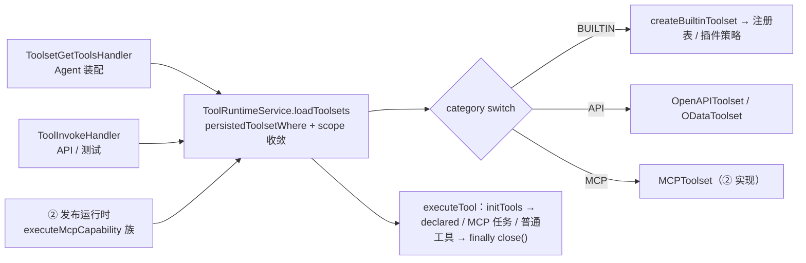

# 工具集与工具子专家 —— C1 能力契约

> 契约层 CR2 / CR5 / CR7。只写「对外可依赖的语义」：入口、参数行为、返回、异常与约束；路径均为仓库根相对 `file://` 引用。
> **资产基线**：`2026-10-16 · commit 80f5676fd`（批次 5 第 10 专家 · 子专家①），继承父域 [C1-能力契约.md](file://.module-experts/后端专题/工具与 MCP 专家/C1-能力契约.md)。**逐端点明细**（完整字段、分页、错误码全集）见父域 [implementation/05-接口.md](file://.module-experts/后端专题/工具与 MCP 专家/implementation/05-接口.md)，本文不复制。②③ 子域端点见 [子专家② C1](file://.module-experts/后端专题/工具与 MCP 专家/sub-experts/MCP协议与发布子专家/C1-能力契约.md) 与 [子专家③ C1](file://.module-experts/后端专题/工具与 MCP 专家/sub-experts/Agent插件子专家/C1-能力契约.md)。

**本文引用的文件**（相对仓库根，链接均为 `file://`）

- [packages/server-ai/src/xpert-toolset/xpert-toolset.controller.ts](file://packages/server-ai/src/xpert-toolset/xpert-toolset.controller.ts)
- [packages/server-ai/src/xpert-toolset/xpert-toolset.service.ts](file://packages/server-ai/src/xpert-toolset/xpert-toolset.service.ts)
- [packages/server-ai/src/xpert-toolset/xpert-toolset.module.ts](file://packages/server-ai/src/xpert-toolset/xpert-toolset.module.ts)
- [packages/server-ai/src/xpert-toolset/guards/toolset.guard.ts](file://packages/server-ai/src/xpert-toolset/guards/toolset.guard.ts)
- [packages/server-ai/src/xpert-toolset/mcp-apps.controller.ts](file://packages/server-ai/src/xpert-toolset/mcp-apps.controller.ts)
- [packages/server-ai/src/xpert-toolset/mcp-apps.service.ts](file://packages/server-ai/src/xpert-toolset/mcp-apps.service.ts)
- [packages/server-ai/src/xpert-toolset/mcp-runtime.controller.ts](file://packages/server-ai/src/xpert-toolset/mcp-runtime.controller.ts)
- [packages/server-ai/src/xpert-toolset/mcp-runtime-audit.service.ts](file://packages/server-ai/src/xpert-toolset/mcp-runtime-audit.service.ts)
- [packages/server-ai/src/xpert-toolset/provider/builtin/index.ts](file://packages/server-ai/src/xpert-toolset/provider/builtin/index.ts)
- [packages/server-ai/src/xpert-toolset/provider/openapi/openapi-toolset.ts](file://packages/server-ai/src/xpert-toolset/provider/openapi/openapi-toolset.ts)
- [packages/server-ai/src/xpert-toolset/provider/odata/odata-toolset.ts](file://packages/server-ai/src/xpert-toolset/provider/odata/odata-toolset.ts)
- [packages/server-ai/src/xpert-tool/xpert-tool.controller.ts](file://packages/server-ai/src/xpert-tool/xpert-tool.controller.ts)
- [packages/server-ai/src/xpert-tool/xpert-tool.service.ts](file://packages/server-ai/src/xpert-tool/xpert-tool.service.ts)
- [packages/server-ai/src/xpert-tool/commands/handlers/tool-invoke.handler.ts](file://packages/server-ai/src/xpert-tool/commands/handlers/tool-invoke.handler.ts)
- [packages/server-ai/src/tool-runtime/tool-runtime.service.ts](file://packages/server-ai/src/tool-runtime/tool-runtime.service.ts)
- [packages/server-ai/src/tool-runtime/toolset-scope.ts](file://packages/server-ai/src/tool-runtime/toolset-scope.ts)
- [packages/server-ai/src/tool-runtime/workspace-scope.ts](file://packages/server-ai/src/tool-runtime/workspace-scope.ts)
- [packages/server-ai/src/tool-runtime/capability-descriptor.ts](file://packages/server-ai/src/tool-runtime/capability-descriptor.ts)

## 目录

1. [§1 HTTP 入口索引](#§1-http-入口索引)
2. [§2 服务契约](#§2-服务契约)
3. [§3 tool-runtime 执行契约](#§3-tool-runtime-执行契约)
4. [§4 示例](#§4-示例)
5. [§5 契约来源](#§5-契约来源)

## §1 HTTP 入口索引

全局前缀 `api`；`XpertToolsetModule` 与 `XpertToolModule` 各带一段 `RouterModule.register`，控制器自身的路径段拼在其后（`XpertToolsetController` 与 `XpertToolController` 均为 `@Controller()` 空前缀）。

| 模块 · 控制器 | 方法 / 路径 | 鉴权 | 用途 |
|---|---|---|---|
| xpert-toolset | GET `/api/xpert-toolset`、`/tags`、`/providers`、`/provider/:name` | 登录态（`@ApiBearerAuth`） | 列表（`afterLoad` 回填后包 `ToolsetPublicDTO`）、内置 tag、provider 目录与单个 provider 元数据 |
| xpert-toolset | GET `/api/xpert-toolset/by-workspace/:workspaceId` | 登录态 + `WorkspaceAuthoringGuard` | 工作区分页；`workspaceId` 为空/`'null'`/`'undefined'` 时退化为「我的私有工具集」 |
| xpert-toolset | GET `/api/xpert-toolset/:toolsetId/tools`、`POST/PUT/PATCH/DELETE /api/xpert-toolset[/:id]` | 登录态（`CrudController` 继承） | 单工具集工具清单（`relations:['tools']` + `afterLoad`）与标准 CRUD |
| xpert-toolset | GET `/api/xpert-toolset/:id/credentials` | **`ToolsetGuard`**（5 分钟用户级缓存） | 唯一凭据出口；越权 403 `Access denied` |
| xpert-toolset | POST `/provider/openapi/remote`、`/provider/openapi/schema`、`/provider/openapi/test` | 登录态 | 远端 OpenAPI 拉取 / schema 解析 / 单条试跑 |
| xpert-toolset | POST `/provider/odata/remote`、`/provider/odata/schema` | 登录态 | OData `$metadata` 拉取与 schema 解析 |
| xpert-toolset | POST `/provider/mcp/tools` | 登录态；**`@Sse` 流式** | MCP 工具探测；失败走流内 error 事件，不做 4xx/5xx JSON |
| xpert-toolset | GET `/builtin-provider/:name/tools`、`/builtin-provider/:name/credentials-schema`、POST `/builtin-provider/:name/instance` | 登录态 | 候选工具、凭据表单、建实例（其余异常统一包成 500） |
| xpert-toolset | GET `/api/xpert-toolset/:id/avatar`、`GET /builtin-provider/:name/icon` | **`@Public()`** | 头像（`toolset:avatar:` 5 分钟缓存）与图标二进制 |
| xpert-toolset · McpApps | `GET /:appInstanceId/history`、`POST /:appInstanceId/resume`、`GET /:appInstanceId/resource`、`POST /:appInstanceId/rpc`、`POST /:appInstanceId/approvals/:approvalId/{approve,reject}`、`DELETE /:appInstanceId` | 登录态 | 挂在 `/api/xpert-toolset/mcp-apps`；实例历史 / 复活 / 资源 / RPC / 审批 / 拆除（7 条） |
| xpert-toolset · McpRuntime | GET `/operations/mcp-runtimes`、`POST /operations/mcp-runtimes/:runtimeId/stop`、`POST /operations/mcp-runtimes/kill` | 手写 `assertSuperAdmin()` → 403 | stdio 运行时审计列表（库内 + 活体合并）与停机阀（3 条） |
| xpert-toolset · 邻域注册 | `/api/xpert-toolset/mcp-consumer/oauth`、`/api/xpert-toolset/mcp-consumer` | 邻域守卫（`WorkspaceGuard`/`WorkspaceOwnerGuard`/`@Public` 混合） | `McpConsumerOAuthController`/`McpConsumerCapabilitiesController` 由本模块 `controllers` 注册，实现归 `mcp-consumer` 邻域 |
| xpert-tool | POST `/api/xpert-tool/test`、GET `/api/xpert-tool/:id`、GET `/api/xpert-tool/:id/faker` | 登录态（**无自定义守卫**） | 工具试跑 / 详情（内置回填） / 参数样例，另继承 `CrudController` 标准 CRUD |

**逐端点明细见父域 [implementation/05-接口.md](file://.module-experts/后端专题/工具与 MCP 专家/implementation/05-接口.md)**（含每条的权限点、主要错误与状态码）。

章节来源：[xpert-toolset.controller.ts](file://packages/server-ai/src/xpert-toolset/xpert-toolset.controller.ts)（关键符号：getAllByWorkspace / getAllToolProviders / getToolProvider / createBuiltinInstance / getMCPAvatar / getToolsetTools / getCredentials）、[xpert-tool.controller.ts](file://packages/server-ai/src/xpert-tool/xpert-tool.controller.ts)（关键符号：test / findById / paramsFaker）、[xpert-toolset.module.ts](file://packages/server-ai/src/xpert-toolset/xpert-toolset.module.ts)（关键符号：RouterModule.register routes / controllers 五项）

## §2 服务契约

| `类.方法(签名)` | 用途 | 参数行为语义 · 约束 |
|---|---|---|
| `XpertToolsetService.createBuiltinToolset(provider, entity)` | 建内置工具集实例（`POST builtin-provider/:name/instance`） | 先 `ListBuiltinToolProvidersQuery` 取 provider（缺失 `ToolProviderNotFoundError`）→ 组装 `env`/`modelRuntime` → `validateCredentials(entity.credentials)` → 强制 `category=BUILTIN`、`type=provider`，并按 provider 身份生成默认 `name`/`avatar`；带 `entity.id` 时退化为 `updateToolset` |
| `XpertToolsetService.create` / `save` / `updateToolset` / `getAllByWorkspace` / `afterLoad` / `findPublicAvatar` | 工具集读写与读模型回填 | `create`/`save` 前统一 `assertValidTagAssociations(..., TagCategoryEnum.TOOLSET)`；`updateToolset` 是 `findOne` + `assign` + `save` 的**浅更新**（无 PATCH 语义校验）；`getAllByWorkspace` 对空 workspaceId 用 `IsNull() + createdById`，`published=true` 追加 `publishAt IS NOT NULL`；`afterLoad` 只回填内置 provider 的 tag 与工具语义字段（`??=` 补空、`schema` 直接覆盖），**不改库** |
| `XpertToolService.testTool` / `getTool(id, options)` / `getParamsFaker(id)` | 工具试跑、详情与参数样例 | `testTool` 以 `{...toolDetail, ...omit(tool,'toolset'), toolset}` 派 `ToolInvokeCommand` ⇒ **入参可覆盖库内行**；`getTool` 强制并入 `relations:['toolset']`，内置工具用 `ListBuiltinToolsQuery` 回填；`faker` 内置走 zod→JSONSchemaFaker，非内置走 `ToolsetGetToolsCommand` 真实建连后 `finally close()` |
| `ToolInvokeHandler.execute(command: ToolInvokeCommand)` | HTTP 侧唯一执行调用方 | 强制 `{...command.tool, enabled:true}`；要求 `toolset`、`tenantId`、`workspaceId` 齐备，否则 400 `Tool invocation requires explicit tenant and workspace context.`；按 `schema.parameters` 分桶 `llm`/`form` 并 `convertPropertyValueType`；用 `Object.assign(new XpertToolset(), ...)` 造**脱库快照**并以 `source:'api'`、`executionId = requestId = randomUUID()` 调 `executeTool`；`error.name === 'ToolException'` → `ToolInvokeError` |
| `ToolRuntimeService.loadToolsets(request)` / `executeTool(request)` | 装配与执行唯一出口 | 空 `toolsetIds` 短路返回 `[]`；快照仅 `source='api'`；`persistedToolsetWhere` 强制 tenant 并按 workspace/organization 收敛；`executeTool` 取不到工具集抛 `ToolNotFoundError`；`finally` 无条件 `toolset.close()`；有 `executionId` 时经 `XpertAgentExecutionRecordUsageCommand` 记账 |
| `ToolRuntimeService.describeCapabilities` / `executeMcpCapability` / `executeMcpResource` / `executeMcpPrompt` / `completeMcpCapability` | 能力描述与 MCP 能力调用 | `describeCapabilities` 读 `McpCapabilityCatalog`（`enabled:true`）并把 `source.toolsetId` 覆写为权威值；其余四者走 `withCapabilityToolset`：`MCPToolset` 直连，其它 provider 经 `getMcpCapabilityDefinitions()` 声明，缺失即抛错；`app` 类型直接抛能力缺失 |
| `McpAppsService.reviveInstance` / `handleRpc` / `getResource` / `approve` / `reject` / `teardown` | MCP App 实例面（服务层承载生命周期与审批） | 每次 RPC 都重做 `assertAccessForInstance`/`assertTokenForInstance`/`assertReviveToken`/`assertInstanceUser` 等按实例鉴权；审批状态与 `rpcErrorCode` 回写；实体与存储来自 `mcp-app-runtime` 邻域 |
| `McpRuntimeAuditService.recordStarting/recordRunning/recordClosed/recordAppInstance` / `closeLostActiveRecords` / `list(query, liveSnapshots)` / `toRuntimeManagerFilter(query)` | 运行时生命周期审计与筛选翻译 | `recordStarting` 首插（`commandLabel`/`commandHash`/`policySnapshot`，并按 `findResourceInstallation` 回填 `resourceInstallationId`）；`recordAppInstance` 是条件 UPDATE（`appInstanceId IS NULL`）；`closeLostActiveRecords` 在 bootstrap 把遗留活跃行收敛为终态；`list` 合并库内历史与内存活体 |
| `ToolsetGuard.canActivate(context)` | 工具集级准入（仅 `/credentials`） | 读 `request.params.id` 与当前用户；`cacheKey = userToolset_${tenantId}_${user.id}_${toolsetId}` 命中直接放行；未命中判 `createdById === user.id` 或 `workspaceService.canAccess(workspaceId, user.id)`；**拒绝不写缓存**，允许缓存 5 分钟 |
| `createBuiltinToolset(provider, toolset, params)` / `BUILTIN_TOOLSET_REPOSITORY` | 内置 provider 静态注册表与实例工厂 | 静态命中即 `new providerTypeClass(toolset, params)`（Planning/Tavily/SearchAPI/Email/Bing/DingTalk/Slack/Discord/Serper）；**未命中回落 `CreateToolsetCommand`**（`ToolsetRegistry` 插件策略），仍未命中才抛 `ToolProviderNotFoundError` |
| `OpenAPIToolset` / `ODataToolset` 构造与 `getTool` / `getToolsSchema` | API 型 provider 实例化 | OpenAPI 按 `isEnableTool` 过滤并为每条工具生成 `static lc_name() => item.name` 的动态子类，`getTool` 未命中抛 `Error`；OData 按 `_.enabled` 过滤，按 entitySet 确定性生成 `Create_/Get_/Query_/Delete_` 四件，`mapODataTypeToOpenAPI` 未命中类型返回 `undefined` |

章节来源：[xpert-toolset.service.ts](file://packages/server-ai/src/xpert-toolset/xpert-toolset.service.ts)（关键符号：createBuiltinToolset / updateToolset / getAllByWorkspace / afterLoad）、[tool-invoke.handler.ts](file://packages/server-ai/src/xpert-tool/commands/handlers/tool-invoke.handler.ts)（关键符号：ToolInvokeHandler.execute / toolsetSnapshots / ToolException 判定）、[provider/odata/odata-toolset.ts](file://packages/server-ai/src/xpert-toolset/provider/odata/odata-toolset.ts)（关键符号：getToolsSchema / mapODataTypeToOpenAPI）

## §3 tool-runtime 执行契约

| 维度 | 契约（源码可查事实） |
|---|---|
| 调用方 | 三处共享入口：① 的 `ToolsetGetToolsHandler`（Agent 装配，长期持有实例）、① 的 `ToolInvokeHandler`（API/测试，逐次建连）、② 的发布运行时（`executeMcpCapability` 族） |
| 寻址 · 租户 | `persistedToolsetWhere(request, workspaceId, ids)` 强制 `tenantId`；按 `workspaceId` 收敛，`source==='mcp'` 时允许 `workspaceId: IsNull()` |
| 寻址 · 组织 | `organizationId === undefined` 不加组织条件；`null` 加 `IsNull()`；`source==='mcp'` 退化为「本组织 **或** 租户共享（`IsNull`）」二选一 |
| 寻址 · 越界即拒 | `toolsetWorkspaceId` 与请求 workspace 不一致 → `ToolProviderNotFoundError`；`source==='mcp'` 缺 workspace 时拒绝执行 workspace-scoped 工具集；`toolsetSnapshots` 仅 `source==='api'`（否则 `McpToolsetSnapshotApiOnly`），且逐个校验 id 归属与 tenant/workspace/organization 一致 |
| 装配 | 逐工具集执行 `resolveToolRuntimeScope`（`files`→`users`、`projectId`→`projects`、`workspaceDataScope==='user'`→`user-xperts`、否则 `xperts`）→ `createScopedApi` 生成模型能力 → 按 `category` 建 runtime（`BUILTIN`/`API`(`openapi`|`odata`)/`MCP`，其余抛错）→ `WeakMap` 记住实例与 host；`attachDeclaredToolAdapters` 追加声明式工具（重名抛错） |
| 超时 | **本层不提供超时**：由宿主注入 `request.signal`（`AbortSignal`）与 provider/工具集自身策略承担；MCP stdio 的 `startupTimeoutMs` 属 ② 的运行时策略 |
| 执行分支 | `initTools()` → 命中 declared tool 则 `inputSchema.parseAsync` + `definition.execute`（有 `outputSchema` 与 `structuredContent` 时再 parse）→ `MCPToolset && serverName && remoteName` 时按 `remoteTaskMode` 走 `callMcpTaskTool` 或 `callMcpTool` → 否则 `toolset.getTool(name)` 后 `tool.invoke(arguments, { configurable: { toolExecutionContext, tool_call_id: requestId } })` |
| 错误语义 | 工具集不在请求范围 → `ToolNotFoundError('Toolset … was not found in the requested workspace')`；工具不在工具集内 → `ToolNotFoundError`；provider/类别未知 → `ToolProviderNotFoundError`（含 i18n key）；`toolsetSnapshots` 非法通道 → `McpToolsetSnapshotApiOnly`；参数非对象 → `MCP tool arguments must be an object.` |
| 结果归一 | `normalizeToolResult`：字符串 → `{content:[{type:'text'}]}`；tool-result-like → `content`（text/image/audio/resource_link，未知项丢弃）+ `structuredContent` + `_meta`→`meta` + `isError`；其它对象 → `{structuredContent}` |
| 用量记账 | 仅当 `executionId` 存在时注入 `createExecutionModelUsageRecorder` → `XpertAgentExecutionRecordUsageCommand`（工具侧模型调用才计费）；执行行状态机归 Agent 执行链专家 |
| 生命周期 | 装配路径由调用方持有并在最后统一 `close()`；`executeTool` 在 `finally` 无条件 `toolset.close()`（关闭异常只 `logger.debug`） |



图表来源：[tool-runtime.service.ts](file://packages/server-ai/src/tool-runtime/tool-runtime.service.ts)（关键符号：loadToolsets / executeTool / normalizeToolResult / withCapabilityToolset）、[toolset-scope.ts](file://packages/server-ai/src/tool-runtime/toolset-scope.ts)（关键符号：persistedToolsetWhere）、[workspace-scope.ts](file://packages/server-ai/src/tool-runtime/workspace-scope.ts)（关键符号：resolveToolRuntimeScope）

章节来源：[tool-runtime.service.ts](file://packages/server-ai/src/tool-runtime/tool-runtime.service.ts)（关键符号：toolsetWorkspaceId / resolveToolsets 的 snapshot 校验 / createExecutionRuntimeCapabilities）、[capability-descriptor.ts](file://packages/server-ai/src/tool-runtime/capability-descriptor.ts)（关键符号：assertValidMcpCapabilityDescriptor / hashMcpCapabilityDescriptor / compareMcpCapabilityDescriptors）

## §4 示例

### ① 建一个工具集并发现工具（内置实例 + MCP 流式探测）

```ts
// 真实调用方：packages/server-ai/src/xpert-toolset/xpert-toolset.controller.ts
@Post('builtin-provider/:name/instance')
async createBuiltinInstance(@Param('name') provider: string, @Body() body: Partial<IXpertToolset>) {
    try {
        return await this.service.createBuiltinToolset(provider, body)   // 强制 category=BUILTIN / type=provider
    } catch (err) {
        throw new InternalServerErrorException(err.message)             // 注意：其余异常统一 500
    }
}

/** @Post @Sse There is a priority order. */
@Post('provider/mcp/tools')
@Sse()
getMCPTools(@Res() res: Response, @Body() toolset: Partial<IXpertToolset>) {
    return new Observable<MessageEvent>((subscriber) => {
        RunnableLambda.from(async (toolset) => {
            const result = await this.commandBus.execute(new MCPToolsBySchemaCommand(toolset))
            subscriber.next({ data: { type: ChatMessageTypeEnum.MESSAGE, data: result } } as MessageEvent)
            subscriber.complete()
        }).invoke(toolset, { callbacks: [{ handleCustomEvent(eventName, data) { /* → type: EVENT */ } }] })
    }).pipe(keepAlive(30000), takeUntilClose(res))
}
```

要点：内置实例的默认 `name`/`avatar` 由 provider 身份生成（图标 URL 指向 `builtin-provider/:name/icon`）；工具本身的清单由 `xpert_tool` 行决定，读路径再经 `afterLoad` 把 `schema`/`label`/`description` 拉齐到 provider 最新定义。

### ② 执行一次工具（统一执行面 + 错误归一）

```ts
// 真实调用方：packages/server-ai/src/xpert-tool/commands/handlers/tool-invoke.handler.ts
const snapshot = Object.assign(new XpertToolset(), toolset, {
    id: toolset.id ?? randomUUID(), tenantId, organizationId: organizationId ?? null, workspaceId, tools: [tool]
})
try {
    const result = await this.toolRuntime.executeTool({
        source: 'api',                                   // 唯一允许 toolsetSnapshots 的通道
        principal: userId ? { type: 'user', id: userId, userId } : { type: 'service_account', id: 'api-tool-invoke' },
        tenantId, organizationId, workspaceId,
        toolsetId: toolset.id ?? randomUUID(), toolName: tool.name,
        arguments: parameters.llm ?? {},
        executionId: originId, requestId: originId,
        env: envState,
        configurable: { user: RequestContext.currentUser(), subscriber },
        toolsetSnapshots: [snapshot]
    })
    return events.length ? { events, result } : result
} catch (error) {
    // The MCP adapter identifies tool failures by name but does not export its error class.
    if (error instanceof Error && error.name === 'ToolException') {
        throw new ToolInvokeError(error.message, { cause: error, description: 'Bad Request' })
    }
    throw error
}
```

要点：`tenantId` 与 `toolset.workspaceId` 必须齐备，否则 400；`ToolRuntimeService` 在 `finally` 里 `close()` 工具集，因此**同一 HTTP 请求内不复用连接**；工具失败按错误名识别，上游改类名即静默降级。

### ③ 停止一个 MCP stdio 运行时（审计 + 停机阀）

```ts
// 真实调用方：packages/server-ai/src/xpert-toolset/mcp-runtime.controller.ts
@Get()                                    // → GET /api/xpert-toolset/operations/mcp-runtimes
async list(@Query() query: McpRuntimeAuditListQuery) {
    this.assertSuperAdmin()
    return this.runtimeAuditService.list(query, mcpStdioRuntimeManager.list(this.runtimeAuditService.toRuntimeManagerFilter(query)))
}

@Post(':runtimeId/stop')
async stop(@Param('runtimeId') runtimeId: string) {
    this.assertSuperAdmin()
    return { stopped: await mcpStdioRuntimeManager.closeRuntime(runtimeId, 'admin-stop') }
}

private assertSuperAdmin() {
    if (!RequestContext.hasRole(RolesEnum.SUPER_ADMIN)) {
        throw new ForbiddenException('Only SUPER_ADMIN users can manage MCP stdio runtimes')
    }
}
```

要点：列表把「库内历史行 + 内存活体快照」按 id 合并（活体优先），因此重启后仍能看到上一进程被收敛为 `closeReason='host-restart-or-lost'` 的记录；`stop`/`kill` 直接作用于 ② 的单例运行时管理器，进程本体与 `runnerPid`/`childPid` 的产生在 `mcp-stdio-runner.js`；越权文案是固定字符串而非 `@Roles` 元数据。

章节来源：[xpert-toolset.controller.ts](file://packages/server-ai/src/xpert-toolset/xpert-toolset.controller.ts)（关键符号：createBuiltinInstance / getMCPTools）、[tool-invoke.handler.ts](file://packages/server-ai/src/xpert-tool/commands/handlers/tool-invoke.handler.ts)（关键符号：ToolInvokeHandler.execute）、[mcp-runtime.controller.ts](file://packages/server-ai/src/xpert-toolset/mcp-runtime.controller.ts)（关键符号：list / stop / kill / assertSuperAdmin）、[mcp-runtime-audit.service.ts](file://packages/server-ai/src/xpert-toolset/mcp-runtime-audit.service.ts)（关键符号：list / toRuntimeManagerFilter）

## §5 契约来源

| 契约条目 | 来源 |
|---|---|
| 工具集 CRUD、provider 元数据与图标、OpenAPI/OData 解析与试跑、MCP 探测、凭据出口、头像 | `packages/server-ai/src/xpert-toolset/xpert-toolset.controller.ts`、`xpert-toolset.service.ts` |
| 工具集准入（5 分钟允许缓存）与工作区 authoring | `packages/server-ai/src/xpert-toolset/guards/toolset.guard.ts`；`WorkspaceAuthoringGuard`（`packages/server-ai/src/xpert-workspace/**`，邻域） |
| provider 家族（builtin/openapi/odata）与工具发现 | `packages/server-ai/src/xpert-toolset/provider/{index.ts,builtin/**,openapi/**,odata/**}`、`shared/tools/toolset.ts`（`_BaseToolset`） |
| 工具详情 / 试跑 / 参数样例与 HTTP 侧执行入口 | `packages/server-ai/src/xpert-tool/{xpert-tool.controller.ts,xpert-tool.service.ts}`、`commands/handlers/tool-invoke.handler.ts` |
| 统一执行面、能力面与四次越界拒绝 | `packages/server-ai/src/tool-runtime/{tool-runtime.service.ts,toolset-scope.ts,workspace-scope.ts,capability-descriptor.ts}` |
| MCP App HTTP 面与按实例鉴权/审批 | `packages/server-ai/src/xpert-toolset/{mcp-apps.controller.ts,mcp-apps.service.ts}`；实体与存储来自 `packages/server-ai/src/mcp-app-runtime/**`（邻域） |
| stdio 运行时审计、启动期收敛与停机阀 | `packages/server-ai/src/xpert-toolset/{mcp-runtime-audit.service.ts,mcp-runtime-instance.entity.ts,mcp-runtime.controller.ts}` |
| 模块装配（RouterModule 路由、5 个控制器、forFeature 9 项） | `packages/server-ai/src/xpert-toolset/xpert-toolset.module.ts` |
| 跨域安装器写工具集/工具的接口面 | `packages/server-ai/src/plugin-resource/plugin-resource-installer.service.ts`（归属见 [子专家③ C1](file://.module-experts/后端专题/工具与 MCP 专家/sub-experts/Agent插件子专家/C1-能力契约.md)） |
| 逐端点明细与错误语义全集 | 父域 [implementation/05-接口.md](file://.module-experts/后端专题/工具与 MCP 专家/implementation/05-接口.md)（本文不复制） |

章节来源：[xpert-toolset.module.ts](file://packages/server-ai/src/xpert-toolset/xpert-toolset.module.ts)（关键符号：XpertToolsetModule）、[tool-runtime.service.ts](file://packages/server-ai/src/tool-runtime/tool-runtime.service.ts)（关键符号：ToolRuntimeService）、[xpert-toolset.service.ts](file://packages/server-ai/src/xpert-toolset/xpert-toolset.service.ts)（关键符号：XpertToolsetService）
