# 工具集与工具子专家 ① · 架构

> 只读梳理（commit `80f5676fd`）。范围：`packages/server-ai/src/xpert-toolset/**` 的**工具集主体**（模块 / 实体 / 服务 / 控制器 / 订阅者、`mcp-apps.*`、`mcp-runtime.*`、`guards/`、`dto/`、`errors.ts`、`types.ts`、`toolset.ts`、`utils/`、`commands/`、`queries/`、`provider/{builtin,openapi,odata}`）+ `packages/server-ai/src/xpert-tool/**` + `packages/server-ai/src/tool-runtime/**`（执行面）。**不含** `provider/mcp/**`、`mcp/**`、`mcp-publication/**`（归 ② 子专家）、`agent-plugin/**`（归 ③ 子专家）。引用为仓库根相对路径；未证实处标 `[推测]`。

**本文引用的文件**

- [xpert-toolset/xpert-toolset.module.ts](file://packages/server-ai/src/xpert-toolset/xpert-toolset.module.ts)
- [xpert-toolset/xpert-toolset.entity.ts](file://packages/server-ai/src/xpert-toolset/xpert-toolset.entity.ts)
- [xpert-toolset/xpert-toolset.service.ts](file://packages/server-ai/src/xpert-toolset/xpert-toolset.service.ts)
- [xpert-toolset/xpert-toolset.controller.ts](file://packages/server-ai/src/xpert-toolset/xpert-toolset.controller.ts)
- [xpert-toolset/xpert-toolset.subscriber.ts](file://packages/server-ai/src/xpert-toolset/xpert-toolset.subscriber.ts)
- [xpert-toolset/guards/toolset.guard.ts](file://packages/server-ai/src/xpert-toolset/guards/toolset.guard.ts)
- [xpert-toolset/mcp-apps.controller.ts](file://packages/server-ai/src/xpert-toolset/mcp-apps.controller.ts)
- [xpert-toolset/mcp-apps.service.ts](file://packages/server-ai/src/xpert-toolset/mcp-apps.service.ts)
- [xpert-toolset/mcp-runtime.controller.ts](file://packages/server-ai/src/xpert-toolset/mcp-runtime.controller.ts)
- [xpert-toolset/mcp-runtime-audit.service.ts](file://packages/server-ai/src/xpert-toolset/mcp-runtime-audit.service.ts)
- [xpert-toolset/mcp-runtime-instance.entity.ts](file://packages/server-ai/src/xpert-toolset/mcp-runtime-instance.entity.ts)
- [xpert-toolset/provider/index.ts](file://packages/server-ai/src/xpert-toolset/provider/index.ts)
- [xpert-toolset/provider/builtin/index.ts](file://packages/server-ai/src/xpert-toolset/provider/builtin/index.ts)
- [xpert-toolset/provider/builtin/planning/planning.ts](file://packages/server-ai/src/xpert-toolset/provider/builtin/planning/planning.ts)
- [xpert-toolset/provider/openapi/openapi-toolset.ts](file://packages/server-ai/src/xpert-toolset/provider/openapi/openapi-toolset.ts)
- [xpert-toolset/provider/odata/odata-toolset.ts](file://packages/server-ai/src/xpert-toolset/provider/odata/odata-toolset.ts)
- [xpert-toolset/toolset.ts](file://packages/server-ai/src/xpert-toolset/toolset.ts)
- [xpert-toolset/errors.ts](file://packages/server-ai/src/xpert-toolset/errors.ts)
- [xpert-toolset/types.ts](file://packages/server-ai/src/xpert-toolset/types.ts)
- [xpert-toolset/utils/parser.ts](file://packages/server-ai/src/xpert-toolset/utils/parser.ts)
- [xpert-toolset/dto/toolset-public.dto.ts](file://packages/server-ai/src/xpert-toolset/dto/toolset-public.dto.ts)
- [xpert-toolset/commands/handlers/get-tools.handler.ts](file://packages/server-ai/src/xpert-toolset/commands/handlers/get-tools.handler.ts)
- [xpert-toolset/queries/handlers/list-builtin-tools.handler.ts](file://packages/server-ai/src/xpert-toolset/queries/handlers/list-builtin-tools.handler.ts)
- [xpert-tool/xpert-tool.entity.ts](file://packages/server-ai/src/xpert-tool/xpert-tool.entity.ts)
- [xpert-tool/xpert-tool.service.ts](file://packages/server-ai/src/xpert-tool/xpert-tool.service.ts)
- [xpert-tool/xpert-tool.controller.ts](file://packages/server-ai/src/xpert-tool/xpert-tool.controller.ts)
- [xpert-tool/xpert-tool.subscriber.ts](file://packages/server-ai/src/xpert-tool/xpert-tool.subscriber.ts)
- [xpert-tool/commands/handlers/tool-invoke.handler.ts](file://packages/server-ai/src/xpert-tool/commands/handlers/tool-invoke.handler.ts)
- [tool-runtime/tool-runtime.service.ts](file://packages/server-ai/src/tool-runtime/tool-runtime.service.ts)
- [tool-runtime/toolset-scope.ts](file://packages/server-ai/src/tool-runtime/toolset-scope.ts)
- [tool-runtime/workspace-scope.ts](file://packages/server-ai/src/tool-runtime/workspace-scope.ts)
- [tool-runtime/capability-descriptor.ts](file://packages/server-ai/src/tool-runtime/capability-descriptor.ts)
- [shared/tools/toolset.ts](file://packages/server-ai/src/shared/tools/toolset.ts)
- [plugin-resource/plugin-resource-installer.service.ts](file://packages/server-ai/src/plugin-resource/plugin-resource-installer.service.ts)
- [xpert-agent/commands/handlers/subgraph.handler.ts](file://packages/server-ai/src/xpert-agent/commands/handlers/subgraph.handler.ts)

## 目录

- [1. 子域职责与边界](#1-子域职责与边界)
- [2. 与 ②③ 的分工](#2-与--的分工)
- [3. 跨子域共享文件清单](#3-跨子域共享文件清单)
- [4. 目录结构与分层](#4-目录结构与分层)
- [5. 依赖关系](#5-依赖关系)
- [6. 关键不变量](#6-关键不变量)
- [7. 架构总览](#7-架构总览)
- [8. 结论](#8-结论)

## 1. 子域职责与边界

**做什么**：① 工具集实例的全生命周期——`XpertToolsetService.create`/`save`/`updateToolset`/`getAllByWorkspace`/`createBuiltinToolset`/`afterLoad`/`hydrateBuiltinToolSchemas`/`findPublicAvatar`；② 工具实例面——`XpertToolService.getTool`/`testTool`/`getParamsFaker` 与 `XpertToolSubscriber` 的名称强制；③ **非 MCP 的工具集 provider**——`BUILTIN_TOOLSET_REPOSITORY` 静态注册表 + `createBuiltinToolset`、`OpenAPIToolset`、`ODataToolset` 及 schema 解析（`ApiBasedToolSchemaParser`）；④ **统一工具执行面** `ToolRuntimeService`（`loadToolsets`/`executeTool`/`describeCapabilities`/`executeMcpResource`/`executeMcpPrompt`/`completeMcpCapability`）；⑤ MCP App 的 HTTP 面（`McpAppsController` + `McpAppsService`）；⑥ MCP stdio 运行时实例的**审计与停机阀**（`McpRuntimeAuditService`、`McpRuntimeInstanceEntity`、`McpRuntimeController`）；⑦ 读路径准入与脱敏（`ToolsetGuard`、`WorkspaceAuthoringGuard`、`ToolsetPublicDTO`）。

**不做什么**：不做模型推理与 Agent 图编排（`xpert-agent`）；不拥有平台插件 bundle 加载（`LOADED_PLUGINS`）与 `plugin_resource_installation` 台账（平台插件域）；不拥有 MCP 客户端实现（`provider/mcp/**`，含 `MCPToolset`/`mcpStdioRuntimeManager`，归 ②）；不拥有 MCP 发布域八表与 `/api/mcp/p/:slug` 运行时（归 ②）；不拥有 Agent 便携插件解析与装配（`agent-plugin/**`，归 ③）；不拥有 `XpertToolset`↔助手关系（M2M 表 `xpert_to_toolset` 由助手域维护，本子域只提供 `ToolsetCatalogItem` 读模型）。

**两类「工具集消费者」要分清**：**Agent 运行时**（`subgraph.handler` 派 `ToolsetGetToolsCommand`，拿到 `_BaseToolset[]` 后交给 LangChain 直接调工具，**不经** `executeTool`）与 **API/测试链路**（`ToolInvokeHandler` → `ToolRuntimeService.executeTool`，逐次建连并 `close()`）。两条路的寻址与 scope 校验共用 `loadToolsets`，但生命周期完全不同。

章节来源：[xpert-toolset.service.ts](file://packages/server-ai/src/xpert-toolset/xpert-toolset.service.ts)（关键符号：XpertToolsetService.createBuiltinToolset / afterLoad）、[tool-runtime.service.ts](file://packages/server-ai/src/tool-runtime/tool-runtime.service.ts)（关键符号：ToolRuntimeService.loadToolsets / executeTool）、[xpert-tool.service.ts](file://packages/server-ai/src/xpert-tool/xpert-tool.service.ts)（关键符号：XpertToolService.getParamsFaker）

## 2. 与 ②③ 的分工

| 面 | 归属 | 判据（源码事实） |
|---|---|---|
| `provider/{builtin,openapi,odata}` + `provider/index.ts` 的导出聚合 | **①** | `provider/index.ts` 同时导出 `mcp/mcp-toolset`，本子域只读其中三件 |
| `provider/mcp/**`（`MCPToolset`、`createMCPClient`、`mcpStdioRuntimeManager`、`app-support`、`meta-artifact-bridge`） | **②** | ① 的 `ToolRuntimeService` 以 `instanceof MCPToolset` 做**只读分支**，不持有实现 |
| `McpAppsController` / `McpAppsService` | **①**（HTTP + 编排） | 实体与存储（`McpAppAudit`/`McpAppHistory`/`McpAppInstanceStoreService`/`McpAppToolApprovalService`）来自 `../mcp-app-runtime`（②侧邻域，交叉引用） |
| `McpRuntimeAuditService` / `McpRuntimeInstanceEntity` / `McpRuntimeController` | **①** | 审计 sink 由 `mcpStdioRuntimeManager.setAuditSink` 驱动，运行时本体在 ② |
| `tool-runtime/**` | **①②③ 共用** | ② 的发布运行时经 `executeMcpCapability` 族执行远端能力；③ 的动态资源最终也落到 `loadToolsets` |
| `agent-plugin/**`、`plugin-resource/**` | **③** | ③ 的安装器 `PluginResourceInstallerService` **写** `XpertToolset`/`XpertTool`，故与 ① 交叉 |
| `mcp-publication/**` 的 `McpCapabilityCatalog` 写入 | **②** | ① 只**读** catalog（`describeCapabilities`），不写 |

**三条硬边界**：① 不 import `mcp-publication` 的服务，只注入 `Repository<McpCapabilityCatalog>` 与 `McpSubscriptionService`（后者用于工具事件总线）；① 不实现 MCP 传输，只用 ② 的 `mcpStdioRuntimeManager` 单例做停止与列表；① 不写 `mcp_publication_capability` 的 `descriptorSnapshot`。

**归属易混的实体**：`XpertToolsetModule.forFeature` 里的 9 项中只有 `XpertToolset` 与 `McpRuntimeInstanceEntity` 属 ①，其余（`PluginResourceInstallation`、`McpCapabilityCatalog`、`McpPublicationCapability`、`McpAppAudit`、`McpAppHistory`、`McpConsumerOAuth*`）是「谁提供 repository」的集中装配点，不改变归属。

章节来源：[xpert-toolset.module.ts](file://packages/server-ai/src/xpert-toolset/xpert-toolset.module.ts)（关键符号：XpertToolsetModule.forFeature / providers）、[tool-runtime.service.ts](file://packages/server-ai/src/tool-runtime/tool-runtime.service.ts)（关键符号：ToolRuntimeService.withCapabilityToolset）、[mcp-runtime.controller.ts](file://packages/server-ai/src/xpert-toolset/mcp-runtime.controller.ts)（关键符号：McpRuntimeController.list / stop / kill）

## 3. 跨子域共享文件清单

以下 7 处被两个以上子域读写，任一侧改动必须双边复核：

1. **`tool-runtime/**`（三子共用）**：① 的 `ToolsetGetToolsHandler` 与 `ToolInvokeHandler` 是主调方；② 的发布运行时经 `executeMcpCapability`/`executeMcpResource`/`executeMcpPrompt`/`completeMcpCapability` 执行；③ 的动态资源（`dynamicResources.toolsetIds`）最终也汇入 `loadToolsets`。文件仅有 `tool-runtime.service.ts`、`capability-descriptor.ts`、`toolset-scope.ts`、`workspace-scope.ts` 与 `index.ts`（导出前两者）。
2. **`xpert-toolset/xpert-toolset.entity.ts`**：① 的唯一业务写落点；② 的 `McpPublicationModule.forFeature([...MCP_PUBLICATION_ENTITIES, XpertToolset, User])` 反向注册它（发布域只读工具集与凭据）；③ 的安装器直接 `toolsetRepo.save/create`。
3. **`xpert-tool/xpert-tool.entity.ts`**：① 的 `@OneToMany` 子实体（级联边界）；③ 的 `ensureMcpToolset` 更新时先 `toolRepo.delete({ toolsetId })` 再按策略重建 `XpertTool[]`。
4. **`xpert-toolset/xpert-toolset.module.ts`**：② 的实体（`McpCapabilityCatalog`/`McpPublicationCapability`）与 `McpSubscriptionService`、② 侧的两个 consumer 控制器（`McpConsumerOAuthController`/`McpConsumerCapabilitiesController`）被 ① 模块**直接注册**；③ 的 `PluginResourceInstallation` 亦在此 forFeature。
5. **`plugin-resource/plugin-resource-installer.service.ts`**：①③ 共用落库器。`ensureRuntime` 按组件类型分流：native → `ensureNativeToolset`（可回落 `createBuiltinToolset`）、MCP → `ensureMcpToolset`（写 `XpertToolset` + `XpertTool`，再 `capabilityCatalog.replaceToolsetCapabilities`）、skill → `skillPackageService.syncPluginSkillBundle`。
6. **`xpert-agent` 的 tool-call handler**：`commands/handlers/subgraph.handler.ts` 先按 `agent.toolsetIds` 派 `ToolsetGetToolsCommand`，再用 `dynamicResources?.toolsetIds` 逐个追加（失败仅告警），最后 `initTools()` + `getVariables()`；`queries/handlers/{get-variables,complete-tool-calls}.handler.ts` 同构。
7. **`shared/tools/toolset.ts`**：`_BaseToolset` 是三子域工具集实现的共同基类（`initTools`/`getTool`/`getVariables`/`close`/`getName` 契约），`toolset.ts` 的 `BaseToolset` 只是它的 `@deprecated` 适配层。

章节来源：[plugin-resource-installer.service.ts](file://packages/server-ai/src/plugin-resource/plugin-resource-installer.service.ts)（关键符号：PluginResourceInstallerService.ensureRuntime / ensureMcpToolset / ensureNativeToolset）、[subgraph.handler.ts](file://packages/server-ai/src/xpert-agent/commands/handlers/subgraph.handler.ts)（关键符号：ToolsetGetToolsCommand / dynamicResources.toolsetIds）、[toolset.ts](file://packages/server-ai/src/shared/tools/toolset.ts)（关键符号：_BaseToolset.initTools / close）

## 4. 目录结构与分层

- **控制器层**：`XpertToolsetController extends CrudController<XpertToolset>`（`@Controller()` 空前缀 + `@ApiBearerAuth` + `TransformInterceptor`，18 条端点；`@Public()` 只用于 `:id/avatar` 与 `builtin-provider/:name/icon`；`WorkspaceAuthoringGuard` 守 `by-workspace/:workspaceId`；`ToolsetGuard` 守 `:id/credentials`）；`McpAppsController('mcp-apps')` 7 条；`McpRuntimeController('operations/mcp-runtimes')` 3 条；`XpertToolController extends CrudController<XpertTool>`（3 条自声明 + 继承 CRUD，无自定义守卫）。
- **服务层**：`XpertToolsetService extends XpertWorkspaceBaseService<XpertToolset>`、`McpAppsService`、`McpRuntimeAuditService`（`OnApplicationBootstrap`）、`XpertToolService extends TenantOrganizationAwareCrudService<XpertTool>`、`ToolRuntimeService`（由本模块 provide 与 export）。
- **provider 体系（`provider/`）**：`index.ts` 导出 `OpenAPIToolset`（`providerType = API`）、`createBuiltinToolset` + `BUILTIN_TOOLSET_REPOSITORY`、`ODataToolset`（`providerType = API`）、`MCPToolset`（②）。`toolset.ts` 的 `BaseToolset` 标 `@deprecated use _BaseToolset`，仅保留 `getCredentialsSchema`/`getToolset`/`getName`；`types.ts` 定义 `ToolProviderIdentity`/`TToolsetProviderSchema`/`ToolsetFolderPath` 与 `InvokeFrom`/`ToolInvokeFrom` 枚举。
- **执行面（`tool-runtime/`）**：`ToolRuntimeService`（装配与执行）、`capability-descriptor.ts`（`assertValidMcpCapabilityDescriptor`/`hashMcpCapabilityDescriptor`/`compareMcpCapabilityDescriptors`/`McpCapabilityCompatibility`）、`toolset-scope.ts`（`persistedToolsetWhere`）、`workspace-scope.ts`（`resolveToolRuntimeScope`）。
- **CQRS 层**：`commands/{5}`（`ToolsetGetTools`/`ParserOpenAPISchema`/`ParserODataSchema`/`MCPToolsBySchema`/`CreateToolset`）+ `queries/{7}`（`FindXpertToolsets`/`ListBuiltinToolProviders`/`ToolProviderIcon`/`ListBuiltinTools`/`ListBuiltinCredentialsSchema`/`GetODataRemoteMetadata`/`GetOpenAPIRemoteSchema`），handler 在 `*/handlers/index.ts` 里以 `CommandHandlers`/`QueryHandlers` 常量一次性注入模块。
- **准入与 DTO 层**：`guards/toolset.guard.ts`（唯一守卫文件）；`dto/tool-provider.dto.ts`（拼内联头像 URL）、`dto/toolset-public.dto.ts`（`@Exclude` options/credentials，`createdBy`/`updatedBy` 转 `UserPublicDTO`）。
- **工具解析层（`utils/`）**：`utils/parser.ts`（`ApiBasedToolSchemaParser`，含 `autoParseToToolBundle`、`convertPropertyValueType`）、`utils/tool-parameter-converter.ts`、`utils/tags.ts`（`DEFAULT_TOOL_TAG_MAP`/`defaultToolTags`）。
- **实体与订阅者**：`xpert-toolset.entity.ts`、`mcp-runtime-instance.entity.ts`、`xpert-toolset.subscriber.ts`（空壳，`afterLoad` 逻辑已注释并迁到 `XpertToolsetService.afterLoad`）；工具侧 `xpert-tool.subscriber.ts` 为**实做**。

章节来源：[xpert-toolset.controller.ts](file://packages/server-ai/src/xpert-toolset/xpert-toolset.controller.ts)（关键符号：XpertToolsetController.getAllByWorkspace / getCredentials / getToolsetTools）、[xpert-toolset.subscriber.ts](file://packages/server-ai/src/xpert-toolset/xpert-toolset.subscriber.ts)（关键符号：XpertToolsetSubscriber.listenTo）、[toolset.ts](file://packages/server-ai/src/xpert-toolset/toolset.ts)（关键符号：BaseToolset / ToolProviderIdentity）、[commands/handlers/index.ts](file://packages/server-ai/src/xpert-toolset/commands/handlers/index.ts)（关键符号：CommandHandlers）

## 5. 依赖关系

**出向（① → 外部）**：`@xpert-ai/server-core`（`RequestContext`、`CrudController`、`TenantOrganizationAwareCrudService`、`PaginationParams`/`ParseJsonPipe`/`UUIDValidationPipe`/`TransformInterceptor`、`Public`、`TenantModule`/`RedisModule`/`CACHE_MANAGER`、`UserPublicDTO`、`loadYamlFile`）；`@xpert-ai/plugin-sdk`（`ToolsetRegistry`、`XpertToolProviderCoordinator`、`ManagedQueueService`、`McpCapabilityRuntimeProvider`、`ToolHostApi`/`ToolPrincipal`/`ToolExecutionContext`/`ToolCredentialsApi`、`BuiltinToolset`/`TBuiltinToolsetParams`）；`@xpert-ai/contracts`（`XpertToolsetCategoryEnum`、`IXpertToolset`/`IXpertTool`、`isEnableTool`、`RolesEnum`、`ApiToolBundle`）；`@langchain/core`（`DynamicStructuredTool`、`RunnableLambda`）与 `json-schema-faker`。

**跨域出向**：`xpert-workspace`（`XpertWorkspaceBaseService`、`XpertWorkspaceAccessService`、`WorkspaceAuthoringGuard`、`XpertWorkspaceService.canAccess`）；`xpert-agent-execution`（`XpertAgentExecutionRecordUsageCommand`、`createExecutionModelUsageRecorder`）；`shared/agent/middleware-runtime`（`AgentMiddlewareRuntimeService.createScopedApi` 产出 `modelRuntime` 与 `runtimeCapabilities`）；`environment`（`EnvStateQuery`）；`shared`（`_BaseToolset`、`ToolSchemaParser`、`assertValidTagAssociations`）；`plugin-resource`；`chat-message`（`FORWARD_REF? → ChatMessageModule`）；`copilot`/`xpert-agent`（均 `forwardRef`，避免重装配环）。

**入向（外部 → ①）**：`app.module.ts` 注册 `XpertToolModule` 与 `XpertToolsetModule`；`chat.module.ts`/`ai.module.ts`/`xpert.module.ts` 引入 `XpertToolsetModule`；`xpert-tool.module.ts` 引入 `XpertToolsetModule`；`plugin-resource.module.ts` 以 `forwardRef` 引入；`xpert-agent/**` 三处 handler 派 `ToolsetGetToolsCommand`；`xpert/middlewares/xpert-authoring.service.ts` 注入 `XpertToolsetService` 生成 `ToolsetCatalogItem`。

章节来源：[xpert-toolset.module.ts](file://packages/server-ai/src/xpert-toolset/xpert-toolset.module.ts)（关键符号：XpertToolsetModule.imports / exports）、[tool-runtime.service.ts](file://packages/server-ai/src/tool-runtime/tool-runtime.service.ts)（关键符号：ToolRuntimeService 构造函数注入 / createExecutionRuntimeCapabilities）、[xpert-tool.module.ts](file://packages/server-ai/src/xpert-tool/xpert-tool.module.ts)（关键符号：XpertToolModule.imports）

## 6. 关键不变量

1. **`ToolsetGuard` 的用户级 5 分钟缓存只缓存允许**：`cacheKey = userToolset_${tenantId}_${user.id}_${toolsetId}`，命中即 `return fromCache`；未命中才 `toolset.createdById === user.id` 或 `workspaceService.canAccess(toolset.workspaceId, user.id)`，拒绝时**直接抛 `ForbiddenException`（不写缓存）**，允许后才 `cacheManager.set(..., 5 * 60 * 1000)`。全仓**未找到任何主动清除该键的调用点** ⇒ 撤权窗口最长 5 分钟。
2. **`credentials` 的三层脱敏边界**：实体列 `@Exclude({ toPlainOnly: true })`（序列化即剔除）+ `ToolsetPublicDTO.credentials` 再次 `@Exclude` + 唯一读出口 `GET :id/credentials` 叠 `ToolsetGuard`。但 `createBuiltinToolset` 内的加密步骤仍逐字保留注释（`// encrypt credentials`）⇒ **当前明文落库**，该边界保护的是「回显」而非「存储」。
3. **工具集↔工具的级联集合是显式列举的**：`XpertToolset.tools` 的 `cascade: ['insert','update','remove','soft-remove','recover']`（五个全列），配合 `XpertTool.toolset` 的 `ManyToOne(..., { onDelete: 'CASCADE' })` 与 `@RelationId` 冗余列 `toolsetId`。⇒ 删工具集会连带删工具，但 `xpert_tool` 自身**无 `deletedAt`**（继承 `TenantOrganizationBaseEntity`），`soft-remove/recover` 只能作用于工具集侧的软删语义。
4. **`tag_xpert_toolset` M2M 是写入口而非只读投影**：`@ManyToMany(() => Tag, { cascade: true, eager: true })` + `@JoinTable({ name: 'tag_xpert_toolset' })`（全仓唯一命中），故保存工具集会级联写标签；且 `create` 与 `save` **两个入口**都先 `assertValidTagAssociations(this.repository, this.workspaceAccessService, entity, TagCategoryEnum.TOOLSET)`。
5. **`mcp_runtime_instance` 的 5 个复合索引与 `policySnapshot` 白名单**：`(tenantId, workspaceId, toolsetId)`、`(pluginName, componentKey)`、`(status, startedAt)`、`(executionId)`、`(appInstanceId)`；`policySnapshot` 只写 `provider`/`startupTimeoutMs`/`idleTimeoutMs`/`maxLifetimeMs`/`allowedCommands`（后者只留 basename）；`commandHash = sha256(command+args)` 而 `commandLabel` 逐参数过 `sanitizeCommandArg`（`token|secret|password|passwd|key=` 命中替换 `[redacted]`、相对路径取 basename、超长截断）。该表**只增不改业务语义**（`recordRunning`/`recordClosed` 均为按 id update），保留期只有查询侧窗口（`DEFAULT_RUNTIME_AUDIT_RETENTION_DAYS`），**无清理作业**。
6. **`mcp_runtime_instance` 的启动收敛是幂等断言**：`McpRuntimeAuditService.onApplicationBootstrap` 先 `closeLostActiveRecords()` 把上一进程遗留的活跃行（`ACTIVE_RUNTIME_STATUSES`）统一置为终态并写 `closeReason`，保证「重启后不存在幽灵 running」。
7. **`tool-runtime` 的寻址语义**：`persistedToolsetWhere(request, workspaceId, ids)` 强制 `tenantId`，并按 `workspaceId` 或（`source === 'mcp'` 时）`workspaceId: IsNull()` 收敛；`organizationId === undefined` 时不加组织条件、`null` 时加 `IsNull()`、`source === 'mcp'` 时退化为「本组织 **或** 租户共享（`IsNull`）」二选一数组。另有两道**越界即拒**：`toolsetWorkspaceId` 在「请求 workspace 与工具集持久化 workspace 不一致」时抛 `ToolProviderNotFoundError`，且 `source === 'mcp'` 且缺 workspace 时**拒绝**执行 workspace-scoped 工具集。
8. **`tool-runtime` 的错误语义分层**：工具集不存在/不在范围内→`ToolNotFoundError`（`Toolset '…' was not found in the requested workspace`）；工具不在工具集内→`ToolNotFoundError`；provider/类别未知→`ToolProviderNotFoundError`（含 i18n key `server-ai:Error.McpToolset…` 系列）；能力缺失→`ToolNotFoundError`；`toolsetSnapshots` 仅在 `source === 'api'` 允许（否则抛 `McpToolsetSnapshotApiOnly`），且逐个校验 id 归属、tenant/workspace/organization 一致。
9. **工具名合法性由订阅者在写路径强制**：`XpertToolSubscriber.beforeInsert`（顺带补 `tenantId`/`organizationId`）与 `beforeUpdate` 都调 `validateToolName(name)`，不合法即 `BadRequestException`。
10. **`afterLoad` 是纯读后回填、不改库**：只对 `category === BUILTIN` 的工具集回填 provider tags，并用 `ListBuiltinToolsQuery` 的最新 `schema`/`label`/`description` **覆盖**内存中的工具（`??=` 只补空值，`schema` 直接赋值），库内行不动。

章节来源：[toolset.guard.ts](file://packages/server-ai/src/xpert-toolset/guards/toolset.guard.ts)（关键符号：ToolsetGuard.canActivate / cacheKey）、[xpert-toolset.entity.ts](file://packages/server-ai/src/xpert-toolset/xpert-toolset.entity.ts)（关键符号：XpertToolset.credentials / tools / tags）、[mcp-runtime-instance.entity.ts](file://packages/server-ai/src/xpert-toolset/mcp-runtime-instance.entity.ts)（关键符号：McpRuntimeInstanceEntity 的 5 个 @Index / policySnapshot）、[mcp-runtime-audit.service.ts](file://packages/server-ai/src/xpert-toolset/mcp-runtime-audit.service.ts)（关键符号：McpRuntimeAuditService.closeLostActiveRecords / sanitizeCommandArg / policySnapshot）、[toolset-scope.ts](file://packages/server-ai/src/tool-runtime/toolset-scope.ts)（关键符号：persistedToolsetWhere）、[tool-runtime.service.ts](file://packages/server-ai/src/tool-runtime/tool-runtime.service.ts)（关键符号：toolsetWorkspaceId / resolveToolsets 的 snapshot 校验）、[xpert-tool.subscriber.ts](file://packages/server-ai/src/xpert-tool/xpert-tool.subscriber.ts)（关键符号：XpertToolSubscriber.beforeInsert / validateToolName）

## 7. 架构总览

```mermaid
flowchart TB
  subgraph CTRL["控制器层（前缀 /api/xpert-toolset · /api/xpert-tool）"]
    TC["XpertToolsetController<br/>CrudController + WorkspaceAuthoringGuard + ToolsetGuard"]
    MAC["McpAppsController<br/>mcp-apps（7 条）"]
    MRC["McpRuntimeController<br/>operations/mcp-runtimes + assertSuperAdmin"]
    TLC["XpertToolController<br/>test / :id / :id/faker"]
  end
  subgraph SVC["服务层"]
    TSVC["XpertToolsetService"]
    MAS["McpAppsService"]
    MRA["McpRuntimeAuditService"]
    TS["XpertToolService"]
    TR["ToolRuntimeService"]
  end
  subgraph PRV["provider 体系（非 MCP）"]
    REPO["BUILTIN_TOOLSET_REPOSITORY<br/>Planning/Tavily/SearchAPI/Email/Bing/DingTalk/Slack/Discord/Serper"]
    OA["OpenAPIToolset（providerType=API）"]
    OD["ODataToolset（providerType=API）"]
    BASE["BaseToolset（@deprecated）→ _BaseToolset"]
  end
  subgraph CQ["CQRS"]
    C1["ToolsetGetToolsHandler"] --> TR
    C2["CreateToolsetHandler → ToolsetRegistry"]
    C3["ParserOpenAPISchemaHandler / ParserODataSchemaHandler"]
    C4["MCPToolsBySchemaHandler"]
    Q1["ListBuiltinToolsHandler / ListBuiltinToolProvidersHandler"]
    Q2["ToolProviderIconHandler / ListBuiltinCredentialsSchemaHandler"]
    Q3["GetOpenAPIRemoteSchemaHandler / GetODataRemoteMetadataHandler"]
  end
  subgraph ENT["持久化"]
    E1["xpert_toolset（+ tag_xpert_toolset）"]
    E2["xpert_tool"]
    E3["mcp_runtime_instance（5 索引）"]
  end
  subgraph X["跨子域 / 跨域承载"]
    XRT["provider/mcp/**（②）<br/>MCPToolset · mcpStdioRuntimeManager"]
    XCAT["mcp_capability_catalog（②）"]
    XINS["PluginResourceInstallerService（③）"]
    XAGT["subgraph.handler → ToolsetGetToolsCommand"]
    XMW["shared/agent/middleware-runtime"]
  end
  TC --> TSVC
  TC -->|queryBus| Q1
  TC -->|commandBus| C3
  TC -->|Sse| C4
  TC -->|ToolsetGuard| E1
  TLC --> TS
  TS --> TR
  TS --> Q1
  C4 --> XRT
  MAC --> MAS
  MRC --> MRA
  MRA --> E3
  MRA -.setAuditSink.-> XRT
  MAS --> XRT
  TSVC --> REPO --> BASE
  TSVC --> XMW
  TR --> REPO
  TR --> OA
  TR --> OD
  TR --> XRT
  TR --> XCAT
  TR --> XINS
  XAGT --> C1
  XINS --> E1
  XINS --> E2
  TSVC --> E1
  E1 -->|cascade insert/update/remove/soft-remove/recover| E2
```

图表来源：[xpert-toolset.module.ts](file://packages/server-ai/src/xpert-toolset/xpert-toolset.module.ts)（关键符号：XpertToolsetModule 的 controllers / providers / exports）、[tool-runtime.service.ts](file://packages/server-ai/src/tool-runtime/tool-runtime.service.ts)（关键符号：ToolRuntimeService.loadToolsets 的 category switch）、[provider/builtin/index.ts](file://packages/server-ai/src/xpert-toolset/provider/builtin/index.ts)（关键符号：BUILTIN_TOOLSET_REPOSITORY / createBuiltinToolset）、[mcp-runtime-audit.service.ts](file://packages/server-ai/src/xpert-toolset/mcp-runtime-audit.service.ts)（关键符号：McpRuntimeAuditService.recordStarting / list）、[plugin-resource-installer.service.ts](file://packages/server-ai/src/plugin-resource/plugin-resource-installer.service.ts)（关键符号：PluginResourceInstallerService.installRuntimeComponent）

## 8. 结论

① 的结构主线是「**一个落点 + 两条消费路径 + 一层集中装配**」。落点是 `xpert_toolset`（可软删、带 `tag_xpert_toolset` M2M、带明文 `credentials`）与 `xpert_tool`（级联子表、名称受订阅者校验）；两条消费路径是 **Agent 装配路径**（`ToolsetGetToolsCommand` → `loadToolsets` → LangChain 直调）与 **API/测试路径**（`ToolInvokeHandler` → `executeTool` → 逐次 `close()`），两者共用 `loadToolsets` 的 scope 与寻址校验，但生命周期与错误暴露面不同；集中装配体现在 `XpertToolsetModule` 一次性吞下 ②③ 的实体、服务与两个 consumer 控制器，是该子域 DI 图的单点。

三处需要长期防守：① **`credentials` 明文落库 + 守卫缓存 5 分钟且无失效通道**构成的撤权窗口（加密步骤仍是注释）；② **`provider/index.ts` 的导出聚合**把 ② 的 `MCPToolset` 与 ① 的三件实现混在一起，任何新增 provider 都要确认 `ToolRuntimeService` 的 `category switch`（builtin / api → openapi|odata / mcp→否则抛错）是否需要同步；③ **`tool-runtime` 的越界拒绝**是安全边界（workspace/organization/snapshot 四条），新增调用方必须走 `ExecuteToolRequest` 的显式字段，不得把环境塞进工具参数。新增工具集能力时，应继续走「provider 实现 + `afterLoad` 回填 schema + catalog 刷新 + 只经 `ToolRuntimeService` 执行」的既有骨架。

章节来源：[tool-runtime.service.ts](file://packages/server-ai/src/tool-runtime/tool-runtime.service.ts)（关键符号：ToolRuntimeEnvironment 的注释约束 / executeTool 的 finally close）、[xpert-toolset.service.ts](file://packages/server-ai/src/xpert-toolset/xpert-toolset.service.ts)（关键符号：XpertToolsetService.updateToolset / createBuiltinToolset 的注释行）、[provider/index.ts](file://packages/server-ai/src/xpert-toolset/provider/index.ts)（关键符号：provider 导出清单）
