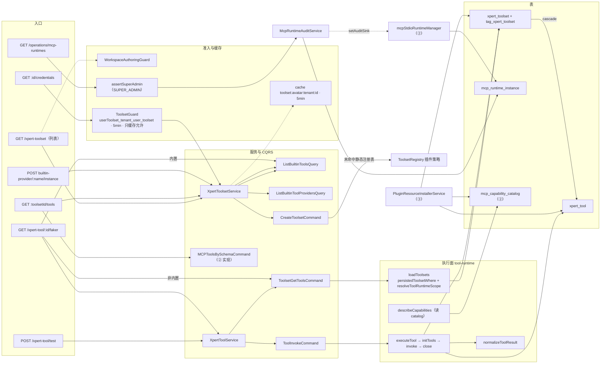
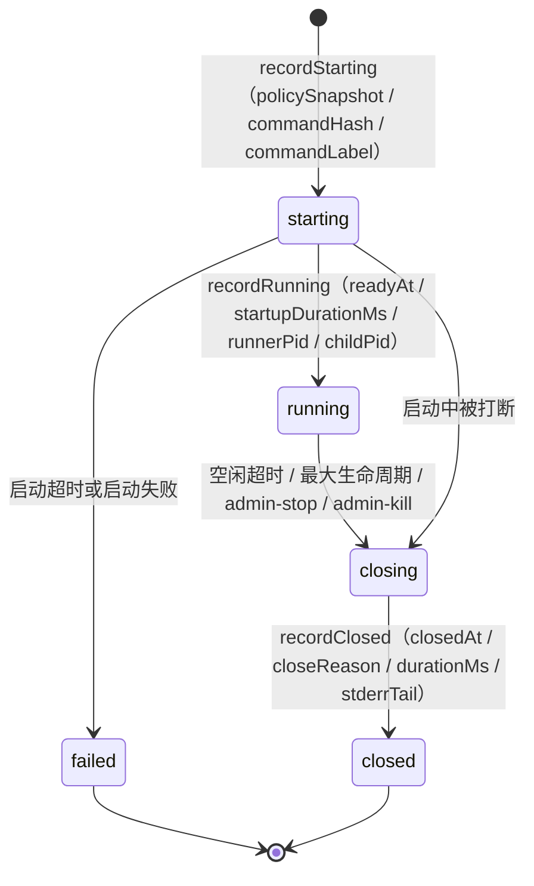

# 工具集与工具子专家 ① · 数据流转

> 只读梳理（commit `80f5676fd`）。源码根 `packages/server-ai/src/`，引用为仓库根相对路径。本文只描述 ① 子域（`xpert-toolset/**` 工具集主体 + `xpert-tool/**` + `tool-runtime/**`）内部的写入与读取链；跨到 ②③ 的边界只在「交接点」处标注。未证实处标 `[推测]`。

**本文引用的文件**

- [xpert-toolset/xpert-toolset.controller.ts](file://packages/server-ai/src/xpert-toolset/xpert-toolset.controller.ts)
- [xpert-toolset/xpert-toolset.service.ts](file://packages/server-ai/src/xpert-toolset/xpert-toolset.service.ts)
- [xpert-toolset/xpert-toolset.entity.ts](file://packages/server-ai/src/xpert-toolset/xpert-toolset.entity.ts)
- [xpert-toolset/guards/toolset.guard.ts](file://packages/server-ai/src/xpert-toolset/guards/toolset.guard.ts)
- [xpert-toolset/dto/toolset-public.dto.ts](file://packages/server-ai/src/xpert-toolset/dto/toolset-public.dto.ts)
- [xpert-toolset/provider/builtin/index.ts](file://packages/server-ai/src/xpert-toolset/provider/builtin/index.ts)
- [xpert-toolset/provider/openapi/openapi-toolset.ts](file://packages/server-ai/src/xpert-toolset/provider/openapi/openapi-toolset.ts)
- [xpert-toolset/provider/odata/odata-toolset.ts](file://packages/server-ai/src/xpert-toolset/provider/odata/odata-toolset.ts)
- [xpert-toolset/utils/parser.ts](file://packages/server-ai/src/xpert-toolset/utils/parser.ts)
- [xpert-toolset/commands/handlers/get-tools.handler.ts](file://packages/server-ai/src/xpert-toolset/commands/handlers/get-tools.handler.ts)
- [xpert-toolset/commands/handlers/create-toolset.handler.ts](file://packages/server-ai/src/xpert-toolset/commands/handlers/create-toolset.handler.ts)
- [xpert-toolset/commands/handlers/mcp-tools-schema.handler.ts](file://packages/server-ai/src/xpert-toolset/commands/handlers/mcp-tools-schema.handler.ts)
- [xpert-toolset/queries/handlers/list-builtin-tools.handler.ts](file://packages/server-ai/src/xpert-toolset/queries/handlers/list-builtin-tools.handler.ts)
- [xpert-toolset/mcp-runtime-audit.service.ts](file://packages/server-ai/src/xpert-toolset/mcp-runtime-audit.service.ts)
- [xpert-toolset/mcp-runtime.controller.ts](file://packages/server-ai/src/xpert-toolset/mcp-runtime.controller.ts)
- [xpert-toolset/mcp-runtime-instance.entity.ts](file://packages/server-ai/src/xpert-toolset/mcp-runtime-instance.entity.ts)
- [xpert-toolset/mcp-apps.service.ts](file://packages/server-ai/src/xpert-toolset/mcp-apps.service.ts)
- [xpert-tool/xpert-tool.controller.ts](file://packages/server-ai/src/xpert-tool/xpert-tool.controller.ts)
- [xpert-tool/xpert-tool.service.ts](file://packages/server-ai/src/xpert-tool/xpert-tool.service.ts)
- [xpert-tool/xpert-tool.entity.ts](file://packages/server-ai/src/xpert-tool/xpert-tool.entity.ts)
- [xpert-tool/xpert-tool.subscriber.ts](file://packages/server-ai/src/xpert-tool/xpert-tool.subscriber.ts)
- [xpert-tool/commands/handlers/tool-invoke.handler.ts](file://packages/server-ai/src/xpert-tool/commands/handlers/tool-invoke.handler.ts)
- [tool-runtime/tool-runtime.service.ts](file://packages/server-ai/src/tool-runtime/tool-runtime.service.ts)
- [tool-runtime/toolset-scope.ts](file://packages/server-ai/src/tool-runtime/toolset-scope.ts)
- [tool-runtime/workspace-scope.ts](file://packages/server-ai/src/tool-runtime/workspace-scope.ts)
- [shared/tools/toolset.ts](file://packages/server-ai/src/shared/tools/toolset.ts)
- [plugin-resource/plugin-resource-installer.service.ts](file://packages/server-ai/src/plugin-resource/plugin-resource-installer.service.ts)
- [xpert-agent/commands/handlers/subgraph.handler.ts](file://packages/server-ai/src/xpert-agent/commands/handlers/subgraph.handler.ts)

## 目录

- [1. 链一：工具集加载（含缓存与准入）](#1-链一工具集加载含缓存与准入)
- [2. 链二：工具发现与 schema 生成](#2-链二工具发现与-schema-生成)
- [3. 链三：工具执行与结果回流](#3-链三工具执行与结果回流)
- [4. 链四：工具测试与参数 faker](#4-链四工具测试与参数-faker)
- [5. 链五：MCP 运行时实例的启动 / 停止 / 审计](#5-链五mcp-运行时实例的启动--停止--审计)
- [6. 链六：平台插件安装器写工具集](#6-链六平台插件安装器写工具集)
- [7. 总览](#7-总览)
- [8. 状态机](#8-状态机)
- [9. 已知风险](#9-已知风险)

## 1. 链一：工具集加载（含缓存与准入）

**A. 列表 / 详情读路径（写者：无，纯读）**
`GET /api/xpert-toolset?data=…` → `CrudController.findAll` → `XpertToolsetService.findAll`（`XpertWorkspaceBaseService` 提供 scope 过滤）→ 控制器再调 `service.afterLoad(items)` → `items.map(item => new ToolsetPublicDTO(item))`。`afterLoad` 内部：① 过滤 `category === BUILTIN` 的项 → `ListBuiltinToolProvidersQuery(names)` → 给每个工具集**在内存里**赋 `tags`（id 形如 `TOOLSET/<name>`，label/icon 来自 `DEFAULT_TOOL_TAG_MAP`）；② `hydrateBuiltinToolSchemas` 按去重后的 provider 名并发 `ListBuiltinToolsQuery(provider)`，用 `latestTools.get(tool.name)` 覆盖 `label ??=`/`description ??=`/`schema =`。两处都**不落库**。

`GET /api/xpert-toolset/by-workspace/:workspaceId` 额外先过 `WorkspaceAuthoringGuard`，且 `getAllByWorkspace` 在 `workspaceId` 为 `'null'`/`'undefined'`/空时把 where 改成 `{ workspaceId: IsNull(), createdById: user.id }`；`published=true` 时追加 `publishAt: Not(IsNull())`。

**B. 缓存读路径（三类，语义不同）**
1. `GET /api/xpert-toolset/:id/avatar`（`@Public()`）：先 `resolvePublicTenantId(tenant)`（显式参数 → `RequestContext.getScope().tenantId` → `currentTenantId()` → `GetDefaultTenantQuery`），再 `cacheManager.get('toolset:avatar:${tenantId}:${id}')`；未命中才 `findPublicAvatar(id, tenantId)`（`select` 只取 `id/avatar/category`，`loadEagerRelations: false`，MCP 类别且无头像时回落内置 SVG），命中后 `set(..., 5*60*1000)`。
2. `GET /api/xpert-toolset/:id/credentials`：先 `ToolsetGuard.canActivate` —— `request.params.id` + `RequestContext.currentTenantId()` + `request.user.id` 拼 `userToolset_${tenantId}_${user.id}_${toolsetId}`，命中即返回；未命中 `service.findOne(toolsetId)`，`createdById === user.id` 或 `workspaceService.canAccess(toolset.workspaceId, user.id)`，**失败直接 `ForbiddenException`（不写缓存）**，成功才写 5 分钟。
3. `GET /api/xpert-toolset/builtin-provider/:name/icon`（`@Public()`）：无缓存，每次 `ToolProviderIconQuery` → `readFileSync`/插件 `resolveIcon`（`[推测]`：该端点适合加缓存但当前没有）。

**交接点**：② 的发布域会 `forFeature([XpertToolset])` 直接读同一张表（只读凭据与身份）；③ 的安装器会写它（见链六）。

章节来源：[xpert-toolset.controller.ts](file://packages/server-ai/src/xpert-toolset/xpert-toolset.controller.ts)（关键符号：getAllByWorkspace / getMCPAvatar / getCredentials）、[xpert-toolset.service.ts](file://packages/server-ai/src/xpert-toolset/xpert-toolset.service.ts)（关键符号：XpertToolsetService.afterLoad / getAllByWorkspace / findPublicAvatar）、[guards/toolset.guard.ts](file://packages/server-ai/src/xpert-toolset/guards/toolset.guard.ts)（关键符号：ToolsetGuard.canActivate / cacheKey）、[dto/toolset-public.dto.ts](file://packages/server-ai/src/xpert-toolset/dto/toolset-public.dto.ts)（关键符号：ToolsetPublicDTO 的 @Exclude）

## 2. 链二：工具发现与 schema 生成

**A. 库内发现（HTTP）**：`GET /api/xpert-toolset/:toolsetId/tools` → `findOne(toolsetId, { relations: ['tools'] })` → `afterLoad([toolset])` → 返回 `hydrated.tools`（`tools` 行来自 `xpert_tool`，字段语义已被 provider 最新定义覆盖）。

**B. 内置工具清单（yaml / 插件双源）**：`ListBuiltinToolsQuery(provider, names?)` → `ListBuiltinToolsHandler.getBuiltinTools(provider)`：先 `ToolsetRegistry.get(provider)` → `createTools()` → 每条 `{identity:{provider,name,author:'',label}, description:{human,llm}, schema: parseZodToJsonSchema(tool.schema)}`；插件分支异常被 `catch {}` 静默吞掉后回落 yaml：`path.join(configService.assetOptions.serverRoot, getBuiltinToolsetBaseUrl(name), name, 'tools')` 下读 `*.yaml|*.yml`（跳过 `_` 前缀），并按 `getPositionMap` 排序；结果写入 `_builtinTools` Map（**无 TTL**）；最后按 `names` 过滤。

**C. OpenAPI / OData 解析（文本 → 工具 bundle）**：`POST provider/openapi/schema { schema }` → `ParserOpenAPISchemaCommand` → `ApiBasedToolSchemaParser.autoParseToToolBundle(schema, warnings)`，返回 `{ schema_type, parameters_schema, credentials_schema, warning }`，凭据 schema 固定为 `auth_type | api_key_header | api_key_value`；`POST provider/odata/schema` 同构（`ParserODataSchemaCommand`）。远端拉取另走 `POST provider/{openapi,odata}/remote`。OData 侧还有一条**服务端生成**路径：`ODataToolset.getToolsSchema()` 连 `options.baseUrl` 读 metadata，对每个 entitySet 产出 `Create_/Get_/Query_/Delete_ + name` 四件工具（参数来自 `entityType.Key` 与 `Properties`，`mapODataTypeToOpenAPI` 只映射 `Edm.String|Decimal|DateTime`）。

**D. 远端探测（MCP，SSE）**：`POST provider/mcp/tools`（`@Sse()`）→ 控制器包一层 `Observable` + `RunnableLambda` + `keepAlive(30000)` + `takeUntilClose(res)` → `MCPToolsBySchemaCommand` → ② 的 `MCPToolsBySchemaHandler`：`resolveToolset`（plugin-managed 工具集**必须**回库校验 `pluginName`/`componentKey` 一致，否则 400）→ `JSON.parse(toolset.schema)` → `EnvStateQuery` → 建客户端（`isPro()` 分流 `createProMCPClient`/`createMCPClient`）→ `filterMcpTools` → 逐工具输出 `{name, description, schema, mcp?, _meta?}`，`finally` 关客户端。

**E. 运行时装配式发现**：`ToolsetGetToolsCommand(ids, environment)` → `ToolsetGetToolsHandler`（补 tenant/org/principal）→ `ToolRuntimeService.loadToolsets` → 查库（`persistedToolsetWhere`）+ scope 解析 + 按 `category` 建 runtime + `attachDeclaredToolAdapters`（把 `getMcpCapabilityDefinitions().tools` 追加进 `toolset.tools`）。Agent 侧（`subgraph.handler`）随后逐个 `initTools()` 与 `getVariables()`，并按 `agent.options.availableTools` 过滤。

章节来源：[queries/handlers/list-builtin-tools.handler.ts](file://packages/server-ai/src/xpert-toolset/queries/handlers/list-builtin-tools.handler.ts)（关键符号：ListBuiltinToolsHandler.getBuiltinTools / _builtinTools / getProviderServerPath）、[provider/odata/odata-toolset.ts](file://packages/server-ai/src/xpert-toolset/provider/odata/odata-toolset.ts)（关键符号：ODataToolset.getToolsSchema）、[commands/handlers/mcp-tools-schema.handler.ts](file://packages/server-ai/src/xpert-toolset/commands/handlers/mcp-tools-schema.handler.ts)（关键符号：MCPToolsBySchemaHandler.resolveToolset / filterMcpTools）、[commands/handlers/get-tools.handler.ts](file://packages/server-ai/src/xpert-toolset/commands/handlers/get-tools.handler.ts)（关键符号：ToolsetGetToolsHandler.execute）

## 3. 链三：工具执行与结果回流

**入口（API / 测试）**：`POST /api/xpert-tool/test` → `XpertToolService.testTool` → `ToolInvokeCommand` → `ToolInvokeHandler.execute`：
1. 取 `RequestContext` 的 tenant/org/user；`tool = { ...command.tool, enabled: true }`（**强制启用**）；要求 `toolset` + `tenantId` + `workspaceId` 齐备，否则 400 `Tool invocation requires explicit tenant and workspace context.`；
2. 入参整形：按 `tool.schema.parameters` 的 `form` 分类，用 `ApiBasedToolSchemaParser.convertPropertyValueType(param.schema, tool.parameters[param.name])` 拆成 `{llm, form}`；`form` 里的 `xpertId`/`agentKey` 作为字符串上下文提取；
3. 造**脱库快照**：`Object.assign(new XpertToolset(), toolset, { id: toolset.id ?? randomUUID(), tenantId, organizationId, workspaceId, tools: [tool] })`；
4. `source: 'api'`、`principal: {type:'user'|'service_account'}`、`executionId = requestId = randomUUID()`、`env: EnvStateQuery(workspaceId)`、`configurable: { user, subscriber }`、`toolsetSnapshots: [snapshot]`。

**执行**：`ToolRuntimeService.executeTool` → `loadToolsets({...request, toolsetIds:[toolsetId]})`（`resolveToolsets` 因 `source==='api'` 而放行快照，并逐项校验 id/tenant/workspace/organization 一致）→ 取回 runtime → 组装 `ToolExecutionContext`（`host` 取 `#runtimeHosts`）→ `try { initTools(); declaredTool? … ; MCPToolset&&serverName&&remoteName? callMcpTool/callMcpTaskTool ; 否则 getTool(name).invoke(arguments, {configurable:{...,toolExecutionContext, tool_call_id: requestId}}) } finally { close() }`。

**结果回流**：`normalizeToolResult` 归一为 `XpertToolResult`（`content[]` / `structuredContent` / `meta` / `isError`）→ `ToolInvokeHandler` 把 `subscriber` 收集到的事件一并返回（有事件时 `{events, result}`，否则裸 `result`）；异常侧：`error.name === 'ToolException'` → `ToolInvokeError`（HTTP 400），其它原样上抛。

**用量回流**：装配阶段若 `executionId` 存在，`loadToolsets` 注册 `reportUsage`，工具内模型调用完成后经 `XpertAgentExecutionRecordUsageCommand` 落 `xpert_agent_execution` 台账（属邻域）。

**Agent 路径差异**：`subgraph.handler` 拿到的是**长期持有**的 runtime，工具由 LangChain 直接 `invoke`，**不经过** `executeTool`、不注册 `toolExecutionContext`（除 `attachDeclaredToolAdapters` 的声明式工具外），也不会逐次 `close()`。

章节来源：[tool-invoke.handler.ts](file://packages/server-ai/src/xpert-tool/commands/handlers/tool-invoke.handler.ts)（关键符号：ToolInvokeHandler.execute / 参数整形 / toolsetSnapshots）、[tool-runtime.service.ts](file://packages/server-ai/src/tool-runtime/tool-runtime.service.ts)（关键符号：ToolRuntimeService.executeTool / normalizeToolResult / createExecutionModelUsageRecorder）、[subgraph.handler.ts](file://packages/server-ai/src/xpert-agent/commands/handlers/subgraph.handler.ts)（关键符号：ToolsetGetToolsCommand 装配 / initTools / getVariables）

## 4. 链四：工具测试与参数 faker

**`POST /api/xpert-tool/test`**：与链三同一跳（`testTool` → `ToolInvokeCommand`），差异只在**入参合成策略**——`toolset = tool.toolsetId ? await toolsetService.findOne(tool.toolsetId) : null`、`toolDetail = tool.id ? await findOne(tool.id) : null`，最终 `{...(toolDetail ?? {}), ...omit(tool,'toolset'), toolset: toolset ?? tool.toolset}` 即「库内行为底、请求体覆盖」。⇒ 该端点可测试「尚未落库的工具定义」（仅需带 `toolset`），也可测试「已落库的既有工具」（带 `id`）。

**`GET /api/xpert-tool/:id`**：`getTool` 强制 `relations: ['toolset']`；`category === BUILTIN` 时用 `ListBuiltinToolsQuery(toolset.type, [tool.name])` 回填临时属性 `provider` 与 `label`/`description`/`schema`（只回内存）。

**`GET /api/xpert-tool/:id/faker`**：`getParamsFaker` 分两支——内置：`ToolSchemaParser.parseZodToJsonSchema(tool.schema as ZodSchema)` → `JSONSchemaFaker.generate(jsonSchema)`；非内置：`ToolsetGetToolsCommand([toolsetId], { workspaceId })` → `toolsets[0]` → `await toolset.initTools()` → `getTool(tool.name)` → `(tool as DynamicStructuredTool).lc_kwargs?.schema ?? parseZodToJsonSchema(toolInstance.schema)`（`??` 优先取 LangChain 已编译的 JSON schema）→ `JSONSchemaFaker.generate`，`finally` 中 `toolset.close().catch(debug)`。

⇒ 该链是**唯一「读端点会建远端连接」**的路径（非内置），且 `initTools()` 失败会把异常映射到 500（无专门错误类型）。

章节来源：[xpert-tool.service.ts](file://packages/server-ai/src/xpert-tool/xpert-tool.service.ts)（关键符号：XpertToolService.testTool / getTool / getParamsFaker）、[xpert-tool.controller.ts](file://packages/server-ai/src/xpert-tool/xpert-tool.controller.ts)（关键符号：XpertToolController.test / findById / paramsFaker）

## 5. 链五：MCP 运行时实例的启动 / 停止 / 审计

**启动与运行（写侧，由 ② 的运行时驱动）**：`mcpStdioRuntimeManager.setAuditSink(McpRuntimeAuditService)` → 每次 stdio 运行时进入 `starting` 调 `recordStarting`（写 22 个字段，其中 `resourceInstallationId` 由 `findResourceInstallation(pluginName, componentKey, runtimeId, workspaceId, xpertId)` 反查 `plugin_resource_installation` 得到；`commandLabel`/`commandHash`/`policySnapshot` 均在服务内计算，`policySnapshot` 只白名单 5 键）→ 进入 `running` 调 `recordRunning`（`readyAt` + `startupDurationMs` + `runnerPid`/`childPid` + `stderrTail` + 两个过期时间）→ 终止时 `recordClosed`（`closedAt` + `closeReason` + `durationMs` + pid + `stderrTail`）。App 场景另有 `recordAppInstance`（条件 UPDATE 追加 `appInstanceId`）。

**启动期收敛**：`McpRuntimeAuditService.onApplicationBootstrap()` → `closeLostActiveRecords()` 把 `ACTIVE_RUNTIME_STATUSES` 命中的历史行统一置为终态（写 `closedAt`/`closeReason`）。⇒ 进程重启不会留下幽灵 running。

**读与停止（HTTP）**：`GET /api/xpert-toolset/operations/mcp-runtimes?…` → `assertSuperAdmin()` → `list(query, mcpStdioRuntimeManager.list(toRuntimeManagerFilter(query)))`：库内分页 + 内存活体快照**按 id 合并**（live 值优先），并返回筛选下拉（`listFilterOptions`：workspaces/toolsets/plugins/executions/appInstances；`workspaceOptions`/`toolsetOptions` 走库、`liveWorkspaceOptions` 走活体）。`POST …/:runtimeId/stop` → `closeRuntime(runtimeId, 'admin-stop')`；`POST …/kill` → `killByFilter(toRuntimeManagerFilter(body), 'admin-kill')`。两个写操作都只输出 `{stopped: boolean|number}`，真正的进程操作在 ② 的 runner。

**MCP App 侧流转（① 的 `McpAppsService`）**：前端 `GET :appInstanceId/resource` → `assertReviveAccess` + `reviveInstance`（按 token 复原 toolset 客户端与执行上下文，必要时重建）→ 返回 `resourceUri`/`csp`/`permissions`/`prefersBorder`/`toolInfo`/`toolInput`/`toolResult`；`POST :appInstanceId/rpc` → `handleRpc` 按 JSON-RPC 方法分派（`tools/call` 命中需审批工具时先落 `approval`，`approvals/:id/{approve,reject}` 推进或拒绝，`ui/download` 走 `validateMcpAppDownloadRequest` 字节上限校验），`DELETE :appInstanceId` → `teardown`。

章节来源：[mcp-runtime-audit.service.ts](file://packages/server-ai/src/xpert-toolset/mcp-runtime-audit.service.ts)（关键符号：recordStarting / recordRunning / recordClosed / recordAppInstance / closeLostActiveRecords / list / toRuntimeManagerFilter）、[mcp-runtime-instance.entity.ts](file://packages/server-ai/src/xpert-toolset/mcp-runtime-instance.entity.ts)（关键符号：McpRuntimeInstanceEntity 字段与 5 索引）、[mcp-runtime.controller.ts](file://packages/server-ai/src/xpert-toolset/mcp-runtime.controller.ts)（关键符号：assertSuperAdmin / stop / kill）、[mcp-apps.service.ts](file://packages/server-ai/src/xpert-toolset/mcp-apps.service.ts)（关键符号：reviveInstance / handleRpc / approve / reject / teardown）

## 6. 链六：平台插件安装器写工具集

**入口**：③/平台插件侧调 `PluginResourceInstallerService.installRuntimeComponent(runtimeComponent, workspaceId, xpertId, agentKey)`（上游还有 `installToWorkspace`/`installToXpert` 两个聚合入口），内部 `ensureRuntime(runtimeComponent, workspaceId, xpertId, runtimeType)` 按组件类型分流。

**native 分支（`ensureNativeToolset`）**：要求 `component.config` 为对象且带 `provider`；命中内置 provider 时可回落 `XpertToolsetService.createBuiltinToolset(provider, entity)`（即走上链一的创建语义：`validateCredentials` + 强制 `category=BUILTIN`/`type=provider`），后台同步路径则只允许更新既有工具集。

**MCP 分支（`ensureMcpToolset`）**：
1. `ensureRuntimePaths(runtimeComponent, workspaceId)`（准备运行时资源路径）；
2. `parseMcpServer(runtimeComponent)` 解析 `mcp.json`/`config` 中的 server 定义，`loadMcpCapabilities(runtimeComponent, parsed)` 解析声明能力；
3. `findPluginManagedToolset(workspaceId, xpertId, runtimeComponent)` 反查既有工具集（Agent 插件路径用 `options ->> 'runtimeSource'` 区分，平台插件路径靠 `pluginManaged`）；
4. 写/更 `XpertToolset`：`category: MCP`，`options` 打上 `pluginManaged`/`pluginName`/`componentKey`/`definitionHash`，`schema` 写 `mcpServers[componentKey]`；
5. 工具投影：**更新时先 `toolRepo.delete({ toolsetId })` 再按策略重建 `XpertTool[]`**（`xpert_tool` 无软删，故这是硬删重建）；
6. `capabilityCatalog.replaceToolsetCapabilities(...)` 刷新 `mcp_capability_catalog`（② 的台账，供 `describeCapabilities` 与发布域消费）。

**回流到 ①**：链二的 `MCPToolsBySchemaHandler.resolveToolset` 会对 plugin-managed 工具集**强制回库校验** `pluginName`/`componentKey` 与库内行一致（否则 400）；链三的 `loadToolsets` 随后按 `category === MCP` 建 `MCPToolset`（②）；`ToolRuntimeService.describeCapabilities` 再从 catalog 读回能力。

章节来源：[plugin-resource-installer.service.ts](file://packages/server-ai/src/plugin-resource/plugin-resource-installer.service.ts)（关键符号：PluginResourceInstallerService.installRuntimeComponent / ensureRuntime / ensureMcpToolset / ensureNativeToolset / findPluginManagedToolset）、[xpert-toolset.entity.ts](file://packages/server-ai/src/xpert-toolset/xpert-toolset.entity.ts)（关键符号：XpertToolset.tools 的 cascade 列表）、[xpert-tool.entity.ts](file://packages/server-ai/src/xpert-tool/xpert-tool.entity.ts)（关键符号：XpertTool.toolset onDelete CASCADE / toolsetId）、[xpert-toolset.service.ts](file://packages/server-ai/src/xpert-toolset/xpert-toolset.service.ts)（关键符号：XpertToolsetService.createBuiltinToolset）

## 7. 总览

图表来源：[xpert-toolset.controller.ts](file://packages/server-ai/src/xpert-toolset/xpert-toolset.controller.ts)（关键符号：getAllByWorkspace / getCredentials / getToolsetTools / getMCPTools）、[tool-runtime.service.ts](file://packages/server-ai/src/tool-runtime/tool-runtime.service.ts)（关键符号：ToolRuntimeService.loadToolsets / executeTool / describeCapabilities）、[guards/toolset.guard.ts](file://packages/server-ai/src/xpert-toolset/guards/toolset.guard.ts)（关键符号：ToolsetGuard.canActivate）、[mcp-runtime-audit.service.ts](file://packages/server-ai/src/xpert-toolset/mcp-runtime-audit.service.ts)（关键符号：McpRuntimeAuditService.recordStarting / list）、[plugin-resource-installer.service.ts](file://packages/server-ai/src/plugin-resource/plugin-resource-installer.service.ts)（关键符号：PluginResourceInstallerService.ensureMcpToolset）

## 8. 状态机

**工具集（`xpert_toolset`）**：无独立 `status` 列，状态由三个字段合成——`publishAt`（是否已发布）、`workspaceId`（`IsNull` = 私有）、`deletedAt`（`WorkspaceBaseEntity` 的 `@DeleteDateColumn`，软删）。合法迁移：`私有(cursor) → 归属工作区`（`getAllByWorkspace` 的两条 where 分支）、`未发布 → 发布`（`publishAt ≠ null`）、`任意 → 软删 → 恢复`（cascade 列表含 `soft-remove`/`recover`）。`category` 与 `type` 在 `createBuiltinToolset` 路径上是**写入即冻结**（`BUILTIN` + provider name 强制），但 `updateToolset` 是浅合并、**不阻止修改 `category`/`type`** `[推测]`：类型漂移会让既有 `xpert_tool` 行的语义与新 provider 不匹配。

**工具（`xpert_tool`）**：`enabled`（`@deprecated`）与 `disabled` 双列并存，均 nullable；有效态由 `isEnableTool(tool, toolset)` 归一（OpenAPI/MCP 路径），但 `ODataToolset` 与 `PlanningToolset.initTools` 只读 `_.enabled` ⇒ **两条判定并存**。删除态只有硬删（`onDelete: 'CASCADE'`，无软删列），且安装器更新 MCP 工具集时会 `toolRepo.delete({toolsetId})` 全量重建。

**运行时实例（`mcp_runtime_instance`）**：`status ∈ starting | running | closing | closed | failed`（varchar，无 CHECK），`origin ∈ agent-toolset | mcp-app-host`（默认 `agent-toolset`）。合法迁移：`starting → running`（`recordRunning` 写 `readyAt`/`startupDurationMs`）、`starting|running → closing → closed`（`recordClosed` 写 `closedAt`/`closeReason`/`durationMs`）、`starting → failed`（同 `recordClosed`，`status='failed'`）。收敛规则：进程重启时所有活跃态被 `closeLostActiveRecords()` 强制终态；App 场景额外挂 `appInstanceId`（`recordAppInstance` 条件更新）。**没有任何行会被删除**，`DEFAULT_RUNTIME_AUDIT_RETENTION_DAYS` 只影响查询窗口。

图表来源：[mcp-runtime-audit.service.ts](file://packages/server-ai/src/xpert-toolset/mcp-runtime-audit.service.ts)（关键符号：McpRuntimeAuditService.recordStarting / recordRunning / recordClosed / closeLostActiveRecords / ACTIVE_RUNTIME_STATUSES）、[mcp-runtime-instance.entity.ts](file://packages/server-ai/src/xpert-toolset/mcp-runtime-instance.entity.ts)（关键符号：McpRuntimeInstanceEntity.status / origin）、[mcp-runtime.controller.ts](file://packages/server-ai/src/xpert-toolset/mcp-runtime.controller.ts)（关键符号：McpRuntimeController.stop / kill）

## 9. 已知风险

1. **凭据流转全程明文（除回显）**：`credentials` 库内明文 json，唯一控制点是实体 `@Exclude` + DTO `@Exclude` + `ToolsetGuard`；加密步骤仍是注释。任何直接 `repository.findOne` 后 `JSON.stringify` 的代码路径都会绕过投影层。
2. **授权缓存窗口无失效**：`ToolsetGuard` 的 `userToolset_*` 键无清除点，被移出工作区后 5 分钟内仍可读凭据；且缓存只覆盖「允许」，所以**拒绝路径每次都查库**（DB 压力与允许路径不对称）。
3. **读路径带远端副作用**：`GET /xpert-tool/:id/faker`（非内置）与 `GET /:toolsetId/tools` 的 `afterLoad` 都会触发查询/建连，前端轮询或重试会放大远端连接数。
4. **列表读放大**：`afterLoad` 对每个内置 provider 发一次 `ListBuiltinToolsQuery`（插件失败还会回落读盘），`Promise.all` 无并发上限。
5. **禁用态判定分叉**：`isEnableTool` 与裸 `_.enabled` 并存，同一 `xpert_tool` 行在不同 provider 下可能是「启用」或「禁用」。`[推测]` 由历史迁移（`enabled` → `disabled`）未完成导致。
6. **工具集类型可被浅更新改写**：`updateToolset` = `findOne` + `assign` + `save`，未禁止 `category`/`type` 变更，也未联动清理 `xpert_tool`。
7. **`mcp_runtime_instance` 只增不删**：无清理作业，`policySnapshot`/`stderrTail`/`commandLabel` 长期累积（其中 `stderrTail` 可能含运行时输出）。
8. **安装器的硬删重建窗口**：`ensureMcpToolset` 更新时先 `toolRepo.delete({toolsetId})` 再重建，若重建失败则工具集处于「无工具」中间态（`xpert_tool` 无软删，无法回滚）`[推测]`。
9. **快照逃生舱的信任边界**：`toolsetSnapshots` 仅 `source==='api'`，但 `ToolInvokeHandler` 恰好用 `source:'api'`，也就是说**任何能调到该命令的代码都能提交一份自造工具集**（含任意 `credentials`）；当前防护只有 `ToolInvokeCommand` 的调用面与四项一致性校验。

章节来源：[tool-invoke.handler.ts](file://packages/server-ai/src/xpert-tool/commands/handlers/tool-invoke.handler.ts)（关键符号：ToolInvokeHandler 的快照构造 / source 'api'）、[tool-runtime.service.ts](file://packages/server-ai/src/tool-runtime/tool-runtime.service.ts)（关键符号：resolveToolsets 的 snapshot 四项校验 / McpToolsetSnapshotApiOnly）、[guards/toolset.guard.ts](file://packages/server-ai/src/xpert-toolset/guards/toolset.guard.ts)（关键符号：ToolsetGuard 的缓存写入分支）、[xpert-toolset.service.ts](file://packages/server-ai/src/xpert-toolset/xpert-toolset.service.ts)（关键符号：updateToolset / hydrateBuiltinToolSchemas）、[plugin-resource-installer.service.ts](file://packages/server-ai/src/plugin-resource/plugin-resource-installer.service.ts)（关键符号：ensureMcpToolset 的 toolRepo.delete）
