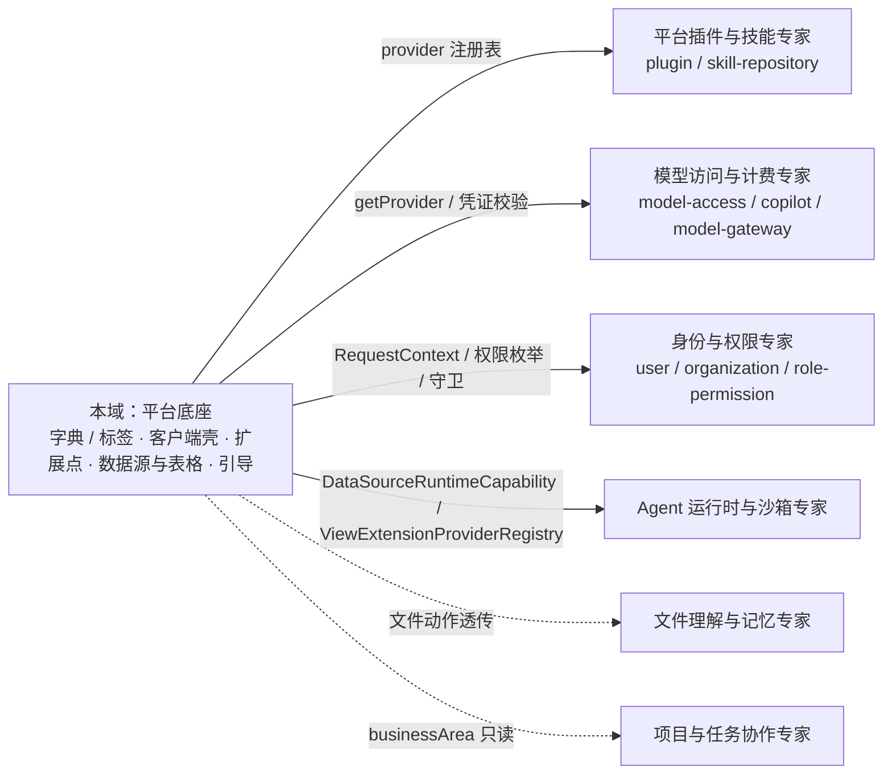

# 平台底座与集成专家 —— C0 使用总览

> **资产基线**：`2026-10-16 · commit 80f5676fd`（批次 5 第 14 专家）。实测 **171 非 spec / 12 模块**：`data-source`（34 非 spec / 4 spec / 2 表 · `/data-source` 16 端点）· `ai-model`（27 非 spec 文件 + 1 个非 spec 命名 test = 28；0 表 · `/ai-model` 1）· `integration`（24/4/1 · `/integration` 11）· `xpert-table`（18/3/1 · `xpert-table` 6）· `view-extension`（14/5/0 · `/view-hosts` 7）· `language`（11 · `/languages` 2 · 1 表）· `country`（7 · `/country` 1 · 1 表）· `currency`（6 · `/currency` 1 · 1 表）· `contact`（9 · `@Controller()` · 1 表）· `desktop-shell`（8 · `/desktop-shell` 9 + **WS** · **3 表 + 2 迁移**）· `mobile`（4 · `/mobile` 2 · 0 表）· `initialization`（8）；另有真实存在但归属待定的 `tags`（`/api/tags` · 1 表 + 2 显式联接表）与 `export-import`（`/api/import` **未挂载** · 2 表）。全批 **14 个 `@Entity`**（核心 11 + tag + import-history + import-record），HTTP 显式端点 **59 条**（不含基类 `CrudController` 自动 CRUD）。全局前缀 `api`；`desktop-shell` / `mobile` / `initialization` 实测在 **`packages/server-ai/src`**，不在 `packages/server/src`。

**本文引用的文件**（相对仓库根，链接均为 `file://`）

- [packages/server/src/data-source/data-source.controller.ts](file://packages/server/src/data-source/data-source.controller.ts)
- [packages/server/src/data-source/data-source.service.ts](file://packages/server/src/data-source/data-source.service.ts)
- [packages/server/src/data-source/data-source-runtime.service.ts](file://packages/server/src/data-source/data-source-runtime.service.ts)
- [packages/server-ai/src/xpert-table/xpert-table.service.ts](file://packages/server-ai/src/xpert-table/xpert-table.service.ts)
- [packages/server/src/integration/integration.service.ts](file://packages/server/src/integration/integration.service.ts)
- [packages/server/src/integration/integration-qr.service.ts](file://packages/server/src/integration/integration-qr.service.ts)
- [packages/server/src/view-extension/view-extension.service.ts](file://packages/server/src/view-extension/view-extension.service.ts)
- [packages/server/src/view-extension/hosts/integration-view-host.definition.ts](file://packages/server/src/view-extension/hosts/integration-view-host.definition.ts)
- [packages/server/src/view-extension/host-definition.registry.ts](file://packages/server/src/view-extension/host-definition.registry.ts)
- [packages/server-ai/src/desktop-shell/desktop-shell-auth.service.ts](file://packages/server-ai/src/desktop-shell/desktop-shell-auth.service.ts)
- [packages/server-ai/src/desktop-shell/desktop-shell.gateway.ts](file://packages/server-ai/src/desktop-shell/desktop-shell.gateway.ts)
- [packages/server-ai/src/initialization/bootstrap.processor.ts](file://packages/server-ai/src/initialization/bootstrap.processor.ts)
- [packages/server-ai/src/mobile/mobile.service.ts](file://packages/server-ai/src/mobile/mobile.service.ts)
- [packages/server-ai/src/ai-model/ai-model.service.ts](file://packages/server-ai/src/ai-model/ai-model.service.ts)
- [packages/server/src/language/language.seed.ts](file://packages/server/src/language/language.seed.ts)
- [packages/server/src/tags/tag-management.service.ts](file://packages/server/src/tags/tag-management.service.ts)
- [packages/server/src/export-import/import/import-all.controller.ts](file://packages/server/src/export-import/import/import-all.controller.ts)
- [packages/server/src/server.module.ts](file://packages/server/src/server.module.ts)

## 目录

1. [专家定位](#专家定位)
2. [何时找这个专家](#何时找这个专家)
3. [契约自足声明与基线](#契约自足声明与基线)
4. [能力清单表](#能力清单表)
5. [边界](#边界)
6. [已知问题与常见坑](#已知问题与常见坑)
7. [延伸阅读](#延伸阅读)

## 专家定位

本专家负责**平台底座**——那些「不被任何单一业务域拥有、却被所有域使用」的平台面，按三个子域组织：① **集成与扩展点**（`integration` 集成实例与扫码授权、`view-extension` 视图宿主解析与插件视图清单）；② **数据源与表格**（`data-source` 外部库连接与查询代理、`xpert-table` 逻辑表 Meta → 外部库物理表）；③ **基础字典与客户端壳**（`language`/`country`/`currency`/`contact`/`tags` 字典，`desktop-shell`/`mobile` 客户端壳，`initialization` 引导队列，`ai-model` 模型目录门面）。

**一句话口径**：本域不是业务域，是「被所有域使用的平台面」——字典是只读种子、表格是元数据、集成是实例定义、视图是宿主解析、设备是执行台账；业务语义（项目、助手、知识库、模型计费）一律在相邻专家域，本域只提供接入面与运行时契约。

章节来源：[server.module.ts](file://packages/server/src/server.module.ts)（关键符号：imports 中的 ViewExtensionModule / IntegrationModule / DataSourceModule / LanguageModule / CountryModule / CurrencyModule / TagModule）、[data-source.service.ts](file://packages/server/src/data-source/data-source.service.ts)（关键符号：DataSourceService.prepareDataSource）、[view-extension.service.ts](file://packages/server/src/view-extension/view-extension.service.ts)（关键符号：ViewExtensionService.listSlotViews）

## 何时找这个专家

- 要**改字典与种子**：`language`/`country`/`currency`/`contact`/`tags` 的实体与种子、`LanguageInitCommand` 手动重灌、`SeedDataService` 基础种子阶段。
- 要**改联系人**：`ContactController` 的 `GET /` 与继承自 `CrudController` 的 CRUD 面，注意 `ContactModule` 当前未被装配。
- 要**改外部数据源与凭据**：`DataSourceService.prepareDataSource`、按用户 `data_source_authentication`（30 天 `validUntil`）、`DataSourcePublicDTO` 脱敏口径、`/ping` 两种试连形态。
- 要**改 xpert-table 的 Meta 与物理表**：`upsertTable`/`activateTable`/`deleteTable`、`columns` json、`physicalSchema`/`physicalTableName`/`version`、DDL 失败补偿。
- 要**改集成定义与扫码授权**：`IntegrationUpsertCommand` 策略校验与生命周期钩子、`/integration/qr` 四端点 Redis 会话状态机、`ensurePrincipalUser` 技术主体。
- 要**改视图扩展宿主**：`@ViewHostDefinition` 注册、槽位与 `canRead`、`/api/view-hosts` 七条协议路由、清单 60s 缓存与两条失效链。
- 要**改桌面壳设备/命令**：`/desktop-shell` 9 条 HTTP + WS 通道、3 张表与 2 个 SQL 迁移、`desktop_shell` Agent 工具与 HITL 审批。
- 要**改移动端 bootstrap**：`MobileService.getBootstrap` 的 deployment 配置、capabilities 六位能力协商、ADMIN membership 分支。
- 要**改初始化引导**：Bull 队列 `server-ai-bootstrap` 的 4 个 `@OnEvent` 入队与 6 个 `@Process` job、稳定 jobId 幂等、`clawxpert` 恢复 2 端点。
- 要**改 `tags`**：`/api/tags` 8 条显式端点、写路径租户行锁 + zod 校验、`usage` 全库 M2M 扫描、软删/恢复恒 400。
- 要**改 `export-import`**：`/api/import` 未挂载、`ImportAllService`/`unzipAndParse` 全注释的现状。
- 要**改 `ai-model` 目录与凭证校验**：`AIProvidersService.getProvider`/`providerCredentialsValidate`、1 条 `@Public` 图标端点、与 `model-access` 的分工。
- 要**排查**：连不上外部库（`ping` 500 / catalogs「配置错误」）、扫码授权不回（409 busy / 404 过期）、视图不显示（三类 404 + 403）、设备离线（409 `DEVICE_OFFLINE`）、种子缺失（空库才灌）、bootstrap 卡住（队列日志）。
- 要**对接插件**：数据源插件（`DataSourceRuntimeService.open` 运行时能力）、集成策略（`IntegrationStrategyRegistry`）、视图 provider（`ViewExtensionProviderRegistry`）。

章节来源：[data-source.controller.ts](file://packages/server/src/data-source/data-source.controller.ts)（关键符号：ping / pingDataSource / query / olap / load）、[desktop-shell.gateway.ts](file://packages/server-ai/src/desktop-shell/desktop-shell.gateway.ts)（关键符号：DesktopShellGateway.handleConnection / dispatch）、[bootstrap.processor.ts](file://packages/server-ai/src/initialization/bootstrap.processor.ts)（关键符号：AI_BOOTSTRAP_QUEUE / jobId）

## 契约自足声明与基线

本专家的 `C0`（使用总览）+ `C1`（能力契约）构成该子域**完整契约面**：HTTP 入口索引、服务方法签名与参数行为语义、扩展点契约、真实调用方示例、鉴权与错误口径均在本层可查，无需阅读实现层即可完成集成与排障；实现细节（算法、私有方法、逐列结构）只在需要定位时按 `file://` 链接回源码。**逐端点明细**（每条的权限点、主要错误与状态码全集、鉴权矩阵）见 [implementation/05-接口.md](file://.module-experts/后端专题/平台底座与集成专家/implementation/05-接口.md)，本文不复制。凡未标 `[推测]` 的结论均取自源码或本域实现层文档。

| 项 | 值 |
|---|---|
| 基线时点 / commit | `2026-10-16` · `80f5676fd`（批次 5 第 14 专家） |
| 规模实测 | 171 非 spec / 12 模块（+ `tags`、`export-import`）；29 个 jest spec（server 14 + server-ai 15，另有 `ai-model/providers.service.test.ts` 1 个非 spec 命名） |
| 表与迁移 | 14 个 `@Entity`；**仅 `desktop-shell` 有 SQL 迁移（2 份）**，其余 12 张表由 `synchronize: true` 建 |
| 子域 | ① 集成与扩展点 ② 数据源与表格 ③ 基础字典与客户端壳 |
| 契约入口 | 本文件 + [C1-能力契约.md](file://.module-experts/后端专题/平台底座与集成专家/C1-能力契约.md) |
| 实现层 | [01-架构](file://.module-experts/后端专题/平台底座与集成专家/implementation/01-架构.md) · [02-实现](file://.module-experts/后端专题/平台底座与集成专家/implementation/02-实现.md) · [03-数据流转](file://.module-experts/后端专题/平台底座与集成专家/implementation/03-数据流转.md) · [04-模型](file://.module-experts/后端专题/平台底座与集成专家/implementation/04-模型.md) · [05-接口](file://.module-experts/后端专题/平台底座与集成专家/implementation/05-接口.md) · [06-测试](file://.module-experts/后端专题/平台底座与集成专家/implementation/06-测试.md) · [07-运维](file://.module-experts/后端专题/平台底座与集成专家/implementation/07-运维.md) |

**口径校正（写入本层契约）**：① `desktop-shell`/`mobile`/`initialization` 在 `packages/server-ai/src`，由 [app.module.ts](file://packages/server-ai/src/app.module.ts) 装配；② `desktop-shell` 确有 **3 张表 + 2 个 SQL 迁移**（索引记 0 表、0 迁移是偏差）；③ `ai-model` 共 28 个 `.ts`，其中 1 个为 `providers.service.test.ts`（非 spec），**27 非 spec**。

章节来源：[app.module.ts](file://packages/server-ai/src/app.module.ts)（关键符号：AppModule 的 imports）、[desktop-shell.entities.ts](file://packages/server-ai/src/desktop-shell/desktop-shell.entities.ts)（关键符号：DesktopShellDevice / DesktopShellGrant / DesktopShellOperation）、[ai-model.module.ts](file://packages/server-ai/src/ai-model/ai-model.module.ts)（关键符号：AIModelModule 无 TypeOrmModule）

## 能力清单表

| 能力 | 入口 | 一句话 |
|---|---|---|
| 语言字典 | `GET /api/languages`、`/api/languages/getByName/:name` | 只读 + 种子；写路径仅 `LanguageInitCommand`，无 HTTP 写端点 |
| 国家 / 货币字典 | `GET /api/country`、`GET /api/currency` | 只读、`isoCode` 仅非唯一索引，一致性靠种子内容 |
| 联系人目录 | `GET /api/contact`（**未挂载**） | 仅 1 条显式 + 基类 CRUD；`country` 存 isoCode 字符串而非外键 |
| 标签字典与使用量 | `GET /api/tags/directory`、`/categories`、`GET/POST /api/tags`、`PUT/DELETE /:id` | 唯一可写字典：租户行锁 + zod 校验 + 全库 M2M usage 扫描 |
| 数据源定义与个人凭据 | `GET/POST/PUT /api/data-source`、`GET/POST/DELETE /:id/authentication` | 连接配置（非数据副本）；认证按「人」粒度、`validUntil=+30d` |
| 数据源连接测试 | `POST /api/data-source/ping`、`POST /:id/ping` | 未落库 ad-hoc 试连 / 已落库覆盖试连；失败 500 透传 adapter message |
| schema 与查询代理 | `GET /:id/catalogs`、`GET /:id/schema`、`POST /:id/query`、`POST /:id/olap`、`POST /:id/capabilities/query` | 每次新建 runner 并 `teardown()`；无 schema 缓存、无查询超时定义 |
| 文件装载 | `POST /api/data-source/:id/load` | `FileInterceptor('file')` + sheets JSON → xlsx/csv 装载到外部库 |
| 插件运行时数据源会话 | `DataSourceRuntimeService.list/open`（无 HTTP） | 插件唯一出口：actor 三元组比对 + 引擎白名单（mysql/doris/postgres）+ revision 复核 |
| xpert-table Meta 与物理表 | `POST/PUT /api/xpert-table`、`POST /:id/activate`、`DELETE /:id` | 逻辑 Meta + 外部库 DDL；激活/改名/删除**与元数据不同事务** |
| xpert-table 行列操作 | `DB_SQL` / `DB_INSERT` 工作流节点（无 HTTP） | `insertRow`/`executeSql` 要求 `status=active`，只经助手侧策略暴露 |
| 集成实例定义 | `GET/POST/PUT/DELETE /api/integration`、`POST /test`、`GET /providers`、`/select-options` | 写路径全走命令：先策略校验、再生命周期钩子、最后落库 |
| 扫码授权会话 | `POST /api/integration/qr/providers/:provider`、`GET/POST/DELETE /qr/sessions/:id[/complete]` | 纯 Redis 状态机；`complete` 以 session id 作集成 id 实现崩溃重试幂等 |
| connector 受限集成面 | `ConnectorAppIntegrationService`（无 HTTP） | 只投影 `{id,name,organizationId}`；slug 去重防并发重试重复建行 |
| 视图扩展宿主与清单 | `GET /api/view-hosts/:hostType/:hostId/slots/:slot/views` | 宿主注册表 + 插件 provider 清单 + 权限过滤 + 60s 缓存 |
| 视图数据·参数·动作·远程入口 | `…/views/:viewKey/{data,manifest,remote-component/entry}`、`…/parameters/:key/options`、`POST …/actions/:actionKey[/file]` | 每个入口自带鉴权边界；文件动作经宿主可选 `prepareFileAction` |
| 桌面壳设备与命令 | `/api/desktop-shell` 9 条 HTTP + WS `namespace=/desktop-shell` | DB 权威 + Redis 仅唤醒；`argsHash`/`connectionEpoch`/`seq` 三重绑定 |
| 移动端 bootstrap | `GET /api/mobile/bootstrap`、`GET /api/mobile/xperts` | 只读投影（0 表）；`viewHostsPath` 固定 `/api/view-hosts` |
| 初始化引导与恢复 | Bull 队列 + `GET/POST /api/initialization/clawxpert` | 事件驱动 6 个 job；幂等靠稳定 jobId + 出队重查，**bootstrap 无 HTTP 面** |
| 模型目录与图标 | `GET /api/ai-model/provider/:name/:iconType/:lang` | 只做 provider 门面与凭证 schema 校验；不存模型、不判授权 |
| 通用导入基建（未启用） | `GET/POST /api/import`（**未挂载**） | `ImportAllModule` 无人 import，核心逻辑注释，仅落 `import-history` |

章节来源：[language.controller.ts](file://packages/server/src/language/language.controller.ts)（关键符号：findAll / findByName）、[xpert-table.controller.ts](file://packages/server-ai/src/xpert-table/xpert-table.controller.ts)（关键符号：create / update / activateTable / deleteTable）、[desktop-shell.controller.ts](file://packages/server-ai/src/desktop-shell/desktop-shell.controller.ts)（关键符号：register / grant / prepare / decision / list / cancel）

## 边界

**做什么**：字典族与标签、客户端壳（设备/移动端投影）、扩展点（集成实例与视图宿主）、外部数据源接入与查询代理、逻辑表物理化、初始化引导队列、模型 Provider 目录门面。

**不做什么（与相邻专家域分工）**

- **模型访问与计费**：`model-*`、`copilot`、`model-gateway`、`model-access` 拥有授权解析、配额与记账；本域 `ai-model` 只回答「provider 存在吗、凭证合法吗、图标是什么」（0 表）。
- **平台插件与技能**：插件安装仓库归 `plugin`/`plugin-resource`/`skill-repository`；`view-extension` 只消费 `ViewExtensionProviderRegistry`，不安装插件。
- **身份与权限**：`user`/`organization`/`role-permission` 归身份域；本域只**复用** `PermissionsEnum.DATA_SOURCE_*`/`INTEGRATION_*`/`ORG_TAGS_EDIT`、`PermissionGuard`/`TenantPermissionGuard`、`ApiKeyOrClientSecretAuthGuard` 与 `RequestContext`。
- **文件理解与记忆**：文件字节、解析与记忆归文件域；本域只做视图文件动作的透传与装载文件解析。
- **运行时·沙箱·产物**：Agent 运行时与沙箱归运行时域；本域 `desktop-shell` 只持有「设备注册 + 会话授权 + 执行台账」，执行本体在用户机器。
- **项目与任务协作**：`business-area` 已归项目与任务协作专家；本域只出现 `MobileService` 对 `summarizeXpert.businessArea` 的读取。
- **邻域表引用**：`data_source_type` 被 `data_source.typeId` 强引用（CASCADE）但不属本批 12 模块；`organization_language` 归 server-core，由 language 的 OneToMany `cascade` 维护。

图表来源：[view-extension.module.ts](file://packages/server/src/view-extension/view-extension.module.ts)（关键符号：ViewExtensionProviderRegistry / VIEW_EXTENSION_CACHE_SERVICE_TOKEN）、[ai-model.service.ts](file://packages/server-ai/src/ai-model/ai-model.service.ts)（关键符号：AIProvidersService.getProvider）、[data-source-runtime.service.ts](file://packages/server/src/data-source/data-source-runtime.service.ts)（关键符号：@RuntimeCapabilityProvider / DataSourceRuntimeCapability）

章节来源：[data-source-runtime.service.ts](file://packages/server/src/data-source/data-source-runtime.service.ts)（关键符号：DataSourceRuntimeService.authorize / open）、[integration.service.ts](file://packages/server/src/integration/integration.service.ts)（关键符号：IntegrationService.getProviders）、[mobile.service.ts](file://packages/server-ai/src/mobile/mobile.service.ts)（关键符号：MobileService.listXperts）

## 已知问题与常见坑

1. **凭据类列一律明文，脱敏只在单点**：实测 `data-source` 全模块 `encrypt|decrypt|cipher|AES` 0 命中——`data_source_authentication.password` 是普通列（无 `@Exclude`/`select:false`/加密），`data_source.options` 上 `// @Exclude()` 处于注释态，`integration.options`（含 `botToken`）无任何隐藏。脱敏仅覆盖 `GET /api/data-source` 列表（`DataSourcePublicDTO` 白名单）与 `GET /api/integration` 列表；`GET /:id`、`/:id/authentication` 直出实体。
   来源：[authentication.entity.ts](file://packages/server/src/data-source/authentication/authentication.entity.ts)、[data-source.entity.ts](file://packages/server/src/data-source/data-source.entity.ts)、[public.dto.ts](file://packages/server/src/data-source/dto/public.dto.ts)。
2. **`xpert-table` 的 DDL 与元数据不在同一事务**：`upsertTable` 的 rename/create/activate 串行执行，激活失败时**新表硬删逻辑行、既有表只标 `ERROR`**；`deleteTable` 的 `DROP_TABLE` 失败仅 `logger.error` 后照常软删——会留下物理表孤儿。
   来源：[xpert-table.service.ts](file://packages/server-ai/src/xpert-table/xpert-table.service.ts)（关键符号：upsertTable / activateTable / deleteTable）。
3. **`desktop-shell` 是 3 表 + 2 迁移（索引记 0 表的偏差）**：`desktop_shell_device`/`grant`/`operation` 由 `20260924-desktop-shell.sql`（显式 `BEGIN…COMMIT`、`IF NOT EXISTS`）建，`20260928-desktop-shell-approval.sql` 补 `operation jsonb`；先跑前者再跑后者，回滚须按外键逆序。
   来源：[20260924-desktop-shell.sql](file://packages/server-ai/src/desktop-shell/migrations/20260924-desktop-shell.sql)、[20260928-desktop-shell-approval.sql](file://packages/server-ai/src/desktop-shell/migrations/20260928-desktop-shell-approval.sql)。
4. **字典族是「只读 + 种子」，改种子要改初始化而不是直接 INSERT**：language/country/currency 无写端点；`LanguageInitCommand` 可在运行期重灌，但 `createLanguages` 唯一冲突被 try/catch + `console.log` 吞掉（静默失败），`createCountries`/`createCurrencies` 直插且 `isoCode` 无唯一约束（重复执行重复插行），颜色取 `faker.internet.color()` 不可复现。
   来源：[language.seed.ts](file://packages/server/src/language/language.seed.ts)、[country.seed.ts](file://packages/server/src/country/country.seed.ts)、[seed-data.service.ts](file://packages/server/src/core/seeds/seed-data.service.ts)。
5. **`contact` 的基类 CRUD 继承面**：`ContactController` 只新增 `GET /`，`POST`/`PUT`/`DELETE`(`/soft`,`/recover`) 全由 `CrudController` 提供（覆写点只有 `getAllContact`）；且 `ContactModule` 未被任何模块 import，`@Controller()` 路由实际未挂载。
   来源：[contact.controller.ts](file://packages/server/src/contact/contact.controller.ts)、[server.module.ts](file://packages/server/src/server.module.ts)（关键符号：imports 未含 ContactModule）。
6. **`view-extension` 宿主解析有插件依赖**：宿主注册表由启动期 `DiscoveryService` 扫描建立（进程内内存，新增宿主需重启）；视图 provider 未加载、宿主未注册或 `canRead` 不通过，分别表现为 `Unknown view host` / `View host … was not found` / 403「视图不显示」。
   来源：[host-definition.registry.ts](file://packages/server/src/view-extension/host-definition.registry.ts)、[view-extension.service.ts](file://packages/server/src/view-extension/view-extension.service.ts)（关键符号：resolveHostContext / listSlotViews）。
7. **`integration` 扫码授权的过期与重放**：会话只在 Redis（TTL 夹在 30..600s，间隔 ≥2s），过期/越权/不存在**统一 404**；并发轮询或抢锁失败即 409 `INTEGRATION_QR_BUSY`（正常表现）；`complete` 以 session id 作集成 id，卡住可直接重试（返回 `created|reused`），但缺省 `getQrAuthorizationIdentity` 时同账号可能重复建行。
   来源：[integration-qr.service.ts](file://packages/server/src/integration/integration-qr.service.ts)（关键符号：begin / poll / complete / read / lock）。
8. **`ai-model` 与 `model-access` 的边界**：`AIProvidersService` 只做目录与凭证 schema 校验（`getProvider` 未命中默认回 `undefined`，`throwError=true` 才抛 `AIModelProviderNotFoundException`）；授权解析、配额与记账在 `model-access`，排障「模型不可用」不能只看本域。
   来源：[ai-model.service.ts](file://packages/server-ai/src/ai-model/ai-model.service.ts)、[model-access.service.ts](file://packages/server-ai/src/model-access/model-access.service.ts)（关键符号：createModelTarget 形参类型）。
9. **`export-import` 的 `/api/import` 未挂载**：`ImportAllModule` 未被任何模块 import（`RouterModule.register('/import')` 不生效），`ImportAllService` 与 `unzipAndParse` 全被注释，POST 只写一条 `import-history`；`import-record` 无存活写入路径——不得作为可用集成面写进对接方案。
   来源：[import-all.controller.ts](file://packages/server/src/export-import/import/import-all.controller.ts)、[import-all.module.ts](file://packages/server/src/export-import/import/import-all.module.ts)。
10. **`initialization` 的幂等与重复执行**：去重靠 Bull 稳定 `jobId`（`org-bootstrap:{id}`、`user-org-bootstrap:{org}:{user}` 等）+ `removeOnComplete` + 出队时重查 `isActiveOrganizationMember`，**数据库层无唯一约束兜底**；Redis 队列数据被清或去掉 `removeOnComplete` 后，同一组织/用户可能被重复 bootstrap。
    来源：[bootstrap.processor.ts](file://packages/server-ai/src/initialization/bootstrap.processor.ts)、[bootstrap.service.ts](file://packages/server-ai/src/initialization/bootstrap.service.ts)。
11. **`mobile`/`desktop-shell` 的版本兼容**：WS 协议 `VERSION=1` 双端校验，不符握手即断（`PROTOCOL_MISMATCH`）；移动端 `deployment.apiBasePath|aiApiPath|viewHostsPath`/`capabilities` 是常量与编译期开关，改动 `viewHostsPath` 属破坏性变更；设备凭据与 grant 均为 8h 到期，须 `refresh`。
    来源：[desktop-shell.gateway.ts](file://packages/server-ai/src/desktop-shell/desktop-shell.gateway.ts)、[mobile.service.ts](file://packages/server-ai/src/mobile/mobile.service.ts)（关键符号：getDeploymentConfig）。
12. **字典语言解析的 fallback**：`GET /languages/getByName/:name` 未命中回 `null`（软失败不抛错）；多语言文案解析不在实体，而按 `RequestContext.getLanguageCode()` 选 `zh_Hans|en_US`（`getDefaultOrganizationWorkspaceName`、`Tag.label`、`resolveI18nText`）——语言字典缺行时下游文案会静默走到默认分支。
    来源：[language.service.ts](file://packages/server/src/language/language.service.ts)（关键符号：findOneByName）、[language.controller.ts](file://packages/server/src/language/language.controller.ts)。
13. **`tags` 的 usage 扫描是隐性契约**：`directory()` 每次遍历 `connection.entityMetadatas` 的全部 M2M junction 并逐表 `COUNT(*)`，未登记白名单的 junction 直接 400 `Error.TagUsageUnsupported`——新增任意「可打标签」关系若忘回填 `usageTargets`，会**让整个标签目录接口失败**。
    来源：[tag-management.service.ts](file://packages/server/src/tags/tag-management.service.ts)（关键符号：usage / write / remove）。
14. **`desktop-shell` 的巡检与不自愈终态**：`setInterval(1000)` 同时负责重派发与把超租约活跃操作置 `unknown`（`EXECUTION_UNKNOWN`，**明确不重放**）；`output` jsonb 每个 chunk 全量写回——容量随连接数与输出量增长，`unknown` 需人工对账后重新发起。
    来源：[desktop-shell.gateway.ts](file://packages/server-ai/src/desktop-shell/desktop-shell.gateway.ts)（关键符号：dispatch / onModuleInit 巡检）、[desktop-shell-operation.service.ts](file://packages/server-ai/src/desktop-shell/desktop-shell-operation.service.ts)（关键符号：receive / notify）。

章节来源：[desktop-shell.errors.ts](file://packages/server-ai/src/desktop-shell/desktop-shell.errors.ts)（关键符号：GRANT_REVOKED / DEVICE_OFFLINE / DEVICE_BUSY / OPERATION_CONFLICT / EXECUTION_UNKNOWN）、[view-extension.permission.service.ts](file://packages/server/src/view-extension/view-extension.permission.service.ts)（关键符号：filterVisibleManifests / ensureActionVisible）、[data-source.service.ts](file://packages/server/src/data-source/data-source.service.ts)（关键符号：prepareDataSource / getMyAuthentication）

## 延伸阅读

- 三子域端到端数据流（字典种子、连接链、查询代理、建表链、授权链、注册链、设备链、bootstrap）：[implementation/03-数据流转.md](file://.module-experts/后端专题/平台底座与集成专家/implementation/03-数据流转.md)
- 逐端点明细、鉴权矩阵与错误语义全集：[implementation/05-接口.md](file://.module-experts/后端专题/平台底座与集成专家/implementation/05-接口.md)
- 表结构、唯一索引、外键与加密边界逐列核实：[implementation/04-模型.md](file://.module-experts/后端专题/平台底座与集成专家/implementation/04-模型.md)
- 装配点与「存在但未挂载」清单（`ContactModule`/`ImportAllModule`/死 Query）：[implementation/01-架构.md](file://.module-experts/后端专题/平台底座与集成专家/implementation/01-架构.md)
- 构建、环境变量、迁移顺序、故障处置表：[implementation/07-运维.md](file://.module-experts/后端专题/平台底座与集成专家/implementation/07-运维.md)
- 测试分布与缺口（DDL 面、扫码端到端、字典族零覆盖）：[implementation/06-测试.md](file://.module-experts/后端专题/平台底座与集成专家/implementation/06-测试.md)

章节来源：[03-数据流转.md](file://.module-experts/后端专题/平台底座与集成专家/implementation/03-数据流转.md)（关键符号：状态机汇总 / 本域写 vs 跨域写）、[07-运维.md](file://.module-experts/后端专题/平台底座与集成专家/implementation/07-运维.md)（关键符号：迁移现状 / 常见故障与处置）
