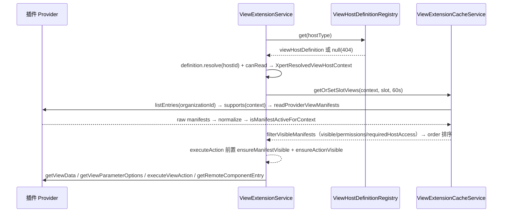

# 平台底座与集成专家 —— C1 能力契约

> 契约层 CR2 / CR5 / CR7。只写「对外可依赖的语义」：入口、参数行为、返回、异常与约束；路径均为仓库根相对 `file://` 引用。
> **资产基线**：`2026-10-16 · commit 80f5676fd`（批次 5 第 14 专家）。**逐端点明细**（完整字段、分页、错误码全集、鉴权矩阵）见 [implementation/05-接口.md](file://.module-experts/后端专题/平台底座与集成专家/implementation/05-接口.md)，本文不复制。

**本文引用的文件**（相对仓库根，链接均为 `file://`）

- [packages/server/src/data-source/data-source.controller.ts](file://packages/server/src/data-source/data-source.controller.ts)
- [packages/server/src/data-source/data-source.service.ts](file://packages/server/src/data-source/data-source.service.ts)
- [packages/server/src/data-source/data-source-runtime.service.ts](file://packages/server/src/data-source/data-source-runtime.service.ts)
- [packages/server/src/data-source/utils.ts](file://packages/server/src/data-source/utils.ts)
- [packages/server/src/integration/integration.controller.ts](file://packages/server/src/integration/integration.controller.ts)
- [packages/server/src/integration/integration-qr.controller.ts](file://packages/server/src/integration/integration-qr.controller.ts)
- [packages/server/src/integration/integration-qr.service.ts](file://packages/server/src/integration/integration-qr.service.ts)
- [packages/server/src/integration/integration.service.ts](file://packages/server/src/integration/integration.service.ts)
- [packages/server/src/integration/connector-app/connector-app-integration.service.ts](file://packages/server/src/integration/connector-app/connector-app-integration.service.ts)
- [packages/server/src/view-extension/view-extension.controller.ts](file://packages/server/src/view-extension/view-extension.controller.ts)
- [packages/server/src/view-extension/view-extension.service.ts](file://packages/server/src/view-extension/view-extension.service.ts)
- [packages/server/src/view-extension/view-extension.permission.service.ts](file://packages/server/src/view-extension/view-extension.permission.service.ts)
- [packages/server/src/view-extension/view-extension.cache.service.ts](file://packages/server/src/view-extension/view-extension.cache.service.ts)
- [packages/server/src/view-extension/host-definition.registry.ts](file://packages/server/src/view-extension/host-definition.registry.ts)
- [packages/server/src/view-extension/host-definition.interface.ts](file://packages/server/src/view-extension/host-definition.interface.ts)
- [packages/server/src/view-extension/hosts/integration-view-host.definition.ts](file://packages/server/src/view-extension/hosts/integration-view-host.definition.ts)
- [packages/server-ai/src/xpert-table/xpert-table.controller.ts](file://packages/server-ai/src/xpert-table/xpert-table.controller.ts)
- [packages/server-ai/src/xpert-table/xpert-table.service.ts](file://packages/server-ai/src/xpert-table/xpert-table.service.ts)
- [packages/server-ai/src/desktop-shell/desktop-shell.controller.ts](file://packages/server-ai/src/desktop-shell/desktop-shell.controller.ts)
- [packages/server-ai/src/desktop-shell/desktop-shell-auth.service.ts](file://packages/server-ai/src/desktop-shell/desktop-shell-auth.service.ts)
- [packages/server-ai/src/desktop-shell/desktop-shell-operation.service.ts](file://packages/server-ai/src/desktop-shell/desktop-shell-operation.service.ts)
- [packages/server-ai/src/desktop-shell/desktop-shell.gateway.ts](file://packages/server-ai/src/desktop-shell/desktop-shell.gateway.ts)
- [packages/server-ai/src/mobile/mobile.service.ts](file://packages/server-ai/src/mobile/mobile.service.ts)
- [packages/server-ai/src/initialization/bootstrap.service.ts](file://packages/server-ai/src/initialization/bootstrap.service.ts)
- [packages/server-ai/src/initialization/clawxpert-recovery.service.ts](file://packages/server-ai/src/initialization/clawxpert-recovery.service.ts)
- [packages/server-ai/src/ai-model/ai-model.service.ts](file://packages/server-ai/src/ai-model/ai-model.service.ts)
- [packages/server/src/tags/tag-management.service.ts](file://packages/server/src/tags/tag-management.service.ts)
- [packages/server/src/language/language.service.ts](file://packages/server/src/language/language.service.ts)
- [apps/cloud/src/app/@core/services/data-source-connection.service.ts](file://apps/cloud/src/app/@core/services/data-source-connection.service.ts)
- [apps/cloud/src/app/@core/services/integration.service.ts](file://apps/cloud/src/app/@core/services/integration.service.ts)
- [apps/cloud/src/app/@core/services/view-extension-api.service.ts](file://apps/cloud/src/app/@core/services/view-extension-api.service.ts)
- [apps/cloud/src/app/@core/services/xpert-table.service.ts](file://apps/cloud/src/app/@core/services/xpert-table.service.ts)

## 目录

1. [§1 HTTP 入口索引](#§1-http-入口索引)
2. [§2 服务能力契约](#§2-服务能力契约)
3. [§3 扩展点契约](#§3-扩展点契约)
4. [§4 代码示例（真实调用方）](#§4-代码示例真实调用方)
5. [§5 契约来源索引](#§5-契约来源索引)

## §1 HTTP 入口索引

全局前缀 `api`；模块前缀来自各自 `RouterModule.register`（`/data-source`、`/integration`、`/view-hosts`、`/languages`、`/country`、`/currency`、`/desktop-shell`、`/mobile`、`/ai-model`、`/tags`），`xpert-table` 与 `initialization/clawxpert` 由 `@Controller()` 决定。全站默认锁死（全局 `AuthGuard(['jwt','basic'])` + `PluginScopeGuard`），仅 `@Public()` 放行——下表「鉴权」列只写模块内额外守卫；**未列出的 `CrudController` 基类路由不在本索引**。

| 方法 | 路径 | 鉴权 | 用途 |
|---|---|---|---|
| `【integration】GET/POST` | `/api/integration` | 仅全局 AuthGuard | 分页列表（items 映射 `IntegrationPublicDTO`，`options` 被 `@Exclude`）/ 创建 201（`IntegrationUpsertCommand`） |
| `【integration】PUT/DELETE` | `/api/integration/:id` | 仅全局 AuthGuard | 更新 202（策略 `onUpdate`；provider 变更先 `onDelete(previous)`）/ 删除 202（`onDelete`） |
| `【integration】POST/GET` | `/api/integration/test`、`/providers`、`/select-options` | 仅全局 AuthGuard | 策略 `validateConfig` 试连（失败 500 透传）/ provider 清单 / 下拉（`features` 在 JS 侧 `every` 过滤） |
| `【integration-qr】POST/GET/DELETE` | `/api/integration/qr/providers/:provider`、`/qr/sessions/:id[/complete]` | `PermissionGuard` + `INTEGRATION_EDIT`（类级；`begin`/`poll` 带 `Cache-Control: no-store`） | begin → poll（尊重 `nextPollAt` 与退避）→ complete（session id 作集成 id，`created\|reused`）→ cancel |
| `【view-extension】GET` | `/api/view-hosts/:hostType/:hostId/slots/:slot/views`、`…/views/:viewKey/manifest` | `@Public` + `ApiKeyOrClientSecretAuthGuard` + `AllowClientSecretBindings(ENTERPRISE_XPERT)` | 槽位视图清单（`?isDraft`；60s 缓存）/ 单视图清单（权限过滤后） |
| `【view-extension】GET` | `…/views/:viewKey/data`、`…/views/:viewKey/remote-component/entry` | 同上 | 视图数据（TTL ≤30s，`cache.enabled=false` 直连）/ 远程组件 HTML（`Cache-Control: no-store`） |
| `【view-extension】GET/POST` | `…/parameters/:parameterKey/options`、`…/actions/:actionKey`、`…/actions/:actionKey/file` | 同上 | 参数下拉 / JSON 动作（`transport` 必须 json，`refresh` 即失效缓存）/ multipart 文件动作 |
| `【data-source】GET` | `/api/data-source` | `PermissionGuard` + `DATA_SOURCE_VIEW` | 租户内分页，items 映射 `DataSourcePublicDTO`（**唯一脱敏出口**） |
| `【data-source】GET/PUT` | `/api/data-source/:id` | 仅全局 AuthGuard | 详情（返回实体，`options` 原样；`$relations` 可展开 `authentications`）/ 更新（发 `DataSourceUpdatedEvent`） |
| `【data-source】POST` | `/api/data-source/ping` | 仅全局 AuthGuard | 未落库 ad-hoc 试连（body 即完整定义）；失败 500 透传 adapter message |
| `【data-source】POST` | `/api/data-source/:id/ping` | 仅全局 AuthGuard | 已落库试连（body 覆盖 + `authentications[].userId` 强制改写为当前用户） |
| `【data-source】GET` | `/api/data-source/sql-select-options`、`/sql-schema-select-options` | 仅全局 AuthGuard | `type.protocol='sql'` 数据源下拉 / catalog 选项（空参回 `[]`） |
| `【data-source】GET` | `/api/data-source/:id/catalogs`、`/:id/schema` | 仅全局 AuthGuard | catalog/schema 列举（每次新建 runner；失败 500，catalogs 常退化为「配置错误」；带 `statement` 走 `describe`） |
| `【data-source】POST` | `/api/data-source/:id/query`、`/:id/olap`、`/:id/capabilities/query` | query/olap 仅全局；capabilities 加 `DATA_SOURCE_VIEW` | 单条查询（400 透传）/ 批量 OLAP（逐项 `{id,status,data}`，整体 200）/ 能力查询（键正则先校验） |
| `【data-source】GET/POST/DELETE` | `/api/data-source/:id/authentication` | 仅全局 AuthGuard | 当前用户认证行读 / upsert（`validUntil=+30d`）/ 删；**无脱敏 DTO** |
| `【data-source】POST` | `/api/data-source/:id/load` | 仅全局 AuthGuard | `FileInterceptor('file')` + `params`(JSON) → `DataLoadCommand`（xlsx/csv 装载） |
| `【xpert-table】POST/PUT` | `/api/xpert-table`、`/api/xpert-table/:id` | 仅全局 AuthGuard | `upsertTable`：建/改逻辑表并**立即激活**物理表（ACTIVE 改名先 `RENAME_TABLE`） |
| `【xpert-table】GET` | `/api/xpert-table/databases`、`/schemas` | databases：`PermissionGuard` + `DATA_SOURCE_VIEW`；schemas 仅全局 | 可激活目标库（`XpertDatabasesQuery({protocol:'sql'})`）/ 目标库 catalog（失败 400） |
| `【xpert-table】POST/DELETE` | `/api/xpert-table/:id/activate`、`/api/xpert-table/:id` | 仅全局 AuthGuard | 显式激活（无列 400；失败置 `error` 抛 400）/ 删除 204：ACTIVE 先 `DROP_TABLE`（失败仅日志）再软删 |
| `【language/contact】GET` | `/api/languages`、`/api/languages/getByName/:name`、`/api/contact`（**未挂载**） | language 方法级 `@Public`；contact 类级 `TenantPermissionGuard` | 语言分页 / 按 name 查单条（软失败回 `null`）/ 联系人分页——`ContactModule` 未被注册，路由不存在 |
| `【country/currency】GET` | `/api/country`、`/api/currency` | 类级 `@Public` | 全量国家 / 货币字典（`isoCode` + 名称；`isoCode` 仅非唯一索引） |
| `【desktop-shell】POST` | `/api/desktop-shell/devices`、`/devices/:id/refresh`、`/devices/:id/disable` | 全局 AuthGuard + `currentShellScope()` | 注册（返回一次性 `token=<id>.<secret>`）/ 轮换凭据 / 禁用（级联禁 grant + 在途操作 → `cancel_requested`） |
| `【desktop-shell】POST` | `/devices/:id/grants`、`/devices/:id/prepare`、`/grants/:id/decision`、`/grants/:id/revoke` | 同上 | 签发会话授权 / 准备命令（`argsHash` + `pending`，只路由不执行）/ 批准或拒绝（409 `OPERATION_CONFLICT`）/ 撤销 |
| `【desktop-shell】GET/POST` | `/operations?deviceId=`、`/operations/:id/cancel` | 同上 | 最近 20 条结果（stdout/stderr、`nextCursor`、`truncated`、`error.code`）/ 取消操作 |
| `【desktop-shell】WS` | `ws(s)://<api-host>/desktop-shell`（`NAMESPACE`，协议 `VERSION=1`） | 握手校验 `version` + `token` → `connectionEpoch` + 90s 租约 | 上行 `ready/command/lease/ack/reconcile/revoked`；下行 `heartbeat/report/rejected` |
| `【mobile/initialization】GET/POST` | `/api/mobile/bootstrap`、`/api/mobile/xperts`、`/api/initialization/clawxpert` | 无守卫（service 内 401 / `requireCurrentMember` 403） | 部署配置与投影 / 已发布 Agent 列表（limit ≤100）/ ClawXpert 状态与恢复；**bootstrap 本身无 HTTP 面**（Bull 队列） |
| `【ai-model/tags】GET/POST/PUT/DELETE` | `/api/ai-model/provider/:name/:iconType/:lang`、`/api/tags[/directory\|/categories]` | ai-model 方法级 `@Public`；tags 类级 `TenantPermissionGuard`，写操作加 `ORG_TAGS_EDIT` | Provider 图标二进制（404 `Icon not found`）/ 标签目录与分类（`soft`、`recover` 恒 400） |
| `【export-import】GET/POST` | `/api/import`（**未挂载**） | — | `ImportAllModule` 无人 import；POST 只落 `import-history`，核心逻辑注释 |

**继承面（不在上表）**：`data-source` 7 条、`xpert-table` 7 条、`integration` 6 条、`contact` 9 条由 `CrudController` 基类提供，鉴权只继承类级元数据；`tags` 另有 4 条继承（`count`/`pagination`/`my`/`GET :id`）。

章节来源：[data-source.controller.ts](file://packages/server/src/data-source/data-source.controller.ts)（关键符号：findAlls / findOneById / updateOne / ping / query / olap / queryCapability / load）、[integration.controller.ts](file://packages/server/src/integration/integration.controller.ts)（关键符号：getAll / connect / getSelectOptions / getProviders）、[desktop-shell.controller.ts](file://packages/server-ai/src/desktop-shell/desktop-shell.controller.ts)（关键符号：register / refresh / disable / grant / prepare / decision / revoke / list / cancel）

## §2 服务能力契约

| `类.方法(签名)` | 用途 | 参数行为语义 | 返回 | 异常 / 约束 |
|---|---|---|---|---|
| `LanguageService.findAll(query)/findOneByName(name)/initialize()` | 语言字典读与全量初始化 | `findAll` 直接转发基类（无 order 声明）；`initialize()` → `createLanguages(connection)` 遍历 `all-languages.ts`，`is_system` 由 `LanguagesEnum` 判定 | `IPagination<ILanguage>` / `ILanguage` / `void` | `findOneByName` 未命中回 `null`；重复初始化唯一冲突被 try/catch 吞掉（静默失败） |
| `createCountries(connection)/createCurrencies(connection)` | 国家 / 货币种子 | 以 `insert().into().values(DEFAULT_COUNTRIES\|DEFAULT_CURRENCIES)` 直插 | `Promise<void>` | 无去重；失败 `reject(null)`；由 `seed-data.service` 基础种子阶段调用 |
| `ContactService.saveContact(request)` / `ContactController.getAllContact` | 联系人写入与列表 | `saveContact` 仅 `repository.save`，无去重、无唯一键；`getAllContact` 用 `ParseJsonPipe` 解析 `data` | `Contact` / `IPagination<Contact>` | 模块未挂载——以上路由运行期不存在 |
| `TagManagementService.write(input,id?)/remove(id)/directory()/usage()` | 标签写路径与使用量目录 | `write` 在事务内对 `Tenant` 行加悲观写锁，zod `inputSchema` 校验（name ≤100、`label{en_US,zh_Hans}`、targets ∈ `TAG_TARGETS`），大小写不敏感重名检查 + `targets→category` 回填；`remove` 要求 usage 计数为 0 | `Tag` / 目录与计数 | 400 `Error.TagTargetInUse` / `Error.TagUsageUnsupported`（未登记 junction）；软删/恢复被显式拒绝 |
| `DataSourceService.prepareDataSource(id, patch?)` | 全部数据源动作的前置 | 要求 `tenantId`+`organizationId` 同时存在（否则 403 `Data source scope is required`）；按 `{id,tenantId,organizationId}` 查库并带 `relations:['type','authentications']`；`authType=BASIC` 时按**当前用户**取认证行并把 `username/password` 注入 `options` | 组装后的 `DataSource` | 403 scope 缺失；404 未命中 / `未找到当前用户认证信息` |
| `DataSourceService.getCatalogs(id)/getSchema(id,catalog?,table?,statement?)/query(id,statement,options?)/queryCapability(id,query)/olap(dataSource,body,acceptLanguage?)` | 外部库代理 | 每次都 `DataSourceStrategyQuery(type,options)` → runner，`finally teardown()`；`statement` 直连 `runner.describe`；`olap` 在 `type.protocol!=='xmla'` 时改投 `OLAP_HOST:OLAP_PORT/xmla` | `IDSSchema[]` / 查询结果 | catalogs 失败被替换为 `配置错误`；`queryCapability` 先正则校验键（capability ≤128、operation ≤64），adapter 未实现即 400 |
| `DataSourceService.ping(dataSource)` / `ping(id, dataSource?)` / `getMyAuthentication(id)` / `createAuthentication(id, auth)` / `deleteAuthentication(id)` | 连接测试与个人凭据 | `ping` 两式分别走 `prepareDataSource(对象)` 与 `prepareDataSource(id, 覆盖体)`；认证 upsert 按 `{tenantId,dataSourceId,userId}`，`validUntil` 固定 `now+30d` | `void` / 认证行 | ping 失败抛 `err.message`（HTTP 层 500）；`getMyAuthentication` 未命中 404 |
| `DataSourceRuntimeService.list(actor)/open(actor, id, write)` | 插件运行时唯一出口 | 要求 actor 的 tenant/organization/user 与 `RequestContext` 逐项相等且持 `DATA_SOURCE_VIEW\|EDIT`；`list` 只回 `{id,name,engine}`（pg→postgres）；`open` 限引擎白名单与 `engineCatalog==='internal'`，以 `updatedAt` 做 revision 复核，返回**不暴露 runner 与解析后凭据**的方法代理（写操作再校验 EDIT） | 受限列表 / 会话代理 | 403 `Data source changed; reopen the connection` 等 |
| `XpertTableService.upsertTable(entity)/activateTable(tableId)/deleteTable(tableId)/getDatabaseSchemas(databaseId)` | 逻辑表 Meta 与物理表生命周期 | `upsertTable` 先 `validateTableName`（物理表探测 + 逻辑行 id 比对，更新异常放行、新建拒绝），ACTIVE 改名先 `RENAME_TABLE`，再激活；`activateTable` 先置 `PENDING_ACTIVATION`，`columns` 清洗后 `tableOp(CREATE_TABLE, UPGRADE)` → `ACTIVE`+`activatedAt`，失败置 `ERROR`+`message` | `XpertTable` / `IDSSchema[]` | 400 `Table name S.T already exists…` / `Table must have at least one column to activate.` / `Table activation failed: …`；DDL 与元数据不同事务 |
| `XpertTableService.insertRow(tableId,row)/executeSql(tableId,statement)` | 行插入与任意 SQL | 两者都要求 `status===ACTIVE`；`insertRow` 把 `[{name,value,type}]` 转 `tableDataOp(DBTableDataAction.INSERT)`；`executeSql` 直通 `adapter.runQuery` | 执行结果 | 400 `Table <name> is not active.`；**无 HTTP 面**，只经 `DB_SQL`/`DB_INSERT` 节点策略暴露 |
| `IntegrationService.getProviders()/getIntegrationStrategy(type,organizationId?)/test(integration)/applyStrategyValidation(...)/runStrategyUpdateHook(previous,current)/runStrategyDeleteHook(integration)/ensurePrincipalUser(integrationOrId)` | 集成实例门面与生命周期 | `getProviders` 合并静态 `INTEGRATION_PROVIDERS` 与策略注册表 meta；`applyStrategyValidation` 调策略 `validateConfig` 后**只回填六个白名单字段**；`runStrategyUpdateHook` 在 provider 变更时先 `onDelete(previous)`；`ensurePrincipalUser` 用 `thirdPartyId='integration:<id>'` 补技术主体 | provider 清单 / 校验后补丁 / `IIntegration` | 策略异常统一降级 400（`test` 为 500） |
| `IntegrationQrService.begin(provider,input)/poll(id)/complete(id)/cancel(id)` | 扫码授权 Redis 状态机 | `begin` zod 校验 `{name,description,avatar}`，按 `tenant:org:user:provider:purpose` 串行（同键旧会话先 cancel），`expiresAt` 夹在 30..600s；`poll` 未到 `nextPollAt` 直回状态，否则先写回再调 provider（防重入）；`complete` 仅 `authorized` 可落库，session id 预占集成 id | 会话 / `{id,name,slug,provider,outcome}` | 404 `IntegrationQrExpired`（不存在/过期/越权统一）；409 `INTEGRATION_QR_BUSY`；502 `IntegrationQrUnavailable`/`IntegrationQrPollFailed` |
| `ConnectorAppIntegrationService.list()/select()/create(...)` | connector 侧受限集成面 | `list/select` 只回 `{id,name,organizationId}`；`create` 要求 `RolePermissionCheck(INTEGRATION_EDIT)`，按 `slug = connector-{bindingId}-{requestId}` 去重（`orIgnore` + 回查）并逐字段比对防篡改 | 公开投影 / 新集成 | 篡改即拒；并发重试不重复建行 |
| `ViewExtensionService.listSlotViews(hostType,hostId,slot,options?)/getViewData(hostType,hostId,viewKey,query)/getViewManifest(...)/getRemoteComponentEntry(...)/getViewParameterOptions(...,parameterKey,query?)/executeAction(...,actionKey,request)/executeFileAction(...,actionKey,request,file)` | 视图扩展全部编排入口 | 统一链路：`resolveHostContext` → `resolveProviderManifest` → `ensureManifestVisible`；清单 60s 缓存；数据 TTL `min(manifest.dataSource.cache.ttlMs, 30s)`；动作要求 `transport='json'`，`result.refresh` 触发 `invalidateView` | 清单 / 数据 / HTML / 动作结果 | 404 宿主/视图/参数/动作未找到；400 非远程组件或 transport 非 json；403 权限不足 |
| `ViewHostDefinitionRegistry.onModuleInit()/get(hostType)` + `ViewExtensionPermissionService.assertHostReadable/filterVisibleManifests/ensureActionVisible/hasRequiredHostAccess` + `ViewExtensionCacheService.invalidateHost/invalidateView/clearAll` | 宿主注册表、权限过滤与三级缓存失效 | 注册表启动期用 `DiscoveryService` + `Reflector.get(VIEW_HOST_DEFINITION)` 建 `Map`；权限服务把 `visible/permissions/requiredHostAccess` 映射到 `canRead/canEdit/canManage`；缓存失效两条链：实体订阅者（host identity）+ `StrategyBus.events$`（`clearAll`） | 定义或 `null` / 过滤后清单 / `void` | 宿主未注册即 `Unknown view host`；注册表为进程内内存，新增宿主需重启 |
| `DesktopShellAuthService.register(body)/refresh(deviceId)/authenticate(token)/issueGrant(deviceId,assistantId,threadId)/prepareOperation(deviceId,body)/decideOperation(id,decision)/revokeGrant(id)/disable(id)` + `DesktopShellOperationService.execute/receive/cancel/result/wait/notify` + `DesktopShellGateway` | 设备、授权与命令执行 | `register` 只存 `sha256(secret)` 与 8h 过期，明文 token 只回一次；`prepareOperation` 写 `{runId,toolCallId,argsHash,decision:'pending'}` 并把 grant 压到 ≤10min；`decideOperation` 悲观锁只允许 `pending→approved\|rejected`；`execute` 事务内复核 `runId/toolCallId/argsHash` 全等 + 设备 lease；WS 每 1s 巡检重派发并标 `unknown` | 设备/授权/操作行 | 400 `INVALID_MESSAGE`；403 `GRANT_REVOKED`；404 `NOT_FOUND`；409 `OPERATION_CONFLICT`/`DEVICE_OFFLINE`/`DEVICE_BUSY`；`EXECUTION_UNKNOWN` |
| `MobileService.getBootstrap()/listXperts({search,limit,offset})` | 移动端只读投影 | `getBootstrap` 以 `RequestContext.currentUserId()` 为唯一身份（缺失 401），组织列表按「ADMIN 恒 membership / 非 ADMIN 且有 `ALL_ORG_VIEW\|ALL_ORG_EDIT` 才列全租户」；`listXperts` 固定 `{type:Agent, latest:true}` 走 `PublishedXpertAccessService` | `XpertMobileBootstrap` / `XpertMobileXpertsResponse` | 401；`assistantBindings` 解析失败静默丢弃 |
| `ServerAIBootstrapService.bootstrapOrganization/bootstrapUserInOrganization/...` + `ClawXpertRecoveryService.getStatus()/recover()` | 引导队列与恢复 | 4 个 `@OnEvent` 入队（jobId `org-bootstrap:{id}` 等，`attempts:3, backoff:10_000`），6 个 `@Process` 执行；`bootstrapUserInOrganization` 先 `isActiveOrganizationMember`；`recover` 对 failed job 用 `existing.retry()`（原子，不重复入队） | job 结果 / 恢复状态 | 403 `Error.ClawXpertRecoveryRequiresMember`；`canRecover` 对 `SUPER_ADMIN` 为 false |
| `AIProvidersService.getProvider(name, throwError?, organizationId?)/providerCredentialsValidate(provider, credentials)` | Provider 门面与凭证校验 | `getProvider` 命中返回策略，未命中按 `throwError` 抛错或回 `undefined`；`providerCredentialsValidate` 取 `provider_credential_schema` → `validateAndFilter` 裁剪 → `validateProviderCredentials` 真实校验，返回**过滤后**凭据 | provider 策略 / 过滤后凭据 | `AIModelProviderNotFoundException`；缺 schema 即抛；**不做加密**（handler 留有 encrypt TODO） |

章节来源：[data-source.service.ts](file://packages/server/src/data-source/data-source.service.ts)（关键符号：prepareDataSource / queryCapability / createAuthentication）、[integration-qr.service.ts](file://packages/server/src/integration/integration-qr.service.ts)（关键符号：begin / poll / complete / read / lock）、[xpert-table.service.ts](file://packages/server-ai/src/xpert-table/xpert-table.service.ts)（关键符号：upsertTable / activateTable / deleteTable）、[desktop-shell-auth.service.ts](file://packages/server-ai/src/desktop-shell/desktop-shell-auth.service.ts)（关键符号：prepareOperation / decideOperation / execute 复核）

## §3 扩展点契约

**宿主注册契约（服务端新增一个视图宿主）**

| 项 | 契约 | 失败行为 |
|---|---|---|
| 声明 | `@ViewHostDefinition(hostType)` 标注 + 实现 `ViewHostDefinitionContract`（`hostType`/`slots`/`resolve`/`canRead`，可选 `prepareFileAction`） | 未标注则启动期不进入注册表 |
| 注册 | `ViewHostDefinitionRegistry.onModuleInit` 用 `DiscoveryService.getProviders()` + `Reflector` 建 `Map<hostType, definition>`；`get(hostType)` 未命中回 `null` | 404 `Unknown view host '<hostType>'` |
| 解析 | `resolve(hostId, options?)` → `{ hostSnapshot?, workspaceId?, context? }`；宿主自行收敛租户边界（示例宿主用 `findOneByIdWithinTenant`） | 404 `View host '<hostType>:<hostId>' was not found` |
| 读权限 | `canRead(context, resolution, options?)`；示例宿主要求 `INTEGRATION_VIEW\|INTEGRATION_EDIT` | 403 `No permission to access this view host` |
| 槽位 | `readonly slots: XpertViewSlot[]`（`key`/`mode`/`order`） | 404 `Slot '<slot>' is not available for host '<hostType>'` |
| 缓存 | 宿主解析结果进入 `XpertResolvedViewHostContext`（含 `slots`/`hostState`/`capabilities`）；清单键把 `features + hostState` 的 sha1 摘要并入 | 激活态变化后不会命中旧清单 |
| 文件动作 | 可选 `prepareFileAction(context, request, file)` 返回改写后的 request；动作仍要求 manifest/action 可见且 `transport='json'` | 未实现则跳过该钩子 |

**清单 → 动作链（服务端每一步的判定顺序）**：`provider.supports(context)` → 读该 slot 的 manifests → `normalizeManifest`（补 providerKey/order/默认值）→ `isManifestActiveForContext`（按 `activation.requiredFeatures`）→ `filterVisibleManifests`（`visible`/`permissions`/`requiredHostAccess` → `canRead|canEdit|canManage`）→ 按 `order` 排序；动作执行前必须过 `ensureManifestVisible` + `ensureActionVisible`；单个 provider 抛错只 `logger.warn`，不影响整体清单。

**插件侧提供视图的接口面**

| 面 | 方法 / 字段 | 语义 |
|---|---|---|
| 提供者注册表 | `ViewExtensionProviderRegistry.listEntries(organizationId)` | 按组织列出 provider（`providerKey` 唯一）；注册表为进程内内存 |
| 支持判定 | `provider.supports(context)` | 返回 false 即跳过；单 provider 异常被隔离 |
| 清单读取 | `provider.readProviderViewManifests`（读该 slot 的全部 manifest） | 原始清单须经 `normalizeManifest` 归一 |
| 激活断言 | `manifest.activation.requiredFeatures` | 与宿主 `features`/`hostState` 不匹配即不显示 |
| 数据 | `provider.getViewData(context, manifestKey, query)` | 缓存 TTL = `min(manifest.dataSource.cache.ttlMs, 30s)`；`cache.enabled=false` 直连 |
| 参数 | `provider.getViewParameterOptions(context, manifestKey, parameterKey, query)` | provider 未实现回 `{ items: [] }` |
| 动作 | `provider.executeViewAction(context, manifestKey, actionKey, request)` | `result.refresh` 为真则失效该视图缓存 |
| 远程组件 | `provider.getRemoteComponentEntry(context, manifestKey, component)` | 硬约束：`view.type='remote_component'`、runtime 受支持、`protocolVersion===1`、`component.isolation='iframe'`、entry key 校验 |
| 文件访问 | `manifest.fileAccess?.purposes` | 与 `ViewExtensionService` 的文件会话/授权端点联动校验 |
| 缓存令牌 | `VIEW_EXTENSION_CACHE_SERVICE_TOKEN` | `ViewExtensionModule` 为 `@Global()`，插件可注入 `ViewExtensionCacheService` |


图表来源：[view-extension.service.ts](file://packages/server/src/view-extension/view-extension.service.ts)（关键符号：resolveHostContext / listSlotViews / executeAction）、[view-extension.cache.service.ts](file://packages/server/src/view-extension/view-extension.cache.service.ts)（关键符号：getOrSetSlotViews / getManifestCacheKey）、[host-definition.interface.ts](file://packages/server/src/view-extension/host-definition.interface.ts)（关键符号：ViewHostDefinitionContract）

章节来源：[host-definition.registry.ts](file://packages/server/src/view-extension/host-definition.registry.ts)（关键符号：onModuleInit / get）、[integration-view-host.definition.ts](file://packages/server/src/view-extension/hosts/integration-view-host.definition.ts)（关键符号：ViewHostDefinition('integration') / slots / resolve / canRead）、[view-extension.permission.service.ts](file://packages/server/src/view-extension/view-extension.permission.service.ts)（关键符号：filterVisibleManifests / ensureActionVisible）

## §4 代码示例（真实调用方）

### ① 建一个外部数据源并测连接

```ts
// 真实调用方：apps/cloud/src/app/@core/services/data-source-connection.service.ts
async ping(dataSource: DataSourcePingInput): Promise<unknown> {
  if (dataSource.authType !== AuthenticationEnum.BASIC) {
    return this.executePing(dataSource)
  }
  const authentication = await this.resolveAuthentication(dataSource)   // 已存则读 GET /:id/authentication；否则弹窗录入
  if (!authentication) throw new Error('XP.MESSAGE.UserAuthenticationFailure')
  if (dataSource.id) return this.executePing(dataSource)
  return this.executePing({ ...dataSource, authentications: [authentication] })
}

private executePing(dataSource: DataSourcePingInput): Promise<unknown> {
  return firstValueFrom(
    dataSource.id ? this.#dataSourceService.ping(dataSource.id, dataSource) : this.#dataSourceService.ping(dataSource)
  )
}
```

要点：未落库走 `POST /api/data-source/ping`（body 即完整定义 + `authentications`），已落库走 `POST /api/data-source/:id/ping`（服务端 `prepareDataSource(id, 覆盖体)` 会把 `authentications[].userId` 改写为当前用户并从 `data_source_authentication` 注入凭据）；`authType=BASIC` 且当前用户无认证行时服务端抛 404 `未找到当前用户认证信息`。建源本身走 `POST /api/data-source`（类级 `DATA_SOURCE_EDIT`），凭据存在**独立表**而非 `options`。

### ② 集成扫码授权全流程

```ts
// 真实调用方：apps/cloud/src/app/@core/services/integration.service.ts
beginQrAuthorization(provider: string, input: TIntegrationQrCreateInput) {
  return this.httpClient.post<TIntegrationQrSession>(`${this.apiBaseUrl}/qr/providers/${encodeURIComponent(provider)}`, input)
}
pollQrAuthorization(id: string) {
  return this.httpClient.get<TIntegrationQrResult>(`${this.apiBaseUrl}/qr/sessions/${encodeURIComponent(id)}`)
}
completeQrAuthorization(id: string) {
  return this.httpClient.post<TIntegrationQrCompletion>(`${this.apiBaseUrl}/qr/sessions/${encodeURIComponent(id)}/complete`, {})
}
cancelQrAuthorization(id: string) {
  return this.httpClient.delete<void>(`${this.apiBaseUrl}/qr/sessions/${encodeURIComponent(id)}`)
}
```

要点：会话是 **Redis-only**（`integration:qr:session:<id>`，TTL 夹在 30..600s），`poll` 受 `nextPollAt` 与 provider 退避增量节流（上限 600s）；`complete` 只有 `authorized` 才落库，**用 session id 作新集成 id** 使崩溃重试幂等（命中既有行则合并 `options` + 跑 `onUpdate`，`outcome='reused'`），会话过期/越权/不存在统一 404，并发抢锁失败 409 `INTEGRATION_QR_BUSY`。

### ③ 注册并读取一个视图宿主

```ts
// 真实调用方：packages/server/src/view-extension/hosts/integration-view-host.definition.ts
@Injectable()
@ViewHostDefinition('integration')
export class IntegrationViewHostDefinition implements ViewHostDefinitionContract {
  readonly hostType = 'integration'
  readonly slots: XpertViewSlot[] = [{ key: 'detail.main_tabs', mode: 'tabs', order: 0 }]

  constructor(private readonly integrationService: IntegrationService) {}

  async resolve(hostId: string) {
    const integration = await this.integrationService.findOneByIdWithinTenant(hostId, RequestContext.currentTenantId())
    return { hostSnapshot: { id: integration.id, name: integration.name, provider: integration.provider, /* … */ } }
  }

  canRead() {
    return RequestContext.hasAnyPermission([PermissionsEnum.INTEGRATION_VIEW, PermissionsEnum.INTEGRATION_EDIT], false)
  }
}
```

```ts
// 真实调用方：packages/server/src/view-extension/host-definition.registry.ts（启动期扫描）
onModuleInit() {
  for (const wrapper of this.discoveryService.getProviders()) {
    const { instance } = wrapper
    if (!instance) continue
    const hostType = this.reflector.get<string>(VIEW_HOST_DEFINITION, instance.constructor)
    if (!hostType) continue
    this.definitions.set(hostType, instance as ViewHostDefinitionContract)
  }
}
```

前端读取（真实调用方：`view-extension-api.service.ts`）：`getSlotViews(hostType, hostId, slot)` → `GET /api/view-hosts/{hostType}/{hostId}/slots/{slot}/views`（带 `?isDraft` 与运行时 scope 头 `X-Xpert-View-Project-Id`/`X-Xpert-View-Conversation-Id`）。新增宿主的成本是「一个 provider 类」，但注册表是进程内内存——**新增/升级插件后需重启宿主进程**；注意示例宿主的 `hostSnapshot` 会把 `options.botToken` 等字段带给视图侧，收敛依赖 `canRead`。

### ④ 激活一张 xpert-table 物理表

```ts
// 真实调用方：apps/cloud/src/app/@core/services/xpert-table.service.ts
activateTable(tableId: string) {
  return this.httpClient.post<IXpertTable>(`${this.apiBaseUrl}/${tableId}/activate`, {})
}
```

服务端语义（`XpertTableService.activateTable`，真实源码）：无列直接 `BadRequestException('Table must have at least one column to activate.')`；随后 `status=PENDING_ACTIVATION` → 取 `XpertDatabaseAdapterQuery(database)` → `columns` 清洗（空字符串默认值置 `undefined`，`isPrimaryKey→isKey`）→ `tableOp(CREATE_TABLE, { createMode: UPGRADE })`；成功置 `ACTIVE` + `activatedAt` + 清 `message`，失败置 `ERROR` + `message` 并抛 400。走 `POST/PUT /api/xpert-table` 的 `upsertTable` 会自动激活：**激活失败时新表硬删逻辑行、既有表只标 ERROR**；`DELETE /:id` 在 ACTIVE 时先 `DROP_TABLE`（失败仅记日志）再软删——DDL 与元数据不在同一事务，改动前先设计补偿。

章节来源：[data-source-connection.service.ts](file://apps/cloud/src/app/@core/services/data-source-connection.service.ts)（关键符号：ping / resolveAuthentication / executePing）、[integration.service.ts](file://apps/cloud/src/app/@core/services/integration.service.ts)（关键符号：beginQrAuthorization / pollQrAuthorization / completeQrAuthorization）、[xpert-table.service.ts](file://packages/server-ai/src/xpert-table/xpert-table.service.ts)（关键符号：upsertTable / activateTable / deleteTable）

## §5 契约来源索引

| 契约条目 | 来源 |
|---|---|
| 数据源 CRUD、连接测试、catalog/schema、查询代理、OLAP、capability、个人认证、装载 | `packages/server/src/data-source/data-source.controller.ts`、`data-source.service.ts`、`utils.ts`、`dto/public.dto.ts` |
| 插件运行时数据源会话（actor 授权 / 引擎白名单 / revision 复核） | `packages/server/src/data-source/data-source-runtime.service.ts` |
| 逻辑表 Meta、物理表激活/改名/删除、行插入、任意 SQL、目标库清单 | `packages/server-ai/src/xpert-table/xpert-table.controller.ts`、`xpert-table.service.ts`、`plugins/{sql,insert}/strategy.ts` |
| 集成定义 CRUD、策略校验与生命周期钩子、provider 目录、principal 用户 | `packages/server/src/integration/integration.controller.ts`、`integration.service.ts`、`dto/integration-public.dto.ts` |
| 扫码授权会话（begin/poll/complete/cancel、身份归并、锁与幂等） | `packages/server/src/integration/integration-qr.controller.ts`、`integration-qr.service.ts` |
| connector 受限集成面（公开投影、slug 重试幂等、篡改比对） | `packages/server/src/integration/connector-app/connector-app-integration.service.ts`、`resolve-connector-integration.handler.ts` |
| 视图扩展七路由、宿主解析、清单/数据/参数/动作、远程组件入口 | `packages/server/src/view-extension/view-extension.controller.ts`、`view-extension.service.ts`、`view-extension.utils.ts` |
| 宿主注册契约与示例宿主 | `packages/server/src/view-extension/host-definition.interface.ts`、`host-definition.decorator.ts`、`host-definition.registry.ts`、`hosts/integration-view-host.definition.ts` |
| 权限过滤、缓存与失效链 | `packages/server/src/view-extension/view-extension.permission.service.ts`、`view-extension.cache.service.ts`、`subscribers/integration-view-host-cache.subscriber.ts` |
| 桌面壳 9 条 HTTP、设备/授权/执行不变量、WS 协议与 LIMITS、3 表 2 迁移 | `packages/server-ai/src/desktop-shell/desktop-shell.controller.ts`、`desktop-shell-auth.service.ts`、`desktop-shell-operation.service.ts`、`desktop-shell.gateway.ts`、`migrations/*.sql`、`packages/desktop-protocol/index.d.ts` |
| 移动端 bootstrap 与助手列表 | `packages/server-ai/src/mobile/mobile.controller.ts`、`mobile.service.ts`、`packages/contracts/src/ai/mobile.model.ts` |
| 初始化引导队列与 ClawXpert 恢复（无 bootstrap HTTP 面） | `packages/server-ai/src/initialization/bootstrap.processor.ts`、`bootstrap.service.ts`、`clawxpert-recovery.controller.ts`、`clawxpert-recovery.service.ts` |
| Provider 目录门面与凭证 schema 校验 | `packages/server-ai/src/ai-model/ai-model.controller.ts`、`ai-model.service.ts` |
| 字典族（language/country/currency/contact）与种子 | `packages/server/src/language/**`、`country/**`、`currency/**`、`contact/**`、`core/seeds/seed-data.service.ts` |
| 标签目录、写路径、usage 扫描 | `packages/server/src/tags/tag.controller.ts`、`tag-management.service.ts`、`tag.entity.ts` |
| 通用导入（未挂载，现状口径） | `packages/server/src/export-import/import/import-all.controller.ts`、`import-all.module.ts` |
| 逐端点明细、鉴权矩阵与错误语义全集 | [implementation/05-接口.md](file://.module-experts/后端专题/平台底座与集成专家/implementation/05-接口.md)（本文不复制） |

章节来源：[data-source.controller.ts](file://packages/server/src/data-source/data-source.controller.ts)（关键符号：DataSourceController extends CrudController）、[view-extension.controller.ts](file://packages/server/src/view-extension/view-extension.controller.ts)（关键符号：ViewExtensionRoutes / ViewExtensionController / @AllowClientSecretBindings）、[desktop-shell.controller.ts](file://packages/server-ai/src/desktop-shell/desktop-shell.controller.ts)（关键符号：DesktopShellController）
