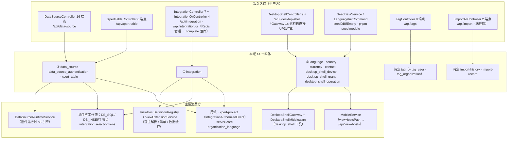

# C4 数据流向与消费（平台底座与集成专家）

> 口径：表结构与索引以实现层 [04-模型.md](file://.module-experts/后端专题/平台底座与集成专家/implementation/04-模型.md) 与源码实体为唯一权威（除 desktop-shell 两份 SQL 外，其余表**无基线 DDL 可对照**）。**逐条实测 `@Entity(...)` 计数 = 14 个实体**：核心 11（`data-source` 2 + `integration` 1 + `xpert-table` 1 + 字典族 4 + `desktop-shell` 3）+ `tags` 1（另有 2 张显式 `@JoinTable`：`tag_user`、`tag_organization`）+ `export-import` 2。**实测 0 表模块**：`view-extension`、`mobile`、`initialization`、`ai-model`。
> 消费方为类级/模块级概括，跨 3 个以上消费者时归纳为模块族；**本批 14 表未发现任何加密列**，凭据类列按实测逐一标注（详见子域②、③）。未能证实处标 `[推测]`。

**本文引用的文件**
- [data-source.entity.ts](file://packages/server/src/data-source/data-source.entity.ts) · [authentication.entity.ts（data-source）](file://packages/server/src/data-source/authentication/authentication.entity.ts) · [xpert-table.entity.ts](file://packages/server-ai/src/xpert-table/xpert-table.entity.ts) · [base.entity.ts（server-ai core）](file://packages/server-ai/src/core/entities/base.entity.ts)
- [integration.entity.ts](file://packages/server/src/integration/integration.entity.ts) · [integration-qr.service.ts](file://packages/server/src/integration/integration-qr.service.ts) · [integration-view-host.definition.ts](file://packages/server/src/view-extension/hosts/integration-view-host.definition.ts) · [integration-view-host-cache.subscriber.ts](file://packages/server/src/view-extension/subscribers/integration-view-host-cache.subscriber.ts)
- [desktop-shell.entities.ts](file://packages/server-ai/src/desktop-shell/desktop-shell.entities.ts) · [20260924-desktop-shell.sql](file://packages/server-ai/src/desktop-shell/migrations/20260924-desktop-shell.sql) · [20260928-desktop-shell-approval.sql](file://packages/server-ai/src/desktop-shell/migrations/20260928-desktop-shell-approval.sql) · [desktop-shell.gateway.ts](file://packages/server-ai/src/desktop-shell/desktop-shell.gateway.ts)
- [language.entity.ts](file://packages/server/src/language/language.entity.ts) · [country.entity.ts](file://packages/server/src/country/country.entity.ts) · [currency.entity.ts](file://packages/server/src/currency/currency.entity.ts) · [contact.entity.ts](file://packages/server/src/contact/contact.entity.ts)
- [tag.entity.ts](file://packages/server/src/tags/tag.entity.ts) · [tag-management.service.ts](file://packages/server/src/tags/tag-management.service.ts) · [import-history.entity.ts](file://packages/server/src/export-import/import-history/import-history.entity.ts) · [import-record.entity.ts](file://packages/server/src/export-import/import-record/import-record.entity.ts) · [import-all.module.ts](file://packages/server/src/export-import/import/import-all.module.ts) · [server.module.ts](file://packages/server/src/server.module.ts)

## 目录
1. [总览：写入入口 → 表 → 消费方](#总览写入入口--表--消费方)
2. [子域① 集成与扩展点（1 张表）](#子域-集成与扩展点1-张表)
3. [子域② 数据源与表格（3 张表）](#子域-数据源与表格3-张表)
4. [子域③ 基础字典与客户端壳（7 张表）](#子域-基础字典与客户端壳7-张表)
5. [归属结论：tags 与 export-import](#归属结论tags-与-export-import)
6. [本域写 vs 跨域消费](#本域写-vs-跨域消费)
7. [口径核对与未确认项](#口径核对与未确认项)

## 总览：写入入口 → 表 → 消费方

图表来源：[data-source.entity.ts](file://packages/server/src/data-source/data-source.entity.ts)（关键符号：DataSource / DataSourceAuthentication）、[integration.entity.ts](file://packages/server/src/integration/integration.entity.ts)（关键符号：Integration / tags M2M）、[desktop-shell.entities.ts](file://packages/server-ai/src/desktop-shell/desktop-shell.entities.ts)（关键符号：DesktopShellDevice / Grant / Operation）、[xpert-table.entity.ts](file://packages/server-ai/src/xpert-table/xpert-table.entity.ts)（关键符号：XpertTable / WorkspaceBaseEntity）

三个互不重叠的持久面：**连接配置**（`data_source`、`data_source_authentication`、`integration`）、**元数据与字典**（`xpert_table` + language/country/currency/contact/tag/import-*）、**设备与授权台账**（`desktop_shell_*` 三表）。本域没有任何表复制业务数据——唯一例外是 `desktop_shell_operation.output` 缓存了命令输出分片。
- 跨模块直接耦合只有三处：`view-extension → integration`（宿主解析）、`xpert-table → data-source`（适配器 Query）、`integration → xpert-project`（授权事件，消费方在批次外）。
- 出网出口只有两类：插件 SDK 的 `DBQueryRunner`（data-source / xpert-table 的 DDL/DML 最终都在外部库执行）与 Redis/Bull（QR 会话锁、desktop-shell 唤起、initialization 队列）。

章节来源：[03-数据流转.md](file://.module-experts/后端专题/平台底座与集成专家/implementation/03-数据流转.md)（关键符号：总览与读写面 / 本域写 vs 跨域写）、[data-source.module.ts](file://packages/server/src/data-source/data-source.module.ts)（关键符号：forFeature / DataSourceTypeModule）、[xpert-table.module.ts](file://packages/server-ai/src/xpert-table/xpert-table.module.ts)（关键符号：imports DataSourceModule）

## 子域① 集成与扩展点（1 张表）

`view-extension` 本身**不建表**（0 实体），只在 `Integration` 行上做宿主解析与缓存；唯一持久实体是集成实例本身。

| 实体 / 表名 | 结构（关键列 · 唯一索引 · 加密/脱敏列） | 生产方 | 主要消费方 | 用途 |
|---|---|---|---|---|
| `Integration` / `integration` | `name`（@Index 普通）、`description`、`avatar json`、**`slug`（@Index unique，列可空）**、`provider`（非空）、**`options json`（内含 `botToken` 等凭据，**无 `@Exclude`、无加密**）**、`features jsonb`（`IntegrationFeatureEnum[]`，无 CHECK）、`userId`（ManyToOne `User` 可空、**未声明 onDelete**，作稳定技术主体）、`tags` M2M → `Tag`（**未声明 `@JoinTable`**，联接表名由 TypeORM 自动生成 `[推测：integration_tags_tag]`）；隔离键 = tenant+organization | `IntegrationUpsertCommand` handler（controller POST/PUT/delete）、`IntegrationQrService.complete`（**id = 会话 id** 幂等创建）、`ConnectorAppIntegrationService.create`（`orIgnore()` + 回查） | `IntegrationViewHostDefinition.resolve`（宿主快照含 `options.botToken`）、connector-app 的 resolve handler、`view-extension` 宿主缓存订阅者（insert/update/remove 失效）、`xpert-project`（`IntegrationAuthorizedEvent`） | 第三方集成实例（provider 策略 + options 凭据 + 特性清单），同时是 view-extension 的**唯一在用宿主** |

- 写路径**全部走命令**，且策略只能回填白名单六字段（`name/description/slug/provider/options/features`），防止策略越权改租户/权限字段。
- 别名一致性：列表端点用 `IntegrationPublicDTO` 把 `options` `@Exclude()` 掉，但**这只是列表出口**——服务层与宿主快照仍直读 `options`。

章节来源：[integration.entity.ts](file://packages/server/src/integration/integration.entity.ts)（关键符号：slug 唯一索引 / options / tags M2M）、[integration-qr.service.ts](file://packages/server/src/integration/integration-qr.service.ts)（关键符号：complete / outcome reused）、[integration-view-host.definition.ts](file://packages/server/src/view-extension/hosts/integration-view-host.definition.ts)（关键符号：resolve / hostSnapshot.botToken）

## 子域② 数据源与表格（3 张表）

| 实体 / 表名 | 结构（关键列 · 唯一索引 · 加密/脱敏列） | 生产方 | 主要消费方 | 用途 |
|---|---|---|---|---|
| `DataSource` / `data_source` | `name`（@Index）、`typeId`（@Index，列非空）+ `type` ManyToOne → `DataSourceType`（`onDelete: 'CASCADE'`）、`authType`（varchar 可空，`AuthenticationEnum`）、**`options json`（列上方的 `// @Exclude()` 处于注释态 → 默认出网，**无加密**）**、OneToMany `authentications`（`cascade: true`）；**无唯一索引**；隔离键 = tenant+organization | `CrudController` + `DataSourceService.create/update`、`PUT /:id` 直连（绕过命令总线，留 `@todo` 注释） | `DataSourceService.prepareDataSource/getCatalogs/getSchema/query/olap/import/dropTable/ping`、`DataSourceRuntimeService`（插件运行时）、`xpert-table` 的 `XpertDatabasesQuery`、`findSqlDataSources` | 外部 SQL/OLAP 数据源**连接配置**（不是数据副本） |
| `DataSourceAuthentication` / `data_source_authentication` | `dataSourceId`（RelationId 真列）+ `dataSource` ManyToOne（`onDelete: 'CASCADE'`，仅**关系**有 `@Exclude()`）、`userId`（非空，**无外键**）、`username`、**`password`（普通 text 列：无加密、无 `select:false`、无 `@Exclude`）**、`validUntil`（可空）；**无唯一索引**（按 tenantId+dataSourceId+userId 约定唯一）；隔离键 = tenant（+userId） | `DataSourceService.createAuthentication`（upsert 语义，`validUntil = now + 30d` 写死）、`deleteAuthentication` | `prepareDataSource`（`authType=BASIC` 时按**当前用户**注入 `username/password` 到 options）、`GET /:id/authentication` 明文回显 | 数据源**个人认证**（个人而非共享粒度） |
| `XpertTable` / `xpert_table` | `name(100)`、`description`、`database`、`schema`、`columns json`（`TXpertTableColumn[]`）、`status varchar(30) default 'draft'`（7 态）、`message`、`physicalSchema(100)`、`physicalTableName(150)`、`version int default 1`、`activatedAt timestamptz`、**软删 `deletedAt`**；继承 `workspaceId`；**无唯一索引**；隔离键 = workspace | `XpertTableController` POST/PUT → `upsertTable`、`activateTable`、`deleteTable`（软删） | `insertRow`/`executeSql`（**要求 status=active**）、工作流节点 `DB_SQL`/`DB_INSERT` 策略、助手 | 自定义物理表的 **Meta 层**（逻辑定义 → 外部库物理表激活/升级） |

- 两张 data-source 表的隔离键不同：`data_source` 是 tenant+organization，`data_source_authentication` 仅 tenant（+userId）；`typeId` 列非空意味着**每个数据源必须挂类型**，类型被删则 `CASCADE` 连带删除数据源。
- `xpert_table.version` 只是普通 int 列（**不是 `@VersionColumn`**）；本域**唯一可软删的表**就是它（tag 用 `isActive` 代替软删）。

章节来源：[04-模型.md](file://.module-experts/后端专题/平台底座与集成专家/implementation/04-模型.md)（关键符号：② 数据源与表格 / 校验规则）、[data-source.entity.ts](file://packages/server/src/data-source/data-source.entity.ts)（关键符号：typeId / authType / options 注释 @Exclude）、[authentication.entity.ts（data-source）](file://packages/server/src/data-source/authentication/authentication.entity.ts)（关键符号：password 明文列 / validUntil）、[xpert-table.entity.ts](file://packages/server-ai/src/xpert-table/xpert-table.entity.ts)（关键符号：status / physicalSchema / physicalTableName）

## 子域③ 基础字典与客户端壳（7 张表）

| 实体 / 表名 | 结构（关键列 · 唯一索引 · 加密/脱敏列） | 生产方 | 主要消费方 | 用途 |
|---|---|---|---|---|
| `Language` / `language` | **`@Unique(['code'])`**；`name`（非空）、`code`（可空但唯一）、`is_system`（默认 true）、`description`、`color`（faker，非空）；OneToMany `organizationLanguages`（`cascade: true`）；**隔离键 = 无**（全局，`BaseEntity`） | `createLanguages` 种子、`LanguageInitCommand` → `LanguageService.initialize` | `LanguageController`（`@Public` 的 GET / 与 getByName）、`organization_language`（server-core）、用户/组织 preferredLanguage | 全局语言字典（`is_system` 由 `LanguagesEnum` 判定） |
| `Country` / `country` | `isoCode`（@Index **非唯一**、非空）、`country`（非空）；**无唯一索引**；全局 | `createCountries`（`DEFAULT_COUNTRIES` 直插） | `CountryController`、`contact.country`（存 isoCode）与 `regionCode` | 全局国家字典（只读） |
| `Currency` / `currency` | `isoCode`（@Index **非唯一**、非空）、`currency`（非空）；**无唯一索引**；全局 | `createCurrencies`（`DEFAULT_CURRENCIES` 直插） | `CurrencyController` | 全局货币字典（只读） |
| `Contact` / `contact` | 全部列可空：`name/firstName/lastName`、`country`（存 isoCode）、`city/address/address2/postcode`、`latitude/longitude`（float scale 6）、`regionCode`、`fax/fiscalInformation/website`；**无唯一索引、无外键**；隔离键 = tenant+organization | `ContactCreateCommand`、`CrudController`（类级 `TenantPermissionGuard`） | invite / organization-contact 等邻域、`ContactController GET /` | 组织联系人目录（当前**模块未装配**，见未确认项） |
| `DesktopShellDevice` / `desktop_shell_device` | **UNIQUE(tenantId,organizationId,userId,installationId)**；`userId uuid`、`installationId uuid`、`name(100)`、`platform(20)`、`shell(256)`、`cwd text`、`enabled bool default false`、**`credentialHash varchar(64)`（sha256 摘要，**非明文秘密**）**、`credentialExpiresAt`、`connectionEpoch uuid`（可空）、`leaseExpiresAt`（可空） | `DesktopShellAuthService.register/refresh/disable`、gateway 轮换 epoch 与续租约 | gateway 认证与 1s 巡检、`operations.execute` 的设备锁 | 桌面设备注册与凭证 |
| `DesktopShellGrant` / `desktop_shell_grant` | `@Index(deviceId,enabled)`；`userId/deviceId/assistantId uuid`（**threadId 可空**）、`enabled default true`、`expiresAt`、**`operation jsonb`（`ShellOperationAuthorization`，含 runId/toolCallId/argsHash/decision）**；`deviceId → device CASCADE` | `issueGrant / prepareOperation / decideOperation / revokeGrant / disable` | `requireGrant`、gateway dispatch 复查、`shell-approval` | 会话级授权（一次命令审批**绑定精确参数**） |
| `DesktopShellOperation` / `desktop_shell_operation` | **UNIQUE(tenantId,runId,toolCallId)** + `@Index(deviceId,state)`；`grantId/threadId/runId uuid`（非空）、`toolCallId(255)`、`argsHash varchar(64)`、`command/cwd text`、`timeoutSec/deadline`、`state varchar(24) default 'pending'`（9 态）、`output jsonb default '[]'`（`ShellChunk[]`）、`outputBytes/seq`、`exitCode/signal/truncated/errorCode(80)`；`grantId → grant` **未声明 ON DELETE（NO ACTION）** | `DesktopShellOperationService.execute`（锁 + 幂等）、`receive`（回执推进）、`cancel/cancelRuns`、gateway 巡检 | `wait/result`、`DesktopShellController` list、middleware 结果回执 | 命令执行台账（**唯一可重放锚点 = 三元组唯一键**） |
| `Mobile` / `Initialization` / `AIModel` | — | — | — | **实测 0 表**（三模块无任何 `@Entity`） |

- 只有 `desktop-shell` 三表同时有实体与**显式 SQL 迁移**（`20260924` 建表 + `20260928` 补 `operation jsonb`）；其余 12 表以实体装饰器为唯一权威。
- 弱引用普遍存在：`desktop_shell_*` 的 `assistantId/threadId/runId` 在迁移中**均无外键**，删除助手/线程不会级联，靠服务层校验与 `enabled` 位兜底。

章节来源：[language.entity.ts](file://packages/server/src/language/language.entity.ts)（关键符号：@Unique(['code']) / is_system）、[contact.entity.ts](file://packages/server/src/contact/contact.entity.ts)（关键符号：country / regionCode）、[desktop-shell.entities.ts](file://packages/server-ai/src/desktop-shell/desktop-shell.entities.ts)（关键符号：credentialHash / 两处 UNIQUE）、[20260924-desktop-shell.sql](file://packages/server-ai/src/desktop-shell/migrations/20260924-desktop-shell.sql)（关键符号：三表 DDL / FK CASCADE）

## 归属结论：tags 与 export-import

| 实体 / 表名 | 结构（关键列 · 唯一索引 · 加密/脱敏列） | 生产方 | 主要消费方 | 用途 |
|---|---|---|---|---|
| `Tag` / `tag` | **`@Index('category_name', ['tenantId','organizationId','name','category'], { unique: true })`**；`name`、`category`（PG enum `TagCategoryEnum` 可空）、`label json`（i18n）、`description/color/icon`、`targets json`（`TagTarget[]`）、`isActive`（默认 true）、`isSystem`（默认 false）；M2M → `Employee`（无 JoinTable，反向 `tag_employee`）、`User`（`@JoinTable('tag_user')`）、`Organization`（`@JoinTable('tag_organization')`） | `TagManagementService.write/remove`（事务内锁 Tenant 行 + zod `inputSchema`）、种子 `createDefaultTags/createTags` | `TagController`（directory / categories / 基类 CRUD）、`integration.tags` M2M、knowledgebase/assistant 域、`tag-management` 的 usage 统计 | 组织级标签字典：分类、i18n 标签、目标域白名单、启停（**无软删，软删/恢复端点显式 400**） |
| `ImportHistory` / `import-history`（**带连字符的字面表名**） | `file`、`path`（非空，存储 key）、`size`（可空）、`status`（自由字符串）、`importDate`（默认 `CURRENT_TIMESTAMP`）；tenant-only；**无唯一索引** | `ImportHistoryCreateCommand`（`ImportAllController` POST 是唯一调用点） | `ImportAllController` GET（按 tenantId + importDate DESC 分页） | 导入操作历史台账 |
| `ImportRecord` / `import-record`（带连字符） | `entityType`（非空）、`sourceId uuid`、`destinationId uuid`（均非空）、`importDate`；**`wasCreated` 无装饰器 → 非持久列**；tenant-only；无唯一索引 | **无存活写入路径**（handler 存在，服务全被注释） | 无（`ImportAllService` 已注释） | 导入对象 id 映射台账（**当前为死表**） |
| M2M `tag_user` / `tag_organization`（**无实体类**） | 由 `tag.entity.ts` 显式 `@JoinTable({ name: 'tag_user' | 'tag_organization' })` 声明；JoinTable 未声明 `onDelete`，由 TypeORM 默认生成 `[待核]` | `TagManagementService` / 基类 CRUD 的级联维护 | 标签 usage 统计、组织/用户标签读取 | 标签 ↔ 用户 / 组织的联接表 |

- **归属结论：两者都归本域 ③**。理由：`tags` 的表、控制器（`/api/tags` 已挂载）与 seed 都在 `packages/server/src` 平台底座，且被 `integration`（M2M）与 assistant/knowledgebase 域消费，`TagCategoryEnum`/`TAG_TARGETS` 定义在 `contracts`；`export-import` 与其他任何域都**没有耦合**，属平台工具。实现层口径为「`tags` 建议并入本域 ③ 字典组；`export-import` 建议并入 ③ 平台工具组，并以**未启用**标注」。
- **`export-import` 的现状必须显式标注**：`ImportAllModule` 在自身文件里 `RouterModule.register({ path: '/import' })`，但全仓**没有任何模块 import 它**，`server.module.ts` 也未注册 → `GET/POST /api/import` 均不可达（Swagger 缺失属预期）。
- 副作用登记：**`integration.tags` 的隐式联接表名未在源码中出现**（TypeORM 惯例应为 `integration_tags_tag`）`[推测]`；`TagManagementService.usage` 靠遍历 `connection.entityMetadatas` 动态发现联接表，**未在 `usageTargets` 登记的新 junction 会让标签目录接口直接 400**（`Error.TagUsageUnsupported`）。

章节来源：[tag.entity.ts](file://packages/server/src/tags/tag.entity.ts)（关键符号：category_name 唯一索引 / tag_user / tag_organization）、[tag-management.service.ts](file://packages/server/src/tags/tag-management.service.ts)（关键符号：usage / usageTargets / TagUsageUnsupported）、[import-all.module.ts](file://packages/server/src/export-import/import/import-all.module.ts)（关键符号：RouterModule.register('/import')）、[04-模型.md](file://.module-experts/后端专题/平台底座与集成专家/implementation/04-模型.md)（关键符号：未确认项 1/3 归属建议）

## 本域写 vs 跨域消费

| 方向 | 表 / 事实 | 写入者 | 说明与证据 |
|---|---|---|---|
| 本域写 | `data_source` / `data_source_authentication` | `DataSourceService`、`CrudController`、`PUT /:id` 直连 | 控制器级 `DATA_SOURCE_EDIT`；认证行按 tenant+userId 独占读写；`DataSourceRuntimeService` **只读** |
| 本域写 | `integration` | `IntegrationUpsertCommand`、`IntegrationQrService.complete`、`ConnectorAppIntegrationService` | QR 落库前全在 Redis；`slug` 唯一 + `orIgnore()` 提供重试幂等；`tags` M2M 由 TypeORM 隐式维护 |
| 本域写 | `xpert_table` | `upsertTable` / `activateTable` / `deleteTable` | 逻辑行 + 物理表**双写**；物理 DDL 语义在外部库，两者不同事务 |
| 本域写 | `language` / `country` / `currency` / `contact` / `import-*` | 种子 + 控制器/命令 | `contact` 与 `import-*` 的写入口**当前未挂载**；country/currency 无唯一约束会重复插行 |
| 本域写 | `desktop_shell_device` / `_grant` / `_operation` | `DesktopShellAuthService` / `DesktopShellOperationService` / `DesktopShellGateway` | 唯一写入口；gateway 的 1s 巡检也直接 UPDATE（置 `unknown`） |
| 本域写 | `tag`（+ `tag_user` / `tag_organization`） | `TagManagementService.write/remove`、种子 | 事务内锁 Tenant 行做重名与占用校验；软删/恢复被显式拒绝 |
| 跨域写（本域只读） | `organization_language` | server-core（由 `language` 的 OneToMany `cascade: true` 维护） | 本域不持有该表，只在 language 侧声明关系 |
| 跨域消费（本域发） | `IntegrationAuthorizedEvent` | 本域 `integration/events/authorized.event.ts` | 消费方在 `xpert-project`（本批次之外）；`Data source_updated` 事件则**域内无消费者** |
| 跨域写（本域触发） | `ON_TOOL_MESSAGE` 会话步骤流 | `desktop-shell.middleware` 每次工具调用后 `dispatchCustomEvent` | desktop-shell 的执行结果最终落在会话域 |
| 跨域写（本域触发） | `Xpert` / `XpertWorkspace` / `Environment` / `Skill*` / `Membership` / `ModelAccess` / `AssistantBinding` | `initialization` 的 6 个 Bull job | 入组 bootstrap 是这些域的事实生产入口；`bootstrapUserInOrganization` 还会调 `AssertChatConversationAccessQuery` 之外的成员校验 |
| 跨域写（插件写） | 外部库对象（表 / 数据） | 插件 `DBQueryRunner` | data-source 的 `import`/`dropTable` 与 xpert-table 的 DDL/DML 最终都在外部库执行 |
| 跨域读 | `PublishedXpertAccessService` / `AssistantBinding` | — | `mobile` 只读投影（`type=Agent, latest=true`），**不直查 `Xpert` 表** |

- **冲突面很小但很尖**：本域被别的域写只有一处（`organization_language`），但本域**触发的跨域写很多**（initialization 一个 job 串起 9 个域模块，desktop-shell 中间件写会话步骤流）——排障时必须按「谁触发」而不是「谁持有表」定位。

章节来源：[03-数据流转.md](file://.module-experts/后端专题/平台底座与集成专家/implementation/03-数据流转.md)（关键符号：状态机汇总 / 本域写 vs 跨域写 / 已知风险）、[bootstrap.service.ts](file://packages/server-ai/src/initialization/bootstrap.service.ts)（关键符号：runInOrganizationContext）、[desktop-shell-operation.service.ts](file://packages/server-ai/src/desktop-shell/desktop-shell-operation.service.ts)（关键符号：execute / notify）

## 口径核对与未确认项

1. **表数口径 = 14 个实体**：逐条实测 `@Entity(...)` 为 `data-source` 2 + `integration` 1 + `xpert-table` 1 + 字典族 4 + `desktop-shell` 3 + `tags` 1 + `export-import` 2；`tag_user`、`tag_organization` 是**显式 `@JoinTable` 联接表**（无实体类），`integration.tags` 的隐式联接表名**未在源码中出现** `[推测：integration_tags_tag]`。
2. **0 表结论（实测确认为无）**：`view-extension`、`mobile`、`initialization`、`ai-model` 四个目录内无任何 `@Entity`；`xpert-table` 的 `XpertDatabaseSchemaQuery`（`get-database-schemas.query.ts`）**无 handler 注册**，属死 Query 类。
3. **加密口径（逐列核实）**：本批 14 表**未发现任何加密列**（无 `encrypted*`、无 KMS/信封字段）。`data_source_authentication.password` 明文、`data_source.options` 的 `@Exclude()` 被注释、`integration.options`（`botToken`）无隐藏；**唯一“摘要而非明文”的是 `desktop_shell_device.credentialHash`（sha256，凭证本体只在客户端）**。对照工具域 `mcp_api_key.keyHash + encryptedSecret` 差异显著。
4. **索引基线 DDL 不在仓库**：除 desktop-shell 两份 SQL 外，其余 12 张表建表语句均未找到（`migrations/*.sql` 为空），实体装饰器是唯一权威——若生产库与实体漂移，仓库内**无对照物**（`packages/config/src/database.ts` 为 `synchronize: true`）。
5. **`contact` 模块注册点**：`server.module.ts` imports 中**未命中 `ContactModule`**（只有 `OrganizationContactModule`/`OrganizationLanguageModule`），`ContactController` 存在且挂 `TenantPermissionGuard`，实际可达性取决于宿主装配 `[待核]`。
6. **`data_source_type` 表在清单之外**：`packages/server/src/data-source-type` 不在 12 模块内，但被 `data_source.typeId` 强引用（`CASCADE`），统计外部依赖时不能漏；`organization_language` 同理属 server-core，**不计入本域 14 表**。
7. **`desktop_shell_*` 的三处无外键列**：`assistantId`、`threadId`（grant 可空 / operation 非空）、`runId` 在迁移中均无 FK，`grantId` 的 `ON DELETE` 也未声明——删除对端的级联行为**未在本轮核实**。
8. **`import-record.wasCreated` 非持久列**：源码显式定义 `wasCreated?: boolean` 但无 `@Column`，说明历史上存在「是否新建」的判定字段，当前无写入方，实际语义未确认。

章节来源：[04-模型.md](file://.module-experts/后端专题/平台底座与集成专家/implementation/04-模型.md)（关键符号：校验规则 / 加密与脱敏边界 / 未确认项）、[server.module.ts](file://packages/server/src/server.module.ts)（关键符号：imports 未含 ContactModule / ImportAllModule）、[database.ts](file://packages/config/src/database.ts)（关键符号：synchronize: true）
