# 平台底座与集成域 · 数据流转

> 只读梳理（commit `80f5676fd`）。范围：12 个模块（`packages/server/src`：data-source / integration / view-extension / language / country / currency / contact / tags / export-import；`packages/server-ai/src`：xpert-table / desktop-shell / mobile / initialization / ai-model），非 spec 文件 171 个。表口径（逐表回源码核实后实测）：**核心 11 张 = `data-source` 2 + `integration` 1 + `xpert-table` 1 + 字典族 4 + `desktop-shell` 3**（索引记 `desktop-shell` 0 表、实为 3 表 + 2 个 SQL 迁移）；另有 `tags` 1（+2 显式联接表）与 `export-import` 2 张，归属待确认（见 04-模型）。HTTP 前缀：`/api/data-source`、`/api/integration`、`/api/view-hosts`、`/api/languages`、`/api/country`、`/api/currency`、`/api/tags`、`/api/mobile`、`/api/desktop-shell`、`/api/import`（未挂载）。引用为仓库根相对路径；未能证实处标 `[推测]`。

**本文引用的文件**

- [data-source.controller.ts](file://packages/server/src/data-source/data-source.controller.ts)
- [data-source.service.ts](file://packages/server/src/data-source/data-source.service.ts)
- [data-source-runtime.service.ts](file://packages/server/src/data-source/data-source-runtime.service.ts)
- [utils.ts（data-source）](file://packages/server/src/data-source/utils.ts)
- [integration-qr.controller.ts](file://packages/server/src/integration/integration-qr.controller.ts)
- [integration-qr.service.ts](file://packages/server/src/integration/integration-qr.service.ts)
- [integration.service.ts](file://packages/server/src/integration/integration.service.ts)
- [authorized.event.ts](file://packages/server/src/integration/events/authorized.event.ts)
- [view-extension.controller.ts](file://packages/server/src/view-extension/view-extension.controller.ts)
- [view-extension.service.ts](file://packages/server/src/view-extension/view-extension.service.ts)
- [view-extension.cache.service.ts](file://packages/server/src/view-extension/view-extension.cache.service.ts)
- [host-definition.registry.ts](file://packages/server/src/view-extension/host-definition.registry.ts)
- [integration-view-host.definition.ts](file://packages/server/src/view-extension/hosts/integration-view-host.definition.ts)
- [integration-view-host-cache.subscriber.ts](file://packages/server/src/view-extension/subscribers/integration-view-host-cache.subscriber.ts)
- [xpert-table.controller.ts](file://packages/server-ai/src/xpert-table/xpert-table.controller.ts)
- [xpert-table.service.ts](file://packages/server-ai/src/xpert-table/xpert-table.service.ts)
- [desktop-shell.controller.ts](file://packages/server-ai/src/desktop-shell/desktop-shell.controller.ts)
- [desktop-shell.gateway.ts](file://packages/server-ai/src/desktop-shell/desktop-shell.gateway.ts)
- [desktop-shell-auth.service.ts](file://packages/server-ai/src/desktop-shell/desktop-shell-auth.service.ts)
- [desktop-shell-operation.service.ts](file://packages/server-ai/src/desktop-shell/desktop-shell-operation.service.ts)
- [shell-approval.ts](file://packages/server-ai/src/desktop-shell/shell-approval.ts)
- [desktop-shell.middleware.ts](file://packages/server-ai/src/xpert-middleware/desktop-shell.middleware.ts)
- [index.js（desktop-protocol）](file://packages/desktop-protocol/index.js)
- [mobile.service.ts](file://packages/server-ai/src/mobile/mobile.service.ts)
- [bootstrap.processor.ts](file://packages/server-ai/src/initialization/bootstrap.processor.ts)
- [bootstrap.service.ts](file://packages/server-ai/src/initialization/bootstrap.service.ts)
- [ai-model.service.ts](file://packages/server-ai/src/ai-model/ai-model.service.ts)
- [provider-credentials-validate.handler.ts](file://packages/server-ai/src/ai-model/commands/handlers/provider-credentials-validate.handler.ts)
- [language.seed.ts](file://packages/server/src/language/language.seed.ts)
- [language-init.handler.ts](file://packages/server/src/language/commands/handlers/language-init.handler.ts)
- [country.seed.ts](file://packages/server/src/country/country.seed.ts)
- [currency.seed.ts](file://packages/server/src/currency/currency.seed.ts)
- [tag.seed.ts](file://packages/server/src/tags/tag.seed.ts)
- [tag.controller.ts](file://packages/server/src/tags/tag.controller.ts)
- [seed-data.service.ts](file://packages/server/src/core/seeds/seed-data.service.ts)
- [import-all.controller.ts](file://packages/server/src/export-import/import/import-all.controller.ts)
- [desktop-shell.model.ts（contracts）](file://packages/contracts/src/desktop-shell.model.ts)
- [xpert-table.model.ts（contracts）](file://packages/contracts/src/ai/xpert-table.model.ts)
- [mobile.model.ts（contracts）](file://packages/contracts/src/ai/mobile.model.ts)

## 目录

- [总览与读写面](#总览与读写面)
- [链路一 字典种子与读取链](#链路一-字典种子与读取链)
- [链路二 data-source 连接链](#链路二-data-source-连接链)
- [链路三 data-source 查询代理链](#链路三-data-source-查询代理链)
- [链路四 xpert-table 建表链](#链路四-xpert-table-建表链)
- [链路五 integration 授权链](#链路五-integration-授权链)
- [链路六 view-extension 注册链](#链路六-view-extension-注册链)
- [链路七 desktop-shell 设备与命令链](#链路七-desktop-shell-设备与命令链)
- [链路八 mobile bootstrap 链](#链路八-mobile-bootstrap-链)
- [链路九 initialization 引导链](#链路九-initialization-引导链)
- [链路十 ai-model 目录链](#链路十-ai-model-目录链)
- [状态机汇总](#状态机汇总)
- [本域写 vs 跨域写](#本域写-vs-跨域写)
- [已知风险](#已知风险)

## 总览与读写面

三条互不重叠的持久面：**连接配置**（`data_source` / `data_source_authentication` / `integration`）、**元数据与字典**（`xpert_table` + language/country/currency/contact/tag/import-*）、**设备与授权台账**（`desktop_shell_device/grant/operation`）。`view-extension`、`mobile`、`initialization`、`ai-model` 四个模块 **0 表**。

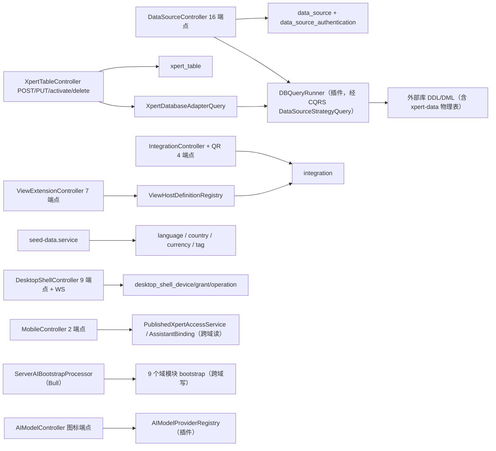

图表来源：[data-source.controller.ts](file://packages/server/src/data-source/data-source.controller.ts)、[xpert-table.controller.ts](file://packages/server-ai/src/xpert-table/xpert-table.controller.ts)、[desktop-shell.gateway.ts](file://packages/server-ai/src/desktop-shell/desktop-shell.gateway.ts)、[bootstrap.processor.ts](file://packages/server-ai/src/initialization/bootstrap.processor.ts)

- 本域没有统一网关：每个模块自带路由与鉴权面；跨模块直接耦合只有三处——`view-extension → integration`（宿主解析）、`xpert-table → data-source`（适配器 Query）、`integration → xpert-project`（授权事件，消费方在批次外）。
- 全部链路的「出网出口」只有两类：插件 SDK 的 `DBQueryRunner`（data-source / xpert-table）与 Redis/Bull（integration QR 锁、desktop-shell 通知、initialization 队列）。

章节来源：[data-source.module.ts](file://packages/server/src/data-source/data-source.module.ts)（关键符号：TypeOrmModule.forFeature / DataSourceTypeModule）、[view-extension.module.ts](file://packages/server/src/view-extension/view-extension.module.ts)（关键符号：ViewExtensionModule / IntegrationModule）、[xpert-table.module.ts](file://packages/server-ai/src/xpert-table/xpert-table.module.ts)（关键符号：XpertTableModule / imports DataSourceModule）

## 链路一 字典种子与读取链

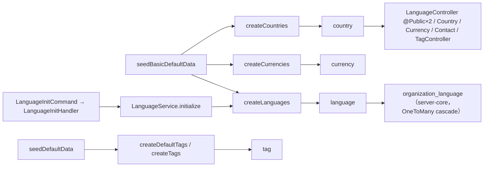

图表来源：[seed-data.service.ts](file://packages/server/src/core/seeds/seed-data.service.ts)、[language.seed.ts](file://packages/server/src/language/language.seed.ts)、[language-init.handler.ts](file://packages/server/src/language/commands/handlers/language-init.handler.ts)、[tag.seed.ts](file://packages/server/src/tags/tag.seed.ts)

- 四个种子函数形态不同：`createCountries` / `createCurrencies` / `createLanguages` 只需 `Connection`，在 `seedBasicDefaultData` 按国家→货币→语言顺序执行；`createDefaultTags` / `createTags` 需要 tenant 与 organizations，在 `seedDefaultData` 执行；`LanguageInitCommand`（tenant 控制器触发）复用同一种子做手动初始化。
- 多语言解析：`createLanguages` 用 `LanguagesEnum` 判定 `is_system`，颜色取 `faker.internet.color()`；tag 种子颜色同样 faker（`white` 改 `red`）——**种子不可复现**。
- 幂等：三者均为**直插**无 upsert；`language.code` 唯一索引会让重复执行报错（错误被 `console.log` 吞掉），country/currency 的 `isoCode` 只有普通索引，重复执行会**重复插行**。
- 读取与消费：language 2 端点（`@Public`：findAll / getByName）、country 1、currency 1、contact 1（+基类 CRUD）、tags 目录端点（+基类）；`organization_language` 关系表挂 Organization 偏好语言，`contact.country` 存 isoCode。

章节来源：[language.seed.ts](file://packages/server/src/language/language.seed.ts)（关键符号：createLanguages / is_system / faker.internet.color）、[country.seed.ts](file://packages/server/src/country/country.seed.ts)（关键符号：createCountries / DEFAULT_COUNTRIES）、[currency.seed.ts](file://packages/server/src/currency/currency.seed.ts)（关键符号：createCurrencies / DEFAULT_CURRENCIES）

## 链路二 data-source 连接链

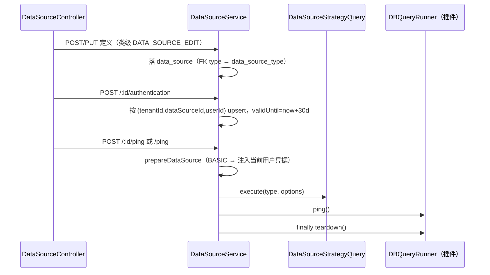

图表来源：[data-source.controller.ts](file://packages/server/src/data-source/data-source.controller.ts)、[data-source.service.ts](file://packages/server/src/data-source/data-source.service.ts)、[utils.ts（data-source）](file://packages/server/src/data-source/utils.ts)

- 创建：控制器继承 `CrudController`，类级 `@Permissions(DATA_SOURCE_EDIT)`；创建后回查 `relations: ['type']`。类型事实在域外的 `data-source-type` 模块（FK `onDelete: 'CASCADE'`，关系可空、`typeId` 列非空）。
- 凭据存储：`data_source_authentication` 是**个人认证**（tenant + userId 维度）；`prepareDataSource` 仅在 `authType === BASIC` 时按**当前用户**取行把 `username/password` 注入 `options`，取不到抛 404「未找到当前用户认证信息」；`prepareDataSource` 同时要求 tenant 与 organization 上下文（否则 403）。
- 连接校验无缓存：`POST /ping`（body 即完整定义）与 `POST /:id/ping` 都新建 runner，`finally teardown()`；失败统一转 500。
- schema 拉取：`GET /:id/catalogs`、`GET /:id/schema?catalog&table&statement`（给了 `statement` 就走 `runner.describe`）每次新建/销毁 runner——**本域没有 schema 缓存层**，缓存责任在调用方。
- 插件运行时面：`DataSourceRuntimeService` 以 `@RuntimeCapabilityProvider(DataSourceRuntimeCapability)` 暴露 `list/open`；`open` 以 `updatedAt` 作 revision，源被修改即 `close` 并要求重开；仅放行 `mysql/doris/postgres` 且要求 `engineCatalog === 'internal'`。

章节来源：[data-source.service.ts](file://packages/server/src/data-source/data-source.service.ts)（关键符号：prepareDataSource / createAuthentication / getCatalogs / getSchema）、[data-source-runtime.service.ts](file://packages/server/src/data-source/data-source-runtime.service.ts)（关键符号：DataSourceRuntimeService.list / open / check / sourceRevision）

## 链路三 data-source 查询代理链

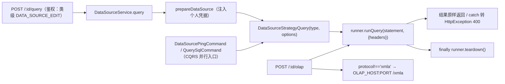

图表来源：[data-source.controller.ts](file://packages/server/src/data-source/data-source.controller.ts)、[data-source.service.ts](file://packages/server/src/data-source/data-source.service.ts)、[data-source-runtime.service.ts](file://packages/server/src/data-source/data-source-runtime.service.ts)

- 授权：类级 `@Permissions(DATA_SOURCE_EDIT)`，列表与 capability 查询端点降级到 `DATA_SOURCE_VIEW`；`prepareDataSource` 把 `tenantId + organizationId` 显式写进 where；`findSqlDataSources` 同样显式双条件并过滤 `type.protocol === 'SQL'`。
- 下发：除 controller 直连外，另有 CQRS 命令入口（ping / query-sql 等 handler），handler 内部同样 `prepareDataSource` 并注入 `debug/trace`（仅 development）。
- 超时与错误：本域代码**未定义查询超时**，超时/取消语义由插件 runner 与 HTTP 层决定 `[推测]`；错误映射为 query→400、catalogs/schema/ping→500、capability→400；OLAP 分支在非 xmla 协议时改走 `OLAP_HOST/OLAP_PORT` 的 HTTP 端点，逐条 promise 把失败吞成 `{id,status,statusText,data}`。
- 结果回流：无结果缓存、无落库；`runner.teardown()` 是唯一资源回收点（每个方法 `finally` 一次）。
- 事件面：`DataSourceUpdatedEvent` 由 PUT 与 subscriber 双通道发布，但 `events/handlers/index.ts` 是空导出——**域内无消费者**，subscriber 头部注释自陈「没有解决 typeorm Subscriber 与注入 nestjs EventBus 的问题」。

章节来源：[utils.ts（data-source）](file://packages/server/src/data-source/utils.ts)（关键符号：prepareDataSource / AuthenticationEnum.BASIC / importSheetTables）、[data-source.controller.ts](file://packages/server/src/data-source/data-source.controller.ts)（关键符号：query / olap / queryCapability / ping / load）

## 链路四 xpert-table 建表链

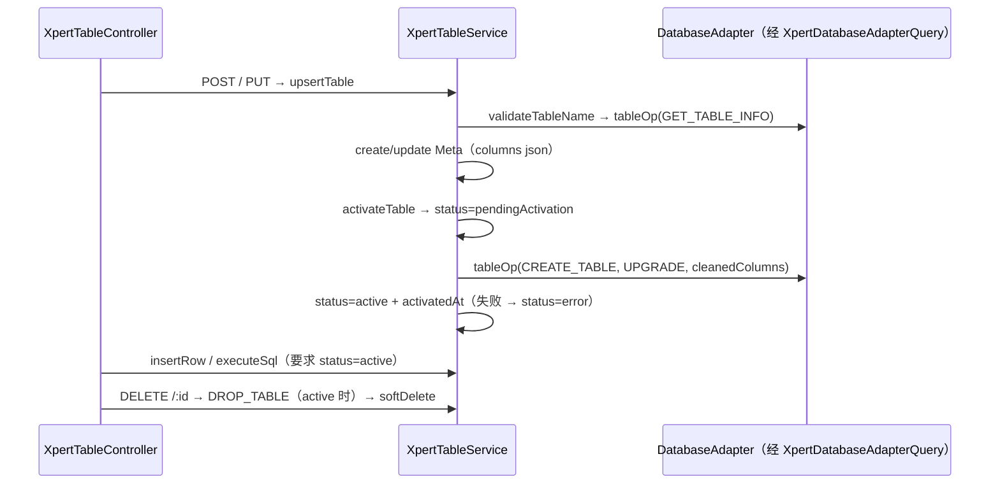

图表来源：[xpert-table.controller.ts](file://packages/server-ai/src/xpert-table/xpert-table.controller.ts)、[xpert-table.service.ts](file://packages/server-ai/src/xpert-table/xpert-table.service.ts)、[xpert-table.model.ts（contracts）](file://packages/contracts/src/ai/xpert-table.model.ts)

- Meta 层：`name / database / schema / columns(json) / status / message / version(默认1) / physicalSchema(如 xpert_data) / physicalTableName / activatedAt`，继承 `WorkspaceBaseEntity` 的 workspaceId 与软删 `deletedAt`。
- 列定义 → DDL：`columns` 映射为 `isKey/required/unique/autoIncrement/defaultValue（空串清理）/length/precision/scale/enumValues/setValues`，以 `DBCreateTableMode.UPGRADE` 提交；重命名仅在 `old.status === ACTIVE` 且 name 变化时走 `RENAME_TABLE`。
- 激活失败语义：新表失败**硬删逻辑行**（保一致性）；既有表失败置 `status=error + message`，错误统一转 `BadRequestException` 上抛。
- 读写门槛：`insertRow` / `executeSql` 都要求 `status === ACTIVE`，否则 400；两者都经 `XpertDatabaseAdapterQuery(database)` 取适配器并 `finally teardown()`。
- 边界与死角：模块 `imports: [DataSourceModule]`，数据库清单由 `XpertDatabasesQuery`（handler 注入 `DataSourceService`）提供；`get-database-schemas.query.ts`（`XpertDatabaseSchemaQuery`）**未注册 handler**（handlers index 仅 2 项），属死代码；助手侧消费为工作流节点 `DB_SQL` / `DB_INSERT` 策略与 validator。

章节来源：[xpert-table.service.ts](file://packages/server-ai/src/xpert-table/xpert-table.service.ts)（关键符号：upsertTable / validateTableName / activateTable / insertRow / executeSql / deleteTable）、[xpert-table.controller.ts](file://packages/server-ai/src/xpert-table/xpert-table.controller.ts)（关键符号：create→upsertTable / activate / delete）

## 链路五 integration 授权链

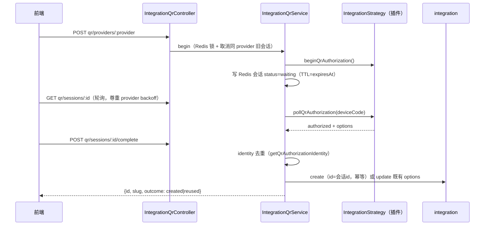

图表来源：[integration-qr.controller.ts](file://packages/server/src/integration/integration-qr.controller.ts)、[integration-qr.service.ts](file://packages/server/src/integration/integration-qr.service.ts)、[integration.service.ts](file://packages/server/src/integration/integration.service.ts)

- 会话是 **Redis-only**：`integration:qr:session:{id}` 存 JSON（zod `sessionSchema` 校验：userId/tenantId/organizationId/provider/deviceCode/status…），**不落库**；`active` 键按 `tenant:org:user:provider:purpose(trigger 哈希)` 收敛，同键新会话会先取消旧的。
- 不变量（源码逐字）：「QR credentials never leave the server; sessions belong to one user and organization.」「Redis locks serialize polling, completion and cancellation across API instances.」
- 状态：`waiting → authorized | expired | denied | failed`；本地过期（`expiresAt <= now`）读取即抛 `IntegrationQrExpired`（404），不写回状态；provider 的退避增量会累加进 `intervalSeconds`（上限 600s）并写回 Redis。
- 令牌落地（complete）：只有 `authorized` 才能落库；`id = 会话 id` 使崩溃重试幂等（命中既有行则只合并 `options` 并触发 `onUpdate` 策略钩子，`outcome=reused`）；`applyStrategyValidation` 失败转 400；成功后清空 `deviceCode/options` 只留 `integrationId`。
- 使用/失效：`IntegrationAuthorizedEvent` 由本域定义、消费在 `xpert-project`（跨域）；QR 全端点挂 `PermissionGuard + @Permissions(INTEGRATION_EDIT)` 且 `Cache-Control: no-store`；`integration.slug` 唯一索引 + `validateConfig` 策略是写入门槛。

章节来源：[integration-qr.service.ts](file://packages/server/src/integration/integration-qr.service.ts)（关键符号：begin / poll / complete / cancel / identity 去重）、[authorized.event.ts](file://packages/server/src/integration/events/authorized.event.ts)（关键符号：IntegrationAuthorizedEvent）

## 链路六 view-extension 注册链

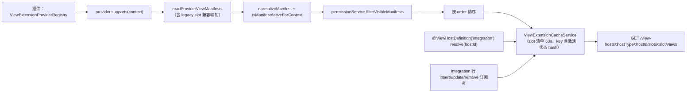

图表来源：[view-extension.service.ts](file://packages/server/src/view-extension/view-extension.service.ts)、[view-extension.cache.service.ts](file://packages/server/src/view-extension/view-extension.cache.service.ts)、[host-definition.registry.ts](file://packages/server/src/view-extension/host-definition.registry.ts)

- 宿主解析：`ViewHostDefinitionRegistry` 在 `onModuleInit` 用 `DiscoveryService` 扫 `@ViewHostDefinition`；当前唯一宿主是 `integration`（slot `detail.main_tabs`，mode `tabs`），其 `resolve()` 输出 `hostSnapshot`（name/provider/status/users/team…**含 options.botToken**），读权限判定 `INTEGRATION_VIEW|EDIT`。
- 清单：7 端点 = slots/views、view data、manifest、remote-component entry、parameter options、action、action/file；remote component 必须 runtime 受支持 + `protocolVersion === 1` + `isolation === 'iframe'`；view data 缓存 30s（manifest 可 `cache.enabled=false` 关闭）。
- 缓存失效：Integration 行的 afterInsert/afterUpdate/afterRemove 经订阅者失效对应 host identity 的缓存；`StrategyBus.events$` 触发全量清空；未授权清单也会按 per-tenant/org/user 缓存键隔离。
- 消费面：前端 `view-extension-api.service.ts` 与 `@shared/view-extension/renderers/*`；鉴权为 `@Public + ApiKeyOrClientSecretAuthGuard + AllowClientSecretBindings(ENTERPRISE_XPERT)`，每个入口自担边界。

章节来源：[view-extension.controller.ts](file://packages/server/src/view-extension/view-extension.controller.ts)（关键符号：ViewExtensionRoutes / 7 端点 / @AllowClientSecretBindings）、[integration-view-host.definition.ts](file://packages/server/src/view-extension/hosts/integration-view-host.definition.ts)（关键符号：IntegrationViewHostDefinition.resolve / hostSnapshot）、[integration-view-host-cache.subscriber.ts](file://packages/server/src/view-extension/subscribers/integration-view-host-cache.subscriber.ts)（关键符号：invalidateHostIdentity）

## 链路七 desktop-shell 设备与命令链

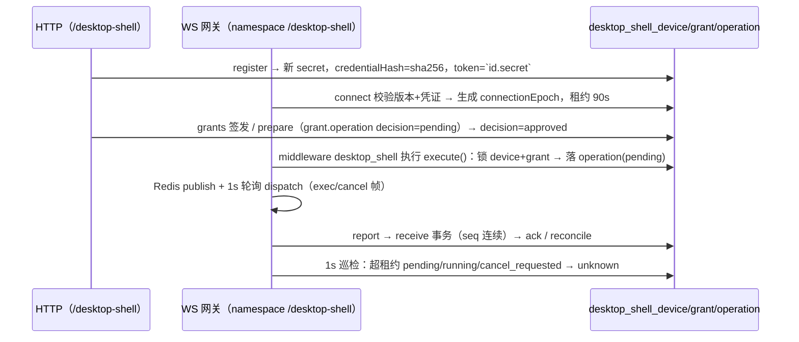

图表来源：[desktop-shell.controller.ts](file://packages/server-ai/src/desktop-shell/desktop-shell.controller.ts)、[desktop-shell.gateway.ts](file://packages/server-ai/src/desktop-shell/desktop-shell.gateway.ts)、[desktop-shell-operation.service.ts](file://packages/server-ai/src/desktop-shell/desktop-shell-operation.service.ts)、[shell-approval.ts](file://packages/server-ai/src/desktop-shell/shell-approval.ts)

- 逐表 ①`desktop_shell_device`：注册（`POST devices`）先 disable 同 `installationId` 旧设备再 upsert，回 `{deviceId, token, expiresAt}`；`enabled / credentialHash / credentialExpiresAt / connectionEpoch / leaseExpiresAt` 是全部安全状态——WS 连接、heartbeat、每次 dispatch 都复查 epoch + enabled + 凭证有效期，不符即 `revoked` 断连。
- 逐表 ②`desktop_shell_grant`：`POST devices/:id/grants` 与 `prepare` 都会签发/复用 grant；`prepare` 把 `{runId,toolCallId,argsHash,decision:'pending'}` 写入 `operation` jsonb 并把有效期收敛到 10 分钟；`decision` 端点事务 + `pessimistic_write` 锁，重复决定不一致抛 409 `OPERATION_CONFLICT`；`revoke` 置 `enabled=false` 并把在途 operation 改 `cancel_requested`。
- 逐表 ③`desktop_shell_operation`：`execute()` 事务内锁 device 与 grant，校验 grant 的 runId/toolCallId/argsHash 与本次完全一致，`UNIQUE(tenantId,runId,toolCallId)` 命中即幂等返回既有行（hash/owner 不一致抛 409）；同 device 已有非终态操作抛 `DEVICE_BUSY`；输出 `output jsonb` 分片按 `seq` 连续校验、超 `LIMITS.output` 截断（`truncated`）。
- 回执与超时：report 在连接内**串行拼 promise 链**（防「快速退出超过输出事务」），未命中/丢片回 `reconcile`，`pendingReports > 128` 直接断连；1s 巡检把 `deadline < now - (lease+10s)` 的活跃行标 `unknown/EXECUTION_UNKNOWN`；dispatch 见 grant 过期或 deadline 过期则发 `cancel(reason=timed_out)`。
- 协议与迁移：协议包 `VERSION=1`、`NAMESPACE='/desktop-shell'`、`LIMITS`（command/chunk 16KB、output 1MiB、result 64KB、timeout 60s/max 600s、lease 90s、grant 8h）双端校验；迁移 `20260924-desktop-shell.sql`（显式建 3 表 + 2 UNIQUE + 2 索引，additive）与 `20260928-desktop-shell-approval.sql`（`ADD COLUMN IF NOT EXISTS operation jsonb`）。

章节来源：[desktop-shell-auth.service.ts](file://packages/server-ai/src/desktop-shell/desktop-shell-auth.service.ts)（关键符号：register / refresh / authenticate / issueGrant / prepareOperation / decideOperation / revokeGrant）、[desktop-shell.middleware.ts](file://packages/server-ai/src/xpert-middleware/desktop-shell.middleware.ts)（关键符号：AgentMiddlewareStrategy('DesktopShell') / desktop_shell 工具）、[index.js（desktop-protocol）](file://packages/desktop-protocol/index.js)（关键符号：VERSION / NAMESPACE / LIMITS / STATES / isFinal）

## 链路八 mobile bootstrap 链

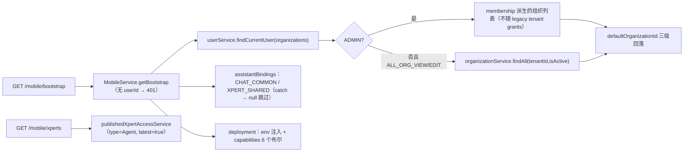

图表来源：[mobile.service.ts](file://packages/server-ai/src/mobile/mobile.service.ts)、[mobile.model.ts（contracts）](file://packages/contracts/src/ai/mobile.model.ts)

- 0 表纯聚合读：`bootstrap` 只做部署配置 + 用户/组织/助手绑定投影；`deployment` 的 URL 全来自 env（`MOBILE_API_BASE_URL / PUBLIC_API_BASE_URL / API_BASE_URL`、`MOBILE_CHATKIT_FRAME_URL`），`viewHostsPath` 固定 `/api/view-hosts`——**直接指向链路六的端点簇**。
- capabilities 是编译期静态开关（chatkit / extensionViews / scheduledTasks / fileMemory / sandboxTerminal / publicChatkitSessions），不落库、不随租户变化。
- ADMIN 分支注释逐字：「ADMIN's Desktop/Mobile organization picker stays membership-based, even with legacy tenant grants.」——即权限口径与 desktop 端一致，避免 legacy grant 放大可见组织。
- xperts 列表复用 `PublishedXpertAccessService`（跨域读），limit 默认 25、上限 100，search 截断 120 字符。

章节来源：[mobile.service.ts](file://packages/server-ai/src/mobile/mobile.service.ts)（关键符号：getBootstrap / listXperts / getDeploymentConfig / summarizeOrganization）、[mobile.model.ts（contracts）](file://packages/contracts/src/ai/mobile.model.ts)（关键符号：XpertMobileBootstrap / XpertMobileDeploymentConfig.capabilities）

## 链路九 initialization 引导链

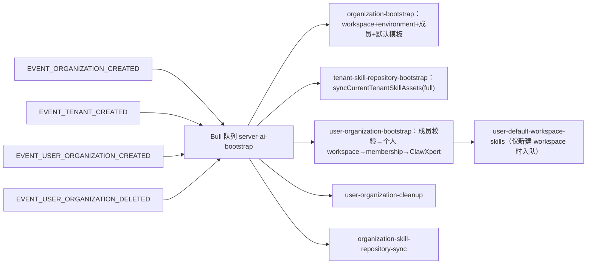

图表来源：[bootstrap.processor.ts](file://packages/server-ai/src/initialization/bootstrap.processor.ts)、[bootstrap.service.ts](file://packages/server-ai/src/initialization/bootstrap.service.ts)

- 何时跑：**不是首启种子**，而是事件驱动——4 个 `@OnEvent`（组织/租户/用户-组织创建、用户-组织删除）把事件入 Bull 队列。
- 跑什么：6 个 `@Process` job。`bootstrapOrganization` 建组织工作空间（i18n 名）、默认环境、预装 ClawXpert 模板插件、补成员、导默认模板；`bootstrapUserInOrganization` 先校验仍是活跃成员（「Queue retries outlive membership removal; never restore access from a stale event.」），再建个人 workspace/environment、membership 兜底、条件初始化 ClawXpert。
- 幂等保证：每个 job 有固定 `jobId`（`org-bootstrap:{id}`、`user-org-bootstrap:{org}:{user}` 等）做队列级去重，`attempts: 3, backoff: 10_000, removeOnComplete: true`；链式 job `user-default-skills:{workspaceId}` 是 `attempts: 8, backoff: 30_000`；`clawXpertError` 在 skills 入队后才抛出以保留重试。源码中未出现「幂等」字样（以 jobId 去重表达）。
- 上下文与失败面：job 内用 `runInOrganizationContext / runInTenantContext` + `captureRequestContext` 还原请求上下文（队列里没有 RequestContext）；`bootstrapUserDefaultWorkspaceSkills` 对未解析/安装失败的技能分别记录后继续。

章节来源：[bootstrap.processor.ts](file://packages/server-ai/src/initialization/bootstrap.processor.ts)（关键符号：@Processor(AI_BOOTSTRAP_QUEUE) / 4 个 @OnEvent / 6 个 @Process / jobId 去重）、[bootstrap.service.ts](file://packages/server-ai/src/initialization/bootstrap.service.ts)（关键符号：bootstrapOrganization / bootstrapTenantSkillRepositories / bootstrapUserInOrganization / isActiveOrganizationMember）

## 链路十 ai-model 目录链

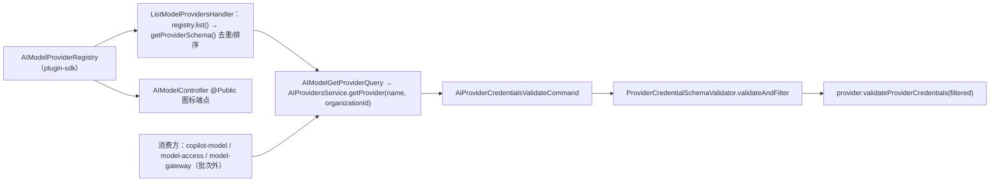

图表来源：[ai-model.service.ts](file://packages/server-ai/src/ai-model/ai-model.service.ts)、[provider-credentials-validate.handler.ts](file://packages/server-ai/src/ai-model/commands/handlers/provider-credentials-validate.handler.ts)

- 0 表：`AIModelModule` 仅 `DiscoveryModule + CqrsModule + RouterModule`，无 `TypeOrmModule`；Provider 事实来源在插件 `AIModelProviderRegistry`。
- Provider 目录：`registry.list()` 收集 `getProviderSchema()`，按 provider 名去重、`not_implemented` 靠后排序；`getProvider(name, organizationId)` 支持按组织解析（插件注册表按 organizationId 取）。
- 凭证校验：先按 `provider_credential_schema` 过滤字段，再调 `validateProviderCredentials`；**本域不做加密**——handler 内留有 `// Todo: encrypt secret variables in credentials`，加密归属在消费域（copilot/model）[推测：具体加密落点未在本批逐文件复核]。
- 与 model-access 的交界：`AIProvidersService` 被 `model-access` 等注入做授权/解析（消费方在批次外，扫描报告口径，未在本轮逐文件复核）；HTTP 面只公开 `@Public` 图标端点，目录/校验均为进程内 Query/Command。
- 负向事实：单测断言已移除的内置 provider（`jina`、`ollama`）经 `getProvider` 返回 `undefined`——目录只认插件注册表。

章节来源：[ai-model.service.ts](file://packages/server-ai/src/ai-model/ai-model.service.ts)（关键符号：AIProvidersService.getProvider / providerCredentialsValidate）、[provider-credentials-validate.handler.ts](file://packages/server-ai/src/ai-model/commands/handlers/provider-credentials-validate.handler.ts)（关键符号：ProviderCredentialSchemaValidator / Todo encrypt 注释）

## 状态机汇总

| 载体 | 取值与默认 | 合法迁移（实证） |
|---|---|---|
| `xpert_table.status` | 7 态 `draft/ready/pendingActivation/active/needsMigration/deprecated/error`，默认 `draft` | `draft→pendingActivation→active`（activateTable）、失败 `→error`（含 message）；`upsertTable` 更新既有行也走激活；`ready/needsMigration/deprecated` **未找到写入点** `[推测]` |
| `desktop_shell_operation.state` | 9 态 `pending/running/cancel_requested/succeeded/failed/cancelled/timed_out/rejected/unknown`，默认 `pending` | `pending→running`（首个 output 片）；`cancel_requested→终态`；`rejected` 仅可由 `pending` 进入（gateway rejected 帧）；超租约活跃行 `→unknown`（`EXECUTION_UNKNOWN`）；终态集合固定 6 值（`isFinal`） |
| `desktop_shell_grant` | `enabled` 布尔 + `operation.decision: pending/approved/rejected` | `pending→approved/rejected`（decideOperation，重复不一致 409）；`revoke`/device `disable` → `enabled=false`（不可逆，需重签） |
| `desktop_shell_device` | `enabled` + `connectionEpoch`(uuid) + `leaseExpiresAt` | register 先 disable 旧行再启用；disable 撤销全部 grants 并把在途操作改 `cancel_requested`；断连把 `leaseExpiresAt` 置 now |
| integration QR 会话（Redis） | `waiting/authorized/expired/denied/failed` | `waiting→authorized`（poll）→ complete 落库后清敏感字段；本地过期读取即 404，`cancel` 直删键 |
| `data_source` / `data_source_authentication` | 无 status 列；`authType`（`AuthenticationEnum`）、`validUntil` | 认证按用户 upsert，`validUntil = now + 30d` 固定写死，**无续期/失效路径**（删除即删行） |
| `tag` | `isActive`（默认 true）、`isSystem`（默认 false） | 软删/恢复被显式拒绝（400「Use tag status to enable or disable a tag.」）；系统标签禁编辑（`!isSystem` 判定，仅 ORG_TAGS_EDIT + 同组织可写） |
| `import-history.status` | 自由字符串列 | 控制器只在 SUCCESS/FAILED 两值间写；无状态机 |
| `language.is_system` | 布尔，默认 true | 由种子按 `LanguagesEnum` 一次性判定，无运行时迁移 |

章节来源：[xpert-table.model.ts（contracts）](file://packages/contracts/src/ai/xpert-table.model.ts)（关键符号：XpertTableStatus）、[desktop-shell.model.ts（contracts）](file://packages/contracts/src/desktop-shell.model.ts)（关键符号：ShellState / ShellOperationAuthorization.decision）、[desktop-shell.gateway.ts](file://packages/server-ai/src/desktop-shell/desktop-shell.gateway.ts)（关键符号：1s 巡检 → unknown / rejected 仅 pending）、[tag.controller.ts](file://packages/server/src/tags/tag.controller.ts)（关键符号：softRemove / softRecover 拒绝）

## 本域写 vs 跨域写

| 表 / 事实 | 写入方 | 说明 |
|---|---|---|
| `data_source` / `data_source_authentication` | 本域（DataSourceService / CrudController / DataSourceRuntimeService 只读） | 控制器级 `DATA_SOURCE_EDIT`；认证行 tenant+userId 独占写 |
| `integration` | 本域（IntegrationUpsertCommand / QrService.complete） | QR 落库前全在 Redis；`tags` M2M 由 TypeORM 隐式联接表维护 |
| `xpert_table` | 本域（upsertTable / activateTable / deleteTable） | 逻辑行 + 物理表双写；物理 DDL 语义在外部库 |
| `language` / `country` / `currency` / `tag` / `import-history` / `import-record` | 本域（种子 + 控制器/命令） | `import-*` 的写入口未挂载（见风险 4） |
| `desktop_shell_*` 三表 | 本域（AuthService / OperationService / Gateway） | 唯一写入口；gateway 的 1s 巡检也直接 UPDATE |
| `organization_language` | **跨域写（server-core）**，本域只读 | 由 language 的 OneToMany `cascade: true` 维护 |
| `integration` 行 → `IntegrationAuthorizedEvent` | 本域发、跨域消费 | 消费方在 `xpert-project`（批次外） |
| Chat 消息事件（`ON_TOOL_MESSAGE`） | **跨域写（本域触发）** | desktop-shell middleware 每次工具调用后 `dispatchCustomEvent` 写会话步骤流 |
| Xpert/Workspace/Environment/Skill*/Membership/ModelAccess/AssistantBinding | **跨域写（本域触发）** | initialization 的 6 个 job 是这些域的事实生产入口 |
| 外部数据库对象（表/数据） | **跨域写（插件 runner）** | data-source 的 import/dropTable 与 xpert-table 的 DDL/DML 最终都在外部库执行 |
| `ChatConversationThread`（desktop-shell 注入的邻域实体） | 只读 + AccessQuery 校验 | `issueGrant` 用 `AssertChatConversationAccessQuery` 校验 thread 归属 |

章节来源：[bootstrap.service.ts](file://packages/server-ai/src/initialization/bootstrap.service.ts)（关键符号：runInOrganizationContext / 跨域 service 清单）、[desktop-shell-operation.service.ts](file://packages/server-ai/src/desktop-shell/desktop-shell-operation.service.ts)（关键符号：execute 事务 / notify）、[view-extension.service.ts](file://packages/server/src/view-extension/view-extension.service.ts)（关键符号：listSlotViews / resolveHostContext）

## 已知风险

1. **凭据泄漏面（本域最宽）**：`data_source_authentication.password` 是明文列（无 `@Exclude`、无 `select:false`、无加密），`GET /:id/authentication` 会把整行（含 password）返回给持有 `DATA_SOURCE_EDIT` 的用户；`data_source.options` 上方的 `// @Exclude()` 处于**注释状态**，options 中的连接参数默认出网。
2. **DDL 误操作面**：xpert-table 的 `validateTableName` 在异常分支对「更新」放行（`return !entity.id`）；`upsertTable` 对既有表无 name 冲突兜底；`deleteTable` 即使 `DROP_TABLE` 失败也照常软删逻辑行——会留下**物理表孤儿**；`RENAME_TABLE` 只在 active 时执行，非 active 改名会造成物理名与 Meta 名脱节。
3. **授权令牌与过期**：QR 会话与 integration 授权完全活在 Redis（无审计表），provider 的 `intervalIncrementSeconds` 会拉长轮询间隔（上限 600s），过期即 404 且选项不可恢复；`complete` 的账号去重依赖策略实现的 `getQrAuthorizationIdentity`，缺省时可能重复建 integration 行。
4. **导入能力实际未实现**：`ImportAllModule` 未在 `server.module.ts` 注册（`/api/import` 不挂载），`ImportAllService` 调用与 `unzipAndParse` 全被注释，控制器只写 `import-history` 的 SUCCESS/FAILED；`import-record` 无任何存活写入路径。
5. **字典种子漂移**：country/currency 无唯一约束 + 直插种子，重复执行会重复行；language 的种子错误被 `console.log` 吞掉；faker 颜色使种子不可复现，`LanguageInitCommand` 可在运行期再次触发同一非幂等种子。
6. **view host 快照外泄 botToken**：`IntegrationViewHostDefinition.resolve` 把 `options.botToken` 放进 `hostSnapshot` 返回给视图提供方/前端（读权限仅 INTEGRATION_VIEW|EDIT 兜底）。
7. **desktop-shell 撤销有最长秒级窗口**：grant 撤销/过期靠 dispatch 每轮复查与 1s 巡检兜底（重发节流 3s），`unknown` 态需人工对账；`desktop_shell_grant` 的 `assistantId/threadId` 无外键，删除助手/线程不会级联。
8. **event 面断裂**：data-source 的 `DataSourceUpdatedEvent` 无域内 consumer，subscriber 头部自陈未解决注入问题——依赖更新的订阅方（若有）拿不到通知。

章节来源：[data-source.service.ts](file://packages/server/src/data-source/data-source.service.ts)（关键符号：getMyAuthentication / createAuthentication / options 注释）、[xpert-table.service.ts](file://packages/server-ai/src/xpert-table/xpert-table.service.ts)（关键符号：validateTableName catch 分支 / deleteTable）、[import-all.controller.ts](file://packages/server/src/export-import/import/import-all.controller.ts)（关键符号：unzipAndParse 注释 / ImportHistoryCreateCommand）、[integration-view-host.definition.ts](file://packages/server/src/view-extension/hosts/integration-view-host.definition.ts)（关键符号：hostSnapshot.botToken）
