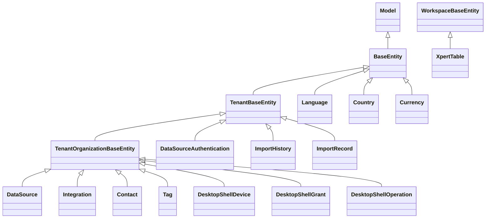

# 平台底座与集成域 · 数据模型

> 只读梳理（commit `80f5676fd`），引用为仓库根相对路径。口径（逐表回源码核实）：**核心 11 张表** = `data-source` 2 + `integration` 1 + `xpert-table` 1 + 字典族 4（language/country/currency/contact）+ `desktop-shell` 3（索引记 0，实测 3 表 + 2 个 SQL 迁移）；另有 `tags` 1（同名实体 + 2 张显式 `@JoinTable`）与 `export-import` 2 张，归属待确认（见「未确认项」）。**全批 `@Entity` 类共 14 个**（14 类 = 11 核心 + tag + import-history + import-record）；`view-extension` / `mobile` / `initialization` / `ai-model` 实测 **0 表**。列极多者只列关键列；未能证实处标 `[推测]`。

**本文引用的文件**

- [data-source.entity.ts](file://packages/server/src/data-source/data-source.entity.ts)
- [authentication.entity.ts（data-source）](file://packages/server/src/data-source/authentication/authentication.entity.ts)
- [data-source.module.ts](file://packages/server/src/data-source/data-source.module.ts)
- [data-source-type.entity.ts](file://packages/server/src/data-source-type/data-source-type.entity.ts)
- [integration.entity.ts](file://packages/server/src/integration/integration.entity.ts)
- [integration.module.ts](file://packages/server/src/integration/integration.module.ts)
- [integration-qr.service.ts](file://packages/server/src/integration/integration-qr.service.ts)
- [xpert-table.entity.ts](file://packages/server-ai/src/xpert-table/xpert-table.entity.ts)
- [xpert-table.module.ts](file://packages/server-ai/src/xpert-table/xpert-table.module.ts)
- [base.entity.ts（server-ai core）](file://packages/server-ai/src/core/entities/base.entity.ts)
- [xpert-table.model.ts（contracts）](file://packages/contracts/src/ai/xpert-table.model.ts)
- [desktop-shell.entities.ts](file://packages/server-ai/src/desktop-shell/desktop-shell.entities.ts)
- [20260924-desktop-shell.sql](file://packages/server-ai/src/desktop-shell/migrations/20260924-desktop-shell.sql)
- [20260928-desktop-shell-approval.sql](file://packages/server-ai/src/desktop-shell/migrations/20260928-desktop-shell-approval.sql)
- [desktop-shell.model.ts（contracts）](file://packages/contracts/src/desktop-shell.model.ts)
- [language.entity.ts](file://packages/server/src/language/language.entity.ts)
- [country.entity.ts](file://packages/server/src/country/country.entity.ts)
- [currency.entity.ts](file://packages/server/src/currency/currency.entity.ts)
- [contact.entity.ts](file://packages/server/src/contact/contact.entity.ts)
- [tag.entity.ts](file://packages/server/src/tags/tag.entity.ts)
- [tag-entity.model.ts（contracts）](file://packages/contracts/src/tag-entity.model.ts)
- [import-history.entity.ts](file://packages/server/src/export-import/import-history/import-history.entity.ts)
- [import-record.entity.ts](file://packages/server/src/export-import/import-record/import-record.entity.ts)
- [import-all.module.ts](file://packages/server/src/export-import/import/import-all.module.ts)
- [organization-language.entity.ts](file://packages/server/src/organization-language/organization-language.entity.ts)
- [server.module.ts](file://packages/server/src/server.module.ts)

## 目录

- [总览与表口径](#总览与表口径)
- [实体基类与作用域](#实体基类与作用域)
- [① 集成与扩展点](#-集成与扩展点)
- [② 数据源与表格](#-数据源与表格)
- [③ 基础字典、标签与客户端壳](#-基础字典标签与客户端壳)
- [desktop-shell 三表与两个迁移](#desktop-shell-三表与两个迁移)
- [建模边界](#建模边界)
- [校验规则](#校验规则)
- [未确认项](#未确认项)

## 总览与表口径

| 子域 | 表 | 数量 |
|---|---|---|
| ① 集成与扩展点 | `integration` | 1 |
| ② 数据源与表格 | `data_source`、`data_source_authentication`、`xpert_table` | 3 |
| ③ 基础字典与客户端壳 | `language`、`country`、`currency`、`contact`、`tag`、`import-history`、`import-record`、`desktop_shell_device`、`desktop_shell_grant`、`desktop_shell_operation` | 10 |
| ③ 附：联接表（不计入） | `tag_user`、`tag_organization`（显式）、integration↔tag（隐式自动命名） | 2+1 |

- 表名不全是 kebab/snake 惯例：`import-history`、`import-record` 是**带连字符**的字面表名（`@Entity('import-history')`），与其它 snake_case 表风格不一致。
- `desktop-shell` 3 表同时有实体与**显式 SQL 迁移**；其余模块无可执行 `migrations/*.sql`，结构以实体装饰器为唯一权威（若库与实体漂移，仓库内无对照物）。
- 时间戳/审计基列来自各自基类（`createdAt/updatedAt/createdById/updatedById`；desktop-shell SQL 显式建同名列）。

章节来源：[desktop-shell.entities.ts](file://packages/server-ai/src/desktop-shell/desktop-shell.entities.ts)（关键符号：DesktopShellDevice / DesktopShellGrant / DesktopShellOperation）、[import-history.entity.ts](file://packages/server/src/export-import/import-history/import-history.entity.ts)（关键符号：@Entity('import-history')）

## 实体基类与作用域

图表来源：[language.entity.ts](file://packages/server/src/language/language.entity.ts)、[data-source.entity.ts](file://packages/server/src/data-source/data-source.entity.ts)、[authentication.entity.ts（data-source）](file://packages/server/src/data-source/authentication/authentication.entity.ts)、[desktop-shell.entities.ts](file://packages/server-ai/src/desktop-shell/desktop-shell.entities.ts)、[xpert-table.entity.ts](file://packages/server-ai/src/xpert-table/xpert-table.entity.ts)

- **三层隔离键**：`BaseEntity`（无 tenant）用于全局字典（language/country/currency）；`TenantBaseEntity` 用于 tenant 级台账（data_source_authentication、import-*）；`TenantOrganizationBaseEntity` 用于组织级（data_source、integration、contact、tag、desktop_shell_*）。
- `XpertTable` 独走 `WorkspaceBaseEntity`（server-ai core）：带 `workspaceId` 与软删 `deletedAt`，实体上再次声明 `@DeleteDateColumn deletedAt`——**本批唯一可软删且以 workspace 为隔离键的表**。
- desktop-shell 三表的 `tenantId/organizationId` 在实体里是 `declare`（继承基类），但迁移 SQL 中它们是 `NOT NULL REFERENCES tenant(id)/organization(id) ON DELETE CASCADE`；`userId` 同为 `NOT NULL REFERENCES "user"(id) ON DELETE CASCADE`。
- 无软删的表：server 侧 11 张全部无 `@DeleteDateColumn`（删行即硬删；`tag` 用 `isActive` 表达启停）；desktop-shell 3 表也无软删。

章节来源：[base.entity.ts（server-ai core）](file://packages/server-ai/src/core/entities/base.entity.ts)（关键符号：WorkspaceBaseEntity / deletedAt）、[20260924-desktop-shell.sql](file://packages/server-ai/src/desktop-shell/migrations/20260924-desktop-shell.sql)（关键符号：tenant/organization/user 三列 FK CASCADE）

## ① 集成与扩展点

本子域 `view-extension` **不建表**（0 实体，只在 `Integration` 行上做宿主解析与缓存）；唯一持久实体是集成实例本身。

| 实体类 / 表名 | 关键列（唯一索引·外键 onDelete·隐藏列） | 生产方 | 主要消费方 | 用途 |
|---|---|---|---|---|
| `Integration` / `integration` | `name`（@Index 普通索引）、`description`、`avatar json`、**`slug`（@Index unique，列可空）**、`provider`（非空）、**`options json（含 botToken 等凭据，无 @Exclude）`**、`features jsonb`（`IntegrationFeatureEnum[]`，无 CHECK）、`userId`（稳定技术主体，ManyToOne `User` 可空、**未声明 onDelete**）、`tags` M2M → `Tag`（**未声明 @JoinTable**，连接表名由 TypeORM 自动生成 `[推测：integration_tags_tag]`） | `IntegrationUpsertCommand` handler（controller POST/PUT/delete）、`IntegrationQrService.complete`（id=会话 id 幂等创建） | `IntegrationViewHostDefinition.resolve`、`connector-app` 的 resolve handler、`view-extension` 宿主缓存订阅者、`xpert-project`（EventNameIntegrationAuthorized） | 第三方集成实例（provider 策略 + options 凭据 + 特性清单），同时是 view-extension 的宿主 |

- 服务侧校验：`applyStrategyValidation` 只允许策略回传 `name/description/slug/provider/options/features` 六个字段（白名单 `pickValidatedIntegrationPatch`）；`features` 过滤在 controller 中由 SQL `@>`（被注释）改为 JS `every`。
- 缓存联动：`Integration` 行的 insert/update/remove 都会失效 view-extension 的宿主缓存（订阅者按 `tenantId/organizationId/hostType='integration'/hostId` 记账）。

章节来源：[integration.entity.ts](file://packages/server/src/integration/integration.entity.ts)（关键符号：Integration / slug 唯一索引 / options / tags M2M）、[integration-qr.service.ts](file://packages/server/src/integration/integration-qr.service.ts)（关键符号：complete / applyStrategyValidation / outcome reused）、[integration.module.ts](file://packages/server/src/integration/integration.module.ts)（关键符号：forFeature([Integration])）

## ② 数据源与表格

| 实体类 / 表名 | 关键列（唯一索引·外键 onDelete·隐藏列） | 生产方 | 主要消费方 | 用途 |
|---|---|---|---|---|
| `DataSource` / `data_source` | `name`（@Index）、`typeId`（@Index，非空列）+ `type` ManyToOne → `DataSourceType`（`onDelete: 'CASCADE'`，关系可空）、`authType`（varchar 可空，`AuthenticationEnum`）、**`options json`（上方 `// @Exclude()` 处于注释态，默认出网）**、OneToMany `authentications`（`cascade: true`）；**无唯一索引** | `CrudController` + `DataSourceService.create/update`、PUT 直连（绕过命令总线，含 @todo 注释） | `DataSourceService.prepareDataSource/getCatalogs/getSchema/query`、`DataSourceRuntimeService`（插件运行时）、`xpert-table` 的 `XpertDatabasesQuery`、`findSqlDataSources` | 外部 SQL/OLAP 数据源定义（**连接配置**，不是数据副本） |
| `DataSourceAuthentication` / `data_source_authentication` | `dataSourceId`（RelationId 真列）+ `dataSource` ManyToOne（`onDelete: 'CASCADE'`，关系上 `@Exclude()`）、`userId`（非空，**无外键**）、`username`、**`password`（普通 text 列：无加密、无 `select:false`、无 `@Exclude`）**、`validUntil`（可空）；**无唯一索引**（按 tenantId+dataSourceId+userId 约定唯一） | `DataSourceService.createAuthentication`（upsert 语义，`validUntil = now + 30d`） | `prepareDataSource`（`authType=BASIC` 时注入当前用户凭据）、`GET /:id/authentication` 回显 | 数据源**个人认证**（类注释「语义模型角色」），凭据明文落库 |
| `XpertTable` / `xpert_table` | `name(100)`、`description`、`database`、`schema`、`columns json`（`TXpertTableColumn[]`）、`status varchar(30) default 'draft'`（7 态）、`message`、`physicalSchema(100)`（注释 e.g. `xpert_data`）、`physicalTableName(150)`（e.g. `xd_ta3f1a_..._v1`）、`version int default 1`、`activatedAt timestamptz`、软删 `deletedAt`；继承 `workspaceId`；**无唯一索引** | `XpertTableController` POST/PUT → `upsertTable`、`activateTable`、`deleteTable`（软删） | `insertRow/executeSql`（要求 status=active）、工作流节点 `DB_SQL`/`DB_INSERT` 策略、助手 | 自定义物理表的 **Meta 层**（逻辑定义 → 外部库物理表激活/升级） |

- 两张 data-source 表的隔离键不同：`data_source` 是 tenant+organization，`data_source_authentication` 仅 tenant（+userId）；`typeId` 列非空意味着**每个数据源必须挂类型**，类型被删则 `CASCADE` 连带删除数据源。
- `xpert_table.version` 只是普通 int 列（注释「increments by 1 after field modifications」），**不是 `@VersionColumn`**；激活与升降级完全通过 `status` + `version` 手工管理。
- 依赖边界：`data-source-type/data-source-type.entity.ts`（`data_source_type` 表，TenantBaseEntity，`type/syntax/protocol/configuration`）不在 12 模块清单内，但被 `data_source.typeId` 强引用。

章节来源：[data-source.entity.ts](file://packages/server/src/data-source/data-source.entity.ts)（关键符号：DataSource / typeId / authType / options 注释 @Exclude）、[authentication.entity.ts（data-source）](file://packages/server/src/data-source/authentication/authentication.entity.ts)（关键符号：DataSourceAuthentication / password / validUntil）、[xpert-table.entity.ts](file://packages/server-ai/src/xpert-table/xpert-table.entity.ts)（关键符号：XpertTable / columns / status / physicalSchema）

## ③ 基础字典、标签与客户端壳

| 实体类 / 表名 | 关键列（唯一索引·外键 onDelete·隐藏列） | 生产方 | 主要消费方 | 用途 |
|---|---|---|---|---|
| `Language` / `language` | **`@Unique(['code'])`**；`name`（非空）、`code`（可空但唯一）、`is_system`（默认 true）、`description`、`color`（非空）；OneToMany `organizationLanguages`（`cascade: true`）；隔离键 = 无（BaseEntity，全局） | `createLanguages` 种子、`LanguageInitCommand` → `LanguageService.initialize` | `LanguageController`（`@Public` GET / 与 getByName）、`organization_language`（server-core）、用户/组织 preferredLanguage | 全局语言字典（`is_system` 由 `LanguagesEnum` 判定） |
| `Country` / `country` | `isoCode`（@Index 非唯一、非空）、`country`（非空）；无唯一索引 | `createCountries`（DEFAULT_COUNTRIES 直插） | CountryController、contact 的 `country`（存 isoCode）与 `regionCode` | 全局国家字典（只读） |
| `Currency` / `currency` | `isoCode`（@Index 非唯一、非空）、`currency`（非空）；无唯一索引 | `createCurrencies`（DEFAULT_CURRENCIES 直插） | CurrencyController | 全局货币字典（只读） |
| `Contact` / `contact` | 全部列可空：`name/firstName/lastName`、`country`（存 isoCode）、`city/address/address2/postcode`、`latitude/longitude`（float scale 6）、`regionCode`、`fax/fiscalInformation/website`；**无唯一索引、无外键、无时间戳基列的额外约束** | `ContactCreateCommand`、`CrudController`（`TenantPermissionGuard`） | invite / organization-contact 等邻域、ContactController `GET /` | 组织联系人目录（仅地址与联系方式，历史结构含大量未启用列） |
| `Tag` / `tag` | **`@Index('category_name',['tenantId','organizationId','name','category'],{unique:true})`**；`name`、`category`（PG enum `TagCategoryEnum` 可空）、`label json`（i18n）、`description/color/icon`、`targets json`（`TagTarget[]`）、`isActive`（默认 true）、`isSystem`（默认 false）；M2M → `Employee`（无 JoinTable，反向 `tag_employee`）、`User`（`@JoinTable('tag_user')`）、`Organization`（`@JoinTable('tag_organization')`） | `TagManagementService.write/remove`（zod `inputSchema` 校验）、种子 `createDefaultTags/createTags` | `TagController`（directory / categories / 基类 CRUD）、`integration.tags`、knowledgebase/assistant 域（TagCategoryEnum 消费）、`tag-management` 的 usage 统计 | 组织级标签字典：分类、i18n 标签、目标域白名单、启停 |
| `ImportHistory` / `import-history`（字面表名） | `file`、`path`（非空，存储 key）、`size`（可空）、`status`（自由字符串）、`importDate`（默认 CURRENT_TIMESTAMP）；tenant-only；**无唯一索引** | `ImportHistoryCreateCommand`（ImportAllController POST 唯一调用点） | ImportAllController GET（按 tenantId + importDate DESC 分页） | 导入操作历史台账 |
| `ImportRecord` / `import-record`（字面表名） | `entityType`（非空）、`sourceId uuid`、`destinationId uuid`（都非空）、`importDate`；**`wasCreated` 无装饰器 → 非持久列**；tenant-only；无唯一索引 | 无存活写入路径（handler 存在，服务全被注释） | 无（ImportAllService 已注释） | 导入对象 id 映射台账（当前为死表） |
| `DesktopShellDevice` / `desktop_shell_device` | **UNIQUE(tenantId,organizationId,userId,installationId)**；`userId uuid`、`installationId uuid`、`name(100)`、`platform(20)`、`shell(256)`、`cwd text`、`enabled bool default false`、**`credentialHash varchar(64)`（sha256 摘要，非明文秘密）**、`credentialExpiresAt`、`connectionEpoch uuid`（可空）、`leaseExpiresAt`（可空） | `DesktopShellAuthService.register/refresh/disable`、gateway 更新 epoch/租约 | gateway 认证与巡检、`operations.execute` 的设备锁 | 桌面设备注册与凭证（见下节） |
| `DesktopShellGrant` / `desktop_shell_grant` | `@Index(deviceId,enabled)`；`userId/deviceId/assistantId uuid`（**threadId 可空**）、`enabled default true`、`expiresAt`、**`operation jsonb`（`ShellOperationAuthorization`，含 runId/toolCallId/argsHash/decision）** | `issueGrant / prepareOperation / decideOperation / revokeGrant / disable` | `requireGrant`、gateway dispatch 复查、`shell-approval` | 会话级授权（一次命令审批绑定精确参数） |
| `DesktopShellOperation` / `desktop_shell_operation` | **UNIQUE(tenantId,runId,toolCallId)** + `@Index(deviceId,state)`；`grantId/threadId/runId uuid`（非空）、`toolCallId(255)`、`argsHash varchar(64)`、`command/cwd text`、`timeoutSec/deadline`、`state varchar(24) default 'pending'`（9 态）、`output jsonb default '[]'`（`ShellChunk[]`）、`outputBytes/seq`、`exitCode/signal/truncated/errorCode(80)` | `DesktopShellOperationService.execute`（锁 + 幂等）、`receive`（回执推进）、`cancel/cancelRuns`、gateway 巡检 | `wait/result`、DesktopShellController list、middleware 结果回执 | 命令执行台账（唯一可重放锚点是三元组唯一键） |
| `Mobile` / `Initialization` / `AIModel` | — | — | — | **实测 0 表**（三模块无任何 `@Entity`） |

- `tag` 的 usage 统计会遍历**全库所有 M2M owning relation**（含 server-ai 实体）来找 `Tag` 连接表，未知连接表直接抛 `TagUsageUnsupported`——新增跨域 tag 关系必须同步登记 `usageTargets`。
- `contact` 的实体在三处 OneToMany（organization_contacts/employees/candidates）被整段注释；模块注册点在 `server.module.ts` **未出现**（见未确认项）。

章节来源：[language.entity.ts](file://packages/server/src/language/language.entity.ts)（关键符号：@Unique(['code']) / is_system）、[tag.entity.ts](file://packages/server/src/tags/tag.entity.ts)（关键符号：category_name 唯一索引 / tag_user / tag_organization）、[contact.entity.ts](file://packages/server/src/contact/contact.entity.ts)（关键符号：Contact / country / regionCode）、[tag-entity.model.ts（contracts）](file://packages/contracts/src/tag-entity.model.ts)（关键符号：TagCategoryEnum / TagTarget / TAG_TARGETS）

## desktop-shell 三表与两个迁移

**迁移一 `20260924-desktop-shell.sql`**（文件头「Apply before enabling Desktop Shell. Additive migration; existing platform data is unchanged.」）：

- `CREATE TABLE IF NOT EXISTS` 显式建三表；基列 `id uuid PK default gen_random_uuid()`、`tenantId/organizationId NOT NULL REFERENCES … ON DELETE CASCADE`、`createdById/updatedById REFERENCES "user"(id)`、`createdAt/updatedAt default now()`。
- 外键细节：`desktop_shell_device.userId → user CASCADE`；`desktop_shell_grant.deviceId → desktop_shell_device CASCADE`；`desktop_shell_operation.deviceId → device CASCADE`、**`grantId → desktop_shell_grant(id)` 未声明 ON DELETE（默认 NO ACTION）**；`assistantId/threadId/runId/toolCallId` 均**无外键**（跨域弱引用）。
- 约束与索引：`UNIQUE (tenantId, organizationId, userId, installationId)`（device）、`UNIQUE (tenantId, runId, toolCallId)`（operation）、`desktop_shell_grant_device(deviceId, enabled)`、`desktop_shell_operation_device(deviceId, state)`。
- 整体 `BEGIN; … COMMIT;`，重复执行安全（`IF NOT EXISTS`）。

**迁移二 `20260928-desktop-shell-approval.sql`**：仅一行 `ALTER TABLE desktop_shell_grant ADD COLUMN IF NOT EXISTS operation jsonb NULL;`——为审批链补参数绑定列（`ShellOperationAuthorization`），与实体新增字段一一对应。

- 两迁移之外，desktop-shell 的运行时约束在代码层：租约 90s（`LIMITS.lease`）、授权 8h（`LIMITS.grant`）、prepare 收敛 10min；gateway `maxHttpBufferSize: 65536`、命名空间 `/desktop-shell`、协议版本 1。
- 注意 `desktop_shell_operation.output` 在 SQL 中 `NOT NULL DEFAULT '[]'`，实体为 `jsonb default (); '[]'`；`truncated/outputBytes/seq` 都有默认值，重建行时无需显式给值。

章节来源：[20260924-desktop-shell.sql](file://packages/server-ai/src/desktop-shell/migrations/20260924-desktop-shell.sql)（关键符号：三表 DDL / UNIQUE / desktop_shell_grant_device / desktop_shell_operation_device）、[20260928-desktop-shell-approval.sql](file://packages/server-ai/src/desktop-shell/migrations/20260928-desktop-shell-approval.sql)（关键符号：ADD COLUMN operation jsonb）、[desktop-shell.model.ts（contracts）](file://packages/contracts/src/desktop-shell.model.ts)（关键符号：ShellOperationAuthorization / ShellState）

## 建模边界

- **字典种子表**（language/country/currency/tag 的默认行）：由 `core/seeds` 直插，无唯一约束兜底（除 `language.code` 与 `tag` 复合唯一）；country/currency 重复执行会重复插行——种子不是「配置」而是「可重复播种的数据」。
- **连接配置表**（data_source + data_source_authentication + integration）：存的是**访问外部系统的凭据与参数**，不是数据副本；`options`/`password` 是敏感面（其中 password 明文），`data_source_authentication` 以「个人」而非「共享」为粒度。
- **设备与授权台账**（desktop_shell 三表）：`device`=注册与凭证、`grant`=会话授权快照（含一次性审批参数）、`operation`=执行台账；三者的真相在 DB，Redis 只做通知（`SHELL_DISPATCH_CHANNEL`）。
- **元数据 vs 物理数据**：`xpert_table` 只存 Meta 与物理表名/版本，实际行列数据在外部库；本域任何表都不复制业务数据（唯一例外是 operation.output 缓存了命令输出分片）。
- **平台工具台账**（import-history/record）：均为 tenant 级、无状态机（status 自由字符串）、无外键；`wasCreated` 是非列属性说明该表曾整体改版过。
- **弱引用普遍存在**：integration.userId、data_source_authentication.userId、xpert_table.database、desktop_shell_* 的 assistantId/threadId/runId 都是无外键的 uuid——删除对端不会级联，靠服务层校验与 `enabled` 位兜底。

章节来源：[data-source.service.ts](file://packages/server/src/data-source/data-source.service.ts)（关键符号：prepareDataSource / createAuthentication）、[desktop-shell-operation.service.ts](file://packages/server-ai/src/desktop-shell/desktop-shell-operation.service.ts)（关键符号：execute / receive / notify）、[xpert-table.entity.ts](file://packages/server-ai/src/xpert-table/xpert-table.entity.ts)（关键符号：physicalSchema / physicalTableName / version）

## 校验规则

- **唯一约束（DB 层强制）**：`language.code`；`integration.slug`（unique index，列可空）；`tag.category_name(tenantId,organizationId,name,category)`；`desktop_shell_device(tenantId,organizationId,userId,installationId)`；`desktop_shell_operation(tenantId,runId,toolCallId)`。**其余 9 张表无唯一索引**（含 data_source、data_source_authentication、xpert_table、contact、import-*）。
- **外键 onDelete 清单**：`CASCADE` = data_source.type、data_source_authentication.dataSource、desktop_shell_grant.deviceId、desktop_shell_operation.deviceId；**无 ON DELETE（NO ACTION）** = desktop_shell_operation.grantId；**无外键** = integration.userId（关系未声明 onDelete）、data_source_authentication.userId、xpert_table.database、desktop_shell 的 assistantId/threadId/runId、tag 的 `tag_organization`、`tag_user`（JoinTable 未声明 onDelete，由 TypeORM 默认生成 `[待核]`）。
- **枚举与取值域**：`tag.category` 是 PG enum（`TagCategoryEnum = indicator/story/toolset/xpert`）、`tag.targets` 由 zod 对照 `TAG_TARGETS` 校验（含 knowledgebase/prompt_workflow/people/integration）；`xpert_table.status`、`integration.features`、desktop-shell 的 `state/decision/platform` 都是 **varchar/json，无 CHECK**，靠 contracts 类型 + class-validator（`@IsEnum(XpertTableStatus)`）与服务层白名单保证。
- **加密与脱敏边界（凭据类列逐列核实）**：本批 14 表**未发现任何加密列**（无 `encrypted*`、无 KMS/信封字段）；`data_source_authentication.password` = 明文 text，无 `select:false`、无 `@Exclude`、无加密；`data_source.options` 的 `@Exclude()` **被注释**；`integration.options` 无任何隐藏（botToken 直读）；`desktop_shell_device.credentialHash` 是 sha256 摘要（设备凭证本体只在客户端，服务端不可逆）；`xpert_table.columns`、`import-history.path`（存储 key）无敏感内容。与工具域的 `mcp_api_key.keyHash + encryptedSecret` 形成鲜明对照。**可达面**见 [`implementation/05-接口.md` §四](file://.module-experts/后端专题/平台底座与集成专家/implementation/05-接口.md)：`GET /:id/authentication` 明文回显、`GET /:id?$relations=authentications` 可带出密码列——暴露面比「存储明文」更严重。
- **服务层规则**：`IntegrationService.applyStrategyValidation`（策略白名单字段）；`integration-qr` 的 zod `sessionSchema/beginSchema`（name ≤100、description ≤10000、uuid 校验）；`desktop-protocol` 的 `parse*`（`isId` UUID 正则、`parseSettings` 只接受 `/bin/zsh|/bin/bash` 且 cwd 必须绝对路径、`parseReport`/`parseCommand` 长度与 NUL 校验）；`TagManagementService` 的 zod `inputSchema`（name ≤100、description ≤500、label en_US/zh_Hans ≤100）+ `canEdit = ORG_TAGS_EDIT && !isSystem && 同组织`；`DataSourceService` 的 capability key 正则 `^[a-z][a-z0-9]*(?:[._-][a-z0-9]+)*$`（capability ≤128 / operation ≤64）。
- **软删与启停语义**：仅 `xpert_table` 可软删；`tag` 的软删/恢复端点**显式抛 400**（用 isActive 代替）；desktop-shell 用 `enabled` 位 + `expiresAt`，不删行；import-* 无删除路径。

章节来源：[desktop-shell.entities.ts](file://packages/server-ai/src/desktop-shell/desktop-shell.entities.ts)（关键符号：credentialHash / UNIQUE 两处）、[authentication.entity.ts（data-source）](file://packages/server/src/data-source/authentication/authentication.entity.ts)（关键符号：password 明文列 / validUntil）、[data-source.entity.ts](file://packages/server/src/data-source/data-source.entity.ts)（关键符号：options 注释 @Exclude）、[tag-entity.model.ts（contracts）](file://packages/contracts/src/tag-entity.model.ts)（关键符号：TagCategoryEnum / TAG_TARGETS）

## 未确认项

1. **`tags` 的表归属**：`tag_user`、`tag_organization` 由 `tag.entity.ts` 显式 `@JoinTable` 声明，但 `integration.tags`（`@ManyToMany(() => Tag)`，无 `@JoinTable`）会再生成一张隐式连接表，**名称未在源码中出现**（TypeORM 惯例应为 `integration_tags_tag`）`[推测]`。
2. **`integration.tags` 的反向关系**：`Tag` 实体未声明 `integrations` 反向字段，`TagManagementService.usage` 靠遍历 `entityMetadatas` 动态发现该连接表并映射到 `usageTargets.integration`——若未来新增未登记的 tag 连接表，目录接口会直接 400。
3. **`export-import` 的模块注册**：`ImportAllModule` 只被自身引用，`server.module.ts` 中无 `ImportAllModule`——`/api/import` 路由**未挂载**；`import-record` 的 handlers（find-or-fail / update-or-create）保留但唯一调用方被注释。归属建议：并入本专家 ③（平台工具组），并以「未启用」标注。
4. **`contact` 模块注册点**：`server.module.ts` 的 imports 列表中**未命中 `ContactModule`**（仅有 OrganizationContactModule/OrganizationLanguageModule）；`ContactController` 存在且挂 `TenantPermissionGuard`，实际可达性取决于宿主装配 `[待核]`。
5. **`data_source_type` 表**：在 `packages/server/src/data-source-type`（不在 12 模块清单），但 `data_source.typeId` 强引用它（CASCADE）；`DataSourceProtocolEnum`/`DataSourceSyntaxEnum` 取值集未逐值核读。
6. **`organization_language` 表**：`TenantOrganizationBaseEntity` + `@Entity('organization_language')`，归属 server-core/organization-language 模块，由 language 的 OneToMany `cascade: true` 维护，**不计入本批 14 表**。
7. **desktop-shell 未加列外键的三处**：`assistantId`、`threadId`（grant 可空 / operation 非空）、`runId` 在迁移中均无 FK；实体也无关系声明——删除助手/线程/运行的级联行为**未在本轮核实**。
8. **`import-record.wasCreated`**：源码显式定义 `wasCreated?: boolean` 但无 `@Column`（**非持久列**），说明历史上存在「是否新建」的判定字段；当前无写入方，实际语义未确认。
9. **0 表结论（实测确认为无）**：`view-extension`、`mobile`、`initialization`、`ai-model` 目录内无任何 `@Entity`；`xpert-table` 的 `XpertDatabaseSchemaQuery`（`get-database-schemas.query.ts`）无 handler 注册，属死 Query 类。
10. **索引基线 DDL 不在仓库**：除 desktop-shell 两份 SQL 外，其余 12 张表建表语句均未找到（`migrations/*.sql` 为空），实体装饰器是唯一权威来源——若生产库与实体漂移，仓库内无对照物。

章节来源：[import-all.module.ts](file://packages/server/src/export-import/import/import-all.module.ts)（关键符号：RouterModule.register('/import') / ImportAllService 注释）、[server.module.ts](file://packages/server/src/server.module.ts)（关键符号：imports 列表未含 ContactModule/ImportAllModule）、[organization-language.entity.ts](file://packages/server/src/organization-language/organization-language.entity.ts)（关键符号：@Entity('organization_language')）、[data-source-type.entity.ts](file://packages/server/src/data-source-type/data-source-type.entity.ts)（关键符号：DataSourceType / protocol / syntax）
