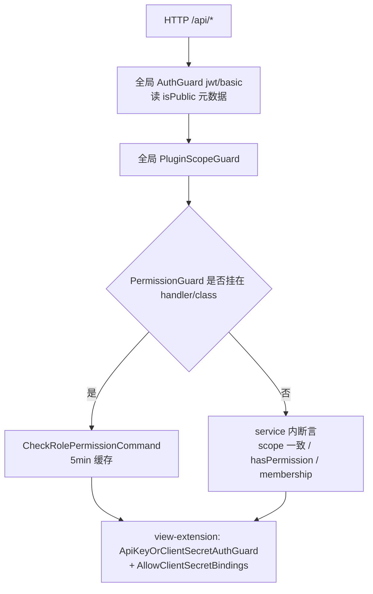

# 平台底座与集成专家 · 接口说明（05）

**本文引用的文件**

- [packages/server/src/data-source/data-source.controller.ts](file://packages/server/src/data-source/data-source.controller.ts)
- [packages/server/src/data-source/data-source.service.ts](file://packages/server/src/data-source/data-source.service.ts)
- [packages/server/src/data-source/data-source.entity.ts](file://packages/server/src/data-source/data-source.entity.ts)
- [packages/server/src/data-source/data-source.module.ts](file://packages/server/src/data-source/data-source.module.ts)
- [packages/server/src/data-source/utils.ts](file://packages/server/src/data-source/utils.ts)
- [packages/server/src/data-source/dto/public.dto.ts](file://packages/server/src/data-source/dto/public.dto.ts)
- [packages/server/src/data-source/authentication/authentication.entity.ts](file://packages/server/src/data-source/authentication/authentication.entity.ts)
- [packages/server/src/data-source/data-source-runtime.service.ts](file://packages/server/src/data-source/data-source-runtime.service.ts)
- [packages/server/src/integration/integration.controller.ts](file://packages/server/src/integration/integration.controller.ts)
- [packages/server/src/integration/integration-qr.controller.ts](file://packages/server/src/integration/integration-qr.controller.ts)
- [packages/server/src/integration/integration-qr.service.ts](file://packages/server/src/integration/integration-qr.service.ts)
- [packages/server/src/integration/integration.service.ts](file://packages/server/src/integration/integration.service.ts)
- [packages/server/src/integration/integration.entity.ts](file://packages/server/src/integration/integration.entity.ts)
- [packages/server/src/integration/dto/integration-public.dto.ts](file://packages/server/src/integration/dto/integration-public.dto.ts)
- [packages/server/src/integration/integration.module.ts](file://packages/server/src/integration/integration.module.ts)
- [packages/server/src/view-extension/view-extension.controller.ts](file://packages/server/src/view-extension/view-extension.controller.ts)
- [packages/server/src/view-extension/view-extension.service.ts](file://packages/server/src/view-extension/view-extension.service.ts)
- [packages/server/src/view-extension/view-extension.permission.service.ts](file://packages/server/src/view-extension/view-extension.permission.service.ts)
- [packages/server/src/view-extension/host-definition.registry.ts](file://packages/server/src/view-extension/host-definition.registry.ts)
- [packages/server/src/view-extension/hosts/integration-view-host.definition.ts](file://packages/server/src/view-extension/hosts/integration-view-host.definition.ts)
- [packages/server/src/view-extension/view-extension.module.ts](file://packages/server/src/view-extension/view-extension.module.ts)
- [packages/server-ai/src/xpert-table/xpert-table.controller.ts](file://packages/server-ai/src/xpert-table/xpert-table.controller.ts)
- [packages/server-ai/src/xpert-table/xpert-table.service.ts](file://packages/server-ai/src/xpert-table/xpert-table.service.ts)
- [packages/server-ai/src/xpert-table/xpert-table.entity.ts](file://packages/server-ai/src/xpert-table/xpert-table.entity.ts)
- [packages/server-ai/src/xpert-table/xpert-table.module.ts](file://packages/server-ai/src/xpert-table/xpert-table.module.ts)
- [packages/server-ai/src/xpert-table/plugins/sql/strategy.ts](file://packages/server-ai/src/xpert-table/plugins/sql/strategy.ts)
- [packages/server-ai/src/xpert-table/plugins/insert/strategy.ts](file://packages/server-ai/src/xpert-table/plugins/insert/strategy.ts)
- [packages/server-ai/src/desktop-shell/desktop-shell.controller.ts](file://packages/server-ai/src/desktop-shell/desktop-shell.controller.ts)
- [packages/server-ai/src/desktop-shell/desktop-shell-auth.service.ts](file://packages/server-ai/src/desktop-shell/desktop-shell-auth.service.ts)
- [packages/server-ai/src/desktop-shell/desktop-shell-operation.service.ts](file://packages/server-ai/src/desktop-shell/desktop-shell-operation.service.ts)
- [packages/server-ai/src/desktop-shell/desktop-shell.gateway.ts](file://packages/server-ai/src/desktop-shell/desktop-shell.gateway.ts)
- [packages/server-ai/src/desktop-shell/desktop-shell.errors.ts](file://packages/server-ai/src/desktop-shell/desktop-shell.errors.ts)
- [packages/server-ai/src/desktop-shell/desktop-shell.module.ts](file://packages/server-ai/src/desktop-shell/desktop-shell.module.ts)
- [packages/server-ai/src/xpert-middleware/desktop-shell.middleware.ts](file://packages/server-ai/src/xpert-middleware/desktop-shell.middleware.ts)
- [packages/desktop-protocol/index.js](file://packages/desktop-protocol/index.js)
- [packages/desktop-protocol/index.d.ts](file://packages/desktop-protocol/index.d.ts)
- [packages/server-ai/src/mobile/mobile.controller.ts](file://packages/server-ai/src/mobile/mobile.controller.ts)
- [packages/server-ai/src/mobile/mobile.service.ts](file://packages/server-ai/src/mobile/mobile.service.ts)
- [packages/server-ai/src/mobile/mobile.module.ts](file://packages/server-ai/src/mobile/mobile.module.ts)
- [packages/server-ai/src/initialization/clawxpert-recovery.controller.ts](file://packages/server-ai/src/initialization/clawxpert-recovery.controller.ts)
- [packages/server-ai/src/initialization/clawxpert-recovery.service.ts](file://packages/server-ai/src/initialization/clawxpert-recovery.service.ts)
- [packages/server-ai/src/initialization/bootstrap.processor.ts](file://packages/server-ai/src/initialization/bootstrap.processor.ts)
- [packages/server-ai/src/initialization/initialization.module.ts](file://packages/server-ai/src/initialization/initialization.module.ts)
- [packages/server/src/language/language.controller.ts](file://packages/server/src/language/language.controller.ts)
- [packages/server/src/country/country.controller.ts](file://packages/server/src/country/country.controller.ts)
- [packages/server/src/currency/currency.controller.ts](file://packages/server/src/currency/currency.controller.ts)
- [packages/server/src/contact/contact.controller.ts](file://packages/server/src/contact/contact.controller.ts)
- [packages/server/src/tags/tag.controller.ts](file://packages/server/src/tags/tag.controller.ts)
- [packages/server/src/export-import/import/import-all.controller.ts](file://packages/server/src/export-import/import/import-all.controller.ts)
- [packages/server-ai/src/ai-model/ai-model.controller.ts](file://packages/server-ai/src/ai-model/ai-model.controller.ts)
- [packages/server-ai/src/ai-model/ai-model.service.ts](file://packages/server-ai/src/ai-model/ai-model.service.ts)
- [packages/server-ai/src/ai-model/ai-model.module.ts](file://packages/server-ai/src/ai-model/ai-model.module.ts)
- [packages/server/src/core/crud/crud.controller.ts](file://packages/server/src/core/crud/crud.controller.ts)
- [packages/server/src/shared/guards/auth.guard.ts](file://packages/server/src/shared/guards/auth.guard.ts)
- [packages/server/src/shared/guards/permission.guard.ts](file://packages/server/src/shared/guards/permission.guard.ts)
- [packages/server/src/shared/guards/api-key-or-client-secret.guard.ts](file://packages/server/src/shared/guards/api-key-or-client-secret.guard.ts)
- [packages/server/src/server.module.ts](file://packages/server/src/server.module.ts)
- [apps/api/src/bootstrap/index.ts](file://apps/api/src/bootstrap/index.ts)
- [packages/contracts/src/ai/mobile.model.ts](file://packages/contracts/src/ai/mobile.model.ts)

## 目录

1. [一、总览：前缀、端点数与控制器分工](#一总览前缀端点数与控制器分工)
2. [二、data-source：数据源 CRUD 与连接测试](#二data-source数据源-crud-与连接测试)
3. [三、data-source：选项、catalog/schema 与查询代理](#三data-source选项catalogschema-与查询代理)
4. [四、data-source：个人凭据脱敏与文件装载](#四data-source个人凭据脱敏与文件装载)
5. [五、xpert-table（/api/xpert-table）](#五xpert-tableapixpert-table)
6. [六、integration：定义 CRUD 与策略校验](#六integration定义-crud-与策略校验)
7. [七、integration 扫码授权会话（/api/integration/qr）](#七integration-扫码授权会话apiintegrationqr)
8. [八、view-extension（/api/view-hosts）](#八view-extensionapiview-hosts)
9. [九、desktop-shell：设备、授权与操作（9 条 HTTP）](#九desktop-shell设备授权与操作9-条-http)
10. [十、desktop-shell：WS 通道（namespace /desktop-shell）](#十desktop-shellws-通道namespace-desktop-shell)
11. [十一、mobile：bootstrap 与助手列表](#十一mobilebootstrap-与助手列表)
12. [十二、initialization：ClawXpert 恢复，无 bootstrap HTTP 面](#十二initializationclawxpert-恢复无-bootstrap-http-面)
13. [十三、字典族：language / country / currency / contact](#十三字典族language--country--currency--contact)
14. [十四、ai-model：图标端点与 model-access 的边界](#十四ai-model图标端点与-model-access-的边界)
15. [十五、邻域归属结论：tags 与 export-import](#十五邻域归属结论tags-与-export-import)
16. [十六、鉴权矩阵](#十六鉴权矩阵)
17. [十七、错误语义](#十七错误语义)

## 一、总览：前缀、端点数与控制器分工

全局前缀 `api` 由启动处以 `setGlobalPrefix('api', …)` 设置；模块前缀来自各模块内 `RouterModule.register` 的真实值。全站默认「锁死」：启动时装 `AuthGuard(['jwt','basic'])` 与 `PluginScopeGuard` 全局守卫，只有 `@Public()`（方法级或类级）才放行。

| 控制器 | register 前缀 | 实际路径 | 显式声明端点 | 类/方法级守卫与权限 |
|---|---|---|---|---|
| `DataSourceController` | `/data-source` | `/api/data-source` | 16 | `@Permissions(DATA_SOURCE_EDIT)`（仅元数据）；`PermissionGuard+DATA_SOURCE_VIEW` 只挂 2 处 |
| `XpertTableController` | 无 register，`@Controller('xpert-table')` | `/api/xpert-table` | 6 | 无类级守卫；`GET databases` 单独 `PermissionGuard+DATA_SOURCE_VIEW` |
| `IntegrationController` | `/integration` | `/api/integration` | 7 | 无守卫（`TransformInterceptor`） |
| `IntegrationQrController` | 同上，`@Controller('qr')` | `/api/integration/qr` | 4 | `PermissionGuard` ＋ `INTEGRATION_EDIT`（类级） |
| `ViewExtensionController` | `/view-hosts` | `/api/view-hosts` | 7 | `@Public()` ＋ `ApiKeyOrClientSecretAuthGuard` ＋ `AllowClientSecretBindings(ENTERPRISE_XPERT)` |
| `LanguageController` | `/languages` | `/api/languages` | 2 | 方法级 `@Public()` |
| `CountryController` | `/country` | `/api/country` | 1 | 类级 `@Public()` |
| `CurrencyController` | `/currency` | `/api/currency` | 1 | 类级 `@Public()` |
| `ContactController` | 无 register，`@Controller()` | **未挂载**（模块未被任何模块 import） | 1 | 类级 `TenantPermissionGuard` |
| `DesktopShellController` | `/desktop-shell` | `/api/desktop-shell` | 9 | 无守卫，靠全局 `AuthGuard` ＋ `RequestContext` scope |
| `MobileController` | `/mobile` | `/api/mobile` | 2 | 无守卫（service 内 `UnauthorizedException`） |
| `ClawXpertRecoveryController` | 无 register，`@Controller('initialization/clawxpert')` | `/api/initialization/clawxpert` | 2 | service 内 `requireCurrentMember` → 403 |
| `AIModelController` | `/ai-model` | `/api/ai-model` | 1 | 方法级 `@Public()` |
| `TagController`（邻域追加） | `/tags` | `/api/tags` | 8 | 类级 `TenantPermissionGuard`；写操作 `PermissionGuard+ORG_TAGS_EDIT` |
| `ImportAllController`（邻域追加） | `/import`（模块内 register） | **未挂载**（`ImportAllModule` 未被 import） | 2 | 无 |

端点合计（12 模块控制器内显式声明）：16＋1＋11＋6＋7＋2＋9＋2＋1＋1＋1＋2＝**59**；与索引口径的 `data-source 16 / ai-model 1 / integration 11 / xpert-table 6 / view-extension 7 / desktop-shell 9 / mobile 2` 逐项吻合。另有 4 个继承 `CrudController` 的控制器存在**未覆盖的基类路由**（`data-source` 7、`xpert-table` 7、`integration` 6、`contact` 9），它们的鉴权只继承类级元数据，不含方法级 `@UseGuards`。

章节来源：[server.module.ts](file://packages/server/src/server.module.ts)（关键符号：imports 中的 ViewExtensionModule / CountryModule / CurrencyModule / TagModule / LanguageModule / IntegrationModule / DataSourceModule），[apps/api/src/bootstrap/index.ts](file://apps/api/src/bootstrap/index.ts)（关键符号：useGlobalGuards / AuthGuard / PluginScopeGuard / setGlobalPrefix），[crud.controller.ts](file://packages/server/src/core/crud/crud.controller.ts)（关键符号：getCount / pagination / findAll / findMyAll / findById / create / update / delete / softRemove / softRecover）

## 二、data-source：数据源 CRUD 与连接测试

`@Controller()` 空前缀 ＋ 模块路由 `/data-source`；实体 `data_source`，个人凭据表 `data_source_authentication`。

| 方法 | 路径 | 用途 | 鉴权 | 主要错误 | 消费方 |
|---|---|---|---|---|---|
| GET | `/api/data-source` | 租户内数据源分页；`$query`（ParseJsonPipe）传 select/where/relations/order；返回 `DataSourcePublicDTO` | `PermissionGuard` ＋ `DATA_SOURCE_VIEW` | 401 | 前端 `data-source-connection.service.ts`、设置页 `features/setting/data-sources/*` |
| GET | `/api/data-source/:id` | 按 id 取详情（`$relations`/`$query` 可展开） | 仅全局 AuthGuard | 404 | 同上（编辑页回填） |
| PUT | `/api/data-source/:id` | 直接 `dsService.update`（**绕过命令总线**，源码留 `@todo Updated cqrs event 应该在哪里发出 ?`），随后 `eventBus.publish(DataSourceUpdatedEvent)` | 仅全局 AuthGuard | 404 之外的更新异常 | 设置页保存；订阅方为插件/缓存失效 |
| POST | `/api/data-source/ping` | 用请求体内的临时 `IDataSource` 试连（ad-hoc 校验） | 仅全局 AuthGuard | 500（`err.message` 透传） | 设置页「Test connection」 |
| POST | `/api/data-source/:id/ping` | 以库内数据源为底、请求体覆盖后试连；认证信息的 `userId` 强制改写为当前用户 | 仅全局 AuthGuard | 500 | 同上 |

`ping` 两式的差异是**是否落库**：`/ping` 走 `prepareDataSource(对象)`，`/:id/ping` 走 `prepareDataSource(id, 覆盖体)`；`authType=BASIC` 时由 `prepareDataSource` 从个人凭据表取 `username/password` 注入 `options`，取不到即抛 `NotFoundException('未找到当前用户认证信息')`（404）。

章节来源：[data-source.controller.ts](file://packages/server/src/data-source/data-source.controller.ts)（关键符号：findAlls / findOneById / updateOne / ping / pingDataSource / DataSourceUpdatedEvent），[data-source.service.ts](file://packages/server/src/data-source/data-source.service.ts)（关键符号：prepareDataSource / ping / findSqlDataSources），[utils.ts](file://packages/server/src/data-source/utils.ts)（关键符号：prepareDataSource / AuthenticationEnum.BASIC）

## 三、data-source：选项、catalog/schema 与查询代理

| 方法 | 路径 | 用途 | 鉴权 | 主要错误 | 消费方 |
|---|---|---|---|---|---|
| GET | `/api/data-source/sql-select-options` | 仅 `type.protocol='sql'` 的数据源下拉 `{value,label}` | 仅全局 AuthGuard | — | 助手/工作流 SQL 节点选库 |
| GET | `/api/data-source/sql-schema-select-options?dataSource=` | 该数据源 catalog 下拉（`dataSource` 为空返回 `[]`） | 仅全局 AuthGuard | 500（catalog 取不到） | 同上 |
| GET | `/api/data-source/:id/catalogs` | 列举 catalog/schema（`IDSSchema[]`） | 仅全局 AuthGuard | **500**（service 内把失败吞成 `Error('配置错误')`） | 助手 schema 上下文构建 |
| GET | `/api/data-source/:id/schema?catalog&table&statement` | 列举表结构；带 `statement` 时走 `runner.describe(catalog, statement)` | 仅全局 AuthGuard | 500 | 同上 |
| POST | `/api/data-source/:id/query` | 单条查询代理（`acceptLanguage` 透传给 runner） | 仅全局 AuthGuard | **400**（`err.message`） | 助手 SQL 执行 / 工作流 DB 节点 |
| POST | `/api/data-source/:id/olap` | 批量 OLAP：`type.protocol==='xmla'` 走 adapter，否则 POST `http://${OLAP_HOST}:${OLAP_PORT}/xmla`；逐条返回 `{id,status,data}`，失败项原样透传上游 `status/statusText/data` | 仅全局 AuthGuard | 逐项 status（整体 200） | BI 面板（语义模型/OLAP 请求） |
| POST | `/api/data-source/:id/capabilities/query` | 适配器自有的能力查询（如 `xmla.metadata/discover`） | `PermissionGuard` ＋ `DATA_SOURCE_VIEW` | 400（capability/operation 键非法、适配器未实现） | 绑定 `@xpert-ai/plugin-sdk` 的数据源插件 |

能力键校验为 `^[a-z][a-z0-9]*(?:[._-][a-z0-9]+)*$`（capability ≤128、operation ≤64），**先校验后建 runner**；每次调用都在 `finally` 里 `runner.teardown()`。插件侧另有一条无 HTTP 的准入面：`DataSourceRuntimeService` 以 `@RuntimeCapabilityProvider(DataSourceRuntimeCapability)` 暴露 `list/open`，要求 actor 的 tenant/organization/user 与 `RequestContext` 一致且具备 `DATA_SOURCE_VIEW/EDIT`，只允许 `mysql/doris/postgres`，且数据源 `updatedAt` 变化即关闭会话。

章节来源：[data-source.controller.ts](file://packages/server/src/data-source/data-source.controller.ts)（关键符号：getSqlDataSources / getSqlSchemas / getCatalogs / getSchema / query / olap / queryCapability），[data-source.service.ts](file://packages/server/src/data-source/data-source.service.ts)（关键符号：getCatalogs / getSchema / queryCapability / query / olap / validateCapabilityQuery / findSqlDataSources），[data-source-runtime.service.ts](file://packages/server/src/data-source/data-source-runtime.service.ts)（关键符号：DataSourceRuntimeService.list / open / authorize / check）

## 四、data-source：个人凭据脱敏与文件装载

| 方法 | 路径 | 用途 | 鉴权 | 主要错误 | 消费方 |
|---|---|---|---|---|---|
| GET | `/api/data-source/:id/authentication` | 取**当前用户**在该数据源上的认证行 | 仅全局 AuthGuard | 404（无该用户认证） | 设置页「个人认证」表单 |
| POST | `/api/data-source/:id/authentication` | upsert（同名同租户同用户唯一），`validUntil = now + 30 天` | 仅全局 AuthGuard | — | 同上 |
| DELETE | `/api/data-source/:id/authentication` | 删除当前用户的认证行 | 仅全局 AuthGuard | — | 同上 |
| POST | `/api/data-source/:id/load` | `FileInterceptor('file')` ＋ `params`(JSON sheets) → `DataLoadCommand`，导入 xlsx/csv 到目标库 | 仅全局 AuthGuard | 500（含 Excel/CSV 解析失败 → 400 语义见 `utils.importSheetTables`） | 设置页数据装载 |

**脱敏行为（逐点口径）**：

1. 列表端点输出 `DataSourcePublicDTO`（`@Exclude()` ＋ `@Expose()` 白名单）：只暴露 `id / name / type / typeId / authType / createdAt / updatedAt / createdBy`——`options`（连接参数）与 `authentications` **不下发**；`ClassSerializerInterceptor` 显式挂在该方法上。
2. **详情端点 `GET /:id` 未做 DTO 映射**，`options` 会原样返回；若调用方在 `$relations` 里指定 `authentications`，`data_source_authentication` 行（含 `username`/`password` 列）会一并返回。
3. `/authentication` 三个端点直接返回/接收实体，**没有脱敏 DTO**：GET 会把该用户自己的 `password` 明文回给浏览器；实体只对 `dataSource` 关系加了 `@Exclude()`。
4. 凭据隔离的设计取向是「连接密钥不落在 `options`」：`authType=BASIC` 时 `options` 里的账号密码由服务端按当前用户从 `data_source_authentication` 现场注入（见第二节），所以列表不回显密码并不等于存储加密。
5. `DataSource` 实体的 `options` 列上原本存在的 `// @Exclude()` 是**注释掉**的，属模块内已知遗留。

章节来源：[dto/public.dto.ts](file://packages/server/src/data-source/dto/public.dto.ts)（关键符号：DataSourcePublicDTO / Exclude / Expose / DataSourceTypeDTO），[authentication.entity.ts](file://packages/server/src/data-source/authentication/authentication.entity.ts)（关键符号：dataSourceId / userId / username / password / validUntil），[data-source.service.ts](file://packages/server/src/data-source/data-source.service.ts)（关键符号：getMyAuthentication / createAuthentication / deleteAuthentication），[data-source.entity.ts](file://packages/server/src/data-source/data-source.entity.ts)（关键符号：authType / options / authentications）

## 五、xpert-table（/api/xpert-table）

模块**没有** `RouterModule.register`，`@Controller('xpert-table')` 决定路径；继承 `CrudController` 并覆盖 `POST ''`、`PUT :id`、`DELETE :id`。

| 方法 | 路径 | 用途 | 鉴权 | 主要错误 | 消费方 |
|---|---|---|---|---|---|
| POST | `/api/xpert-table` | 覆盖基类 create：`upsertTable(entity)` —— 建/改逻辑表并**立即激活物理表** | 仅全局 AuthGuard | 400 `Table name S.T already exists in the database.` / `Table name and database are required…` / `Table activation failed: …` | 前端自定义表编辑页；工作流节点运行时 |
| PUT | `/api/xpert-table/:id` | 覆盖基类 update：`upsertTable({...entity, id})`；改名且原状态 `active` 时先 `RENAME_TABLE` | 仅全局 AuthGuard | 400 `Failed to rename physical table: …` | 同上 |
| GET | `/api/xpert-table/databases` | `XpertDatabasesQuery({protocol:'sql'})`——可激活的目标库列表 | `PermissionGuard` ＋ `DATA_SOURCE_VIEW` | — | 表创建向导选库 |
| GET | `/api/xpert-table/schemas?databaseId=` | 目标库 catalog 列表（`BadRequestException('Error getting database schemas: …')`） | 仅全局 AuthGuard | 400 | 同上 |
| POST | `/api/xpert-table/:id/activate` | 显式激活：无列时 400；置 `pendingActivation` → `CREATE_TABLE(createMode=UPGRADE)` → `active`；失败置 `error` 并抛 400 | 仅全局 AuthGuard | 400 `Table must have at least one column to activate.` / `Table activation failed: …` | 编辑页「保存并激活」、失败重试 |
| DELETE | `/api/xpert-table/:id` | 204：`active` 时先 `DROP_TABLE`（drop 失败仅记日志不阻断），再软删逻辑表 | 仅全局 AuthGuard | 400（表记录不存在） | 删除入口 |

**列与行的键入面不在 HTTP**：`XpertTableService.insertRow(tableId, row)` 与 `executeSql(tableId, statement)` 都要求 `status=active`，只经助手工作流策略暴露——`@WorkflowNodeStrategy(WorkflowNodeTypeEnum.DB_SQL)`（`plugins/sql/strategy.ts`）与 `@WorkflowNodeStrategy(WorkflowNodeTypeEnum.DB_INSERT)`（`plugins/insert/strategy.ts`），两者都 `@Inject(XpertTableService)`；对应 validator 监听 `EventNameXpertValidate`。Meta 层字段语义：`columns` json 为列定义（含 `isPrimaryKey/required/isUnique/autoIncrement/defaultValue/length/precision/scale/enumValues`），物理层字段为 `physicalSchema`（注释示例 `xpert_data`）、`physicalTableName`、`version`（默认 1）、`activatedAt`、`deletedAt`。

章节来源：[xpert-table.controller.ts](file://packages/server-ai/src/xpert-table/xpert-table.controller.ts)（关键符号：create / update / getDatabases / getDatabaseSchemas / activateTable / deleteTable），[xpert-table.service.ts](file://packages/server-ai/src/xpert-table/xpert-table.service.ts)（关键符号：validateTableName / upsertTable / activateTable / getDatabaseSchemas / insertRow / executeSql / deleteTable），[xpert-table.entity.ts](file://packages/server-ai/src/xpert-table/xpert-table.entity.ts)（关键符号：columns / status / physicalSchema / physicalTableName / version），[strategy.ts](file://packages/server-ai/src/xpert-table/plugins/sql/strategy.ts)（关键符号：WorkflowNodeTypeEnum.DB_SQL），[strategy.ts](file://packages/server-ai/src/xpert-table/plugins/insert/strategy.ts)（关键符号：WorkflowNodeTypeEnum.DB_INSERT）

## 六、integration：定义 CRUD 与策略校验

| 方法 | 路径 | 用途 | 鉴权 | 主要错误 | 消费方 |
|---|---|---|---|---|---|
| GET | `/api/integration` | 分页列表（`data` ParseJsonPipe → `transformWhere`），items 映射为 `IntegrationPublicDTO`（`options` 被 `@Exclude()`） | 仅全局 AuthGuard | — | 设置页集成列表、`select-options` 之外的明细视图 |
| POST | `/api/integration/test` | 用请求体直接跑 provider 策略的 `validateConfig`（不落库） | 仅全局 AuthGuard | **500**（`InternalServerErrorException(error)`，含下游策略抛错） | 「测试连接」按钮 |
| GET | `/api/integration/select-options?provider&features` | 下拉选项：value/label/description/icon/avatar；`provider` 过滤走 SQL，`features` 过滤在 **JS 侧 `every`**（SQL `@>` 过滤被注释） | 仅全局 AuthGuard | — | 助手/触发器配置选择集成实例 |
| GET | `/api/integration/providers` | 提供者清单：`INTEGRATION_PROVIDERS`（当前仅注册 GitHub，DingTalk/WeCom 已注释）＋ 插件注册表 `strategyRegistry.list(organizationId)` 的 meta | 仅全局 AuthGuard | — | 集成创建向导 |
| POST | `/api/integration` | 201；`IntegrationUpsertCommand` | 仅全局 AuthGuard | 400（`validateConfig` 抛错 → `BadRequestException(error.message)`） | 集成创建 |
| PUT | `/api/integration/:id` | 202；`normalizeIntegrationUpdatePayload` 后 `IntegrationUpsertCommand({...patch,id})` | 仅全局 AuthGuard | 400（同上） | 集成编辑 / 扫码授权完成后写回 options |
| DELETE | `/api/integration/:id` | 202；`IntegrationDelCommand`，服务侧跑 `runStrategyDeleteHook` | 仅全局 AuthGuard | 400（`onDelete` 抛错） | 集成删除与解绑 |

策略钩子由 `IntegrationService` 统一封装并**把异常统一降级为 400**：`applyStrategyValidation`、`runStrategyUpdateHook`（`provider` 变化时先 `onDelete` 再返回）、`runStrategyDeleteHook`；`ensurePrincipalUser` 会为集成补一个「技术主账号」（`thirdPartyId=integration:<id>`），供 API Key 绑定使用。

章节来源：[integration.controller.ts](file://packages/server/src/integration/integration.controller.ts)（关键符号：getAll / connect / getSelectOptions / getProviders / create / update / delete），[integration.service.ts](file://packages/server/src/integration/integration.service.ts)（关键符号：getProviders / getIntegrationStrategy / applyStrategyValidation / test / runStrategyUpdateHook / runStrategyDeleteHook / ensurePrincipalUser），[integration-public.dto.ts](file://packages/server/src/integration/dto/integration-public.dto.ts)（关键符号：IntegrationPublicDTO.options @Exclude），[integration.module.ts](file://packages/server/src/integration/integration.module.ts)（关键符号：IntegrationStrategyRegistry / IntegrationQrController）

## 七、integration 扫码授权会话（/api/integration/qr）

`@Controller('qr')` ＋ `@UseGuards(PermissionGuard)` ＋ `@Permissions(INTEGRATION_EDIT)`；会话只存 Redis（key `integration:qr:session:<id>`，另有 `integration:qr:active:<tenant:org:user:provider:purpose>` 防并发），**QR 凭据不出服务端**，同一会话限定一个用户＋组织。

| 方法 | 路径 | 用途 | 鉴权 | 主要错误 | 消费方 |
|---|---|---|---|---|---|
| POST | `/api/integration/qr/providers/:provider` | 开始授权：`beginSchema` 校验 `name`(1..100)/`description`/`avatar`；过期秒数夹在 30..600，间隔 ≥2s；同 scope 已有活动会话则先 `cancel` | `INTEGRATION_EDIT` | 400 `IntegrationQrInvalid`（provider 未声明 qrAuthorization）；**502** `IntegrationQrUnavailable`（`beginQrAuthorization` 抛错）；409 `INTEGRATION_QR_BUSY` | 集成创建向导（扫码页） |
| GET | `/api/integration/qr/sessions/:id` | 轮询；未到 `nextPollAt` 直接回状态；provider 返回 `intervalIncrementSeconds` 时写回退避 | `INTEGRATION_EDIT` | 404 `IntegrationQrExpired`（会话不存在/过期/越权 scope）；502 `IntegrationQrPollFailed`；409 busy | 扫码页轮询 |
| POST | `/api/integration/qr/sessions/:id/complete` | 授权成功后落库：**用 session id 作为新集成 id**（崩溃重试幂等）；有 identity 时按 `(provider,tenant,organization,identity)` 复用既有集成并跑 `onUpdate` 钩子；返回 `{id,name,slug,provider,outcome:'created'\|'reused'}` | `INTEGRATION_EDIT` | 400 invalid（未 authorized / options 缺失 / 作用域不符） | 向导完成动作 |
| DELETE | `/api/integration/qr/sessions/:id` | 取消（Redis 删 key；不存在也 204 语义） | `INTEGRATION_EDIT` | — | 关闭扫码弹窗 |

`purpose` 由 `context.{xpertId,triggerProvider}` 哈希派生，`assertContext` 供触发器侧校验会话归属；会话 TTL 恒为 `expiresAt - now`，`write` 在 TTL≤0 时抛 404。

章节来源：[integration-qr.controller.ts](file://packages/server/src/integration/integration-qr.controller.ts)（关键符号：begin / poll / complete / cancel），[integration-qr.service.ts](file://packages/server/src/integration/integration-qr.service.ts)（关键符号：begin / poll / complete / cancel / assertContext / read / write / lock / invalid / IntegrationQrErrorCode）

## 八、view-extension（/api/view-hosts）

`ViewExtensionRoutes` 是协议路由载体（注释：**共享协议路由，每个入口自带鉴权边界**），`ViewExtensionController` 仅为 `/view-hosts` 提供「API Key / ChatKit client secret」入口。

| 方法 | 路径 | 用途 | 鉴权 | 主要错误 | 消费方 |
|---|---|---|---|---|---|
| GET | `/api/view-hosts/:hostType/:hostId/slots/:slot/views` | 某宿主槽位的视图清单（`?isDraft` 走草稿） | `ApiKeyOrClientSecretAuthGuard`（`@Public` ＋ 允许 `ENTERPRISE_XPERT` client secret） | 403（宿主 `canRead` 不通过）；404 未知宿主/槽位 | 前端 `view-extension-api.service.ts`、ChatKit 嵌入端 |
| GET | `…/views/:viewKey/data` | 取视图数据（query 透传 `parseViewQuery`） | 同上 | 403 / 404 | 同上 |
| GET | `…/views/:viewKey/manifest` | 视图清单（权限过滤后） | 同上 | 403（`No permission to access this extension view`）/ 404 | 同上 |
| GET | `…/views/:viewKey/remote-component/entry` | 远程组件 HTML 入口：必须是 `remote_component`、`protocolVersion=1`、`isolation='iframe'`；响应 `Cache-Control: no-store` | 同上 | 400（非远程组件/运行时不受支持/entry 为空或非法）；404（provider 未实现） | 前端远程组件宿主 |
| GET | `…/views/:viewKey/parameters/:parameterKey/options` | 参数下拉项 | 同上 | 404（参数不存在） | 视图筛选器 |
| POST | `…/views/:viewKey/actions/:actionKey` | 执行动作（JSON transport，`whitelist` 校验 `targetId/input/parameters`） | 同上 | 403（动作不可见/项目角色不足）；404（动作不存在/未实现）；400（transport 非 json） | 视图按钮 |
| POST | `…/views/:viewKey/actions/:actionKey/file` | 文件型动作（`FileInterceptor('file')`，multipart 内 `targetId/input/parameters` 需合法） | 同上 | 400 `file is required` / `input must be a JSON object` / `parameters must be valid JSON`；403/404 同上 | 上传类动作 |

宿主解析：`ViewHostDefinitionRegistry` 在 `onModuleInit` 用 `DiscoveryService` 收集 `@ViewHostDefinition(...)` 的 provider（当前域内仅 `@ViewHostDefinition('integration')`，槽位 `detail.main_tabs`，`canRead` 要求 `INTEGRATION_VIEW|INTEGRATION_EDIT`，`resolve` 从 `integration.options` 提取 `botToken/status/workspace/team/users/lastSyncAt`）；插件视图经 `ViewExtensionProviderRegistry`（plugin-sdk）以 `(providerKey, organizationId)` 解析；权限过滤统一在 `ViewExtensionPermissionService`（`visible/permissions/requiredHostAccess`→`canRead/canEdit/canManage`）。

章节来源：[view-extension.controller.ts](file://packages/server/src/view-extension/view-extension.controller.ts)（关键符号：getSlotViews / getViewData / getViewManifest / getRemoteComponentEntry / getViewParameterOptions / executeAction / executeFileAction / ViewExtensionController），[view-extension.service.ts](file://packages/server/src/view-extension/view-extension.service.ts)（关键符号：resolveProvider / resolveView / ensureSlotExists / validateRemoteComponentEntryKey / getViewManifest），[view-extension.permission.service.ts](file://packages/server/src/view-extension/view-extension.permission.service.ts)（关键符号：assertHostReadable / filterVisibleManifests / ensureActionVisible / hasRequiredHostAccess），[host-definition.registry.ts](file://packages/server/src/view-extension/host-definition.registry.ts)（关键符号：onModuleInit / get），[integration-view-host.definition.ts](file://packages/server/src/view-extension/hosts/integration-view-host.definition.ts)（关键符号：ViewHostDefinition('integration') / slots / canRead）

## 九、desktop-shell：设备、授权与操作（9 条 HTTP）

`@Controller()` ＋ 模块路由 `/desktop-shell`；**控制器不声明任何守卫**，全部依赖全局 `AuthGuard` 与 `currentShellScope()`（tenant/organization/user 三者必为 UUID，否则 `GRANT_REVOKED 403`）。

| 方法 | 路径 | 用途 | 鉴权 | 主要错误 | 消费方 |
|---|---|---|---|---|---|
| POST | `/api/desktop-shell/devices` | 设备注册：`installationId`(uuid)＋`platform`(仅 `darwin`)＋`settings`；同 scope 同 installationId 已存在则先 disable 再复用 id；返回 `{deviceId, token: '<id>.<secret>', expiresAt}` | scope ＋ 全局 AuthGuard | 400 `INVALID_MESSAGE` / `INVALID_SETTINGS` | 桌面端 `apps/desktop`（`useShellIntegration.tsx`） |
| POST | `/api/desktop-shell/devices/:id/refresh` | 轮换设备凭据（新 secret，重置 `credentialExpiresAt`） | scope | 400 / 403 `GRANT_REVOKED` | 桌面端续期 |
| POST | `/api/desktop-shell/devices/:id/disable` | 禁用设备 → 级联禁 grants、把 `pending/running` 操作置 `cancel_requested`，并 `notify` 设备 | scope | 404 `NOT_FOUND`；403 | 平台侧回收入口 |
| POST | `/api/desktop-shell/devices/:id/grants` | 为 `assistantId`（可选 `threadId`）签发会话授权；带 `threadId` 时校验线程存在并跑会话访问断言 | scope | 400（缺 assistantId / id 非法）；404（线程不存在）；403（会话越权） | 助手侧建立「本机执行」授权 |
| POST | `/api/desktop-shell/devices/:id/prepare` | 准备一次命令：`parsePreparation` 后签发 grant，写 `operation={runId,toolCallId,argsHash,decision:'pending'}`，`argsHash=sha256([command,cwd,timeoutSec])`；**pending 授权只能路由、不能执行** | scope | 400 `INVALID_MESSAGE`；403 | `desktop_shell` 工具的审批前置 |
| POST | `/api/desktop-shell/grants/:id/decision` | 用户批准/拒绝（`approve\|reject`）：悲观锁事务内读 grant，非 pending 且与目标不一致 → 409 | scope | 400；403 `GRANT_REVOKED`（过期/设备不可用）；409 `OPERATION_CONFLICT` | 桌面端/前端审批弹窗 |
| POST | `/api/desktop-shell/grants/:id/revoke` | 撤销授权：`enabled=false`，并把该 grant 下 `pending/running` 操作置 `cancel_requested` | scope | 400；404 | 会话结束/手动撤销 |
| GET | `/api/desktop-shell/operations?deviceId=` | 最近 20 条操作结果（含 stdout/stderr、`nextCursor`、`truncated`、`error.code`） | scope（先 `requireDevice`） | 403（设备不属于当前 scope） | 前端展示本机命令历史 |
| POST | `/api/desktop-shell/operations/:id/cancel` | 取消操作（`pending/running` → `cancel_requested` 并 notify） | scope | 404 `NOT_FOUND`；400 | 助手运行中止/用户取消 |

设备凭据形态：`token = <deviceId>.<secret>`，库内只存 `credentialHash=sha256(secret)`（`timingSafeEqual` 比较）与 `credentialExpiresAt`；`LIMITS.grant = 8h`，`prepare` 的 grant 另夹 `min(grant.expiresAt, now+10min)`；`authenticate` 拒绝超长 token（>150）与禁用设备（401 `GRANT_REVOKED`）。`desktop_shell` 中间件侧另有执行侧不变量：`requireGrant` ＋ `decision==='approved'` ＋ `runId/toolCallId/argsHash` 全等，否则 403。

章节来源：[desktop-shell.controller.ts](file://packages/server-ai/src/desktop-shell/desktop-shell.controller.ts)（关键符号：register / refresh / disable / grant / prepare / decision / revoke / list / cancel），[desktop-shell-auth.service.ts](file://packages/server-ai/src/desktop-shell/desktop-shell-auth.service.ts)（关键符号：currentShellScope / register / refresh / authenticate / issueGrant / prepareOperation / decideOperation / revokeGrant / disable），[desktop-shell-operation.service.ts](file://packages/server-ai/src/desktop-shell/desktop-shell-operation.service.ts)（关键符号：execute / requireOperation / cancel / result / receive），[desktop-shell.errors.ts](file://packages/server-ai/src/desktop-shell/desktop-shell.errors.ts)（关键符号：ShellErrorCode / shellError），[desktop-shell.middleware.ts](file://packages/server-ai/src/xpert-middleware/desktop-shell.middleware.ts)（关键符号：AgentMiddlewareStrategy('DesktopShell') / requestShellApproval）

## 十、desktop-shell：WS 通道（namespace /desktop-shell）

`@WebSocketGateway({ namespace: NAMESPACE, transports: ['websocket'], maxHttpBufferSize: 65536 })`，`NAMESPACE='/desktop-shell'`，协议 `VERSION=1`（双端校验，版本不符只能在握手期失败）。

**上行（服务端 → 设备）**：`ready {version, connectionEpoch, leaseUntil}`、`command`（`type:'exec'|'cancel'`，含 `operationId/connectionEpoch/grantId/argsHash/command/cwd/timeoutSec/deadline`）、`lease {leaseUntil}`、`ack {operationId,seq,type,state}`、`reconcile {operationId}`、`revoked {code}`。
**下行（设备 → 服务端）**：`heartbeat`、`report`（output/终态，seq 连续；丢包要求 reconcile）、`rejected`（仅 `pending` 可拒绝）。

运行约束（`LIMITS`）：`command 16384`、`chunk 16384`、`output 1MiB`（超出置 `truncated`）、`result 64KiB`（分页游标）、`timeout 60 / maxTimeout 600`、`wait 10s`、`lease 90s`、`grant 8h`、`records 2000`。网关每 1s 巡检：重投未确认命令（同 operation 3s 内不重发）并把超租约的 `pending/running/cancel_requested` 置为 `unknown/EXECUTION_UNKNOWN`；多实例靠 Redis pub/sub 频道 `xpert:desktop-shell:dispatch` 唤醒（不变量：每次派发都重查持久化 epoch 与 grant，Redis 只是提醒）。连接期 `connectionEpoch` 单调更新（同设备新连接会踢掉旧 socket）。

章节来源：[desktop-shell.gateway.ts](file://packages/server-ai/src/desktop-shell/desktop-shell.gateway.ts)（关键符号：DesktopShellGateway / handleConnection / handleDisconnect / heartbeat / report / rejected / dispatch），[desktop-shell-operation.service.ts](file://packages/server-ai/src/desktop-shell/desktop-shell-operation.service.ts)（关键符号：SHELL_DISPATCH_CHANNEL / notify / receive），[index.js](file://packages/desktop-protocol/index.js)（关键符号：VERSION / NAMESPACE / LIMITS / FINAL / STATES），[index.d.ts](file://packages/desktop-protocol/index.d.ts)（关键符号：parseSettings / parseCommand / parseReport / parsePreparation）

## 十一、mobile：bootstrap 与助手列表

| 方法 | 路径 | 用途 | 鉴权 | 主要错误 | 消费方 |
|---|---|---|---|---|---|
| GET | `/api/mobile/bootstrap` | 返回 `XpertMobileBootstrap`：`deployment`（apiBaseUrl/apiBasePath/aiApiPath/chatkitFrameUrl/viewHostsPath/socketNamespaces/capabilities）、`user`、`organizations`、`activeOrganizationId`、`defaultOrganizationId`、`assistantBindings`（仅 `chat_common` 与 `xpert_shared` 两个 code，解析失败静默丢弃） | 无守卫；service 内 `RequestContext.currentUserId()` 为空 → 401 | 401 | `apps/ios`（`Networking/APIClient.swift`） |
| GET | `/api/mobile/xperts?search&limit&offset` | 已发布 Agent 列表（`type=Agent, latest=true`，走 `PublishedXpertAccessService`），`limit` 默认 25 / 上限 100，`offset` 非法归 0，`search` 截断 120 字 | 无守卫 | — | 同上 |

组织选择分支（源码注释）：**ADMIN 保持 membership 语义**，即使拥有 `ALL_ORG_VIEW/ALL_ORG_EDIT` 也不走 legacy tenant grants；非 ADMIN 且具备上述权限时才改为查租户内全部启用组织。`deployment.capabilities` 是客户端能力协商位（chatkit/extensionViews/scheduledTasks/fileMemory/sandboxTerminal/publicChatkitSessions），`viewHostsPath` 恒为 `/api/view-hosts`，即移动端是 view-extension 的**另一个协议入口**。

章节来源：[mobile.controller.ts](file://packages/server-ai/src/mobile/mobile.controller.ts)（关键符号：bootstrap / xperts），[mobile.service.ts](file://packages/server-ai/src/mobile/mobile.service.ts)（关键符号：getBootstrap / listXperts / getAssistantBindings / getDeploymentConfig / summarizeOrganization / normalizeLimit），[mobile.model.ts](file://packages/contracts/src/ai/mobile.model.ts)（关键符号：XpertMobileDeploymentConfig / XpertMobileBootstrap / XpertMobileXpertSummary）

## 十二、initialization：ClawXpert 恢复，无 bootstrap HTTP 面

| 方法 | 路径 | 用途 | 鉴权 | 主要错误 | 消费方 |
|---|---|---|---|---|---|
| GET | `/api/initialization/clawxpert` | 当前用户在该组织下的 ClawXpert 绑定状态：`ready` / `initializing` / `dependency_unavailable`（`personal_workspace_unavailable`、`model_required`）/ `error`（`initialization_failed`）/ `binding_inaccessible` / `binding_missing`；附 `binding`、`candidates`、`canRecover` | 无守卫；`requireCurrentMember` 校验 active membership | 403 `Error.ClawXpertRecoveryRequiresMember` | 桌面/移动端向导诊断页 |
| POST | `/api/initialization/clawxpert` | 触发恢复：`ready/initializing/dependency_unavailable` 直接回原状态；否则按稳定 jobId `user-org-bootstrap:<orgId>:<userId>` 重试失败 job 或入队，返回 `initializing` | 同上 | 403 | 同上 |

**bootstrap 本身没有 HTTP 面**：它是事件驱动的 Bull 队列 `server-ai-bootstrap`——4 个 `@OnEvent`（`EVENT_ORGANIZATION_CREATED` / `EVENT_TENANT_CREATED` / `EVENT_USER_ORGANIZATION_CREATED` / `EVENT_USER_ORGANIZATION_DELETED`）入队，6 个 `@Process` job（`organization-bootstrap`、`tenant-skill-repository-bootstrap`、`user-organization-bootstrap`、`user-default-workspace-skills-bootstrap`、`user-organization-cleanup`、`organization-skill-repository-sync`）执行；统一 `attempts:3, backoff:10_000, removeOnComplete`，jobId 形如 `org-bootstrap:<id>`、`user-default-skills:<workspaceId>`（队列级去重）。因此运维口径上**没有可 `curl` 的 bootstrap 端点**，只有 `clawxpert` 恢复这 2 条。

章节来源：[clawxpert-recovery.controller.ts](file://packages/server-ai/src/initialization/clawxpert-recovery.controller.ts)（关键符号：getStatus / recover），[clawxpert-recovery.service.ts](file://packages/server-ai/src/initialization/clawxpert-recovery.service.ts)（关键符号：requireCurrentMember / getStatus / recover），[bootstrap.processor.ts](file://packages/server-ai/src/initialization/bootstrap.processor.ts)（关键符号：AI_BOOTSTRAP_QUEUE / OnEvent / Process / jobId），[initialization.module.ts](file://packages/server-ai/src/initialization/initialization.module.ts)（关键符号：BullModule.registerQueue / controllers）

## 十三、字典族：language / country / currency / contact

| 模块 | 方法 | 路径 | 用途 | 鉴权 | 主要错误 |
|---|---|---|---|---|---|
| `language` | GET | `/api/languages` | 语言分页列表（`IPagination<ILanguage>`） | 方法级 `@Public()` | — |
| `language` | GET | `/api/languages/getByName/:name` | 按 `name` 精确查单条（`findOneByName`，未命中返回 `null`） | 方法级 `@Public()` | 不抛错（软失败） |
| `country` | GET | `/api/country` | 全量国家字典（`isoCode` / `country`） | 类级 `@Public()` | — |
| `currency` | GET | `/api/currency` | 全量货币字典（`isoCode` / `currency`） | 类级 `@Public()` | — |
| `contact` | GET | `/api/contact`（应为，实际未挂载） | 联系人分页（`data` ParseJsonPipe → `findInput`/`relations`） | 类级 `TenantPermissionGuard` | 模块未注册 → 路由不存在（404） |

`contact` 另有 9 条继承自 `CrudController` 的 CRUD（POST `/`、PUT/DELETE `/:id`、DELETE `/:id/soft`、PUT `/:id/recover`、GET `/:id`、`count`、`pagination`、`my`），并存在 `ContactCreateCommand` 命令；因为 `ContactModule` 在全仓仅被自身引用、`server.module.ts` 只注册了 `OrganizationContactModule`，**整族 route 目前不可达**（`/contact` 与 `/organization-contact` 是两个不同控制器，后者属邻域）。字典族**无写端点**，只有 seed 与 `LanguageInitCommand`（由 tenant 侧调用，见 07）。

章节来源：[language.controller.ts](file://packages/server/src/language/language.controller.ts)（关键符号：findAll / findByName / Public），[country.controller.ts](file://packages/server/src/country/country.controller.ts)（关键符号：CountryController / findAll），[currency.controller.ts](file://packages/server/src/currency/currency.controller.ts)（关键符号：CurrencyController / findAll），[contact.controller.ts](file://packages/server/src/contact/contact.controller.ts)（关键符号：ContactController / getAllContact / TenantPermissionGuard），[server.module.ts](file://packages/server/src/server.module.ts)（关键符号：OrganizationContactModule 与 ContactModule 的注册差异）

## 十四、ai-model：图标端点与 model-access 的边界

| 方法 | 路径 | 用途 | 鉴权 | 主要错误 | 消费方 |
|---|---|---|---|---|---|
| GET | `/api/ai-model/provider/:name/:iconType/:lang?organizationId=` | 透出 Provider 图标（`AIModelGetIconQuery`），把 mimetype 写回 `Content-Type` 后 `res.end(icon)` | 方法级 `@Public()` | 404 `Icon not found` | 前端模型选择器（匿名场景也要渲染图标） |

接口边界：`AIModelModule` **0 张表**，只注入 plugin-sdk 的 `AIModelProviderRegistry`（`AIProvidersService.getProvider(name, throwError, organizationId)` 直查策略注册表；未命中且 `throwError` 抛 `AIModelProviderNotFoundException`），HTTP 面只此 1 条。**凭据校验不在 HTTP 上**：`AiProviderCredentialsValidateCommand`（→ `providerCredentialsValidate`：取 `provider_credential_schema` → `validateAndFilter` → 策略 `validateProviderCredentials`）由**邻域 `copilot-provider`** 的 upsert handler 消费；`AIProvidersService` 同时被 `model-access`（授权解析、`createModelTarget`）、`copilot-model`、`model-gateway`、`realtime-voice`、`model-execution` 等域注入。结论：本模块是**Provider 目录门面 + 1 个公开图标端点**，模型可用性/授权的 HTTP 面归 `model-access` 与 `copilot-provider`，不属本域。

章节来源：[ai-model.controller.ts](file://packages/server-ai/src/ai-model/ai-model.controller.ts)（关键符号：getModelIcon / AIModelGetIconQuery），[ai-model.service.ts](file://packages/server-ai/src/ai-model/ai-model.service.ts)（关键符号：AIProvidersService.getProvider / providerCredentialsValidate），[ai-model.module.ts](file://packages/server-ai/src/ai-model/ai-model.module.ts)（关键符号：RouterModule.register / AIModelProviderRegistry），[provider-credentials-validate.handler.ts](file://packages/server-ai/src/ai-model/commands/handlers/provider-credentials-validate.handler.ts)（关键符号：AiProviderCredentialsValidateHandler），[model-access.service.ts](file://packages/server-ai/src/model-access/model-access.service.ts)（关键符号：AIProvidersService 注入 / createModelTarget）

## 十五、邻域归属结论：tags 与 export-import

**`tags`：存在且已挂载（`/api/tags`），建议归本域（③ 字典组）。** 8 条显式端点＋4 条继承：`GET /directory`、`GET /categories`、`GET ''`、`POST ''`、`PUT /:id`、`DELETE /:id`、`DELETE /:id/soft`（恒定 400「Use tag status to enable or disable a tag.」）、`PUT /:id/recover`（同 400），继承 `count/pagination/my/GET :id`。鉴权＝类级 `TenantPermissionGuard`；`PUT/DELETE/POST` 另加 `PermissionGuard`＋`ORG_TAGS_EDIT`。归属理由：表/控制器/seed 都在 `packages/server/src` 平台底座，且被 `integration`（`integration.tags` ManyToMany）与 assistant/knowledgebase 域消费；`TagCategoryEnum` 定义在 contracts。

**`export-import`：存在但未挂载，属平台工具（③），当前是「半成品接口」。** `ImportAllModule` 在自身模块内 `RouterModule.register({path:'/import'})`，但全仓**没有任何模块 import 它**，`server.module.ts` 也未注册 → `GET/POST /api/import` 均不可达。控制器源码里核心逻辑被注释（`// import { ImportAllService }`、`upsertAndParse` 相关调用全被注释），POST 只做「文件落盘 + 写 `import_history`」，且**成功/失败都返回同一条历史记录**（status 分别 `SUCCESS`/`FAILED`）；仓库内无 export 侧控制器。结论：接口声明归本域维护，但**不应作为可用集成面写入对外契约**。

章节来源：[tag.controller.ts](file://packages/server/src/tags/tag.controller.ts)（关键符号：directory / getAllCategories / findAll / create / update / delete / softRemove / softRecover），[import-all.controller.ts](file://packages/server/src/export-import/import/import-all.controller.ts)（关键符号：importAll / parse / ImportHistoryCreateCommand / 注释掉的 ImportAllService），[import-all.module.ts](file://packages/server/src/export-import/import/import-all.module.ts)（关键符号：RouterModule.register(path '/import') / ImportAllModule）

## 十六、鉴权矩阵

| 层 | 触发点 | 判定 | 适用面 |
|---|---|---|---|
| 全局 `AuthGuard(['jwt','basic'])` | `useGlobalGuards` | 读 `isPublic` 元数据（方法级或类级）放行，否则走 passport jwt/basic | 全站；本域除 `@Public()` 端点外全部生效 |
| 全局 `PluginScopeGuard` | 同上 | 插件作用域约束 | 全站 |
| `PermissionGuard` | 方法级 `@UseGuards` | `getAllAndOverride(PERMISSIONS_METADATA, [handler, class])` → `CheckRolePermissionCommand`，结果缓存 5 分钟；无 `RequestContext.roleId` → `false` | `data-source` 2 处、`xpert-table` 1 处、`integration/qr` 类级、`tags` 写操作 |
| `TenantPermissionGuard` | 类级 `@UseGuards` | 租户/组织上下文校验（继承 `TenantBaseGuard`） | `contact`（未挂载）、`tags` |
| `ApiKeyOrClientSecretAuthGuard` | 类级 `@UseGuards` | `x-client-secret` 或 `Bearer cs-x-…` 走 client-secret，并要求 `AllowClientSecretBindings` 命中（否则 403）；否则先试 api-key，再回退 jwt/basic/oidc | `view-extension` |
| service 内断言（无守卫） | — | `currentShellScope()`（desktop-shell）、`RequestContext.hasPermission(s)`（view-extension 权限服务、data-source runtime）、`requireCurrentMember`（clawxpert）、`assertCanRead`/`resolve`（view-extension 宿主） | desktop-shell 9 条、mobile 2 条、initialization 2 条、view-extension 全部 |

**哪些端点无守卫、靠 service 断言**（逐条，均为「仅全局 AuthGuard」）：`data-source` 的 `GET/:id`、`PUT/:id`、`GET sql-select-options`、`GET sql-schema-select-options`、`GET/:id/catalogs`、`GET/:id/schema`、`POST/:id/query`、`POST/:id/olap`、`POST/ping`、`POST/:id/ping`、`authentication` 三式、`POST/:id/load`，以及继承的 `count/pagination/my/POST/DELETE/:id/DELETE/:id/soft/PUT/:id/recover`；`xpert-table` 除 `databases` 外的 5 条与继承的 7 条；`integration` 全部 7 条 CRUD（仅 service 侧 `TenantOrganizationAwareCrudService` 与 `findOneByIdWithinTenant` 做租户隔离）；`desktop-shell`、`mobile`、`initialization/clawxpert` 全部。

图表来源：[apps/api/src/bootstrap/index.ts](file://apps/api/src/bootstrap/index.ts)（关键符号：useGlobalGuards / AuthGuard / PluginScopeGuard），[auth.guard.ts](file://packages/server/src/shared/guards/auth.guard.ts)（关键符号：AuthGuard.canActivate / isPublic），[permission.guard.ts](file://packages/server/src/shared/guards/permission.guard.ts)（关键符号：PermissionGuard.canActivate / PERMISSIONS_METADATA），[api-key-or-client-secret.guard.ts](file://packages/server/src/shared/guards/api-key-or-client-secret.guard.ts)（关键符号：assertClientSecretBindingAllowed / tryApiKeyOrFallbackAuth）

章节来源：[permission.guard.ts](file://packages/server/src/shared/guards/permission.guard.ts)（关键符号：canActivate / cacheManager），[api-key-or-client-secret.guard.ts](file://packages/server/src/shared/guards/api-key-or-client-secret.guard.ts)（关键符号：CLIENT_SECRET_PREFIX / ALLOWED_CLIENT_SECRET_BINDINGS_METADATA），[view-extension.controller.ts](file://packages/server/src/view-extension/view-extension.controller.ts)（关键符号：Public / AllowClientSecretBindings / ApiKeyOrClientSecretAuthGuard）

## 十七、错误语义

| 场景 | HTTP 表现（源码事实） | 触发点 |
|---|---|---|
| 连不上外部库（ping） | **500**，`err.message` 原样返回 | `POST /ping`、`POST /:id/ping` |
| catalog/schema 拉取失败 | **500**；`GET /:id/catalogs` 的 message 常退化为 `配置错误`（service 内 `throw new Error('配置错误')`） | `GET /:id/catalogs`、`GET /:id/schema` |
| 查询语句被外部库拒绝 | **400**，透传 `err.message`（`query`）；OLAP 则逐项返回上游 `status/statusText/data`，整体仍 200 | `POST /:id/query`、`POST /:id/olap` |
| 能力查询非法 / 适配器不支持 | **400**：`A valid data-source capability is required`、`… operation is required`、`Data source adapter '<type>' does not support capability queries` | `POST /:id/capabilities/query`（键非法在建模前就失败） |
| 凭据无效 / 缺失 | `authType=BASIC` 且当前用户无认证行 → **404** `未找到当前用户认证信息`；集成侧凭据问题 → **400**（`validateConfig` 抛错）或 **500**（`/integration/test`） | `prepareDataSource`、集成 test/create/update |
| 凭据过期（desktop-shell 设备） | **401/403 `GRANT_REVOKED`**（`credentialExpiresAt<=now`、`enabled=false`、缺 scope）；WS 握手失败即 `revoked` 后断开 | `authenticate` / `requireDevice` / `handleConnection` |
| 授权过期（integration QR） | **404 `IntegrationQrExpired`**（会话不存在/已过期/scope 不符，三种都收 404 以免泄露存在性）；并发冲突 **409 `INTEGRATION_QR_BUSY`**；开始失败 **502** | `read` / `write` / `lock` |
| 授权过期（desktop-shell grant） | `decideOperation`/`requireGrant`/`execute` 均 **403 `GRANT_REVOKED`**；同 grant 上 runId/toolCallId/argsHash 不匹配也是 403 | `decideOperation` / `execute` |
| schema 过期（插件运行时） | **403**：`Data source changed; reopen the connection`、`Data source session closed`（靠 `updatedAt` 做 revision 比对） | `DataSourceRuntimeService.check` |
| DDL 冲突 | **400**：`Table name <schema>.<name> already exists in the database.`；改名失败 `Failed to rename physical table: …`；激活失败 `Table activation failed: …`（并把行置 `status=error`）；无列 `Table must have at least one column to activate.` | xpert-table `upsertTable` / `activateTable` |
| 设备离线 / 设备忙 | **409 `DEVICE_OFFLINE`**（无 lease 或 lease 过期）、**409 `DEVICE_BUSY`**（存在 `pending/running/cancel_requested`）；结果不确定时 **`EXECUTION_UNKNOWN`**（超租约被巡检置 `unknown`） | `DesktopShellOperationService.execute` / gateway 巡检 |
| 宿主未注册（扩展点） | **404**：`Unknown view host '<hostType>'`、`View host '<hostType>:<hostId>' was not found`、`View provider '<key>' was not found`、`View '<key>' was not found`、`Slot '<slot>' is not available for host '<hostType>'`；无权限 **403** `No permission to access this view host` | `ViewExtensionService.resolve*` / `ViewExtensionPermissionService` |
| 操作 ID 冲突 | **409 `OPERATION_CONFLICT`**（同 runId+toolCallId 但 argsHash/grantId/user 不同；grant 决策与目标不一致） | `execute` / `decideOperation` |
| 协议版本不符 | WS 侧仅 `PROTOCOL_MISMATCH`（握手即断，无 HTTP 状态码）；文案 `Update Xpert Desktop to connect to this service.` | gateway `handleConnection` |
| 字典/联系人 | 字典读端点不抛业务错；`contact` 因模块未注册为**路由级 404** | `language` / `country` / `currency` / `contact` |

错误码到文案的映射是「代码常量 → i18n key」：`shellMessage(code)` 优先 `server-ai:DesktopShell.<code>`，回退英文默认值；JSON 体形如 `{code,message}`（`shellError` 统一封装）。

章节来源：[desktop-shell.errors.ts](file://packages/server-ai/src/desktop-shell/desktop-shell.errors.ts)（关键符号：messages / shellMessage / shellError / parseShellBoundary），[desktop-shell-error 使用点](file://packages/server-ai/src/desktop-shell/desktop-shell-operation.service.ts)（关键符号：DEVICE_OFFLINE / DEVICE_BUSY / OPERATION_CONFLICT / EXECUTION_UNKNOWN），[integration-qr.service.ts](file://packages/server/src/integration/integration-qr.service.ts)（关键符号：IntegrationQrExpired / IntegrationQrBusy / IntegrationQrUnavailable / badRequest），[xpert-table.service.ts](file://packages/server-ai/src/xpert-table/xpert-table.service.ts)（关键符号：already exists in the database / Table activation failed），[view-extension.service.ts](file://packages/server/src/view-extension/view-extension.service.ts)（关键符号：Unknown view host / View host ... was not found / View provider ... was not found），[data-source.service.ts](file://packages/server/src/data-source/data-source.service.ts)（关键符号：配置错误 / does not support capability queries），[data-source-runtime.service.ts](file://packages/server/src/data-source/data-source-runtime.service.ts)（关键符号：Data source changed; reopen the connection）
