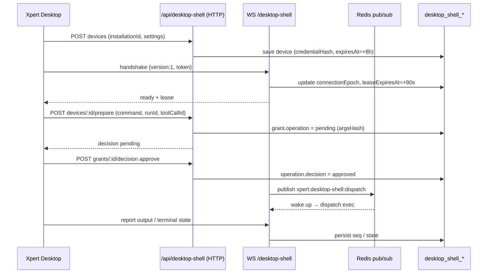

# 平台底座与集成专家 · 运维说明（07）

**本文引用的文件**

- [package.json](file://package.json)
- [packages/server/project.json](file://packages/server/project.json)
- [packages/server-ai/project.json](file://packages/server-ai/project.json)
- [apps/api/src/bootstrap/index.ts](file://apps/api/src/bootstrap/index.ts)
- [packages/config/src/database.ts](file://packages/config/src/database.ts)
- [packages/server/src/server.module.ts](file://packages/server/src/server.module.ts)
- [packages/server/src/core/seeds/seed-data.service.ts](file://packages/server/src/core/seeds/seed-data.service.ts)
- [packages/server/src/language/language.seed.ts](file://packages/server/src/language/language.seed.ts)
- [packages/server/src/language/commands/handlers/language-init.handler.ts](file://packages/server/src/language/commands/handlers/language-init.handler.ts)
- [packages/server/src/country/country.seed.ts](file://packages/server/src/country/country.seed.ts)
- [packages/server/src/currency/currency.seed.ts](file://packages/server/src/currency/currency.seed.ts)
- [packages/server/src/contact/contact.seed.ts](file://packages/server/src/contact/contact.seed.ts)
- [packages/server/src/data-source/data-source.service.ts](file://packages/server/src/data-source/data-source.service.ts)
- [packages/server/src/data-source/utils.ts](file://packages/server/src/data-source/utils.ts)
- [packages/server/src/data-source/data-source-runtime.service.ts](file://packages/server/src/data-source/data-source-runtime.service.ts)
- [packages/server/src/data-source/authentication/authentication.entity.ts](file://packages/server/src/data-source/authentication/authentication.entity.ts)
- [packages/server/src/integration/integration-qr.service.ts](file://packages/server/src/integration/integration-qr.service.ts)
- [packages/server/src/view-extension/view-extension.module.ts](file://packages/server/src/view-extension/view-extension.module.ts)
- [packages/server/src/view-extension/view-extension.cache.service.ts](file://packages/server/src/view-extension/view-extension.cache.service.ts)
- [packages/server/src/view-extension/host-definition.registry.ts](file://packages/server/src/view-extension/host-definition.registry.ts)
- [packages/server/src/view-extension/subscribers/integration-view-host-cache.subscriber.ts](file://packages/server/src/view-extension/subscribers/integration-view-host-cache.subscriber.ts)
- [packages/server-ai/src/desktop-shell/migrations/20260924-desktop-shell.sql](file://packages/server-ai/src/desktop-shell/migrations/20260924-desktop-shell.sql)
- [packages/server-ai/src/desktop-shell/migrations/20260928-desktop-shell-approval.sql](file://packages/server-ai/src/desktop-shell/migrations/20260928-desktop-shell-approval.sql)
- [packages/server-ai/src/desktop-shell/desktop-shell.module.ts](file://packages/server-ai/src/desktop-shell/desktop-shell.module.ts)
- [packages/server-ai/src/desktop-shell/desktop-shell.gateway.ts](file://packages/server-ai/src/desktop-shell/desktop-shell.gateway.ts)
- [packages/server-ai/src/desktop-shell/desktop-shell-auth.service.ts](file://packages/server-ai/src/desktop-shell/desktop-shell-auth.service.ts)
- [packages/server-ai/src/desktop-shell/desktop-shell-operation.service.ts](file://packages/server-ai/src/desktop-shell/desktop-shell-operation.service.ts)
- [packages/server-ai/src/desktop-shell/desktop-shell.errors.ts](file://packages/server-ai/src/desktop-shell/desktop-shell.errors.ts)
- [packages/desktop-protocol/index.js](file://packages/desktop-protocol/index.js)
- [packages/server-ai/src/mobile/mobile.service.ts](file://packages/server-ai/src/mobile/mobile.service.ts)
- [packages/server-ai/src/initialization/bootstrap.processor.ts](file://packages/server-ai/src/initialization/bootstrap.processor.ts)
- [packages/server-ai/src/initialization/constants.ts](file://packages/server-ai/src/initialization/constants.ts)
- [packages/server-ai/src/initialization/clawxpert-recovery.service.ts](file://packages/server-ai/src/initialization/clawxpert-recovery.service.ts)
- [packages/server-ai/src/ai-model/ai-model.service.ts](file://packages/server-ai/src/ai-model/ai-model.service.ts)
- [packages/server-ai/src/xpert-table/xpert-table.service.ts](file://packages/server-ai/src/xpert-table/xpert-table.service.ts)

## 目录

1. [一、构建与运行入口](#一构建与运行入口)
2. [二、环境变量与外链依赖](#二环境变量与外链依赖)
3. [三、迁移现状（逐模块）](#三迁移现状逐模块)
4. [四、字典种子运维](#四字典种子运维)
5. [五、外部数据源运维](#五外部数据源运维)
6. [六、客户端壳运维（desktop-shell / mobile）](#六客户端壳运维desktop-shell--mobile)
7. [七、扩展点运维（view-extension / integration / ai-model）](#七扩展点运维view-extension--integration--ai-model)
8. [八、日志与排障入口](#八日志与排障入口)
9. [九、常见故障与处置](#九常见故障与处置)

## 一、构建与运行入口

| 入口 | 命令 / 配置 | 说明 |
|---|---|---|
| 构建底座 | `pnpm b:p:server`（`nx build server`）、`pnpm b:p:server-ai`（`nx build server-ai`） | 两者均为 `@nx/js:tsc`，输出 `dist/packages/server`、`dist/packages/server-ai`；`server-ai.build` 的 `dependsOn` 含 `build-remote-components`（`node packages/server-ai/scripts/build-remote-components.mjs`，产出 `src/**/remote-components/**/app.{js,css}`，view-extension 远程入口依赖它） |
| 一把梭构建 | `pnpm b:p:all` | contracts → common → config → auth → server → server-ai → 插件 |
| 本地起服务 | `pnpm start:api`（`b:p:all` ＋ `nx serve api`）或 `pnpm start:api:dev`（nodemon） | 12 个模块**随宿主进程启动**，无独立进程/端口 |
| 全局前缀与文档 | `setGlobalPrefix('api')`；Swagger 在 `/swg`，指标在 `/metrics` | 本域全部路由形如 `/api/<prefix>` |
| 进程内 bootstrap | 启动末尾 `serverService.seedDBIfEmpty()`（开发种子） | 与 `pnpm seed:module --name …` 同源 |

章节来源：[package.json](file://package.json)（关键符号：scripts.b:p:server / b:p:server-ai / b:p:all / start:api / seed:module），[project.json](file://packages/server-ai/project.json)（关键符号：targets.build / build-remote-components），[project.json](file://packages/server/project.json)（关键符号：targets.build / outputs），[index.ts](file://apps/api/src/bootstrap/index.ts)（关键符号：setGlobalPrefix / SwaggerModule.setup('swg') / /metrics / seedDBIfEmpty）

## 二、环境变量与外链依赖

| 模块 | 变量 / 依赖 | 事实与默认值 |
|---|---|---|
| `data-source` | `OLAP_HOST`、`OLAP_PORT` | 非 `xmla` 协议的数据源做 OLAP 时 POST `http://${OLAP_HOST\|\|'localhost'}:${OLAP_PORT\|\|'8080'}/xmla`；`xmla` 走 adapter。`NODE_ENV=development` 会给 adapter 打开 `debug/trace`（`utils.dataLoad` 与各 query handler） |
| `data-source` | **无凭据加密密钥** | 本模块不读取任何加密 env；`packages/server/src/core/utils/crypto.ts` 的 AES-256-GCM 工具注释明写用于 GitHub token，本域未调用。因此连接凭据以「`data_source.options`（json）＋ `data_source_authentication.password`（普通列）」形态落库，运维侧必须靠**库级/字段级权限**而不是应用层加密来保护 |
| `integration` | 第三方回调/跳转地址 | 不在本模块读取 env：授权地址由 plugint 策略 `beginQrAuthorization()` 返回的 `authorizationUrl` 决定（测试里出现的是 `https://open-dev.dingtalk.com/authorize`），第三方 App 的 clientId/secret 存在集成实例 `options` 内。**回调白名单/域名需在第三方平台侧配置**，本仓库无对应开关 |
| `desktop-shell` | Redis pub/sub（必需） | `RedisModule` 注入 `REDIS_CLIENT`；网关在 `onModuleInit` `duplicate()` 出订阅连接并订阅 `xpert:desktop-shell:dispatch`，失败仅 `logger.warn('Desktop Shell notification connection unavailable')`（**降级但不阻塞**，因为还有每秒轮询兜底） |
| `desktop-shell` | WS 端口/域名 | **无独立 env/端口**：`@WebSocketGateway({namespace:'/desktop-shell', transports:['websocket'], maxHttpBufferSize:65536})` 挂在同一 HTTP 服务上，客户端连 `ws(s)://<api-host>/desktop-shell`；反向代理必须放行 websocket upgrade 且 body 上限 ≥64KiB。协议版本 `VERSION=1`，版本不符握手即断 |
| `mobile` | `MOBILE_API_BASE_URL` → `PUBLIC_API_BASE_URL` → `API_BASE_URL`；`MOBILE_CHATKIT_FRAME_URL` → `CHATKIT_FRAME_URL`（默认 `/chatkit`） | 由 `getDeploymentConfig()` 读取并回给客户端；`apiBasePath`/`aiApiPath`/`viewHostsPath` 为常量 |
| `ai-model` | Provider 端点 | 本模块**无 env**：Provider 的 base url/密钥来自插件策略与 `copilot-provider` 记录的凭据，`AIProvidersService.getProvider(name, throwError, organizationId)` 按组织解析 `AIModelProviderRegistry` |
| 全局 | `EXPRESS_SESSION_SECRET`、`CORS_ALLOW_ORIGINS`、`TRUST_PROXY`、`clientBaseUrl`（`env.clientBaseUrl`） | 会话密钥、CORS 白名单与代理信任；CORS 允许头包含 `X-Api-Key`、`X-Client-Secret`（view-extension 的两种入口） |

章节来源：[data-source.service.ts](file://packages/server/src/data-source/data-source.service.ts)（关键符号：olap / OLAP_HOST / OLAP_PORT），[utils.ts](file://packages/server/src/data-source/utils.ts)（关键符号：dataLoad / NODE_ENV=development / debug / trace），[authentication.entity.ts](file://packages/server/src/data-source/authentication/authentication.entity.ts)（关键符号：username / password / validUntil），[integration-qr.service.ts](file://packages/server/src/integration/integration-qr.service.ts)（关键符号：beginQrAuthorization / authorizationUrl / deviceCode），[desktop-shell.gateway.ts](file://packages/server-ai/src/desktop-shell/desktop-shell.gateway.ts)（关键符号：WebSocketGateway / SHELL_DISPATCH_CHANNEL / subscribe / Redis 不可用告警），[mobile.service.ts](file://packages/server-ai/src/mobile/mobile.service.ts)（关键符号：getDeploymentConfig / MOBILE_API_BASE_URL / MOBILE_CHATKIT_FRAME_URL），[ai-model.service.ts](file://packages/server-ai/src/ai-model/ai-model.service.ts)（关键符号：getProvider / AIModelProviderRegistry），[index.ts](file://apps/api/src/bootstrap/index.ts)（关键符号：enableCors / EXPRESS_SESSION_SECRET / TRUST_PROXY）

## 三、迁移现状（逐模块）

事实基线：全仓 `migrations/*.sql` 共 30 份，**本批 12 模块只有 `desktop-shell` 有迁移（2 份）**；`packages/server/src` 全目录只有 `api-key/personal-api-key/migrate-personal-api-keys.sql`（不属本批）。其余模块的表由 TypeORM 建——`packages/config/src/database.ts` 的 `synchronize: true`（该目录内唯一一处 `synchronize`，未见按环境关闭的分支）。

| 模块 | 迁移 | 建表机制与注意点 |
|---|---|---|
| `data-source` | **无** | `synchronize` 建 `data_source`、`data_source_authentication`；`data_source.authentications` 关系为 `cascade: true`（删数据源连带删个人凭据），`typeId` 外键 `onDelete: CASCADE` 指向 `data_source_type` |
| `integration` | **无** | 建 `integration` ＋ M2M join（`integration.tags`）；`slug` 唯一索引、`name/provider` 普通索引 |
| `xpert-table` | **无** | 建 `xpert_table`（`columns` json、`status` 默认 `draft`、`deletedAt` 软删、`version` 默认 1）；**`physicalSchema/physicalTableName` 指向外部库的真实表**，删库/改库不会自动清理，需按第五节处理 |
| `view-extension` | **无表** | 无 TypeORM 实体，仅注册表与缓存；`IntegrationViewHostCacheSubscriber` 监听集成变更做失效 |
| `language` / `country` / `currency` / `contact` | **无** | 建 `language`（`code` 唯一）、`country`、`currency`（`isoCode` 非唯一索引）、`contact`；数据由 seed 填充（第四节） |
| `desktop-shell` | **2 份（唯一）** | `20260924-desktop-shell.sql`：**显式 `BEGIN…COMMIT`**，`CREATE TABLE IF NOT EXISTS` 建 `desktop_shell_device` / `desktop_shell_grant` / `desktop_shell_operation`，建 `UNIQUE(tenantId,organizationId,userId,installationId)`、`UNIQUE(tenantId,runId,toolCallId)`、索引 `desktop_shell_grant_device(deviceId,enabled)`、`desktop_shell_operation_device(deviceId,state)`；文件头注释「Apply before enabling Desktop Shell. Additive migration; existing platform data is unchanged.」；`20260928-desktop-shell-approval.sql`：单句 `ALTER TABLE desktop_shell_grant ADD COLUMN IF NOT EXISTS operation jsonb NULL;`（**无 BEGIN/COMMIT**，单语句天然幂等） |
| `mobile` | **无表** | 只读聚合，无实体 |
| `initialization` | **无** | 无自有实体；依赖 Bull 队列（存储在 Redis，非 PG） |
| `ai-model` | **无** | 0 表，无 `TypeOrmModule` |

**执行顺序与回滚**：先跑 `20260924`（三表基线），再跑 `20260928`（补 `operation` 列），两者均可重复执行；回滚应用版本时**优先保留列**（旧代码不读 `operation` 不影响），若必须回退 DDL，须先确认没有 `pending/approved` 的授权在途，再 `ALTER TABLE … DROP COLUMN operation`、最后 `DROP TABLE desktop_shell_operation → grant → device`（外键顺序）。`desktop_shell_device.enabled` 默认 `false`（实体侧默认也是 `false`），注册后才置 `true`。

章节来源：[20260924-desktop-shell.sql](file://packages/server-ai/src/desktop-shell/migrations/20260924-desktop-shell.sql)，[20260928-desktop-shell-approval.sql](file://packages/server-ai/src/desktop-shell/migrations/20260928-desktop-shell-approval.sql)，[database.ts](file://packages/config/src/database.ts)（关键符号：synchronize: true / uuidExtension: pgcrypto），[desktop-shell.module.ts](file://packages/server-ai/src/desktop-shell/desktop-shell.module.ts)（关键符号：TypeOrmModule.forFeature / RedisModule / TenantModule），[xpert-table.service.ts](file://packages/server-ai/src/xpert-table/xpert-table.service.ts)（关键符号：deleteTable / DROP_TABLE / softDelete）

## 四、字典种子运维

| 字典 | 种子 | 触发时机 | 更新与漂移处理 |
|---|---|---|---|
| `language` | `createLanguages(connection)`：遍历 `all-languages.ts` 全量写入；`is_system` 由 `LanguagesEnum` 判定；`color` 用 `faker.internet.color()` **随机** | 开发种子 `SeedDataService`（`seedDBIfEmpty` / `pnpm seed:module`）；另有 `LanguageInitCommand` 供租户侧显式重灌 | 每次执行都**整体 `save` 全量数组**：`code` 唯一约束会让已存在行走 upsert 语义，但 `color` 每次重跑都会变，`description` 被重置为空——**不要把 `color` 当业务字段**。`is_system` 是「哪些语言是系统语言」的唯一权威 |
| `country` | `createCountries(connection)`：从 contracts 的 `DEFAULT_COUNTRIES` 常量插入（`isoCode`→`country`） | 同上 | 纯插入（`insert().values(...)`），**无去重逻辑**：重复执行会产生重复行（`isoCode` 无唯一约束），需人工去重 |
| `currency` | `createCurrencies(connection)`：同 country 模式 | 同上 | 同上（`isoCode` 非唯一索引） |
| `contact` | `contact.seed.ts` 定义但**全仓无人调用**（模块本身也未挂载） | — | 视为死代码，不要依赖 |
| `tags`（邻域） | `tag.seed.ts` 的 `createDefaultTags/createRandomOrganizationTags/createTags` | 同 `SeedDataService` | 标签名在 `(tenantId,organizationId,name,category)` 上唯一；系统标签不可编辑（`!isSystem` 判定），运维改标签应改 `isActive` 而非删除 |

`SeedDataService` 是**开发/初始化用**的种子入口，生产上「种子缺失」的处理优先级应是：先确认是否走过 `seedDBIfEmpty`（空库才灌）或 `pnpm seed:module --name …`，再针对性重灌；`country/currency` 重灌前务必先按 `isoCode` 去重。

章节来源：[language.seed.ts](file://packages/server/src/language/language.seed.ts)（关键符号：createLanguages / is_system / faker.internet.color），[language-init.handler.ts](file://packages/server/src/language/commands/handlers/language-init.handler.ts)（关键符号：LanguageInitHandler），[country.seed.ts](file://packages/server/src/country/country.seed.ts)（关键符号：createCountries / DEFAULT_COUNTRIES / insertCountry），[currency.seed.ts](file://packages/server/src/currency/currency.seed.ts)（关键符号：createCurrencies），[contact.seed.ts](file://packages/server/src/contact/contact.seed.ts)（关键符号：未被引用），[seed-data.service.ts](file://packages/server/src/core/seeds/seed-data.service.ts)（关键符号：SeederTypeEnum / createCountries / createCurrencies / createLanguages / createTags）

## 五、外部数据源运维

- **连接池与超时不在本域**：`DataSourceService` 只负责「取配置 → `DataSourceStrategyQuery` 拿 runner → 用 → `teardown()`」。连接池大小、语句超时、`statement_timeout` 属插件 adapter（`@xpert-ai/plugin-sdk` 的 `DBQueryRunner`），运维应查对应数据库插件配置；本域每次调用都在 `finally` 里 `teardown()`，因此**没有长驻连接**，也不会持有跨请求连接。
- **权限最小化**：能给 `DATA_SOURCE_VIEW` 的账号应只给该权限；`POST /:id/query`、`/:id/olap`、`/:id/load` 会以服务端身份执行任意语句，**后端 DB 账号必须是只读/受限账号**。插件运行时另有更严的边界：`DataSourceRuntimeService.open()` 只允许 `mysql/doris/postgres`，写路径（`transaction`、`importRows`、`query(mode:'write')`）额外要求 `DATA_SOURCE_EDIT`，且 `check()` 在 `updatedAt` 变化时强制关闭会话并抛 403。
- **凭据轮换**：个人凭据（`data_source_authentication`）按用户隔离，`POST /:id/authentication` 每次都会把 `validUntil` 重置为 `now+30d`——**建议以 30 天为轮换周期**，到期前重新提交；凭据删除走 `DELETE /:id/authentication`（只删当前用户，别人的不动）。因为 `options` 里可能是可用的账号密码（`authType≠BASIC`），改密后需同时更新数据源 `options`，否则连接继续用旧密码。
- **数据源变更的传播**：`PUT /api/data-source/:id` 会 `eventBus.publish(DataSourceUpdatedEvent)`；插件侧会话通过 `updatedAt` revision 感知变更并失效（`Data source changed; reopen the connection`）。因此**修改连接参数后，正在跑的插件会话会被主动掐断**——属预期行为。
- **schema 拉取**：`GET /:id/catalogs`、`GET /:id/schema` 每次调用都新建 runner 并 teardown；外部库不可达时返回 500（catalogs 的 message 常为 `配置错误`）。**没有缓存层**，高频调用会持续压外部库，需要限流时应在网关侧做。
- **xpert-table 的物理表**：激活会在外部库里 `CREATE_TABLE(createMode=UPGRADE)`；删除只对 `status=active` 的表尝试 `DROP_TABLE`，drop 失败**仅记日志**（软删照常进行）→ 运维需定期核对「逻辑表已删但物理表仍在」的残留。

章节来源：[data-source.service.ts](file://packages/server/src/data-source/data-source.service.ts)（关键符号：prepareDataSource / getCatalogs / getSchema / query / olap / teardown / DataSourceUpdatedEvent），[data-source-runtime.service.ts](file://packages/server/src/data-source/data-source-runtime.service.ts)（关键符号：authorize / open / check / close / Data source changed; reopen the connection），[data-source.controller.ts](file://packages/server/src/data-source/data-source.controller.ts)（关键符号：updateOne / query / olap / load），[xpert-table.service.ts](file://packages/server-ai/src/xpert-table/xpert-table.service.ts)（关键符号：activateTable / deleteTable / DROP_TABLE / 失败仅记日志）

## 六、客户端壳运维（desktop-shell / mobile）

**桌面端设备授权与回收**

- 生命周期：`POST /devices`（注册，返回一次性可复制的 `token=<deviceId>.<secret>`，库内只存 `sha256`）→ 桌面端用该 token 完成 WS 握手（`handshake.auth.token`，并校验 `version===1`）→ 平台侧 `/devices/:id/refresh` 轮换凭据 → `/devices/:id/disable` 回收（同时禁用该设备全部 grants 并把在途操作置 `cancel_requested`）。`LIMITS.grant = 8h`：**设备凭据与 grant 都会到期**，8 小时内未 refresh 会全线 401/403。
- 会话授权：`/devices/:id/prepare` 写 `pending` 授权（只路由、不授权执行）→ 用户 `/grants/:id/decision` 批准 → 执行侧再校验 `runId/toolCallId/argsHash` 三者全等才放行；`/grants/:id/revoke` 或设备禁用会立刻让在途操作 `cancel_requested`。运维含义：**「pending 不是已批准」**，页面显示 pending 时命令不会执行。
- 租约与心跳：设备连接时写 `connectionEpoch`（换代即踢旧 socket）与 `leaseExpiresAt = now + 90s`；`heartbeat` 续租。网关每秒巡检，把 `deadline < now-90s-10s` 的 `pending/running/cancel_requested` 置为 `unknown` 并带 `EXECUTION_UNKNOWN`——**这类操作不会自动重试**，处置方式是让用户重新发起，而不是重放。
- 清理建议：`desktop_shell_operation.output` 是 jsonb（单操作上限 1MiB，超出置 `truncated`），`desktop_shell_grant/operation` 没有 TTL 清理逻辑，长期运行需自建归档（例如按 `createdAt` 分片删除已终态且超过 N 天的行）。

**移动端 bootstrap 兼容**

- `GET /api/mobile/bootstrap` 的 `deployment` 是**客户端能力协商面**：`chatkit/extensionViews/scheduledTasks/fileMemory/sandboxTerminal/publicChatkitSessions` 六位全是 `true` 常量，`apiBasePath='/api'`、`aiApiPath='/api/ai'`、`viewHostsPath='/api/view-hosts'` 也是常量——升级 API 时只要这些路径不变，老客户端不受影响；变更 `viewHostsPath` 属于**破坏性变更**。
- 域名切换只需改 `MOBILE_API_BASE_URL`（优先级最高），未配置时回落 `PUBLIC_API_BASE_URL`/`API_BASE_URL`；`chatkitFrameUrl` 默认 `/chatkit`，跨域嵌 iframe 时需同时更新 `CORS_ALLOW_ORIGINS`。
- 组织选择：ADMIN 恒走 membership 列表（不看 legacy tenant grants），非 ADMIN 且具备 `ALL_ORG_VIEW/ALL_ORG_EDIT` 才返回租户全量启用组织。排障时「移动端看不到某组织」应先确认角色分支，再查 membership / 组织 `isActive`。

图表来源：[desktop-shell.gateway.ts](file://packages/server-ai/src/desktop-shell/desktop-shell.gateway.ts)（关键符号：handleConnection / dispatch / SHELL_DISPATCH_CHANNEL），[desktop-shell-auth.service.ts](file://packages/server-ai/src/desktop-shell/desktop-shell-auth.service.ts)（关键符号：register / prepareOperation / decideOperation），[desktop-shell-operation.service.ts](file://packages/server-ai/src/desktop-shell/desktop-shell-operation.service.ts)（关键符号：execute / receive / notify），[index.js](file://packages/desktop-protocol/index.js)（关键符号：VERSION / NAMESPACE / LIMITS.lease / LIMITS.grant）

章节来源：[desktop-shell-auth.service.ts](file://packages/server-ai/src/desktop-shell/desktop-shell-auth.service.ts)（关键符号：register / refresh / disable / issueGrant / prepareOperation / requireDevice），[desktop-shell-operation.service.ts](file://packages/server-ai/src/desktop-shell/desktop-shell-operation.service.ts)（关键符号：execute / cancel / cancelRuns / result / receive / LIMITS.result），[desktop-shell.errors.ts](file://packages/server-ai/src/desktop-shell/desktop-shell.errors.ts)（关键符号：DEVICE_OFFLINE / DEVICE_BUSY / EXECUTION_UNKNOWN / PROTOCOL_MISMATCH），[mobile.service.ts](file://packages/server-ai/src/mobile/mobile.service.ts)（关键符号：getBootstrap / getDeploymentConfig / ADMIN membership 分支）

## 七、扩展点运维（view-extension / integration / ai-model）

- **视图注册与失效**：视图来自插件（`ViewExtensionProviderRegistry`，plugin-sdk），宿主来自内部注册表 `ViewHostDefinitionRegistry`（`onModuleInit` 用 `DiscoveryService` 扫 `@ViewHostDefinition`，当前只有 `integration`，槽位 `detail.main_tabs`）。**插件升级/重装后必须重启宿主进程**才能让新 provider 进入注册表（注册表是进程内内存）。
- **缓存**：`ViewExtensionModule` 是 `@Global()`，提供 `ViewExtensionCacheService` 并以 `VIEW_EXTENSION_CACHE_SERVICE_TOKEN` 暴露给插件；集成变更通过 `IntegrationViewHostCacheSubscriber` 触发失效。排障时「视图不显示」先看 provider 是否注册、宿主 `canRead`（`INTEGRATION_VIEW|INTEGRATION_EDIT`）与缓存是否已失效。
- **集成实例运维**：`/api/integration/providers` 只反映**当前进程**注册的 provider（代码内 `INTEGRATION_PROVIDERS` 仅 GitHub，其余靠插件）；创建/更新会跑 `validateConfig`（失败统一 400），删除跑 `onDelete`，改 provider 会先 `onDelete` 旧的。集成实例的 `options` 是密钥载体，`IntegrationPublicDTO` 只在列表端点 `@Exclude()` 掉 `options`——**API 层面不能作为凭据审计的唯一依据**。
- **扫码授权的运维窗口**：会话只在 Redis（TTL 至 `expiresAt`，30..600s 夹取，间隔 ≥2s），**服务重启不丢会话但 Redis 清空即全失效**；多实例靠 `RedisLockService` 串行化 poll/complete/cancel，锁失败即 409 `INTEGRATION_QR_BUSY`（并发轮询过密的正常表现，不是故障）。`complete` 用 session id 作集成 id，**重试幂等**（返回 `created`/`reused`），因此卡住时可以直接重试 `/complete` 而不必重扫码。
- **Provider 侧**：`ai-model` 只有图标端点，`AIProvidersService.getProvider` 直查插件注册表；插件卸载后 `getProvider` 返回 `undefined`（默认不抛），需要 `throwError=true` 才会抛 `AIModelProviderNotFoundException`——排障「模型不可用」应同时检查插件是否加载与 `copilot-provider` 凭据，而不是只看 `ai-model`。

章节来源：[view-extension.module.ts](file://packages/server/src/view-extension/view-extension.module.ts)（关键符号：ViewExtensionProviderRegistry / VIEW_EXTENSION_CACHE_SERVICE_TOKEN / ViewExtensionCacheService），[host-definition.registry.ts](file://packages/server/src/view-extension/host-definition.registry.ts)（关键符号：onModuleInit / DiscoveryService / get），[integration-view-host-cache.subscriber.ts](file://packages/server/src/view-extension/subscribers/integration-view-host-cache.subscriber.ts)（关键符号：IntegrationViewHostCacheSubscriber），[integration.service.ts](file://packages/server/src/integration/integration.service.ts)（关键符号：getProviders / applyStrategyValidation / runStrategyDeleteHook），[integration-qr.service.ts](file://packages/server/src/integration/integration-qr.service.ts)（关键符号：lock / IntegrationQrBusy / complete / reused），[ai-model.service.ts](file://packages/server-ai/src/ai-model/ai-model.service.ts)（关键符号：getProvider / AIModelProviderNotFoundException）

## 八、日志与排障入口

| 观测面 | 入口 | 判据 |
|---|---|---|
| 通用指标 | `GET /metrics`（`MetricsService`）＋ HTTP 请求指标中间件 | 全站可用；本域无自有指标 |
| 接口清单 | Swagger `/swg` | 核对端点是否真的挂载（`/api/contact`、`/api/import` 会缺失——属预期） |
| 外部库连通 | `POST /api/data-source/:id/ping`（500 + message） | 失败时 message 来自 adapter；`GET /:id/catalogs` 的 500 常是 `配置错误` |
| 数据源清单筛选 | `GET /api/data-source/sql-select-options`、`xpert-table GET /databases` | 前者按 `type.protocol='sql'`，后者走 `XpertDatabasesQuery({protocol:'sql'})`；查不到库先看数据源类型的 protocol |
| 视图排障 | `GET /api/view-hosts/<hostType>/<hostId>/slots/<slot>/views` | 404 区分三态：`Unknown view host`（宿主未注册）/`View host … was not found`（宿主解析失败）/`View … was not found`（provider/manifest 不匹配） |
| 桌面壳 | 网关 `Logger.warn('Desktop Shell notification connection unavailable')`；`desktop_shell_operation.state='unknown'` + `errorCode='EXECUTION_UNKNOWN'` | 前者代表 Redis 订阅不可用（仍有轮询兜底）；后者代表命令超时未回执 |
| 设备侧错误 | 网关 `revoked {code}` / `reconcile {operationId}` 帧 | 客户端收到 `revoked` 需重新注册/refresh；`reconcile` 表示 chunk 丢失需重新拉结果 |
| bootstrap 队列 | `Logger.error('Failed <domain> bootstrap for …')`（processor 逐 job 打点） | 队列名 `server-ai-bootstrap`，可用 Redis 里的 Bull 键排查；重试 3 次后需人工 `POST /api/initialization/clawxpert` |
| 种子 | `SeedDataService` 构造期 `console.log` 环境与配置；`createLanguages` 失败时 `console.log({error})` | 语言种子「静默失败」只会打印错误对象，需看启动日志 |

章节来源：[index.ts](file://apps/api/src/bootstrap/index.ts)（关键符号：MetricsService / /metrics / SwaggerModule.setup('swg')），[data-source.controller.ts](file://packages/server/src/data-source/data-source.controller.ts)（关键符号：pingDataSource / getCatalogs / getSqlDataSources），[view-extension.service.ts](file://packages/server/src/view-extension/view-extension.service.ts)（关键符号：Unknown view host / View host … was not found / View … was not found），[desktop-shell.gateway.ts](file://packages/server-ai/src/desktop-shell/desktop-shell.gateway.ts)（关键符号：logger.warn / setInterval 巡检 / EXECUTION_UNKNOWN），[bootstrap.processor.ts](file://packages/server-ai/src/initialization/bootstrap.processor.ts)（关键符号：logger.error / attempts / backoff），[language.seed.ts](file://packages/server/src/language/language.seed.ts)（关键符号：console.log({error})）

## 九、常见故障与处置

| 故障 | 根因（结构事实） | 处置 |
|---|---|---|
| 连不上外部库 | `ping` 500 透传 adapter message；`catalogs` 的 500 常退化为 `配置错误` | 先用 `/ping` 区分「网络不通」与「认证失败」；`authType=BASIC` 时先查当前用户的 `data_source_authentication` 是否存在与是否过期（30 天） |
| schema 拉取失败 / 拉完还报错 | `GET /:id/catalogs`、`/:id/schema` 每次新建 runner、无缓存；插件会话以 `updatedAt` 做 revision | 确认外部库账号对 `information_schema` 有权限；若刚改过数据源，插件侧会强制 `Data source changed; reopen the connection`（重开会话即可） |
| 扫码授权“不回” | 会话在 Redis，`poll` 受 `intervalSeconds` 与 provider 的 `intervalIncrementSeconds` 节流；多实例并发会 409 `INTEGRATION_QR_BUSY` | 先看 Redis 里的 `integration:qr:session:<id>` 是否还在（TTL 30..600s，过期即 404）；`status` 停在 `waiting` 说明第三方未确认——回第三方后台确认应用回调与授权人；`authorized` 后直接重试 `/complete`（幂等，返回 `reused`/`created`） |
| 视图不显示 | 三类 404（宿主未注册 / 宿主解析失败 / provider 或 manifest 不匹配）＋403（`canRead`、动作权限、项目角色） | 用《八》的 URL 逐个区分；插件视图需确认插件已加载且宿主进程已重启；集成宿主要求 `INTEGRATION_VIEW/EDIT` |
| 设备离线（409 `DEVICE_OFFLINE`） | `leaseExpiresAt` 为空或过期（>90s 无心跳/连接） | 让用户打开 Xpert Desktop 并启用 Shell；服务端不需要“重放”命令，重新发起即可 |
| 设备忙（409 `DEVICE_BUSY`） | 同设备已有 `pending/running/cancel_requested` 操作 | 等终态或 `POST /operations/:id/cancel`；注意 `unknown` 是终态，不会自愈 |
| 命令结果未知（`EXECUTION_UNKNOWN`） | 网关每秒巡检把超租约操作置 `unknown`（**明确不重新执行**） | 不要重放同一 `runId+toolCallId`（会命中唯一约束/409）；确认设备侧实际影响后重新发起新操作 |
| WS 连不上 / 立刻断开 | `PROTOCOL_MISMATCH`（`version!==1`）；凭据过期（`credentialExpiresAt<=now`）；body 超 64KiB | 升级桌面端；`POST /devices/:id/refresh` 换 token；反代放行 upgrade 且放宽 buffer |
| 种子缺失（语言/国家/货币） | 只在空库 `seedDBIfEmpty` 或手工 `pnpm seed:module` 时灌；`country/currency` 无去重、`language` 每次重跑都会刷 `color` 并清空 `description` | 先 `SELECT count(*)` 确认缺哪张；重灌前对国家/货币按 `isoCode` 去重，语言用 `LanguageInitCommand` 显式重灌 |
| `/api/contact`、`/api/import` 404 | `ContactModule`、`ImportAllModule` 未被任何模块注册（接口存在但未挂载） | 属现状而非故障；需要这两个面时必须先在 `server.module.ts` 注册模块并补回被注释的逻辑 |
| bootstrap 卡住 / ClawXpert 缺绑定 | 队列 `server-ai-bootstrap`（Bull/Redis），jobId 去重（`org-bootstrap:<id>`、`user-org-bootstrap:<org>:<user>`） | 看 processor 的 `Failed … bootstrap` 日志与 Redis 中 Bull 状态；`POST /api/initialization/clawxpert` 会重试失败 job（并发点击不会重复入队） |
| 没有 HTTP 面可查的 bootstrap | `InitializationModule` 只暴露 ClawXpert 的 2 条恢复端点 | 运维排障只能靠队列与日志（第八节），不要期待 `curl /initialization` |

章节来源：[desktop-shell.errors.ts](file://packages/server-ai/src/desktop-shell/desktop-shell.errors.ts)（关键符号：DEVICE_OFFLINE / DEVICE_BUSY / EXECUTION_UNKNOWN / OPERATION_CONFLICT / PROTOCOL_MISMATCH），[desktop-shell-operation.service.ts](file://packages/server-ai/src/desktop-shell/desktop-shell-operation.service.ts)（关键符号：execute / receive / requireOperation），[integration-qr.service.ts](file://packages/server/src/integration/integration-qr.service.ts)（关键符号：poll / complete / read / write / IntegrationQrBusy），[view-extension.service.ts](file://packages/server/src/view-extension/view-extension.service.ts)（关键符号：Unknown view host / View host … was not found / View provider … was not found），[data-source-runtime.service.ts](file://packages/server/src/data-source/data-source-runtime.service.ts)（关键符号：check / Data source changed; reopen the connection），[clawxpert-recovery.service.ts](file://packages/server-ai/src/initialization/clawxpert-recovery.service.ts)（关键符号：recover / getStatus / existing.retry / AI_USER_ORGANIZATION_BOOTSTRAP_JOB），[bootstrap.processor.ts](file://packages/server-ai/src/initialization/bootstrap.processor.ts)（关键符号：AI_BOOTSTRAP_QUEUE / jobId / attempts / backoff）
