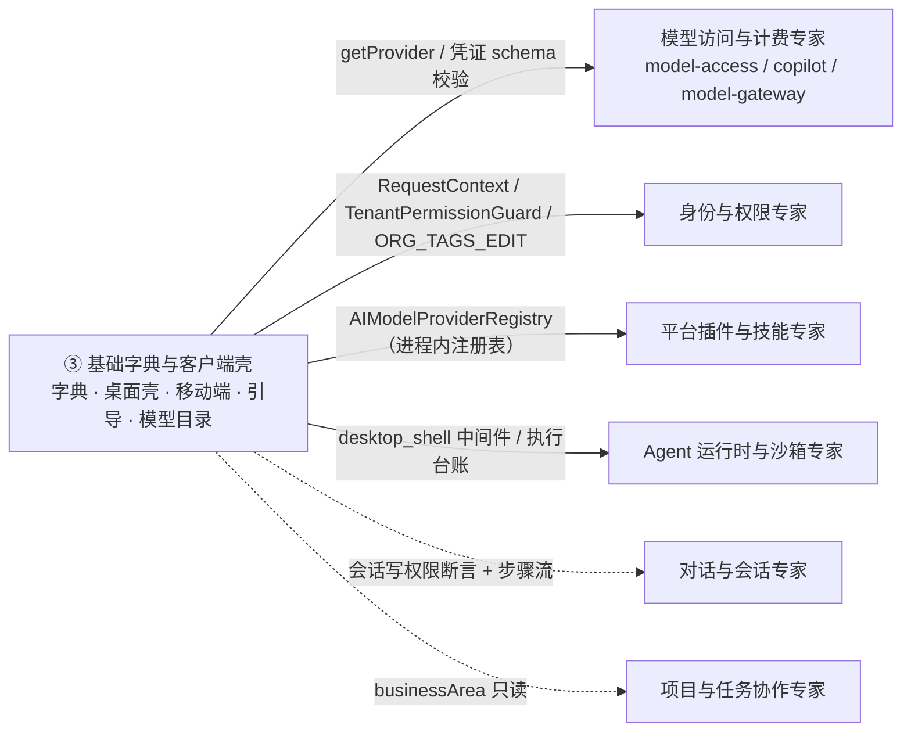

# 基础字典与客户端壳子专家 —— C0 使用总览

> **资产基线**：`2026-10-16 · commit 80f5676fd`（批次 5 第 14 专家 ③ 子专家），继承父域 [C0-使用总览.md](file://.module-experts/后端专题/平台底座与集成专家/C0-使用总览.md)。**范围**：字典族（`language` 11 非 spec / `/api/languages` 2 · 1 表；`country` 7 / `/api/country` 1 · 1 表；`currency` 6 / `/api/currency` 1 · 1 表；`contact` 9 / **`/api/contact` 未挂载** · 1 表）＋ 客户端壳（`desktop-shell` 8 / **9 端点 + WS** / **3 表 + 2 SQL 迁移**；`mobile` 4 / `/api/mobile` 2 · 0 表）＋ `initialization` 8（`/api/initialization/clawxpert` 2）＋ `ai-model` **27**（`/api/ai-model` 1 / 0 表）＋ 相邻 `tags`（`/api/tags` **8** / 1 表 + 2 显式联接表）与 `export-import`（**`/api/import` 未挂载** / 2 表）。本子域自身 **7 表**（字典 4 + `desktop_shell_*` 3）；全仓 14 实体口径见父域 [C4-数据流向与消费.md](file://.module-experts/后端专题/平台底座与集成专家/C4-数据流向与消费.md)。未证实处标 `[推测]`。

**本文引用的文件**（相对仓库根，链接均为 `file://`）

- [packages/server/src/language/language.controller.ts](file://packages/server/src/language/language.controller.ts)
- [packages/server/src/language/language.seed.ts](file://packages/server/src/language/language.seed.ts)
- [packages/server/src/country/country.seed.ts](file://packages/server/src/country/country.seed.ts)
- [packages/server/src/currency/currency.seed.ts](file://packages/server/src/currency/currency.seed.ts)
- [packages/server/src/core/seeds/seed-data.service.ts](file://packages/server/src/core/seeds/seed-data.service.ts)
- [packages/server/src/contact/contact.controller.ts](file://packages/server/src/contact/contact.controller.ts)
- [packages/server/src/contact/contact.module.ts](file://packages/server/src/contact/contact.module.ts)
- [packages/server/src/server.module.ts](file://packages/server/src/server.module.ts)
- [packages/server-ai/src/desktop-shell/desktop-shell.controller.ts](file://packages/server-ai/src/desktop-shell/desktop-shell.controller.ts)
- [packages/server-ai/src/desktop-shell/desktop-shell-auth.service.ts](file://packages/server-ai/src/desktop-shell/desktop-shell-auth.service.ts)
- [packages/server-ai/src/desktop-shell/desktop-shell-operation.service.ts](file://packages/server-ai/src/desktop-shell/desktop-shell-operation.service.ts)
- [packages/server-ai/src/desktop-shell/desktop-shell.gateway.ts](file://packages/server-ai/src/desktop-shell/desktop-shell.gateway.ts)
- [packages/server-ai/src/desktop-shell/desktop-shell.entities.ts](file://packages/server-ai/src/desktop-shell/desktop-shell.entities.ts)
- [packages/server-ai/src/desktop-shell/migrations/20260924-desktop-shell.sql](file://packages/server-ai/src/desktop-shell/migrations/20260924-desktop-shell.sql)
- [packages/server-ai/src/desktop-shell/migrations/20260928-desktop-shell-approval.sql](file://packages/server-ai/src/desktop-shell/migrations/20260928-desktop-shell-approval.sql)
- [packages/server-ai/src/xpert-middleware/desktop-shell.middleware.ts](file://packages/server-ai/src/xpert-middleware/desktop-shell.middleware.ts)
- [packages/server-ai/src/mobile/mobile.service.ts](file://packages/server-ai/src/mobile/mobile.service.ts)
- [packages/server-ai/src/initialization/bootstrap.processor.ts](file://packages/server-ai/src/initialization/bootstrap.processor.ts)
- [packages/server-ai/src/initialization/clawxpert-recovery.service.ts](file://packages/server-ai/src/initialization/clawxpert-recovery.service.ts)
- [packages/server-ai/src/ai-model/ai-model.service.ts](file://packages/server-ai/src/ai-model/ai-model.service.ts)
- [packages/server-ai/src/ai-model/queries/handlers/get-model-icon.handler.ts](file://packages/server-ai/src/ai-model/queries/handlers/get-model-icon.handler.ts)
- [packages/server/src/tags/tag-management.service.ts](file://packages/server/src/tags/tag-management.service.ts)
- [packages/server/src/export-import/import/import-all.controller.ts](file://packages/server/src/export-import/import/import-all.controller.ts)
- [apps/cloud/src/app/@core/services/languages.service.ts](file://apps/cloud/src/app/@core/services/languages.service.ts)
- [apps/desktop/electron/shell/controller.cjs](file://apps/desktop/electron/shell/controller.cjs)

## 目录

1. [定位](#定位)
2. [何时找这个子专家](#何时找这个子专家)
3. [能力清单表](#能力清单表)
4. [边界](#边界)
5. [已知问题与常见坑](#已知问题与常见坑)
6. [延伸阅读](#延伸阅读)

## 定位

本子专家负责**平台基础枚举与种子**（`language` / `country` / `currency` / `contact` 四模块，其中 `contact` 语义上接近业务实体但物理上与字典族同放 `packages/server/src`）、**客户端壳服务端面**（`desktop-shell` 设备/授权/执行台账 + 一条 WS 通道、`mobile` 只读投影）、**引导队列**（`initialization` 的入组/建组织/建租户副作用与 ClawXpert 恢复）与**模型 Provider 目录**（`ai-model` 门面，0 表），外加两个相邻面：`tags`（唯一可写字典）与 `export-import`（保留模块但无 HTTP 面）。

**一句话口径**：本子域是「字典只读 + 种子、客户端壳只做服务端侧、引导只做队列副作用、模型目录只回答 provider 存在与凭证合法」——业务语义（授权计费、身份权限、插件安装、会话）一律在相邻专家域；桌面命令的**执行本体在用户机器**（`Xpert Desktop`），`desktop_shell_*` 三表只是权威台账。

**关键计数**：字典 4 表 + `tag` 1 表 + `desktop_shell_*` 3 表 + `import-*` 2 表 = 10 个实体（另 `tag_user` / `tag_organization` 2 张显式 `@JoinTable`）；仅 `desktop-shell` 带显式 SQL 迁移（2 份），其余由 `synchronize: true` 建。

章节来源：[language.controller.ts](file://packages/server/src/language/language.controller.ts)（关键符号：LanguageController.findAll / findByName / @Public）、[desktop-shell-auth.service.ts](file://packages/server-ai/src/desktop-shell/desktop-shell-auth.service.ts)（关键符号：register / issueGrant / prepareOperation）、[bootstrap.processor.ts](file://packages/server-ai/src/initialization/bootstrap.processor.ts)（关键符号：4 个 @OnEvent / 6 个 @Process）、[ai-model.service.ts](file://packages/server-ai/src/ai-model/ai-model.service.ts)（关键符号：AIProvidersService.getProvider / providerCredentialsValidate）

## 何时找这个子专家

- 要**改字典与种子**：`language` / `country` / `currency` 的实体与种子常量、`LanguageInitCommand` 运行期重灌、`SeedDataService` 基础种子阶段（`Countries → Currencies → Languages → Features`）与默认阶段（`createDefaultTags` / `createTags`）。
- 要**改语言 fallback**：`RequestContext.getLanguageCode()` 的取值规则、i18next `fallbackLng: 'en'`、`getDefaultOrganizationWorkspaceName` 与 `AIModelGetIconHandler` 里的 `zh_Hans || en_US` 兜底。
- 要**改联系人**：`ContactController.getAllContact`（唯一自写读端点）与继承自 `CrudController` 的 9 条基类路由、`ContactCreateCommand → ContactService.create` 命令链；注意 `ContactModule` 未被装配，`/api/contact` 当前不可用。
- 要**改桌面设备授权与命令**：`/api/desktop-shell` 9 条 HTTP + WS `namespace=/desktop-shell`、`desktop_shell_*` 3 表与 2 个 SQL 迁移、`desktop_shell` Agent 工具与两段式 HITL 审批。
- 要**改移动端 bootstrap**：`MobileService.getBootstrap` 的 deployment 常量与 6 个 `capabilities`、组织可见性两条分支（`ADMIN` 恒 membership / 非 ADMIN 看 `ALL_ORG_VIEW|ALL_ORG_EDIT`）。
- 要**改初始化引导**：Bull 队列 `server-ai-bootstrap` 的 4 个 `@OnEvent` 入队与 6 个 `@Process` 执行、稳定 jobId 幂等、ClawXpert 恢复 2 端点与 6 态判定。
- 要**改模型 Provider 目录与凭证校验**：`AIProvidersService.getProvider` / `providerCredentialsValidate`、`@Public` 图标端点、`AiProviderCredentialsValidateCommand` 的消费方（`copilot-provider` upsert）。
- 要**改 `tags`**：`/api/tags` 8 条显式端点、写路径的租户行锁 + zod 校验、`usage` 全库 M2M 扫描与 `usageTargets` 白名单、`soft`/`recover` 恒 400 的兼容 hack。
- 要**查导入导出（未挂载）**：`/api/import` 的两条路由形态、`ImportAllService` 与 `unzipAndParse` 全注释的现状、`import-history` / `import-record` 两张表的注册来源不对称。
- 要**排查**：字典缺行或重复行（种子静默失败 / 重复直插）、设备离线（409 `DEVICE_OFFLINE`）、命令卡住（`EXECUTION_UNKNOWN` 不重放）、bootstrap 卡住（队列日志与 `canRecover`）。

章节来源：[seed-data.service.ts](file://packages/server/src/core/seeds/seed-data.service.ts)（关键符号：createCountries / createCurrencies / createLanguages / createDefaultTags）、[desktop-shell.controller.ts](file://packages/server-ai/src/desktop-shell/desktop-shell.controller.ts)（关键符号：register / grant / prepare / decision / revoke / list / cancel）、[clawxpert-recovery.service.ts](file://packages/server-ai/src/initialization/clawxpert-recovery.service.ts)（关键符号：getStatus / recover / canRecover）

## 能力清单表

| 能力 | 入口 | 一句话 |
|---|---|---|
| 语言字典 | `GET /api/languages`、`GET /api/languages/getByName/:name` | 只读 + 种子；写路径只有 `LanguageInitCommand`，服务端无 HTTP 写端点 |
| 国家 / 货币字典 | `GET /api/country`、`GET /api/currency` | 类级 `@Public`；`isoCode` 仅非唯一索引，一致性靠种子内容 |
| 联系人目录 | `/api/contact`（**未挂载**） | 1 条自写读端点 + 基类 9 条；命令链 `ContactCreateCommand` 闭合但不可达 |
| 桌面设备注册与凭据 | `POST /api/desktop-shell/devices`、`/devices/:id/refresh`、`/devices/:id/disable` | 一次性 `token = <deviceId>.<secret>`；库内只存 sha256 摘要 + 到期时间 |
| 桌面会话授权 | `POST /devices/:id/grants`、`/grants/:id/revoke` | `expiresAt = min(设备到期, now + LIMITS.grant)`；`bindForRun` 一次性绑线程 |
| 命令准备与审批 | `POST /devices/:id/prepare`、`POST /grants/:id/decision` | `argsHash = sha256([command,cwd,timeoutSec])`；`pending → approved\|rejected`（冲突 409） |
| 命令执行与台账 | `DesktopShellOperationService.execute/receive/wait/result` | `UNIQUE(tenantId,runId,toolCallId)` 重试幂等；9 态；超租约置 `unknown` 不重放 |
| 桌面 WS 通道 | `ws(s)://<api-host>/desktop-shell`（`VERSION=1`） | DB 权威 + Redis 仅唤醒；`connectionEpoch` 换代、90s 租约、1s 巡检 |
| 移动端 bootstrap | `GET /api/mobile/bootstrap` | 部署配置 + 用户/组织投影；0 表；未登录 401 |
| 移动端助手列表 | `GET /api/mobile/xperts` | 固定 `{type:Agent, latest:true}` 走发布域准入；`limit` 默认 25 上限 100 |
| 初始化引导队列 | Bull `server-ai-bootstrap`（无 HTTP 面） | 4 `@OnEvent` 入队 + 6 `@Process` 执行；稳定 jobId 幂等 |
| ClawXpert 恢复 | `GET/POST /api/initialization/clawxpert` | 6 态判定；failed 作业走 `existing.retry()`（同 jobId，不重复入队） |
| 模型 Provider 目录 | `GET /api/ai-model/provider/:name/:iconType/:lang` | `@Public` 图标二进制；目录在插件注册表（0 表） |
| 模型凭证校验 | `AiProviderCredentialsValidateCommand`（无 HTTP） | schema 裁剪 + 插件自检，返回过滤后凭据；不落库、不加密（TODO） |
| 标签字典与用量 | `GET/POST /api/tags`、`PUT/DELETE /:id`、`/directory`、`/categories` | 唯一可写字典：租户行锁 + zod + 全库 M2M usage 扫描 |
| 通用导入基建 | `GET/POST /api/import`（**未挂载**） | `ImportAllModule` 无人 import；核心逻辑注释，POST 只写 `import-history` |

章节来源：[language.controller.ts](file://packages/server/src/language/language.controller.ts)（关键符号：findAll / findByName）、[desktop-shell-operation.service.ts](file://packages/server-ai/src/desktop-shell/desktop-shell-operation.service.ts)（关键符号：execute / receive / wait / result）、[tag-management.service.ts](file://packages/server/src/tags/tag-management.service.ts)（关键符号：write / remove / directory / usage）、[import-all.controller.ts](file://packages/server/src/export-import/import/import-all.controller.ts)（关键符号：parse / importAll）

## 边界

> **不含**：`integration` / `view-extension`（→ [子专家① 集成与扩展点](file://.module-experts/后端专题/平台底座与集成专家/sub-experts/集成与扩展点子专家/C0-使用总览.md)）· `data-source` / `xpert-table`（→ [子专家② 数据源与表格](file://.module-experts/后端专题/平台底座与集成专家/sub-experts/数据源与表格子专家/C0-使用总览.md)）。

**做什么**：字典族与种子、联系人面（保留态）、客户端壳（设备/授权/台账/WS、移动端投影）、引导队列与 ClawXpert 恢复、模型 Provider 目录与凭证 schema 校验、标签字典与用量统计。

**不做什么（与相邻专家域分工）**

- **模型访问与计费**：授权解析、配额与记账在 `model-access` / `model-gateway` / `copilot*`；本域 `ai-model` 只回答「provider 存在吗、凭证 schema 合法吗、图标是什么」（0 表）——凭证校验通过**不等于**已授权使用。
- **身份与权限**：`user` / `organization` / `role-permission` 归身份域；本域只**复用** `RequestContext`、`TenantPermissionGuard`、`PermissionsEnum.ORG_TAGS_EDIT`、全局 `AuthGuard(['jwt','basic'])`。
- **平台插件与技能**：插件安装与技能仓库归 `plugin` / `plugin-resource` / `skill-repository`；`ai-model` 只消费 plugin-sdk 的 `AIModelProviderRegistry`，`initialization` 只**触发**模板插件与技能包的安装副作用。
- **Agent 运行时与沙箱**：沙箱与运行时归运行时域；`desktop_shell` 工具经 `DesktopShellMiddleware` 挂到 Agent 中间件链，命令在用户机器执行，本域只登记与派发。
- **发布与准入**：移动端助手列表的准入在 `PublishedXpertAccessService`；桌面授权带 `threadId` 时会话写权限由 `AssertChatConversationAccessQuery('contribute')` 判定，执行结果经 `dispatchCustomEvent` 落会话步骤流（会话域）。
- **项目与任务协作**：本域只出现 `MobileService.summarizeXpert` 对 `businessArea` 的只读投影。

图表来源：[ai-model.service.ts](file://packages/server-ai/src/ai-model/ai-model.service.ts)（关键符号：AIProvidersService.getProvider）、[desktop-shell.middleware.ts](file://packages/server-ai/src/xpert-middleware/desktop-shell.middleware.ts)（关键符号：DesktopShellMiddleware / tool 'desktop_shell'）、[mobile.service.ts](file://packages/server-ai/src/mobile/mobile.service.ts)（关键符号：summarizeXpert / listXperts）

章节来源：[desktop-shell-auth.service.ts](file://packages/server-ai/src/desktop-shell/desktop-shell-auth.service.ts)（关键符号：issueGrant / AssertChatConversationAccessQuery）、[tag-management.service.ts](file://packages/server/src/tags/tag-management.service.ts)（关键符号：write / canEdit / ORG_TAGS_EDIT）、[ai-model.module.ts](file://packages/server-ai/src/ai-model/ai-model.module.ts)（关键符号：AIModelModule 无 TypeOrmModule）

## 已知问题与常见坑

1. **字典是「只读 + 种子」，改种子要改初始化而不是直接 INSERT**：language / country / currency 无写端点；`LanguageInitCommand` 可在运行期重灌，但 `createLanguages` 的唯一冲突被 `try/catch + console.log` 吞掉（静默失败），`createCountries` / `createCurrencies` 直插且 `isoCode` 无唯一约束（重复执行重复插行），`color = faker.internet.color()` 不可复现且每次重跑清空 `description`。前端 `LanguagesService` 仍保留 `insertLanguage` / `update` / `delete`（POST/PUT/DELETE `/api/languages*`）——服务端**无对应端点**，不要把前端方法当契约。
   来源：[language.seed.ts](file://packages/server/src/language/language.seed.ts)、[country.seed.ts](file://packages/server/src/country/country.seed.ts)、[languages.service.ts](file://apps/cloud/src/app/@core/services/languages.service.ts)。
2. **语言 fallback 规则**：`I18nObject` 以 `en_US` 必填、`zh_Hans` 可选；服务端选语言的唯一依据是 `RequestContext.getLanguageCode()`，i18next 以 `fallbackLng: 'en'` 兜底，字面实现见 `getDefaultOrganizationWorkspaceName`（`Chinese|SimplifiedChinese → zh_Hans ?? en_US`）与 `AIModelGetIconHandler`（`lang.toLowerCase()==='zh_hans' && icon.zh_Hans || icon.en_US`）。
   来源：[constants.ts](file://packages/server-ai/src/initialization/constants.ts)（关键符号：getDefaultOrganizationWorkspaceName）、[get-model-icon.handler.ts](file://packages/server-ai/src/ai-model/queries/handlers/get-model-icon.handler.ts)（关键符号：AIModelGetIconHandler.execute）。
3. **`/api/contact` 未挂载——当前不可用（如实写）**：`ContactModule` 既未注册进 `server.module.ts`，也没有 `RouterModule.register`，`@Controller()` 为空前缀；表结构仍在 `coreEntities` 中（库结构存在、服务端面不存在），Swagger 不出现该组路由。恢复挂载须同时补路由前缀、守卫实例化与「无唯一键」的写入去重策略。
   来源：[contact.module.ts](file://packages/server/src/contact/contact.module.ts)、[server.module.ts](file://packages/server/src/server.module.ts)（关键符号：imports 未含 ContactModule）、[contact.controller.ts](file://packages/server/src/contact/contact.controller.ts)。
4. **`/api/import` 未挂载**：`ImportAllModule` 自身声明 `RouterModule.register([{ path: '/import' }])`，但全仓无人 import、`server.module.ts` 也未注册；`ImportAllService` 与 `unzipAndParse` 相关调用**全部被注释**，POST 只落一条 `import-history`（成功/失败各一行），`import-record` 无存活写入路径（死表）；两表注册来源不对称（`ImportRecord` 在 `coreEntities`、`ImportHistory` 只在自身模块 `forFeature`）。
   来源：[import-all.controller.ts](file://packages/server/src/export-import/import/import-all.controller.ts)、[import-record.entity.ts](file://packages/server/src/export-import/import-record/import-record.entity.ts)、[core/entities/index.ts](file://packages/server/src/core/entities/index.ts)。
5. **`desktop_shell_device.credentialHash` 是 sha256 摘要，凭证本体只在客户端**：`register` 生成 `randomBytes(32).toString('base64url')`，明文 `token = <deviceId>.<secret>` **只随响应返回一次**；库内只存 `createHash('sha256')` hex，认证用 `timingSafeEqual` 比较摘要并同时校验 `enabled` 与 `credentialExpiresAt`；`refresh` 是唯一轮换路径，旧 token 立即失效。
   来源：[desktop-shell-auth.service.ts](file://packages/server-ai/src/desktop-shell/desktop-shell-auth.service.ts)、[desktop-shell.entities.ts](file://packages/server-ai/src/desktop-shell/desktop-shell.entities.ts)（关键符号：DesktopShellDevice.credentialHash）。
6. **`desktop-shell` 是 3 表 + 2 迁移（索引记 0 表的偏差）**：`desktop_shell_device` / `_grant` / `_operation` 由 `20260924-desktop-shell.sql`（显式 `BEGIN…COMMIT` + `CREATE TABLE IF NOT EXISTS`，additive）建，`20260928-desktop-shell-approval.sql` 单句补 `grant.operation jsonb`；须先跑前者再跑后者；`operation.grantId` 未声明 `ON DELETE`、`assistantId` / `threadId` / `runId` 均无外键（弱引用）。
   来源：[20260924-desktop-shell.sql](file://packages/server-ai/src/desktop-shell/migrations/20260924-desktop-shell.sql)、[20260928-desktop-shell-approval.sql](file://packages/server-ai/src/desktop-shell/migrations/20260928-desktop-shell-approval.sql)。
7. **`desktop-shell` WS 通道的鉴权与生命周期**：握手校验 `version`（`VERSION=1`，不符即 `PROTOCOL_MISMATCH` 断连）+ `token`，签发新 `connectionEpoch` 并**踢掉同设备旧 socket**；租约 `leaseExpiresAt = now + LIMITS.lease`（90s）靠 `heartbeat` 续；`report` 逐 socket 串行化（在途 >128 断连）；1s 巡检重派发并把超租约活跃操作置 `unknown`（`EXECUTION_UNKNOWN`，**明确不重放**）。
   来源：[desktop-shell.gateway.ts](file://packages/server-ai/src/desktop-shell/desktop-shell.gateway.ts)、[desktop-protocol/index.d.ts](file://packages/desktop-protocol/index.d.ts)。
8. **`mobile` bootstrap 的版本兼容**：`XpertMobileBootstrap` **无 `apiVersion`**，兼容靠 6 个 `capabilities` 布尔位与三条固定路径（`apiBasePath: '/api'`、`aiApiPath: '/api/ai'`、`viewHostsPath: '/api/view-hosts'`）——改动 `viewHostsPath` 属破坏性变更；`apiBaseUrl` / `chatkitFrameUrl` 可由环境变量覆盖；`assistantBindings` 解析失败静默丢弃（不阻断 bootstrap）。
   来源：[mobile.service.ts](file://packages/server-ai/src/mobile/mobile.service.ts)（关键符号：getBootstrap / getDeploymentConfig / summarizeAssistantBinding）。
9. **`initialization` 的幂等（重复执行）**：去重靠 Bull 稳定 `jobId`（`org-bootstrap:{id}`、`user-org-bootstrap:{orgId}:{userId}` 等）+ `removeOnComplete` + 出队时重查 `isActiveOrganizationMember`，**数据库层无唯一约束兜底**；Redis 队列数据被清或队列语义变化后同一组织/用户可能被重复 bootstrap。`recover()` 对 failed 作业用 `existing.retry()`（原子、不重复入队）。
   来源：[bootstrap.processor.ts](file://packages/server-ai/src/initialization/bootstrap.processor.ts)、[clawxpert-recovery.service.ts](file://packages/server-ai/src/initialization/clawxpert-recovery.service.ts)。
10. **`ai-model` 与 `model-access` 的分工**：`getProvider` 默认**吞异常回 `undefined`**（插件卸载后静默），只有 `throwError = true` 才抛 `AIModelProviderNotFoundException`；`providerCredentialsValidate` 只回「按 `credential_form_schemas` 裁剪 + 插件自检通过」的凭据，加密仅有 TODO（落点在消费域 `copilot-provider`）；排障「模型不可用」不能只看本域。
    来源：[ai-model.service.ts](file://packages/server-ai/src/ai-model/ai-model.service.ts)、[provider-credentials-validate.handler.ts](file://packages/server-ai/src/ai-model/commands/handlers/provider-credentials-validate.handler.ts)、[upsert.handler.ts](file://packages/server-ai/src/copilot-provider/commands/handlers/upsert.handler.ts)。
11. **`tags` 的 2 张显式联接表 + 隐性 `usageTargets` 契约**：`tag_user` / `tag_organization` 是显式 `@JoinTable`；`usage()` 还会遍历**全库 `entityMetadatas`** 的 owning M2M junction 并硬识别 `knowledgebase_tag` / `knowledge_document_tag`——新增任意 M2M 却未回填 `usageTargets`，会让 `/api/tags/directory` 直接 400 `Error.TagUsageUnsupported`；`soft` / `recover` 两条端点恒 400（用 `isActive` 启停）。
    来源：[tag-management.service.ts](file://packages/server/src/tags/tag-management.service.ts)、[tag.entity.ts](file://packages/server/src/tags/tag.entity.ts)（关键符号：@JoinTable tag_user / tag_organization）。
12. **字典的种子时机与「默认值静默」**：基础种子只在**空库启动**（`seedDBIfEmpty`）或显式 `pnpm seed:module` / `LanguageInitCommand` 时执行，运行期不会自动补行；多语言解析缺 `zh_Hans` 一律回 `en_US`、语言字典缺行时下游文案静默走默认分支（不报错）——排障时不能只看 `/api/languages` 行数。
    来源：[seed-data.service.ts](file://packages/server/src/core/seeds/seed-data.service.ts)、[language.service.ts](file://packages/server/src/language/language.service.ts)（关键符号：findOneByName 未命中回 null）。

章节来源：[desktop-shell.errors.ts](file://packages/server-ai/src/desktop-shell/desktop-shell.errors.ts)（关键符号：DEVICE_OFFLINE / DEVICE_BUSY / GRANT_REVOKED / OPERATION_CONFLICT / EXECUTION_UNKNOWN / PROTOCOL_MISMATCH）、[import-all.module.ts](file://packages/server/src/export-import/import/import-all.module.ts)（关键符号：ImportAllModule 无人 import）、[desktop-shell.entities.ts](file://packages/server-ai/src/desktop-shell/desktop-shell.entities.ts)（关键符号：DesktopShellOperation / ShellState）

## 延伸阅读

- 端点、服务签名与种子/引导契约：[C1-能力契约.md](file://.module-experts/后端专题/平台底座与集成专家/sub-experts/基础字典与客户端壳子专家/C1-能力契约.md)
- Recipe 手册（字典种子与 fallback / 联系人 / 桌面壳 / 移动端 / 引导幂等 / ai-model 凭证 / 排障合集）：父域 [C2-使用流程.md](file://.module-experts/后端专题/平台底座与集成专家/C2-使用流程.md) Recipe 1 / 2 / 8 / 9 / 10 / 11 / 12
- 表结构与消费方（子域③ 7 张表 + `tags` / `export-import` 归属结论）：父域 [C4-数据流向与消费.md](file://.module-experts/后端专题/平台底座与集成专家/C4-数据流向与消费.md)
- 决策与逐字证据（字典只读、3 表 2 迁移、jobId 幂等、ai-model 边界、`/api/import` 不给面、tags 归属、contact 不装配路由）：父域 [C5-关键决策.md](file://.module-experts/后端专题/平台底座与集成专家/C5-关键决策.md) D1 / D6 / D7 / D8 / D9 / D10 / D11
- 实现层（调用顺序、锁与幂等键、7 条数据链与状态机、13 个 spec 的分布与缺口）：[01-架构.md](file://.module-experts/后端专题/平台底座与集成专家/sub-experts/基础字典与客户端壳子专家/implementation/01-架构.md)、[02-实现.md](file://.module-experts/后端专题/平台底座与集成专家/sub-experts/基础字典与客户端壳子专家/implementation/02-实现.md)、[03-数据流转.md](file://.module-experts/后端专题/平台底座与集成专家/sub-experts/基础字典与客户端壳子专家/implementation/03-数据流转.md)、[06-测试.md](file://.module-experts/后端专题/平台底座与集成专家/sub-experts/基础字典与客户端壳子专家/implementation/06-测试.md)
- 逐端点明细、鉴权矩阵与错误语义全集：父域 [implementation/05-接口.md](file://.module-experts/后端专题/平台底座与集成专家/implementation/05-接口.md)

章节来源：[01-架构.md](file://.module-experts/后端专题/平台底座与集成专家/sub-experts/基础字典与客户端壳子专家/implementation/01-架构.md)（关键符号：职责与边界 / 关键不变量）、[06-测试.md](file://.module-experts/后端专题/平台底座与集成专家/sub-experts/基础字典与客户端壳子专家/implementation/06-测试.md)（关键符号：spec 清单与分布 / 缺口）、[C5-关键决策.md](file://.module-experts/后端专题/平台底座与集成专家/C5-关键决策.md)（关键符号：D1 / D6 / D7 / D8 / D9 / D10 / D11）
