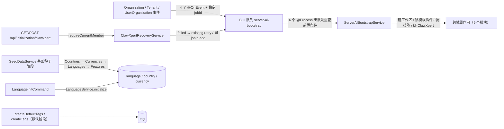

# 基础字典与客户端壳子专家 —— C1 能力契约

> 契约层 CR2 / CR5 / CR7。只写「对外可依赖的语义」：入口、参数行为、返回、异常与约束；路径均为仓库根相对 `file://` 引用。
> **资产基线**：`2026-10-16 · commit 80f5676fd`（批次 5 第 14 专家 ③ 子专家），继承父域 [C1-能力契约.md](file://.module-experts/后端专题/平台底座与集成专家/C1-能力契约.md)。**逐端点明细**（完整字段、分页、错误码全集、鉴权矩阵）见父域 [implementation/05-接口.md](file://.module-experts/后端专题/平台底座与集成专家/implementation/05-接口.md)，本文不复制。全局前缀 `api`；`desktop-shell` / `mobile` / `initialization` 实测在 **`packages/server-ai/src`**。

**本文引用的文件**（相对仓库根，链接均为 `file://`）

- [packages/server/src/language/language.controller.ts](file://packages/server/src/language/language.controller.ts)
- [packages/server/src/language/language.service.ts](file://packages/server/src/language/language.service.ts)
- [packages/server/src/language/language.seed.ts](file://packages/server/src/language/language.seed.ts)
- [packages/server/src/country/country.seed.ts](file://packages/server/src/country/country.seed.ts)
- [packages/server/src/currency/currency.seed.ts](file://packages/server/src/currency/currency.seed.ts)
- [packages/server/src/core/seeds/seed-data.service.ts](file://packages/server/src/core/seeds/seed-data.service.ts)
- [packages/server/src/contact/contact.controller.ts](file://packages/server/src/contact/contact.controller.ts)
- [packages/server/src/contact/contact.service.ts](file://packages/server/src/contact/contact.service.ts)
- [packages/server-ai/src/desktop-shell/desktop-shell.controller.ts](file://packages/server-ai/src/desktop-shell/desktop-shell.controller.ts)
- [packages/server-ai/src/desktop-shell/desktop-shell-auth.service.ts](file://packages/server-ai/src/desktop-shell/desktop-shell-auth.service.ts)
- [packages/server-ai/src/desktop-shell/desktop-shell-operation.service.ts](file://packages/server-ai/src/desktop-shell/desktop-shell-operation.service.ts)
- [packages/server-ai/src/desktop-shell/desktop-shell.gateway.ts](file://packages/server-ai/src/desktop-shell/desktop-shell.gateway.ts)
- [packages/server-ai/src/desktop-shell/shell-approval.ts](file://packages/server-ai/src/desktop-shell/shell-approval.ts)
- [packages/server-ai/src/xpert-middleware/desktop-shell.middleware.ts](file://packages/server-ai/src/xpert-middleware/desktop-shell.middleware.ts)
- [packages/server-ai/src/mobile/mobile.service.ts](file://packages/server-ai/src/mobile/mobile.service.ts)
- [packages/server-ai/src/initialization/bootstrap.processor.ts](file://packages/server-ai/src/initialization/bootstrap.processor.ts)
- [packages/server-ai/src/initialization/bootstrap.service.ts](file://packages/server-ai/src/initialization/bootstrap.service.ts)
- [packages/server-ai/src/initialization/clawxpert-recovery.service.ts](file://packages/server-ai/src/initialization/clawxpert-recovery.service.ts)
- [packages/server-ai/src/ai-model/ai-model.service.ts](file://packages/server-ai/src/ai-model/ai-model.service.ts)
- [packages/server-ai/src/ai-model/commands/handlers/provider-credentials-validate.handler.ts](file://packages/server-ai/src/ai-model/commands/handlers/provider-credentials-validate.handler.ts)
- [packages/server/src/tags/tag-management.service.ts](file://packages/server/src/tags/tag-management.service.ts)
- [packages/server/src/export-import/import/import-all.controller.ts](file://packages/server/src/export-import/import/import-all.controller.ts)
- [apps/cloud/src/app/@core/services/languages.service.ts](file://apps/cloud/src/app/@core/services/languages.service.ts)
- [apps/desktop/electron/shell/controller.cjs](file://apps/desktop/electron/shell/controller.cjs)
- [packages/server-ai/src/copilot-provider/commands/handlers/upsert.handler.ts](file://packages/server-ai/src/copilot-provider/commands/handlers/upsert.handler.ts)

## 目录

1. [§1 HTTP 入口索引](#§1-http-入口索引)
2. [§2 服务契约](#§2-服务契约)
3. [§3 种子与引导契约](#§3-种子与引导契约)
4. [§4 示例](#§4-示例)
5. [§5 契约来源索引](#§5-契约来源索引)

## §1 HTTP 入口索引

鉴权列只写**模块内额外守卫**；全站默认锁死（全局 `AuthGuard(['jwt','basic'])` + `PluginScopeGuard`），仅 `@Public()` 放行。**未列出的 `CrudController` 基类路由不在本索引**（`contact` 9 条、`tags` 4 条继承面）。

| 方法 | 路径 | 鉴权 | 用途 |
|---|---|---|---|
| `【languages】GET` | `/api/languages` | 方法级 `@Public` | 语言分页（`IPagination<ILanguage>`，支持 `is_system` 过滤）；无 HTTP 写端点 |
| `【languages】GET` | `/api/languages/getByName/:name` | 方法级 `@Public` | 按 `name` 查单条；未命中回 `null`（软失败不抛错） |
| `【country】GET` | `/api/country` | 类级 `@Public` | 全量国家字典（两位 ISO 码 + 名称） |
| `【currency】GET` | `/api/currency` | 类级 `@Public` | 全量货币字典（三位 ISO 码 + 名称） |
| `【contact】GET` | `/api/contact`（**未挂载**） | 类级 `TenantPermissionGuard`（不会实例化） | 自写 `getAllContact` + 基类 9 条；`ContactModule` 未注册、无路由前缀 → 路由不存在 |
| `【desktop-shell】POST` | `/api/desktop-shell/devices` | 全局 AuthGuard + service 内 `currentShellScope()` | 注册设备（`installationId` uuid + `platform='darwin'`），返回一次性 `token=<id>.<secret>` |
| `【desktop-shell】POST` | `/devices/:id/refresh`、`/devices/:id/disable` | 同上 | 轮换凭据（旧 token 立即失效）/ 停机（级联禁 grant + 在途操作置 `cancel_requested`） |
| `【desktop-shell】POST` | `/devices/:id/grants` | 同上 | 签发会话授权（`assistantId` 必填、`threadId` 可选；带线程先做会话写权限断言） |
| `【desktop-shell】POST` | `/devices/:id/prepare` | 同上 | 命令准备：写 `{runId,toolCallId,argsHash,decision:'pending'}`（只路由不执行） |
| `【desktop-shell】POST` | `/grants/:id/decision`、`/grants/:id/revoke` | 同上 | 批准/拒绝（`pending→approved\|rejected`，冲突 409 `OPERATION_CONFLICT`）/ 撤销 |
| `【desktop-shell】GET` | `/operations?deviceId=` | 同上 | 最近 20 条结果（stdout/stderr、`nextCursor`、`truncated`、`error.code`） |
| `【desktop-shell】POST` | `/operations/:id/cancel` | 同上 | 取消操作（在途置 `cancel_requested`） |
| `【desktop-shell】WS` | `ws(s)://<api-host>/desktop-shell` | 握手 `version`（=1）+ `token` | 上行 `ready/command/lease/ack/reconcile/revoked`；下行 `heartbeat/report/rejected` |
| `【mobile】GET` | `/api/mobile/bootstrap` | 无守卫（service 内 401） | 部署配置 + 用户/组织投影 + assistantBindings（0 表） |
| `【mobile】GET` | `/api/mobile/xperts` | 无守卫（service 内 401） | 可访问已发布 Agent 列表（`limit` 默认 25 / 上限 100、`search` ≤120） |
| `【initialization】GET/POST` | `/api/initialization/clawxpert` | 无守卫（`requireCurrentMember` 403） | ClawXpert 状态 6 态判定 / 恢复 failed 作业（同 jobId） |
| `【ai-model】GET` | `/api/ai-model/provider/:name/:iconType/:lang` | 方法级 `@Public` | Provider 图标二进制（`icon_small`/`icon_large`；缺文件 404 `Icon not found`） |
| `【tags】GET` | `/api/tags/directory`、`/api/tags/categories` | 类级 `TenantPermissionGuard` | 标签目录（逐条附 `targets`/`editable`/`usage`）/ 去重分类 |
| `【tags】GET/POST` | `/api/tags` | 同上；POST 加 `ORG_TAGS_EDIT` | 分页（租户级 + 组织级两段合并）/ 新建（zod + 租户行锁） |
| `【tags】PUT/DELETE` | `/api/tags/:id`、`/:id/soft`、`/:id/recover` | `ORG_TAGS_EDIT`（写路径） | 更新（`canEdit`）/ 删除（在用 400）/ `soft` 与 `recover` **恒 400**（改口径为 `isActive`） |
| `【export-import】GET/POST` | `/api/import`（**未挂载**） | — | 模块无人 import；POST 只落 `import-history`，核心逻辑注释 |

章节来源：[language.controller.ts](file://packages/server/src/language/language.controller.ts)（关键符号：findAll / findByName / @Public）、[desktop-shell.controller.ts](file://packages/server-ai/src/desktop-shell/desktop-shell.controller.ts)（关键符号：register / refresh / disable / grant / prepare / decision / revoke / list / cancel）、[tag.controller.ts](file://packages/server/src/tags/tag.controller.ts)（关键符号：directory / update / delete / softRemove / softRecover / categories / create）

## §2 服务契约

| `类.方法(签名)` | 用途 | 参数行为语义 | 返回 | 异常 / 约束 |
|---|---|---|---|---|
| `LanguageService.findAll(query)/findOneByName(name)/initialize()` | 语言字典读与重灌 | `findAll` 转发基类（无 order）；`findOneByName` 按 `"language"."name"` 查且未命中回 `null`；`initialize()` → `createLanguages(connection)` 遍历 `all-languages.ts` | `IPagination<ILanguage>` / `ILanguage` / `void` | 无写端点；重复初始化唯一冲突被 `try/catch + console.log` 吞掉 |
| `createLanguages(connection)/createCountries(connection)/createCurrencies(connection)` | 字典种子函数（唯一写路径） | language 整批 `save()`（`is_system` 由 `LanguagesEnum` 判定、`color=faker.internet.color()`、`description=''`）；country/currency `insert().values()` 直插、**无去重** | `Language[]` / `Promise<void>` | country/currency 失败 `reject(null)`；`isoCode` 仅非唯一索引 |
| `CountryService` / `CurrencyService`（`CrudService` 零覆写） | 国家 / 货币只读面 | 只暴露 `findAll`；校验在实体装饰器层（`@IsNotEmpty`），读端点无 DTO 白名单 | `IPagination<ICountry\|ICurrency>` | 无 |
| `getDefaultOrganizationWorkspaceName(languageCode = RequestContext.getLanguageCode())` | 语言 fallback 的唯一服务端范式 | `Chinese\|SimplifiedChinese → zh_Hans ?? en_US`，其余一律 `en_US` | `string` | 不抛错；字典缺行时静默回默认分支 |
| `ContactService.saveContact(request)` + `ContactCreateHandler.execute(input)` + `ContactController.getAllContact(query)` | 联系人写读（**当前不可达**） | `saveContact` 仅 `repository.save`（无调用方）；handler 走基类 `create`（自动 tenant/organization 作用域）；`getAllContact` 用 `ParseJsonPipe` 解 `{relations,findInput}` | `Contact` / `IPagination<Contact>` | 模块未装配 → 全部路由 404；实体无唯一键、`country` 存 isoCode 字符串 |
| `DesktopShellAuthService.register(body)/refresh(deviceId)/disable(id)/authenticate(token)/requireDevice(id,scope)` | 设备与凭据 | `register` 校验 `installationId` uuid + `platform==='darwin'` + `parseSettings`；同 `(scope,installationId)` 先 `disable` 再复用 id；明文密钥只回一次，库内 `sha256(secret)` + `credentialExpiresAt=now+LIMITS.grant`；`authenticate` 用 `timingSafeEqual` | 设备 / 凭据 | 400 `INVALID_MESSAGE`；403 `GRANT_REVOKED`（scope 非 uuid / 跨租户不探测） |
| `issueGrant(deviceId, assistantId, threadId?)/bindForRun(grantId, threadId, assistantId, scope)/revokeGrant(id)` | 会话授权 | 带 `threadId` 时先查 `ChatConversationThread` + `AssertChatConversationAccessQuery('contribute')`，**校验失败不落行**；`expiresAt=min(设备到期, now+LIMITS.grant)`；`bindForRun` 用 `threadId IsNull()` 条件保证一次性认领 | grant 行 | 403 / 404；`revokeGrant` 把在途操作置 `cancel_requested` |
| `prepareOperation(deviceId, body)/decideOperation(id, decision)` | 命令准备与审批 | `argsHash = sha256(JSON.stringify([command,cwd,timeoutSec]))`；写 `grant.operation={runId,toolCallId,argsHash,decision:'pending'}` 并把 grant 压到 ≤10 分钟；`decide` 事务内 `pessimistic_write` 锁 grant，只允许 `pending→approved\|rejected` 或同值重放 | grant/operation | 400 `INVALID_MESSAGE`；403 `GRANT_REVOKED`；409 `OPERATION_CONFLICT` |
| `DesktopShellOperationService.execute(input, scope)/receive(deviceId, report)/wait(id, scope, signal)/result(op, cursor)/cancel/notify(deviceId)` | 执行台账、回执与幂等锚点 | `execute`：`requireGrant` → 参数校验（`cwd` 以 `/` 开头、`runId` uuid）→ 重算并比对 `decision/runId/toolCallId/argsHash` 四项 → 事务锁 device+grant 复核 → 按 `(tenantId,runId,toolCallId)` 命中即返回既有行 → 离线 409 / 忙 409 → 落行 + Redis `notify`；`receive`：`seq` 严格 +1，跳号回 `false`（触发 `reconcile`），超 `LIMITS.output` 置 `truncated`，终态要求 `seq===op.seq+1` | operation 行 / `ShellResult` | 409 `DEVICE_OFFLINE` / `DEVICE_BUSY`；`cancel_requested` 下忽略非终态回执 |
| `DesktopShellGateway.handleConnection/heartbeat/report/rejected/dispatch` + `onModuleInit` 巡检 | WS 通道与派发 | 握手校验 `version`+`token` → 新 `connectionEpoch` + `leaseExpiresAt=now+LIMITS.lease`，踢旧 socket；`report` 逐 socket 串行（在途 >128 断连，按 epoch 丢弃陈旧回执）；1s 巡检重派发并把超租约活跃行置 `unknown` | — | `PROTOCOL_MISMATCH`（握手）；`EXECUTION_UNKNOWN`（**不重放**） |
| `requestShellApproval(preparation)` | 两段式 HITL 审批 | 先 `interrupt(ClientToolRequest{desktop_shell_prepare})` 取宿主准备（`kind`/`cwd`/`expiresAt`/`decision` 四项校验）；宿主已 `approved` 则跳过交互；否则再 `interrupt(HITLRequest)` 要求唯一 `approve` | 准备结果或 `null` | 校验不过 403 `GRANT_REVOKED`；`null` → 中间件输出 `status:'denied'` 且不执行 |
| `MobileService.getBootstrap()/listXperts({search,limit,offset})` + `getDeploymentConfig()` | 移动端只读投影与部署能力位 | `getBootstrap` 以 `RequestContext.currentUserId()` 为唯一身份（缺失 401）；`ADMIN` 恒 membership、非 ADMIN 需 `ALL_ORG_VIEW\|ALL_ORG_EDIT`；`listXperts` 固定 `{type:Agent, latest:true}` 走 `PublishedXpertAccessService`；`getDeploymentConfig` 返回三条固定路径 + 6 个 `capabilities` + env 覆盖的 `apiBaseUrl`/`chatkitFrameUrl` | `XpertMobileBootstrap` / 列表 / 配置 | 401；`assistantBindings` 解析失败静默丢弃；**无 `apiVersion`** |
| `ServerAIBootstrapService.bootstrapOrganization/bootstrapTenantSkillRepositories/bootstrapUserInOrganization/bootstrapUserDefaultWorkspaceSkills/cleanupUserInOrganization/syncSkillRepository` + `ServerAIBootstrapProcessor` 4 入队 / 6 执行 | 引导副作用（无 HTTP 面） | 入队只做 `queue.add` + 稳定 jobId（`attempts:3, backoff:10_000, removeOnComplete:true`；链式 `user-default-skills` 为 `8/30_000`）；出队先重查前置条件（`bootstrapUserInOrganization` 首步 `isActiveOrganizationMember`） | job 结果 | 每个 `@Process` try/catch 记日志后**重抛**（交给 Bull 重试） |
| `ClawXpertRecoveryService.getStatus()/recover()/requireCurrentMember()/canRecover` | 恢复入口 | `requireCurrentMember` 用 `memberships.count({isActive:true})` 判活（失败 403）；`getStatus` 按序判 `ready/initializing/dependency_unavailable/error/binding_inaccessible/missing`；`recover` 对 failed 用 `existing.retry()`，否则同 jobId `add` | 状态 / `initializing` | 403；`canRecover` 对 `SUPER_ADMIN` 恒 `false` |
| `AIProvidersService.getProvider(name, throwError=false, organizationId?)/providerCredentialsValidate(provider, credentials)` + `AiProviderCredentialsValidateHandler.execute` | Provider 目录门面与凭证校验 | `getProvider` 直查 `AIModelProviderRegistry`，异常被吞、`throwError=true` 才抛；校验链：`provider_credential_schema`（缺失即抛）→ `ProviderCredentialSchemaValidator.validateAndFilter` 裁剪 → `validateProviderCredentials` 插件自检 → 返回**过滤后**凭据 | provider 策略 / 过滤后凭据 | `AIModelProviderNotFoundException`；**不做加密**（handler 留 encrypt TODO）；不落库、不判授权 |
| `TagManagementService.write(input, id?)/remove(id)/directory()/usage()` + `TagService.findAllCategories()` + `TagSubscriber.beforeInsert` | 标签写路径与用量目录 | `write`：`scope()`（`tenantId` 必需）→ `ORG_TAGS_EDIT` → zod（`name`≤100、`label{en_US,zh_Hans?}`、`targets ∈ TAG_TARGETS`）→ 事务 `Tenant` 行锁 + 标签行锁 → `category↔targets` 折算 → `LOWER(name)` 域内重名 → 移除 target 前查 usage；`usage()` 遍历全库 `entityMetadatas` 的 M2M + 2 张显式关联表 | `Tag` / 目录 / 计数 | 403；400 `TagTargetInUse`/`TagUsageUnsupported`/`TagInUse`；`soft`/`recover` 恒 400 |
| `ImportAllController.parse/importAll` + `ImportEntityFieldMapOrCreateHandler.execute` | 导入基建（**不可达**） | POST 落盘取 `{key,originalname,size}` 后写 `import-history`（`SUCCESS\|FAILED` 仅差状态串）；`unzipAndParse`/`removeExtractedFiles` 在注释中；handler 的「先查 → 取 `destinationId` 复用 → 新建」链无存活调用方 | 历史行 | 模块未装配 → 路由 404；`import-record` 为死表 |

章节来源：[language.service.ts](file://packages/server/src/language/language.service.ts)（关键符号：initialize / findOneByName）、[desktop-shell-auth.service.ts](file://packages/server-ai/src/desktop-shell/desktop-shell-auth.service.ts)（关键符号：register / issueGrant / prepareOperation / decideOperation）、[desktop-shell-operation.service.ts](file://packages/server-ai/src/desktop-shell/desktop-shell-operation.service.ts)（关键符号：execute / receive / notify）、[mobile.service.ts](file://packages/server-ai/src/mobile/mobile.service.ts)（关键符号：getBootstrap / listXperts / getDeploymentConfig）

## §3 种子与引导契约

**字典族 seed 的来源与更新时机**：三类全局字典的**唯一权威在常量**（`all-languages.ts` 182 条 / `DEFAULT_COUNTRIES` / contracts 的 `DEFAULT_CURRENCIES`）+ `LanguagesEnum`（`is_system` 判定）；写入只在两个时机发生——① 空库启动 / 显式 `pnpm seed:module`：`SeedDataService` 基础种子阶段顺序 `Countries → Currencies → Languages → Features`（每步 `tryExecute` 单步失败不阻断），默认阶段再 `createDefaultTags` / `createTags`；② 租户侧运行期：`LanguageInitCommand → LanguageInitHandler → LanguageService.initialize()`。**没有 upsert 事务**：改字典 = 改常量 + 改初始化语义，不允许加写端点。

**`initialization` 的执行时机与幂等保证**：执行时机完全由事件驱动（建组织 / 建租户 / 用户入组 / 用户离组四条 `@OnEvent`），幂等三层——① 稳定 `jobId`（`org-bootstrap:{id}`、`tenant-skill-repository-bootstrap:{tenantId}`、`user-org-bootstrap:{orgId}:{userId}`、`user-org-cleanup:{orgId}:{userId}`、链式 `user-default-skills:{workspaceId}`）；② `removeOnComplete: true` + Bull 重试语义（`attempts:3, backoff:10_000`）；③ 出队时重查前置条件（成员资格 / 工作区是否已建）。**数据库层无唯一约束兜底**，Redis 队列数据缺失即失去去重依据。恢复面：`GET/POST /api/initialization/clawxpert` 只判定与重排作业，失败走 `existing.retry()`（原子，不产生第二条 job）。

| 契约项 | 值 | 失败/边界行为 |
|---|---|---|
| 基础种子顺序 | `Countries → Currencies → Languages → Features`（`tryExecute` 包裹） | 单步失败不阻断后续；country/currency 无去重，重复执行重复插行 |
| 语言重灌 | `LanguageInitCommand`（`static type='[Language] Init'`） | 唯一冲突被 `try/catch + console.log` 吞掉（函数仍返回数组） |
| 入队语义 | 事件 → `queue.add(jobName, event, { jobId, attempts:3, backoff:10_000, removeOnComplete:true })` | 重复投递被 jobId 吸收；链式技能作业 `attempts:8, backoff:30_000` |
| 出队语义 | 6 个 `@Process` → `ServerAIBootstrapService` 六个方法 | 先重查前置条件；`clawXpertError` 先排队补技能再上抛（触发重试） |
| 恢复语义 | `recover()`：`ready\|initializing\|dependency_unavailable` 原样返回 | failed → `existing.retry()`；`canRecover` 对 `SUPER_ADMIN` 恒 `false` |



图表来源：[bootstrap.processor.ts](file://packages/server-ai/src/initialization/bootstrap.processor.ts)（关键符号：4 个 @OnEvent / 6 个 @Process / user-default-skills）、[clawxpert-recovery.service.ts](file://packages/server-ai/src/initialization/clawxpert-recovery.service.ts)（关键符号：getStatus / recover / existing.retry）、[seed-data.service.ts](file://packages/server/src/core/seeds/seed-data.service.ts)（关键符号：tryExecute / createLanguages / createDefaultTags）

章节来源：[language.seed.ts](file://packages/server/src/language/language.seed.ts)（关键符号：createLanguages / try-catch 吞冲突）、[seed-data.service.ts](file://packages/server/src/core/seeds/seed-data.service.ts)（关键符号：基础种子阶段 / 默认阶段）、[bootstrap.service.ts](file://packages/server-ai/src/initialization/bootstrap.service.ts)（关键符号：bootstrapUserInOrganization / isActiveOrganizationMember）

## §4 示例

### ① 读语言列表并解析 fallback

```ts
// 真实调用方：apps/cloud/src/app/@core/services/languages.service.ts
getAll(): Promise<{ items: ILanguage[] }> {
  return firstValueFrom(this.http.get<{ items: ILanguage[] }>(`${API_PREFIX}/languages`))
}
getSystemLanguages(): Promise<{ items: ILanguage[] }> {
  return firstValueFrom(
    this.http.get<{ items: ILanguage[] }>(`${API_PREFIX}/languages`, { params: toParams({ is_system: 1 }) })
  )
}
findByName(name: string): Promise<{ item: ILanguage }> {
  return firstValueFrom(this.http.get<{ item: ILanguage }>(`${API_PREFIX}/languages/getByName/${name}`))
}
```

```ts
// 服务端 fallback 的真实实现：packages/server-ai/src/initialization/constants.ts
export function getDefaultOrganizationWorkspaceName(languageCode = RequestContext.getLanguageCode()) {
  return [LanguagesEnum.Chinese, LanguagesEnum.SimplifiedChinese].includes(languageCode)
    ? (DEFAULT_ORGANIZATION_WORKSPACE_NAME.zh_Hans ?? DEFAULT_ORGANIZATION_WORKSPACE_NAME.en_US)
    : DEFAULT_ORGANIZATION_WORKSPACE_NAME.en_US
}
```

要点：列表走 `GET /api/languages`（方法级 `@Public`，`items` 为分页体）；`findByName` 服务端返回**裸 `ILanguage`**，未命中为 `null`（不抛错），而调用点泛型写的是 `{ item: ILanguage }`——类型口径不兑齐 `[待核]`，集成时以实际响应为准。**fallback 不在字典实体**：`en_US` 必填、`zh_Hans` 可选，`zh_Hans` 缺失一律回 `en_US`；语言字典缺行时下游文案静默走默认分支。

### ② 桌面设备授权并下发一条命令

```ts
// 真实调用方：apps/desktop/electron/shell/controller.cjs（设备侧，节选）
const registration = await this.service.request('/api/desktop-shell/devices', {
  method: 'POST',
  body: { installationId: this.installationId, platform: process.platform, settings }
})
if (!isId(registration.deviceId) || typeof registration.token !== 'string') throw new Error('INVALID_MESSAGE')
// registration.token（=<deviceId>.<secret>）只在此处返回一次，随后用于 WS 握手
const grant = await this.service.request(`/api/desktop-shell/devices/${this.deviceId}/grants`, {
  method: 'POST', body: input
})
```

```ts
// 真实调用方：packages/server-ai/src/xpert-middleware/desktop-shell.middleware.ts（Agent 侧，节选）
const ready = await requestShellApproval({
  kind: 'desktop-shell', assistantId: context.xpertId, threadId, runId, toolCallId,
  command: input.command, cwd: input.cwd, timeoutSec: input.timeout_sec ?? LIMITS.timeout
})
if (!ready) return JSON.stringify({ status: 'denied', /* … */ })
const operation = await this.operations.execute(
  { ...input, cwd: ready.cwd },
  { ...scope, threadId, runId, toolCallId, grantId: ready.grantId }
)
result = await this.operations.wait(operation.id, scope, config?.signal)
```

要点：授权链是 `register → grants → prepare（argsHash + pending）→ decision（approved）`，执行四要素（`decision/runId/toolCallId/argsHash`）在 `execute` 事务内二次复核；`IDENT` 之外由三元组唯一键兜底重试幂等，同设备串行（409 `DEVICE_BUSY`）；派发只经 Redis 唤醒（频道 `xpert:desktop-shell:dispatch`）+ 1s 巡检，超租约置 `unknown` 且**不重放**。

### ③ 读模型 Provider 目录并做凭证校验

```ts
// 真实调用方：packages/server-ai/src/copilot-provider/commands/handlers/upsert.handler.ts
public async execute(command: CopilotProviderUpsertCommand): Promise<CopilotProvider> {
  const entity = command.entity
  if (entity.providerName) {
    this.providersService.getProvider(entity.providerName, true)  // throwError=true → 未命中抛 AIModelProviderNotFoundException
  }
  if (entity.credentials) {
    entity.credentials = await this.commandBus.execute(
      new AiProviderCredentialsValidateCommand(entity.providerName, entity.credentials)
    )  // 只回「按 credential_form_schemas 裁剪 + 插件自检通过」的字段，由调用方落库
  }
  if (entity.id) { await this.service.update(entity.id, entity); return this.service.findOne(entity.id) }
  return this.service.create(entity)
}
```

要点：目录来源是进程内插件注册表 `AIModelProviderRegistry`（0 表），`getProvider` 默认吞异常回 `undefined`、只有 `throwError=true` 才抛——调用方必须显式处理「插件已卸载」；凭证校验**不加密、不落库、不判授权**（handler 留 `// Todo: encrypt secret variables in credentials`），授权解析与记账在 `model-access` / 计费域。

章节来源：[languages.service.ts](file://apps/cloud/src/app/@core/services/languages.service.ts)（关键符号：getAll / getSystemLanguages / findByName）、[constants.ts](file://packages/server-ai/src/initialization/constants.ts)（关键符号：getDefaultOrganizationWorkspaceName）、[controller.cjs](file://apps/desktop/electron/shell/controller.cjs)（关键符号：register / grants / prepare / decision / refresh / disable）、[desktop-shell.middleware.ts](file://packages/server-ai/src/xpert-middleware/desktop-shell.middleware.ts)（关键符号：requestShellApproval / operations.execute / operations.wait）、[upsert.handler.ts](file://packages/server-ai/src/copilot-provider/commands/handlers/upsert.handler.ts)（关键符号：CopilotProviderUpsertHandler.execute / AiProviderCredentialsValidateCommand）

## §5 契约来源索引

| 契约条目 | 来源 |
|---|---|
| 语言字典端点、`@Public` 口径、`findOneByName` 未命中回 `null` | `packages/server/src/language/language.controller.ts`、`language.service.ts` |
| 字典种子（language/country/currency）与执行阶段、`is_system`、重复执行语义 | `packages/server/src/language/language.seed.ts`、`country/country.seed.ts`、`currency/currency.seed.ts`、`core/seeds/seed-data.service.ts`、`packages/contracts/src/currency.model.ts` |
| 多语言 fallback（`zh_Hans ?? en_US`）与 i18next 兜底 | `packages/server-ai/src/initialization/constants.ts`、`packages/server/src/bootstrap/i18next.ts`、`packages/server-ai/src/ai-model/queries/handlers/get-model-icon.handler.ts` |
| 联系人继承面、命令链与未挂载现状 | `packages/server/src/contact/contact.controller.ts`、`contact.service.ts`、`contact.module.ts`、`core/crud/crud.controller.ts`、`server.module.ts` |
| 桌面壳 9 条 HTTP、设备/授权/执行不变量、审批链 | `packages/server-ai/src/desktop-shell/desktop-shell.controller.ts`、`desktop-shell-auth.service.ts`、`desktop-shell-operation.service.ts`、`shell-approval.ts`、`desktop-shell.errors.ts` |
| 桌面壳 3 表 + 2 迁移 + WS 协议与 LIMITS | `packages/server-ai/src/desktop-shell/desktop-shell.entities.ts`、`migrations/20260924-desktop-shell.sql`、`migrations/20260928-desktop-shell-approval.sql`、`desktop-shell.gateway.ts`、`packages/desktop-protocol/index.d.ts` |
| 桌面工具面（`desktop_shell` 中间件与真实调用方） | `packages/server-ai/src/xpert-middleware/desktop-shell.middleware.ts`、`apps/desktop/electron/shell/controller.cjs` |
| 移动端 bootstrap / 助手列表 / 部署能力位 | `packages/server-ai/src/mobile/mobile.controller.ts`、`mobile.service.ts`、`packages/contracts/src/ai/mobile.model.ts` |
| 引导队列（4 入队 / 6 执行 / 稳定 jobId）与 ClawXpert 恢复 | `packages/server-ai/src/initialization/bootstrap.processor.ts`、`bootstrap.service.ts`、`clawxpert-recovery.controller.ts`、`clawxpert-recovery.service.ts`、`constants.ts` |
| Provider 目录门面、图标端点与凭证校验（含加密 TODO） | `packages/server-ai/src/ai-model/ai-model.controller.ts`、`ai-model.service.ts`、`queries/handlers/get-model-icon.handler.ts`、`commands/handlers/provider-credentials-validate.handler.ts` |
| 凭证校验的真实消费方（邻域 `copilot-provider`） | `packages/server-ai/src/copilot-provider/commands/handlers/upsert.handler.ts` |
| 标签目录、写路径、usage 扫描与恒 400 端点 | `packages/server/src/tags/tag.controller.ts`、`tag-management.service.ts`、`tag.entity.ts`、`tag.subscriber.ts` |
| 通用导入（未挂载，现状口径） | `packages/server/src/export-import/import/import-all.controller.ts`、`import-all.module.ts`、`import-history/import-history.entity.ts`、`import-record/import-record.entity.ts` |
| 逐端点明细、鉴权矩阵与错误语义全集 | 父域 [implementation/05-接口.md](file://.module-experts/后端专题/平台底座与集成专家/implementation/05-接口.md)（本文不复制） |

章节来源：[desktop-shell.controller.ts](file://packages/server-ai/src/desktop-shell/desktop-shell.controller.ts)（关键符号：DesktopShellController）、[ai-model.controller.ts](file://packages/server-ai/src/ai-model/ai-model.controller.ts)（关键符号：getModelIcon / @Public）、[import-all.controller.ts](file://packages/server/src/export-import/import/import-all.controller.ts)（关键符号：ImportAllController / parse）
