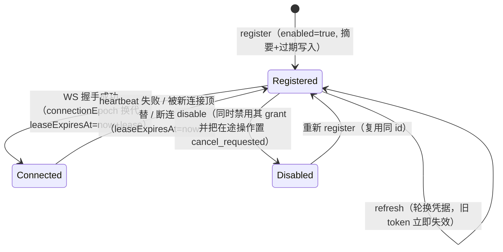
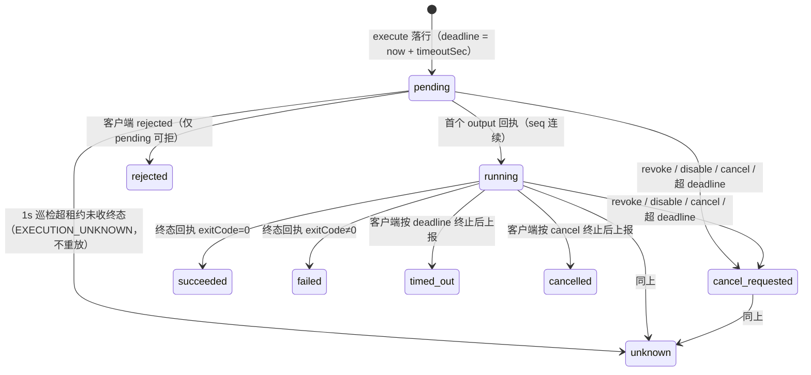

# 平台底座与集成专家 ③ · 基础字典与客户端壳 · 数据流转

> 只读梳理（commit `80f5676fd`）。本文只追踪**写入点 → 表 → 读取点/消费方**，不含 `data-source` / `xpert-table` / `integration` / `view-extension`。

**本文引用的文件**

- [packages/server/src/core/seeds/seed-data.service.ts](file://packages/server/src/core/seeds/seed-data.service.ts)
- [packages/server/src/language/language.seed.ts](file://packages/server/src/language/language.seed.ts)
- [packages/server/src/country/country.seed.ts](file://packages/server/src/country/country.seed.ts)
- [packages/server/src/currency/currency.seed.ts](file://packages/server/src/currency/currency.seed.ts)
- [packages/server/src/contact/contact.seed.ts](file://packages/server/src/contact/contact.seed.ts)
- [packages/server/src/contact/contact.controller.ts](file://packages/server/src/contact/contact.controller.ts)
- [packages/server-ai/src/desktop-shell/desktop-shell-auth.service.ts](file://packages/server-ai/src/desktop-shell/desktop-shell-auth.service.ts)
- [packages/server-ai/src/desktop-shell/desktop-shell-operation.service.ts](file://packages/server-ai/src/desktop-shell/desktop-shell-operation.service.ts)
- [packages/server-ai/src/desktop-shell/desktop-shell.gateway.ts](file://packages/server-ai/src/desktop-shell/desktop-shell.gateway.ts)
- [packages/server-ai/src/desktop-shell/shell-approval.ts](file://packages/server-ai/src/desktop-shell/shell-approval.ts)
- [packages/server-ai/src/desktop-shell/desktop-shell.entities.ts](file://packages/server-ai/src/desktop-shell/desktop-shell.entities.ts)
- [packages/server-ai/src/mobile/mobile.service.ts](file://packages/server-ai/src/mobile/mobile.service.ts)
- [packages/server-ai/src/initialization/bootstrap.processor.ts](file://packages/server-ai/src/initialization/bootstrap.processor.ts)
- [packages/server-ai/src/initialization/clawxpert-recovery.service.ts](file://packages/server-ai/src/initialization/clawxpert-recovery.service.ts)
- [packages/server-ai/src/ai-model/ai-model.service.ts](file://packages/server-ai/src/ai-model/ai-model.service.ts)
- [packages/server-ai/src/ai-model/queries/handlers/get-model-icon.handler.ts](file://packages/server-ai/src/ai-model/queries/handlers/get-model-icon.handler.ts)
- [packages/server/src/tags/tag-management.service.ts](file://packages/server/src/tags/tag-management.service.ts)
- [packages/server/src/tags/tag.subscriber.ts](file://packages/server/src/tags/tag.subscriber.ts)
- [packages/server/src/tags/tag.entity.ts](file://packages/server/src/tags/tag.entity.ts)
- [packages/server/src/export-import/import/import-all.controller.ts](file://packages/server/src/export-import/import/import-all.controller.ts)
- [packages/server/src/export-import/import-history/import-history.entity.ts](file://packages/server/src/export-import/import-history/import-history.entity.ts)
- [packages/server/src/export-import/import-record/import-record.entity.ts](file://packages/server/src/export-import/import-record/import-record.entity.ts)

## 目录

- [1. 链一：字典种子与读取](#1-链一字典种子与读取)
- [2. 链二：联系人（未挂载现状）](#2-链二联系人未挂载现状)
- [3. 链三：桌面设备授权与命令](#3-链三桌面设备授权与命令)
- [4. 链四：移动端 bootstrap](#4-链四移动端-bootstrap)
- [5. 链五：初始化引导](#5-链五初始化引导)
- [6. 链六：标签](#6-链六标签)
- [7. 链七：导入导出（未挂载现状）](#7-链七导入导出未挂载现状)
- [8. 全链总览](#8-全链总览)
- [9. 状态机](#9-状态机)
- [10. 已知风险](#10-已知风险)
- [11. 结论](#11-结论)

## 1. 链一：字典种子与读取

**写入链（部署期 / 初始化期，共两条）**

1. `SeedDataService` 的「只需 connection」阶段按固定顺序调用 `createCountries(connection)` → `createCurrencies(connection)` → `createLanguages(connection)`（每步外层包 `tryExecute(名称, promise)`，单步失败不阻断后续），随后在默认数据库阶段调 `createDefaultTags(connection, tenant, organizations)` 与 `createTags(connection)`。
2. 运行期唯一增量写入口是租户侧命令 `LanguageInitCommand`（`static type = '[Language] Init'`）→ `LanguageInitHandler.execute` → `LanguageService.initialize()` → `createLanguages(connection)`。

**表与写入语义**：`language`（`@Unique(['code'])`，整批 `save()` 呈 upsert 语义，冲突被 `try/catch` 吞掉；每次重跑改写 `color`、清空 `description`）；`country` / `currency`（`insert().into().values()` 直插，**无去重**，`isoCode` 仅非唯一索引）。

**读取链（消费方）**

- `GET /api/languages`（`@Public` 分页）与 `GET /api/languages/getByName/:name`（未命中回 `null`）；`GET /api/country`、`GET /api/currency`（类级 `@Public`，全量）。
- 跨域消费：`contact.country` / `contact.regionCode` 存 isoCode **字符串**（种子用 `faker.random.arrayElement(countries).isoCode` 写入）；用户与组织的 `preferredLanguage`、`organization_language`（server-core）都是由语言字典派生的弱引用，`Language.organizationLanguages` 声明了 `cascade: true` 的 OneToMany。
- 多语言取值链：`RequestContext.getLanguageCode()` → i18next（`fallbackLng: 'en'`）→ 具体实现里的 `zh_Hans || en_US` 兜底。

章节来源：[seed-data.service.ts](file://packages/server/src/core/seeds/seed-data.service.ts)（关键符号：tryExecute('Countries'/'Currencies'/'Languages'/'Default Tags')）、[language.seed.ts](file://packages/server/src/language/language.seed.ts)（关键符号：createLanguages / save）、[country.seed.ts](file://packages/server/src/country/country.seed.ts)（关键符号：createCountries / insertCountry）、[currency.seed.ts](file://packages/server/src/currency/currency.seed.ts)（关键符号：createCurrencies / insertCurrency）、[language.service.ts](file://packages/server/src/language/language.service.ts)（关键符号：initialize / findOneByName）

## 2. 链二：联系人（未挂载现状）

**设计链路**：`ContactCreateCommand(input)` → `ContactCreateHandler.execute` → `ContactService.create`（基类 `TenantAwareCrudService`，自动按 tenant/organization 作用域）→ `contact` 表；另有 `ContactService.saveContact(request)` 直接 `repository.save`（**无调用方**）。读侧是 `ContactController.getAllContact`（`ParseJsonPipe` 解 `data` 取 `relations` / `findInput`）→ `contactService.findAll(...)`，以及基类 8 条 CRUD 读/写端点。

**种子链路（开发/演示库）**：`createRandomContacts(connection, tenant, organizations, noOfRandomContacts)` 先 `connection.manager.find(Country)` 取国家集合，再逐组织构造 `Contact`（`firstName` / `lastName` / `website` / `address` / `address2` / `city` / `country = 随机 isoCode` / `name = 名 + 姓` / `longitude` / `latitude` / `postcode`），设 `organization` 与 `tenant` 后 `connection.manager.save(contacts)`。

**当前实际数据流：无**。`ContactModule` 未被 `server.module.ts` 注册，也没有 `RouterModule.register([{ path: '/contact' }])`——因此：

- 不存在任何 HTTP 写入/读取入口（`/api/contact` 未挂载），`TenantPermissionGuard` 不会参与请求链；
- 表（`contact`）仍由实体装饰器定义并在核心实体集合中出现（`coreEntities` 含 `Contact`），即**库结构存在、服务端面不存在**；
- 种子里写入的 `country` 值是字符串而非外键，一旦恢复挂载，历史行与新建行的国家语义需靠应用层对齐。

章节来源：[contact.controller.ts](file://packages/server/src/contact/contact.controller.ts)（关键符号：ContactController.getAllContact / TenantPermissionGuard）、[contact.service.ts](file://packages/server/src/contact/contact.service.ts)（关键符号：ContactService.saveContact）、[contact-create.handler.ts](file://packages/server/src/contact/commands/handlers/contact-create.handler.ts)（关键符号：ContactCreateHandler.execute）、[contact.seed.ts](file://packages/server/src/contact/contact.seed.ts)（关键符号：createRandomContacts / faker.random.arrayElement(countries).isoCode）、[contact.module.ts](file://packages/server/src/contact/contact.module.ts)（关键符号：未注册 / 无 RouterModule）、[core/entities/index.ts](file://packages/server/src/core/entities/index.ts)（关键符号：coreEntities 含 Contact）

## 3. 链三：桌面设备授权与命令

**阶段 1：设备注册（HTTP，人 → 服务端）**。`POST /api/desktop-shell/devices`（`register`）→ `currentShellScope()` 取三键 → 同 `installationId` 命中则先 `disable`（禁用旧 grant + 在途操作 `cancel_requested`）→ 生成 32 字节密钥并写 `desktop_shell_device`（`credentialHash = sha256(secret)`、`credentialExpiresAt = now + LIMITS.grant`、`connectionEpoch`/`leaseExpiresAt` 置空）→ 响应一次性 `token = ${deviceId}.${secret}`。后续 `POST devices/:id/refresh` 轮换凭据，`POST devices/:id/disable` 停机（并触发 `operations.notify(id)`）。

**阶段 2：桌面端连接（WS）**。客户端以 `handshake.auth = { version: 1, token }` 接入 `namespace=/desktop-shell` → `authenticate(token)` 用 `sha256(secret)` 与库内摘要做 `timingSafeEqual` → 服务端签发新 `connectionEpoch`、写 `leaseExpiresAt = now + LIMITS.lease`、**断开同设备旧 socket**、`emit('ready', …)`。此后客户端 `heartbeat` 续租（服务端复核 `enabled` / `connectionEpoch` / 凭据未过期，失败 `revoked` + 断连）。

**阶段 3：会话授权（HTTP，人 → 服务端）**。`POST devices/:id/grants`（`issueGrant`，带 `threadId` 时先 `AssertChatConversationAccessQuery(..., 'contribute')`）→ `desktop_shell_grant` 行（`threadId` 可空、`enabled = true`、`expiresAt = min(设备到期, now + LIMITS.grant)`）；`POST grants/:id/revoke` 置 `enabled = false` 并把在途操作置 `cancel_requested`。

**阶段 4：命令准备与审批**。`desktop_shell` 工具（`DesktopShellMiddleware`）→ `requestShellApproval` 第一段 `interrupt(ClientToolRequest{ desktop_shell_prepare })` → 宿主/客户端回调 `POST devices/:id/prepare`（`prepareOperation`）落 `grant.operation = { runId, toolCallId, argsHash, decision: 'pending' }` 且有效期压到 ≤10 分钟 → 第二段 `interrupt(HITLRequest)` 让人 `approve | reject` → 未批准则返回 `null`（中间件输出 `status: 'denied'`，不执行）。用户批准可另经 `POST grants/:id/decision` 落库（事务 + `pessimistic_write`，冲突 409）。

**阶段 5：执行与派发**。`DesktopShellOperationService.execute` 复核 `grant.operation` 四项（`decision === 'approved'` + `runId` + `toolCallId` + 重算的 `argsHash`）→ 事务锁 device/grant → 按 `(tenantId, runId, toolCallId)` 幂等落 `desktop_shell_operation`（`state = 'pending'`，`deadline = now + timeoutSec * 1000`）→ `notify(deviceId)` 向 Redis 频道 `xpert:desktop-shell:dispatch` 发布唤醒 → **持有该设备连接的 API 实例**（或 1 秒巡检）读库复查 `connectionEpoch` / grant / `deadline` 后 `emit('command', { type: 'exec', argsHash, cwd, timeoutSec, deadline })`，需要撤销时发 `{ type: 'cancel', reason: 'timed_out' | 'cancelled' }`。

**阶段 6：回执与结果**。客户端 `emit('report', …)`：`output` 类型按 `seq` 严格递增写入 `output jsonb`（超 `LIMITS.output` 只置 `truncated`），终态报告要求 `seq === op.seq + 1` 并写 `state` / `exitCode` / `signal` / `errorCode`；服务端逐条 `emit('ack', { operationId, seq, type, state })`，跳号则 `emit('reconcile', { operationId })` 要求重传。`rejected` 只允许把 `pending` 置 `rejected`。读侧：`GET /api/desktop-shell/operations?deviceId=`（最近 20 条、经 `result` 投影）与工具侧 `status`（`cursor` 增量）/ `cancel`；`wait` 每 200ms 轮询至终态或 `LIMITS.wait`。

章节来源：[desktop-shell-auth.service.ts](file://packages/server-ai/src/desktop-shell/desktop-shell-auth.service.ts)（关键符号：register / issueGrant / prepareOperation / decideOperation）、[desktop-shell-operation.service.ts](file://packages/server-ai/src/desktop-shell/desktop-shell-operation.service.ts)（关键符号：execute / receive / wait / result / notify）、[desktop-shell.gateway.ts](file://packages/server-ai/src/desktop-shell/desktop-shell.gateway.ts)（关键符号：handleConnection / dispatch / report / rejected）、[shell-approval.ts](file://packages/server-ai/src/desktop-shell/shell-approval.ts)（关键符号：requestShellApproval）、[desktop-shell.entities.ts](file://packages/server-ai/src/desktop-shell/desktop-shell.entities.ts)（关键符号：DesktopShellGrant.operation / DesktopShellOperation.output）

## 4. 链四：移动端 bootstrap

`GET /api/mobile/bootstrap` → `MobileService.getBootstrap()` → `RequestContext.currentUserId()`（缺失 401）→ `userService.findCurrentUser(userId, ['organizations','organizations.organization'])` → **组织集合的两条分支**（`ADMIN` 恒 membership；非 ADMIN 且具 `ALL_ORG_VIEW|ALL_ORG_EDIT` 才列全租户 `isActive` 组织）→ 解析 `defaultOrganizationId`（当前组织 → membership `isDefault` → 首个 → null）→ **并行** `getAssistantBindings()`（固定 `CHAT_COMMON` 与 `XPERT_SHARED` 两个 code，异常静默丢弃）→ 组装 `{ deployment, user, organizations, activeOrganizationId, defaultOrganizationId, assistantBindings }`，其中 `deployment` 全部来自 `getDeploymentConfig()` 的**环境变量 + 常量**（`apiBaseUrl` / `chatkitFrameUrl` 可被 env 覆盖，路径与 `capabilities` 固定，`socketNamespaces.sandboxTerminal = SANDBOX_TERMINAL_NAMESPACE`）。

`GET /api/mobile/xperts?search&limit&offset` → 参数归一（limit 默认 25 / 上限 100、offset 负值归 0、search 截断 120）→ 固定 where `{ type: Agent, latest: true }` → `PublishedXpertAccessService.findAccessiblePublishedXperts` / `countAccessiblePublishedXperts`（**准入在发布域，本模块只投影**）→ `summarizeXpert`（`businessArea` 只取 `{ id, name }`）。

**表：0 张**。全链只读，且读的是身份域（用户/组织/成员）、发布域（已发布 Agent）与 `assistant-binding` 的解析结果。

章节来源：[mobile.service.ts](file://packages/server-ai/src/mobile/mobile.service.ts)（关键符号：getBootstrap / listXperts / getDeploymentConfig / getAssistantBindings）、[mobile.controller.ts](file://packages/server-ai/src/mobile/mobile.controller.ts)（关键符号：bootstrap / xperts）、[mobile.module.ts](file://packages/server-ai/src/mobile/mobile.module.ts)（关键符号：forwardRef UserModule / OrganizationModule / AssistantBindingModule / XpertModule）

## 5. 链五：初始化引导

**入队链（事件 → 队列）**：`EVENT_ORGANIZATION_CREATED` / `EVENT_TENANT_CREATED` / `EVENT_USER_ORGANIZATION_CREATED` / `EVENT_USER_ORGANIZATION_DELETED` 四条 `@OnEvent` 只做 `bootstrapQueue.add(jobName, event, { jobId: <稳定 id>, attempts: 3, backoff: 10_000, removeOnComplete: true })`；jobId 分别是 `org-bootstrap:{organizationId}`、`tenant-skill-repository-bootstrap:{tenantId}`、`user-org-bootstrap:{organizationId}:{userId}`、`user-org-cleanup:{organizationId}:{userId}`。

**执行链（队列 → 服务 → 跨域副作用）**：6 个 `@Process` 分别调 `bootstrapOrganization`、`bootstrapTenantSkillRepositories`、`bootstrapUserInOrganization`、`bootstrapUserDefaultWorkspaceSkills`、`cleanupUserInOrganization`、`syncSkillRepository`；每个方法**先重查前置条件**（如 `isActiveOrganizationMember`），再依次建个人/组织工作区、装模板插件、装技能包、绑定 ClawXpert。`handleUserOrganizationBootstrap` 的两条特殊边：新建个人工作区时追加链式 job `user-default-skills:{workspaceId}`（`attempts: 8, backoff: 30_000`）；返回 `clawXpertError` 时抛错以触发重试（**先排队补技能、再上抛失败**）。

**恢复链（HTTP → 队列）**：`GET /api/initialization/clawxpert` → `requireCurrentMember()`（`UserOrganizationService.count({ tenantId, organizationId, userId, isActive: true })`，失败 403）→ 并行取 binding / 候选 assistant / `queue.getJob('user-org-bootstrap:{orgId}:{userId}')` → 6 态判定（`ready` / `initializing` / `dependency_unavailable` / `error` / `binding_inaccessible` / `missing`）。`POST /api/initialization/clawxpert` → `recover()`：`ready | initializing | dependency_unavailable` 原样返回；failed 作业走 `existing.retry()`（原子，不产生第二条 job）；否则用同一 jobId `add`，返回 `initializing`。

**表：0 张**（状态寄生在 Bull/Redis 与跨域实体上，DB 无引导状态位）。

章节来源：[bootstrap.processor.ts](file://packages/server-ai/src/initialization/bootstrap.processor.ts)（关键符号：4 个 @OnEvent / 6 个 @Process / 链式 user-default-skills）、[bootstrap.service.ts](file://packages/server-ai/src/initialization/bootstrap.service.ts)（关键符号：bootstrapOrganization / bootstrapUserInOrganization / getAvailableClawXpertModel）、[clawxpert-recovery.service.ts](file://packages/server-ai/src/initialization/clawxpert-recovery.service.ts)（关键符号：getStatus / recover / requireCurrentMember）、[constants.ts](file://packages/server-ai/src/initialization/constants.ts)（关键符号：AI_BOOTSTRAP_QUEUE / AI_USER_ORGANIZATION_BOOTSTRAP_JOB）

## 6. 链六：标签

**写入链**：`POST /api/tags` 或 `PUT /api/tags/:id` → `TagManagementService.write(input, id?)`：`scope()`（`tenantId` 必需，`organizationId ?? IsNull()`）→ `ORG_TAGS_EDIT` 权限门 → zod `inputSchema.safeParse` → 事务：`Tenant` 行 `pessimistic_write` 锁 → （更新时）标签行 `pessimistic_write` 锁 + `canEdit` → `targets` 去重 / `category ↔ targets` 兼容折算 → `LOWER(name)` 域内重名检查 → 若移除 target 则查 usage 命中即 400 → `repository.save`。写入前 `TagSubscriber.beforeInsert` 会补 `tenantId` / `organizationId` / `createdById`。

**读取链**：`GET /api/tags/directory` → `directory()`（当前组织 + `organizationId IS NULL` 共享标签，逐条附 `targets` / `editable` / `usage`）；`GET /api/tags/categories` → `SELECT DISTINCT category WHERE tenantId = :t AND (organizationId = :o OR organizationId IS NULL)`；`GET /api/tags` 走 `TagService.findAll`（**租户级 + 组织级两段查询后合并** total/items）。

**用量链（最关键的一跳）**：`usage()` 遍历 `manager.connection.entityMetadatas` → 对每个 owning 的 M2M（或反向指向 `Tag`）junction 建一条 `innerJoin + COUNT(*) GROUP BY tagId` 查询（`withDeleted()` + tenant 过滤 + 当前组织过滤）→ 命中 `usageTargets[resource.tableName]` 才计数，否则 **400 `Error.TagUsageUnsupported`** → 再单独扫 `knowledgebase_tag` / `knowledge_document_tag` 两张显式关联实体累加 `knowledgebase`。删除链 `remove(id)` 用同一 usage 判「在用即拒删（提示改用 `isActive` 停用）」。

**联接表**：`tag_user` / `tag_organization`（`tag.entity.ts` 显式 `@JoinTable`），另有 `Employee` 反向关系未声明 JoinTable；`integration.tags` 的联接表名未在源码出现（`[推测]` 为 TypeORM 默认命名）。

章节来源：[tag-management.service.ts](file://packages/server/src/tags/tag-management.service.ts)（关键符号：write / remove / directory / usage / usageTargets）、[tag.service.ts](file://packages/server/src/tags/tag.service.ts)（关键符号：findAll / findAllCategories）、[tag.entity.ts](file://packages/server/src/tags/tag.entity.ts)（关键符号：@Index('category_name') / @JoinTable tag_user / tag_organization）、[tag.subscriber.ts](file://packages/server/src/tags/tag.subscriber.ts)（关键符号：beforeInsert）

## 7. 链七：导入导出（未挂载现状）

**代码声明的链路**：`POST /api/import`（`FileInterceptor('file')` → `new FileStorage().storage({ dest: 'import', prefix: 'import' })` 落盘）→ 取 `{ key, originalname, size }` → `ImportHistoryCreateCommand` 写 `import-history`（`path = key`、`status = ImportHistoryStatusEnum.SUCCESS | FAILED`）；`GET /api/import` → 按 `tenantId` + `importDate DESC` 分页读 `import-history`。原设计里还有一条对象映射链：`ImportEntityFieldMapOrCreateHandler`（先按 `where` 找实体 → 失败则 `ImportRecordFindOrFailCommand` 用 `(tenantId, sourceId, entityType)` 取 `destinationId` 复用 → 再失败则新建），但**其调用方 `ImportAllService` 与 `unzipAndParse` 在源码里是注释**。

**当前实际链路：无 HTTP 面**。`ImportAllModule` 自身声明 `RouterModule.register([{ path: '/import' }])` 并 `forFeature([...coreEntities])`，但**没有任何模块 import 它**、`server.module.ts` 也未注册 → `GET/POST /api/import` 均不可达。

**表的实际状态**：`import-history` 的实体只出现在 `ImportHistoryModule` 的 `forFeature` 中（`ImportHistory` **不在** `coreEntities` 列表里），`import-record` 的实体则在 `coreEntities` 中——两表的注册来源不对称；`import-record` 无存活写入路径（死表），`import-history` 的写入者（控制器）同样不可达。

章节来源：[import-all.controller.ts](file://packages/server/src/export-import/import/import-all.controller.ts)（关键符号：importAll / parse / 被注释的 unzipAndParse）、[import-all.module.ts](file://packages/server/src/export-import/import/import-all.module.ts)（关键符号：RouterModule '/import' / 无人 import）、[import-history.entity.ts](file://packages/server/src/export-import/import-history/import-history.entity.ts)（关键符号：ImportHistory.file / path / status）、[import-record.entity.ts](file://packages/server/src/export-import/import-record/import-record.entity.ts)（关键符号：ImportRecord.destinationId / wasCreated）、[import-entity-field-map-or-create.handler.ts](file://packages/server/src/export-import/import/commands/handlers/import-entity-field-map-or-create.handler.ts)（关键符号：ImportEntityFieldMapOrCreateHandler.execute）、[core/entities/index.ts](file://packages/server/src/core/entities/index.ts)（关键符号：coreEntities 含 ImportRecord、未含 ImportHistory）

## 8. 全链总览

```mermaid
flowchart LR
  SEED["SeedDataService / LanguageInitCommand"] -->|insert / save| L[("language")]
  SEED -->|insert| N[("country")]
  SEED -->|insert| U[("currency")]
  SEED -->|save| G[("tag")]
  L -->|@Public GET /api/languages| CLI["客户端 / 前端"]
  N --> CLI
  U --> CLI
  N -.isoCode 字符串.-> CT[("contact")]
  CT -.模块未挂载.-> X1["/api/contact 不可达"]
  TAGW["TagManagementService.write"] -->|zod + 租户行锁| G
  G -->|usage 扫描实体元数据| TAGD["GET /api/tags/directory"]
  REG["POST /api/desktop-shell/devices"] -->|sha256 摘要| DEV[("desktop_shell_device")]
  CONN["WS handshake + heartbeat"] -->|epoch / lease| DEV
  GRT["issueGrant / prepare / decision"] -->|argsHash + decision| GRA[("desktop_shell_grant")]
  GRA -->|approved 四项比对| OPE[("desktop_shell_operation")]
  OPE -->|Redis 唤醒 → command| WS["Xpert Desktop（客户端）"]
  WS -->|report seq| OPE
  OPE -->|ack / reconcile| WS
  MOB["GET /api/mobile/bootstrap"] -.只读投影 0 表.-> M1["身份域 / 发布域 / assistant-binding"]
  EVT["Organization/Tenant/UserOrganization 事件"] --> Q["Bull 队列 server-ai-bootstrap"]
  Q --> BOOT["6 个 @Process → 工作区 / 插件 / 技能 / ClawXpert"]
  REC["GET/POST /api/initialization/clawxpert"] -->|同 jobId retry| Q
  AIM["GET /api/ai-model/provider/:name/:iconType/:lang"] --> REGP["AIModelProviderRegistry（进程内）"]
  AIV["AiProviderCredentialsValidateCommand"] --> REGP
  IMP["ImportAllModule（未装配）"] -.无效.-> H1[("import-history")]
  IMP -.无效.-> H2[("import-record")]
```

图表来源：[seed-data.service.ts](file://packages/server/src/core/seeds/seed-data.service.ts)、[tag-management.service.ts](file://packages/server/src/tags/tag-management.service.ts)、[desktop-shell-auth.service.ts](file://packages/server-ai/src/desktop-shell/desktop-shell-auth.service.ts)、[desktop-shell.gateway.ts](file://packages/server-ai/src/desktop-shell/desktop-shell.gateway.ts)、[mobile.service.ts](file://packages/server-ai/src/mobile/mobile.service.ts)、[bootstrap.processor.ts](file://packages/server-ai/src/initialization/bootstrap.processor.ts)、[clawxpert-recovery.service.ts](file://packages/server-ai/src/initialization/clawxpert-recovery.service.ts)、[ai-model.service.ts](file://packages/server-ai/src/ai-model/ai-model.service.ts)、[import-all.module.ts](file://packages/server/src/export-import/import/import-all.module.ts)

章节来源：[desktop-shell.entities.ts](file://packages/server-ai/src/desktop-shell/desktop-shell.entities.ts)（关键符号：device / grant / operation 三表）、[tag.entity.ts](file://packages/server/src/tags/tag.entity.ts)（关键符号：tag / tag_user / tag_organization）、[import-history.entity.ts](file://packages/server/src/export-import/import-history/import-history.entity.ts)、[import-record.entity.ts](file://packages/server/src/export-import/import-record/import-record.entity.ts)

## 9. 状态机

**设备（`desktop_shell_device`，无 state 列，靠四列组合表达）**



图表来源：[desktop-shell.entities.ts](file://packages/server-ai/src/desktop-shell/desktop-shell.entities.ts)

**授权（`desktop_shell_grant`）**：`operation.decision` 三态与 `enabled` / `expiresAt` 是两条独立轴。`pending` → `approved` / `rejected`（`decideOperation` 事务 + 行锁；与既有值冲突 409）；`enabled: true → false` 由 `revokeGrant` / `disable` 触发，并把在途操作置 `cancel_requested`。`threadId` 由 `issued`（NULL）→ `bound`（`bindForRun` 的一次性认领）——**bounded 后不可再绑定**。

**操作（`desktop_shell_operation.state`，9 态 `ShellState`）**



图表来源：[desktop-shell.entities.ts](file://packages/server-ai/src/desktop-shell/desktop-shell.entities.ts)

**导入记录（`import-history` / `import-record`）**：`import-history.status` 只有两种写入值（`ImportHistoryStatusEnum.SUCCESS` / `FAILED`，由 `ImportAllController.parse` 的 try/catch 决定），但**因模块未装配而无实际写入方**；`import-record` 的语义状态是「映射存在 / 不存在 / 映射可用性」——由 handler 的「找不到记录即新建」表达，同样无存活调用链，属**死表**。

章节来源：[desktop-shell-auth.service.ts](file://packages/server-ai/src/desktop-shell/desktop-shell-auth.service.ts)（关键符号：register / refresh / disable / revokeGrant / decideOperation）、[desktop-shell.gateway.ts](file://packages/server-ai/src/desktop-shell/desktop-shell.gateway.ts)（关键符号：handleConnection / heartbeat / 1s 巡检 EXECUTION_UNKNOWN）、[desktop-shell-operation.service.ts](file://packages/server-ai/src/desktop-shell/desktop-shell-operation.service.ts)（关键符号：execute / receive / cancel / isFinal）、[desktop-shell.model.ts（contracts）](file://packages/contracts/src/desktop-shell.model.ts)（关键符号：ShellState 9 值）、[import-all.controller.ts](file://packages/server/src/export-import/import/import-all.controller.ts)（关键符号：ImportHistoryStatusEnum）

## 10. 已知风险

| # | 风险 | 影响面 | 证据 |
|---|---|---|---|
| 1 | 字典重复种子产生重复行 / 覆盖既有内容 | `language` 冲突被吞、`country`/`currency` 无去重、`color`/`description` 每次重写 | `language.seed.ts`、`country.seed.ts` |
| 2 | `isoCode` 非唯一 + 无外键 | 直连库写入无法被约束拒绝；`contact.country` 为字符串弱引用 | `country.entity.ts`、`contact.entity.ts` |
| 3 | `/api/contact` 未挂载但实体在 `coreEntities` | 表结构存在、服务端面缺失；恢复时无唯一键去重 | `contact.module.ts`、`server.module.ts` |
| 4 | 桌面授权依赖人机两段确认 | 误操作/误拒绝都会阻塞自动化；审批内容必须与 `argsHash` 严格一致 | `shell-approval.ts`、`desktop-shell-auth.service.ts` |
| 5 | 派发巡检为 1Hz × 实例数，且含全表超期清扫 | 多实例 + 多设备时 DB 压力集中；`connectionEpoch` 是唯一互斥 | `desktop-shell.gateway.ts` |
| 6 | 弱引用：`grantId` 无 `ON DELETE`，`assistantId`/`threadId`/`runId` 无外键 | 删助手/线程不级联，靠 `enabled` 位与服务层校验兜底 | `20260924-desktop-shell.sql`、`desktop-shell.entities.ts` |
| 7 | 引导幂等依赖 Bull/Redis | Redis 数据丢失后无 DB 唯一约束可重建；`removeOnComplete` 语义变化会破坏去重 | `bootstrap.processor.ts`、`clawxpert-recovery.service.ts` |
| 8 | `tags.usage` 会因新 junction 未登记而 400 | 跨域新增 M2M 立刻打断标签目录读路径 | `tag-management.service.ts` |
| 9 | 标签写路径对租户行加锁 | 租户级串行，高并发建标签排队 | `tag-management.service.ts` |
| 10 | `import-*` 表注册来源不对称且无 HTTP 面 | 建表/迁移与文档预期易错；死表长期留存 | `import-all.module.ts`、`core/entities/index.ts` |
| 11 | `ai-model` 凭证加密仅 TODO | 凭据以明文经命令交回调用方落库（加密落点在消费域） | `provider-credentials-validate.handler.ts` |
| 12 | 移动端无 `apiVersion` | 兼容只能靠 `capabilities` 位与字段缺失容错（客户端行为 `[推测]`） | `mobile.service.ts` |

章节来源：[language.seed.ts](file://packages/server/src/language/language.seed.ts)、[country.seed.ts](file://packages/server/src/country/country.seed.ts)、[contact.module.ts](file://packages/server/src/contact/contact.module.ts)、[shell-approval.ts](file://packages/server-ai/src/desktop-shell/shell-approval.ts)、[desktop-shell.gateway.ts](file://packages/server-ai/src/desktop-shell/desktop-shell.gateway.ts)、[20260924-desktop-shell.sql](file://packages/server-ai/src/desktop-shell/migrations/20260924-desktop-shell.sql)、[bootstrap.processor.ts](file://packages/server-ai/src/initialization/bootstrap.processor.ts)、[tag-management.service.ts](file://packages/server/src/tags/tag-management.service.ts)、[import-all.module.ts](file://packages/server/src/export-import/import/import-all.module.ts)、[provider-credentials-validate.handler.ts](file://packages/server-ai/src/ai-model/commands/handlers/provider-credentials-validate.handler.ts)、[mobile.service.ts](file://packages/server-ai/src/mobile/mobile.service.ts)

## 11. 结论

1. **本子域只有三条链真正产生数据**：字典种子（部署期、幂等性弱）、桌面三表（运行期、强幂等）、标签（运行期、租户级串行）；其余四条链是只读投影（移动端、模型图标）、队列副作用（初始化）或不可达代码（联系人、导入导出）。
2. **「真相在 DB、提示在 Redis、执行在客户端」是桌面链的核心**：任何一次派发都要重读 `connectionEpoch` 与 grant，`seq` 连续性缺失时要求客户端 `reconcile`，超租约统一置 `unknown` 而**不重放**——这条链的正确性依赖客户端诚实上报，而不是服务端的状态推断。
3. **字典族的风险不在读而在写种子**：种子函数不可复现、无去重、非唯一索引，任何「补数据」动作都必须先决定「是覆盖还是追加」，否则会在多环境间产生语义漂移。
4. **两处未挂载（`/api/contact`、`/api/import`）应在所有下游文档中保持同一标注**：它们是代码与文档的差异点，也是最容易被误当作「已交付能力」的部分。

章节来源：[desktop-shell-operation.service.ts](file://packages/server-ai/src/desktop-shell/desktop-shell-operation.service.ts)、[desktop-shell.gateway.ts](file://packages/server-ai/src/desktop-shell/desktop-shell.gateway.ts)、[seed-data.service.ts](file://packages/server/src/core/seeds/seed-data.service.ts)、[tag-management.service.ts](file://packages/server/src/tags/tag-management.service.ts)、[contact.module.ts](file://packages/server/src/contact/contact.module.ts)、[import-all.module.ts](file://packages/server/src/export-import/import/import-all.module.ts)
