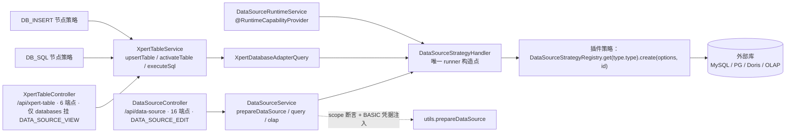

# 数据源与表格子专家 —— C0 使用总览

> **资产基线**：`2026-10-16 · commit 80f5676fd`（批次 5 第 14 专家 · 子专家②），继承父域 [C0-使用总览.md](file://.module-experts/后端专题/平台底座与集成专家/C0-使用总览.md)。**范围**：`packages/server/src/data-source/**`（**34 非 spec / 4 spec / 2 表** `data_source`、`data_source_authentication`；`/api/data-source` **16 端点**，含 `authentication/authentication.entity.ts`）＋ `packages/server-ai/src/xpert-table/**`（**18 非 spec / 3 spec / 1 表** `xpert_table`；`@Controller('xpert-table')` → `/api/xpert-table` **6 端点**，**无 `RouterModule`**）。**不含** `integration`/`view-extension`（→ [子专家①](file://.module-experts/后端专题/平台底座与集成专家/sub-experts/集成与扩展点子专家/C0-使用总览.md)）与字典族 / 客户端壳（→ 子专家③）。未证实处标 `[推测]`。

**本文引用的文件**（相对仓库根，链接均为 `file://`）

- [packages/server/src/data-source/data-source.controller.ts](file://packages/server/src/data-source/data-source.controller.ts)
- [packages/server/src/data-source/data-source.service.ts](file://packages/server/src/data-source/data-source.service.ts)
- [packages/server/src/data-source/data-source-runtime.service.ts](file://packages/server/src/data-source/data-source-runtime.service.ts)
- [packages/server/src/data-source/data-source.entity.ts](file://packages/server/src/data-source/data-source.entity.ts)
- [packages/server/src/data-source/authentication/authentication.entity.ts](file://packages/server/src/data-source/authentication/authentication.entity.ts)
- [packages/server/src/data-source/dto/public.dto.ts](file://packages/server/src/data-source/dto/public.dto.ts)
- [packages/server/src/data-source/utils.ts](file://packages/server/src/data-source/utils.ts)
- [packages/server/src/data-source/subscriber.ts](file://packages/server/src/data-source/subscriber.ts)
- [packages/server/src/data-source/queries/handlers/datasource.strategy.handler.ts](file://packages/server/src/data-source/queries/handlers/datasource.strategy.handler.ts)
- [packages/server/src/data-source/queries/handlers/olap-query.handler.ts](file://packages/server/src/data-source/queries/handlers/olap-query.handler.ts)
- [packages/server/src/data-source/commands/handlers/query-schema.handler.ts](file://packages/server/src/data-source/commands/handlers/query-schema.handler.ts)
- [packages/server-ai/src/xpert-table/xpert-table.controller.ts](file://packages/server-ai/src/xpert-table/xpert-table.controller.ts)
- [packages/server-ai/src/xpert-table/xpert-table.service.ts](file://packages/server-ai/src/xpert-table/xpert-table.service.ts)
- [packages/server-ai/src/xpert-table/xpert-table.entity.ts](file://packages/server-ai/src/xpert-table/xpert-table.entity.ts)
- [packages/server-ai/src/xpert-table/plugins/sql/strategy.ts](file://packages/server-ai/src/xpert-table/plugins/sql/strategy.ts)
- [packages/server-ai/src/xpert-table/plugins/insert/strategy.ts](file://packages/server-ai/src/xpert-table/plugins/insert/strategy.ts)
- [packages/server-ai/src/xpert-table/queries/handlers/xpert-database-adapter.handler.ts](file://packages/server-ai/src/xpert-table/queries/handlers/xpert-database-adapter.handler.ts)
- [apps/cloud/src/app/@core/services/xpert-table.service.ts](file://apps/cloud/src/app/@core/services/xpert-table.service.ts)

## 目录

1. [定位](#定位)
2. [何时找这个子专家](#何时找这个子专家)
3. [能力清单表](#能力清单表)
4. [边界](#边界)
5. [已知问题与常见坑](#已知问题与常见坑)
6. [延伸阅读](#延伸阅读)

## 定位

本子专家负责**「外部库接入」与「逻辑表物理化」两条链**：① **数据源（`data-source`）** = 外部 SQL/OLAP 接入与**查询代理**，不存数据副本——登记连接（`data_source` 行 + 可选 `data_source_authentication` 个人凭据）、两式探活（`POST /ping`、`POST /:id/ping`）、经 CQRS 把「类型名 + options」翻译成插件 runner（`DataSourceStrategyQuery` → `DataSourceStrategyHandler` → `DataSourceStrategyRegistry.get(name).create(options, dataSourceId)`），再以**一次一 runner、`finally teardown()`** 代理 catalogs/schema/SQL/能力/OLAP，并把「安全摘要 + 受作用域约束的 runner」以 `@RuntimeCapabilityProvider(DataSourceRuntimeCapability)` 形式开放给插件。② **表格（`xpert-table`）** = 工作区自定义物理表的 **Meta 层**——`xpert_table` 只存逻辑定义（`name/schema/columns/status`），真实结构由 `activateTable` 经适配器 `tableOp(CREATE_TABLE, { createMode: UPGRADE })` 落在**外部库**上，行/语句写入经 `plugins/{insert,sql}` 两个工作流节点策略暴露。

**一句话口径**：两条链共用**同一个插件策略入口**——代理链（控制器 → `prepareDataSource` → `DataSourceStrategyQuery` → runner → 一次 teardown）与 DDL 链（`XpertTableController.upsertTable/activateTable/deleteTable` → `XpertDatabaseAdapterQuery` → 同一个 `DataSourceStrategyQuery` → `tableOp/tableDataOp/runQuery`）在 `DataSourceStrategyHandler` 处合流，这是本子域唯一的 runner 构造点。

章节来源：[data-source.service.ts](file://packages/server/src/data-source/data-source.service.ts)（关键符号：prepareDataSource / getCatalogs / getSchema / query / olap / queryCapability）、[datasource.strategy.handler.ts](file://packages/server/src/data-source/queries/handlers/datasource.strategy.handler.ts)（关键符号：DataSourceStrategyHandler.execute）、[xpert-table.service.ts](file://packages/server-ai/src/xpert-table/xpert-table.service.ts)（关键符号：upsertTable / activateTable / deleteTable）

## 何时找这个子专家

- 要**建数据源与认证**：`POST /api/data-source`（类级 `DATA_SOURCE_EDIT`）、`POST /:id/authentication`（`createAuthentication` 按 `{tenantId,dataSourceId,userId}` **upsert**，`validUntil = now + 30d` 写死）、`authType=BASIC` 的凭据注入语义。
- 要**改连接测试**：`POST /ping`（未落库 ad-hoc）与 `POST /:id/ping`（已落库，请求体覆盖并把 `authentications[].userId` 强制改写为当前用户），两者失败都恒 **500** 并透传 adapter message。
- 要**改 schema 拉取**：`GET /:id/catalogs`、`GET /:id/schema?catalog=&table=&statement=`（三参数可选；给了 `statement` 走 `runner.describe(catalog, statement)` 并包装成单元素 `[{name, tables:[...]}]`）；`catalogs` 失败常见 message 是「配置错误」。
- 要**改查询代理（含 OLAP）**：`POST /:id/query`（400 透传）、`POST /:id/olap`（`@HttpCode(200)` + 逐项 `{id,status,data}`，整体恒 200）、`POST /:id/capabilities/query`（`DATA_SOURCE_VIEW` + 键名白名单校验），以及 `POST /:id/load` 的 xlsx/csv 装载。
- 要**建表 Meta 与列**：`POST/PUT /api/xpert-table` 都被覆写为 `upsertTable`（保存即激活）、`columns` 的 `TXpertTableColumn[]` 形态、`status` 7 态（`draft/ready/pendingActivation/active/needsMigration/deprecated/error`）。
- 要**激活物理表 / 排查 DDL 冲突**：`POST /:id/activate`；`UPGRADE` 模式直改已有物理表、`columns` 为空即 400、失败置 `ERROR + message`；改名走 `RENAME_TABLE`、删除先 `DROP_TABLE`。
- 要**排查连不上 / schema 过期 / 表名冲突**：`prepareDataSource` 的 scope 断言与「未找到当前用户认证信息」404；OLAP runner 缓存 10 分钟且改源不失效；`validateTableName` 的「物理表探测 + 逻辑行 id 比对」与异常路径（更新放行、新建拒绝）。
- 要**接表格行列能力**：`insertRow`/`executeSql`（硬前置 `status === ACTIVE`，**无 HTTP 面**）与 `DB_SQL`/`DB_INSERT` 两个工作流节点策略（`plugins/sql/strategy.ts`、`plugins/insert/strategy.ts`）。
- 要**给插件开放数据源会话**：`DataSourceRuntimeService.list/open`（actor 三元组比对 + 引擎白名单 `mysql|doris|postgres` + `updatedAt` revision 复核 + 方法代理）。

章节来源：[data-source.controller.ts](file://packages/server/src/data-source/data-source.controller.ts)（关键符号：findAlls / ping / pingDataSource / getCatalogs / getSchema / query / olap / queryCapability / load / authenticate）、[xpert-table.controller.ts](file://packages/server-ai/src/xpert-table/xpert-table.controller.ts)（关键符号：create / update / getDatabases / getDatabaseSchemas / activateTable / deleteTable）、[data-source-runtime.service.ts](file://packages/server/src/data-source/data-source-runtime.service.ts)（关键符号：authorize / list / open / check）

## 能力清单表

| 能力 | 入口 | 一句话 |
|---|---|---|
| 数据源 CRUD | 基类 CRUD + `GET/PUT /api/data-source[/:id]` | 连接配置（非数据副本）；`PUT /:id` 直连 service 并发 `DataSourceUpdatedEvent` |
| 唯一脱敏出口 | `GET /api/data-source` | `PermissionGuard` + `DATA_SOURCE_VIEW` + `ClassSerializerInterceptor` → `DataSourcePublicDTO` 白名单 |
| 个人认证三件套 | `GET/POST/DELETE /api/data-source/:id/authentication` | 按「人」一行，upsert 语义，`validUntil = now + 30d`；**无脱敏 DTO** |
| 连接测试两式 | `POST /api/data-source/ping`、`POST /:id/ping` | 未落库 / 已落库（覆盖体）试连；失败 500 透传 message |
| 库与 schema 下拉 | `GET /sql-select-options`、`GET /sql-schema-select-options?dataSource=` | SQL 协议数据源下拉 / catalog 选项；空参回 `[]` |
| 元数据探察 | `GET /:id/catalogs`、`GET /:id/schema` | 每次新建 runner 并 `finally teardown()`；无 schema 缓存 |
| 查询代理 | `POST /:id/query`、`POST /:id/olap` | 单条语句透传 / 批量 OLAP（10 分钟 runner 缓存） |
| 能力查询 | `POST /:id/capabilities/query` | 键名白名单（`^[a-z][a-z0-9]*(?:[._-][a-z0-9]+)*$`，≤128/≤64）先校验再建连 |
| 文件装载 | `POST /:id/load` | `FileInterceptor('file')` + `params`(JSON sheets) → `DataLoadCommand`（xlsx 并发 / CSV 流式） |
| 插件运行时能力 | `DataSourceRuntimeService.list/open`（无 HTTP） | 引擎白名单 + revision 复核；返回不暴露 runner 与凭据的方法代理 |
| 插件策略入口 | `DataSourceStrategyQuery` → `DataSourceStrategyHandler` | 全子域唯一 runner 构造点；策略缺失**不回落** |
| 表格 Meta CRUD | `POST/PUT /api/xpert-table[/:id]` | 都被覆写为 `upsertTable`（保存即激活物理表） |
| 物理表激活 | `POST /api/xpert-table/:id/activate` | `PENDING_ACTIVATION` → `CREATE_TABLE(UPGRADE)` → `ACTIVE + activatedAt`；失败 `ERROR + message` |
| 表格行与语句 | `DB_INSERT` / `DB_SQL` 工作流节点（无 HTTP） | `insertRow`/`executeSql` 均要求 `status === ACTIVE` |
| 库/表删除联动 | `DELETE /api/xpert-table/:id`（204） | `ACTIVE` 时先 `DROP_TABLE`（失败仅记日志）再软删 Meta |

章节来源：[data-source.controller.ts](file://packages/server/src/data-source/data-source.controller.ts)（关键符号：16 条显式端点）、[data-source.service.ts](file://packages/server/src/data-source/data-source.service.ts)（关键符号：findSqlDataSources / getCatalogs / queryCapability / validateCapabilityQuery）、[xpert-table.controller.ts](file://packages/server-ai/src/xpert-table/xpert-table.controller.ts)（关键符号：create / update / getDatabases / activateTable / deleteTable）、[xpert-table.service.ts](file://packages/server-ai/src/xpert-table/xpert-table.service.ts)（关键符号：upsertTable / activateTable / insertRow / executeSql）

## 边界

**做什么**：外部库连接登记与个人凭据、两式连接测试、catalogs/schema 元数据代理、SQL 与 OLAP 查询代理、能力查询、xlsx/csv 装载、插件运行时数据源会话、逻辑表 Meta 与物理表 DDL 生命周期、行插入与任意 SQL 的两条工作流节点出口。

**不做什么**

- **不含类型目录**：`data_source_type`（`type/syntax/protocol/configuration`）归邻域 `data-source-type` 模块，本子域只**强引用**它（`typeId` 非空列 + `onDelete: 'CASCADE'`）。
- **不含数据副本**：本子域不落业务数据、不做结果投影、不做 SQL 白名单/行数上限/超时（源码内均无），限制只能在插件 adapter 侧实现。
- **不含仪表盘 / 知识库的编排**：它们经 `DataSourceQuery`（`QuerySql|ListTables|TableSchema`，`TableSchema` 附带 `sample_data`）与 `DataSourceOlapQuery`（带 `sessionId` 命中 10 分钟缓存）消费；这两条 query 在本仓**未命中派发点**（除 `DataLoadCommand`），派发方在插件或邻域 `[推测]`。
- **不含表格的展示层与助手挂载**：`xpert-table` 前端 `XpertTableService extends OrganizationBaseCrudService<IXpertTable>`（基址 `/xpert-table`，另调 `GET /databases`、`GET /schemas`、`POST /:id/activate`、`DELETE /:id`），界面与助手图编排不在本子域。
- **不含 workspace 准入实现**：`XpertWorkspaceBaseService`/`XpertWorkspaceAccessService` 在 `../xpert-workspace` 邻域。

图表来源：[datasource.strategy.handler.ts](file://packages/server/src/data-source/queries/handlers/datasource.strategy.handler.ts)（关键符号：execute / strategy.create）、[xpert-table.service.ts](file://packages/server-ai/src/xpert-table/xpert-table.service.ts)（关键符号：activateTable 的 UPGRADE / executeSql）、[data-source-runtime.service.ts](file://packages/server/src/data-source/data-source-runtime.service.ts)（关键符号：open / check）、[plugins/sql/strategy.ts](file://packages/server-ai/src/xpert-table/plugins/sql/strategy.ts)（关键符号：WorkflowDBSQLNodeStrategy）

章节来源：[data-source.module.ts](file://packages/server/src/data-source/data-source.module.ts)（关键符号：RouterModule /data-source / exports）、[xpert-table.module.ts](file://packages/server-ai/src/xpert-table/xpert-table.module.ts)（关键符号：无 RouterModule / DataSourceModule 跨包引入）、[xpert-table.service.ts（前端）](file://apps/cloud/src/app/@core/services/xpert-table.service.ts)（关键符号：XpertTableService）

## 已知问题与常见坑

1. **`data_source_authentication.password` 是明文 text 列（实测）**：`@Column()` 无 `select:false`、无 `@Exclude`、无 transformer；实体上唯一的 `@Exclude()` 落在 `dataSource` **关系**字段上；`data_source.options` 上方的 `// @Exclude()` 处于**注释态**；模块内 `encrypt|decrypt|cipher|AES` 0 命中 ⇒ 加密/脱敏只覆盖「列表回显」，不覆盖存储。
   - 契约来源：[authentication.entity.ts](file://packages/server/src/data-source/authentication/authentication.entity.ts)（关键符号：password / dataSource 的 @Exclude / validUntil）、[data-source.entity.ts](file://packages/server/src/data-source/data-source.entity.ts)（关键符号：options 的注释态 @Exclude）、[public.dto.ts](file://packages/server/src/data-source/dto/public.dto.ts)（关键符号：DataSourcePublicDTO）。
2. **两条明文出网口绕过脱敏**：`GET /api/data-source/:id` 直出实体（`$relations=["authentications"]` 即回显凭据）、`GET /:id/authentication` 直出当前用户整行；`DataSourcePublicDTO` 的白名单只作用于 `GET /api/data-source` 一处。
   - 契约来源：[data-source.controller.ts](file://packages/server/src/data-source/data-source.controller.ts)（关键符号：findOneById / getAuthentication）、[data-source.service.ts](file://packages/server/src/data-source/data-source.service.ts)（关键符号：getMyAuthentication）。
3. **schema 无缓存，OLAP 有 10 分钟缓存且没有失效通道**：`getCatalogs/getSchema/query/queryCapability` 每次新建 runner 并 `finally teardown()`；`olap-query.handler` 在模块作用域按 `runners[sessionId][dataSourceId]` 复用（`OBJECT_LIFETIME = 10m`，`setInterval(..., 60000*10)` 回收），命中时**跳过 `prepareDataSource` 与鉴权重算**（复用首次凭据快照）；改数据源不会清缓存。
   - 契约来源：[data-source.service.ts](file://packages/server/src/data-source/data-source.service.ts)（关键符号：getCatalogs / finally teardown）、[olap-query.handler.ts](file://packages/server/src/data-source/queries/handlers/olap-query.handler.ts)（关键符号：runners / OBJECT_LIFETIME / runnerCleanupTimer）。
4. **`DataSourceUpdatedEvent` 是一条悬空事件：唯一失效机制在插件边界**：`DataSourceSubscriber` **从未被实例化**（不在 `providers`、不在 `coreSubscribers`、不在 `index.ts` 导出），`events/handlers/index.ts` 是 `export const EventHandlers = []`；实际发布方只剩控制器 `PUT /:id`，故既无 TypeORM 订阅者也无 handler。与之对照，`DataSourceRuntimeService.open` 才有**版本式失效**（比对 `updatedAt` 不一致即 `close()` 并抛 403 `Data source changed; reopen the connection`）。
   - 契约来源：[subscriber.ts](file://packages/server/src/data-source/subscriber.ts)（关键符号：DataSourceSubscriber.afterUpdate）、[events/handlers/index.ts](file://packages/server/src/data-source/events/handlers/index.ts)（关键符号：EventHandlers = []）、[data-source-runtime.service.ts](file://packages/server/src/data-source/data-source-runtime.service.ts)（关键符号：sourceRevision / check / close）。
5. **查询代理没有超时、没有行数上限、没有 SQL 白名单（回源码核实）**：`runQuery(statement, options)` 把原始语句透传给插件 runner；HTTP 路径**不传 `AbortSignal`**（取消能力只在插件协议 `DatabaseWorkbenchAdapter.query(value, signal)` + `cancel()`）；唯一的「限量」是 `query-schema.handler` 内部的 `LIMIT 10` 取样；`schema` 未经 `escapeRegExp` 就进 `new RegExp('^' + schema + '\\.')`。
   - 契约来源：[data-source.service.ts](file://packages/server/src/data-source/data-source.service.ts)（关键符号：query / olap / import）、[query-schema.handler.ts](file://packages/server/src/data-source/commands/handlers/query-schema.handler.ts)（关键符号：LIMIT 10 / statement 分支）。
6. **错误码是固定的，排障只能看 message**：`ping`/`catalogs` 恒 500（catalogs 在 service 内先 `console.error` 再抛 `new Error('配置错误')`）、`query`/`capabilities` 恒 400、`olap` 整体恒 200（失败项以 `{id,status,data}` 返回，且依赖 axios 错误的 `response` 形状，非 axios 错误会抛 `TypeError`）。
   - 契约来源：[data-source.controller.ts](file://packages/server/src/data-source/data-source.controller.ts)（关键符号：ping 的 500 / query 的 400 / olap 的逐项包装 / queryCapability 的 400）。
7. **物理表激活/DDL 是本子域最大风险面（`plugins/sql/strategy` 是它的下行出口）**：`activateTable` 用 `DBCreateTableMode.UPGRADE` 直改外部库既有表（无迁移审批、无 dry-run、无回滚）；`upsertTable` 激活失败时**新建表硬删逻辑行、既有表只标 `ERROR + message`**；`deleteTable` 的 `DROP_TABLE` 失败**仅 `logger.error` 后照常软删**（可能留下物理表孤儿）；改名先 `RENAME_TABLE`，失败即抛且无二次补偿；`DB_SQL` 策略把 `sqlTemplate` 渲染后直送 `executeSql`，唯一护栏是 `status === ACTIVE`。
   - 契约来源：[xpert-table.service.ts](file://packages/server-ai/src/xpert-table/xpert-table.service.ts)（关键符号：activateTable 的 UPGRADE / upsertTable 的补偿分支 / deleteTable 的 DROP_TABLE）、[plugins/sql/strategy.ts](file://packages/server-ai/src/xpert-table/plugins/sql/strategy.ts)（关键符号：WorkflowDBSQLNodeStrategy.create / tableService.executeSql）。
8. **表 Meta 与物理表存在漂移缝隙**：`xpert_table` 同时有 `name/schema`（用户可见，DDL 实际使用）与 `physicalSchema/physicalTableName/version`（注释里有示例值，但**服务层零读写点**），`version` 不是 `@VersionColumn`；`database` 只是指向 `data_source.id` 的字符串（无 FK），删数据源不清理表格行；3 张表**均无唯一索引**，「一源一人一凭据」「一库一表名」全靠服务层 read-then-write 约定。
   - 契约来源：[xpert-table.entity.ts](file://packages/server-ai/src/xpert-table/xpert-table.entity.ts)（关键符号：physicalSchema / physicalTableName / version / database）、[xpert-database-adapter.handler.ts](file://packages/server-ai/src/xpert-table/queries/handlers/xpert-database-adapter.handler.ts)（关键符号：table.database → findOneByIdString）。
9. **`xpert-table` 的权限面极薄**：`XpertTableController` 类级只有 `@UseInterceptors(TransformInterceptor)`，**仅 `GET databases` 挂 `PermissionGuard + DATA_SOURCE_VIEW`**；`POST /`、`PUT /:id`、`POST /:id/activate`、`DELETE /:id`（内含 `DROP TABLE`）都无 `@Permissions`，只依赖全局 AuthGuard 与 workspace 校验 `[推测]`；模块**无 `RouterModule`**（前缀靠 `@Controller('xpert-table')` 字符串），也无 `@UseValidationPipe`。
   - 契约来源：[xpert-table.controller.ts](file://packages/server-ai/src/xpert-table/xpert-table.controller.ts)（关键符号：类级装饰器清单 / getDatabases 的 PermissionGuard）、[xpert-table.module.ts](file://packages/server-ai/src/xpert-table/xpert-table.module.ts)（关键符号：无 RouterModule）。
10. **策略选择不回落，名字口径可能两种并存**：`DataSourceStrategyHandler.execute` 只经注册表（`DataSourceStrategyRegistry.get(name)` 抛错即转 `InternalServerErrorException("DataSource strategy not found for type: …")`，`strategy.create` 不会被调用、错误原样上抛）；`name` 一律取 `dataSource.type.type`（如 `pg`/`mysql`/`doris`/`xmla`/`sapbw`），只有 `DataSourceRuntimeService` 内部做 `pg → postgres` 归一；`XpertDatabaseSchemaQuery` 有类**无 handler**（前端 `getDatabaseSchemas` 走控制器直调服务）。
    - 契约来源：[datasource.strategy.handler.ts](file://packages/server/src/data-source/queries/handlers/datasource.strategy.handler.ts)（关键符号：execute / no-fallback）、[data-source-runtime.service.ts](file://packages/server/src/data-source/data-source-runtime.service.ts)（关键符号：引擎白名单 / pg → postgres）、[queries/handlers/index.ts](file://packages/server-ai/src/xpert-table/queries/handlers/index.ts)（关键符号：QueryHandlers 仅 2 项）。

章节来源：[data-source.service.ts](file://packages/server/src/data-source/data-source.service.ts)（关键符号：prepareDataSource / createAuthentication / validateCapabilityQuery）、[xpert-table.service.ts](file://packages/server-ai/src/xpert-table/xpert-table.service.ts)（关键符号：validateTableName / activateTable / deleteTable）、[authentication.entity.ts](file://packages/server/src/data-source/authentication/authentication.entity.ts)（关键符号：password 明文列）

## 延伸阅读

- 建源/测连/拉 schema/下查询/建表激活的端到端走查：[02-实现.md](file://.module-experts/后端专题/平台底座与集成专家/sub-experts/数据源与表格子专家/implementation/02-实现.md)（§1 16 端点 / §3 schema 与缓存 / §4 查询代理 / §6 xpert-table）
- 三张表逐列核实与「无加密列」证据、校验规则与未确认项：[04-模型.md](file://.module-experts/后端专题/平台底座与集成专家/sub-experts/数据源与表格子专家/implementation/04-模型.md)
- 职责与边界（代理链 / DDL 链在策略入口合流）：[01-架构.md](file://.module-experts/后端专题/平台底座与集成专家/sub-experts/数据源与表格子专家/implementation/01-架构.md)（§4 关键不变量）
- 测试分布与缺口（data-source 4 spec + xpert-table 3 spec，本次未复跑）：[06-测试.md](file://.module-experts/后端专题/平台底座与集成专家/sub-experts/数据源与表格子专家/implementation/06-测试.md)
- 父域 Recipe（建源并测连 / schema 与查询代理 / 建表并激活）：[C2-使用流程.md](file://.module-experts/后端专题/平台底座与集成专家/C2-使用流程.md) Recipe 3 / 4 / 5
- 决策与口径（凭据明文落库 + 出口收窄 / 物理表 UPGRADE / 复用 data-source 代理层）：[C5-关键决策.md](file://.module-experts/后端专题/平台底座与集成专家/C5-关键决策.md) D2 / D3 / D12

章节来源：[01-架构.md](file://.module-experts/后端专题/平台底座与集成专家/sub-experts/数据源与表格子专家/implementation/01-架构.md)（关键符号：职责与边界 / 关键不变量）、[06-测试.md](file://.module-experts/后端专题/平台底座与集成专家/sub-experts/数据源与表格子专家/implementation/06-测试.md)（关键符号：spec 清单与运行命令）
