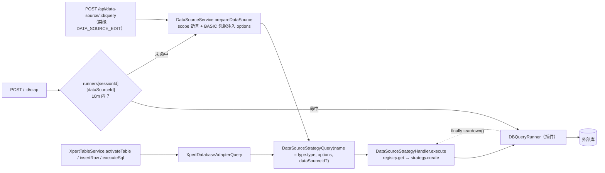

# 数据源与表格子专家 —— C1 能力契约

> 契约层 CR2 / CR5 / CR7。只写「对外可依赖的语义」：入口、参数行为、返回、异常与约束；路径均为仓库根相对 `file://` 引用。**资产基线**：`2026-10-16 · commit 80f5676fd`（批次 5 第 14 专家 · 子专家②），继承父域 [C1-能力契约.md](file://.module-experts/后端专题/平台底座与集成专家/C1-能力契约.md)。**逐端点明细**（完整字段、分页、错误码全集）见父域 [implementation/05-接口.md](file://.module-experts/后端专题/平台底座与集成专家/implementation/05-接口.md)，本文不复制。

**本文引用的文件**（相对仓库根，链接均为 `file://`）

- [packages/server/src/data-source/data-source.controller.ts](file://packages/server/src/data-source/data-source.controller.ts)
- [packages/server/src/data-source/data-source.service.ts](file://packages/server/src/data-source/data-source.service.ts)
- [packages/server/src/data-source/data-source-runtime.service.ts](file://packages/server/src/data-source/data-source-runtime.service.ts)
- [packages/server/src/data-source/authentication/authentication.entity.ts](file://packages/server/src/data-source/authentication/authentication.entity.ts)
- [packages/server/src/data-source/dto/public.dto.ts](file://packages/server/src/data-source/dto/public.dto.ts)
- [packages/server/src/data-source/utils.ts](file://packages/server/src/data-source/utils.ts)
- [packages/server/src/data-source/queries/handlers/datasource.strategy.handler.ts](file://packages/server/src/data-source/queries/handlers/datasource.strategy.handler.ts)
- [packages/server/src/data-source/queries/handlers/olap-query.handler.ts](file://packages/server/src/data-source/queries/handlers/olap-query.handler.ts)
- [packages/server/src/data-source/queries/handlers/query.handler.ts](file://packages/server/src/data-source/queries/handlers/query.handler.ts)
- [packages/server/src/data-source/commands/handlers/query-schema.handler.ts](file://packages/server/src/data-source/commands/handlers/query-schema.handler.ts)
- [packages/server-ai/src/xpert-table/xpert-table.controller.ts](file://packages/server-ai/src/xpert-table/xpert-table.controller.ts)
- [packages/server-ai/src/xpert-table/xpert-table.service.ts](file://packages/server-ai/src/xpert-table/xpert-table.service.ts)
- [packages/server-ai/src/xpert-table/xpert-table.entity.ts](file://packages/server-ai/src/xpert-table/xpert-table.entity.ts)
- [packages/server-ai/src/xpert-table/plugins/sql/strategy.ts](file://packages/server-ai/src/xpert-table/plugins/sql/strategy.ts)
- [packages/server-ai/src/xpert-table/plugins/insert/strategy.ts](file://packages/server-ai/src/xpert-table/plugins/insert/strategy.ts)
- [packages/server-ai/src/xpert-table/queries/handlers/xpert-database-adapter.handler.ts](file://packages/server-ai/src/xpert-table/queries/handlers/xpert-database-adapter.handler.ts)

## 目录

1. [§1 HTTP 入口索引](#§1-http-入口索引)
2. [§2 服务契约](#§2-服务契约)
3. [§3 凭据与查询代理契约](#§3-凭据与查询代理契约)
4. [§4 示例](#§4-示例)
5. [§5 契约来源](#§5-契约来源)

## §1 HTTP 入口索引

全局前缀 `api`。`DataSourceController` 为 `@Controller()` + 类级 `@ApiBearerAuth()` + `@Permissions(DATA_SOURCE_EDIT)`，路径段由 `RouterModule.register([{ path: '/data-source' }])` 给出；`XpertTableController` 为 `@Controller('xpert-table')`（**无 `RouterModule`**）+ 类级仅 `@UseInterceptors(TransformInterceptor)`。

**A. 数据源 16 条显式端点（按主题分组）**

| 组 | 方法 / 路径 | 鉴权 | 用途与关键行为 |
|---|---|---|---|
| 列表与下拉 | GET `/api/data-source` | `PermissionGuard` + `DATA_SOURCE_VIEW`（覆盖类级 EDIT）+ `ClassSerializerInterceptor` | **唯一脱敏出口**：`items` 映射 `DataSourcePublicDTO` 白名单；`$query` 经 `ParseJsonPipe` |
| 列表与下拉 | GET `/sql-select-options` | 登录态（类级 EDIT） | `type.protocol = SQL` 的 `{value:id,label:name}` |
| 列表与下拉 | GET `/sql-schema-select-options?dataSource=` | 登录态 | 无 `dataSource` 直接回 `[]`，否则 `getCatalogs` 映射 `{value,label}` |
| 单条 | GET `/:id` | 登录态 + `UUIDValidationPipe` | **直出实体、无 DTO**；`$relations`/`$query` 都经 `ParseJsonPipe`（`$relations=["authentications"]` 即回显凭据） |
| 单条 | PUT `/:id` | 登录态 + `UUIDValidationPipe` | `dsService.update` 后 `eventBus.publish(new DataSourceUpdatedEvent(id))`（源码保留 `@todo`） |
| 连接测试 | POST `/ping` | 登录态 | body 即完整 `IDataSource`，**不落库**；失败恒 **500** 透传 message |
| 连接测试 | POST `/:id/ping` | 登录态 + `UUIDValidationPipe` | 以库内为底、请求体覆盖；`authentications[].userId` 被强制改写为当前用户；失败 **500** |
| 元数据 | GET `/:id/catalogs` | 登录态 | catalog 列举；失败 **500**（runner 侧失败被 service 换成「配置错误」） |
| 元数据 | GET `/:id/schema?catalog=&table=&statement=` | 登录态 | 三参数可选；带 `statement` 走 `runner.describe(catalog, statement)` 并包成单元素 `[{name, tables:[tableSchema]}]` |
| 查询 | POST `/:id/query` | 登录态 | body `{query}`；转发 `Accept-Language`；失败 **400** 透传 message |
| 查询 | POST `/:id/olap` | 登录态 + `@HttpCode(200)` | body `{query:[{id,body}]}`，并发逐项；成功 `{id,status:200,data}`，失败 `{id,status,statusText,data}`，**整体恒 200** |
| 能力 | POST `/:id/capabilities/query` | 登录态 + `PermissionGuard` + `DATA_SOURCE_VIEW` | body `IDataSourceCapabilityQuery`；键名白名单先校验；失败 **400** |
| 认证 | GET `/:id/authentication` | 登录态 | 当前用户认证行；未命中 **404**；**无脱敏** |
| 认证 | POST `/:id/authentication` | 登录态 | 按 `{tenantId,dataSourceId,userId}` upsert；`validUntil = now + 30d` |
| 认证 | DELETE `/:id/authentication` | 登录态 | 按同一三元组删除 |
| 装载 | POST `/:id/load` | 登录态 + `FileInterceptor('file')` | body `params` 为 JSON `sheets`；派 `DataLoadCommand`；失败 **500** |

**B. `/api/xpert-table` 6 条显式端点**

| 方法 / 路径 | 鉴权 | 用途与关键行为 |
|---|---|---|
| POST `/api/xpert-table` | 登录态（类级仅 `TransformInterceptor`） | 覆写基类 `create` → `service.upsertTable(entity)`：建逻辑表并**立即激活** |
| PUT `/api/xpert-table/:id` | 登录态 | 覆写基类 `update` → `upsertTable({...entity, id})`：ACTIVE 改名先 `RENAME_TABLE` |
| GET `/api/xpert-table/databases` | `PermissionGuard` + `DATA_SOURCE_VIEW` | `XpertDatabasesQuery({protocol:'sql'})`：可激活目标库 |
| GET `/api/xpert-table/schemas?databaseId=` | 登录态 | `service.getDatabaseSchemas` → `adapter.getCatalogs()`；失败 **400** |
| POST `/api/xpert-table/:id/activate` | 登录态 | 显式激活；无列 **400**；失败置 `error` 并抛 400 |
| DELETE `/api/xpert-table/:id` | 登录态 + `@HttpCode(204)` | ACTIVE 时先 `DROP_TABLE`（失败仅日志）再软删 Meta |

**逐端点明细见父域 [implementation/05-接口.md](file://.module-experts/后端专题/平台底座与集成专家/implementation/05-接口.md)**（基类 `CrudController` 另提供 `GET /:id`、`count`、`pagination`、`my`、`DELETE /:id/soft`、`PUT /:id/recover` 等继承端点，未计入上述计数）。

章节来源：[data-source.controller.ts](file://packages/server/src/data-source/data-source.controller.ts)（关键符号：findAlls / getSqlDataSources / getSqlSchemas / findOneById / updateOne / getCatalogs / getSchema / query / olap / queryCapability / ping / pingDataSource / getAuthentication / authenticate / deleteAuthentication / load）、[xpert-table.controller.ts](file://packages/server-ai/src/xpert-table/xpert-table.controller.ts)（关键符号：create / update / getDatabases / getDatabaseSchemas / activateTable / deleteTable）

## §2 服务契约

| `类.方法(签名)` | 用途 | 参数行为语义 · 约束 |
|---|---|---|
| `DataSourceService.prepareDataSource(id \| entity, userId?)`（`utils.ts`） | 所有代理动作的前置：scope 断言 + BASIC 凭据注入 | 强制 `tenantId` + `organizationId` 同时存在（否则 403 `Data source scope is required`）；`authType === BASIC` 时按 `userId` 取 `data_source_authentication` 行并把 `username/password` **写回 `options`**，找不到即 404「未找到当前用户认证信息」 |
| `DataSourceService.getCatalogs(id)` / `getSchema(id, catalog?, table?, statement?)` / `query(id, statement, options?)` / `olap(dataSource, body, lang?)` / `queryCapability(id, query)` / `import(id, body, options?)` / `dropTable(id, tableName, options?)` | 查询代理全部方法 | 骨架一致：`prepareDataSource` → `queryBus.execute(new DataSourceStrategyQuery(type.type, options))` → `try { runner.xxx() } finally { runner.teardown() }`；`queryCapability` 在建模**之前**做键名白名单（`^[a-z][a-z0-9]*(?:[._-][a-z0-9]+)*$`，`capability ≤ 128`、`operation ≤ 64`），runner 未实现该方法则 fail-closed 并**先 teardown 再抛** |
| `DataSourceService.findSqlDataSources()` / `create` / `update` / `findAll` / `getMyAuthentication(id)` / `createAuthentication(id, auth)` / `deleteAuthentication(id)` | 读写与个人凭据 | `createAuthentication` 按 `{tenantId,dataSourceId,userId}` `findOneBy` 复用（**upsert**），`validUntil = addDays(now, 30)` 写死且读取侧从不校验；`getMyAuthentication` 未命中 404 |
| `DataSourceRuntimeService.list(actor)` / `open({actor, dataSourceId, location})` / `authorize(actor, write?)` | 插件唯一出口（`@RuntimeCapabilityProvider`，capability `platform.datasource.workbench`） | `authorize`：actor 的 `tenantId/organizationId/userId` 全非空且与 `RequestContext` 逐项相等（否则 403 `Data source scope mismatch`），再按 `write` 判 EDIT / VIEW；`list` 取 `take:1000` 后**白名单引擎**（`pg → postgres`，只放行 `mysql|doris|postgres`）；`open` 限 `engineCatalog` 空或 `'internal'`，返回**逐方法包 `check()` 的代理**（重查 `updatedAt`，不一致即 `close()` + 403 `Data source changed; reopen the connection`；不暴露 runner 与解析后凭据） |
| `DataSourceStrategyHandler.execute(query: DataSourceStrategyQuery)` | 建 runner 的唯一出口 | `registry.get(name)` 缺失即 `InternalServerErrorException('DataSource strategy not found for type: …')`；`strategy.create(options, dataSourceId)` 返回空同样抛错；**策略缺失不回落、策略内错误原样上抛** |
| `DataSourceQueryHandler.execute(query)`（`query.handler.ts`） | `QuerySql` / `ListTables` / `TableSchema` 三分支 | `TableSchema` 附带 `sample_data`（取样）；handler 侧 runner 带 `debug: isDev, trace: isDev`（`NODE_ENV==='development'`），**HTTP 侧同名方法不带** |
| `OlapQueryHandler.execute(query)`（`olap-query.handler.ts`） | OLAP 代理 + 会话级 runner 复用 | 模块作用域 `runners[sessionId][dataSourceId]`，`OBJECT_LIFETIME = 10m`；命中即复用并**跳过 `prepareDataSource` 与鉴权重算**；`setInterval(...,60000*10)` 过期 `teardown()` 后删键，`unref()` 不阻塞退出 |
| `QuerySchemaHandler.execute(cmd)`（`query-schema.handler.ts`） | 单表 schema 取样 | 内部拼 `LIMIT 10` 取样语句；`table.replace(new RegExp('^' + schema + '\\.'), '')` 中 `schema` **未转义** |
| `XpertTableService.validateTableName(entity)` / `upsertTable(entity)` / `activateTable(tableId)` / `getDatabaseSchemas(databaseId)` / `insertRow(tableId,row)` / `executeSql(tableId,statement)` / `deleteTable(tableId)` | Meta 与物理表生命周期 | `validateTableName`：`id` 存在且 `name/schema/database` 未变即放行，否则打一次外部库 `GET_TABLE_INFO` 并按逻辑行 id 比对；**异常路径**更新放行（`return !entity.id`）、新建拒绝。`upsertTable` 先校验 `name`+`database`（400），ACTIVE 改名先 `RENAME_TABLE`（失败即抛），再 `update`/`create`，最后**无条件** `activateTable`；激活失败：新建→删逻辑行（失败仅日志）、既有→`ERROR + message`，随后统一抛出。`activateTable`：`columns` 为空 400；`PENDING_ACTIVATION` → `tableOp(CREATE_TABLE, {createMode: UPGRADE})` → `ACTIVE + activatedAt + message:null`，失败 `ERROR + message`。`insertRow`/`executeSql` 硬前置 `status === ACTIVE`（否则 400 `Table <name> is not active.`）；`deleteTable`：ACTIVE 时先 `DROP_TABLE`（失败仅日志）后 `softDelete` |
| `WorkflowDBSQLNodeStrategy.create`（`DB_SQL`）/ `WorkflowDBInsertNodeStrategy.create`（`DB_INSERT`） | 表格接进 Agent 图的唯一 HTTP 外出口 | `DB_SQL` 用 `mustache` 渲染 `entity.sqlTemplate` 后调 `executeSql`；`DB_INSERT` 从 state 取值后调 `insertRow`；两者都以 `wrapAgentExecution` 包成执行记录 |
| `XpertDatabaseAdapterQueryHandler.execute(query)` | 归还数据库适配器 | 以 `query.options.id`（即 `table.database`）`findOneByIdString(id, {relations:['type']})`；**唯一向 `DataSourceStrategyQuery` 传 `dataSourceId` 的调用方** |
| `DataSourcePublicDTO`（`dto/public.dto.ts`） | 列表白名单 | 类级 `@Exclude()` + 逐字段 `@Expose()`：`id/name/type(→DataSourceTypeDTO)/typeId/authType/createdAt/updatedAt/createdBy(→UserPublicDTO)`；`options` 与 `authentications` 不下发 |

章节来源：[data-source.service.ts](file://packages/server/src/data-source/data-source.service.ts)（关键符号：prepareDataSource / query / olap / queryCapability / createAuthentication / validateCapabilityQuery）、[utils.ts](file://packages/server/src/data-source/utils.ts)（关键符号：prepareDataSource 的 BASIC 分支）、[datasource.strategy.handler.ts](file://packages/server/src/data-source/queries/handlers/datasource.strategy.handler.ts)（关键符号：execute / strategy.create / no-fallback）、[olap-query.handler.ts](file://packages/server/src/data-source/queries/handlers/olap-query.handler.ts)（关键符号：runners / OBJECT_LIFETIME）、[xpert-table.service.ts](file://packages/server-ai/src/xpert-table/xpert-table.service.ts)（关键符号：validateTableName / upsertTable / activateTable / insertRow / executeSql / deleteTable）

## §3 凭据与查询代理契约

**（1）认证字段形态（`data_source_authentication`，1 表 1 行/人）**

| 字段 | 形态与行为 | 脱敏现状 |
|---|---|---|
| `dataSourceId` | `@RelationId` + 真实非空列；FK `onDelete: 'CASCADE'`（父行删则连删） | — |
| `dataSource` | `ManyToOne(DataSource)`，仅**关系**上有 `@Exclude()` | 关系级隐藏，**不代表列级隐藏** |
| `userId` | `@Column()`，**无 FK、无索引**；`prepareDataSource` 靠它匹配 | — |
| `username` | `@Column()` 外部库账号 | 无脱敏 |
| `password` | **普通 `@Column()` → 明文 text**：无 `select:false`、无 `@Exclude`、无 transformer、无加密 | **明文落库 + 明文回显** |
| `validUntil` | `@Column({nullable:true})`，写入 `addDays(now, 30)`；读取侧**从不校验** | — |

脱敏现状（唯一出口 vs 明文口）：`GET /api/data-source` → `DataSourcePublicDTO` 白名单（**唯一**）；`GET /:id`（可带 `$relations=["authentications"]`）与 `GET /:id/authentication` **直出明文**；`data_source.options` 上方的 `// @Exclude()` 处于注释态 ⇒ 默认出网；`XpertTable` 侧无凭据列。写入侧 `createAuthentication` 直接赋值 `password` 后 `save`，无长度/复杂度校验；无唯一索引（三元组唯一是服务层 read-then-write 约定）。

**（2）查询下发的限制与错误（回源码核实）**

| 维度 | 契约 |
|---|---|
| 授权分层 | HTTP 层：类级 `@Permissions(DATA_SOURCE_EDIT)`（`query`/`olap`/`load` 无额外守卫），`capabilities/query` 额外 `DATA_SOURCE_VIEW`，列表端点覆盖为 `DATA_SOURCE_VIEW`；服务层：`prepareDataSource` 强制 `tenantId + organizationId` 并按 `{id, tenantId, organizationId}` 收敛（缺 scope ⇒ 403 `Data source scope is required`；查不到 ⇒ 404） |
| 资源限制 | **无超时、无行数上限、无 SQL 白名单/黑名单**；`runQuery(statement, options)` 原样透传；唯一「限量」是 `query-schema.handler` 的 `LIMIT 10` 取样 |
| 取消能力 | HTTP 路径**不传 `AbortSignal`**；仅插件协议 `DatabaseWorkbenchAdapter.query(value, signal)` + `cancel()` 具备取消/超时能力 `[推测]`（面向用户的超时只能由插件 adapter 实现） |
| 错误语义 | `ping`/`catalogs` ⇒ 恒 500 + message（catalogs 常为「配置错误」）；`query`/`capabilities` ⇒ 恒 400 + message（capabilities 无 message 时回落 `Data-source capability query failed`）；`olap` ⇒ 整体 200，逐项 `{id,status,statusText,data}`；`schema` ⇒ 由控制器 try/catch 转 500 |
| 建连口径 | 每次调用新建 runner 并 `finally teardown()`（异常也释放）；`DataSourceStrategyHandler` 是唯一构造点，策略缺失不回落 |
| 幂等/缓存 | 只有 OLAP 有会话级 runner 复用（10 分钟，`sessionId` 必需，缺则每次重建连接）；其余无缓存 |


图表来源：[data-source.controller.ts](file://packages/server/src/data-source/data-source.controller.ts)（关键符号：query / olap / queryCapability）、[data-source.service.ts](file://packages/server/src/data-source/data-source.service.ts)（关键符号：prepareDataSource / query / olap）、[olap-query.handler.ts](file://packages/server/src/data-source/queries/handlers/olap-query.handler.ts)（关键符号：runners / OBJECT_LIFETIME）、[xpert-table.service.ts](file://packages/server-ai/src/xpert-table/xpert-table.service.ts)（关键符号：activateTable / executeSql）

章节来源：[authentication.entity.ts](file://packages/server/src/data-source/authentication/authentication.entity.ts)（关键符号：password / userId / validUntil / dataSource 的 @Exclude）、[public.dto.ts](file://packages/server/src/data-source/dto/public.dto.ts)（关键符号：DataSourcePublicDTO @Exclude/@Expose）、[data-source-runtime.service.ts](file://packages/server/src/data-source/data-source-runtime.service.ts)（关键符号：authorize / check / 引擎白名单）、[xpert-database-adapter.handler.ts](file://packages/server-ai/src/xpert-table/queries/handlers/xpert-database-adapter.handler.ts)（关键符号：findOneByIdString）

## §4 示例

### ① 建数据源并测连接（未落库 ad-hoc）

```ts
// 真实调用方：packages/server/src/data-source/data-source.controller.ts
@Post('/ping')
async ping(@Body() body: IDataSource): Promise<void> {
    try {
        return await this.dsService.ping(body)                       // body 即完整定义，不落库
    } catch (err) {
        throw new HttpException(err.message, HttpStatus.INTERNAL_SERVER_ERROR)   // 恒定 500
    }
}

@Post('/:id/authentication')
async authenticate(@Param('id', UUIDValidationPipe) dataSourceId: string, @Body() body: DataSourceAuthentication) {
    return this.dsService.createAuthentication(dataSourceId, body)   // 三元组 upsert，validUntil = now + 30d
}
```

要点：建源本身走基类 `POST /api/data-source`（类级 `DATA_SOURCE_EDIT`）；`authType=BASIC` 时必须先写认证行，否则后续代理报 404「未找到当前用户认证信息」；已落库试连用 `POST /:id/ping`（服务端把 `authentications[].userId` 改写为当前用户后再注入凭据）。

### ② 拉 schema 并下查询

```ts
// 真实调用方：packages/server/src/data-source/data-source.controller.ts
@Get('/:id/schema')
async getSchema(
    @Param('id', UUIDValidationPipe) dataSourceId: string,
    @Query('catalog') catalog: string,
    @Query('table') table: string,
    @Query('statement') statement: string
): Promise<IDSTable[]> {
    try {
        return await this.dsService.getSchema(dataSourceId, catalog, table, statement)   // 带 statement → describe
    } catch (error) {
        throw new HttpException(error.message, HttpStatus.INTERNAL_SERVER_ERROR)
    }
}

@Post('/:id/query')
async query(@Param('id', UUIDValidationPipe) dataSourceId: string, @Body() body: { query: string },
            @Headers('Accept-Language') acceptLanguage: string): Promise<any> {
    return await this.dsService.query(dataSourceId, body?.query, { headers: { 'Accept-Language': acceptLanguage } })
        .catch((err) => { throw new HttpException(err.message, HttpStatus.BAD_REQUEST) })   // 恒定 400
}
```

要点：每个代理方法都是「新建 runner → 调用 → `finally teardown()`」；`GET /:id/schema` 与 `POST /:id/query` 的状态码口径不同（500 vs 400）；OLAP 走 `POST /:id/olap` 且**整体恒 200**，前端必须读 body 里的逐项 `status`；本域不提供查询超时与行数上限。

### ③ 建表 Meta 并激活物理表

```ts
// 真实调用方：packages/server-ai/src/xpert-table/xpert-table.service.ts
async activateTable(tableId: string) {
    const table = await this.findOneByIdString(tableId)
    if (!table.columns?.length) throw new BadRequestException(`Table must have at least one column to activate.`)
    await this.update(table.id, { status: XpertTableStatus.PENDING_ACTIVATION })
    try {
        const adapter = await this.queryBus.execute(new XpertDatabaseAdapterQuery({ id: table.database }))
        await adapter.tableOp(DBTableAction.CREATE_TABLE, {
            schema: table.schema || undefined, table: table.name,
            columns: cleanedColumns, createMode: DBCreateTableMode.UPGRADE     // 直改外部库既有表
        })
        await this.update(table.id, { status: XpertTableStatus.ACTIVE, activatedAt: new Date(), message: null })
    } catch (error) {
        await this.update(table.id, { status: XpertTableStatus.ERROR, message: getErrorMessage(error) })
        throw new BadRequestException(`Table activation failed: ${getErrorMessage(error)}`)
    }
}
```

要点：`POST /api/xpert-table` 与 `PUT /:id` 都被覆写为 `upsertTable`（**保存即激活**），`POST /:id/activate` 仅供重试；ACTIVE 改名会先 `RENAME_TABLE`；激活失败时新建表回删逻辑行、既有表只标 `ERROR + message`；`DELETE /:id` 在 ACTIVE 时先 `DROP_TABLE`（失败仅记日志）再软删 Meta——DDL 与元数据**不同事务**，且 `physicalSchema/physicalTableName/version` 三列当前不参与读写。

章节来源：[data-source.controller.ts](file://packages/server/src/data-source/data-source.controller.ts)（关键符号：ping / authenticate / getSchema / query / olap）、[data-source.service.ts](file://packages/server/src/data-source/data-source.service.ts)（关键符号：getSchema / query / finally teardown）、[xpert-table.service.ts](file://packages/server-ai/src/xpert-table/xpert-table.service.ts)（关键符号：activateTable / upsertTable / deleteTable）、[xpert-table.controller.ts](file://packages/server-ai/src/xpert-table/xpert-table.controller.ts)（关键符号：create/update 覆写 upsertTable）

## §5 契约来源

| 契约条目 | 来源 |
|---|---|
| 数据源 16 端点、固定错误码（500/400/恒 200）、`$relations` 直出实体 | `packages/server/src/data-source/data-source.controller.ts` |
| 代理骨架与 `finally teardown()`、能力键名白名单、认证 upsert 与 30 天有效期 | `packages/server/src/data-source/data-source.service.ts` |
| BASIC 凭据注入与 404「未找到当前用户认证信息」、xlsx 并发 / CSV 流式装载 | `packages/server/src/data-source/utils.ts` |
| 凭据列形态（`password` 明文）与脱敏出口白名单 | `packages/server/src/data-source/authentication/authentication.entity.ts`、`dto/public.dto.ts` |
| 插件运行时出口（scope 断言、引擎白名单、revision 复核、方法代理） | `packages/server/src/data-source/data-source-runtime.service.ts` |
| runner 唯一构造点与「策略缺失不回落」 | `packages/server/src/data-source/queries/handlers/datasource.strategy.handler.ts` |
| 查询三分支、OLAP 10 分钟 runner 缓存、schema 取样 `LIMIT 10` | `packages/server/src/data-source/queries/handlers/{query.handler.ts,olap-query.handler.ts}`、`commands/handlers/query-schema.handler.ts` |
| 表格 6 端点与权限面（仅 `databases` 挂 `DATA_SOURCE_VIEW`） | `packages/server-ai/src/xpert-table/xpert-table.controller.ts` |
| Meta/DDL 生命周期（`UPGRADE` 激活、改名、删除、行写入与任意 SQL） | `packages/server-ai/src/xpert-table/xpert-table.service.ts`、`xpert-table.entity.ts` |
| `DB_SQL` / `DB_INSERT` 节点出口 | `packages/server-ai/src/xpert-table/plugins/{sql,insert}/strategy.ts` |
| 表格 → 数据源适配器（`dataSourceId` 唯一传入方） | `packages/server-ai/src/xpert-table/queries/handlers/xpert-database-adapter.handler.ts` |
| 逐端点明细与错误语义全集 | 父域 [implementation/05-接口.md](file://.module-experts/后端专题/平台底座与集成专家/implementation/05-接口.md)（本文不复制） |

章节来源：[data-source.controller.ts](file://packages/server/src/data-source/data-source.controller.ts)（关键符号：DataSourceController 全端点）、[xpert-table.controller.ts](file://packages/server-ai/src/xpert-table/xpert-table.controller.ts)（关键符号：XpertTableController）、[xpert-table.service.ts](file://packages/server-ai/src/xpert-table/xpert-table.service.ts)（关键符号：XpertTableService）
