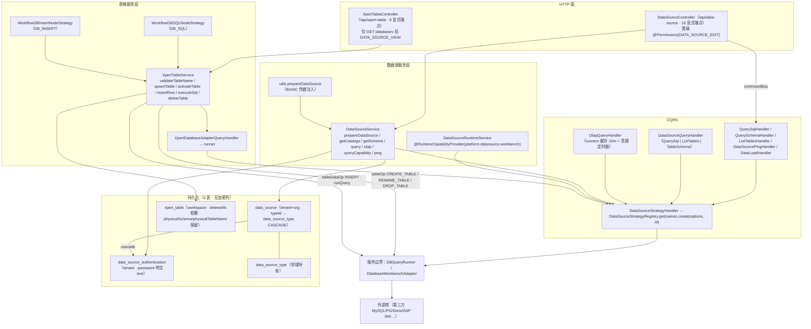

# 数据源与表格子专家 ② · 架构

> 只读梳理（不写入、不改动工作区）。范围：`packages/server/src/data-source/**`（**34 非 spec / 4 spec / 2 表**；HTTP 前缀 `/api/data-source`，**16 端点**）+ `packages/server-ai/src/xpert-table/**`（**18 非 spec / 3 spec / 1 表**；`@Controller('xpert-table')` → `/api/xpert-table`，**6 端点**，**无 `RouterModule`**）。**不含** `integration`/`view-extension`（→① 子专家）、字典与客户端壳（→③ 子专家）。引用为仓库根相对路径；未能证实处一律标 `[推测]`。

**本文引用的文件**

- [data-source/data-source.module.ts](file://packages/server/src/data-source/data-source.module.ts)
- [data-source/data-source.controller.ts](file://packages/server/src/data-source/data-source.controller.ts)
- [data-source/data-source.service.ts](file://packages/server/src/data-source/data-source.service.ts)
- [data-source/data-source-runtime.service.ts](file://packages/server/src/data-source/data-source-runtime.service.ts)
- [data-source/data-source.entity.ts](file://packages/server/src/data-source/data-source.entity.ts)
- [data-source/authentication/authentication.entity.ts](file://packages/server/src/data-source/authentication/authentication.entity.ts)
- [data-source/utils.ts](file://packages/server/src/data-source/utils.ts)
- [data-source/subscriber.ts](file://packages/server/src/data-source/subscriber.ts)
- [data-source/dto/public.dto.ts](file://packages/server/src/data-source/dto/public.dto.ts)
- [data-source/queries/datasource.strategy.query.ts](file://packages/server/src/data-source/queries/datasource.strategy.query.ts)
- [data-source/queries/handlers/datasource.strategy.handler.ts](file://packages/server/src/data-source/queries/handlers/datasource.strategy.handler.ts)
- [data-source/queries/handlers/query.handler.ts](file://packages/server/src/data-source/queries/handlers/query.handler.ts)
- [data-source/queries/handlers/olap-query.handler.ts](file://packages/server/src/data-source/queries/handlers/olap-query.handler.ts)
- [data-source/commands/handlers/query-schema.handler.ts](file://packages/server/src/data-source/commands/handlers/query-schema.handler.ts)
- [data-source/commands/handlers/list-tables.handler.ts](file://packages/server/src/data-source/commands/handlers/list-tables.handler.ts)
- [data-source-type/data-source-type.entity.ts](file://packages/server/src/data-source-type/data-source-type.entity.ts)
- [core/entities/subscribers.ts](file://packages/server/src/core/entities/subscribers.ts)
- [xpert-table/xpert-table.module.ts](file://packages/server-ai/src/xpert-table/xpert-table.module.ts)
- [xpert-table/xpert-table.controller.ts](file://packages/server-ai/src/xpert-table/xpert-table.controller.ts)
- [xpert-table/xpert-table.service.ts](file://packages/server-ai/src/xpert-table/xpert-table.service.ts)
- [xpert-table/xpert-table.entity.ts](file://packages/server-ai/src/xpert-table/xpert-table.entity.ts)
- [xpert-table/plugins/sql/strategy.ts](file://packages/server-ai/src/xpert-table/plugins/sql/strategy.ts)
- [xpert-table/plugins/insert/strategy.ts](file://packages/server-ai/src/xpert-table/plugins/insert/strategy.ts)
- [xpert-table/queries/handlers/xpert-database-adapter.handler.ts](file://packages/server-ai/src/xpert-table/queries/handlers/xpert-database-adapter.handler.ts)
- [apps/cloud/…/services/xpert-table.service.ts](file://apps/cloud/src/app/@core/services/xpert-table.service.ts)

## 目录

- [1. 职责与边界](#1-职责与边界)
- [2. 目录结构与分层](#2-目录结构与分层)
- [3. 依赖关系](#3-依赖关系)
- [4. 关键不变量](#4-关键不变量)
- [5. 架构总览](#5-架构总览)
- [6. 结论](#6-结论)

## 1. 职责与边界

**数据源（`packages/server/src/data-source`）= 外部 SQL/OLAP 接入与查询代理**，**不存数据副本**。它做四件事：① 登记一个外部库连接（`data_source` 行 + 可选 `data_source_authentication` 个人凭据）；② 建连前/建连后探活（`ping` 两式）；③ 经 CQRS 把「类型名 + options」翻译成插件侧 runner（`DataSourceStrategyQuery` → `DataSourceStrategyHandler` → `DataSourceStrategyRegistry.get(name).create(options, dataSourceId)`），再以**一次一 runner、`finally teardown()`** 的方式代理元数据（catalogs/schema/describe）、SQL 查询、能力查询与 OLAP；④ 把同一份「安全摘要 + 受作用域约束的 runner」以**平台运行时能力**形式开放给插件（`DataSourceRuntimeService`，`@RuntimeCapabilityProvider(DataSourceRuntimeCapability)`）。

**表格（`packages/server-ai/src/xpert-table`）= 工作区自定义物理表（Meta + 激活）**。`xpert_table` 只存**逻辑定义**（名称/库/模式/列数组/状态），真正的物理表由 `activateTable` 经数据库适配器 `tableOp(CREATE_TABLE, { createMode: UPGRADE })` 落在**外部库**上。表格域因此同时是「元数据 CRUD 面」与「DDL 执行面」，并由 `plugins/{sql,insert}` 两个工作流节点策略把表接进 Agent 图。

**不做什么**：数据源域不做 SQL 白名单、不做行数上限、不做语句超时（本域源码内**均无**）；表格域不做查询编排、不做数据展示层；两者都不定义类型目录——`data_source_type`（`DataSourceType`，`type/syntax/protocol/configuration`）由 `data-source-type` 模块持有，本子域只**强引用**它（`typeId` 非空列 + `onDelete: 'CASCADE'`）。

**与 `xpert-table` 的前端消费**：前端 `XpertTableService extends OrganizationBaseCrudService<IXpertTable>`，基址 `API_PREFIX + '/xpert-table'`，另调 `GET /databases`、`GET /schemas?databaseId=`、`POST /:id/activate`、`DELETE /:id`——即**继承 CRUD（含 POST/PUT/GET/:id）+ 4 条自定义路由**，全部落在 `XpertTableController` 上。

**与知识库/仪表盘的边界**：`DataSourceQuery`（`QuerySql|ListTables|TableSchema`）与 `DataSourceOlapQuery` 两个 query 类的 handler 都在本域，但**仓库内除 `DataLoadCommand` 外未命中任何派发点**——它们由插件或邻域（知识库取样、OLAP 前端桥）派发 `[推测]`（`packages/**` 全量检索 `new DataSourceQuery(`/`new DataSourceOlapQuery(` 0 命中）。因此**数据源是「被消费方」，不是消费方**：知识库/仪表盘拿到的是 runner 与结果，不是表结构本体。

章节来源：[data-source.service.ts](file://packages/server/src/data-source/data-source.service.ts)（关键符号：DataSourceService.prepareDataSource / getCatalogs / getSchema / query / olap / queryCapability）、[xpert-table.service.ts](file://packages/server-ai/src/xpert-table/xpert-table.service.ts)（关键符号：XpertTableService.upsertTable / activateTable / insertRow / executeSql / deleteTable）、[xpert-table.service.ts（前端）](file://apps/cloud/src/app/@core/services/xpert-table.service.ts)（关键符号：XpertTableService / injectXpertTableAPI）

## 2. 目录结构与分层

**数据源侧（`packages/server/src/data-source/`，38 文件 = 34 非 spec + 4 spec）**

- **模块装配**：`data-source.module.ts` —— `RouterModule.register([{ path: '/data-source', module: DataSourceModule }])`（本子域**唯一**有 RouterModule 的模块，与 `xpert-table` 形成对照）、`TypeOrmModule.forFeature([DataSource, DataSourceAuthentication])`、`forwardRef(TenantModule, UserModule)`、`DataSourceTypeModule`、`SharedModule`、`CqrsModule`；`exports: [TypeOrmModule, DataSourceService]`（`DataSourceRuntimeService` **不导出**，靠 `@RuntimeCapabilityProvider` 装饰器被插件宿主发现）。
- **控制器层**：`data-source.controller.ts` —— `CrudController<DataSource>`，类级 `@Permissions(DATA_SOURCE_EDIT)`，类内**显式 16 条**端点；全模块唯一的脱敏出口是 `findAlls`（`DataSourcePublicDTO`）。
- **服务层**：`data-source.service.ts`（`TenantOrganizationAwareCrudService<DataSource>`，双 repository：`dsRepository` + `authRepository`）、`data-source-runtime.service.ts`（插件边界，`implements DataSourceRuntimeApi`）。
- **领域工具层**：`utils.ts` —— `prepareDataSource(dataSource, userId?)`（BASIC 认证注入）、`importSheetTables`（CSV 流式 / Excel 两路）、`dataLoad`、`loadFromExcel`。
- **CQRS 层**：`queries/{olap,query,datasource.strategy}` + `commands/{load,list-tables,query-schema,query-sql,ping}`，handler 经 `queries/handlers/index.ts`（`QueryHandlers` 3 个）与 `commands/handlers/index.ts`（`CommandHandlers` 5 个）一次性注入模块。
- **事件层**：`events/updated.event.ts`（纯 POJO `DataSourceUpdatedEvent(id)`）+ `events/handlers/index.ts`（**`export const EventHandlers = []`，空数组**）——即「事件已发/已订阅者框架就位，但**无任何 handler**」。
- **DTO 层**：`dto/public.dto.ts`（`@Exclude()` 类级 + 逐字段 `@Expose()` 白名单）。
- **订阅者**：`subscriber.ts`（`DataSourceSubscriber`，见 §4 ⑥）。

**表格侧（`packages/server-ai/src/xpert-table/`，21 文件 = 18 非 spec + 3 spec）**

- **模块装配**：`xpert-table.module.ts` —— `TypeOrmModule.forFeature([XpertTable])`、`TenantModule`、**`DataSourceModule`（来自 `@xpert-ai/server-core`，即 `packages/server/src`）**、`CqrsModule`、`forwardRef(XpertWorkspaceModule)`；**无 `RouterModule`**、**无 `exports`**。
- **控制器层**：`xpert-table.controller.ts` —— `CrudController<XpertTable>`（来自 `@xpert-ai/server-core`），类级仅 `@UseInterceptors(TransformInterceptor)`；**类内显式 6 条**，其中**仅 `GET databases` 挂 `PermissionGuard + DATA_SOURCE_VIEW`**。
- **服务层**：`xpert-table.service.ts` —— `XpertWorkspaceBaseService<XpertTable>`（构造注入 `Repository<XpertTable>` + `XpertWorkspaceAccessService`），方法集 `validateTableName` / `upsertTable` / `activateTable` / `getDatabaseSchemas` / `insertRow` / `executeSql` / `deleteTable`。
- **查询层**：`queries/{get-databases,get-database-adapter,get-database-schemas}.query.ts` + `queries/handlers/{xpert-databases,xpert-database-adapter}.handler.ts`（**`XpertDatabaseSchemaQuery` 无 handler，见 §4 ⑤**）。
- **插件/策略层**：`plugins/index.ts` 汇总 `Validators`（2 个校验器）与 `Strategies`（`WorkflowDBSQLNodeStrategy`、`WorkflowDBInsertNodeStrategy`），二者都以 `@Inject(XpertTableService)` 回注本模块服务。
- **实体**：`xpert-table.entity.ts`（`@Entity('xpert_table')`，继承 `WorkspaceBaseEntity`）。

章节来源：[data-source.module.ts](file://packages/server/src/data-source/data-source.module.ts)（关键符号：DataSourceModule.imports / providers / exports / RouterModule）、[xpert-table.module.ts](file://packages/server-ai/src/xpert-table/xpert-table.module.ts)（关键符号：XpertTableModule.imports / providers）、[events/handlers/index.ts](file://packages/server/src/data-source/events/handlers/index.ts)（关键符号：EventHandlers = []）、[plugins/index.ts](file://packages/server-ai/src/xpert-table/plugins/index.ts)（关键符号：Strategies / Validators）

## 3. 依赖关系

**出向（数据源）**：`@xpert-ai/contracts`（`IDataSource`/`IDataSourceAuthentication`/`IDSSchema`/`IDSTable`/`IDataSourceCapabilityQuery`/`AuthenticationEnum`/`DataSourceProtocolEnum`/`PermissionsEnum`/`mapTranslationLanguage`）；`@xpert-ai/plugin-sdk`（`DataSourceStrategyRegistry`、`DBQueryRunner`、`IDataSourceStrategy`、`AdapterBaseOptions`、`CreationTable`、`File`、`DataSourceRuntimeApi` 与 `@RuntimeCapabilityProvider`）；`@xpert-ai/server-common`（`getErrorMessage`、`readExcelWorkSheets`、`UploadSheetType`）；`../core/crud`（`CrudController`、`TenantOrganizationAwareCrudService`、`PaginationParams`）；`../core/context`（`RequestContext`）；`../shared`（`CurrentUser`/`EmployeeId`/`ParseJsonPipe`/`PermissionGuard`/`Permissions`/`UseValidationPipe`/`UUIDValidationPipe`）；外部库 `axios`、`date-fns`（`addDays`）、`nestjs-i18n`、`@nestjs/platform-express`（`FileInterceptor`）。**跨模块**：`../data-source-type`（`DataSourceType` 实体 + 模块）、`TenantModule`、`UserModule`、`SharedModule`。

**出向（表格）**：`@xpert-ai/server-core`（`DataSourceModule`、`DataSourceService`、`DataSource`、`DataSourceStrategyQuery`、`CrudController`、`PermissionGuard`、`Permissions`、`TransformInterceptor`、`TenantModule`）；`@xpert-ai/plugin-sdk`（`DBQueryRunner`、`DBTableAction`、`DBTableDataAction`、`DBCreateTableMode`、`@WorkflowNodeStrategy`、`IWorkflowNodeStrategy`、`TWorkflowNodeMeta`）；`@xpert-ai/contracts`（`IXpertTable`、`TXpertTableColumn`、`XpertTableStatus`、`IWFNDBSql`、`IWFNDBInsert`、`WorkflowNodeTypeEnum`、`ChannelName`）；`@langchain/core`（`RunnableLambda`、`PromptTemplate`）；`../../../shared/{index,agent/execution}`（`AgentStateAnnotation`、`stateWithEnvironment`、`wrapAgentExecution`）；`../xpert-workspace`（`XpertWorkspaceBaseService`、`XpertWorkspaceAccessService`）。

**入向**：`server/src/core/entities/index.ts` 把 `DataSource`/`DataSourceAuthentication`/`DataSourceType` 登记进 `coreEntities`（server 侧全局实体表）；`server-ai/src/core/entities/index.ts` 把 `XpertTable` 登记进 `ALL_AI_ENTITIES`；`server-ai/src/app.module.ts` 引入 `XpertTableModule`。**`XpertTableModule` 是全仓「server-ai → server」最直接的跨包依赖边之一**：它直接 `import { DataSourceModule } from '@xpert-ai/server-core'`（jest 侧由 `server-ai/jest.config.ts` 的 `moduleNameMapper` 把 `^@xpert-ai/server-core$` 指到 `packages/server/src/index.ts`）。

**被外部消费**：`DataSourcePublicDTO` 经 `GET /api/data-source` 供前端数据源设置页（ping 走 `DataSourceConnectionService`）；`XpertDatabaseAdapterQuery` 归还的 runner 被 `xpert-table` 服务用于 DDL/DML；`DataSourceService` 被 `XpertDatabasesQueryHandler` 注入。

章节来源：[data-source.module.ts](file://packages/server/src/data-source/data-source.module.ts)（关键符号：DataSourceModule 的 import 清单）、[xpert-table.module.ts](file://packages/server-ai/src/xpert-table/xpert-table.module.ts)（关键符号：DataSourceModule 跨包引入）、[core/entities/index.ts](file://packages/server-ai/src/core/entities/index.ts)（关键符号：ALL_AI_ENTITIES / XpertTable）、[jest.config.ts（server-ai）](file://packages/server-ai/jest.config.ts)（关键符号：moduleNameMapper 的 server-core 映射）

## 4. 关键不变量

**① 凭据明文风险（如实记录，属本子域最重要的安全事实）。** `data_source_authentication.password` 是**普通 `text` 列**：`@Column()` 无 `select: false`、无 `@Exclude`、无 `@Column({ transformer })`；实体上唯一带 `@Exclude` 的是 `dataSource` **关系**字段（`authentication.entity.ts`），**不含** `password`。上游 `data-source.entity.ts` 里 `options`（json）上方的 `// @Exclude()` **处于注释态**。写入侧 `DataSourceService.createAuthentication` 直接把 `auth.password` 赋给列并 `save`，`validUntil` 硬编码 `now + 30d`；读取侧 `getMyAuthentication` 直出实体。⇒ **本批 14 表无任何加密列**（父级已定口径），加密/脱敏在这里**只覆盖「列表回显」**（`DataSourcePublicDTO` 白名单不含 `options` 与 `authentications`），**不覆盖存储、不覆盖 `GET /:id` 与 `GET /:id/authentication`**。全模块检索 `encrypt|decrypt|cipher|AES` 0 命中。

**② schema 拉取与缓存/失效。** 元数据代理是**逐次建连**的：`getCatalogs`/`getSchema`/`query`/`queryCapability` 每次都 `queryBus.execute(new DataSourceStrategyQuery(...))` 新建 runner 并 `finally teardown()`，**本域无 schema 缓存**。唯一的 runner 缓存落在 OLAP 侧：`olap-query.handler.ts` 的模块级 `runners[sessionId][dataSourceId]`，TTL `OBJECT_LIFETIME = 10m`，由 `setInterval(..., 60000 * 10)` + `runnerCleanupTimer.unref()` 回收（teardown 后删键，session 空则删 session）。**失效只有时间维度**：改数据源不会清缓存（`DataSourceUpdatedEvent` 无 handler）。插件边界则另有一套**版本式失效**：`DataSourceRuntimeService.open()` 记 `sourceRevision = source.updatedAt?.getTime()`，每次调用前 `check()` 重查 `{id, tenantId, organizationId}` 的 `updatedAt`，**不一致即 `close()` 并抛 `ForbiddenException('Data source changed; reopen the connection')`**。

**③ 查询代理的授权与资源限制（以源码为准）。** 授权是**两层**：HTTP 层只有类级 `@Permissions(DATA_SOURCE_EDIT)`（`POST /:id/query`、`POST /:id/olap`、`POST /:id/load` 均**无额外守卫**），`POST /:id/capabilities/query` 另挂 `@Permissions(DATA_SOURCE_VIEW)`；服务层 `prepareDataSource` 强制 `tenantId` + `organizationId` 同时存在（否则 403 `Data source scope is required`）并按 `{id, tenantId, organizationId}` 收敛。**资源限制：本域内没有超时、没有行数上限、没有 SQL 白名单/黑名单**——`runQuery(statement, options)` 把原始语句透传给插件 runner；唯一的「限量」是 `query-schema.handler` 内部拼的 `SELECT * FROM ${table} LIMIT 10`（取样）。需要真正限制只能在插件 adapter 侧 `[推测]`（`DataSourceRuntimeService` 的 `DatabaseWorkbenchAdapter.query(value, signal)` 暴露了 `AbortSignal` 与 `cancel()`，说明插件协议**具备**取消能力，但 HTTP 代理路径不传 signal）。另有一处**字符串拼装风险**：`query-schema.handler.ts` 与 `query.handler.ts` 都用 `table.replace(new RegExp(`^${schema}\\.`), '')`，`schema` 未经 `escapeRegExp` 即进入正则构造。

**④ `xpert-table` 的物理表激活 / DDL 风险面。** `activateTable` 先置 `PENDING_ACTIVATION`，再 `tableOp(DBTableAction.CREATE_TABLE, { columns: cleanedColumns, createMode: DBCreateTableMode.UPGRADE })`——**UPGRADE 模式**意味着列增删改会直接作用到外部库既有物理表，且**无迁移审批、无 dry-run、无回滚**；成功置 `ACTIVE + activatedAt`，失败置 `ERROR + message` 并把错误包成 `BadRequestException`。`upsertTable` 在**改名且旧状态为 `ACTIVE`** 时先 `tableOp(RENAME_TABLE)` 再写 Meta；`deleteTable` 在 `ACTIVE` 时先 `DROP_TABLE`（失败仅记日志、**仍继续软删 Meta**）；`insertRow`/`executeSql` 都硬要求 `status === ACTIVE`，其中 `executeSql` 直接把调用方语句交给 `adapter.runQuery(statement, { catalog })`，**唯一护栏是「表必须已激活」**。

**⑤ 表 Meta 与物理表的对应与漂移。** `xpert_table` 同时存在两组名字：`name/schema`（用户可见，`validateTableName` 用于查重）与 `physicalSchema/physicalTableName`（注释示例 `xpert_data` / `xd_ta3f1a_ws9b2_xpd10_cuord_v1`，`version int default 1`）。**但启动 DDL 时用的是 `table.schema`/`table.name`**，`physical*` 两列与 `version` **在服务层无任何读写点**（源码内 `physicalSchema|physicalTableName` 仅出现在实体注释与列声明）——即这两组字段**当前是纯保留字段**，`physical*` 与实际物理表可能长期不一致。`version` 也**不是 `@VersionColumn`**，注释所说的「字段修改后 +1」**无实现**。`XpertDatabaseSchemaQuery` 声明了却**无 handler**（`queries/handlers/index.ts` 只导出 2 个），前端 `getDatabaseSchemas` 走的是控制器直调 `service.getDatabaseSchemas`。

**⑥ subscriber 的副作用：**`DataSourceSubscriber` 在 `afterUpdate` 时 `eventBus.publish(new DataSourceUpdatedEvent(event.entity.id))`，但**它从未被实例化**：不在 `DataSourceModule.providers`、不在 `coreSubscribers`（`[StorageFileSubscriber, TagSubscriber, ReferralCodeSubscriber]`）、也不在 `data-source/index.ts` 的导出清单里；它依赖的 `Connection` 注入方式（构造里 `connection.subscribers.push(this)`）本身也没有 Nest 装配点。其类注释自述「没有解决 typeorm Subscriber 与注入 nestjs EventBus 的问题」。⇒ **实际生效的 `DataSourceUpdatedEvent` 发布方只有控制器 `PUT /:id`**（`updateOne` 里的 `@todo` 注释「Updated cqrs event 应该在哪里发出 ?」正是此处的对照），而 `EventHandlers = []` 导致**该事件目前无任何消费者**。

章节来源：[authentication.entity.ts](file://packages/server/src/data-source/authentication/authentication.entity.ts)（关键符号：DataSourceAuthentication.password / dataSource 的 @Exclude / validUntil）、[data-source.entity.ts](file://packages/server/src/data-source/data-source.entity.ts)（关键符号：options 的注释态 // @Exclude()）、[data-source.service.ts](file://packages/server/src/data-source/data-source.service.ts)（关键符号：prepareDataSource 的 scope 断言 / createAuthentication 的 addDays 30）、[olap-query.handler.ts](file://packages/server/src/data-source/queries/handlers/olap-query.handler.ts)（关键符号：runners / OBJECT_LIFETIME / runnerCleanupTimer.unref）、[data-source-runtime.service.ts](file://packages/server/src/data-source/data-source-runtime.service.ts)（关键符号：authorize / sourceRevision / check / close）、[xpert-table.service.ts](file://packages/server-ai/src/xpert-table/xpert-table.service.ts)（关键符号：activateTable 的 DBCreateTableMode.UPGRADE / deleteTable 的 DROP_TABLE / executeSql）、[xpert-table.entity.ts](file://packages/server-ai/src/xpert-table/xpert-table.entity.ts)（关键符号：physicalSchema / physicalTableName / version）、[subscriber.ts](file://packages/server/src/data-source/subscriber.ts)（关键符号：DataSourceSubscriber.afterUpdate / connection.subscribers.push）、[core/entities/subscribers.ts](file://packages/server/src/core/entities/subscribers.ts)（关键符号：coreSubscribers 三元素）

## 5. 架构总览

图表来源：[data-source.module.ts](file://packages/server/src/data-source/data-source.module.ts)（关键符号：RouterModule path /data-source、providers）、[data-source.controller.ts](file://packages/server/src/data-source/data-source.controller.ts)（关键符号：DataSourceController 的 16 条路由声明）、[xpert-table.module.ts](file://packages/server-ai/src/xpert-table/xpert-table.module.ts)（关键符号：XpertTableModule.controllers）、[xpert-table.controller.ts](file://packages/server-ai/src/xpert-table/xpert-table.controller.ts)（关键符号：getDatabases 的 PermissionGuard）、[xpert-table.service.ts](file://packages/server-ai/src/xpert-table/xpert-table.service.ts)（关键符号：activateTable / deleteTable / insertRow / executeSql）

## 6. 结论

本子域的结构主线是「**一条代理链 + 一条 DDL 链，共用同一个插件策略入口**」。代理链：`DataSourceController` → `DataSourceService.prepareDataSource`（scope + BASIC 凭据注入）→ `DataSourceStrategyQuery` → 插件 runner → **一次性 teardown**；DDL 链：`XpertTableController.upsertTable/activateTable/deleteTable` → `XpertDatabaseAdapterQuery` → **同一个** `DataSourceStrategyQuery` → `DBQueryRunner.tableOp/tableDataOp/runQuery`。两条链在 `DataSourceStrategyHandler` 处合流，这是本子域**唯一**的 runner 构造点，也是「谁能碰外部库」的单点。

三处需要长期防守：① **凭据明文**——`password` 无 `select:false`/无 `@Exclude`、`options` 的 `@Exclude` 仍是注释，脱敏只存在于列表 DTO，`GET /:id?...$relations=["authentications"]` 与 `GET /:id/authentication` 都会明文出网；② **DDL 无护栏**——`UPGRADE` 模式直接改外部库既有表、`DELETE` 连带 `DROP TABLE`（失败也照样软删 Meta）、`executeSql` 只校验 `status === ACTIVE`；③ **元数据双份命名漂移**——`physicalSchema/physicalTableName/version` 三列无读写点，实际 DDL 用 `schema/name`，一旦有人按注释启用 `physical*`，历史表的对应关系将断裂。

两处「发了但没人接」的空转也应在扩展时优先补齐：`DataSourceUpdatedEvent`（控制器会发，`EventHandlers` 为空、subscriber 未装配）与 `XpertDatabaseSchemaQuery`（有 query 类、无 handler）。新增数据源类型时，正确骨架是「插件注册 `IDataSourceStrategy` → 只经 `DataSourceStrategyQuery` 建 runner → `finally teardown()`」；新增表格能力时，正确骨架是「先 `status` 流转、再 `tableOp`、失败落 `ERROR + message`」，不要把 DDL 直接写进控制器。

章节来源：[data-source.service.ts](file://packages/server/src/data-source/data-source.service.ts)（关键符号：DataSourceService.query 的 finally teardown）、[datasource.strategy.handler.ts](file://packages/server/src/data-source/queries/handlers/datasource.strategy.handler.ts)（关键符号：DataSourceStrategyHandler.execute / InternalServerErrorException）、[xpert-table.service.ts](file://packages/server-ai/src/xpert-table/xpert-table.service.ts)（关键符号：upsertTable 的激活失败补偿 / deleteTable 的软删兜底）、[events/handlers/index.ts](file://packages/server/src/data-source/events/handlers/index.ts)（关键符号：EventHandlers = []）
