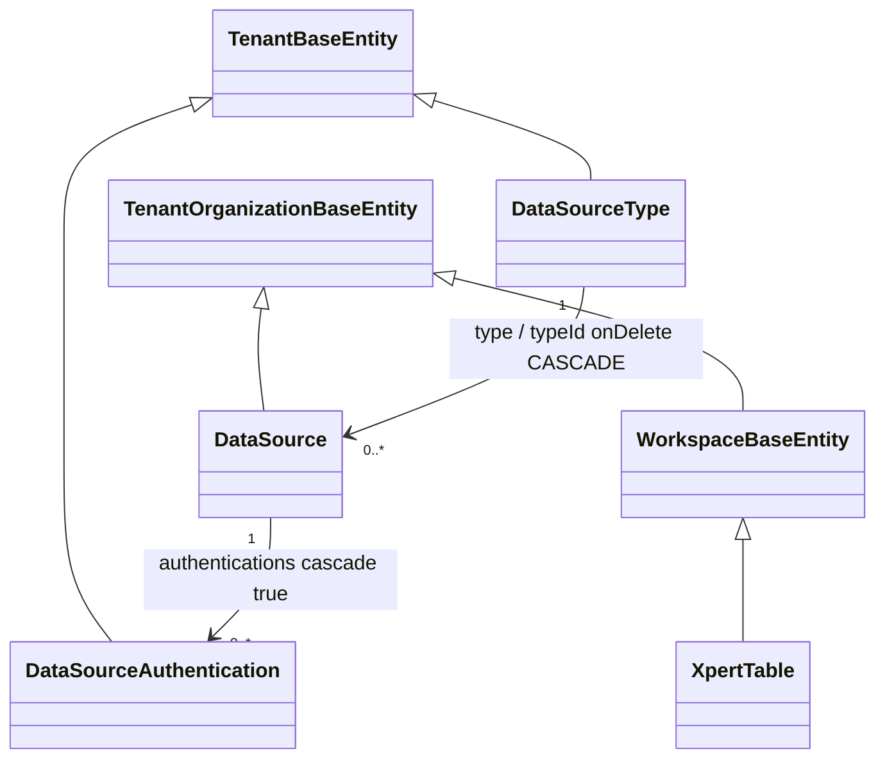

# 数据源与表格子专家 ② · 模型

> 只读梳理。本子域共 **3 张表**：`packages/server/src/data-source` 的 `data_source`、`data_source_authentication`（2 张）+ `packages/server-ai/src/xpert-table` 的 `xpert_table`（1 张）。**关键事实（父级已定口径，本文件如实标注风险）：本批 14 表无任何加密列**——`data_source_authentication.password` 是**明文 text**，无 `select: false`、无 `@Exclude`、无 transformer；`data_source.options` 的 `// @Exclude()` 处于**注释态**。未确认处显式标注。引用为仓库根相对路径。

**本文引用的文件**

- [data-source/data-source.entity.ts](file://packages/server/src/data-source/data-source.entity.ts)
- [data-source/authentication/authentication.entity.ts](file://packages/server/src/data-source/authentication/authentication.entity.ts)
- [data-source-type/data-source-type.entity.ts](file://packages/server/src/data-source-type/data-source-type.entity.ts)
- [xpert-table/xpert-table.entity.ts](file://packages/server-ai/src/xpert-table/xpert-table.entity.ts)
- [core/entities/base.entity.ts（server-ai）](file://packages/server-ai/src/core/entities/base.entity.ts)
- [core/entities/index.ts（server）](file://packages/server/src/core/entities/index.ts)
- [core/entities/index.ts（server-ai）](file://packages/server-ai/src/core/entities/index.ts)
- [contracts/src/data-source.model.ts](file://packages/contracts/src/data-source.model.ts)
- [contracts/src/ai/xpert-table.model.ts](file://packages/contracts/src/ai/xpert-table.model.ts)
- [data-source/data-source.service.ts](file://packages/server/src/data-source/data-source.service.ts)
- [data-source/dto/public.dto.ts](file://packages/server/src/data-source/dto/public.dto.ts)
- [xpert-table/xpert-table.service.ts](file://packages/server-ai/src/xpert-table/xpert-table.service.ts)

## 目录

- [1. 总览与表口径](#1-总览与表口径)
- [2. data_source](#2-data_source)
- [3. data_source_authentication](#3-data_source_authentication)
- [4. xpert_table](#4-xpert_table)
- [5. 建模边界](#5-建模边界)
- [6. 校验规则](#6-校验规则)
- [7. 未确认项](#7-未确认项)
- [8. 结论](#8-结论)

## 1. 总览与表口径

| 子域 | 表 | 数量 | 隔离键基类 | 软删 |
|---|---|---|---|---|
| 数据源 | `data_source`、`data_source_authentication` | 2 | `TenantOrganizationBaseEntity` / `TenantBaseEntity` | 无 |
| 表格 | `xpert_table` | 1 | `WorkspaceBaseEntity`（继承 `TenantOrganizationBaseEntity`） | **有**（`@DeleteDateColumn`） |
| 附：邻域被强引用 | `data_source_type`（邻域 `data-source-type` 持有） | — | `TenantBaseEntity` | 无 |

图表来源：[data-source.entity.ts](file://packages/server/src/data-source/data-source.entity.ts)（关键符号：DataSource extends TenantOrganizationBaseEntity）、[authentication.entity.ts](file://packages/server/src/data-source/authentication/authentication.entity.ts)（关键符号：DataSourceAuthentication extends TenantBaseEntity）、[xpert-table.entity.ts](file://packages/server-ai/src/xpert-table/xpert-table.entity.ts)（关键符号：XpertTable extends WorkspaceBaseEntity）、[base.entity.ts](file://packages/server-ai/src/core/entities/base.entity.ts)（关键符号：WorkspaceBaseEntity extends TenantOrganizationBaseEntity / deletedAt）

- **本子域 3 表全部无加密列**：既无 `@Column({ transformer })`，也无 `select: false`，也无 `@Exclude` 落在凭据列上。全子域检索 `encrypt|decrypt|cipher|AES` **0 命中**。
- **本子域 3 表全部无唯一索引**：所有「自然键唯一」都是**服务层的查后写（read-then-write）约定**，无数据库约束兜底。
- **只有 `xpert_table` 可软删**；两张 data-source 表删行即硬删（`data_source_authentication` 另有 FK `onDelete: 'CASCADE'` 由父行带删）。
- **结构权威只有实体装饰器**：本子域无可执行 `migrations/*.sql`（对照：`desktop-shell` 3 表有显式 SQL 迁移），若库与实体漂移，仓库内**无对照物**。
- 表名风格：`data_source` / `data_source_authentication` / `xpert_table` 均为 snake_case（本批并非全部如此——`import-history`/`import-record` 为带连字符字面名）。

章节来源：[data-source.entity.ts](file://packages/server/src/data-source/data-source.entity.ts)（关键符号：@Entity('data_source') / TenantOrganizationBaseEntity）、[authentication.entity.ts](file://packages/server/src/data-source/authentication/authentication.entity.ts)（关键符号：@Entity('data_source_authentication') / TenantBaseEntity）、[xpert-table.entity.ts](file://packages/server-ai/src/xpert-table/xpert-table.entity.ts)（关键符号：@Entity('xpert_table') / WorkspaceBaseEntity / @DeleteDateColumn）

## 2. data_source

**实体**：`DataSource`（`@Entity('data_source')`，`implements IDataSource`，`extends TenantOrganizationBaseEntity`）

**关键列**

| 列 | 定义（源码） | 说明 |
|---|---|---|
| `name` | `@Column()` + `@Index()` + `@IsString()` + `@IsNotEmpty()` | 数据源显示名，**普通索引非唯一** |
| `type` | `@ManyToOne(() => DataSourceType, d => d.dataSources, { nullable: true, onDelete: 'CASCADE' })` + `@JoinColumn()` | 关系可空，但**库内被删会 CASCADE 删本行** |
| `typeId` | `@RelationId(...)` + `@Column()` + `@Index()` + `@IsString()` + `@IsNotEmpty()` | **真实非空列**（与 `type` 关系并存）；⇒ 每行必须挂类型 |
| `authType` | `@Column({ type: 'varchar', nullable: true })` + `@IsOptional()` | `AuthenticationEnum`：`NONE`/`BASIC` |
| `options` | `@Column({ type: 'json', nullable: true })` + `@IsJSON()` + `@IsOptional()`，**上方 `// @Exclude()` 是注释** | **连接参数 + 运行期被注入的 `username`/`password`**；默认出网 |
| `authentications` | `@OneToMany(() => DataSourceAuthentication, m => m.dataSource, { cascade: true })` + `@JoinColumn()` | 级联保存子凭据行 |
| 继承列 | 来自 `TenantOrganizationBaseEntity`：`id`、`tenantId`、`organizationId`、`createdAt`、`updatedAt`、`createdById`、`updatedById` | — |

**是否加密/脱敏**：`options` **列级无加密、无 `select:false`、无 `@Exclude`**（唯一的 `@Exclude()` 被注释掉，故序列化默认带出）。模块内唯一脱敏是 `DataSourcePublicDTO` 的字段白名单（下详），且仅作用于 `GET /api/data-source` 一处。

**生产方**：`CrudController` 基类 `POST /` 与 `DataSourceService.create`（覆写后回查 `relations: ['type']`）、`PUT /:id`（`dsService.update` 直连，未走命令总线，含 `@todo` 注释）。

**主要消费方**：`DataSourceService.prepareDataSource/getCatalogs/getSchema/query/queryCapability/olap/import/dropTable/ping`、`DataSourceService.findSqlDataSources`（`GET sql-select-options`）、`DataSourceRuntimeService.list/open`（插件边界）、`XpertDatabasesQueryHandler`（`findAll({ relations: ['type'] })`）、`XpertDatabaseAdapterQueryHandler`（`findOneByIdString`）。

**用途**：**连接配置**（不是数据副本）。它同时承担三种语义：外部库的连接参数容器（`options`）、类型路由键（`typeId → type.type` 决定插件策略）、个人认证的宿主行（`authentications`）。

**脱敏出口细节**：`DataSourcePublicDTO` 对 `DataSource` 做 `Object.assign` 后**只 `@Expose()`** `id`/`name`/`type`（转 `DataSourceTypeDTO`）/`typeId`/`authType`/`createdAt`/`updatedAt`/`createdBy`（转 `UserPublicDTO`）；类级 `@Exclude()` ⇒ **`options` 与 `authentications` 不下发**。但 `GET /:id` 返回的是**裸实体**，带 `$relations` 即可明文回显。

章节来源：[data-source.entity.ts](file://packages/server/src/data-source/data-source.entity.ts)（关键符号：DataSource.name / type / typeId / authType / options 的注释态 @Exclude / authentications）、[public.dto.ts](file://packages/server/src/data-source/dto/public.dto.ts)（关键符号：DataSourcePublicDTO 的 @Exclude 与逐字段 @Expose）、[data-source.service.ts](file://packages/server/src/data-source/data-source.service.ts)（关键符号：prepareDataSource 查库条件 / create 覆写 / findSqlDataSources）

## 3. data_source_authentication

**实体**：`DataSourceAuthentication`（`@Entity('data_source_authentication')`，`implements IDataSourceAuthentication`，`extends TenantBaseEntity`）；类注释写「语义模型角色」，与实现用途（**数据源个人认证**）不符。

**关键列**

| 列 | 定义（源码） | 说明 |
|---|---|---|
| `dataSource` | `@ManyToOne(() => DataSource, it => it.authentications, { nullable: true, onDelete: 'CASCADE' })` + `@JoinColumn()` + **`@Exclude()`（唯一一处 `@Exclude`，且落在关系字段上）** | 关系上加隐藏，**不代表列级隐藏** |
| `dataSourceId` | `@RelationId((it) => it.dataSource)` + `@Column()` | 真实非空列 |
| `userId` | `@Column()`（**无 `@Index()`、无 FK 约束**） | 当前用户 id；`prepareDataSource` 靠它匹配 |
| `username` | `@Column()` | 外部库账号 |
| **`password`** | **`@Column()`** | **明文 text**：无加密、无 `select: false`、无 `@Exclude`、无 transformer |
| `validUntil` | `@Column({ nullable: true })` | 写入时 `addDays(new Date(), 30)`；**读取侧从不校验** |
| 继承列 | 来自 `TenantBaseEntity`：`id`、`tenantId`、`createdAt`、`updatedAt`、`createdById`、`updatedById`（**无 `organizationId`**） | 隔离粒度比父表粗一层 |

**是否加密/脱敏 —— 凭据列（如实记录，标注风险）**：**`password` 是明文列，且是「明文落库 + 明文回显」双重问题**。落库侧：`DataSourceService.createAuthentication` 直接赋值 `authentication.password = auth.password` 后 `save`。回显侧有两条明文路径：① `GET /api/data-source/:id` 直出实体，`$relations=["authentications"]` 即含明文；② `GET /api/data-source/:id/authentication` 把当前用户的整行（含 `password`）返回浏览器。**注意**：表格侧不存在凭据列，本子域唯一的凭据载体就是这张表；`DataSourcePublicDTO` 的白名单**不覆盖以上两条路径**。**建议**：列级 `@Exclude({ toPlainOnly: true })` 或 `select: false` 先止血，再上列加密（读写在 `createAuthentication` / `prepareDataSource` 两处）。

**生产方**：`DataSourceService.createAuthentication(id, auth)` —— 按 `{tenantId, dataSourceId, userId}` 查已有行，命中则复用（**upsert**），否则 new；写 `username`/`password`/`validUntil = now + 30d`。`PUT /:id` 亦可经 `DataSource.authentications` 的 `cascade: true` 间接写入。

**主要消费方**：`prepareDataSource`（`authType === BASIC` 时按 `userId` 取行，把 `username`/`password` 注入 `dataSource.options`，找不到抛 `NotFoundException('未找到当前用户认证信息')`）、`ping`/`ping(id, body)`（把 `authentications[].userId` 强制改写为当前用户）、`getMyAuthentication`、`deleteAuthentication`。

**用途**：外部库的**个人认证**（一个数据源 × 一个用户 × 一套账号密码），支持「同一数据源不同人用不同账号」；有效期 30 天为写死值。

章节来源：[authentication.entity.ts](file://packages/server/src/data-source/authentication/authentication.entity.ts)（关键符号：DataSourceAuthentication.dataSource 的 @Exclude / password 明文 @Column / userId / validUntil）、[data-source.service.ts](file://packages/server/src/data-source/data-source.service.ts)（关键符号：createAuthentication 的 addDays(30) / getMyAuthentication / deleteAuthentication / ping 的 userId 改写）、[utils.ts](file://packages/server/src/data-source/utils.ts)（关键符号：prepareDataSource 的 AuthenticationEnum.BASIC 注入）

## 4. xpert_table

**实体**：`XpertTable`（`@Entity('xpert_table')`，`implements IXpertTable`，`extends WorkspaceBaseEntity`）；类注释明确「custom database tables (**Meta** layer）」「A Workspace can contain multiple custom tables」。

**关键列**

| 列 | 定义（源码） | 说明 |
|---|---|---|
| `name` | `@Column({ length: 100 })` + `@IsString()` | 逻辑表名（用户可见） |
| `description` | `@Column({ nullable: true })` + `@IsString()` + `@IsOptional()` | — |
| `database` | `@Column({ nullable: true })` + `@IsString()` + `@IsOptional()` | **指向 `data_source.id`（字符串，无 FK 约束）** |
| `schema` | `@Column({ nullable: true })` + `@IsString()` + `@IsOptional()` | 外部库 schema/catalog |
| `columns` | `@Column({ type: 'json', nullable: true })` + `@IsObject()` + `@IsOptional()` | `TXpertTableColumn[]` |
| `status` | `@Column({ type: 'varchar', length: 30, default: XpertTableStatus.DRAFT })` + `@IsEnum(...)` | 7 态 |
| `message` | `@Column({ nullable: true })` + `@IsString()` | 激活失败原因 |
| `physicalSchema` | `@Column({ nullable: true, length: 100 })` | 注释示例 `'xpert_data'`；**服务层无读写点** |
| `physicalTableName` | `@Column({ nullable: true, length: 150 })` | 注释示例 `'xd_ta3f1a_ws9b2_xpd10_cuord_v1'`；**服务层无读写点** |
| `version` | `@Column({ type: 'int', nullable: true, default: 1 })` | **不是 `@VersionColumn`**；注释称「字段修改后 +1」**无实现** |
| `activatedAt` | `@Column({ type: 'timestamptz', nullable: true })` | 激活成功时间 |
| `deletedAt` | `@DeleteDateColumn({ nullable: true })` | **实体上再次声明**（基类已有同名列）；支持软删 |
| 继承列 | `WorkspaceBaseEntity`：`workspace`（`ManyToOne(XpertWorkspace, { nullable: true, onUpdate: 'CASCADE', onDelete: 'CASCADE' })`）、`workspaceId`（`@RelationId` + `@Index()` + `@Column({ nullable: true })`）、`publishAt`、`deletedAt`；再上溯 `TenantOrganizationBaseEntity` 的 `tenantId/organizationId/审计列` | **本批唯一以 workspace 为隔离键且可软删的表** |

**列定义的类型**（`TXpertTableColumn`，来自 contracts）：`name`、`type`（`DatabaseDataType = string`，MySQL/PG 类型清单在 contracts 中被整段注释）、`label?`、`required?`（NOT NULL）、`isPrimaryKey?`、`isUnique?`、`autoIncrement?`、`defaultValue?: string`、`length?`、`precision?`、`scale?`、`enumValues?: string[]`、`setValues?: string[]`。派生成 DDL 时映射为 `{ name, fieldName, type, isKey, required, unique, autoIncrement, defaultValue, length, precision, scale, enumValues, setValues }`。

**是否加密/脱敏**：**无任何加密列、无脱敏截断**；`columns` 是公开的 JSON 结构。

**生产方**：`XpertTableController` 的 `POST /` 与 `PUT /:id`（**都被覆写为 `service.upsertTable`**）→ `create`/`update`；`POST /:id/activate` → `activateTable`（内含 `update` 写 `status`/`message`/`activatedAt`）；`DELETE /:id` → `deleteTable` → `softDelete`。

**主要消费方**：`insertRow` / `executeSql`（**硬前置 `status === ACTIVE`**）→ `WorkflowDBInsertNodeStrategy`（`DB_INSERT`）、`WorkflowDBSQLNodeStrategy`（`DB_SQL`）；`WorkflowDBInsertNodeValidator` / `WorkflowDBSqlNodeValidator`（校验 `entity.tableId` 非空）；前端 `XpertTableService`（含 `activateTable`/`deleteTable`）。

**用途**：**Meta 层**——把「用户视角的表」映射到外部库里的物理表：`activateTable` 用 `schema/name/columns` 执行 `CREATE_TABLE(UPGRADE)`（DDL），`insertRow` 用 `name/columns` 执行 `INSERT`（DML），`deleteTable` 用 `schema/name` 执行 `DROP_TABLE`。**`physicalSchema`/`physicalTableName`/`version` 三列目前不参与任何读写**，DDL 实际使用 `schema`/`name`。

章节来源：[xpert-table.entity.ts](file://packages/server-ai/src/xpert-table/xpert-table.entity.ts)（关键符号：XpertTable 全部列 / physicalSchema / physicalTableName / version / @DeleteDateColumn）、[base.entity.ts](file://packages/server-ai/src/core/entities/base.entity.ts)（关键符号：WorkspaceBaseEntity.workspaceId / @Index / publishAt / deletedAt）、[xpert-table.model.ts](file://packages/contracts/src/ai/xpert-table.model.ts)（关键符号：XpertTableStatus 7 态 / TXpertTableColumn / DatabaseDataType）、[xpert-table.service.ts](file://packages/server-ai/src/xpert-table/xpert-table.service.ts)（关键符号：activateTable 的 cleanedColumns / insertRow 的 ACTIVE 前置）

## 5. 建模边界

**① 「连接配置」≠「认证」≠「表 Meta」——三条边界。**

- **连接配置（`data_source.options`）**：非结构化 JSON，schema 由 `data_source_type.configuration` 动态描述（前端用 `convertConfigurationSchema` 渲染表单）。**它是「弱类型 + 可运行期增强」的容器**：`prepareDataSource` 在 BASIC 模式下会往 `options` 里塞 `username`/`password`，⇒ **DB 里的 `options` 与内存里传给 runner 的 `options` 不是同一份语义**（前者是配置，后者是配置 + 凭据）。
- **认证（`data_source_authentication`）**：**按用户**一行，隔离键比父表少一层（无 `organizationId`），`userId` 无外键与索引。与 `options` 的关系是「BASIC 时由服务层合并」，**没有数据库层的引用**。
- **表 Meta（`xpert_table`）**：与 `data_source` 的关联**只有一个无 FK 约束的 `database` 字符串列**（`XpertDatabaseAdapterQuery` 拿它当 `data_source.id` 去 `findOneByIdString`）。⇒ 数据源被删不会清理表格行，只会在下次读表时报错。

**② 跨模块的强引用（越界即断）**：`DataSource.type` / `typeId` 强引用 `data_source_type`（`onDelete: 'CASCADE'`，且 `typeId` 是**非空列**）——`data_source_type` 不在本子域，也不在本批 12 模块清单，但它决定数据源能否落库。反向：`DataSourceType.dataSources` 是 `@OneToMany(..., { cascade: true })`（**类型侧也带写权限**）。

**③ 语义模型 vs 物理模型的错位**：`xpert_table` 同时声明了「逻辑名（`name/schema`）」与「物理名（`physicalSchema/physicalTableName`）」两套坐标系，但**只有前者被实现**；`version` 也声明了版本语义却非 `@VersionColumn`。⇒ 任何按注释实现的消费者都会与实际 DDL 目标不一致（**漂移风险**）。

**④ 只增不改的隐式约定**：`data_source_authentication` 的 `validUntil` 写入后从不被读取；`data_source.options` 会被 `prepareDataSource` 做浅合并（`{...dataSource.options, ...options}`）。这两处都属于「有列/有逻辑但无契约」的灰区。

章节来源：[data-source.service.ts](file://packages/server/src/data-source/data-source.service.ts)（关键符号：prepareDataSource 的 options 合并与凭据注入）、[data-source-type.entity.ts](file://packages/server/src/data-source-type/data-source-type.entity.ts)（关键符号：DataSourceType.dataSources cascade / configuration / protocol）、[xpert-database-adapter.handler.ts](file://packages/server-ai/src/xpert-table/queries/handlers/xpert-database-adapter.handler.ts)（关键符号：findOneByIdString(query.options.id, { relations: ['type'] })）、[xpert-table.service.ts](file://packages/server-ai/src/xpert-table/xpert-table.service.ts)（关键符号：activateTable 使用 schema/name 而非 physical*）

## 6. 校验规则

| 层 | 规则（源码事实） | 落点 |
|---|---|---|
| class-validator（实体） | `DataSource`：`name` `@IsString()+@IsNotEmpty()`；`typeId` `@IsString()+@IsNotEmpty()`；`options` `@IsJSON()+@IsOptional()`；`authType` `@IsOptional()` | 实体装饰器 |
| class-validator（实体） | `XpertTable`：`name` `@IsString()`；`status` `@IsEnum(XpertTableStatus)`；`columns` `@IsObject()+@IsOptional()`；`description/database/schema/physicalSchema/physicalTableName/version/activatedAt` 均 `@IsOptional()` | 实体装饰器 |
| 服务层硬校验 | `upsertTable`：`!entity.name \|\| !entity.database` → `BadRequestException('Table name and database are required for upsert operation.')` | `XpertTableService` |
| 服务层硬校验 | `activateTable`：`!table.columns?.length` → `BadRequestException('Table must have at least one column to activate.')` | `XpertTableService` |
| 服务层硬校验 | `insertRow` / `executeSql`：`status !== ACTIVE` → `BadRequestException('Table … is not active.')` | `XpertTableService` |
| 服务层硬校验 | `validateTableName`：改名/新建时查物理表是否存在；**异常时更新放行、新建拒绝**（`return !entity.id`） | `XpertTableService` |
| 服务层作用域 | `prepareDataSource`：`!currentTenantId() \|\| !getOrganizationId()` → `ForbiddenException('Data source scope is required')`；查不到 → `NotFoundException(i18n core.Error.NotFoundException)` | `DataSourceService` |
| 服务层作用域 | `DataSourceRuntimeService.authorize`：actor 三元组非空且与 `RequestContext` 逐项相等 → 否则 `ForbiddenException('Data source scope mismatch')`；再判 `DATA_SOURCE_VIEW`/`DATA_SOURCE_EDIT` | `DataSourceRuntimeService` |
| 键名白名单 | `validateCapabilityQuery`：`capability` 匹配 `^[a-z][a-z0-9]*(?:[._-][a-z0-9]+)*$` 且 ≤128；`operation` 同模式且 ≤64 | `DataSourceService` |
| 应用层校验器 | `WorkflowDBSqlNodeValidator` / `WorkflowDBInsertNodeValidator`：`entity.tableId` 为空 → error `DB_INSERT_TABLE_REQUIRED`（**两者文案与 ruleCode 相同**） | `xpert-table/plugins/*/validator.ts` |
| HTTP 层 | `DataSourceController`：`@UseValidationPipe({ transform: true })`（仅 `findAlls`）、`UUIDValidationPipe`（所有 `:id`）、`ParseJsonPipe`（`$query`/`$relations`） | 控制器 |
| **缺失** | `XpertTableController` **除 `GET databases` 外无 `@Permissions`、无 `@UseGuards`；无 `@UseValidationPipe`** | 控制器 |
| **缺失** | 无 SQL 语句校验、无行数上限、无查询超时；`password` 无长度/复杂度校验 | 全子域 |

章节来源：[data-source.entity.ts](file://packages/server/src/data-source/data-source.entity.ts)（关键符号：IsString / IsNotEmpty / IsJSON）、[xpert-table.entity.ts](file://packages/server-ai/src/xpert-table/xpert-table.entity.ts)（关键符号：IsEnum / IsObject）、[xpert-table.service.ts](file://packages/server-ai/src/xpert-table/xpert-table.service.ts)（关键符号：upsertTable / activateTable / insertRow 的 BadRequestException）、[data-source.service.ts](file://packages/server/src/data-source/data-source.service.ts)（关键符号：validateCapabilityQuery / isCapabilityKey）、[xpert-table.controller.ts](file://packages/server-ai/src/xpert-table/xpert-table.controller.ts)（关键符号：仅 getDatabases 有 PermissionGuard）

## 7. 未确认项

1. **`data_source.options` 的运行时形状**：不同 `data_source_type.configuration` 会产生不同键集合；仓库内无权威汇总（`configuration` 是 `json` 列，值由 seed/插件写入）。本子域只知一定会出现 `host/port/username/password/catalog/database/debug/trace` 中的若干项。**未确认**。
2. **`type.type` 的取值全集**：散见于源码的字符串有 `pg`/`postgres`/`mysql`/`doris`/`xmla`/`sapbw`。`DataSourceRuntimeService` 里 `pg → postgres` 的归一说明**注册表键可能同时存在两种写法**，但注册表的实际键集合由插件加载期决定（`DataSourceStrategyRegistry` 在 `plugin-sdk`）。**未确认**。
3. **`xpert_table.database` 是否真的存 `data_source.id`**：实证来自 `XpertDatabaseAdapterQuery({ id: table.database })` → `findOneByIdString(id)`；列本身是 `varchar` 字符串、无 FK、无前缀约束。**约定成立但无约束**，若有其它写入方存别名/名称则会在运行期才暴露。**未确认**。
4. **`physicalSchema`/`physicalTableName`/`version` 是否曾被历史版本写入**：当前服务层零读写点，但列存在且带注释示例值，无法从仓库判断是「预留」还是「已废弃」。**未确认**。
5. **`data_source` 与 `xpert_table` 的删除联动**：无 FK、无级联、无事件（`DataSourceUpdatedEvent` 无 handler），删数据源后 `xpert_table` 行仍指向已消失的 id。**未确认是否有清理作业**（仓库内未命中）。
6. **`data_source_authentication` 的 `validUntil` 语义**：写入 `now + 30d` 后无任何读取点；同理无过期清理任务。**未确认**（可能由未来插件消费）。
7. **`data_source_authentication` 是否可能一用户多行**：服务层用 `findOneBy` 单行语义，但**无唯一索引**；若存在并发 upsert 或其它写入方，库内可出现重复行。**未确认**。
8. **`xpert_table` 的 `deletedAt` 双声明是否产生两列**：实体与 `WorkspaceBaseEntity` 都声明 `@DeleteDateColumn`，TypeORM 通常以同名覆盖处理，但**仓库内无迁移 SQL 可核**。**未确认**。
9. **`DataLoadCommand` 之外，`DataSourceQuery`/`DataSourceOlapQuery`/`QuerySqlCommand`/`ListTablesCommand`/`QuerySchemaCommand`/`DataSourcePingCommand` 的派发方**：`packages/**` 全量检索 `new Xxx(` 0 命中（除 `DataLoadCommand`）⇒ 应由插件或外部消费方派发。**未确认**。

章节来源：[data-source-runtime.service.ts](file://packages/server/src/data-source/data-source-runtime.service.ts)（关键符号：pg → postgres 归一 / 引擎白名单）、[xpert-database-adapter.handler.ts](file://packages/server-ai/src/xpert-table/queries/handlers/xpert-database-adapter.handler.ts)（关键符号：table.database → findOneByIdString）、[xpert-table.entity.ts](file://packages/server-ai/src/xpert-table/xpert-table.entity.ts)（关键符号：physical* 三列 / deletedAt 双声明）、[data-source.service.ts](file://packages/server/src/data-source/data-source.service.ts)（关键符号：prepareDataSource 的 findOne 单行语义）

## 8. 结论

两张 data-source 表是**「配置 + 凭据 + 类型路由」三合一**的接入态模型：`data_source` 承载连接参数（`options`，弱类型 JSON）、类型路由（`typeId` 非空 + CASCADE）与子凭据级联；`data_source_authentication` 承载**按用户**的外部库账号，隔离键比父表少一层（无 `organizationId`，`userId` 无索引与外键）。`xpert_table` 是**纯 Meta 层**：只描述「该长什么样」，真实结构由 `activateTable` 的 `CREATE_TABLE(UPGRADE)` 落到外部库，`physical*` 三列留而未用。

模型层的三条硬结论：① **本子域 3 表无任何加密列**，`password` 是明文 text 且带两条明文回显路径（`GET /:id` 带 `$relations`、`GET /:id/authentication`），`options` 的 `@Exclude` 仍是注释——这是必须长期标注的风险，不是「待确认」；② **3 表均无唯一索引**，「一用户一凭据」「一库一表名」全靠服务层 read-then-write 约定，并发下无数据库兜底；③ **实体装饰器是本子域唯一的结构权威**（无可执行迁移），`xpert_table` 的 `physicalSchema/physicalTableName/version` 与 `deletedAt` 双声明这两处，若要核实只能直连数据库比对，无法从仓库自证。

章节来源：[data-source.entity.ts](file://packages/server/src/data-source/data-source.entity.ts)（关键符号：DataSource.typeId / options）、[authentication.entity.ts](file://packages/server/src/data-source/authentication/authentication.entity.ts)（关键符号：password 明文 / 无唯一索引）、[xpert-table.entity.ts](file://packages/server-ai/src/xpert-table/xpert-table.entity.ts)（关键符号：XpertTable 的 Meta 层定位与物理列）、[xpert-table.service.ts](file://packages/server-ai/src/xpert-table/xpert-table.service.ts)（关键符号：activateTable 的 DDL 落点）
