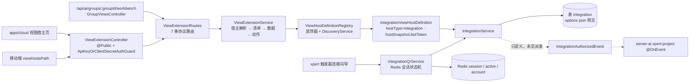

# 集成与扩展点子专家 —— C0 使用总览

> **资产基线**：`2026-10-16 · commit 80f5676fd`（批次 5 第 14 专家 · 子专家①），继承父域 [C0-使用总览.md](file://.module-experts/后端专题/平台底座与集成专家/C0-使用总览.md)。**范围**：`packages/server/src/integration/**`（**24 非 spec / 4 spec / 1 表 `integration`**；`/api/integration` **7 端点** + `/api/integration/qr` **4 端点**，含 `connector-app/**` 子目录）＋ `packages/server/src/view-extension/**`（**14 非 spec / 5 spec / 0 表**；`/api/view-hosts` **7 端点**）。**不含** `data-source`/`xpert-table`（→ [子专家②](file://.module-experts/后端专题/平台底座与集成专家/sub-experts/数据源与表格子专家/C0-使用总览.md)）与字典族 / 客户端壳（→ 子专家③）。未证实处标 `[推测]`。

**本文引用的文件**（相对仓库根，链接均为 `file://`）

- [packages/server/src/integration/integration.controller.ts](file://packages/server/src/integration/integration.controller.ts)
- [packages/server/src/integration/integration.service.ts](file://packages/server/src/integration/integration.service.ts)
- [packages/server/src/integration/integration.entity.ts](file://packages/server/src/integration/integration.entity.ts)
- [packages/server/src/integration/dto/integration-public.dto.ts](file://packages/server/src/integration/dto/integration-public.dto.ts)
- [packages/server/src/integration/commands/handlers/upsert.handler.ts](file://packages/server/src/integration/commands/handlers/upsert.handler.ts)
- [packages/server/src/integration/integration-qr.controller.ts](file://packages/server/src/integration/integration-qr.controller.ts)
- [packages/server/src/integration/integration-qr.service.ts](file://packages/server/src/integration/integration-qr.service.ts)
- [packages/server/src/integration/connector-app/connector-app-integration.service.ts](file://packages/server/src/integration/connector-app/connector-app-integration.service.ts)
- [packages/server/src/integration/events/authorized.event.ts](file://packages/server/src/integration/events/authorized.event.ts)
- [packages/server/src/view-extension/view-extension.controller.ts](file://packages/server/src/view-extension/view-extension.controller.ts)
- [packages/server/src/view-extension/view-extension.service.ts](file://packages/server/src/view-extension/view-extension.service.ts)
- [packages/server/src/view-extension/view-extension.cache.service.ts](file://packages/server/src/view-extension/view-extension.cache.service.ts)
- [packages/server/src/view-extension/view-extension.permission.service.ts](file://packages/server/src/view-extension/view-extension.permission.service.ts)
- [packages/server/src/view-extension/host-definition.registry.ts](file://packages/server/src/view-extension/host-definition.registry.ts)
- [packages/server/src/view-extension/host-definition.interface.ts](file://packages/server/src/view-extension/host-definition.interface.ts)
- [packages/server/src/view-extension/hosts/integration-view-host.definition.ts](file://packages/server/src/view-extension/hosts/integration-view-host.definition.ts)
- [packages/server/src/view-extension/subscribers/integration-view-host-cache.subscriber.ts](file://packages/server/src/view-extension/subscribers/integration-view-host-cache.subscriber.ts)
- [packages/plugin-sdk/src/lib/integration/strategy.interface.ts](file://packages/plugin-sdk/src/lib/integration/strategy.interface.ts)
- [packages/server-ai/src/xpert/trigger-connection.service.ts](file://packages/server-ai/src/xpert/trigger-connection.service.ts)
- [packages/server-ai/src/ai/groups/group-workbench.controller.ts](file://packages/server-ai/src/ai/groups/group-workbench.controller.ts)

## 目录

1. [定位](#定位)
2. [何时找这个子专家](#何时找这个子专家)
3. [能力清单表](#能力清单表)
4. [边界](#边界)
5. [已知问题与常见坑](#已知问题与常见坑)
6. [延伸阅读](#延伸阅读)

## 定位

本子专家负责**平台的两个横切扩展面**：① **集成（`integration`）**——单表承载第三方连接定义（`provider`/`options`/`features`/`slug`），写入统一走 CQRS（`IntegrationUpsertCommand`/`IntegrationDelCommand`），先跑 provider 策略钩子（`validateConfig`/`onUpdate`/`onDelete`）再落库；扫码授权由 `IntegrationQrService` 以**纯 Redis 状态机**完成（会话键 `integration:qr:session:<id>` + 去重键 `active` + 账号锁 `account`）。② **视图扩展点（`view-extension`）**——`@ViewHostDefinition` 声明的宿主经 `DiscoveryService` 聚成进程内注册表，`ViewExtensionService` 完成「宿主解析 → 插件 provider 扇出 → 清单规范化 → 激活判定 → 权限过滤 → 排序」，`ViewExtensionRoutes` 的 7 条协议路由被 `/api/view-hosts`、`/api/ai/groups/:groupId/workbench` 与移动端 `viewHostsPath` 三个入口复用。

**一句话口径**：本子域 = **一张集成表 + 一台 Redis 会话机 + 一张宿主注册表 + 一层进程内缓存**；除 `integration` 行外所有状态都在 Redis 或进程内存里——Redis 清空则未完成授权全部作废，进程重启则注册表与缓存重建。

章节来源：[integration.service.ts](file://packages/server/src/integration/integration.service.ts)（关键符号：getProviders / applyStrategyValidation / runStrategyUpdateHook / ensurePrincipalUser）、[integration-qr.service.ts](file://packages/server/src/integration/integration-qr.service.ts)（关键符号：begin / poll / complete / cancel / sessionSchema）、[view-extension.service.ts](file://packages/server/src/view-extension/view-extension.service.ts)（关键符号：resolveHostContext / listSlotViews / resolveProviderManifest）、[host-definition.registry.ts](file://packages/server/src/view-extension/host-definition.registry.ts)（关键符号：onModuleInit / definitions / get）

## 何时找这个子专家

- 要**改集成定义与写路径语义**：`IntegrationUpsertHandler` 的「先策略校验 → 再生命周期钩子 → 最后落库」次序、`pickValidatedIntegrationPatch` 的六字段白名单（`name/description/slug/provider/options/features`）、provider 变更时改跑 `previous.onDelete`。
- 要**改扫码授权**：`begin/poll/complete/cancel` 四步、会话状态与字段、`expiresAt` 夹在 30..600s、`nextPollAt` 先写后调、`intervalIncrementSeconds` 退避、`getQrAuthorizationIdentity` 归并（`outcome=created|reused`）、三把 Redis 锁与 409 `INTEGRATION_QR_BUSY`。
- 要**排查授权不回 / 令牌失效**：会话不存在、过期、越权**统一 404** `IntegrationQrExpired`；provider 失败为 502 `IntegrationQrUnavailable`（begin）/`IntegrationQrPollFailed`（poll）；`cancel` 只删 Redis 键、不通知 provider 撤销；`complete` 之前令牌明文驻留 Redis。
- 要**注册或改视图宿主**：新增带 `@ViewHostDefinition('<type>')` 的 provider 类并实现 `ViewHostDefinitionContract`（`slots`/`resolve`/`canRead`/可选 `prepareFileAction`）；注册表是启动期扫描产物，**新增宿主需重启**，同 `hostType` 静默覆盖。
- 要**排查视图不显示**：`Unknown view host`（未注册）/`View host '<type>:<id>' was not found`（`resolve` 返回 null）/`No permission to access this view host`（`canRead` 为假）/槽位不存在/manifest 未命中/未激活（Feature 不足）——逐级 404/403。
- 要**改动作与文件上传**：`POST …/actions/:actionKey[/file]` 的 transport 契约（JSON 端点必须 `json`、文件端点必须 `file`）、宿主可选 `prepareFileAction`、`decodeMultipartFileName`、`result.refresh` 触发 `invalidateView`。
- 要**改缓存与失效**：`getOrSetSlotViews`（60s）/`getOrSetViewData`（`min(ttlMs,30s)`）、`invalidateView`/`invalidateHostIdentity`/`clearAll`（`StrategyBus.events$`）三条路径与进程内键台账。
- 要**改 connector 接缝**：`ConnectorAppIntegrationService.list/select/create`（只投影 `{id,name,organizationId}`、`INTEGRATION_EDIT` 校验、slug `connector-{bindingId}-{requestId}` + `orIgnore` + 回查）与 `ResolveConnectorIntegrationHandler`。
- 要**改触发器的集成绑定**：`XpertTriggerConnectionService.begin/poll/cancel/complete` 的 `assertContext(session, xpertId, provider)` 与 `change(...)`（第二入口，`purpose = trigger:<sha256([xpertId,triggerProvider])>`）。

章节来源：[integration.controller.ts](file://packages/server/src/integration/integration.controller.ts)（关键符号：getAll / connect / getSelectOptions / getProviders / create / update / delete）、[integration-qr.controller.ts](file://packages/server/src/integration/integration-qr.controller.ts)（关键符号：begin / poll / complete / cancel / Cache-Control no-store）、[view-extension.permission.service.ts](file://packages/server/src/view-extension/view-extension.permission.service.ts)（关键符号：assertHostReadable / filterVisibleManifests / ensureActionVisible）

## 能力清单表

| 能力 | 入口 | 一句话 |
|---|---|---|
| 集成实例 CRUD | `GET/POST /api/integration`、`PUT/DELETE /:id` | 写走命令（校验 → 钩子 → 落库），列表经 `IntegrationPublicDTO` 剪掉 `options` |
| 试连与 provider 目录 | `POST /test`、`GET /providers`、`GET /select-options` | `test` 直调策略 `validateConfig` 且异常统一 500；`features` 过滤在 JS 侧 `every` |
| 扫码授权会话 | `POST /qr/providers/:provider`、`GET/POST/DELETE /qr/sessions/:id[/complete]` | Redis-only 五态机；session id 预占集成 id；409/404/502 三类失败 |
| 授权第二入口 | `XpertTriggerConnectionService`（server-ai，无 HTTP） | 触发器维度与集成维度两条独立会话链，互不影响 |
| 视图宿主注册 | `@ViewHostDefinition` + `ViewHostDefinitionRegistry`（无 HTTP） | 启动期扫描建 `Map<hostType, contract>`；同键静默覆盖 |
| 槽位视图清单 | `GET /api/view-hosts/:hostType/:hostId/slots/:slot/views` | 解析 → 扇出 → 规范化 → 激活判定 → 权限过滤 → 排序；60s 缓存 |
| 视图数据 / 清单 / 远程组件 | `…/views/:viewKey/{data,manifest,remote-component/entry}` | data TTL `min(ttlMs,30s)`；manifest 再裁 actions；entry 走 `no-store` + 路径穿越校验 |
| 视图参数下拉 | `…/views/:viewKey/parameters/:parameterKey/options` | 读 provider 参数声明；宿主/视图/参数任一未命中即 404 |
| 视图动作（JSON / 文件） | `POST …/actions/:actionKey[/file]` | 先权限与 transport 校验，再调 provider；`result.refresh` 即失效缓存 |
| 宿主缓存失效 | `ViewExtensionCacheService` + `IntegrationViewHostCacheSubscriber` | 视图级 / 宿主身份级 / `StrategyBus` 全清三条路径 |
| connector 受限集成面 | `ConnectorAppIntegrationService.list/select/create`（无 HTTP） | 只回 `{id,name,organizationId}`；`create` 校验 EDIT + slug 去重 |
| 授权事件契约 | `IntegrationAuthorizedEvent` / `EventNameIntegrationAuthorized` | 本子域只有定义，消费方在 server-ai `xpert-project`，本批未见派发点 |

章节来源：[integration.controller.ts](file://packages/server/src/integration/integration.controller.ts)（关键符号：getAll / getSelectOptions / createBuiltinInstance 之外的 7 条）、[view-extension.controller.ts](file://packages/server/src/view-extension/view-extension.controller.ts)（关键符号：ViewExtensionRoutes 的 getSlotViews / getViewData / getViewManifest / getRemoteComponentEntry / getViewParameterOptions / executeAction / executeFileAction）、[connector-app-integration.service.ts](file://packages/server/src/integration/connector-app/connector-app-integration.service.ts)（关键符号：list / select / create / publicOption）

## 边界

**做什么**：集成实例全生命周期与策略钩子封装、扫码授权会话状态机、connector-app 的选型与受控建行接缝、视图宿主注册表与视图协议路由（清单/数据/参数/动作/远程组件）、宿主清单与数据缓存及其失效、扩展点读取侧的三层权限裁决。

**不做什么**

- **不含 `connector` 应用/绑定域本体**（本批次之外）：本子域只提供 `ConnectorAppIntegrationService` 与 `ResolveConnectorIntegrationHandler` 两个入出口，`descriptor`/`bindingId` 由 connector 侧传入。
- **不含 `agent-plugin`**（→ [工具与 MCP 专家](file://.module-experts/后端专题/工具与 MCP 专家/C0-使用总览.md)）：本子域不解析便携包、不加载插件 bundle。
- **不含两个注册表的实现**：`IntegrationStrategyRegistry` 与 `ViewExtensionProviderRegistry` 归插件侧（`plugin-sdk`），本子域只**消费**它们，不读 `LOADED_PLUGINS`。
- **不含 `data-source`/`xpert-table`**（→ [子专家②](file://.module-experts/后端专题/平台底座与集成专家/sub-experts/数据源与表格子专家/C0-使用总览.md)）：视图清单里 `dataSource.mode` 被强制归一为 `'platform'`，真实取数由插件 provider 完成。
- **不含前端**：与 `apps/cloud` 的唯一契约是 REST 路径、运行时 scope 头（`X-Xpert-View-Project-Id`/`X-Xpert-View-Conversation-Id`）与清单字段。

图表来源：[view-extension.service.ts](file://packages/server/src/view-extension/view-extension.service.ts)（关键符号：resolveHostContext / listSlotViews）、[host-definition.registry.ts](file://packages/server/src/view-extension/host-definition.registry.ts)（关键符号：onModuleInit / definitions）、[integration-view-host.definition.ts](file://packages/server/src/view-extension/hosts/integration-view-host.definition.ts)（关键符号：resolve / canRead / hostSnapshot.botToken）、[integration-qr.service.ts](file://packages/server/src/integration/integration-qr.service.ts)（关键符号：begin / poll / complete / read / write / lock）

章节来源：[integration.module.ts](file://packages/server/src/integration/integration.module.ts)（关键符号：RouterModule /integration、exports IntegrationService / IntegrationQrService / ConnectorAppIntegrationService）、[view-extension.module.ts](file://packages/server/src/view-extension/view-extension.module.ts)（关键符号：@Global / RouterModule /view-hosts / VIEW_EXTENSION_CACHE_SERVICE_TOKEN）、[group-workbench.controller.ts](file://packages/server-ai/src/ai/groups/group-workbench.controller.ts)（关键符号：GroupViewsController extends ViewExtensionRoutes）

## 已知问题与常见坑

1. **`integration.options` 是明文 json 且无隐藏/加密（实测）**：实体上仅 `@Column({ type: 'json' })`，`botToken`/`clientSecret` 等键由各 provider 策略自由写入；HTTP 侧唯一收窄是列表端点的 `IntegrationPublicDTO`（`@Exclude() options`），详情、服务层与 `hostSnapshot` 都直读；本目录检索 `encrypt|decrypt|cipher|AES` 0 命中。
   - 契约来源：[integration.entity.ts](file://packages/server/src/integration/integration.entity.ts)（关键符号：options json 列）、[integration-public.dto.ts](file://packages/server/src/integration/dto/integration-public.dto.ts)（关键符号：IntegrationPublicDTO @Exclude options）。
2. **`hostSnapshot` 无条件读 `botToken` 并交给所有插件 provider**：`IntegrationViewHostDefinition.resolve` 每次请求都摘 `options.botToken`；`hostSnapshot.enabled` 恒为 `true`（硬编码），真实「连接状态」只是 `options.status ?? connectionStatus ?? state ?? 'unknown'`——视图侧看到的「已启用」不反映连通性。
   - 契约来源：[integration-view-host.definition.ts](file://packages/server/src/view-extension/hosts/integration-view-host.definition.ts)（关键符号：hostSnapshot.botToken / getIntegrationStatus / enabled）。
3. **扫码授权会话是 Redis-only，且令牌有明文驻留窗口**：状态为 `waiting|authorized|expired|denied|failed`，TTL 恒等于 `expiresAt - now`（夹在 30..600s）；`poll` 拿到 `authorized` 后把 `options` 写回会话，直到 `complete` 成功才清空；会话无审计、无表，`cancel` 不通知 provider 撤销。
   - 契约来源：[integration-qr.service.ts](file://packages/server/src/integration/integration-qr.service.ts)（关键符号：sessionSchema / begin / poll 的 session.options / complete 的清空 / cancel / read 三元校验）。
4. **过期/越权/不存在统一 404，且并发即 409 是正常表现**：`read` 在 TTL≤0 或 `userId/tenantId/organizationId` 任一不符时抛同一个 `IntegrationQrExpired`（防会话枚举）；四个操作都在 `RedisLockService.runWithLock('<key>:lock', 60000, op)` 内串行，抢锁失败抛 409 `INTEGRATION_QR_BUSY`——轮询高峰期偶发 409 需按重试处理，不要当故障。
   - 契约来源：[integration-qr.service.ts](file://packages/server/src/integration/integration-qr.service.ts)（关键符号：read / write / lock / invalid / INTEGRATION_QR_BUSY）。
5. **`authorized.event` 在本子域只有定义、没有派发点**：`IntegrationAuthorizedEvent` 与 `EventNameIntegrationAuthorized` 定义在 `events/authorized.event.ts` 与 `types.ts`，全仓 grep 只命中 server-ai `xpert-project` 的 `@OnEvent` 消费者；`IntegrationQrService.complete` 与 `IntegrationUpsertHandler` 均未发射 ⇒ 授权成功不会自动触发下游（`[推测]`：派发在批次 5 之外或尚未接线）。
   - 契约来源：[authorized.event.ts](file://packages/server/src/integration/events/authorized.event.ts)（关键符号：IntegrationAuthorizedEvent.payload）、[integration-qr.service.ts](file://packages/server/src/integration/integration-qr.service.ts)（关键符号：complete 无 emit）、[types.ts](file://packages/server/src/integration/types.ts)（关键符号：EventNameIntegrationAuthorized）。
6. **宿主注册表是进程内 `Map` 且注册零校验**：`onModuleInit` 用 `DiscoveryService.getProviders()` + `Reflector` 建表，同 `hostType` 重复注册为**静默覆盖**（`Map.set`，无冲突检测、无卸载钩子），插件升级/热更新后需重启宿主进程；注册侧没有白名单或签名——**进程内代码即权限边界**。
   - 契约来源：[host-definition.registry.ts](file://packages/server/src/view-extension/host-definition.registry.ts)（关键符号：definitions / onModuleInit / get）、[host-definition.interface.ts](file://packages/server/src/view-extension/host-definition.interface.ts)（关键符号：ViewHostDefinitionContract）。
7. **缓存失效只作用于本实例，且键不含插件版本**：`trackedKeys/hostKeys/hostIdentityKeys/viewKeys/viewIdentityKeys` 全是进程内 `Map/Set`，`invalidateView`/`invalidateHostIdentity` 只删本实例登记过的键；`StrategyBus.events$` 的 `clearAll()` 也是逐实例执行 ⇒ 多副本下靠 TTL（60s / ≤30s）收敛（`[推测]`：仓库内未见跨实例失效广播或键版本号）。
   - 契约来源：[view-extension.cache.service.ts](file://packages/server/src/view-extension/view-extension.cache.service.ts)（关键符号：trackedKeys / invalidateView / invalidateHostIdentity / clearAll / getOrSetSlotViews）、[integration-view-host-cache.subscriber.ts](file://packages/server/src/view-extension/subscribers/integration-view-host-cache.subscriber.ts)（关键符号：afterInsert / afterUpdate / afterRemove）。
8. **扩展点读取侧的权限敏感面**：控制器类级 `@Public()`，鉴权= `ApiKeyOrClientSecretAuthGuard`（API Key 或 `cs-x-` client secret）+ `@AllowClientSecretBindings(ENTERPRISE_XPERT)`；`ENTERPRISE_XPERT` 主体额外强制 `hostType === 'agent'` 且 `resourceScope.xpertId === hostId`，否则 403；随后三层过滤（宿主 `canRead`、manifest `permissions`、action `permissions` + `requiredHostAccess`）。
   - 契约来源：[view-extension.controller.ts](file://packages/server/src/view-extension/view-extension.controller.ts)（关键符号：@Public / @AllowClientSecretBindings / @UseGuards）、[view-extension.permission.service.ts](file://packages/server/src/view-extension/view-extension.permission.service.ts)（关键符号：ensureManifestVisible / ensureActionVisible / hasRequiredHostAccess）、[view-extension.service.ts](file://packages/server/src/view-extension/view-extension.service.ts)（关键符号：assertEnterpriseXpertViewHost）。
9. **动作为空或宿主未注册时的表现各不相同，且 provider 异常不包装**：未注册 `hostType` → 404 `Unknown view host`；`resolve` 返回 null → 404 `View host … was not found`；槽位不存在/manifest 未命中/未激活 → 404；动作未声明 → 404；transport 不符 → 400；provider 未实现方法 → 404；**provider 内部异常原样冒泡**（与 `integration` 侧「钩子异常统一降级 400」是两套风格）；另外 `resolve` 忽略 `options.isDraft`，`?isDraft` 能力对 integration 宿主实际无效。
   - 契约来源：[view-extension.service.ts](file://packages/server/src/view-extension/view-extension.service.ts)（关键符号：executeAction / executeFileAction / getRemoteComponentEntry / resolveHostContext）、[integration-view-host.definition.ts](file://packages/server/src/view-extension/hosts/integration-view-host.definition.ts)（关键符号：resolve 忽略 isDraft）。
10. **两条写入路径语义分叉，且 `/api/integration` 权限面比 QR 更松**：`/api/integration` 7 端点只靠全局 `AuthGuard`（类级仅 `TransformInterceptor`），而同域 QR 4 端点要求 `INTEGRATION_EDIT`——「读写含凭据的集成定义」门槛低于「发起扫码授权」；`POST /test` 把策略校验失败统一包成 500；`ConnectorAppIntegrationService.create` 绕过命令总线（不跑 `validateConfig` 与任何钩子），靠 `slug = connector-{bindingId}-{requestId}` + `orIgnore()` + 回查做并发幂等，并用 `createdOption` 逐字段比对防篡改（不符即 400）。
    - 契约来源：[integration.controller.ts](file://packages/server/src/integration/integration.controller.ts)（关键符号：connect 的 500 包装 / 类级装饰器缺失）、[connector-app-integration.service.ts](file://packages/server/src/integration/connector-app/connector-app-integration.service.ts)（关键符号：create / orIgnore / createdOption / publicOption）。

章节来源：[integration-qr.service.ts](file://packages/server/src/integration/integration-qr.service.ts)（关键符号：begin / poll / complete / lock）、[view-extension.cache.service.ts](file://packages/server/src/view-extension/view-extension.cache.service.ts)（关键符号：clearAll / normalizeActivationState）、[host-definition.registry.ts](file://packages/server/src/view-extension/host-definition.registry.ts)（关键符号：onModuleInit）、[strategy.interface.ts](file://packages/plugin-sdk/src/lib/integration/strategy.interface.ts)（关键符号：beginQrAuthorization / pollQrAuthorization / getQrAuthorizationIdentity / validateConfig / onUpdate / onDelete）

## 延伸阅读

- 扫码授权与视图宿主两条链路的端到端走查：[03-数据流转.md](file://.module-experts/后端专题/平台底座与集成专家/sub-experts/集成与扩展点子专家/implementation/03-数据流转.md)（链路二 / 链路四 / 链路五 / 链路六）
- 逐条实现与错误语义全集：[02-实现.md](file://.module-experts/后端专题/平台底座与集成专家/sub-experts/集成与扩展点子专家/implementation/02-实现.md)（§1 集成 CRUD / §2 扫码授权 / §4 宿主注册与解析 / §6 动作语义）
- 职责与依赖方向（含 `view-extension → integration` 单向强耦合）：[01-架构.md](file://.module-experts/后端专题/平台底座与集成专家/sub-experts/集成与扩展点子专家/implementation/01-架构.md)（§3 依赖关系 / §4 关键不变量）
- 测试分布与缺口（integration 4 spec + view-extension 5 spec，本次未复跑）：[06-测试.md](file://.module-experts/后端专题/平台底座与集成专家/sub-experts/集成与扩展点子专家/implementation/06-测试.md)
- 父域 Recipe（集成扫码授权全流程 / 视图扩展注册与消费 / 排障入口合集）：[C2-使用流程.md](file://.module-experts/后端专题/平台底座与集成专家/C2-使用流程.md) Recipe 6 / 7 / 12
- 表与消费方（`integration` 1 张表）：[C4-数据流向与消费.md](file://.module-experts/后端专题/平台底座与集成专家/C4-数据流向与消费.md) 子域①；决策取舍（明文落库 + 出口收窄 / Redis 会话状态机 / 宿主注册表 + 缓存）：[C5-关键决策.md](file://.module-experts/后端专题/平台底座与集成专家/C5-关键决策.md) D2 / D4 / D5

章节来源：[03-数据流转.md](file://.module-experts/后端专题/平台底座与集成专家/sub-experts/集成与扩展点子专家/implementation/03-数据流转.md)（关键符号：状态机 / 已知风险：令牌与凭据暴露面）、[06-测试.md](file://.module-experts/后端专题/平台底座与集成专家/sub-experts/集成与扩展点子专家/implementation/06-测试.md)（关键符号：spec 清单与运行命令）
