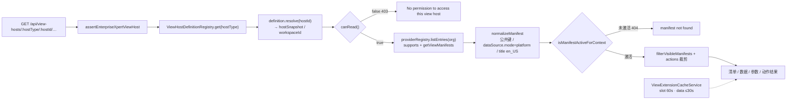

# 集成与扩展点子专家 —— C1 能力契约

> 契约层 CR2 / CR5 / CR7。只写「对外可依赖的语义」：入口、参数行为、返回、异常与约束；路径均为仓库根相对 `file://` 引用。**资产基线**：`2026-10-16 · commit 80f5676fd`（批次 5 第 14 专家 · 子专家①），继承父域 [C1-能力契约.md](file://.module-experts/后端专题/平台底座与集成专家/C1-能力契约.md)。**逐端点明细**（完整字段、错误码全集）见父域 [implementation/05-接口.md](file://.module-experts/后端专题/平台底座与集成专家/implementation/05-接口.md)，本文不复制。

**本文引用的文件**（相对仓库根，链接均为 `file://`）

- [packages/server/src/integration/integration.controller.ts](file://packages/server/src/integration/integration.controller.ts)
- [packages/server/src/integration/integration-qr.controller.ts](file://packages/server/src/integration/integration-qr.controller.ts)
- [packages/server/src/integration/integration-qr.service.ts](file://packages/server/src/integration/integration-qr.service.ts)
- [packages/server/src/integration/integration.service.ts](file://packages/server/src/integration/integration.service.ts)
- [packages/server/src/integration/commands/handlers/upsert.handler.ts](file://packages/server/src/integration/commands/handlers/upsert.handler.ts)
- [packages/server/src/integration/commands/handlers/delete.handler.ts](file://packages/server/src/integration/commands/handlers/delete.handler.ts)
- [packages/server/src/integration/connector-app/connector-app-integration.service.ts](file://packages/server/src/integration/connector-app/connector-app-integration.service.ts)
- [packages/server/src/view-extension/view-extension.controller.ts](file://packages/server/src/view-extension/view-extension.controller.ts)
- [packages/server/src/view-extension/view-extension.service.ts](file://packages/server/src/view-extension/view-extension.service.ts)
- [packages/server/src/view-extension/view-extension.cache.service.ts](file://packages/server/src/view-extension/view-extension.cache.service.ts)
- [packages/server/src/view-extension/view-extension.permission.service.ts](file://packages/server/src/view-extension/view-extension.permission.service.ts)
- [packages/server/src/view-extension/view-extension.utils.ts](file://packages/server/src/view-extension/view-extension.utils.ts)
- [packages/server/src/view-extension/host-definition.registry.ts](file://packages/server/src/view-extension/host-definition.registry.ts)
- [packages/server/src/view-extension/host-definition.interface.ts](file://packages/server/src/view-extension/host-definition.interface.ts)
- [packages/server/src/view-extension/hosts/integration-view-host.definition.ts](file://packages/server/src/view-extension/hosts/integration-view-host.definition.ts)
- [packages/plugin-sdk/src/lib/integration/strategy.interface.ts](file://packages/plugin-sdk/src/lib/integration/strategy.interface.ts)

## 目录

1. [§1 HTTP 入口索引](#§1-http-入口索引)
2. [§2 服务契约](#§2-服务契约)
3. [§3 授权与扩展点契约](#§3-授权与扩展点契约)
4. [§4 示例](#§4-示例)
5. [§5 契约来源](#§5-契约来源)

## §1 HTTP 入口索引

全局前缀 `api`；`IntegrationController` 与 `ViewExtensionController` 均为 `@Controller()` 空前缀，路径段由 `RouterModule.register`（`/integration`、`/view-hosts`）或 `@Controller('qr')` 给出。

| # | 方法 / 路径 | 鉴权 | 用途与关键行为 |
|---|---|---|---|
| 1 | GET `/api/integration` | 登录态（类级仅 `TransformInterceptor`，靠全局 `AuthGuard`） | 分页列表，`items` 逐个包 `IntegrationPublicDTO`（`options` 被 `@Exclude`） |
| 2 | POST `/api/integration/test` | 登录态 | 直调 `service.test`（当前组织策略 `validateConfig`）；异常统一包成 **500** |
| 3 | GET `/api/integration/select-options` | 登录态 | `provider` 过滤 + `features` 逗号分隔；**features 的 DB 过滤被注释**，改 JS 侧 `every`；icon/avatar 来自 `getProviders()` |
| 4 | GET `/api/integration/providers` | 登录态 | `INTEGRATION_PROVIDERS` 常量全集 + 当前组织已注册策略的 `meta` |
| 5 | POST `/api/integration` | 登录态 | **201**；派 `IntegrationUpsertCommand(entity)`（无 `id` 分支 → `create`） |
| 6 | PUT `/api/integration/:id` | 登录态 + `UUIDValidationPipe` | **202**；`normalizeIntegrationUpdatePayload` 仅做对象性检查后派 `IntegrationUpsertCommand({...patch,id})` |
| 7 | DELETE `/api/integration/:id` | 登录态 + `UUIDValidationPipe` | **202**；`IntegrationDelCommand(id)`，先 `runStrategyDeleteHook` 再删行 |
| 8 | POST `/api/integration/qr/providers/:provider` | 类级 `PermissionGuard` + `INTEGRATION_EDIT`；`Cache-Control: no-store` | `begin`；返回 `{id, authorizationUrl, expiresAt, intervalSeconds}` |
| 9 | GET `/api/integration/qr/sessions/:id` | 同上（含 `no-store`） | `poll`；**只回 `{status}`**，绝不含 `deviceCode`/`options` |
| 10 | POST `/api/integration/qr/sessions/:id/complete` | 同上 | `complete`；要求 `status === 'authorized'`，返回 `{id,name,slug,provider,outcome}` |
| 11 | DELETE `/api/integration/qr/sessions/:id` | 同上 | `cancel`；`read(id,true)`（允许缺失）后 `redis.del`，幂等 |
| 12 | GET `/api/view-hosts/:hostType/:hostId/slots/:slot/views` | 类级 `@Public()` + `ApiKeyOrClientSecretAuthGuard` + `@AllowClientSecretBindings(ENTERPRISE_XPERT)` | 槽位清单；`?isDraft`；60s 缓存 |
| 13 | GET `…/:hostType/:hostId/views/:viewKey/data` | 同上 | 视图数据；TTL `min(manifest.dataSource.cache.ttlMs, 30s)`；`cache.enabled=false` 时穿透 |
| 14 | GET `…/:hostType/:hostId/views/:viewKey/manifest` | 同上 | 单视图清单（actions 再按权限裁剪） |
| 15 | GET `…/:hostType/:hostId/views/:viewKey/remote-component/entry` | 同上 | HTML 直出，`Content-Type` 取自 entry，`Cache-Control: no-store`；入口 key 做路径穿越校验 |
| 16 | GET `…/views/:viewKey/parameters/:parameterKey/options` | 同上 | 参数下拉；走 provider 参数声明 |
| 17 | POST `…/views/:viewKey/actions/:actionKey` | 同上 + `@UseValidationPipe({whitelist,transform})` | JSON 动作；body 仅 `targetId?/input?/parameters?`；transport 必须 `json` |
| 18 | POST `…/views/:viewKey/actions/:actionKey/file` | 同上 + `FileInterceptor('file')` | 文件动作；缺文件 400 `file is required`；transport 必须 `file` |

`ViewExtensionRoutes` 是**无装饰器的共享路由类**，鉴权由各入口自带（另两个入口：`/api/ai/groups/:groupId/workbench` 与移动端 `deployment.viewHostsPath`）。**逐端点明细见父域 [implementation/05-接口.md](file://.module-experts/后端专题/平台底座与集成专家/implementation/05-接口.md)**。

章节来源：[integration.controller.ts](file://packages/server/src/integration/integration.controller.ts)（关键符号：getAll / connect / getSelectOptions / getProviders / create / update / delete）、[integration-qr.controller.ts](file://packages/server/src/integration/integration-qr.controller.ts)（关键符号：begin / poll / complete / cancel）、[view-extension.controller.ts](file://packages/server/src/view-extension/view-extension.controller.ts)（关键符号：ViewExtensionRoutes 七条 / ViewExtensionController 类级装饰器）

## §2 服务契约

| `类.方法(签名)` | 用途 | 参数行为语义 · 约束 |
|---|---|---|
| `IntegrationService.getProviders()` / `getIntegrationStrategy(type, organizationId?)` / `test(integration)` | provider 门面与试连 | `getProviders` 合并静态 `INTEGRATION_PROVIDERS` 与策略注册表 `meta`；`test` 即当前组织策略的 `validateConfig`（HTTP 层再包 500） |
| `IntegrationService.applyStrategyValidation(input)` / `runStrategyUpdateHook(previous, current)` / `runStrategyDeleteHook(integration)` / `pickValidatedIntegrationPatch(result)` | 策略钩子统一封装（CQRS 写路径） | 校验结果**只回填 `name/description/slug/provider/options/features` 六字段**；钩子先于落库，异常统一降级 `BadRequestException`；provider 变化时改跑 `previous.onDelete` 并直接返回 |
| `IntegrationService.findOneByIdWithinTenant(id, tenantId)` / `readOneById(id)` / `ensurePrincipalUser(integrationOrId)` | 读口径与技术主体 | 宿主 `resolve` 用前者做租户内强校验；`ensurePrincipalUser` 补 `thirdPartyId='integration:<id>'` 的技术主体供 API Key 绑定，并回写 `userId` |
| `IntegrationQrService.begin(provider, input)` / `poll(id)` / `complete(id)` / `cancel(id)` | 扫码授权 Redis 状态机 | `begin` 以 `beginSchema` 校验 `name/description/avatar`，按 `tenant:org:user:provider:purpose` 串行（同键旧会话先 cancel）；`poll` 尊重 `nextPollAt` 与退避；`complete` 仅 `authorized` 可落库，`id = session.integrationId ?? 会话 id`；`read` 三元归属校验，失败统一 404 |
| `ConnectorAppIntegrationService.list(scope, descriptor)` / `select(scope, descriptor, id)` / `create(scope, descriptor, bindingId, input)` | connector 受限集成面 | `list/select` 逐行 `configured()` 校验 `descriptor.fields` 后只回 `publicOption`（`{id,name,organizationId}`）；`create` 先 `CheckRolePermissionCommand(INTEGRATION_EDIT)`，slug `connector-{bindingId}-{requestId}` + `orIgnore()` + 回查幂等，`createdOption` 逐字段比对防篡改 |
| `ViewExtensionService.resolveHostContext(hostType, hostId, options?)` / `listSlotViews(...)` / `getViewData(...)` / `getViewManifest(...)` / `getRemoteComponentEntry(...)` / `getViewParameterOptions(...)` | 扩展点全部编排入口 | 统一链：`assertEnterpriseXpertViewHost` → `registry.get(hostType)` → `buildBaseViewHostContext` → `definition.resolve` → `assertHostReadable`；清单再经 `resolveProviderManifest` + `normalizeManifest` + `isManifestActiveForContext` + `filterVisibleManifests` + `order` 排序 |
| `ViewExtensionService.executeAction(..., actionKey, request)` / `executeFileAction(..., actionKey, request, file)` | 动作执行 | 次序：宿主解析 → manifest → `ensureManifestVisible` → 动作存在性(404) → `ensureActionVisible`(403) → `identifyViewRequest` → transport 校验(400) → provider 方法存在性(404) → provider；文件动作在 provider 前插宿主 `prepareFileAction`；`result.refresh` 触发 `invalidateView` |
| `ViewHostDefinitionRegistry.onModuleInit()` / `get(hostType)` | 宿主注册表 | `DiscoveryService.getProviders()` + `Reflector.get(VIEW_HOST_DEFINITION, ...)` 建 `Map<hostType, contract>`；同键**静默覆盖**，无冲突检测/卸载钩子；`get` 未命中由调用方转 404 |
| `ViewExtensionCacheService.getOrSetSlotViews(ctx, slot, 60000, loader)` / `getOrSetViewData(ctx, viewKey, query, min(ttlMs,30s), loader)` / `invalidateView(...)` / `invalidateHostIdentity(identity)` / `clearAll()` | 清单与数据的 cache-aside | 键含 `tenant/org/userId` 与「激活态摘要」`sha1(features + hostState)`；数据键只取白名单查询字段；台账为进程内 `Map/Set`，失效只对本实例登记的键生效 |
| `ViewExtensionPermissionService.assertHostReadable(...)` / `ensureManifestVisible(...)` / `ensureActionVisible(...)` / `hasRequiredHostAccess(...)` / `filterVisibleManifests(...)` | 读取侧三层裁决 | 宿主 → manifest → action 依次裁决；Project 角色不符时文案为 `The current Project role does not allow this extension action` |
| `IntegrationViewHostDefinition.resolve(hostId, options?)` / `canRead(...)` | 唯一在用宿主（`hostType='integration'`） | `slots=[{key:'detail.main_tabs',mode:'tabs',order:0}]`；`resolve` 用 `findOneByIdWithinTenant`，找不到即 404；`hostSnapshot` 摘 `options.botToken/teamName/botUserName/users/status/lastSyncAt`，`enabled` 恒 `true`；`canRead` 要求 `INTEGRATION_VIEW|INTEGRATION_EDIT` |
| `IntegrationUpsertHandler.execute(cmd)` / `IntegrationDelHandler.execute(cmd)` | 写路径固定次序 | `有 id`：`findOne` 取 previous → 合并 patch → 校验 → `runStrategyUpdateHook` → `update` → 回读；`无 id`：校验后 `create`；删除：先 `onDelete` 后 `delete`（钩子失败则行保留） |
| `normalizeManifest(...)` / `splitPublicViewKey(...)` / `isManifestActiveForContext(...)`（`view-extension.utils.ts`） | 清单规范化契约 | 公共键 `providerKey__manifestKey`；`dataSource.mode` 强制 `'platform'`；`view.type ∈ stats|table|list|detail|raw_json|remote_component`；`title` 必须有非空 `en_US`；`runtime.featureProviders` 由宿主重算（忽略 provider 自报） |

章节来源：[integration.service.ts](file://packages/server/src/integration/integration.service.ts)（关键符号：getProviders / applyStrategyValidation / pickValidatedIntegrationPatch / ensurePrincipalUser）、[integration-qr.service.ts](file://packages/server/src/integration/integration-qr.service.ts)（关键符号：begin / poll / complete / cancel / read / lock）、[view-extension.service.ts](file://packages/server/src/view-extension/view-extension.service.ts)（关键符号：resolveHostContext / listSlotViews / executeAction / assertEnterpriseXpertViewHost）、[view-extension.utils.ts](file://packages/server/src/view-extension/view-extension.utils.ts)（关键符号：normalizeManifest / isManifestActiveForContext）

## §3 授权与扩展点契约

**（1）扫码授权会话：字段与状态**

| 项 | 契约（源码可查事实） |
|---|---|
| 键 | `integration:qr:session:<uuid>`（整份会话，zod `sessionSchema` 校验）；`integration:qr:active:<tenant>:<org>:<user>:<provider>:<purpose>`（当前活动会话 id）；`integration:qr:account:<tenant>:<org>:<provider>:<sha256(identity)>`（账号级锁名） |
| 会话字段 | `id`、`provider`、`purpose`（`trigger:<sha256([xpertId,triggerProvider])>` 或字面量 `'integration'`）、`name/description/avatar`、`status`、`deviceCode`、`authorizationUrl`、`expiresAt`、`intervalSeconds`、`nextPollAt`、`integrationId?`、`options?`；归属三元 `userId/tenantId/organizationId` |
| 状态 | `waiting → authorized \| expired \| denied \| failed`；`authorized` 后 `complete` 写回 `integrationId` 并清空 `deviceCode/options`（终态不可逆） |
| 过期 | `expiresAt = now + clamp(30..600)s`，Redis `PX = 剩余 TTL`；`TTL <= 0` 或 `expiresAt <= now` 或归属三元不符 ⇒ **统一 404**（防会话枚举） |
| 节流 | `intervalSeconds = max(2, provider)`；未到 `nextPollAt` 直接回状态，否则**先写回 `nextPollAt` 再调 provider**；接受 `intervalIncrementSeconds` 累加，上限 600s |
| 幂等与归并 | `complete` 用 `session.integrationId ?? id`（会话 id）作集成 id；策略提供 `getQrAuthorizationIdentity(options)` 时先按 `(provider, tenant, organization)` 比对 identity：命中则只合并 `options`（**浅合并**）并跑 `onUpdate`，`outcome='reused'`；未命中则以会话 id 建行，`outcome='created'` |
| 错误码 | 400（未声明 QR 能力 / 入参非法）；404 `Error.IntegrationQrExpired`；409 `{code:'INTEGRATION_QR_BUSY'}`（`runWithLock('<key>:lock', 60000, op)` 未拿到）；502 `Error.IntegrationQrUnavailable`（begin）/`Error.IntegrationQrPollFailed`（poll） |

**（2）宿主注册 → 清单 → 消费**

| 阶段 | 契约（源码可查事实） |
|---|---|
| 注册 | `@ViewHostDefinition(hostType)` 仅 `SetMetadata(VIEW_HOST_DEFINITION, hostType)`；`onModuleInit` 扫描全部 provider 并 `definitions.set(hostType, instance)`——无排序、无冲突报错、无卸载钩子；注册侧**无白名单/签名校验** |
| 宿主契约 | `hostType` + `slots: XpertViewSlot[]` + `resolve(hostId, options?) → {workspaceId?, hostSnapshot?, context?} | null` + `canRead(context, resolution, options?) → boolean` + 可选 `prepareFileAction(context, request, file) → request` |
| 解析与准入 | 每请求：`assertEnterpriseXpertViewHost`（`ENTERPRISE_XPERT` 主体强制 `hostType='agent'` 且 `resourceScope.xpertId === hostId`，否则 403）→ 注册表命中（否则 404 `Unknown view host '<type>'`）→ `buildBaseViewHostContext`（缺 tenant/user 401）→ 读头 `x-xpert-view-project-id`/`x-xpert-view-conversation-id` 组 `runtimeScope` → `resolve`（null ⇒ 404）→ `canRead`（false ⇒ 403） |
| 清单扇出 | `providerRegistry.listEntries(organizationId)` 逐 provider：`supports(context)`（false ⇒ 404）+ `getViewManifests`（单 provider 抛错只 `logger.warn` 续跑）；`normalizeManifest` 拼公共键并做形状校验 |
| 激活与过滤 | `isManifestActiveForContext`（`activation.requiredFeatures` 与槽位 `manifestPolicy.requireFeatureActivation` 不满足 ⇒ 404）→ `filterVisibleManifests`（`visible !== false` + `permissions` + actions 裁剪）→ 按 `order` 升序返回 |


图表来源：[view-extension.service.ts](file://packages/server/src/view-extension/view-extension.service.ts)（关键符号：resolveHostContext / listSlotViews / resolveProviderManifest）、[view-extension.permission.service.ts](file://packages/server/src/view-extension/view-extension.permission.service.ts)（关键符号：assertHostReadable / filterVisibleManifests）、[host-definition.registry.ts](file://packages/server/src/view-extension/host-definition.registry.ts)（关键符号：definitions / get）

章节来源：[integration-qr.service.ts](file://packages/server/src/integration/integration-qr.service.ts)（关键符号：sessionSchema / begin / poll / complete / read / write / lock）、[strategy.interface.ts](file://packages/plugin-sdk/src/lib/integration/strategy.interface.ts)（关键符号：IntegrationStrategy / beginQrAuthorization / pollQrAuthorization / getQrAuthorizationIdentity）、[host-definition.interface.ts](file://packages/server/src/view-extension/host-definition.interface.ts)（关键符号：ViewHostDefinitionContract / ViewHostResolution）、[view-extension.cache.service.ts](file://packages/server/src/view-extension/view-extension.cache.service.ts)（关键符号：getOrSetSlotViews / getOrSetViewData / invalidateView）

## §4 示例

### ① 定义集成（写路径由命令收口）

```ts
// 真实调用方：packages/server/src/integration/integration.controller.ts
@Post()
@HttpCode(HttpStatus.CREATED)
async create(@Body() entity: Partial<Integration>) {
    return this.commandBus.execute(new IntegrationUpsertCommand(entity))
}

@Put(':id')
@HttpCode(HttpStatus.ACCEPTED)
async update(@Param('id', UUIDValidationPipe) id: string, @Body() entity: QueryDeepPartialEntity<Integration>) {
    const patch = normalizeIntegrationUpdatePayload(entity)   // 仅做对象性检查
    return this.commandBus.execute(new IntegrationUpsertCommand({ ...patch, id }))
}
```

要点：落库前次序固定为「策略 `validateConfig`（只放行六字段）→ 生命周期钩子（provider 变化先 `previous.onDelete`）→ 写库」；钩子抛错即整体不落库并降级 400，`POST /test` 则是 500。凭据只放 `options`，且**只有列表端点**经 `IntegrationPublicDTO` 剪掉它。

### ② 扫码授权（begin → poll → complete → cancel）

```ts
// 真实调用方：packages/server/src/integration/integration-qr.controller.ts
@Controller('qr')
@UseGuards(PermissionGuard)
@Permissions(PermissionsEnum.INTEGRATION_EDIT)
export class IntegrationQrController {
    @Post('providers/:provider')
    @Header('Cache-Control', 'no-store')
    begin(@Param('provider') provider: string, @Body() input: unknown) { return this.qr.begin(provider, input) }

    @Get('sessions/:id')
    @Header('Cache-Control', 'no-store')
    poll(@Param('id') id: string) { return this.qr.poll(id) }

    @Post('sessions/:id/complete')
    complete(@Param('id') id: string) { return this.qr.complete(id) }

    @Delete('sessions/:id')
    cancel(@Param('id') id: string) { return this.qr.cancel(id) }
}
```

要点：`begin` 回 `{id, authorizationUrl, expiresAt, intervalSeconds}`；`poll` 只回 `{status}`（`deviceCode`/`options` 永不出网）；`complete` 只有 `authorized` 才落库，用会话 id 作集成 id 换取崩溃重试幂等（`created|reused`）；轮询期间令牌明文驻留 Redis，直到 `complete` 清空。

### ③ 注册并读取视图宿主

```ts
// 真实调用方：packages/server/src/view-extension/hosts/integration-view-host.definition.ts
@Injectable()
@ViewHostDefinition('integration')
export class IntegrationViewHostDefinition implements ViewHostDefinitionContract {
    readonly hostType = 'integration'
    readonly slots: XpertViewSlot[] = [{ key: 'detail.main_tabs', mode: 'tabs', order: 0 }]

    async resolve(hostId: string) {
        const integration = await this.integrationService.findOneByIdWithinTenant(hostId, RequestContext.currentTenantId())
        return { hostSnapshot: { id: integration.id, name: integration.name, provider: integration.provider,
            type: integration.provider, enabled: true,
            botToken: getStringProperty(integration.options, 'botToken'),
            status: getIntegrationStatus(integration.options) } }
    }

    canRead() {
        return RequestContext.hasAnyPermission([PermissionsEnum.INTEGRATION_VIEW, PermissionsEnum.INTEGRATION_EDIT], false)
    }
}
```

要点：新增宿主 = 新增一个带装饰器的 provider 类（启动期扫描登记，**改完需重启**）；消费是 `GET /api/view-hosts/integration/:integrationId/slots/detail.main_tabs/views`，入口鉴权为 `@Public()` + `ApiKeyOrClientSecretAuthGuard` + `@AllowClientSecretBindings(ENTERPRISE_XPERT)`；`hostSnapshot.botToken` 只进插件 `context`，不出现在 7 个端点响应体里。

章节来源：[integration.controller.ts](file://packages/server/src/integration/integration.controller.ts)（关键符号：create / update / normalizeIntegrationUpdatePayload）、[upsert.handler.ts](file://packages/server/src/integration/commands/handlers/upsert.handler.ts)（关键符号：applyStrategyValidation / runStrategyUpdateHook）、[integration-qr.controller.ts](file://packages/server/src/integration/integration-qr.controller.ts)（关键符号：begin / poll / complete / cancel）、[integration-view-host.definition.ts](file://packages/server/src/view-extension/hosts/integration-view-host.definition.ts)（关键符号：slots / resolve / canRead）

## §5 契约来源

| 契约条目 | 来源 |
|---|---|
| 集成 7 端点、`/test` 的 500 包装、`select-options` 的 JS 侧过滤 | `packages/server/src/integration/integration.controller.ts` |
| 写路径次序（校验 → 钩子 → 落库）与六字段白名单、删除钩子先于删行 | `packages/server/src/integration/commands/handlers/{upsert,delete}.handler.ts`、`integration.service.ts` |
| QR 四端点的类级 `INTEGRATION_EDIT` 与 `no-store`、`begin/poll/complete/cancel` 语义 | `packages/server/src/integration/{integration-qr.controller.ts,integration-qr.service.ts}` |
| 策略契约（`validateConfig`/`onUpdate`/`onDelete`/`beginQrAuthorization`/`pollQrAuthorization`/`getQrAuthorizationIdentity`） | `packages/plugin-sdk/src/lib/integration/strategy.interface.ts` |
| connector 受限投影、EDIT 校验与 slug 幂等 | `packages/server/src/integration/connector-app/connector-app-integration.service.ts` |
| 视图 7 条协议路由与类级鉴权（`@Public` + client secret 绑定） | `packages/server/src/view-extension/view-extension.controller.ts` |
| 宿主解析链、清单规范化、动作执行次序与错误语义 | `packages/server/src/view-extension/{view-extension.service.ts,view-extension.utils.ts,view-extension.permission.service.ts}` |
| 宿主注册表（装饰器 + 发现）与宿主契约 | `packages/server/src/view-extension/{host-definition.registry.ts,host-definition.interface.ts,host-definition.decorator.ts}` |
| 缓存 TTL、键构成与三条失效路径 | `packages/server/src/view-extension/view-extension.cache.service.ts`、`subscribers/integration-view-host-cache.subscriber.ts` |
| 唯一在用宿主与 `hostSnapshot` 字段（含 `botToken`） | `packages/server/src/view-extension/hosts/integration-view-host.definition.ts` |
| 逐端点明细与错误语义全集 | 父域 [implementation/05-接口.md](file://.module-experts/后端专题/平台底座与集成专家/implementation/05-接口.md)（本文不复制） |

章节来源：[view-extension.controller.ts](file://packages/server/src/view-extension/view-extension.controller.ts)（关键符号：ViewExtensionRoutes / ViewExtensionController）、[host-definition.registry.ts](file://packages/server/src/view-extension/host-definition.registry.ts)（关键符号：ViewHostDefinitionRegistry）、[integration-qr.service.ts](file://packages/server/src/integration/integration-qr.service.ts)（关键符号：IntegrationQrService）
