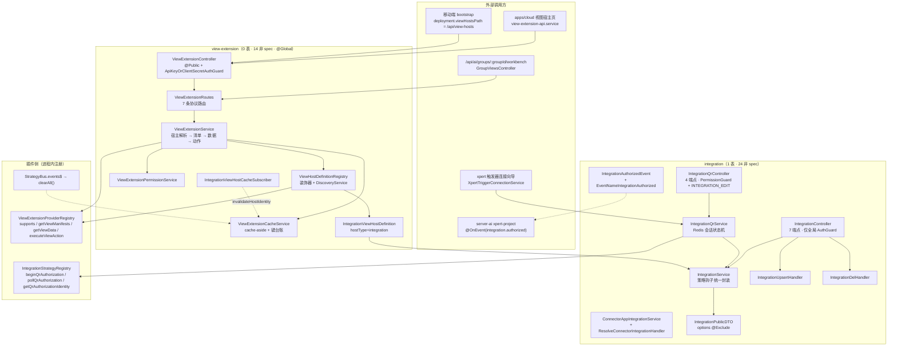

# 集成与扩展点子专家 · 架构

> 只读梳理（未落盘）。本子域覆盖 `packages/server/src/integration/**`（**24 非 spec / 4 spec / 1 张表 `integration`**；前缀 `/api/integration` 7 端点 + `/api/integration/qr` 4 端点）与 `packages/server/src/view-extension/**`（**14 非 spec / 5 spec / 0 表**；前缀 `/api/view-hosts` 7 端点）。**不含** `data-source` / `xpert-table`（→ ② 子专家）与字典族 / 客户端壳（→ ③ 子专家）。引用为仓库根相对路径并以 `file://` 包裹；未能证实处标 `[推测]`。

**本文引用的文件**

- [packages/server/src/integration/integration.module.ts](file://packages/server/src/integration/integration.module.ts)
- [packages/server/src/integration/integration.controller.ts](file://packages/server/src/integration/integration.controller.ts)
- [packages/server/src/integration/integration-qr.controller.ts](file://packages/server/src/integration/integration-qr.controller.ts)
- [packages/server/src/integration/integration-qr.service.ts](file://packages/server/src/integration/integration-qr.service.ts)
- [packages/server/src/integration/integration.service.ts](file://packages/server/src/integration/integration.service.ts)
- [packages/server/src/integration/integration.entity.ts](file://packages/server/src/integration/integration.entity.ts)
- [packages/server/src/integration/dto/integration-public.dto.ts](file://packages/server/src/integration/dto/integration-public.dto.ts)
- [packages/server/src/integration/types.ts](file://packages/server/src/integration/types.ts)
- [packages/server/src/integration/events/authorized.event.ts](file://packages/server/src/integration/events/authorized.event.ts)
- [packages/server/src/integration/commands/handlers/upsert.handler.ts](file://packages/server/src/integration/commands/handlers/upsert.handler.ts)
- [packages/server/src/integration/commands/handlers/delete.handler.ts](file://packages/server/src/integration/commands/handlers/delete.handler.ts)
- [packages/server/src/integration/connector-app/connector-app-integration.service.ts](file://packages/server/src/integration/connector-app/connector-app-integration.service.ts)
- [packages/server/src/integration/connector-app/resolve-connector-integration.handler.ts](file://packages/server/src/integration/connector-app/resolve-connector-integration.handler.ts)
- [packages/server/src/view-extension/view-extension.module.ts](file://packages/server/src/view-extension/view-extension.module.ts)
- [packages/server/src/view-extension/view-extension.controller.ts](file://packages/server/src/view-extension/view-extension.controller.ts)
- [packages/server/src/view-extension/view-extension.service.ts](file://packages/server/src/view-extension/view-extension.service.ts)
- [packages/server/src/view-extension/view-extension.cache.service.ts](file://packages/server/src/view-extension/view-extension.cache.service.ts)
- [packages/server/src/view-extension/view-extension.permission.service.ts](file://packages/server/src/view-extension/view-extension.permission.service.ts)
- [packages/server/src/view-extension/view-extension.utils.ts](file://packages/server/src/view-extension/view-extension.utils.ts)
- [packages/server/src/view-extension/host-definition.registry.ts](file://packages/server/src/view-extension/host-definition.registry.ts)
- [packages/server/src/view-extension/host-definition.interface.ts](file://packages/server/src/view-extension/host-definition.interface.ts)
- [packages/server/src/view-extension/hosts/integration-view-host.definition.ts](file://packages/server/src/view-extension/hosts/integration-view-host.definition.ts)
- [packages/server/src/view-extension/subscribers/integration-view-host-cache.subscriber.ts](file://packages/server/src/view-extension/subscribers/integration-view-host-cache.subscriber.ts)
- [packages/server/src/view-extension/workbench-manifest.ts](file://packages/server/src/view-extension/workbench-manifest.ts)
- [packages/server/src/view-extension/view-request-metrics.ts](file://packages/server/src/view-extension/view-request-metrics.ts)
- [packages/plugin-sdk/src/lib/integration/strategy.interface.ts](file://packages/plugin-sdk/src/lib/integration/strategy.interface.ts)
- [packages/plugin-sdk/src/lib/view-extension/provider.registry.ts](file://packages/plugin-sdk/src/lib/view-extension/provider.registry.ts)
- [packages/contracts/src/integration.model.ts](file://packages/contracts/src/integration.model.ts)
- [packages/contracts/src/view-extension/model.ts](file://packages/contracts/src/view-extension/model.ts)
- [packages/server-ai/src/ai/groups/group-workbench.controller.ts](file://packages/server-ai/src/ai/groups/group-workbench.controller.ts)
- [packages/server-ai/src/xpert/trigger-connection.service.ts](file://packages/server-ai/src/xpert/trigger-connection.service.ts)
- [packages/server-ai/src/xpert-project/project.service.ts](file://packages/server-ai/src/xpert-project/project.service.ts)
- [apps/cloud/src/app/@core/services/view-extension-api.service.ts](file://apps/cloud/src/app/@core/services/view-extension-api.service.ts)

## 目录

- [1. 子域职责与边界](#1-子域职责与边界)
- [2. 目录结构与分层](#2-目录结构与分层)
- [3. 依赖关系](#3-依赖关系)
- [4. 关键不变量](#4-关键不变量)
- [5. 架构总览](#5-架构总览)
- [6. 结论](#6-结论)

## 1. 子域职责与边界

**做什么（四段互不重叠的实现）**：

1. **集成 = 第三方连接与授权**：`integration.entity.ts` 的 `Integration`（1 张表）承载「第三方连接的配置载体」，`IntegrationService` 把 provider 策略（`IntegrationStrategyRegistry` 注册的 `IntegrationStrategy`）的 `validateConfig / onUpdate / onDelete` 收敛成统一钩子，`integration.controller.ts` 暴露 7 个管理端点。
2. **扫码授权会话**：`IntegrationQrService` 是一台 **Redis-only 状态机**（无表、无审计），把 provider 的 `beginQrAuthorization → pollQrAuthorization → options` 三段封装成 `begin / poll / complete / cancel` 四个端点，文件头逐字不变量为「QR credentials never leave the server; sessions belong to one user and organization.」与「Redis locks serialize polling, completion and cancellation across API instances.」。
3. **connector-app 接缝**：`ConnectorAppIntegrationService`（只回 `{id,name,organizationId}` 的选型面 + 受控建行）与 `ResolveConnectorIntegrationHandler`（按 `provider + tenant + organization` 三元精确解析）。**connector 的应用/绑定域本体不在本批次**，本目录只提供这两个入出口。
4. **扩展点 = 插件提供视图的宿主注册与解析**：`host-definition.registry.ts` 用「装饰器 + `DiscoveryService`」把宿主声明聚成进程内注册表，`view-extension.service.ts` 完成「宿主解析 → 插件 provider 扇出 → 清单规范化 → 激活判定 → 权限过滤 → 排序」，`view-extension.cache.service.ts` 承担清单/数据的 cache-aside，`view-extension.controller.ts` 暴露 7 个只读 + 动作端点。

**不做什么（边界）**：

- 不拥有 `data-source` / `xpert-table`（→ ② 子专家）：本子域对数据源零依赖，`view-extension` 的 `dataSource.mode` 被强制归一为 `'platform'`，真实取数由插件 provider 完成。
- 不拥有字典族与客户端壳（→ ③ 子专家）：本子域不碰 language/country/currency/contact/desktop-shell/mobile。
- 不做插件 bundle 加载与工具/MCP 面（→ 工具与 MCP 专家）：本子域**只消费**插件注册产物——`IntegrationStrategyRegistry`（策略）与 `ViewExtensionProviderRegistry`（视图 provider），不读 `LOADED_PLUGINS`。
- 不做前端：与 `apps/cloud` 的唯一契约是 REST 路径、运行时 scope 头与清单字段；`view-extension-api.service.ts` 只决定「走 `/api/view-hosts` 直连还是走 Project 分组边界」。
- 不做授权事件的派发：`IntegrationAuthorizedEvent` 与 `EventNameIntegrationAuthorized` 在本子域**只有定义**，全仓唯一消费者在 `packages/server-ai/src/xpert-project/project.service.ts` 的 `@OnEvent`，**本批代码中未见派发点**（详见不变量②）。

**与邻域的接口面**：`view-extension → integration` 是唯一同包强耦合（`ViewExtensionModule` 直接 `imports: [IntegrationModule]`，宿主定义注入 `IntegrationService`）；反向则通过 Reids/实体订阅者（`IntegrationViewHostCacheSubscriber`）隐式联动。

章节来源：[integration.service.ts](file://packages/server/src/integration/integration.service.ts)（关键符号：IntegrationService / getIntegrationStrategy / applyStrategyValidation / runStrategyUpdateHook / runStrategyDeleteHook）、[integration-qr.service.ts](file://packages/server/src/integration/integration-qr.service.ts)（关键符号：IntegrationQrService.begin / poll / complete / cancel）、[host-definition.registry.ts](file://packages/server/src/view-extension/host-definition.registry.ts)（关键符号：ViewHostDefinitionRegistry.onModuleInit / get）、[view-extension.service.ts](file://packages/server/src/view-extension/view-extension.service.ts)（关键符号：listSlotViews / resolveProviderManifest）、[types.ts](file://packages/server/src/integration/types.ts)（关键符号：EventNameIntegrationAuthorized）

## 2. 目录结构与分层

**`src/integration/**`（24 非 spec / 4 spec / 1 表）**

- 装配层：`integration.module.ts`——`RouterModule.register([{ path: '/integration', module: IntegrationModule }])`、`TypeOrmModule.forFeature([Integration])`、`forwardRef(() => TenantModule)`、`UserModule`、`DiscoveryModule`、`CqrsModule`；`exports: [IntegrationService, IntegrationQrService, ConnectorAppIntegrationService]`。
- 控制器层：`integration.controller.ts`（`@Controller()` 类级仅 `TransformInterceptor`，无显式守卫/权限装饰器，依赖全局 `AuthGuard`）、`integration-qr.controller.ts`（`@Controller('qr')` + 类级 `PermissionGuard` + `@Permissions(INTEGRATION_EDIT)`）。
- 服务层：`integration.service.ts`（继承 `TenantOrganizationAwareCrudService<Integration>`）、`integration-qr.service.ts`（注入 `REDIS_CLIENT` + `RedisLockService` + `IntegrationService`）。
- 写入面：`commands/{upsert,delete}.command.ts` + `commands/handlers/*` 两个 CQRS handler；读取面：`queries/get-one.query.ts` + `queries/handlers/get-one.handler.ts`。
- 出口收窄层：`dto/integration-public.dto.ts`（列表专用白名单）。
- 契约层：`types.ts`（事件名常量）、`events/authorized.event.ts`（事件类）、`index.ts`（再导出）。
- 邻域接缝：`connector-app/connector-app-integration.service.ts`、`connector-app/resolve-connector-integration.handler.ts`。

**`src/view-extension/**`（14 非 spec / 5 spec / 0 表）**

- 装配层：`view-extension.module.ts`——`@Global()`、`RouterModule.register([{ path: '/view-hosts', ... }])`、`DiscoveryModule`、`IntegrationModule`；`VIEW_EXTENSION_CACHE_SERVICE_TOKEN` 以 `useExisting` 指向 `ViewExtensionCacheService` 并导出。
- 协议路由载体：`view-extension.controller.ts` 内 `ViewExtensionRoutes`（**无任何装饰器**，注释逐字「Shared protocol routes; each entry point supplies its own authentication boundary.」）+ `ViewExtensionController`（`@Controller()` + `@Public()` + `@AllowClientSecretBindings(ENTERPRISE_XPERT)` + `@UseGuards(ApiKeyOrClientSecretAuthGuard)`）。
- 服务层：`view-extension.service.ts`（宿主解析 + 清单 + 数据 + 参数 + 动作 + 文件访问）、`view-extension.permission.service.ts`（宿主可读 / 清单 / 动作三层过滤）。
- 缓存层：`view-extension.cache.service.ts`（`CACHE_MANAGER` + `StrategyBus`）。
- 注册表与契约层：`host-definition.decorator.ts`（`VIEW_HOST_DEFINITION`）、`host-definition.interface.ts`（`ViewHostDefinitionContract` / `ViewHostResolution` / `ViewHostResolutionOptions` / `ViewExtensionFileActionFile`）、`host-definition.registry.ts`。
- 宿主实现：`hosts/integration-view-host.definition.ts`（`@ViewHostDefinition('integration')`）。
- 一致性订阅：`subscribers/integration-view-host-cache.subscriber.ts`（TypeORM `EntitySubscriberInterface<Integration>`）。
- 工具与观测：`view-extension.utils.ts`（清单规范化/查询校验/公共键拼装）、`workbench-manifest.ts`（agent 工作台槽位兼容）、`view-request-metrics.ts`（指标标签改写）。

**分层结论**：`integration` 是「有写入的多层 CQRS 模块」，`view-extension` 是「无持久化的解析与聚合模块」——后者用 `@Global()` 反向被消费，前者被前者直接 `imports`。

章节来源：[integration.module.ts](file://packages/server/src/integration/integration.module.ts)（关键符号：IntegrationModule.imports / controllers / exports）、[view-extension.module.ts](file://packages/server/src/view-extension/view-extension.module.ts)（关键符号：ViewExtensionModule / VIEW_EXTENSION_CACHE_SERVICE_TOKEN）、[view-extension.controller.ts](file://packages/server/src/view-extension/view-extension.controller.ts)（关键符号：ViewExtensionRoutes / ViewExtensionController）、[host-definition.interface.ts](file://packages/server/src/view-extension/host-definition.interface.ts)（关键符号：ViewHostDefinitionContract）

## 3. 依赖关系

**出向（第三方）**：`redis`（`RedisClientType`，QR 会话与锁）、`zod`（`sessionSchema` / `beginSchema`）、`i18next`（`t`，QR 服务用 `server-ai:Error.IntegrationQr*` 前缀；utils 侧不经 `t` 而直接 `i18next.t('server:ViewExtension.Errors.*')`）、`typeorm`（`Repository` / `FindOptionsWhere` / `EntitySubscriberInterface`）、`cache-manager`（`Cache`）、`class-transformer`（`@Exclude/@Expose/@Transform`）、`class-validator`、`@nestjs/*`（`CommandBus`、`DiscoveryService`、`Reflector`、`FileInterceptor`）、`@nestjs/cache-manager`。

**出向（同仓）**：`@xpert-ai/contracts`（`IIntegration` / `INTEGRATION_PROVIDERS` / `IntegrationFeatureEnum` / `TIntegrationQr*` / `TIntegrationQrErrorCode` / `PermissionsEnum` / `SecretTokenBindingType` / `XpertExtensionViewManifest` / `XpertResolvedViewHostContext` / `XpertViewSlot` / `XpertViewActionDefinition` / `AGENT_WORKBENCH_SLOT` / `LEGACY_AGENT_WORKBENCH_SLOTS`）、`@xpert-ai/plugin-sdk`（`IntegrationStrategyRegistry`、`ViewExtensionProviderRegistry`、`VIEW_EXTENSION_CACHE_SERVICE_TOKEN`、`StrategyBus`、`ResolveConnectorIntegrationQuery`、`RequestContext`）、`@xpert-ai/server-common`（`omit`、`parseQueryBoolean`、`decodeMultipartFileName`）、`@xpert-ai/server-core`（`TransformInterceptor`、`Permissions`/`PermissionGuard`、`AllowClientSecretBindings`、`ApiKeyOrClientSecretAuthGuard`、`UseValidationPipe`、`UUIDValidationPipe`、`ParseJsonPipe`、`CrudController`/`TenantOrganizationAwareCrudService`/`transformWhere`、`RequestContext`、`RedisLockService`）。

**入向（依赖本子域）**：
- `packages/server/src/app/…`：`IntegrationModule` / `ViewExtensionModule` 在应用侧装配（`@Global()` 使 `ViewHostDefinitionRegistry` / `ViewExtensionService` 全局可注入）。
- `packages/server-ai/src/xpert/trigger-connection.service.ts`：注入 `IntegrationQrService`（经 `@xpert-ai/server-core` 再导出），`begin/poll/cancel/complete` 全部走 `assertContext` 归属校验。这是「扫码授权会话」的第二个入口。
- `packages/server-ai/src/ai/groups/group-workbench.controller.ts`：`GroupViewsController extends ViewExtensionRoutes`，把同一套 7 条协议路由挂到 `/api/ai/groups/:groupId/workbench`，鉴权由 `ApiKeyOrClientSecretAuthGuard + GroupScopeGuard + GroupWorkbenchGuard` 提供——**协议路由复用是本子域最强的跨包契约**。
- `packages/server-ai/src/xpert-project/project.service.ts`：`@OnEvent(EventNameIntegrationAuthorized)` 消费者（函数体首行为 `console.log('Integration Authorized:', event)`，`payload.projectId` 为空即返回）。
- `apps/cloud`：前端 `view-extension-api.service.ts` / `view-extension-route.service.ts` 直接拼接 `/api/view-hosts/...`（`slots/${encodeURIComponent(slot)}/views`）并附带 `X-Xpert-View-Project-Id` / `X-Xpert-View-Conversation-Id`。

**依赖方向的三处不对称（读图成本最高处）**：
1. `ViewExtensionModule` 是 `@Global()` 且直接 `imports: [IntegrationModule]`，而 `IntegrationModule` 对 view-extension **零引用**——耦合是单向且隐藏的（宿主缓存失效靠实体订阅者，不在 DI 图里）。
2. `ViewExtensionRoutes` 不是 `@Controller`，宿主路由由**消费方**决定，故 `/api/view-hosts` 只是其中一个入口（另两个：`/api/ai/groups/:groupId/workbench`、移动端 `deployment.viewHostsPath`）。
3. `IntegrationModule` 同时也对外导出 `IntegrationService`，导致 connector-app 与宿主定义都绕过 `IntegrationController` 直用服务（权限面因此不统一）。

章节来源：[view-extension.module.ts](file://packages/server/src/view-extension/view-extension.module.ts)（关键符号：ViewExtensionModule.imports / exports）、[group-workbench.controller.ts](file://packages/server-ai/src/ai/groups/group-workbench.controller.ts)（关键符号：GroupViewsController extends ViewExtensionRoutes）、[trigger-connection.service.ts](file://packages/server-ai/src/xpert/trigger-connection.service.ts)（关键符号：begin / poll / cancel / complete / assertContext）、[project.service.ts](file://packages/server-ai/src/xpert-project/project.service.ts)（关键符号：handleIntegrationAuthorizedEvent / OnEvent）、[view-extension-api.service.ts](file://apps/cloud/src/app/@core/services/view-extension-api.service.ts)（关键符号：getSlotViews / createRuntimeScopeHeaders）

## 4. 关键不变量

1. **凭据存储形态：`integration.options` 是明文 json 列，无加密、无 `select:false`、无 `@Exclude`**。实体上 `options?: any` 仅标注 `@Column({ type: 'json', nullable: true })`；唯一收窄出口是列表端点的 `IntegrationPublicDTO`（`@Exclude() options`）与 `ConnectorAppIntegrationService.publicOption`（只回 `{id,name,organizationId}`）。**父级实测口径照录**：`integration.options`（含 `botToken`）无任何隐藏，且会经 `IntegrationViewHostDefinition.resolve` 进入 `hostSnapshot`。本批 14 表**实测无任何加密列**（无 `encrypted*`、无 KMS 字段），本目录检索 `encrypt|decrypt|cipher|AES` 为 0 命中。
2. **扫码授权会话是 Redis-only 状态机，`authorized.event` 在本子域只有定义没有派发**。`sessionSchema` 的 `status` 枚举为 `'waiting' | 'authorized' | 'expired' | 'denied' | 'failed'`；TTL 恒等于 `expiresAt - now`，`write()` 在 `TTL <= 0` 时抛 404，`read()` 在 `expiresAt <= Date.now()` 或「user/tenant/organization 三元不匹配」时抛同一个 404（防会话枚举）。过期秒数被夹在 `30..600`、间隔 `>= 2s`；`poll` 在 `status !== 'waiting'` 或 `nextPollAt > now` 时直接回状态、否则**先写回 `nextPollAt` 再调 provider**（防重入），并接受 provider 的 `intervalIncrementSeconds`（累计上限 600s）。**派发点核实**：`IntegrationAuthorizedEvent`（类）与 `EventNameIntegrationAuthorized = 'integration.authorized'` 定义在 `events/authorized.event.ts` 与 `types.ts`，全仓 grep 仅命中 `server-ai` 的 `@OnEvent` 消费者；`IntegrationQrService.complete` 与 `IntegrationUpsertHandler` 均未发射事件 ⇒ **本批代码中派发方未见**（`[推测]`：派发在批次 5 之外或尚未接线）。
3. **宿主注册表 + 缓存的一致性由两条失效链支撑，但键台账是进程内内存**。注册表 `definitions` 是 `Map<hostType, contract>`，`onModuleInit` 时用 `DiscoveryService.getProviders()` + `Reflector.get(VIEW_HOST_DEFINITION, instance.constructor)` 建表——**同 hostType 重复注册为静默覆盖（`Map.set`），无冲突检测**；插件升级/热更新后需重启宿主进程。缓存侧：`getOrSetSlotViews`（TTL 60s）与 `getOrSetViewData`（TTL `min(ttlMs, 30s)`）为 cache-aside；失效三条路径为 `invalidateView`（视图级 + 该宿主槽位清单键）、`invalidateHostIdentity`（宿主身份级）、`clearAll`（`StrategyBus.events$` 订阅 + `onModuleInit`）。**局限**：`trackedKeys / hostKeys / hostIdentityKeys / viewKeys / viewIdentityKeys` 全是进程内 `Map/Set`，失效只遍历本实例登记过的键 ⇒ 多副本部署下兄弟实例登记的键不会被主动删除，只能靠 TTL 收敛（`[推测]`：仓库内未找到跨实例失效广播）。
4. **扩展点的权限敏感面：谁能注册宿主 vs 谁能读清单**。*注册侧*：凡是落在 Nest provider 容器内、类上带 `@ViewHostDefinition('<type>')` 的实例都会被自动注册——**进程内代码即权限边界**，本子域没有宿主白名单/签名校验，也没有「一个宿主能被谁声明」的注册时校验；与之对照，视图侧另有 `ViewExtensionProviderRegistry`（`BaseStrategyRegistry` 派生，按 tenant/organization/builtin scope 解析，`listEntries(organizationId)` 做 scope 归并）。*读取侧*：控制器类级 `@Public()`，因此鉴权= `ApiKeyOrClientSecretAuthGuard`（API Key 或 `cs-x-` 前缀 ChatKit client secret）+ 仅放行 `ENTERPRISE_XPERT` 绑定；随后三层过滤——宿主 `canRead`（integration 宿主要求 `INTEGRATION_VIEW|INTEGRATION_EDIT`，`RequestContext.hasAnyPermission([...], false)`）、manifest `permissions`、action `permissions` + `requiredHostAccess`（对 `runtimeScope.projectAccess` 的 `canRead/canEdit/canManage`）。额外的强绑定：`assertEnterpriseXpertViewHost` 要求 client secret 主体的 `hostType === 'agent'` 且 `resourceScope.xpertId === hostId`，否则 403。
5. **动作执行面的错误语义按「先定位、再鉴权、后传输契约」次序收敛，且 provider 异常不包装**。统一次序为：宿主解析 → manifest 解析 → `ensureManifestVisible`（403）→ 动作存在性（404 `Action '<key>' was not found for view '<view>'`）→ `ensureActionVisible`（403，Project 角色不符时文案不同：`The current Project role does not allow this extension action`）→ `identifyViewRequest`（指标标签）→ transport 契约（JSON 端点要求 `(action.transport ?? 'json') !== 'json'` 即 400；文件端点要求 `!== 'file'` 即 400）→ provider 能力存在性（`executeViewAction` / `executeViewFileAction` 缺失即 404）→ 调 provider。成功且 `result.refresh` 为真时 `cacheService.invalidateView(context, viewKey)`；**provider 抛出的异常原样冒泡**（未被包装成 4xx/5xx 契约），与 `integration` 侧「策略钩子异常统一降级为 400」形成两套风格。

章节来源：[integration.entity.ts](file://packages/server/src/integration/integration.entity.ts)（关键符号：options json 列 / features jsonb / slug 唯一索引 / userId）、[integration-public.dto.ts](file://packages/server/src/integration/dto/integration-public.dto.ts)（关键符号：IntegrationPublicDTO @Exclude options）、[integration-view-host.definition.ts](file://packages/server/src/view-extension/hosts/integration-view-host.definition.ts)（关键符号：resolve / hostSnapshot.botToken / canRead）、[integration-qr.service.ts](file://packages/server/src/integration/integration-qr.service.ts)（关键符号：sessionSchema / begin / poll / complete / read / write / lock）、[types.ts](file://packages/server/src/integration/types.ts)（关键符号：EventNameIntegrationAuthorized）、[authorized.event.ts](file://packages/server/src/integration/events/authorized.event.ts)（关键符号：IntegrationAuthorizedEvent.payload）、[host-definition.registry.ts](file://packages/server/src/view-extension/host-definition.registry.ts)（关键符号：definitions Map / onModuleInit）、[view-extension.cache.service.ts](file://packages/server/src/view-extension/view-extension.cache.service.ts)（关键符号：trackedKeys / invalidateView / invalidateHostIdentity / clearAll / getManifestCacheKey）、[view-extension.permission.service.ts](file://packages/server/src/view-extension/view-extension.permission.service.ts)（关键符号：ensureManifestVisible / ensureActionVisible / hasRequiredHostAccess）、[view-extension.controller.ts](file://packages/server/src/view-extension/view-extension.controller.ts)（关键符号：@Public / @AllowClientSecretBindings）、[view-extension.service.ts](file://packages/server/src/view-extension/view-extension.service.ts)（关键符号：executeAction / executeFileAction / assertEnterpriseXpertViewHost）

## 5. 架构总览

图表来源：[integration.module.ts](file://packages/server/src/integration/integration.module.ts)（关键符号：controllers / providers）、[integration-qr.service.ts](file://packages/server/src/integration/integration-qr.service.ts)（关键符号：strategy / owner / key / lock）、[view-extension.service.ts](file://packages/server/src/view-extension/view-extension.service.ts)（关键符号：resolveHostContext / resolveProviderManifest / listSlotViews）、[view-extension.module.ts](file://packages/server/src/view-extension/view-extension.module.ts)（关键符号：providers / exports）、[strategy.interface.ts](file://packages/plugin-sdk/src/lib/integration/strategy.interface.ts)（关键符号：beginQrAuthorization / pollQrAuthorization / IntegrationQrAuthorizationResult）、[provider.registry.ts](file://packages/plugin-sdk/src/lib/view-extension/provider.registry.ts)（关键符号：ViewExtensionProviderRegistry.listEntries）

## 6. 结论

本子域的架构主线是「**一张集成表 + 一台 Redis 会话机 + 一张宿主注册表 + 一层缓存**」：

1. `integration` 把「第三方连接」拆成**定义（表）**与**授权（Redis 会话）**两半——定义侧用 CQRS 命令与策略钩子保证「先校验/先清理、后落库」，授权侧用「会话 id = 新集成 id」换取崩溃重试幂等，用 `getQrAuthorizationIdentity` 换取同账号复用；这套设计把长期凭据的保管责任推给了 provider（平台只保管 `options`）。
2. `view-extension` 把「视图」抽象成**宿主（服务端声明槽位）+ 插件 provider（声明清单）**两侧的契约，服务端只做解析、规范化、激活判定、权限过滤与缓存；`ViewExtensionRoutes` 的三入口复用是这套抽象最直接的收益证据。
3. 三处结构性张力需长期守住：**① 凭据明文面**（`options` 无加密、无隐藏，且在授权过程中还会以明文短暂驻留 Redis 会话）；**② 注册表的进程内属性**（宿主与 provider 都是扫描结果，插件更新需重启；同 hostType 静默覆盖）；**③ 缓存失效的进程边界**（键台账在内存，失效只作用于本实例，`StrategyBus` 全清是唯一全局兜底）。
4. 边界本身很干净：本子域**不建第二张表**、不碰数据源与字典、不加载插件 bundle、不实现前端——这使它成为「平台底座」里最适合被复用的两个横切面。

章节来源：[integration-qr.service.ts](file://packages/server/src/integration/integration-qr.service.ts)（关键符号：complete / getQrAuthorizationIdentity / outcome created｜reused）、[view-extension.service.ts](file://packages/server/src/view-extension/view-extension.service.ts)（关键符号：listSlotViews / resolveHostContext / resolveProviderManifest）、[view-extension.cache.service.ts](file://packages/server/src/view-extension/view-extension.cache.service.ts)（关键符号：clearAll / invalidateHostIdentity / getOrSetSlotViews）、[host-definition.registry.ts](file://packages/server/src/view-extension/host-definition.registry.ts)（关键符号：onModuleInit）、[view-extension.controller.ts](file://packages/server/src/view-extension/view-extension.controller.ts)（关键符号：ViewExtensionRoutes）
