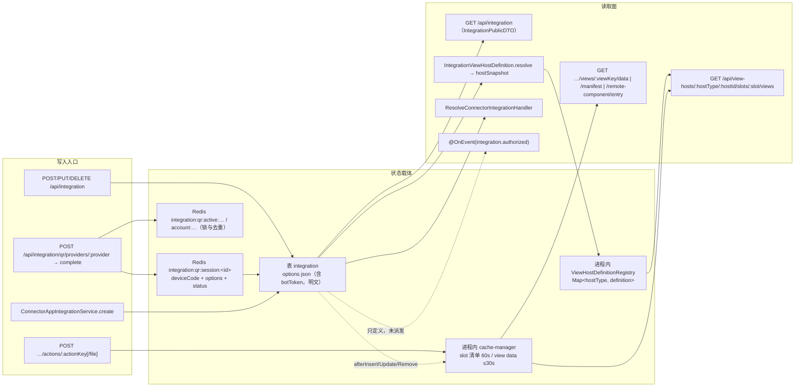
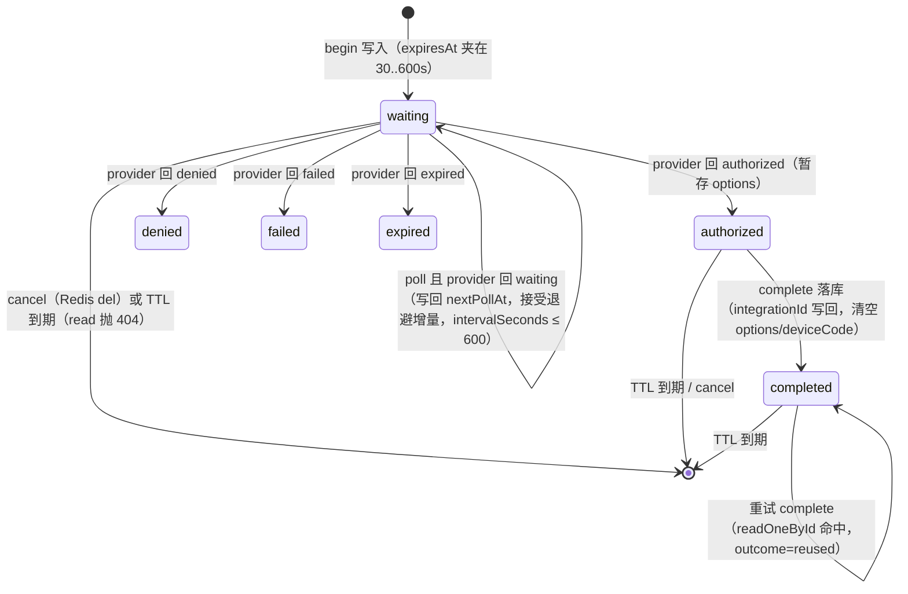

# 集成与扩展点子专家 · 数据流转

> 只读梳理（未落盘）。本子域持久面只有 **1 张表 `integration`**（`view-extension` 0 表），其余状态驻留 Redis（授权会话）与进程内缓存/注册表。引用为仓库根相对路径并以 `file://` 包裹；推断标 `[推测]`。

**本文引用的文件**

- [packages/server/src/integration/integration.entity.ts](file://packages/server/src/integration/integration.entity.ts)
- [packages/server/src/integration/integration.controller.ts](file://packages/server/src/integration/integration.controller.ts)
- [packages/server/src/integration/integration.service.ts](file://packages/server/src/integration/integration.service.ts)
- [packages/server/src/integration/integration-qr.service.ts](file://packages/server/src/integration/integration-qr.service.ts)
- [packages/server/src/integration/commands/handlers/upsert.handler.ts](file://packages/server/src/integration/commands/handlers/upsert.handler.ts)
- [packages/server/src/integration/commands/handlers/delete.handler.ts](file://packages/server/src/integration/commands/handlers/delete.handler.ts)
- [packages/server/src/integration/dto/integration-public.dto.ts](file://packages/server/src/integration/dto/integration-public.dto.ts)
- [packages/server/src/integration/connector-app/connector-app-integration.service.ts](file://packages/server/src/integration/connector-app/connector-app-integration.service.ts)
- [packages/server/src/integration/connector-app/resolve-connector-integration.handler.ts](file://packages/server/src/integration/connector-app/resolve-connector-integration.handler.ts)
- [packages/server/src/integration/types.ts](file://packages/server/src/integration/types.ts)
- [packages/server/src/integration/events/authorized.event.ts](file://packages/server/src/integration/events/authorized.event.ts)
- [packages/server/src/view-extension/view-extension.service.ts](file://packages/server/src/view-extension/view-extension.service.ts)
- [packages/server/src/view-extension/view-extension.cache.service.ts](file://packages/server/src/view-extension/view-extension.cache.service.ts)
- [packages/server/src/view-extension/host-definition.registry.ts](file://packages/server/src/view-extension/host-definition.registry.ts)
- [packages/server/src/view-extension/hosts/integration-view-host.definition.ts](file://packages/server/src/view-extension/hosts/integration-view-host.definition.ts)
- [packages/server/src/view-extension/subscribers/integration-view-host-cache.subscriber.ts](file://packages/server/src/view-extension/subscribers/integration-view-host-cache.subscriber.ts)
- [packages/server/src/view-extension/view-extension.permission.service.ts](file://packages/server/src/view-extension/view-extension.permission.service.ts)
- [packages/plugin-sdk/src/lib/integration/strategy.interface.ts](file://packages/plugin-sdk/src/lib/integration/strategy.interface.ts)
- [packages/server-ai/src/xpert/trigger-connection.service.ts](file://packages/server-ai/src/xpert/trigger-connection.service.ts)
- [packages/server-ai/src/xpert-project/project.service.ts](file://packages/server-ai/src/xpert-project/project.service.ts)

## 目录

- [1. 链路总览](#1-链路总览)
- [2. 链路一：集成定义 CRUD](#2-链路一集成定义-crud)
- [3. 链路二：扫码授权](#3-链路二扫码授权)
- [4. 链路三：令牌与凭据的使用](#4-链路三令牌与凭据的使用)
- [5. 链路四：宿主注册与消费](#5-链路四宿主注册与消费)
- [6. 链路五：缓存失效](#6-链路五缓存失效)
- [7. 链路六：动作执行](#7-链路六动作执行)
- [8. 状态机](#8-状态机)
- [9. 已知风险：令牌与凭据暴露面](#9-已知风险令牌与凭据暴露面)
- [10. 结论](#10-结论)

## 1. 链路总览

六条链分两组：**集成组**（定义 CRUD / 扫码授权 / 令牌使用）落 `integration` 表 + Redis 会话；**扩展点组**（宿主注册与消费 / 缓存失效 / 动作执行）不落任何自有表，只读 `integration` 行与进程内状态。

图表来源：[integration-qr.service.ts](file://packages/server/src/integration/integration-qr.service.ts)（关键符号：begin / poll / complete / read / write / key / lock）、[view-extension.cache.service.ts](file://packages/server/src/view-extension/view-extension.cache.service.ts)（关键符号：getOrSetSlotViews / getOrSetViewData / invalidateHostIdentity）、[integration-view-host-cache.subscriber.ts](file://packages/server/src/view-extension/subscribers/integration-view-host-cache.subscriber.ts)（关键符号：listenTo / afterInsert / afterUpdate / afterRemove）、[host-definition.registry.ts](file://packages/server/src/view-extension/host-definition.registry.ts)（关键符号：definitions / onModuleInit）

## 2. 链路一：集成定义 CRUD

**写**：`POST /api/integration` → `IntegrationUpsertCommand` → `applyStrategyValidation`（策略 `validateConfig`，回填六字段白名单）→ `create`；`PUT /:id` → `findOne` 取 previous → 合并 patch → 校验 → `runStrategyUpdateHook`（provider 变化时改跑 `previous.onDelete`）→ `update`；`DELETE /:id` → `findOne` → `runStrategyDeleteHook` → `delete`。**钩子先于落库**，任意钩子抛错即整体不落库并降级为 400。

**读**：`GET /api/integration` → `transformWhere` + `findAll` → `items.map(new IntegrationPublicDTO)`（**`options` 在此被剪掉**）；`GET /:id`（`CrudController` 基类路由，不在 7 端点计数内）返回实体原样（`[推测]`：因此详情面仍可能带出 `options`，取决于基类是否挂 `ClassSerializerInterceptor`）。旁路读：`ConnectorAppIntegrationService.list/select`（JS 侧 `descriptor.fields` 校验 → `publicOption` 只回 `{id,name,organizationId}`）、`ResolveConnectorIntegrationHandler`（`where: [tenant行, org行]`）。

**失败/回滚语义**：全部依赖同一条 `TypeORM` 请求级事务（`[推测]`：未见显式 `dataSource.transaction`，钩子内的外部副作用不在事务内）；`slug` 唯一索引是并发写入的兜底。

章节来源：[integration.controller.ts](file://packages/server/src/integration/integration.controller.ts)（关键符号：getAll / create / update / delete）、[upsert.handler.ts](file://packages/server/src/integration/commands/handlers/upsert.handler.ts)（关键符号：execute）、[delete.handler.ts](file://packages/server/src/integration/commands/handlers/delete.handler.ts)（关键符号：execute / runStrategyDeleteHook）、[integration.service.ts](file://packages/server/src/integration/integration.service.ts)（关键符号：applyStrategyValidation / pickValidatedIntegrationPatch / runStrategyUpdateHook）、[connector-app-integration.service.ts](file://packages/server/src/integration/connector-app/connector-app-integration.service.ts)（关键符号：list / select / publicOption）

## 3. 链路二：扫码授权

**链路步骤**：浏览器（扫码页）→ `POST /qr/providers/:provider` → `IntegrationQrService.begin` → `IntegrationStrategyRegistry` 取策略（`meta.setup.qrAuthorization` + `beginQrAuthorization`）→ 写 Redis 会话与 active 键 → 返回 `authorizationUrl` → 前端轮询 `GET /qr/sessions/:id` → `poll` → 策略 `pollQrAuthorization(deviceCode)` → 写回 `status` 与暂存 `options` → 前端 `POST /qr/sessions/:id/complete` → 身份归并与落库（`integration` 表）→ `DELETE` 或自然过期收尾。

**参与方**：前端扫码页（唯一消费者）、`IntegrationQrController`（鉴权 `INTEGRATION_EDIT`）、`IntegrationQrService`、`IntegrationService`（校验/建行/更新钩子）、provider 策略、Redis（会话 + 双锁）。

**持久化与中间态**：`integration:qr:session:<uuid>` 存整份会话（zod 校验）；`integration:qr:active:<tenant>:<org>:<user>:<provider>:<purpose>` 存「当前活动会话 id」用于同键收敛；`integration:qr:account:<tenant>:<org>:<provider>:<sha256(identity)>` 只作为账号级锁名。`purpose` 为 `trigger:<sha256([xpertId,triggerProvider])>` 或字面量 `'integration'`。**成功落库后会话保留（`integrationId` 已写、`options`/`deviceCode` 被清空）**，故重试 complete 会走 `readOneById` 命中既有行并返回 `outcome='reused'`。

**第二入口**：`XpertTriggerConnectionService.begin/poll/cancel/complete` 先 `assertContext(session, xpertId, provider)`，complete 后再 `change(id, provider, integration.id)` 把集成绑定回触发器图——即**触发器维度与集成维度是两条独立会话链**（spec 有用例专门断言二者互不影响）。

**失败语义**：策略 begin 失败 → 502；策略 poll 失败 → 502；`provider` 未声明 QR 能力 → 400；会话越权/过期 → 404；并发锁未拿到 → 409 `INTEGRATION_QR_BUSY`。

章节来源：[integration-qr.service.ts](file://packages/server/src/integration/integration-qr.service.ts)（关键符号：begin / poll / complete / cancel / assertContext / owner / read / write / lock / strategy）、[strategy.interface.ts](file://packages/plugin-sdk/src/lib/integration/strategy.interface.ts)（关键符号：beginQrAuthorization / pollQrAuthorization / getQrAuthorizationIdentity / IntegrationQrAuthorizationResult）、[trigger-connection.service.ts](file://packages/server-ai/src/xpert/trigger-connection.service.ts)（关键符号：begin / poll / cancel / complete / change）

## 4. 链路三：令牌与凭据的使用

**从「provider 返回」到「被使用」的四段**：

1. **入站**：`pollQrAuthorization` 返回 `{status:'authorized', options}` → `session.options = result.options` → `write(session)`（**明文进 Redis，TTL = 剩余授权窗口**）。
2. **落库**：`complete` 调 `applyStrategyValidation({... metadata, provider, name, options, features, tenantId, organizationId})` → `integrations.create({...input, id})` 或对既有行 `update(existing.id, {options: input.options})` → 清空会话 `options/deviceCode`。**`options` 是唯一被写入的凭据载体**，实体侧无加密列、无 `select:false`、无 `@Exclude`。
3. **消费（进程内）**：`IntegrationService.findOneByIdWithinTenant` / `readOneById` 属服务层直读；`IntegrationViewHostDefinition.resolve` 把 `options.botToken / teamName / botUserName / users / status / lastSyncAt` 摘进 `hostSnapshot`，随后交给插件 provider 的 `supports / getViewManifests / getViewData / executeViewAction`。
4. **出口（HTTP）**：列表 `IntegrationPublicDTO` 剪掉 `options`；QR 的 `poll` 只回 `{status}`；`begin` 只回 `{id, authorizationUrl, expiresAt, intervalSeconds}`；`complete` 只回 `{id,name,slug,provider,outcome}`。`hostSnapshot` 出现在 `XpertResolvedViewHostContext` 中，但**不在 7 个视图端点的响应体里**。

**跨域使用**：provider 策略在 `execute(integration, payload)`（如消息推送、通讯录同步）里读取 `integration.options` 的令牌——这条链完全在本子域之外（各插件策略实现），本子域只负责「把 `options` 交给策略」；测试侧对「凭据不出服务端」的断言集中在 QR 服务（`integration-qr.service.spec.ts`）。

章节来源：[integration-qr.service.ts](file://packages/server/src/integration/integration-qr.service.ts)（关键符号：poll 的 session.options / complete 的 create 与 update / write）、[integration.entity.ts](file://packages/server/src/integration/integration.entity.ts)（关键符号：options json 列）、[integration-view-host.definition.ts](file://packages/server/src/view-extension/hosts/integration-view-host.definition.ts)（关键符号：hostSnapshot.botToken）、[integration-public.dto.ts](file://packages/server/src/integration/dto/integration-public.dto.ts)（关键符号：IntegrationPublicDTO.options @Exclude）

## 5. 链路四：宿主注册与消费

**注册（启动期一次）**：`ViewExtensionModule` 声明 `IntegrationViewHostDefinition` 为 provider → `ViewHostDefinitionRegistry.onModuleInit` 扫描所有 provider → `Reflector` 读出 `@ViewHostDefinition('integration')` → `definitions.set('integration', instance)`。

**消费（每请求）**：前端 → `GET /api/view-hosts/integration/:integrationId/slots/detail.main_tabs/views`（或 `…/views/:viewKey/{data|manifest|…}`）→ `ViewExtensionController`（`@Public` + `ApiKeyOrClientSecretAuthGuard`）→ `ViewExtensionRoutes` → `ViewExtensionService.resolveHostContext`（`assertEnterpriseXpertViewHost` → `registry.get('integration')` → `buildBaseViewHostContext` → 头解析 runtimeScope → `definition.resolve` → `assertHostReadable`）→ `providerRegistry.listEntries(organizationId)` → 逐 provider `supports` + `getViewManifests`（经 `readProviderViewManifests` 处理工作台槽位兼容）→ `normalizeManifest`（拼公共键、强制 `dataSource.mode='platform'`、宿主重算 `runtime.featureProviders`）→ `isManifestActiveForContext`（Features 与槽位 `manifestPolicy.requireFeatureActivation`）→ `filterVisibleManifests`（`visible !== false` + `permissions` + 动作裁剪）→ 按 `order` 升序 → 返回。

**宿主侧依赖**：`IntegrationViewHostDefinition.resolve` 每次都经 `IntegrationService.findOneByIdWithinTenant(hostId, currentTenantId)` 读 `integration` 行——**表变更因此天然影响该入口结果**（配合 §6 的订阅者失效）。

章节来源：[host-definition.registry.ts](file://packages/server/src/view-extension/host-definition.registry.ts)（关键符号：onModuleInit / definitions / get）、[view-extension.service.ts](file://packages/server/src/view-extension/view-extension.service.ts)（关键符号：resolveHostContext / listSlotViews / resolveProviderManifest / normalizeManifest 调用链）、[integration-view-host.definition.ts](file://packages/server/src/view-extension/hosts/integration-view-host.definition.ts)（关键符号：resolve / canRead / slots）、[view-extension/permission.service.ts](file://packages/server/src/view-extension/view-extension.permission.service.ts)（关键符号：assertHostReadable / filterVisibleManifests）

## 6. 链路五：缓存失效

**写入点 → 失效点**：

- `integration` 行 insert/update/remove → `IntegrationViewHostCacheSubscriber`（构造时 `dataSource.subscribers.push(this)`）→ `invalidateHostIdentity({tenantId, organizationId, hostType:'integration', hostId:id})` → 删除该宿主身份下**本实例登记过**的全部键（含槽位清单键与数据键）。
- 动作返回 `refresh: true` → `invalidateView(context, viewKey)` → 删该视图的数据键 + 该宿主身份下的槽位清单键。
- `StrategyBus.events$` 任意事件 → `ViewExtensionCacheService.onModuleInit` 的订阅回调 → `clearAll()`（全量删 + 清空台账）。

**读取点（cache-aside）**：`getOrSetSlotViews`（TTL 60s）与 `getOrSetViewData`（TTL `min(ttlMs, 30s)`）；命中直接返回，未命中调 loader 后 `set` 并 `trackKey`（把键登记进 `trackedKeys/hostKeys/hostIdentityKeys/viewKeys/viewIdentityKeys` 五张台账）。

**一致性的三处边界**：① 台账在进程内 ⇒ 兄弟实例的键不会被本实例删除；② `clearAll` 是「尽力清」且只清本实例台账；③ 键里只并入 `features + hostState` 摘要与 `userId`，**不含插件版本/代码哈希** ⇒ 插件升级后同键仍可能命中旧清单，需重启清空（`[推测]`：与宿主注册表「重启生效」同源）。

章节来源：[integration-view-host-cache.subscriber.ts](file://packages/server/src/view-extension/subscribers/integration-view-host-cache.subscriber.ts)（关键符号：listenTo / afterInsert / afterUpdate / afterRemove / invalidate）、[view-extension.cache.service.ts](file://packages/server/src/view-extension/view-extension.cache.service.ts)（关键符号：onModuleInit / strategyBus.events$ / getOrSetSlotViews / getOrSetViewData / invalidateView / invalidateHostIdentity / clearAll / trackKey / normalizeActivationState）、[view-extension.service.ts](file://packages/server/src/view-extension/view-extension.service.ts)（关键符号：executeAction 的 result.refresh / executeFileAction 的 result.refresh）

## 7. 链路六：动作执行

**JSON 动作**：前端 `POST …/views/:viewKey/actions/:actionKey`（body `{targetId?, input?, parameters?}`）→ `resolveHostContext` → `resolveProviderManifest` → `ensureManifestVisible` → 找到 action（否则 404）→ `ensureActionVisible`（permissions + Project 角色）→ `identifyViewRequest`（指标标签）→ transport 必须为 `json`（否则 400）→ `provider.executeViewAction(context, manifestKey, actionKey, request)` → 若 `result.refresh` 则 `invalidateView`。

**文件动作**：`POST …/actions/:actionKey/file`（multipart）→ controller 层先查空文件（400 `file is required`）、解析 body（JSON 字符串容错）→ service 侧 transport 必须为 `file` → 宿主钩子 `prepareFileAction`（可选，用于把文件元信息塞进 request）→ `provider.executeViewFileAction(context, manifestKey, actionKey, preparedRequest, uploadedFile)`；文件名先经 `decodeMultipartFileName` 还原（Multer 按 Latin-1 解字节）。

**副作用方向**：动作是**唯一**能让「读侧协议端点」间接触发写入的路径（写入发生在 provider 内），本子域只负责缓存失效与权限裁决，不提供幂等键、不记录审计。

章节来源：[view-extension.controller.ts](file://packages/server/src/view-extension/view-extension.controller.ts)（关键符号：executeAction / executeFileAction / parseMultipartActionBody）、[view-extension.service.ts](file://packages/server/src/view-extension/view-extension.service.ts)（关键符号：executeAction / executeFileAction / prepareFileAction / decodeMultipartFileName / invalidateView）

## 8. 状态机

**（1）授权会话（Redis-only，`waiting → authorized | expired | denied | failed`）**

图表来源：[integration-qr.service.ts](file://packages/server/src/integration/integration-qr.service.ts)（关键符号：sessionSchema.status 枚举 / begin / poll / complete / cancel / read / write）

| 事件 | 会话状态变化 | 表侧效果 |
|---|---|---|
| begin | 新建 `waiting`（同 active 键旧会话先 cancel） | 无 |
| poll（provider=waiting） | 仍 `waiting`，`nextPollAt` 前移，可累加 `intervalSeconds` ≤600 | 无 |
| poll（provider=authorized） | `authorized` + `session.options` | 无 |
| complete | 写 `integrationId`、清 `options/deviceCode` | 新建或更新 `integration` 行 |
| cancel / TTL 到期 | 键删除 / `read` 抛 404 | 无 |

**（2）宿主解析（每请求，无持久态）**：`未注册 hostType → 404` → `resolve 返回 null → 404` → `canRead=false → 403` → `槽位不存在 → 404` → `manifest 未命中 → 404` → `未激活（Feature 不足）→ 404` → `可见性/权限不足 → 403` → `已解析（可返回清单/数据/动作结果）`。`ENTERPRISE_XPERT` 主体额外要求 `hostType='agent'` 且 `xpertId === hostId`，否则 403。

**（3）集成状态（表内无状态列）**：`Integration` 只有 CRUD 生命周期（`created → updated → deleted`）；对外可读的「连接状态」是**策略自由写入 `options` 的字符串**，宿主快照按 `options.status ?? options.connectionStatus ?? options.state ?? 'unknown'` 归一口径，且 `hostSnapshot.enabled` 恒为 `true`（硬编码）⇒ 视图侧看到的「已启用」不反映真实连通性。

章节来源：[integration-qr.service.ts](file://packages/server/src/integration/integration-qr.service.ts)（关键符号：sessionSchema / begin / poll / complete）、[view-extension.service.ts](file://packages/server/src/view-extension/view-extension.service.ts)（关键符号：resolveHostContext / ensureSlotExists / resolveProviderManifest / assertEnterpriseXpertViewHost）、[integration-view-host.definition.ts](file://packages/server/src/view-extension/hosts/integration-view-host.definition.ts)（关键符号：getIntegrationStatus / hostSnapshot.enabled）

## 9. 已知风险：令牌与凭据暴露面

| 位置 | 载体 | 谁能读到 | 当前缓解 | 残余风险 |
|---|---|---|---|---|
| 库内 `integration.options` | json 列（含 `botToken`、`clientSecret` 等） | 任何库级读取、备份、慢日志；服务层与宿主定义直读 | 仅列表端点 `IntegrationPublicDTO` 剪裁 | **无加密、无 `select:false`、无 `@Exclude`**；新增任意读取面即扩大暴露 |
| Redis `integration:qr:session:<id>` | `deviceCode` + `options`（授权后暂存） | Redis 读取方；任何能读 Redis 的旁路 | TTL = 剩余授权窗口（≤600s），complete 后立即清空 | 未 complete 时令牌明文驻留；无审计；`cancel` 不通知 provider 撤销 |
| `hostSnapshot.botToken` | 进程内 `XpertResolvedViewHostContext` | 所有插件 provider（`supports/getViewManifests/getViewData/executeViewAction`） | 宿主 `canRead` 要求 `INTEGRATION_VIEW|INTEGRATION_EDIT` | 凭据无条件读取；一旦 provider 或新入口把它写进响应/日志即外泄；7 个端点当前未见直出 |
| HTTP 出口（7 + 4 + 7 端点） | 响应体 | 持 API Key / `ENTERPRISE_XPERT` client secret 或登录态调用方 | 白名单 DTO、`{status}` 精简返回、`Cache-Control: no-store`（QR begin/poll、remote entry） | `GET /api/integration/:id`（基类路由）与 `select-options` 是否有同等白名单取决于基类序列化配置（`[推测]`） |
| 缓存键 / 指标标签 | 键名与 Prometheus 标签 | 缓存后端、指标系统 | 键只含 id 与 sha1 摘要；标签用 `encodeURIComponent` 后的 hostType/viewKey 且限白名单路由 | 凭据不进入这两处（已核实） |

**收敛建议（按成本排序）**：① 把 `resolve` 的 `botToken` 改为按需注入（或返回 `hasBotToken: boolean`）；② 给 `options` 增加列级加密或至少 `select:false` + 显式 `addSelect`；③ `complete` 失败路径补 TTL 提前失效与告警；④ 复核详情/`select-options` 是否复用 `IntegrationPublicDTO`。

章节来源：[integration-qr.service.ts](file://packages/server/src/integration/integration-qr.service.ts)（关键符号：poll 的 options 暂存 / complete 的清空 / 注释「never leave the server」）、[integration-view-host.definition.ts](file://packages/server/src/view-extension/hosts/integration-view-host.definition.ts)（关键符号：botToken / canRead）、[integration-public.dto.ts](file://packages/server/src/integration/dto/integration-public.dto.ts)（关键符号：@Exclude options）、[view-request-metrics.ts](file://packages/server/src/view-extension/view-request-metrics.ts)（关键符号：identifyViewRequest / VIEW_ROUTES）、[view-extension.cache.service.ts](file://packages/server/src/view-extension/view-extension.cache.service.ts)（关键符号：getHostScopeKey / getDataCacheKey）

## 10. 结论

1. **持久面极窄**：全子域只有 1 张表；「授权会话」「轮询退避」「并发锁」「宿主清单缓存」「宿主注册表」全部是进程内或 Redis 态。这意味着**Redis 与进程生命周期即是业务生命周期**：Redis 清空 → 所有未完成授权作废；进程重启 → 注册表与缓存重建。
2. **两条写入路径语义不同**：CRUD 走 CQRS + 策略钩子（校验先于落库）；connector-app 直插（`orIgnore` + 回查）不跑策略。读侧口径却统一——都从同一行 `options` 取凭据。
3. **扩展点链路是「读多写少」的扇出结构**：宿主解析（1 次 DB）+ 插件扇出（N 个 provider）+ 缓存（60s/30s）三层叠加，瓶颈与风险都在「宿主快照把整行 `options` 交给插件」这一点上。
4. **状态机的诚实描述是**：授权会话是严格的五态机且终态不可逆；宿主解析是无状态的前置校验链；集成行没有任何状态列（`enabled: true` 是常量、`status` 是策略自由字段）——任何把「连接状态」当权威的地方都应回到 `options` 口径复核。

章节来源：[integration-qr.service.ts](file://packages/server/src/integration/integration-qr.service.ts)（关键符号：begin / poll / complete / lock）、[integration.entity.ts](file://packages/server/src/integration/integration.entity.ts)（关键符号：Integration 列集合）、[integration-view-host.definition.ts](file://packages/server/src/view-extension/hosts/integration-view-host.definition.ts)（关键符号：hostSnapshot / getIntegrationStatus）、[view-extension.cache.service.ts](file://packages/server/src/view-extension/view-extension.cache.service.ts)（关键符号：getOrSetSlotViews / getOrSetViewData / clearAll）
