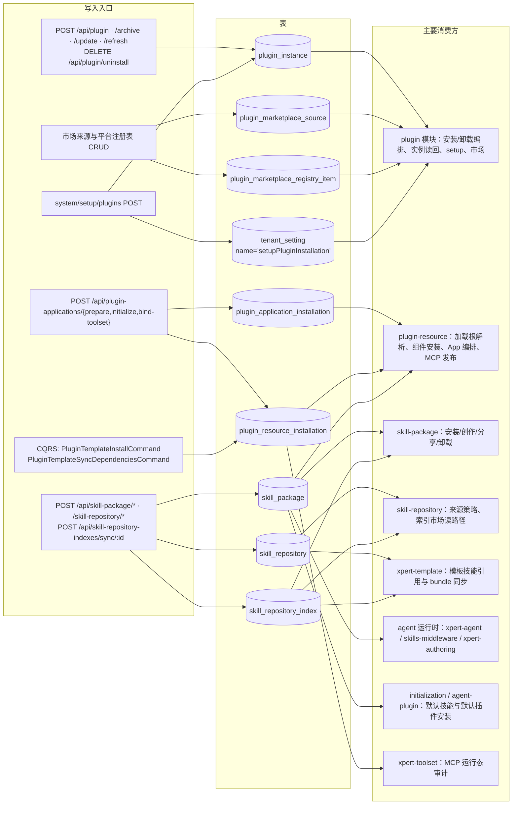

# C4 · 数据流向与消费（平台插件与技能专家）

范围：本父专家直接拥有的 8 张表 + 1 张被复用的宿主表（`tenant_setting`）。不含 `packages/plugin-sdk` 与 `packages/plugins/*`。
本文只描述「谁写入、谁读取、做什么用」；**不描述消费方的处理逻辑**（如需处理细节，回到对应的 `implementation/02-实现.md`）。

## 总览

图表来源：[plugin-instance.entity.ts](file://packages/server/src/plugin/plugin-instance.entity.ts)（关键符号：表 `plugin_instance`）、[plugin-resource-installation.entity.ts](file://packages/server-ai/src/plugin-resource/plugin-resource-installation.entity.ts)（关键符号：表 `plugin_resource_installation`）、[skill-package.entity.ts](file://packages/server-ai/src/skill-package/skill-package.entity.ts)（关键符号：表 `skill_package`）、[setup-plugins.store.ts](file://packages/server/src/plugin/setup/setup-plugins.store.ts)（关键符号：表 `tenant_setting`）

## 1. plugin_instance

- **实体类型**：宿主机插件安装态聚合（`TenantOrganizationBaseEntity`，止步 tenant/organization 维度，无 workspace）。
- **结构**：表 `plugin_instance`；关键列 `scopeKey`（可空）、`pluginName` / `packageName`、`version`、`source`、`level`（默认 `organization`）、`pendingRestart`（默认 false）、`config` / `configurationStatus` / `configurationError`、`sourceConfig`（jsonb，瞬态字段已剔除）、`meta`（含 `sdkCompatibilityWarnings`）；关键唯一索引三重叠：`(scopeKey, pluginName)`、`(tenantId, organizationId, pluginName)`、partial unique `IDX_plugin_instance_tenant_level_plugin_name` on `(pluginName) WHERE level='tenant'`。
- **生产方**：`PluginInstanceService.upsert` / `deactivate` / `uninstall`；由 `PluginManagementService.installPlugin` / `refreshCodePlugin` / 归档安装、`UpdatePluginCommand`、`PluginUninstallService`、`PUT /api/plugin/configuration`、setup 向导间接驱动。
- **主要消费方**：启动与运行期装配链（`plugin-instance.loader.ts` 读回期望配置并 restage、`plugin-management.service.ts`、`plugin-instance.service.ts`）、setup 向导（判断插件是否已加载）、API 列表/详情（`loadStatus`、`canConfigure`、`canUninstall`）、契约类型 `IPlugin`。[基于引用扫描，未深入验证：`plugin_instance` 的实体引用集中在 `packages/server/src/plugin/`，未见本域外模块直接查该表]
- **业务用途**：持久化「这台机器期望安装哪些插件、属于哪个 level、配置是什么」这一唯一事实源。
- **详细流向**：见本文件「§1 插件安装与启动链」思路与 R1/R2；落库—收敛顺序见 [plugin-management.service.ts](file://packages/server/src/plugin/plugin-management.service.ts)。

## 2. plugin_marketplace_source

- **实体类型**：用户登记的市场目录来源（`TenantOrganizationBaseEntity`）。
- **结构**：表 `plugin_marketplace_source`；关键列 `name`、`type`（`url | github | git`）、`url`、`ref`、`sparsePath`、`enabled`（默认 true）、`priority`（默认 100）、`lastIndexStatus`（默认 `idle`）、`lastIndexedAt`、`lastIndexError`、`lastCatalog`（整份目录 jsonb 快照）；普通索引 `(tenantId, organizationId, name)`。
- **生产方**：`PluginMarketplaceService.createSource` / `updateSource` / `deleteSource`（含 `assertSuperAdmin`），以及刷新链写回 `lastIndexStatus` / `lastIndexedAt` / `lastIndexError` / `lastCatalog`。
- **主要消费方**：市场聚合读路径（列表 / 详情 / 图标）与目录刷新（`PluginMarketplaceCatalogs`、Redis 共享缓存、PG `xmin` 栅栏）。引用面集中在 `packages/server/src/plugin/marketplace/`。[基于引用扫描，未深入验证]
- **业务用途**：把「从哪抓插件目录」变成可配置、可观测的租户/组织数据。
- **详细流向**：见 R3（市场来源配置），写回竞争语义见 [plugin-marketplace.service.ts](file://packages/server/src/plugin/marketplace/plugin-marketplace.service.ts)。

## 3. plugin_marketplace_registry_item

- **实体类型**：平台注册表条目（`TenantBaseEntity`，**无 organization 维度**，与 `plugin_resource_installation` 的 scope 显式要求混用易写出跨租户可见查询）。
- **结构**：表 `plugin_marketplace_registry_item`；关键列 `packageName`、`version`、`artifactNamespace`、`displayName`（+I18n）、`description`（+I18n）、`category`、`enabled`（默认 true）、`priority`（默认 100）、`section`（默认 `marketplace`）、`downloads` / `downloadsStatus` / `downloadsUpdatedAt` / `downloadsError`；索引 `(tenantId, packageName)`。
- **生产方**：`PluginMarketplaceRegistry.createRegistryItem` / `updateRegistryItem` / `deleteRegistryItem`（含唯一性校验），下载量富化写 `downloads*` 字段。
- **主要消费方**：平台源目录合成（`refreshPlatformRegistrySource` → 以 `xpert-platform://plugins` 作为市场来源出现）与市场列表/详情展示。[基于引用扫描，未深入验证]
- **业务用途**：平台侧人工审阅过的上架清单，不依赖外部 JSON 站点。
- **详细流向**：见 R3；平台源与内置源、第三方源三者的聚合行为见 [plugin-marketplace-registry.ts](file://packages/server/src/plugin/marketplace/plugin-marketplace-registry.ts)。

## 4. plugin_application_installation

- **实体类型**：App 级认领记录与控制面状态机（`TenantOrganizationBaseEntity`）。
- **结构**：表 `plugin_application_installation`；关键列 `pluginName`、`appName`、`declaredScope`、`scopeKey`、`status`（默认 `initializing`；取值 `configuring | initializing | ready | degraded | failed`）、`pluginVersion`、`templateId` / `templateVersion`、`operationId`、`workspaceId`、`xpertId`、`knowledgebaseIds`（jsonb）、`resourceRefs`（jsonb）、`errorCode` / `errorMessage`；关键唯一索引 `(tenantId, pluginName, appName, scopeKey)`（即并发锁），另有 `(tenantId, organizationId, status)` 支持状态查询。
- **生产方**：`PluginApplicationService.claimInstallation`（insert 冲突即回读）与 initialize 成功/补偿路径的状态推进；`PluginApplicationSetupService.prepare` / `bindToolset` / `discard`（`insert().orIgnore()` 占位 + `pessimistic_write` 行锁）。
- **主要消费方**：`plugin-resource`（App 状态汇总、详情、健康检查、工具集 preflight，最多引用）、`xpert-project` 与 `xpert-project-access`（项目类型与托管供给路径引用该实体）。[基于引用扫描，未深入验证：`packages/server-ai/src/xpert-project/services/project-type.service.ts`、`project.module.ts`]
- **业务用途**：App 安装的幂等认领与「配置到什么程度」的事实记录。
- **详细流向**：见 R5（App 初始化）。

## 5. plugin_resource_installation

- **实体类型**：组件安装态（`WorkspaceBaseEntity`，带 `workspaceId` / `publishAt` / `deletedAt`）。
- **结构**：表 `plugin_resource_installation`；关键列 `pluginName`、`componentType`（skill / mcp_server / toolset / app / hook / asset）、`componentKey`、`xpertId`、`agentKey`、`runtimeType`（`skill_package | toolset | hook_profile | app_connector`）、`runtimeId`、`runtimeNodeKey`、`definitionHash`（非空）、`status`（`ready | pending_auth | blocked | failed`）、`config`（jsonb）、`enabled`（默认 true）；**无唯一约束**，只有非唯一组合索引 `(workspaceId, xpertId, agentKey, pluginName, componentType, componentKey)`；`workspace` 多对一 CASCADE。
- **生产方**：`PluginResourceInstallerService` 的组件安装路径（`installComponentsForXpert` / `installToWorkspace` / `installToOrganization` → `installRuntimeComponent` upsert）；`PluginMcpServerService` 改 `enabled`。
- **主要消费方**：`plugin-resource`（组件状态查询 `ListComponentStatesQuery`、MCP 生命周期收敛、草稿绑定回写）、`xpert-toolset`（MCP 运行态审计读取安装行）。[基于引用扫描，未深入验证]
- **业务用途**：记录「哪个插件组件装到了哪个 workspace / xpert / agent，运行体 id 与定义哈希是什么」。
- **详细流向**：见 R4（模板安装）。

## 6. skill_package

- **实体类型**：工作区技能包安装态（`WorkspaceBaseEntity`）。
- **结构**：表 `skill_package`；关键列 `runtimeResourceOnly`（默认 false）、`skillIndexId`（可空，`@ManyToOne(SkillRepositoryIndex, { onDelete: 'CASCADE', nullable: true })`）、`name`（json i18n）、`visibility`（默认 `private`）、`packagePath`、`sharedSkillId`、`sharedPackagePath`、`metadata`、`instructions`；`skillIndexId` 可空性即「工作区自建 vs 市场安装」的判据（无独立唯一索引）。
- **生产方**：`SkillPackageService` 的安装入口（`installSkillPackage` / `ensureInstalledSkillPackage` / `installRepositorySkillPackages` / `installGithubSkillPackages` / `uploadSkillPackagesFromFile`）、创作入口（`createWorkspaceSkillPackage` / `saveWorkspaceSkillMarkdown`）、分发与同步（`shareSkillPackage` 写 `sharedSkillId` / `sharedPackagePath`、`syncPluginSkillBundle`、`syncTemplateSkillBundle`）。
- **主要消费方**：`skill-package`（自身读写与卸载）、`skill-repository`（workspace-public 来源策略按 `sharedSkillId + sharedPackagePath + publishAt` 生成索引行）、`plugin-resource`（插件技能包同步）、`agent 运行时`（`xpert-agent` 的 `list-workspace-skills`、`runtime-capabilities`、skills 提示组装、skills-middleware）、`xpert`（authoring 中间件）、`agent-plugin`、`initialization`（`BootstrapService` 安装默认工作区技能）、`xpert-project`（项目内容）。[基于引用扫描，未深入验证：`SkillPackage` 实体引用命中 48 个源文件，上列为按目录归纳]
- **业务用途**：技能资产「工作区里已经有一份」的事实源 + 组织共享快照的指针。
- **详细流向**：见 R6 / R7。

## 7. skill_repository

- **实体类型**：技能仓库登记（`TenantOrganizationBaseEntity`，带 `deletedAt` 软删）。
- **结构**：表 `skill_repository`；关键列 `name`（length 100）、`provider`（length 100）、`credentials`（jsonb）、`options`（jsonb）、`lastSyncAt`、`deletedAt`；关键 partial unique `IDX_skill_repository_workspace_public_tenant_unique` on `(tenantId) WHERE provider='workspace-public' AND organizationId IS NULL AND deletedAt IS NULL`。
- **生产方**：`SkillRepositoryService.register` / `updateRepository` / `deleteRepository`（拒绝手工注册或修改系统托管 provider）、`ensureWorkspacePublicRepository`（惰性创建 + `pg_advisory_xact_lock` 序列化）、`updateLastSyncAt`。
- **主要消费方**：`skill-repository`（索引 sync 与 `findMarketplace` 读路径、四个来源策略）、`xpert-template`（模板技能同步解析目标仓库）、`initialization`（bootstrap 安装默认技能时保障仓库存在）。[基于引用扫描，未深入验证]
- **业务用途**：定义「技能从哪里来」，并保证每租户唯一一个系统托管公开仓库。
- **详细流向**：见 R6。

## 8. skill_repository_index

- **实体类型**：技能元数据行（`TenantOrganizationBaseEntity`，带 `deletedAt` 软删）。
- **结构**：表 `skill_repository_index`；关键列 `repositoryId`（`@ManyToOne(SkillRepository)`，**onDelete CASCADE**）、`skillPath`（length 300）、`skillId`（length 200）、`name`、`link`（length 500）、`publisher`（**物理列名 `author`**，json）、`description`（text）、`license`、`tags`（json）、`version`（length 50）、`stats`（json）、`resources`（json）、`deletedAt`；**无 `(repositoryId, skillId)` 唯一约束**，唯一性由应用层 Map 去重 + 重复行软删维护。
- **生产方**：`SkillRepositoryIndexService.sync`（create / update / softDelete 三态，`full` 模式软删本轮未出现项）；workspace-public 的索引行来源于 `skill_package` 中 `sharedSkillId` + `sharedPackagePath` + `publishAt` 齐备的行（含工作区分享与上传直传两条来源）。
- **主要消费方**：`skill-repository`（`findMarketplace` 市场读路径与 four 来源策略写入）、`skill-package`（`installSkillPackage` 以索引行为安装来源、`skillIndex` 关系）、`xpert-template`（模板技能引用解析与 bundle 同步）、skills-middleware 运行时解析。[基于引用扫描，未深入验证]
- **业务用途**：可搜索、可安装的技能清单；搜索命中 `name` / `skillId` / `skillPath` / `description` / `tags` 与 `author::jsonb ->> 'handle' | 'displayName' | 'name'`。
- **详细流向**：见 R6 / R7。

## 附：tenant_setting（被本域复用，不属本域表）

- **实体类型**：宿主通用租户设置表，本域只占单行。
- **结构**：复用表 `tenant_setting`；本域约定 `name = 'setupPluginInstallation'`、`id = uuidv5('xpert:setup-plugins:<tenantId>')`、`value` 为 `setupPluginProgress` 的 JSON 字符串（`phase ∈ idle | installing | restarting | completed | attention` + `items[]` + `generation` / `restartId`）。
- **生产方**：`SetupPluginsStore.save`（由 `SetupPluginsService.start` / `run` / `status` 驱动）。
- **主要消费方**：`SetupPluginsStore.read` ← `SetupPluginsService.status` / `start`（刷新页面或换副本后在同一把 advisory lock 下续跑）。同表还被 `tenant-setting`、`model-execution`、`membership`、`model-gateway` 等模块使用，与本域互不干扰。[基于引用扫描，未深入验证]
- **业务用途**：setup 向导的跨刷新、跨副本进度记录，**只存状态不存凭据**。
- **详细流向**：见 [setup-plugins.store.ts](file://packages/server/src/plugin/setup/setup-plugins.store.ts) 与 [setup-plugins.schema.ts](file://packages/server/src/plugin/setup/setup-plugins.schema.ts)。

## 软删与级联小结（跨实体）

- `skill_repository` 为软删：删仓库行不会自动回收索引；真正物理删 repository 行时 `skill_repository_index` 会被 CASCADE 物理删除。
- `skill_package.skillIndex` 为 CASCADE 且可空：删索引会连带删技能包行，但工作区磁盘文件不会自动回收。
- `plugin_resource_installation` 挂在 `workspace` 上（多对一 CASCADE，硬删），无唯一约束，重复安装依赖 install 路径的查询去重。
