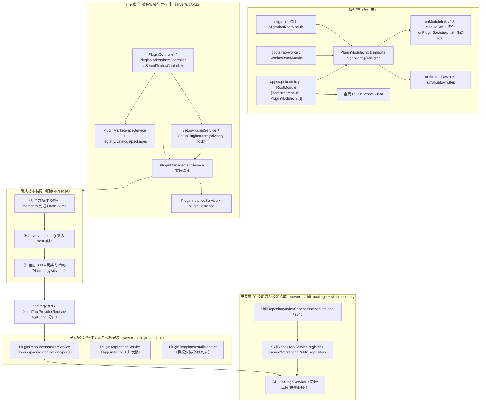

**本文引用的文件**
- [AGENTS.md](file://AGENTS.md)
- [apps/api/src/bootstrap/index.ts](file://apps/api/src/bootstrap/index.ts)
- [apps/api/src/bootstrap-worker.ts](file://apps/api/src/bootstrap-worker.ts)
- [apps/api/src/knowledge-filter-v2-migration-cli.ts](file://apps/api/src/knowledge-filter-v2-migration-cli.ts)
- [packages/server/src/plugin/plugin.module.ts](file://packages/server/src/plugin/plugin.module.ts)
- [packages/server/src/plugin/plugin.helper.ts](file://packages/server/src/plugin/plugin.helper.ts)
- [packages/server/src/plugin/plugin-management.service.ts](file://packages/server/src/plugin/plugin-management.service.ts)
- [packages/server/src/plugin/plugin-instance.entity.ts](file://packages/server/src/plugin/plugin-instance.entity.ts)
- [packages/server/src/plugin/plugin-instance.loader.ts](file://packages/server/src/plugin/plugin-instance.loader.ts)
- [packages/server/src/plugin/plugin-runtime-policy.ts](file://packages/server/src/plugin/plugin-runtime-policy.ts)
- [packages/server/src/plugin/plugin-startup-step.ts](file://packages/server/src/plugin/plugin-startup-step.ts)
- [packages/server/src/plugin/plugin-startup-state.ts](file://packages/server/src/plugin/plugin-startup-state.ts)
- [packages/server/src/plugin/plugin-scope.ts](file://packages/server/src/plugin/plugin-scope.ts)
- [packages/server/src/plugin/plugin-orm-metadata.ts](file://packages/server/src/plugin/plugin-orm-metadata.ts)
- [packages/server/src/plugin/plugin-http-routes.ts](file://packages/server/src/plugin/plugin-http-routes.ts)
- [packages/server/src/plugin/plugin-strategy-registration.ts](file://packages/server/src/plugin/plugin-strategy-registration.ts)
- [packages/server/src/plugin/plugin-sdk-versioning.ts](file://packages/server/src/plugin/plugin-sdk-versioning.ts)
- [packages/server/src/plugin/source-config.ts](file://packages/server/src/plugin/source-config.ts)
- [packages/server/src/plugin/plugin-schema-sync.service.ts](file://packages/server/src/plugin/plugin-schema-sync.service.ts)
- [packages/server/src/plugin/marketplace/plugin-marketplace.service.ts](file://packages/server/src/plugin/marketplace/plugin-marketplace.service.ts)
- [packages/server/src/plugin/setup/setup-plugins.service.ts](file://packages/server/src/plugin/setup/setup-plugins.service.ts)
- [packages/server/src/plugin/setup/setup-plugins.store.ts](file://packages/server/src/plugin/setup/setup-plugins.store.ts)
- [packages/server/src/shared/guards/plugin-scope.guard.ts](file://packages/server/src/shared/guards/plugin-scope.guard.ts)
- [packages/server-ai/src/plugin-resource/plugin-resource.module.ts](file://packages/server-ai/src/plugin-resource/plugin-resource.module.ts)
- [packages/server-ai/src/plugin-resource/plugin-resource-installer.service.ts](file://packages/server-ai/src/plugin-resource/plugin-resource-installer.service.ts)
- [packages/server-ai/src/plugin-resource/plugin-resource-components.ts](file://packages/server-ai/src/plugin-resource/plugin-resource-components.ts)
- [packages/server-ai/src/plugin-resource/plugin-resource-installation-scope.ts](file://packages/server-ai/src/plugin-resource/plugin-resource-installation-scope.ts)
- [packages/server-ai/src/plugin-resource/effective-loaded-plugins.ts](file://packages/server-ai/src/plugin-resource/effective-loaded-plugins.ts)
- [packages/server-ai/src/plugin-resource/plugin-application-installation.entity.ts](file://packages/server-ai/src/plugin-resource/plugin-application-installation.entity.ts)
- [packages/server-ai/src/plugin-resource/commands/template-runtime-dependencies.ts](file://packages/server-ai/src/plugin-resource/commands/template-runtime-dependencies.ts)
- [packages/server-ai/src/skill-package/skill-package.module.ts](file://packages/server-ai/src/skill-package/skill-package.module.ts)
- [packages/server-ai/src/skill-repository/skill-repository.module.ts](file://packages/server-ai/src/skill-repository/skill-repository.module.ts)
- [packages/server-ai/src/skill-repository/repository-index/skill-repository-index.service.ts](file://packages/server-ai/src/skill-repository/repository-index/skill-repository-index.service.ts)
- [packages/server-ai/src/app.module.ts](file://packages/server-ai/src/app.module.ts)

## 目录
- [专家域职责边界](#专家域职责边界)
- [子专家划分说明](#子专家划分说明)
- [子模块清单](#子模块清单)
- [分层结构](#分层结构)
- [依赖关系](#依赖关系)
- [关键设计约束与不变量](#关键设计约束与不变量)
- [架构总览](#架构总览)
- [组件详细分析](#组件详细分析)
- [结论](#结论)

## 专家域职责边界
本域负责「插件与技能的准入—落地—运行」闭环：插件从市场来源/本地代码/上传归档进入平台，完成 SDK 兼容校验、level 归属判定、staging、schema preflight、运行期模块加载与路由/策略注册、配置与卸载；把插件导出的可移植资源（Skill / MCP Server / Hook / App）与工具集安装到 workspace / xpert / organization；以及技能包的安装、上传、共享、卸载与技能仓库、仓库索引、市场聚合。

**不做什么**：不实现 SDK 自身——`packages/plugin-sdk`（已发布 3.22.1）作为外部依赖，按 `AGENTS.md` 约定新代码的 `RequestContext` 必须从 `@xpert-ai/plugin-sdk` 引入，而非 `@xpert-ai/server-core`；不包含 `packages/plugins/*` 内置插件实现；不承载 Agent 会话与模板业务主流程（模板只作为调用方通过 CQRS 命令进入）；不拥有 DDL——注册只刷新 TypeORM metadata，建表由加锁的插件 schema preflight 负责。

边界细则：不改写数据库中的期望配置（启动快照只做本地私有副本）；HTTP 输入永不允许携带恢复标识与回调；无登录用户的后台同步必须显式解析 scope，缺少 tenant 时拒绝执行。

章节来源：[plugin-management.service.ts](file://packages/server/src/plugin/plugin-management.service.ts)（关键符号：PluginManagementService.installPlugin）、[plugin-orm-metadata.ts](file://packages/server/src/plugin/plugin-orm-metadata.ts)（关键符号：registerPluginOrmMetadataInDataSource）、[AGENTS.md](file://AGENTS.md)（关键符号：Backend(NestJS) 约定）

## 子专家划分说明
本父专家按「进程内运行时 / 资源与模板落点 / 技能资产」切成 3 个子专家，切分依据是生命周期归属与数据所有权，而非目录巧合：

1. **插件安装与运行时**（`packages/server/src/plugin/`，39 个 spec）：拥有 `plugin_instance`、`plugin_marketplace_source`、`plugin_marketplace_registry_item` 三张表与整个启动链；负责 staging、SDK 兼容、schema preflight、动态装配、市场来源与 setup 向导。子专家边界=「进程重启才生效的东西」。
2. **插件资源与模板安装**（`packages/server-ai/src/plugin-resource/`，16 个 spec）：拥有 `plugin_resource_installation` 与 `plugin_application_installation`；把已加载插件的能力安装进工作区/组织/智能体，并承接模板安装与模板依赖同步命令。边界=「不重启也能生效的资源落点」。
3. **技能包与技能仓库**（`skill-package/` 7 个 spec + `skill-repository/` 7 个 spec，含 `repository-index/`）：拥有 `skill_package`、`skill_repository`、`skill_repository_index`；负责工作区技能文件读写、共享与发布、来源策略（clawhub / github / zip / workspace-public）与索引同步。边界=「文件形态的智力资产」。

三者共享 SDK 契约（`PLUGIN_COMPONENT_TYPE`、`PLUGIN_RESOURCE_INSTALLATION_STATUS`、`StrategyBus`、`SkillSourceProviderRegistry`），因此跨子专家只允许通过契约与 CQRS 交互，禁止直接互引内部实现。全域共 69 个 spec，无 `.skip/.only` 标记。

章节来源：[plugin-resource.module.ts](file://packages/server-ai/src/plugin-resource/plugin-resource.module.ts)（关键符号：PluginResourceModule）、[skill-package.module.ts](file://packages/server-ai/src/skill-package/skill-package.module.ts)（关键符号：SkillPackageModule）、[skill-repository.module.ts](file://packages/server-ai/src/skill-repository/skill-repository.module.ts)（关键符号：SkillRepositoryModule）

## 子模块清单
- `packages/server/src/plugin/`：`plugin.module.ts`（启动入口）、`plugin-management.service.ts`、`plugin-instance.service.ts`、`plugin-instance.entity.ts`、`plugin-instance.loader.ts`、`plugin.helper.ts`、`plugin-loader.ts`、`plugin-discovery.ts`、`uninstall/`、`permissions/`、`setup/`、`marketplace/`、`commands|queries/`。
- `packages/server-ai/src/plugin-resource/`：`plugin-resource-installer.service.ts`、`plugin-application.service.ts`、`plugin-application-suite.service.ts`、`plugin-mcp-server.service.ts`、`plugin-hooks.middleware.ts`、`application-setup/`、`application-toolsets/`、`commands/`、`queries/`。
- `packages/server-ai/src/skill-package/`：`skill-package.service.ts`、`skill-package.controller.ts`、`skill-package.entity.ts`、`authoring/`、`plugins/skills-middleware`、`plugins/skill-creator-middleware`。
- `packages/server-ai/src/skill-repository/`：`skill-repository.service.ts`、`skill-repository.entity.ts`、`plugins/{clawhub,github,zip,workspace-public}`、`repository-index/`（controller + service + entity + module）。
- 机制层文件（跨子专家共用语义）：`plugin.helper.ts`、`source-config.ts`、`plugin-orm-metadata.ts`、`plugin-http-routes.ts`、`plugin-strategy-registration.ts`、`plugin-runtime-policy.ts`、`plugin-update.utils.ts`、`plugin-sdk-versioning.ts`、`plugin-scope.ts`、`plugin-schema-sync.service.ts`。

章节来源：[plugin.module.ts](file://packages/server/src/plugin/plugin.module.ts)（关键符号：PluginModule.providers）、[plugin-resource.module.ts](file://packages/server-ai/src/plugin-resource/plugin-resource.module.ts)（关键符号：PluginResourceModule.providers）

## 分层结构
- **Controller（8 个）**：`PluginController`、`PluginMarketplaceController`、`SetupPluginsController`、`PluginResourceController`、`PluginApplicationController`、`SkillPackageController`、`SkillRepositoryController`、`SkillRepositoryIndexController`。职责仅为解析 HTTP、护栏（`RoleGuard` / `RolesEnum` / `WorkspaceAuthoringGuard`）与转调服务。
- **Service**：`PluginManagementService`、`PluginInstanceService`、`PluginMarketplaceService`、`PluginResourceInstallerService`、`PluginApplicationService`、`SkillPackageService`、`SkillRepositoryService`、`SkillRepositoryIndexService`；辅助服务 `PluginSchemaSyncService`、`PluginRuntimeStateService`、`PluginUninstallService`、`PluginMcpServerService`、`SetupPluginsService`。
- **CQRS handler**：`commands|queries/handlers`（插件侧 `UpdatePluginCommand`、`ResolvePluginArtifactNamespaceQuery`；资源侧 `PluginTemplateInstallCommand`、`PluginTemplateSyncDependenciesCommand`、`ListComponentStatesQuery`）。
- **Scheduler/Gate**：`setup/`（向导 + advisory lock）、`permissions/`（把 `@xpert-ai/plugin-sdk` 的权限 token 绑定到宿主实现）、全局 `PluginScopeGuard`。
- **Entity**：`PluginInstance`、`PluginMarketplaceSource`、`PluginMarketplaceRegistryItem`、`PluginResourceInstallation`、`PluginApplicationInstallation`、`SkillPackage`、`SkillRepository`、`SkillRepositoryIndex`。
- **机制层**：见「子模块清单」末项，承载装配顺序、scope 收敛、版本兼容与瞬态字段语义。

章节来源：[plugin.controller.ts](file://packages/server/src/plugin/plugin.controller.ts)（关键符号：PluginController.installPluginArchive）、[plugin-scope.guard.ts](file://packages/server/src/shared/guards/plugin-scope.guard.ts)（关键符号：PluginScopeGuard.canActivate）

## 依赖关系
**启动链硬引用（非 imports 声明式装配）**：`apps/api/src/bootstrap/index.ts` 的 `RootModule` imports `[BootstrapModule, PluginModule.init()]`；`apps/api/src/bootstrap-worker.ts` 的 `WorkerRootModule` 与 `apps/api/src/knowledge-filter-v2-migration-cli.ts` 的 `MigrationRootModule` 同款。`PluginModule.init()` 用 `getConfig().plugins` 展开 imports；`onModuleInit` 把 `moduleRef` 注入每条 loaded 记录后逐个执行 `onPluginBootstrap`（`runPluginStartupStep`，超时/失败即致命），`onModuleDestroy` 走 `runShutdownStep`。`bootstrap/index.ts` 用 `app.useGlobalGuards(new AuthGuard(reflector), new PluginScopeGuard(reflector))` 注册全局守卫。

**模块依赖**：`plugin` → `ConfigModule`（`getConfig().plugins`）、`RedisModule`（市场共享缓存）、`DiscoveryModule`、`RuntimeControlModule`、`TypeOrmModule.forFeature([PluginInstance, PluginMarketplaceSource, PluginMarketplaceRegistryItem])`、`CqrsModule`、`@xpert-ai/plugin-sdk`（`StrategyBus` / `XpertToolProviderRegistry` / 权限 token）。`plugin-resource` → `TenantModule` / `EnvironmentModule` / `XpertModule` / `XpertTemplateModule` / `SkillPackageModule` / `XpertToolsetModule` / `XpertWorkspaceModule` / `KnowledgebaseModule` / `CopilotModule` / `McpPublicationModule`（多数 `forwardRef`）。`skill-package` → `TenantModule` / `forwardRef(XpertWorkspaceModule)` / `forwardRef(SkillRepositoryModule)` / `SkillRepositoryIndexModule` / `forwardRef(XpertTemplateModule)`。`skill-repository` → `SkillSourceProviderRegistry`（SDK）+ `forwardRef(SkillPackageModule)` + `BullModule` 的 GitHub 请求队列。

**被依赖与导出面**：`PluginModule` 标 `@Global()`，导出 `StrategyBus`、`XpertToolProviderRegistry`、`PluginConfigResolver`、`PluginManagementService`、`PLUGIN_CONFIG_RESOLVER_TOKEN`、`PLUGIN_WEBHOOK_AUTH_SERVICE_TOKEN`、`LOADED_PLUGINS`；`PluginResourceModule` 导出 `PluginResourceInstallerService` / `PluginMcpServerService` / `PluginApplicationService`，被 `@Global()` 的 `AgentPluginModule` 与 `ServerAIModule`（`app.module.ts`）引用；`SkillPackageService` 被 `skill-repository` 反向依赖（`forwardRef`）。

**CQRS 契约**：本域发出 `ImportDefaultAgentPluginsCommand`（setup 向导）与 `UpdatePluginCommand`；接收 `ResolvePluginArtifactNamespaceQuery`、`PluginTemplateInstallCommand`、`PluginTemplateSyncDependenciesCommand`。

章节来源：[plugin.module.ts](file://packages/server/src/plugin/plugin.module.ts)（关键符号：PluginModule.init）、[bootstrap/index.ts](file://apps/api/src/bootstrap/index.ts)（关键符号：bootstrap.RootModule）、[plugin-resource.module.ts](file://packages/server-ai/src/plugin-resource/plugin-resource.module.ts)（关键符号：PluginResourceModule.imports）

## 关键设计约束与不变量
1. package scope 是**授权边界**，runtime policy 是**独立的显式能力**，两者不可互相推导。
2. 组件 → 目标合法性固定：organization 仅 `TOOLSET`；workspace 为 `SKILL` / `MCP_SERVER` / `APP`；xpert 为 `HOOK`；`ASSET` 永不安装。
3. `packageDir` 是瞬态字段，持久化前必须经 `omitTransientPluginSourceConfig` 删除；只有服务端归档上传路径可用（`allowPackageDir`）。
4. `PluginInstance` 唯一性由 `(scopeKey, pluginName)`、`(tenantId, organizationId, pluginName)` 与 partial unique `pluginName WHERE level='tenant'` 三重叠保证。
5. 启动超时是致命的：超时的 hook 仍可能改进程状态，因此进程不得进入就绪；失败日志**不记录插件配置与异常文本**（可能含凭据）。
6. 启动快照是副本本地、私有的，绝不被写回期望的数据库配置；未完成的候选 boot 只尝试一次，随后由 supervisor 回滚到上次被接纳的配置。
7. 必须先合并插件 ORM metadata 到活 `DataSource` 再 lazy-load，否则出现 `EntityMetadataNotFoundError`；注册只刷新 metadata，DDL 归加锁的 schema preflight。
8. 启动恢复与运行期安装必须收敛到同一 staging 语义（同一份目录结构、同一份 manifest）。
9. 模板 `dependencies.plugins` 只声明运行时前置；可移植资源必须被显式选择，绝不让模板把插件导出的全部 Skill/MCP/Hook/App 当副作用装上。
10. 模板安装的恢复标识与回调绝不接受 HTTP 输入，只允许服务端 bootstrap 传入。
11. 无登录用户的同步路径必须显式解析 scope；tenant 缺失时**绝不**发出无 scope 的管理查询。
12. 安装并发的最后一道闸门是数据库：App 安装的 unique `scopeKey` 就是并发锁；setup 向导由 PostgreSQL advisory lock 跨副本与跨浏览器重试持有。
13. `RequestContext` 等运行时契约统一从 `@xpert-ai/plugin-sdk` 引入，禁止新代码引用 `@xpert-ai/server-core` 的旧路径。

章节来源：[plugin-runtime-policy.ts](file://packages/server/src/plugin/plugin-runtime-policy.ts)（关键符号：parsePluginRuntimePolicy）、[plugin-resource-components.ts](file://packages/server-ai/src/plugin-resource/plugin-resource-components.ts)（关键符号：isPluginResourceInstallableForTarget）、[plugin-startup-state.ts](file://packages/server/src/plugin/plugin-startup-state.ts)（关键符号：快照不变量注释）

## 架构总览

图表来源：[plugin.module.ts](file://packages/server/src/plugin/plugin.module.ts)（关键符号：PluginModule.init）、[bootstrap/index.ts](file://apps/api/src/bootstrap/index.ts)（关键符号：bootstrap.RootModule）、[plugin-management.service.ts](file://packages/server/src/plugin/plugin-management.service.ts)（关键符号：PluginManagementService.installPlugin）

图中三段式装配是本域最脆弱的时序契约：`packages/server/src/plugin/plugin-management.service.ts` 的启动恢复与运行期安装都必须遵守「metadata → load → routes/strategies」，否则插件实体不可查、动态路由会被挂在 404 之后。

章节来源：[plugin-http-routes.ts](file://packages/server/src/plugin/plugin-http-routes.ts)（关键符号：registerPluginControllerRoutes）、[plugin-orm-metadata.ts](file://packages/server/src/plugin/plugin-orm-metadata.ts)（关键符号：mergeEntityClasses）

## 组件详细分析
### 插件安装与实例
以「包」为单位：市场来源解析 → 归档/工作区/包目录 staging（`stageWorkspacePlugin` / `stagePackageDirectoryPlugin` / npm 安装） → SDK 兼容与 level 判定 → artifact namespace 校验 → schema preflight → 写入 `plugin_instance` → 运行期收敛。重启敏感的 system/tenant 插件只做 staging 并标记 `pendingRestart: true`，由 `RuntimeControlService.recordPluginRuntimeChange` 触发重启或收敛；组织级则就地热装。启动时 `plugin-instance.loader.ts` 直接从 `plugin_instance` 读回期望配置（含 `sourceConfig`）以便 restage 代码插件。

章节来源：[plugin-management.service.ts](file://packages/server/src/plugin/plugin-management.service.ts)（关键符号：PluginManagementService.installPlugin）、[plugin-instance.loader.ts](file://packages/server/src/plugin/plugin-instance.loader.ts)（关键符号：OrganizationPluginConfig）

### 市场与来源
`PluginMarketplaceService` 聚合三类来源：内置公开源、平台 registry、用户登记的 `PluginMarketplaceSource`；`catalogs` 负责来源抓取，`packages` 负责按需的 npm 元数据/README/下载量读取，`registry` 负责平台目录与安装包，`PluginMarketplaceSharedCache` 提供 Redis 级共享 TTL 与租约刷新。列表读路径不触发包 I/O，保证市场首屏稳定。

章节来源：[plugin-marketplace.service.ts](file://packages/server/src/plugin/marketplace/plugin-marketplace.service.ts)（关键符号：PluginMarketplaceService.listMarketplace）

### 资源与模板安装
`PluginResourceInstallerService` 以 `resolveLoadedPluginResourceRoot` 定位插件 bundle 根，按 `(pluginName, componentType, componentKey)` 解析运行组件并以 `PluginResourceInstallation` 记录 `definitionHash`。模板侧由 `PluginTemplateInstallHandler` 调 `resolveTemplateRuntimeDependencyComponents` 把显式选择器解析为运行组件；应用侧 `PluginApplicationService` 用 unique `scopeKey` 做并发幂等并维护 `plugin_application_installation` 状态机。`PluginHooksMiddleware` 在 Agent 运行时按 Hooks 配置注入行为。

章节来源：[plugin-resource-installer.service.ts](file://packages/server-ai/src/plugin-resource/plugin-resource-installer.service.ts)（关键符号：PluginResourceInstallerService.resolveRuntimeComponents）、[template-runtime-dependencies.ts](file://packages/server-ai/src/plugin-resource/commands/template-runtime-dependencies.ts)（关键符号：resolveTemplateRuntimeDependencyComponents）

### 技能包与技能仓库
技能资产分两层：仓库（来源策略注册在 `SkillSourceProviderRegistry`）与索引（`SkillRepositoryIndex`，`sync` 支持 full/incremental 并按 `repositoryId + skillId` 去重）；安装到工作区时由 `SkillPackageService` 调对应策略落盘，并维护 `skill_package`（含 `packagePath`、`sharedSkillId`、`runtimeResourceOnly`）。模板与插件 bundle 的同步走 `sharedSkillId` 约定（插件为 `plugin:<插件名>:skill:<componentKey>`），用 bundle hash 判断是否需要重写工作区文件。

章节来源：[skill-package.service.ts](file://packages/server-ai/src/skill-package/skill-package.service.ts)（关键符号：SkillPackageService.installSkillPackage）、[skill-repository-index.service.ts](file://packages/server-ai/src/skill-repository/repository-index/skill-repository-index.service.ts)（关键符号：SkillRepositoryIndexService.sync）

## 结论
本域的本质是「在活进程里安全地长出新能力」：写路径被设计成三段式装配加数据库级并发锁，读路径被设计成 scope 收敛加缓存；授权由 scope/level/runtime policy 三个正交维度表达，资源落地由「组件类型 × 目标」的固定矩阵约束。三个子专家分别守进程级、资源级与文件级资产，接口只在 SDK 契约与 CQRS 上交汇，因此可以独立演进，但任何改动都必须先回答「是否需要重启」与「scope 是否可证明」两个问题。

章节来源：[plugin-runtime-policy.ts](file://packages/server/src/plugin/plugin-runtime-policy.ts)（关键符号：requiresPluginRestart）、[effective-loaded-plugins.ts](file://packages/server-ai/src/plugin-resource/effective-loaded-plugins.ts)（关键符号：effectiveLoadedPlugins）
