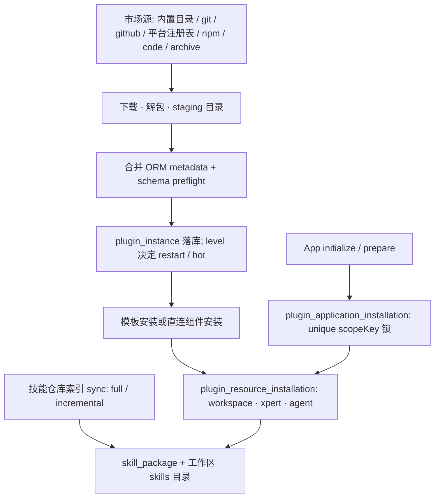
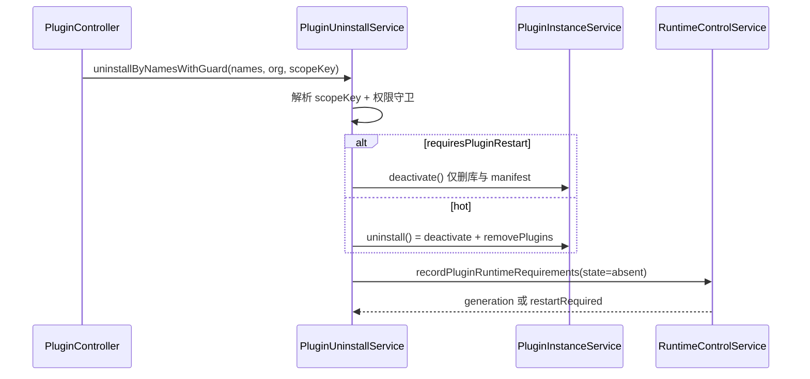
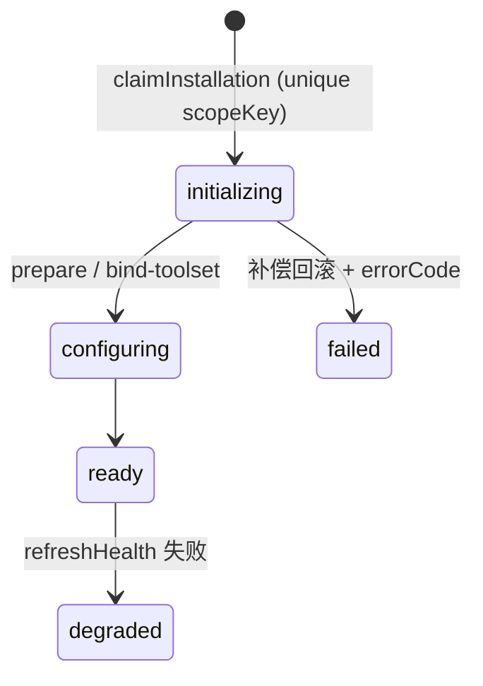
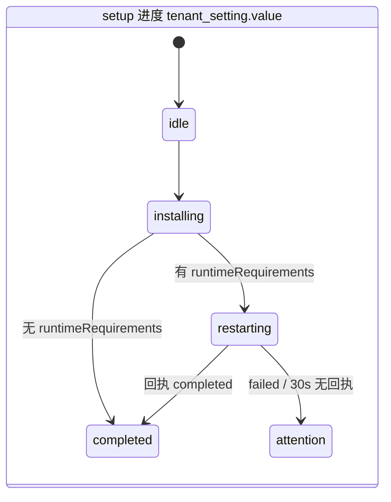

**本文引用的文件**
- [plugin-instance.entity.ts](file://packages/server/src/plugin/plugin-instance.entity.ts)（表 `plugin_instance`、`resolvePluginLevel`）
- [plugin-instance.service.ts](file://packages/server/src/plugin/plugin-instance.service.ts)（`PluginInstanceService`）
- [plugin-instance.loader.ts](file://packages/server/src/plugin/plugin-instance.loader.ts)（`buildOrganizationPluginConfigs`）
- [plugin.helper.ts](file://packages/server/src/plugin/plugin.helper.ts)（`registerPluginsAsync`、`loaded`、`loadFailures`）
- [plugin-management.service.ts](file://packages/server/src/plugin/plugin-management.service.ts)（`PluginManagementService.installPlugin`）
- [organization-plugin.store.ts](file://packages/server/src/plugin/organization-plugin.store.ts)（`getOrganizationPluginPath`、`stageWorkspacePlugin`、`stagePackageDirectoryPlugin`）
- [plugin-archive.ts](file://packages/server/src/plugin/plugin-archive.ts)（`extractPluginArchive`）
- [plugin-schema-sync.service.ts](file://packages/server/src/plugin/plugin-schema-sync.service.ts)（`PluginSchemaSyncService.synchronize`）
- [plugin-orm-metadata.ts](file://packages/server/src/plugin/plugin-orm-metadata.ts)（`registerPluginOrmMetadataInDataSource`）
- [plugin-scope.ts](file://packages/server/src/plugin/plugin-scope.ts)（`resolvePluginScope`）
- [plugin-runtime-policy.ts](file://packages/server/src/plugin/plugin-runtime-policy.ts)（`requiresPluginRestart`）
- [plugin-uninstall.service.ts](file://packages/server/src/plugin/uninstall/plugin-uninstall.service.ts)（`PluginUninstallService.uninstallByNamesWithGuard`）
- [plugin-marketplace.types.ts](file://packages/server/src/plugin/marketplace/plugin-marketplace.types.ts)（`BUILTIN_MARKETPLACE_URL`）
- [plugin-marketplace.service.ts](file://packages/server/src/plugin/marketplace/plugin-marketplace.service.ts)（`fetchGithubCatalog`、`fetchGitCatalog`）
- [plugin-marketplace-catalogs.ts](file://packages/server/src/plugin/marketplace/plugin-marketplace-catalogs.ts)（`PluginMarketplaceCatalogs.load`）
- [plugin-marketplace-registry.ts](file://packages/server/src/plugin/marketplace/plugin-marketplace-registry.ts)（表 `plugin_marketplace_registry_item`）
- [setup-plugins.service.ts](file://packages/server/src/plugin/setup/setup-plugins.service.ts)（`SetupPluginsService.start`）
- [setup-plugins.store.ts](file://packages/server/src/plugin/setup/setup-plugins.store.ts)（`SetupPluginsStore.acquire`、`tenant_setting`）
- [setup-plugins.schema.ts](file://packages/server/src/plugin/setup/setup-plugins.schema.ts)（`setupPluginProgress`）
- [plugin-application.service.ts](file://packages/server-ai/src/plugin-resource/plugin-application.service.ts)（`PluginApplicationService.initialize`、`claimInstallation`）
- [plugin-application.controller.ts](file://packages/server-ai/src/plugin-resource/plugin-application.controller.ts)（`PluginApplicationController`）
- [plugin-resource-installer.service.ts](file://packages/server-ai/src/plugin-resource/plugin-resource-installer.service.ts)（`installComponentsForXpert`）
- [plugin-resource-installation.entity.ts](file://packages/server-ai/src/plugin-resource/plugin-resource-installation.entity.ts)（表 `plugin_resource_installation`）
- [template-runtime-dependencies.ts](file://packages/server-ai/src/plugin-resource/commands/template-runtime-dependencies.ts)（`resolveTemplateRuntimeDependencyComponents`）
- [install-template.handler.ts](file://packages/server-ai/src/plugin-resource/commands/install-template.handler.ts)（`PluginTemplateInstallHandler`）
- [sync-template-dependencies.handler.ts](file://packages/server-ai/src/plugin-resource/commands/sync-template-dependencies.handler.ts)（`PluginTemplateSyncDependenciesHandler`）
- [skill-repository-index.service.ts](file://packages/server-ai/src/skill-repository/repository-index/skill-repository-index.service.ts)（`SkillRepositoryIndexService.sync`）
- [skill-package.service.ts](file://packages/server-ai/src/skill-package/skill-package.service.ts)（`installSkillPackage`、`shareSkillPackage`、`syncPluginSkillBundle`）
- [workspace-public/strategy.ts](file://packages/server-ai/src/skill-repository/plugins/workspace-public/strategy.ts)（`WorkspacePublicSkillSourceProvider`）
- [plugin-startup-state.ts](file://packages/server/src/plugin/plugin-startup-state.ts)（`PluginStartupState`）

## 目录
1. [总览：三张安装态表的分工](#总览三张安装态表的分工)
2. [链 1：插件安装链](#链-1插件安装链)
3. [链 2：卸载与重启链](#链-2卸载与重启链)
4. [链 3：setup 向导链](#链-3setup-向导链)
5. [链 4：模板安装链](#链-4模板安装链)
6. [链 5：App 初始化链](#链-5app-初始化链)
7. [链 6：技能包链](#链-6技能包链)
8. [状态流转](#状态流转)
9. [异步流与外部依赖](#异步流与外部依赖)
10. [数据变换关键节点](#数据变换关键节点)
11. [已知风险](#已知风险)

## 总览：三张安装态表的分工

本域把「插件代码装到宿主机」与「插件组件装到某个工作区 / Agent」分成两层，并为受治理的 App 另设编排层：

- `plugin_instance`：宿主机安装态，`level`（system / tenant / organization）与 `scopeKey` 决定重启语义，`pendingRestart` 表示「已落库但当前进程未加载」。
- `plugin_resource_installation`：组件安装态，`componentType` / `runtimeType` / `runtimeId` / `definitionHash` 描述绑定到 workspace / xpert / agent 的运行体。
- `plugin_application_installation`：App 级认领记录，唯一 `scopeKey` 充当跨副本、跨浏览器重试的并发锁。

图表来源：[plugin-resource-installer.service.ts](file://packages/server-ai/src/plugin-resource/plugin-resource-installer.service.ts)（关键符号：表 `plugin_resource_installation`）、[plugin-application.service.ts](file://packages/server-ai/src/plugin-resource/plugin-application.service.ts)（关键符号：表 `plugin_application_installation`）

章节来源：[plugin-instance.entity.ts](file://packages/server/src/plugin/plugin-instance.entity.ts)（关键符号：表 `plugin_instance`）、[plugin-resource-installation.entity.ts](file://packages/server-ai/src/plugin-resource/plugin-resource-installation.entity.ts)（关键符号：表 `plugin_resource_installation`）、[plugin-application-installation.entity.ts](file://packages/server-ai/src/plugin-resource/plugin-application-installation.entity.ts)（关键符号：表 `plugin_application_installation`）

## 链 1：插件安装链

来源解析：`POST /plugin` 进入 `PluginManagementService.installPlugin`，`source = body.source || 'marketplace'`；`sourceConfig` 先经 `normalizePluginSourceConfig` 归一，`source === 'code'` 时必须有 `workspacePath` 或内部态 `packageDir`（`packageDir` 不允许从 HTTP 传入，只能来自归档上传）。

- 内置 JSON 目录：`BUILTIN_MARKETPLACE_URL`（默认 `https://xpert-ai.github.io/xpert-plugin-registry/plugins/index.json`，可用 `XPERT_PLUGIN_MARKETPLACE_URL` 覆盖）。
- 远程 git/github 目录：`type === 'github'` 走 `fetchGithubCatalog`（raw 候选路径 × ref 轮询），`type === 'git'` 走 `fetchGitCatalog`（`git clone --depth 1 [--branch ref]` 到临时目录后按 `sparsePath` 找候选清单文件）。
- 平台内注册表：`PLATFORM_REGISTRY_SOURCE_URL = 'xpert-platform://plugins'`，数据来自 `plugin_marketplace_registry_item`。
- npm：版本解析在 `queries/handlers/npm-plugin-version.ts`（复用 npm 配置 + `dist-tags`，10s 超时），tarball 地址来自 `plugin-marketplace-packages.ts::fetchNpmPackageArchive`。
- 归档：`POST /plugin/archive` → `extractPluginArchive`（按魔数/扩展名判定 zip / tgz / tar，`assertSafeArchiveEntries` 拒绝 `..` 与绝对路径，`findExtractedPackageDirectory` 要求唯一 `package.json`），解包目录以 `packageDir` 传入安装并在 finally 清理临时目录。

落盘与加载：非 code 插件经 `installOrganizationPlugins` 拷入 `getOrganizationPluginPath` 指向的不可变运行时目录，并更新 manifest（`writeOrganizationManifest`，同包名后者覆盖）；`registerPluginsAsync` 先为 code 插件执行 `stagePackageDirectoryPlugin` / `stageWorkspacePlugin`（realpath + 绝对路径 + 白名单校验、包名必须匹配、必须含 `dist/`、`src/index.ts` 或编译入口），再 `loadPlugin` + `plugin.register(context)`。ORM metadata 先由 `collectPluginOrmMetadata` 收集并做表名前缀校验（声明 artifact namespace 时要求 `plugin_<namespace>_`，否则退化为 `plugin_`），DDL 由锁定的 schema preflight 执行；`registerPluginOrmMetadataInDataSource` 只把实体/订阅者并进活 `DataSource` 并 `buildMetadatas()`，用于避免 `EntityMetadataNotFoundError`。controller 通过 `registerPluginControllerRoutes` 追加到 Express 栈并前移到尾部 404 处理器之前。

落库与收敛：`pluginInstanceService.upsert({... pendingRestart: true, level, config, sourceConfig })` 写入 `plugin_instance`；是否需要重启由 `requiresPluginRestart(meta.runtimePolicy, level, operation)` 决定（未声明 runtimePolicy 时 system/tenant 需重启、organization 热加载），返回 `restartRequired: true` 或 `runtimeConvergence.generation`。

章节来源：[plugin-management.service.ts](file://packages/server/src/plugin/plugin-management.service.ts)（关键符号：`PluginManagementService.installPlugin`）、[organization-plugin.store.ts](file://packages/server/src/plugin/organization-plugin.store.ts)（关键符号：`stageWorkspacePlugin`、`installOrganizationPlugins`）、[plugin.helper.ts](file://packages/server/src/plugin/plugin.helper.ts)（关键符号：`registerPluginsAsync`）、[plugin-orm-metadata.ts](file://packages/server/src/plugin/plugin-orm-metadata.ts)（关键符号：`registerPluginOrmMetadataInDataSource`）

## 链 2：卸载与重启链

`DELETE /plugin/uninstall` → `uninstallByNamesWithGuard(names, organizationId?, scopeKey?)`：先算 `scopeKey`（显式传入 → 命中已加载 system 插件时为 `system:global` → 全局组织时 `resolveTenantGlobalScopeKey(tenantId)` → 否则为 organizationId），再依次执行 `canManageGlobalPlugins` / `canManageSystemPlugins` / `canManageTenantPlugins` 与「禁止卸载 system 插件」校验。

分两路收敛：需要重启时调用 `pluginInstanceService.deactivate(...)`（删除 `plugin_instance` 行、从磁盘 manifest 摘除、**保留已加载代码直到重启**）并 `strategyBus.remove(scopeKey, name, 'uninstall')`；可热卸载时调用 `pluginInstanceService.uninstall(...)` = `deactivate` + `removePlugins`（同时清理 runtime 目录）。两条路径最后都 `runtimeControl.recordPluginRuntimeRequirements([{ scopeKey, pluginName, state: 'absent' }])`，返回 `runtimeConvergence.generation` 或 `restartRequired: true`；`pendingRestart` 与 RuntimeControl 的收敛结果因此保持一致语义。

图表来源：[plugin-uninstall.service.ts](file://packages/server/src/plugin/uninstall/plugin-uninstall.service.ts)（关键符号：`PluginUninstallService.uninstallByNamesWithGuard`）、[plugin-runtime-policy.ts](file://packages/server/src/plugin/plugin-runtime-policy.ts)（关键符号：`requiresPluginRestart`）

章节来源：[plugin-instance.service.ts](file://packages/server/src/plugin/plugin-instance.service.ts)（关键符号：`PluginInstanceService.deactivate`、`removePlugins`）、[plugin-uninstall.service.ts](file://packages/server/src/plugin/uninstall/plugin-uninstall.service.ts)（关键符号：`PluginUninstallService`）

## 链 3：setup 向导链

`system/setup/plugins`（SuperAdmin + 默认租户）三步：`GET` 读进度、`GET catalog` 复用市场目录、`POST`（202）启动。

`SetupPluginsService.start` 先 `authorize()`（拒绝 API Key、必须是默认租户 SuperAdmin），再 `store.acquire(tenantId)`：用**专用** QueryRunner 执行 `SELECT pg_try_advisory_lock(hashtext('xpert:setup-plugins:<tenantId>'))`，拿不到锁直接返回当前 status（幂等）。进度写入复用表 `tenant_setting`（`name = 'setupPluginInstallation'`，id = `uuidv5('xpert:setup-plugins:<tenantId>')`，`value` 为 `setupPluginProgress` 的 JSON），**只存状态不存凭据**；锁在异步任务 finally 中释放，进程退出由 PG 自动释放。

`run()` 逐项顺序处理：已加载则标 `existing`，否则 `installPlugin({ pluginName, version, source: 'npm' }, { deferActivation: true, requiredLevel: item.level })`；单项失败标 `failed` 并继续（不中断整批），每步前后都落盘进度，刷新页面后在同一把 DB 锁下续跑。全部结束后（默认 Agent 插件走 `ImportDefaultAgentPluginsCommand`）汇总 `runtimeRequirements`，无需求则 `phase = 'completed'`，有需求则 `phase = 'restarting'` 并 `runtime.requestRestart(...)`，用 `pluginConvergenceStatus(generation)` / `restartStatus(restartId)` 轮询；30s 无回执或回执缺失一律降级为 `attention`。

章节来源：[setup-plugins.service.ts](file://packages/server/src/plugin/setup/setup-plugins.service.ts)（关键符号：`SetupPluginsService.start`、`SetupPluginsService.run`）、[setup-plugins.store.ts](file://packages/server/src/plugin/setup/setup-plugins.store.ts)（关键符号：`SetupPluginsStore.acquire`、表 `tenant_setting`）、[setup-plugins.schema.ts](file://packages/server/src/plugin/setup/setup-plugins.schema.ts)（关键符号：`setupPluginProgress`）

## 链 4：模板安装链

`PluginTemplateInstallCommand(templateId, workspaceId, language, basic?, publish, locale?, capabilities, bootstrap?)` → `PluginTemplateInstallHandler.execute`：`assertCanAuthor(workspaceId)` → 读模板 → `yaml.parse(export_data)` 归一为 draft → `capabilities.prepareInstallation` / `configureRealtimeVoice` → `XpertImportCommand`（bootstrap 恢复时按 `resumeXpertId` 续跑）→ 已发布模板只补工作区初始化。

组件部分 `resolveTemplateRuntimeDependencyComponents(installer, defaultPluginName, dependencies)` 把模板里的 skills / mcpServers / hooks / apps 选择器解析为 `PluginResourceInstallComponent[]`；注释明确 `dependencies.plugins` 只是运行期前置条件，**portable 资源必须显式选择**，避免「装模板=顺带安装该插件全部组件」。随后 `installer.installComponentsForXpert(xpert, components)` 逐组件落 `plugin_resource_installation`（`runtimeType` 由 componentType 推导，`definitionHash` 取自组件定义，`status` 由 App 鉴权策略/占位 connector 推导为 `ready` / `pending_auth` / `blocked`）并把 skill / toolset / hook 节点写回当前 draft 的 middleware 绑定；模板 toolset 依赖另行解析并挂到 Xpert。失败时 `rollbackTemplateXpert` 回滚。

`sync-template-dependencies.handler.ts` 是补跑路径：**执行时才**通过 `xpertService.getTeam(xpertId)` 加载导入图，因为组件安装会改写当前 draft 的 Agent middleware 绑定，提前缓存会拿到过期图。

章节来源：[install-template.handler.ts](file://packages/server-ai/src/plugin-resource/commands/install-template.handler.ts)（关键符号：`PluginTemplateInstallHandler.execute`）、[template-runtime-dependencies.ts](file://packages/server-ai/src/plugin-resource/commands/template-runtime-dependencies.ts)（关键符号：`resolveTemplateRuntimeDependencyComponents`）、[sync-template-dependencies.handler.ts](file://packages/server-ai/src/plugin-resource/commands/sync-template-dependencies.handler.ts)（关键符号：`PluginTemplateSyncDependenciesHandler`）

## 链 5：App 初始化链

HTTP 边界 `plugin-applications`：`status` / `catalog` / `detail` 只读，`initialize` / `prepare` / `bind-toolset` / `discard-configuration` 需 `SUPER_ADMIN | ADMIN | TRIAL`，请求体走 Zod schema。

`initialize` 的顺序体现幂等设计：`resolveApplication`（只从进程内可信注册表解析）→ `operationId` 必填 → `assertInitializationAccess` → 若已有 `ready` 记录先 `refreshHealth`（健康则直接返回，**不依赖可能已被禁用的模型**）→ `getPreflightForApplication` 校验 scope 合法性 → 模型/assistantSuite 校验 → `applicationToolsets.prepare` → `claimInstallation` 以 `(tenantId, pluginName, appName, scopeKey)`（`scopeKey` 取 organizationId，`status = initializing`）插入 `plugin_application_installation`；唯一索引冲突即视为「别的请求已认领」，`claimed = false` 时直接返回现有状态。成功后写 `resourceRefs`（workspace / assistant / knowledgebase 等）并把状态推进到 `ready`；失败时补偿已创建的工作区/知识库/Xpert、状态置 `failed` 且 `errorCode = 'initialization_failed'`。`prepare` 只分配配置用工作区（模型与 toolset 前置属于激活阶段），`bindToolset` 绑定具体 toolset，`discardConfiguration` 丢弃配置。

图表来源：[plugin-application-installation.entity.ts](file://packages/server-ai/src/plugin-resource/plugin-application-installation.entity.ts)（关键符号：表 `plugin_application_installation`）、[plugin-application.service.ts](file://packages/server-ai/src/plugin-resource/plugin-application.service.ts)（关键符号：`PluginApplicationService.initialize`）

章节来源：[plugin-application.controller.ts](file://packages/server-ai/src/plugin-resource/plugin-application.controller.ts)（关键符号：`PluginApplicationController`）、[plugin-application.service.ts](file://packages/server-ai/src/plugin-resource/plugin-application.service.ts)（关键符号：`claimInstallation`）

## 链 6：技能包链

仓库索引：`POST /skill-repository-indexes/sync/:repositoryId`（body `mode: full | incremental`）→ `SkillRepositoryIndexService.sync` 调 `strategy.listSkills(repository)`，按 `repositoryId + skillId` 建键、用 `compareSkillRepositoryIndexFreshness` 去重（旧重复行在 sync 中软删），写入/更新 `skill_repository_index`；`full` 模式软删未出现项，`finally` 中无论成败都 `updateLastSyncAt`。来源策略在 `skill-repository/plugins/`：`clawhub`、`github`（`GITHUB_TOKEN` 或 repository.credentials.token）、`workspace-public`（系统托管，索引直接来自 `skill_package` 中 `sharedSkillId + sharedPackagePath + publishAt` 均存在的行）、`zip`（上传即装，不建索引）。

安装：`installSkillPackage(workspaceId, indexId)` → `assertWorkspaceWritePermission` → 命中既有记录且版本/元数据未变则直接返回 → 否则 `strategy.installSkillPackage(index, getWorkspaceSkillsRoot(...))` 拷入工作区 `skills/` 目录并 `normalizePackagePath` → 写 `skill_package`（`skillIndexId`、`packagePath`、`metadata`，`visibility` 默认 `private`）；`ensureInstalledSkillPackage` 去重、`installRepositorySkillPackages` 批量、`installGithubSkillPackages` 直连 GitHub。工作区技能文件读写全部经 `WorkspaceAuthoringGuard`（upload/download/file 增删改查、分享）。

分享与回灌：`shareSkillPackage` 只允许工作区自建技能（`skillIndexId` 为空），生成 `sharedSkillId`（默认 `shared-skill-<uuid>`）并发布到 `workspace-public` 仓库（组织共享目录 `getOrganizationSharedSkillPath`）+ 建索引行；插件技能包用前缀 `plugin:<pluginName>:skill:<componentKey>`（`syncPluginSkillBundle`），模板技能包走 `syncTemplateSkillBundle`（bundle hash 比对，`created/updated/unchanged/missing`）。

章节来源：[skill-repository-index.service.ts](file://packages/server-ai/src/skill-repository/repository-index/skill-repository-index.service.ts)（关键符号：`SkillRepositoryIndexService.sync`）、[skill-package.service.ts](file://packages/server-ai/src/skill-package/skill-package.service.ts)（关键符号：`installSkillPackage`、`shareSkillPackage`、`syncPluginSkillBundle`）、[workspace-public/strategy.ts](file://packages/server-ai/src/skill-repository/plugins/workspace-public/strategy.ts)（关键符号：`WorkspacePublicSkillSourceProvider`）

## 状态流转

- `plugin_instance`：`level` ∈ `system | tenant | organization`（列默认 organization）；`pendingRestart` 为真且版本/来源/runtimeName 与已加载实例不一致时，controller 对外暴露 `PLUGIN_LOAD_STATUS.PENDING_RESTART`；`configurationStatus` ∈ `valid | invalid`，并带 `configurationError` 文本。
- `plugin_application_installation.status` ∈ `configuring | initializing | ready | degraded | failed`（列默认 `initializing`）。
- `plugin_resource_installation`：`status` ∈ `ready | pending_auth | blocked | failed`，`enabled` 默认 true（组件被禁用时置 false）。
- 市场源 `plugin_marketplace_source.lastIndexStatus` ∈ `idle | success | failed`；注册表项 `downloadsStatus` 同理。
- 软删：`skill_repository.deletedAt` 与 `skill_repository_index.deletedAt` 均为软删，索引 full sync 也走 `softDelete`；`skill_package` 继承 `WorkspaceBaseEntity` 亦带 `deletedAt`。

图表来源：[setup-plugins.schema.ts](file://packages/server/src/plugin/setup/setup-plugins.schema.ts)（关键符号：`setupPluginProgress`）、[setup-plugins.service.ts](file://packages/server/src/plugin/setup/setup-plugins.service.ts)（关键符号：`SetupPluginsService.status`）

章节来源：[plugin-instance.entity.ts](file://packages/server/src/plugin/plugin-instance.entity.ts)（关键符号：表 `plugin_instance`）、[plugin-resource-installation.entity.ts](file://packages/server-ai/src/plugin-resource/plugin-resource-installation.entity.ts)（关键符号：表 `plugin_resource_installation`）、[skill-repository-index.entity.ts](file://packages/server-ai/src/skill-repository/repository-index/skill-repository-index.entity.ts)（关键符号：表 `skill_repository_index`）

## 异步流与外部依赖

本模块**无 MQ、无 `@Cron` / `@Interval`**：跨进程协调靠 PG 锁与轮询回执，进程内靠 CQRS CommandBus 与 RuntimeControl。实际异步机制为：

- CQRS 命令：`ImportDefaultAgentPluginsCommand`（setup 默认 Agent 插件）、`XpertImportCommand` / `XpertPublishCommand`（模板安装）、`PluginTemplateInstallCommand` / `PluginTemplateSyncDependenciesCommand`。
- 运行时收敛：`RuntimeControlService.recordPluginRuntimeChange` / `recordPluginRuntimeRequirements` / `requestRestart` 返回 generation 或 restartId，由 setup status 与重启协调器轮询。
- 单实例注册上报：`PluginRuntimeStateService.report()` → `InstanceRegistryService.reportPluginState`（携带 `loadFailures`）。
- PG advisory lock：`pg_try_advisory_lock`（setup，专用连接持有至结束）、`pg_advisory_xact_lock`（`skill_repository` 的 workspace-public 初始化，仅 postgres 生效）；marketplace DSL 用 Redis 租约 + PG `xmin` 栅栏。
- 文件系统：插件 staging 根、manifest、启动快照 `.runtime-plugin-state/<replica>.json`、归档/npm tarball/git clone 的临时目录。
- 外部依赖：npm registry（`registry.npmjs.org`）、内置市场 JSON URL、GitHub raw、`git` 可执行文件、Redis、PostgreSQL。

章节来源：[plugin.helper.ts](file://packages/server/src/plugin/plugin.helper.ts)（关键符号：`loaded`、`loadFailures`）、[plugin-runtime-state.service.ts](file://packages/server/src/plugin/plugin-runtime-state.service.ts)（关键符号：`PluginRuntimeStateService.report`）、[plugin-marketplace-catalogs.ts](file://packages/server/src/plugin/marketplace/plugin-marketplace-catalogs.ts)（关键符号：`PluginMarketplaceCatalogs.refresh`）

## 数据变换关键节点

- `packageDir` 是**瞬态**字段：只用于上传归档解包后的安装，`omitTransientPluginSourceConfig` 落库前删除；重启时必须重新 stage，不能依赖磁盘残留。
- 路径语义：`getOrganizationPluginRoot` 按 scope 分支（system → `plugins/<scopeKey>`、租户全局 → `plugins/tenants/<tenantId>/<organizationId>`、其余 → `plugins/<organizationId>`），`getOrganizationPluginPath` 用「去版本后缀」的目录名，保证同包升级覆盖旧目录。
- `scopeKey` 计算集中在 `resolvePluginScope`：显式值优先；system → `system:global`；全局组织且非默认租户 → `tenant:<tenantId>:global`；否则为 organizationId。历史 `scopeKey IS NULL` 行由 `loadPluginInstances` 内的回填 SQL 迁移。
- `definitionHash` 与 `runtimeNodeKey`：前者标识组件定义版本，后者是组件在工作区 draft 中生成的 middleware/node 键，安装后回写。
- 分享路径：`sharedSkillId`（`shared-skill-<uuid>` 或 `plugin:<plugin>:skill:<key>`）→ 组织共享目录 → `skill_package.sharedPackagePath` → 索引行 `skillId`，形成闭环。
- 启动快照：`configs` 以 `__xpert_plugin_encrypted__` 信封加密落盘，读取统一走 `deserializePluginConfig`。

章节来源：[source-config.ts](file://packages/server/src/plugin/source-config.ts)（关键符号：`omitTransientPluginSourceConfig`）、[plugin-scope.ts](file://packages/server/src/plugin/plugin-scope.ts)（关键符号：`resolvePluginScope`）、[plugin-instance.loader.ts](file://packages/server/src/plugin/plugin-instance.loader.ts)（关键符号：`buildOrganizationPluginConfigs`）

## 已知风险

- `packageDir` 瞬态 + 「本地 code 插件加载前必须重新 stage」的约定：任何绕过 `registerPluginsAsync` 的直接加载都会读到过期拷贝。
- 启动快照是**副本私有**文件（按 `XPERT_INSTANCE_ID` / `HOSTNAME` 命名），多副本各自回滚；未完成候选 boot 只尝试一次，随后必须操作者介入，否则以 keep-alive 阻塞而非崩溃重启。
- 快照只恢复代码与配置，**DB migration 必须保持向后兼容**，否则回滚后的旧代码会读到新 schema。
- `plugin_instance` 的 partial unique 只覆盖 `level = 'tenant'`，`'organization'` 级并发安装仅靠 `(scopeKey, pluginName)` 与应用层校验。
- `scopeKey` 可空且历史行为 NULL，回填 SQL 对 system 级的重复行采用「按更新时间保留一条」的破坏性清理。
- 组件安装与模板导入之间存在顺序耦合：组件安装改写 draft middleware 绑定，因此同步依赖必须延迟到执行时加载导入图。
- 技能分享把工作区文件复制到组织共享目录，`sharedSkillId` 复用（同 id 覆盖）时源目录缺失只报 `Shared skill snapshot not found`，无自动重建。
- 市场目录在冷启动时先落「raw 索引」再异步 enrich，列表字段可能短暂缺少下载量等富化信息。

章节来源：[plugin-startup-state.ts](file://packages/server/src/plugin/plugin-startup-state.ts)（关键符号：`PluginStartupState.select`、`PluginStartupState.commit`）、[plugin.helper.ts](file://packages/server/src/plugin/plugin.helper.ts)（关键符号：`registerPluginsAsync`）、[plugin-marketplace-catalogs.ts](file://packages/server/src/plugin/marketplace/plugin-marketplace-catalogs.ts)（关键符号：`PluginMarketplaceCatalogs.load`）
