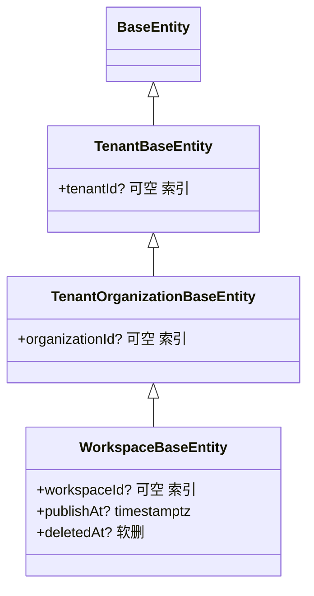

**本文引用的文件**
- [tenant-base.entity.ts](file://packages/server/src/core/entities/tenant-base.entity.ts)（`TenantBaseEntity`）
- [tenant-organization-base.entity.ts](file://packages/server/src/core/entities/tenant-organization-base.entity.ts)（`TenantOrganizationBaseEntity`）
- [base.entity.ts](file://packages/server-ai/src/core/entities/base.entity.ts)（`WorkspaceBaseEntity`）
- [plugin-instance.entity.ts](file://packages/server/src/plugin/plugin-instance.entity.ts)（表 `plugin_instance`）
- [plugin-marketplace-source.entity.ts](file://packages/server/src/plugin/marketplace/plugin-marketplace-source.entity.ts)（表 `plugin_marketplace_source`）
- [plugin-marketplace-registry-item.entity.ts](file://packages/server/src/plugin/marketplace/plugin-marketplace-registry-item.entity.ts)（表 `plugin_marketplace_registry_item`）
- [plugin-application-installation.entity.ts](file://packages/server-ai/src/plugin-resource/plugin-application-installation.entity.ts)（表 `plugin_application_installation`）
- [plugin-resource-installation.entity.ts](file://packages/server-ai/src/plugin-resource/plugin-resource-installation.entity.ts)（表 `plugin_resource_installation`）
- [skill-package.entity.ts](file://packages/server-ai/src/skill-package/skill-package.entity.ts)（表 `skill_package`）
- [skill-repository.entity.ts](file://packages/server-ai/src/skill-repository/skill-repository.entity.ts)（表 `skill_repository`）
- [skill-repository-index.entity.ts](file://packages/server-ai/src/skill-repository/repository-index/skill-repository-index.entity.ts)（表 `skill_repository_index`）
- [setup-plugins.store.ts](file://packages/server/src/plugin/setup/setup-plugins.store.ts)（复用表 `tenant_setting`）
- [plugin-schema-sync.service.ts](file://packages/server/src/plugin/plugin-schema-sync.service.ts)（`PluginSchemaSyncService.synchronize`）
- [plugin-schema-scope.ts](file://packages/server/src/plugin/plugin-schema-scope.ts)（`scopePluginSchemaSynchronization`）
- [plugin-orm-metadata.ts](file://packages/server/src/plugin/plugin-orm-metadata.ts)（`validatePluginEntityTableNames`）
- [plugin-resource-installation-scope.ts](file://packages/server-ai/src/plugin-resource/plugin-resource-installation-scope.ts)（`applyPluginResourceOrganizationScope`）

## 目录
1. [实体基类分层](#实体基类分层)
2. [本域表逐表 schema](#本域表逐表-schema)
3. [迁移与 seed 惯例](#迁移与-seed-惯例)
4. [校验规则](#校验规则)
5. [已知风险与坑](#已知风险与坑)

## 实体基类分层

图表来源：[tenant-base.entity.ts](file://packages/server/src/core/entities/tenant-base.entity.ts)（关键符号：`TenantBaseEntity`）、[base.entity.ts](file://packages/server-ai/src/core/entities/base.entity.ts)（关键符号：`WorkspaceBaseEntity`）

层级与继承：`BaseEntity` → `TenantBaseEntity`（`tenant` 多对一 CASCADE、`tenantId` 可空 + 索引）→ `TenantOrganizationBaseEntity`（`organization` 多对一 CASCADE、`organizationId` 可空 + 索引）→ `WorkspaceBaseEntity`（`workspace` 多对一 CASCADE、`workspaceId`、`publishAt`、`deletedAt` 软删）。`plugin_instance` 等四张表止步于 `TenantOrganizationBaseEntity`；`plugin_resource_installation`、`skill_package` 到 `WorkspaceBaseEntity`。

章节来源：[tenant-organization-base.entity.ts](file://packages/server/src/core/entities/tenant-organization-base.entity.ts)（关键符号：`TenantOrganizationBaseEntity`）

## 本域表逐表 schema

- `plugin_instance`（继承 `TenantOrganizationBaseEntity`）：`scopeKey` varchar 可空、`pluginName`/`packageName` 非空、`version` 可空、`source` varchar 可空（code/npm/archive/marketplace/...）、`meta` jsonb 可空（`PluginMeta`，含 `sdkCompatibilityWarnings`）、`pendingRestart` boolean 默认 false、`sourceConfig` jsonb 可空、`level` varchar 默认 `organization`、`config` jsonb 默认 `{}`、`configurationStatus` varchar 可空、`configurationError` text 可空。索引：唯一 `(scopeKey, pluginName)`、唯一 `(tenantId, organizationId, pluginName)`、partial unique `IDX_plugin_instance_tenant_level_plugin_name` on `(pluginName) WHERE level='tenant'`。
- `plugin_marketplace_source`（`TenantOrganizationBaseEntity`）：`name`、`type`（url/github/git）、`url`、`ref`、`sparsePath`、`enabled` 默认 true、`priority` 默认 100、`lastIndexStatus` 默认 `idle`、`lastIndexedAt` timestamptz、`lastIndexError`、`lastCatalog` jsonb；普通索引 `(tenantId, organizationId, name)`。
- `plugin_marketplace_registry_item`（`TenantBaseEntity`，无 organization）：`packageName`、`version`、`artifactNamespace`、`displayName`(+I18n)、`description`(+I18n)、`category`、`author`、`icon`/`keywords`/`repository`/`targetApps`/`targetAppMeta`、`enabled` 默认 true、`priority` 默认 100、`section` 默认 `marketplace`、`downloads`/`downloadsStatus`/`downloadsUpdatedAt`/`downloadsError`；索引 `(tenantId, packageName)`。
- `plugin_application_installation`（`TenantOrganizationBaseEntity`）：`pluginName`、`appName`、`declaredScope`、`scopeKey`、`status` 默认 `initializing`、`pluginVersion`、`templateId`、`templateVersion`、`operationId`、`workspaceId`、`xpertId`、`knowledgebaseIds` jsonb、`resourceRefs` jsonb、`errorCode`、`errorMessage` text（除 jsonb/text 外均默认可空 varchar）。**唯一索引 `(tenantId, pluginName, appName, scopeKey)` 即并发锁**，另有 `(tenantId, organizationId, status)` 供状态查询。
- `plugin_resource_installation`（`WorkspaceBaseEntity`）：`pluginName`、`componentType`（skill/mcp_server/toolset/app/hook/asset）、`componentKey`、`xpertId`、`agentKey`、`runtimeType`（skill_package/toolset/hook_profile/app_connector）、`runtimeId`、`runtimeNodeKey`、`definitionHash` 非空、`status`、`config` jsonb、`enabled` 默认 true；索引 `(workspaceId, xpertId, agentKey, pluginName, componentType, componentKey)`（非唯一）。级联：`workspace` 多对一 CASCADE。
- `skill_package`（`WorkspaceBaseEntity`）：`runtimeResourceOnly` boolean 默认 false、`skillIndexId` 可空且 `@ManyToOne(SkillRepositoryIndex, { onDelete: 'CASCADE', nullable: true })`、`name` json 可空（i18n）、`visibility` varchar 默认 `private`、`packagePath`、`sharedSkillId`、`sharedPackagePath`、`metadata` json、`instructions` json。
- `skill_repository`（`TenantOrganizationBaseEntity`）：`name` length 100、`provider` length 100、`credentials` jsonb、`options` jsonb、`lastSyncAt` timestamptz、`deletedAt` 软删；partial unique `IDX_skill_repository_workspace_public_tenant_unique` on `(tenantId) WHERE provider='workspace-public' AND organizationId IS NULL AND deletedAt IS NULL`。
- `skill_repository_index`（`TenantOrganizationBaseEntity`）：`repository` 多对一 `SkillRepository` **onDelete CASCADE**、`repositoryId`、`skillPath` length 300、`skillId` length 200、`name`、`link` length 500、`publisher` **物理列名 `author`**（json）、`description` text、`license`、`tags` json、`version` length 50、`stats` json、`resources` json、`deletedAt` 软删。
- `tenant_setting`（复用）：setup 进度以单行存放，`name='setupPluginInstallation'`、`id = uuidv5('xpert:setup-plugins:<tenantId>')`、`value` 为 `setupPluginProgress` JSON 字符串。

章节来源：[plugin-instance.entity.ts](file://packages/server/src/plugin/plugin-instance.entity.ts)（关键符号：表 `plugin_instance`）、[plugin-marketplace-source.entity.ts](file://packages/server/src/plugin/marketplace/plugin-marketplace-source.entity.ts)（关键符号：表 `plugin_marketplace_source`）、[skill-repository-index.entity.ts](file://packages/server-ai/src/skill-repository/repository-index/skill-repository-index.entity.ts)（关键符号：表 `skill_repository_index`）

## 迁移与 seed 惯例

本仓**没有** `migrations/` 目录（`packages/server/src` 下搜不到 migration 文件），本域字符型 schema 由两条路径产生：宿主表由 `synchronize` 式建表，插件自带实体则由运行期合并 + 锁定的 schema preflight 负责 DDL。

- 合并：`registerPluginOrmMetadataInDataSource` 把插件实体/订阅者并进活 `DataSource.options` 并 `buildMetadatas()`；重名实体直接抛 `ConflictException`，避免静默覆盖宿主表。
- DDL（preflight）：`PluginSchemaSyncService.synchronize` 在 Redis 锁 `xpert:plugin:schema-sync`（TTL 5 分钟）内 `loadPlugin` → `plugin.register(context)`（`resolve()` 抛错，禁止插件在迁移期解析应用服务）→ 收集 metadata → 无实体则直接返回 → 建一个一次性 `DataSource`（`synchronize: false` 起步、`migrationsRun: false`）并只对插件自有实体打开 `synchronize`。
- 作用域：`scopePluginSchemaSynchronization` 收集插件实体及其关联（closure / junction 表），并校验表名前缀必须匹配 `plugin_<namespace>_`（未声明 namespace 时退化 `plugin_`），否则报错拒绝执行 DDL；`validatePluginEntityTableNames` 使用装饰器里的物理表名而非类名。
- seed：本域无 seed 脚本，首个内置市场源与平台注册表源由代码在首次访问时按确定性主键 `orIgnore()` 插入。

章节来源：[plugin-schema-sync.service.ts](file://packages/server/src/plugin/plugin-schema-sync.service.ts)（关键符号：`PluginSchemaSyncService.synchronize`）、[plugin-schema-scope.ts](file://packages/server/src/plugin/plugin-schema-scope.ts)（关键符号：`scopePluginSchemaSynchronization`）、[plugin-orm-metadata.ts](file://packages/server/src/plugin/plugin-orm-metadata.ts)（关键符号：`validatePluginEntityTableNames`）

## 校验规则

- 实体级（class-validator）：字符串字段普遍带 `@IsString()` / `@IsOptional()`，枚举字段带 `@IsIn(...)`（如 `plugin_marketplace_source.type`、`plugin_resource_installation.componentType/runtimeType/status`），URL 字段带 `@IsUrl({ require_tld: false, require_protocol: false })`，jsonb 字段带 `@IsJSON()` / `@IsObject()` / `@IsArray()`（`skill_repository.credentials/options`、`skill_repository_index.publisher`）。
- HTTP 级：setup 与 App 接口用 Zod schema（`setupPluginsInput` 限制 5000 项、pageSize ≤ 48；App 接口用 `applicationInitializeSchema` 等），失败统一转 `BadRequestException`。
- DB 级：`plugin_instance` 三条唯一约束；`plugin_application_installation` 唯一 `(tenantId, pluginName, appName, scopeKey)`；`skill_repository` workspace-public 的 partial unique；`skill_package.skillIndexId` 外键 CASCADE。
- 服务级业务校验：`applyPluginResourceOrganizationScope` 在无用户上下文（bootstrap 恢复）时**必须显式 scope**，且 tenant 缺失直接报错、organization 为空时强制 `organizationId IS NULL`，禁止无 scope 的越权查询；组件安装校验目标合法性（toolset 之外必须有 workspaceId，App 占位 connector → `blocked`）；`skill_package` 写操作统一 `assertWorkspaceWritePermission`，HTTP 侧再叠加 `WorkspaceAuthoringGuard`；`skill_repository.register` 拒绝手工注册系统托管 provider（`workspace-public` / `file`）。

章节来源：[plugin-instance.entity.ts](file://packages/server/src/plugin/plugin-instance.entity.ts)（关键符号：表 `plugin_instance`）、[plugin-resource-installation-scope.ts](file://packages/server-ai/src/plugin-resource/plugin-resource-installation-scope.ts)（关键符号：`applyPluginResourceOrganizationScope`）、[skill-repository.entity.ts](file://packages/server-ai/src/skill-repository/skill-repository.entity.ts)（关键符号：`IDX_skill_repository_workspace_public_tenant_unique`）

## 已知风险与坑

- `packageDir` 是瞬态字段（`omitTransientPluginSourceConfig` 落库前删除）：**从 DB 读插件记录永远拿不到已解包目录**，重启必须重新 stage，排查安装问题时不要以库里的 `sourceConfig` 判断磁盘状态。
- `plugin_instance` 的 partial unique 只覆盖 `level='tenant'`；`system` / `organization` 级仍可能因 NULL 语义（`(tenantId, organizationId, pluginName)` 在 organizationId 为 NULL 时不互相冲突）产生重复行，历史上靠 `plugin-instance.loader.ts` 的回填 SQL 做一次性清理。
- `skill_repository_index.publisher` 的列名是 `author`：手写 SQL / 原生查询、以及 `findMarketplace` 里的 `skill.author::jsonb ->> 'handle'` 搜索都必须用 `author`。
- 软删与 CASCADE 交互：`skill_repository` 删除（软删）不会物理删 `skill_repository_index`，但真正删除 repository 行时索引会被 **CASCADE 物理删除**；`skill_package.skillIndex` 也是 CASCADE 且可空，删索引会连带删技能包行而工作区磁盘文件不会自动回收。
- `plugin_resource_installation` **没有唯一约束**（只有一条组合索引），并发安装/重复安装依赖 install 路径的 `findInstallation` 查询去重，异常路径可能残留重复行。
- `plugin_marketplace_source.lastCatalog` 是整份目录的 jsonb 快照，源越大行越宽，且刷新依赖 `xmin` 栅栏保证只写赢家；非 PostgreSQL 时 `xmin::text` 不可用。
- 列表为空时的语义差异：`plugin_marketplace_registry_item` 属于 `TenantBaseEntity`（无 organization 维度），而 `plugin_resource_installation` 读取时要求 scope 显式，二者混用容易写出跨租户可见的查询。
- `skill_package.visibility` 默认 `private`，模板/插件同步写包时也显式传 `private`，若指望「先落库再改可见性」会在分享前产生短暂不可见窗口。

章节来源：[skill-repository-index.entity.ts](file://packages/server-ai/src/skill-repository/repository-index/skill-repository-index.entity.ts)（关键符号：表 `skill_repository_index`）、[plugin-instance.loader.ts](file://packages/server/src/plugin/plugin-instance.loader.ts)（关键符号：`buildOrganizationPluginConfigs`）、[plugin-marketplace-source.entity.ts](file://packages/server/src/plugin/marketplace/plugin-marketplace-source.entity.ts)（关键符号：表 `plugin_marketplace_source`）
