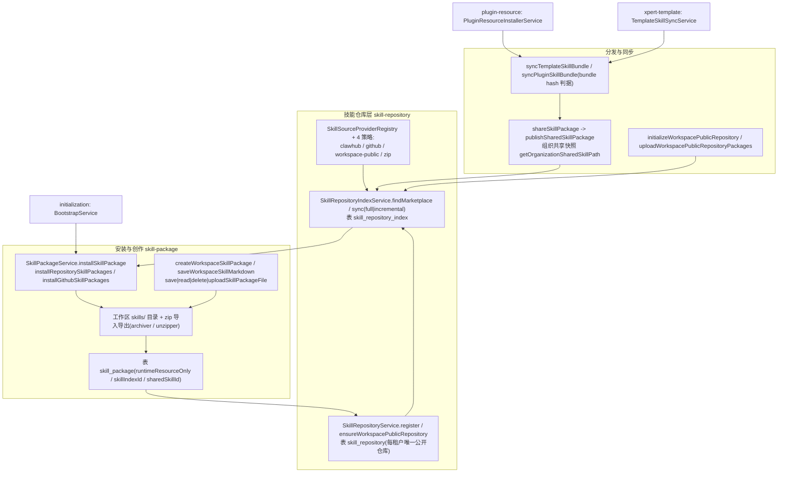

**本文引用的文件**
- [packages/server-ai/src/skill-package/skill-package.module.ts](file://packages/server-ai/src/skill-package/skill-package.module.ts)
- [packages/server-ai/src/skill-package/skill-package.service.ts](file://packages/server-ai/src/skill-package/skill-package.service.ts)
- [packages/server-ai/src/skill-package/skill-package.controller.ts](file://packages/server-ai/src/skill-package/skill-package.controller.ts)
- [packages/server-ai/src/skill-package/skill-package.entity.ts](file://packages/server-ai/src/skill-package/skill-package.entity.ts)
- [packages/server-ai/src/skill-package/index.ts](file://packages/server-ai/src/skill-package/index.ts)
- [packages/server-ai/src/skill-package/types.ts](file://packages/server-ai/src/skill-package/types.ts)
- [packages/server-ai/src/skill-package/plugins/index.ts](file://packages/server-ai/src/skill-package/plugins/index.ts)
- [packages/server-ai/src/skill-package/plugins/skills-middleware/index.ts](file://packages/server-ai/src/skill-package/plugins/skills-middleware/index.ts)
- [packages/server-ai/src/skill-package/plugins/skills-middleware/skill-usage.ts](file://packages/server-ai/src/skill-package/plugins/skills-middleware/skill-usage.ts)
- [packages/server-ai/src/skill-package/plugins/skill-creator-middleware/index.ts](file://packages/server-ai/src/skill-package/plugins/skill-creator-middleware/index.ts)
- [packages/server-ai/src/skill-package/authoring/skill-creator-cqrs.ts](file://packages/server-ai/src/skill-package/authoring/skill-creator-cqrs.ts)
- [packages/server-ai/src/skill-package/authoring/skill-authoring.ts](file://packages/server-ai/src/skill-package/authoring/skill-authoring.ts)
- [packages/server-ai/src/skill-repository/skill-repository.module.ts](file://packages/server-ai/src/skill-repository/skill-repository.module.ts)
- [packages/server-ai/src/skill-repository/skill-repository.service.ts](file://packages/server-ai/src/skill-repository/skill-repository.service.ts)
- [packages/server-ai/src/skill-repository/skill-repository.controller.ts](file://packages/server-ai/src/skill-repository/skill-repository.controller.ts)
- [packages/server-ai/src/skill-repository/skill-repository.entity.ts](file://packages/server-ai/src/skill-repository/skill-repository.entity.ts)
- [packages/server-ai/src/skill-repository/types.ts](file://packages/server-ai/src/skill-repository/types.ts)
- [packages/server-ai/src/skill-repository/repository-index/skill-repository-index.service.ts](file://packages/server-ai/src/skill-repository/repository-index/skill-repository-index.service.ts)
- [packages/server-ai/src/skill-repository/repository-index/skill-repository-index.controller.ts](file://packages/server-ai/src/skill-repository/repository-index/skill-repository-index.controller.ts)
- [packages/server-ai/src/skill-repository/repository-index/skill-repository-index.entity.ts](file://packages/server-ai/src/skill-repository/repository-index/skill-repository-index.entity.ts)
- [packages/server-ai/src/skill-repository/plugins/index.ts](file://packages/server-ai/src/skill-repository/plugins/index.ts)
- [packages/server-ai/src/skill-repository/plugins/clawhub/strategy.ts](file://packages/server-ai/src/skill-repository/plugins/clawhub/strategy.ts)
- [packages/server-ai/src/skill-repository/plugins/github/strategy.ts](file://packages/server-ai/src/skill-repository/plugins/github/strategy.ts)
- [packages/server-ai/src/skill-repository/plugins/workspace-public/strategy.ts](file://packages/server-ai/src/skill-repository/plugins/workspace-public/strategy.ts)
- [packages/server-ai/src/skill-repository/plugins/zip/strategy.ts](file://packages/server-ai/src/skill-repository/plugins/zip/strategy.ts)
- [packages/server-ai/src/skill-repository/plugins/zip/archive.ts](file://packages/server-ai/src/skill-repository/plugins/zip/archive.ts)
- [packages/server-ai/src/xpert-workspace/guards/workspace-authoring.guard.ts](file://packages/server-ai/src/xpert-workspace/guards/workspace-authoring.guard.ts)
- [packages/server-ai/src/xpert-workspace/workspace-base.service.ts](file://packages/server-ai/src/xpert-workspace/workspace-base.service.ts)
- [packages/server-ai/src/plugin-resource/plugin-resource-installer.service.ts](file://packages/server-ai/src/plugin-resource/plugin-resource-installer.service.ts)
- [packages/server-ai/src/xpert-template/template-skill-sync.service.ts](file://packages/server-ai/src/xpert-template/template-skill-sync.service.ts)
- [packages/server-ai/src/initialization/bootstrap.service.ts](file://packages/server-ai/src/initialization/bootstrap.service.ts)
- [AGENTS.md](file://AGENTS.md)

## 目录
- [子域职责边界](#子域职责边界)
- [与父专家其他子专家的切分依据](#与父专家其他子专家的切分依据)
- [子模块清单](#子模块清单)
- [分层结构](#分层结构)
- [依赖关系](#依赖关系)
- [关键不变量](#关键不变量)
- [架构总览](#架构总览)
- [组件详细分析](#组件详细分析)
- [结论](#结论)

## 子域职责边界
本子域拥有「文件形态的智力资产」：技能包（`skill_package`）的安装、创作、分发与卸载，技能仓库（`skill_repository`）与仓库索引（`skill_repository_index`）的登记、同步与市场查询，以及围绕它们的来源策略与两个 Agent 中间件策略。

**包含**：`installSkillPackage` / `installRepositorySkillPackages` / `installGithubSkillPackages` / `installDirectGithubSkillPackage` 四条安装入口；工作区技能创作与文件读写（`createWorkspaceSkillPackage`、`saveWorkspaceSkillMarkdown`、`save|read|delete|uploadSkillPackageFile`、`getSkillPackageFiles`、`getSkillPackageRootDownload` / `getSkillPackageFileDownload`）；卸载（`uninstallSkillPackage`、`uninstallSkillPackageInWorkspace`）；分发与同步（`shareSkillPackage`、`publishSharedSkillPackage`、`publishUploadedWorkspacePublicSkill`、`initializeWorkspacePublicRepository`、`uploadWorkspacePublicRepositoryPackages`、`syncTemplateSkillBundle`、`syncPluginSkillBundle`）；仓库与索引（`register`、`updateRepository`、`deleteRepository`、`findAllInOrganizationOrTenant`、`getSourceStrategies`、`ensureWorkspacePublicRepository`、`updateLastSyncAt`、`withWorkspacePublicRepositoryLock`、`findMarketplace`、`sync`）。

**不包含**：插件本体的安装与运行时装配（归「插件安装与运行时」）；插件组件/模板资源到 workspace、xpert、organization 的落点编排（归「插件资源与模板安装」，本子域只被其调用）；模板与插件的定义、导出与版本（`XpertTemplateService` 由 `xpert-template` 拥有，本子域只消费 `getTemplateSkillBundles`）；技能运行时中间件的 Prompt 组装细节归 Agent 运行时调用方，本子域只提供策略与数据。
章节来源：[skill-package.service.ts](file://packages/server-ai/src/skill-package/skill-package.service.ts)（关键符号：SkillPackageService.installSkillPackage、表 `skill_package`）、[skill-repository.service.ts](file://packages/server-ai/src/skill-repository/skill-repository.service.ts)（关键符号：SkillRepositoryService.ensureWorkspacePublicRepository、表 `skill_repository`）

## 与父专家其他子专家的切分依据
父专家按「进程级 / 资源级 / 文件级」三分。本子域是文件级：唯一持久化的业务事实是「某个工作区 `skills/` 目录下有一份某来源的技能目录」，以及「某个仓库索引里有一行技能元数据」。它与资源子专家的接口是**方法级调用而非数据级共享**：`PluginResourceInstallerService` 在 `runtimeType === SKILL_PACKAGE` 时计算 `plugin:<pluginName>:skill:<componentKey>` 并调用 `syncPluginSkillBundle`；模板子域通过 `TemplateSkillSyncService` 调用 `syncTemplateSkillBundle`。反向依赖仅有 `skill-repository` 对 `SkillPackageService` 的 `forwardRef` 注入（`SkillRepositoryController` 复用 `initializeWorkspacePublicRepository` 与 `uploadWorkspacePublicRepositoryPackages`）。
章节来源：[plugin-resource-installer.service.ts](file://packages/server-ai/src/plugin-resource/plugin-resource-installer.service.ts)（关键符号：PluginResourceInstallerService.syncPluginSkillBundle 调用点）、[skill-repository.controller.ts](file://packages/server-ai/src/skill-repository/skill-repository.controller.ts)（关键符号：SkillRepositoryController.ensureWorkspacePublicRepository）

## 子模块清单
- `packages/server-ai/src/skill-package/`（23 个非测试文件）：`index.ts`（barrel）、`skill-package.module.ts`、`skill-package.service.ts`（约 2.5k 行，含 4 个来源常量与 4 个文件上限常量）、`skill-package.controller.ts`、`skill-package.entity.ts`、`types.ts`、`authoring/{skill-authoring.ts, skill-creator-cqrs.ts}`、`commands/handlers/{create,update,delete}-workspace-skill.handler.ts`、`queries/handlers/{get-workspace-skill-for-edit, resolve-runtime-skill-packages}.handler.ts`、`queries/resolve-runtime-skill-packages.query.ts`、`plugins/skills-middleware/{index.ts, skill-usage.ts}`、`plugins/skill-creator-middleware/{index.ts, instructions.ts}`、`dto/simple-skill.dto.ts`，以及 5 个 barrel。
- `packages/server-ai/src/skill-repository/`（27 个非测试文件，其中 7 个 barrel；与父文档「24 源文件」同目录，差额来自 barrel 与 dto 是否计入）：`skill-repository.{module,controller,service,entity}.ts`、`types.ts`、`dto/{simple-skill-index.ts, simple-skill-repository.dto.ts}`、`repository-index/{skill-repository-index.module,controller,service,entity}.ts`、`plugins/{clawhub, github, workspace-public, zip}/`（github 额外含 `github-request.job.ts` 与 `github.constants.ts` 队列常量）。
- 路径语义集中在 `skill-repository/types.ts`：`getWorkspaceSkillsRoot`（工作区技能根）、`getOrganizationSharedSkillsRoot` / `getOrganizationSharedSkillPath`（组织共享快照根）、`isWorkspacePublicSkillRepositoryProvider`。
章节来源：[skill-package.module.ts](file://packages/server-ai/src/skill-package/skill-package.module.ts)（关键符号：SkillPackageModule.providers）、[skill-repository/types.ts](file://packages/server-ai/src/skill-repository/types.ts)（关键符号：getWorkspaceSkillsRoot）

## 分层结构
- **Controller（3 个）**：`SkillPackageController`（16 个端点，14 个挂 `WorkspaceAuthoringGuard`）、`SkillRepositoryController`（继承 `CrudController<SkillRepository>` 并覆写三个写方法 + 4 个业务端点）、`SkillRepositoryIndexController`（`CrudController<SkillRepositoryIndex>` + `POST sync/:repositoryId`）。
- **Service**：`SkillPackageService`（继承 `XpertWorkspaceBaseService<SkillPackage>`）、`SkillRepositoryService`（继承 `TenantOrganizationAwareCrudService<SkillRepository>`）、`SkillRepositoryIndexService`（继承 `TenantOrganizationAwareCrudService<SkillRepositoryIndex>`）。
- **来源策略层**：`SkillSourceProviderRegistry`（来自 `@xpert-ai/plugin-sdk`）+ 4 个实现，注册于 `SkillSourceProviders` 数组并由 `skill-repository.module.ts` 的 `providers` 展开。
- **中间件策略层**：`SkillsMiddleware`、`SkillCreatorMiddleware`（`@AgentMiddlewareStrategy(SKILLS_MIDDLEWARE_NAME)` / `(SKILL_CREATOR_MIDDLEWARE_NAME)`），由 `skill-package.module.ts` 的 `Strategies` 展开注入；配套 CQRS 命令/查询与宿主适配器 `resolveWorkspaceAuthoredSkill`。
- **CQRS**：`CreateWorkspaceSkillCommand`、`UpdateWorkspaceSkillCommand`、`DeleteWorkspaceSkillCommand`、`GetWorkspaceSkillForEditQuery`、`ResolveRuntimeSkillPackagesQuery` 及各自 handler。
- **Entity/DTO**：`SkillPackage`、`SkillRepository`、`SkillRepositoryIndex`；出参用 `SimpleSkillPackageDTO`（排除 `instructions`/`resources`）与 `SimpleSkillIndexDto`。
章节来源：[skill-package.controller.ts](file://packages/server-ai/src/skill-package/skill-package.controller.ts)（关键符号：SkillPackageController.saveSkillPackageFile）、[authoring/skill-creator-cqrs.ts](file://packages/server-ai/src/skill-package/authoring/skill-creator-cqrs.ts)（关键符号：CreateWorkspaceSkillCommand）

## 依赖关系
- **skill-package 的 imports**：`TypeOrmModule.forFeature([SkillPackage, XpertWorkspace])`、`TenantModule`、`CqrsModule`、`forwardRef(XpertWorkspaceModule)`、`forwardRef(SkillRepositoryModule)`、`SkillRepositoryIndexModule`、`forwardRef(XpertTemplateModule)`；`controllers: [SkillPackageController]`，`exports: [SkillPackageService]`。
- **skill-repository 的 imports**：`TypeOrmModule.forFeature([SkillRepository, SkillPackage])`、`TenantModule`、`DiscoveryModule`、`forwardRef(SkillPackageModule)`、`BullModule.registerQueue({ name: GITHUB_REQUEST_QUEUE, limiter: { max: 1, duration: 200 } })`；`exports: [SkillRepositoryService, SkillSourceProviderRegistry]`——即**来源策略注册表由本子域构造并对外导出**。
- **被依赖（消费方）**：`plugin-resource`（`syncPluginSkillBundle`）、`xpert-template`（`TemplateSkillSyncService` → `syncTemplateSkillBundle`）、`initialization`（`BootstrapService` 注入 `SkillPackageService` 与 `SkillRepositoryIndexService`，用 `ensureInstalledSkillPackage` 安装默认工作区技能）、Agent 运行时（`SkillsMiddleware`、`runtime-capabilities`、`xpert-agent` 的 `list-workspace-skills`）。
- **引用面实测**：在 `packages/server-ai/src` 下检索符号 `SkillPackageService` 命中 **37 个文件**（含 spec 与夹具）；检索 `SkillPackage|skill_package` 命中 **不少于 72 个文件**（工具输出被上限截断）。父文档记录的「52 个文件引用 `skill_package`（AI 域）」与本次复测同量级，应视为**下限估值**而非精确值。
章节来源：[skill-package.module.ts](file://packages/server-ai/src/skill-package/skill-package.module.ts)（关键符号：SkillPackageModule.imports）、[skill-repository.module.ts](file://packages/server-ai/src/skill-repository/skill-repository.module.ts)（关键符号：SkillRepositoryModule.exports）、[bootstrap.service.ts](file://packages/server-ai/src/initialization/bootstrap.service.ts)（关键符号：BootstrapService 构造注入）

## 关键不变量
1. **每租户唯一公开仓库**：`skill_repository` 上的 partial unique `IDX_skill_repository_workspace_public_tenant_unique` 限定 `provider='workspace-public' AND organizationId IS NULL AND deletedAt IS NULL`；写入前必须经 `withWorkspacePublicRepositoryLock`（PostgreSQL 下 `pg_advisory_xact_lock(hashtext(tenantId), hashtext(provider))`）与 `ensureWorkspacePublicRepository` 的「先查后建」。
2. **`sharedSkillId` 前缀即来源契约**：工作区分享为 `shared-skill-<uuid>`；模板 bundle 为 `template-bundle__<provider>__<编码后的仓库名>__<编码后的技能 id>`（由 `xpert-template` 的 bundle 常量与 `getTemplateSkillBundles` 生成）；插件组件为 `plugin:<pluginName>:skill:<componentKey>`；zip 直传公开仓库为 `workspace-public-upload__<编码路径>`。中途改格式等于让全部已发布快照失联。
3. **`skillIndexId` 可空且 CASCADE**：为空表示「工作区自建技能」，是分享与 Markdown 编辑的准入条件（`shareSkillPackage` 对非空者直接 400，`saveWorkspaceSkillMarkdown` 同样拒绝）；非空表示市场安装态，其外键 `onDelete: 'CASCADE'` 指向 `skill_repository_index`。
4. **写操作必须过两道写权限**：HTTP 侧 `WorkspaceAuthoringGuard`（`params.workspaceId` 必须是 UUID，否则 400 `server-ai:Error.WorkspaceIdInvalid`，随后 `workspaceAccessService.assertCanAuthor`），服务侧 `assertWorkspaceWritePermission` → `assertWorkspaceWriteAccess` → `assertWorkspaceAccess(workspaceId,'write')`；读路径 `resolveSkillPackageRoot` 用 `assertWorkspaceReadAccess`。`POST /skill-package/install` 与 `DELETE /skill-package/uninstall` 未挂守卫，但服务层仍各自校验写权限，因此授权并未缺失，缺的是工作区 id 的 HTTP 级前置校验。
5. **系统托管仓库不可人工注册/修改**：`register` 与 `assertMutableRepository` 拒绝 `workspace-public` 与 `file` 两个 provider；`getSourceStrategies` 同时把它们从可选来源里过滤掉。
6. **索引去重键是应用层契约**：`skill_repository_index` 上**没有** `(repositoryId, skillId)` 唯一约束，唯一性由 `SkillRepositoryIndexService.sync` 的 Map 去重 + 重复行软删维护。
7. **文件内容只能经来源策略落地**：安装走 `strategy.installSkillPackage(index, installDir)`，卸载走 `strategy.uninstallSkillPackage(path)`，路径一律由 `getWorkspaceSkillsRoot(tenantId, workspaceId)` 派生，服务自身不直接写工作区技能目录（创作链与 bundle 同步是显式例外）。
章节来源：[skill-repository.service.ts](file://packages/server-ai/src/skill-repository/skill-repository.service.ts)（关键符号：SkillRepositoryService.withWorkspacePublicRepositoryLock）、[workspace-authoring.guard.ts](file://packages/server-ai/src/xpert-workspace/guards/workspace-authoring.guard.ts)（关键符号：WorkspaceAuthoringGuard.canActivate）、[workspace-base.service.ts](file://packages/server-ai/src/xpert-workspace/workspace-base.service.ts)（关键符号：assertWorkspaceWriteAccess）

## 架构总览

图表来源：[skill-package.service.ts](file://packages/server-ai/src/skill-package/skill-package.service.ts)（关键符号：SkillPackageService.installSkillPackage、SkillPackageService.syncTemplateSkillBundle）、[skill-repository-index.service.ts](file://packages/server-ai/src/skill-repository/repository-index/skill-repository-index.service.ts)（关键符号：SkillRepositoryIndexService.sync）、[plugins/index.ts](file://packages/server-ai/src/skill-repository/plugins/index.ts)（关键符号：SkillSourceProviders）

## 组件详细分析
### 技能包服务
`SkillPackageService` 同时承担四条职责：安装态读写（`skill_package`）、工作区技能文件系统读写（`skills/` 目录的增删改查与 zip 导入导出）、分发（把工作区技能快照复制到组织共享目录并写入公开仓库索引行）、同步（模板/插件 bundle 的 hash 比对与刷新）。它继承 `XpertWorkspaceBaseService<SkillPackage>`，因此列表读路径 `getAllByWorkspace` 自带 `authoring` 权限过滤，且 `assertWorkspaceWriteAccess` / `assertWorkspaceReadAccess` 可复用。四个上限常量（50 文件、1MB 文本、5MB 二进制、20MB 整包）**只作用于 `createWorkspaceSkillPackage`**，zip 上传与 bundle 同步不受其约束。
章节来源：[skill-package.service.ts](file://packages/server-ai/src/skill-package/skill-package.service.ts)（关键符号：SkillPackageService.createWorkspaceSkillPackage、MAX_WORKSPACE_SKILL_PACKAGE_BYTES）、[workspace-base.service.ts](file://packages/server-ai/src/xpert-workspace/workspace-base.service.ts)（关键符号：`getAllByWorkspace`）

### 仓库与索引
仓库层是「可配置来源」与「系统托管来源」的合流点：手写路径只允许 clawhub / github 等非托管 provider，`workspace-public` 只能由 `ensureWorkspacePublicRepository` 惰性创建，`file`（zip）只能在安装时直传。索引层把四个策略的 `listSkills` 归一为 `ISkillRepositoryIndex[]` 落库，`findMarketplace` 则是唯一的市场读路径：按 `tenantId` + `deletedAt IS NULL` 收敛，organization 维度用 `organizationId = :organizationId OR organizationId IS NULL`，搜索命中 `name` / `skillId` / `skillPath` / `description` / `tags` 与 **`author::jsonb ->> 'handle'|'displayName'|'name'`**（物理列名是 `author`，属性名是 `publisher`）。
章节来源：[skill-repository-index.service.ts](file://packages/server-ai/src/skill-repository/repository-index/skill-repository-index.service.ts)（关键符号：SkillRepositoryIndexService.findMarketplace）、[skill-repository-index.entity.ts](file://packages/server-ai/src/skill-repository/repository-index/skill-repository-index.entity.ts)（关键符号：表 `skill_repository_index`）

### 两个中间件策略
`SkillsMiddleware` 是消费端：它在系统提示里做渐进式披露，并把运行时技能同步进沙箱 `{PWD}/.xpert/skills/`（含 inflight 复用、失败可见、按绑定变更重排）；`SkillCreatorMiddleware` 是生产端：只暴露 `create_workspace_skill`、`get_workspace_skill_for_edit`、`update_workspace_skill`、`delete_workspace_skill` 四个工具，经 CommandBus/QueryBus 转成 CQRS，宿主适配器 `resolveWorkspaceAuthoredSkill` 用 id/name/displayName/packagePath 四元匹配，歧义即返回候选而不落写。
章节来源：[skills-middleware/index.ts](file://packages/server-ai/src/skill-package/plugins/skills-middleware/index.ts)（关键符号：SkillsMiddleware、ISkillsMiddlewareOptions）、[authoring/skill-authoring.ts](file://packages/server-ai/src/skill-package/authoring/skill-authoring.ts)（关键符号：resolveWorkspaceAuthoredSkill）

## 结论
本子域的结构可以一句话概括：**仓库定义「能从哪拿」，索引定义「有哪些」，技能包定义「这里已经有一份」**。三者用 `repositoryId + skillId` 与应用层去重、`sharedSkillId` 前缀、`skillIndexId` 可空性三条弱契约缝合，任何一条变更都会立刻表现为「市场看不到、安装重复或分享失联」。因此变更前必须先回答：这条路径是安装、创作还是分发？它落在 DB 行还是卷上文件？写权限是否两道都过了？
章节来源：[skill-package.service.ts](file://packages/server-ai/src/skill-package/skill-package.service.ts)（关键符号：SkillPackageService.shareSkillPackage）、[skill-repository.service.ts](file://packages/server-ai/src/skill-repository/skill-repository.service.ts)（关键符号：SkillRepositoryService.register）
