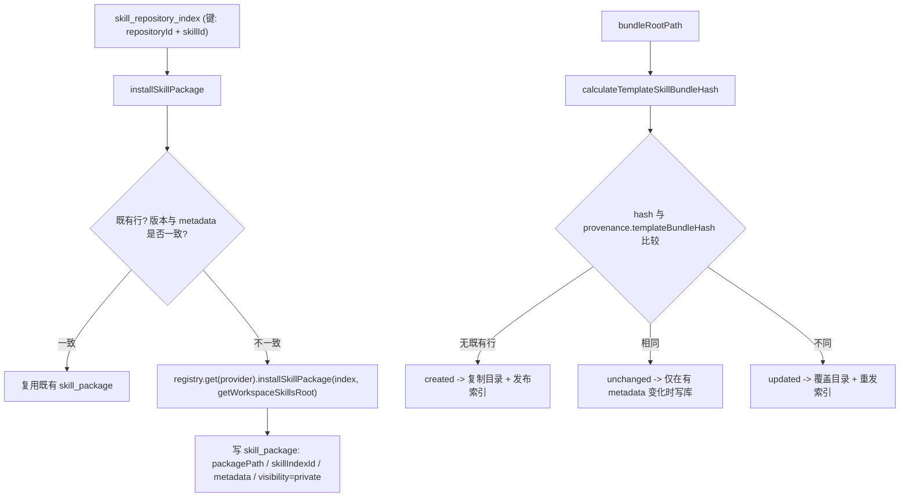

**本文引用的文件**
- [packages/server-ai/src/skill-package/skill-package.service.ts](file://packages/server-ai/src/skill-package/skill-package.service.ts)
- [packages/server-ai/src/skill-package/skill-package.controller.ts](file://packages/server-ai/src/skill-package/skill-package.controller.ts)
- [packages/server-ai/src/skill-package/skill-package.entity.ts](file://packages/server-ai/src/skill-package/skill-package.entity.ts)
- [packages/server-ai/src/skill-package/plugins/skills-middleware/index.ts](file://packages/server-ai/src/skill-package/plugins/skills-middleware/index.ts)
- [packages/server-ai/src/skill-package/plugins/skills-middleware/skill-usage.ts](file://packages/server-ai/src/skill-package/plugins/skills-middleware/skill-usage.ts)
- [packages/server-ai/src/skill-package/plugins/skill-creator-middleware/index.ts](file://packages/server-ai/src/skill-package/plugins/skill-creator-middleware/index.ts)
- [packages/server-ai/src/skill-package/plugins/skill-creator-middleware/instructions.ts](file://packages/server-ai/src/skill-package/plugins/skill-creator-middleware/instructions.ts)
- [packages/server-ai/src/skill-package/authoring/skill-authoring.ts](file://packages/server-ai/src/skill-package/authoring/skill-authoring.ts)
- [packages/server-ai/src/skill-package/authoring/skill-creator-cqrs.ts](file://packages/server-ai/src/skill-package/authoring/skill-creator-cqrs.ts)
- [packages/server-ai/src/skill-package/queries/handlers/resolve-runtime-skill-packages.handler.ts](file://packages/server-ai/src/skill-package/queries/handlers/resolve-runtime-skill-packages.handler.ts)
- [packages/server-ai/src/skill-repository/skill-repository.service.ts](file://packages/server-ai/src/skill-repository/skill-repository.service.ts)
- [packages/server-ai/src/skill-repository/skill-repository.controller.ts](file://packages/server-ai/src/skill-repository/skill-repository.controller.ts)
- [packages/server-ai/src/skill-repository/repository-index/skill-repository-index.service.ts](file://packages/server-ai/src/skill-repository/repository-index/skill-repository-index.service.ts)
- [packages/server-ai/src/skill-repository/repository-index/skill-repository-index.controller.ts](file://packages/server-ai/src/skill-repository/repository-index/skill-repository-index.controller.ts)
- [packages/server-ai/src/skill-repository/plugins/clawhub/strategy.ts](file://packages/server-ai/src/skill-repository/plugins/clawhub/strategy.ts)
- [packages/server-ai/src/skill-repository/plugins/github/strategy.ts](file://packages/server-ai/src/skill-repository/plugins/github/strategy.ts)
- [packages/server-ai/src/skill-repository/plugins/github/github-request.job.ts](file://packages/server-ai/src/skill-repository/plugins/github/github-request.job.ts)
- [packages/server-ai/src/skill-repository/plugins/workspace-public/strategy.ts](file://packages/server-ai/src/skill-repository/plugins/workspace-public/strategy.ts)
- [packages/server-ai/src/skill-repository/plugins/zip/strategy.ts](file://packages/server-ai/src/skill-repository/plugins/zip/strategy.ts)
- [packages/server-ai/src/skill-repository/plugins/zip/archive.ts](file://packages/server-ai/src/skill-repository/plugins/zip/archive.ts)
- [packages/server-ai/src/skill-repository/types.ts](file://packages/server-ai/src/skill-repository/types.ts)
- [packages/server-ai/src/xpert-template/template-skill-sync.service.ts](file://packages/server-ai/src/xpert-template/template-skill-sync.service.ts)
- [packages/server-ai/src/xpert-template/template.constants.ts](file://packages/server-ai/src/xpert-template/template.constants.ts)
- [packages/server-ai/src/plugin-resource/plugin-resource-installer.service.ts](file://packages/server-ai/src/plugin-resource/plugin-resource-installer.service.ts)
- [packages/server-ai/src/xpert-workspace/guards/workspace-authoring.guard.ts](file://packages/server-ai/src/xpert-workspace/guards/workspace-authoring.guard.ts)
- [AGENTS.md](file://AGENTS.md)

## 目录
- [安装链](#安装链)
- [创作链](#创作链)
- [分发链](#分发链)
- [同步链](#同步链)
- [仓库索引同步](#仓库索引同步)
- [来源策略实现差异](#来源策略实现差异)
- [设计模式及落点](#设计模式及落点)
- [热点路径](#热点路径)
- [关键类清单](#关键类清单)
- [技术债与 hack](#技术债与-hack)
- [设计维度分析](#设计维度分析)
- [结论](#结论)

## 安装链
`installSkillPackage(workspaceId, indexId)` 的固定顺序：① 校验 `workspaceId` 存在（400 `workspaceId is required`）与 `assertWorkspaceWritePermission`；② `skillIndexService.findOneInOrganizationOrTenant(indexId, { relations: ['repository'] })` 取索引并 `buildMetadataFromIndex` 生成 metadata；③ `findInstalledMarketplaceSkillPackage` 按 `(id, repositoryId, skillId, version)` 找既有行，命中后由 `shouldRefreshInstalledMarketplaceSkillPackage`（版本比较）与 `isInstalledMarketplaceSkillMetadataCurrent`（metadata 深比较）判定「复用」还是「就地刷新」；④ 刷新路径 `skillSourceProviderRegistry.get(repository.provider)` + `getWorkspaceSkillsRoot(tenantId, workspaceId)` → `strategy.installSkillPackage(index, installDir)` → `normalizePackagePath` → 写 `skill_package`（`skillIndexId`、`packagePath`、`metadata`，`visibility` 默认 `private`）；⑤ 全局 `catch` 统一转 400。

派生入口：`ensureInstalledSkillPackage(workspaceId, indexId)` 先按 `(workspaceId, skillIndexId)` 查重再回落安装（默认技能与 `ResolveTemplateSkillRefsCommand` 的回灌都用它）；`installRepositorySkillPackages` 取 `skillIndexService.findAll({ where: { repositoryId }, order: { updatedAt: 'DESC' } })` 后逐个 `ensureInstalledSkillPackage`；`installGithubSkillPackages` 走直连路径——`normalizeGithubSkillInstallInput`（`command` 用 `parseGithubSkillInstallCommand` 解析，否则取 `url`/`path`/`branch`/`skills`/`token`）→ `buildDirectGithubRepository`（**内存对象，不落 `skill_repository`**）→ github 策略 `listSkills` → `selectGithubSkillIndexes` 选择 → 每个索引调用私有 `installDirectGithubSkillPackage`，落行时**显式写 `skillIndexId: null`** 并把 `provenance`（sourceProvider/repositoryUrl/repositoryPath/branch/skillId/skillPath）写进 metadata。
章节来源：[skill-package.service.ts](file://packages/server-ai/src/skill-package/skill-package.service.ts)（关键符号：SkillPackageService.installSkillPackage、SkillPackageService.installDirectGithubSkillPackage、表 `skill_package`）

## 创作链
`createWorkspaceSkillPackage(workspaceId, input)`：`assertWorkspaceWritePermission` → `parseWorkspaceSkillFrontmatter`（`strictFrontmatter` 时只允许 `name`/`description`）→ `allocateWorkspaceSkillPackagePath` 生成 slug → 在 `.tmp-skill-create-<uuid>` 暂存目录写 `SKILL.md` 与 `prepareWorkspaceSkillPackageFiles` 处理后的附件 → 校验目标路径不存在 → `fs.rename` 原子迁入 → `create` 写行；失败时按「是否已迁入」选择删除目标目录或暂存目录。

文件级读写（全部经 `resolveSkillPackageRoot` 的读权限与 `validateSkillRelativePath` 的越界校验）：`getSkillPackageFiles`（`listFiles` + `deepth` 参数）、`readSkillPackageFile`（二进制不返回 `contents`，Office 走 `extractOfficePreviewText`）、`saveSkillPackageFile`（仅 `EditableSkillExtensions` 白名单，否则 400 `This file type cannot be edited`）、`uploadSkillPackageFile`（表单 `path` + `file`，名经 `normalizeUploadedFileName`）、`deleteSkillPackageFile`（目录递归删）。zip 导入导出：`uploadSkillPackagesFromFile` 用 `extractSkillsFromZip` + `installUploadedSkills` 落盘后逐技能 `create`；导出侧 `getSkillPackageRootDownload` / `getSkillPackageFileDownload` 只返回 `{ absolutePath, fileName, mimeType, type }`，真正的流式响应在 controller：目录用 `archiver('zip', { zlib: { level: 9 } })`，文件用 `createReadStream().pipe(res)`，统一写 `Content-Disposition: attachment; filename="<URI 编码>"`。
章节来源：[skill-package.service.ts](file://packages/server-ai/src/skill-package/skill-package.service.ts)（关键符号：SkillPackageService.createWorkspaceSkillPackage、SkillPackageService.saveSkillPackageFile）、[skill-package.controller.ts](file://packages/server-ai/src/skill-package/skill-package.controller.ts)（关键符号：SkillPackageController.sendSkillPackageDownload）

## 分发链
`shareSkillPackage(workspaceId, id, input)`：要求 tenant 上下文与非空写权限 → `skillIndexId` 非空即 400 `Only workspace uploaded skills can be shared` → `normalizeSharedSkillInput` 归一展示信息 → `sharedSkillId = skillPackage.sharedSkillId ?? 'shared-skill-' + uuid()`（**复用既有 id 即覆盖发布**）→ `resolveInstalledPath` 定位源目录 → `ensureWorkspacePublicRepository` → `mergeSharedMetadata`（补 `author`/`provenance`）→ `publishSharedSkillPackage`。

`publishSharedSkillPackage` 是分发的唯一落地点：`getOrganizationSharedSkillsRoot` / `getOrganizationSharedSkillPath(tenantId, organizationId, sharedSkillId)` 定位目标 → `mkdir` + `rm -rf` + `cp -r` 覆盖快照 → `update` 回写 `metadata`、`sharedSkillId`、`sharedPackagePath`、`publishAt` → `findSharedSkillIndex` 命中则复用 `id` 调 `skillIndexSkillService.create` 写/更新索引行（`skillId` 与 `skillPath` 均为 `sharedSkillId`，`publisher` 来自当前用户或 metadata.author，`stats` 用 `buildSharedSkillStats` 置零）。

公开仓库两条创建/灌入路径：`initializeWorkspacePublicRepository` 先 `ensureWorkspacePublicRepositoryContext`（tenant + user 必填）再遍历 `xpertTemplateService.getTemplateSkillBundles()`，对每个 bundle 以 `{ skipAccessCheck: true }` 调 `syncTemplateSkillBundle`；`uploadWorkspacePublicRepositoryPackages(repositoryId, file)` 校验目标仓库必须是 workspace-public → `ensureWorkspacePublicRepository` → `findOrCreateScopeDefaultWorkspace`（缺省时创建 `Tenant Skills Workspace`）→ `extractSkillsFromZip` → 逐个 `publishUploadedWorkspacePublicSkill`（`workspace-public-upload__<encodeURIComponent(路径)>` 作为 `sharedSkillId`）→ finally 清理临时目录。
章节来源：[skill-package.service.ts](file://packages/server-ai/src/skill-package/skill-package.service.ts)（关键符号：SkillPackageService.shareSkillPackage、SkillPackageService.publishSharedSkillPackage、SkillPackageService.uploadWorkspacePublicRepositoryPackages）

## 同步链
`syncTemplateSkillBundle(workspaceId, { bundleRootPath, sharedSkillId, metadata }, { skipAccessCheck?, validateOnly? })` 的判据链：除 `skipAccessCheck` 与 `validateOnly` 外先校验三个必填并查权限与 tenant → `calculateTemplateSkillBundleHash(bundleRootPath)`（递归目录哈希）→ `findSharedSkillIndex` + 按 `(workspaceId, sharedSkillId)` 取最新 `skill_package` → `readTemplateBundleHash(existingSkillPackage.metadata)` 得出 `nextStatus`：缺任一侧为 `created`，hash 相同为 `unchanged`，否则 `updated`；`validateOnly` 直接返回 `{ status, hash, sharedSkillId, index }`。

`unchanged` 分支仍可能写库：若传入 metadata 归一后与既有 metadata 不等则 `update`，若 `name`/`description` 展示字段变化则 `skillIndexService.update`，任一变化把状态升级为 `updated`。其余分支执行实际落地：`fs.rm` 目标目录 → `fs.cp(bundleRootPath, …)`（`filter` 排除 `bundle.yaml`）→ `withTemplateBundleHash` 把 `templateBundleHash` 写进 `provenance` → 新建或更新 `skill_package` → `publishSharedSkillPackage` 发布到公开仓库 → 失败时若本来没有既有行则删目录 + `softDelete` 回滚。

`syncPluginSkillBundle(workspaceId, { pluginName, componentKey, bundleRootPath, metadata }, options)` 只是同一实现的壳：校验 `pluginName`/`componentKey` 后拼出 `sharedSkillId = 'plugin:<pluginName>:skill:<componentKey>'` 再转发。调用方是 `PluginResourceInstallerService`（`runtimeType === SKILL_PACKAGE` 时以 `resolveSkillRoot(runtimeComponent)` 为 `bundleRootPath`）与 `TemplateSkillSyncService`（模板 bundle 与默认技能引用）。
章节来源：[skill-package.service.ts](file://packages/server-ai/src/skill-package/skill-package.service.ts)（关键符号：SkillPackageService.syncTemplateSkillBundle、SkillPackageService.syncPluginSkillBundle）、[plugin-resource-installer.service.ts](file://packages/server-ai/src/plugin-resource/plugin-resource-installer.service.ts)（关键符号：PluginResourceInstallerService 技能安装分支）

## 仓库索引同步
`SkillRepositoryIndexService.sync(repositoryId, { mode })`：① `repositoryId` 必填（400）→ `skillRepositoryService.findOneByIdString` 取仓库；② `find({ where: { repositoryId } })` 取全部既有行，按 `compareSkillRepositoryIndexFreshness`（先 `updatedAt` 后 `createdAt` 降序）排序后建 `repositoryId:skillId` Map，多余行记入 `duplicateExistingIds`；③ `registry.get(repository.provider).listSkills(repository)`，缺 `skillId` 立即 400 `Skill repository index item.skillId is required.`，并按同一键去重（有重复则告警）；④ 逐条 `{ ...匹配到的既有行, ...omit(item, 'repository'), repositoryId }` 后 `create`（更新即带 id 保存）；⑤ **`mode === 'full'` 时**把「既有存在但本次未返回」的 id 与重复行合并为 `softDelete({ id: In(...) })`，`incremental` 则不删任何行；⑥ `finally` 中无条件 `updateLastSyncAt(repositoryId)`，异常统一转 400。

`full` 与 `incremental` 的差异总结：两者的写入与去重逻辑相同，区别只在是否对「仓库端已消失的技能」做软删；因此 `incremental` 是**只增不减**的收敛，长期使用会留下陈旧索引行，需要周期性 `full` 清理。判据来源是策略的 `listSkills` 返回值，本子域不做二次判定。

图表来源：[skill-package.service.ts](file://packages/server-ai/src/skill-package/skill-package.service.ts)（关键符号：SkillPackageService.installSkillPackage、SkillPackageService.syncTemplateSkillBundle）、[skill-repository-index.service.ts](file://packages/server-ai/src/skill-repository/repository-index/skill-repository-index.service.ts)（关键符号：SkillRepositoryIndexService.sync）

## 来源策略实现差异
- **clawhub**（`ClawHubSkillSourceProvider`，`provider='clawhub'`）：默认 registry `https://clawhub.ai`、公共 Convex 端点 `https://wry-manatee-359.convex.cloud`、默认上限 `maxSkills = 100`、页大小 10、公共查询并发 5；列表有官方包目录与 `/api/v1/skills` 双端点回退，`officialOnly=false` 时合并官方与社区，重复按 `skillId` 去重再截断；限流按 `CLAWHUB_RATE_LIMIT_RETRIES`（2 次）指数退避重试，无 token 且持续 429 时**不回退**并直接报错；安装按版本下载 zip 并忽略 `_meta.json`，要求归档根有 `SKILL.md`。
- **github**（`GitHubSkillSourceProvider`，`provider='github'`）：token 取 `repository.credentials.token || process.env.GITHUB_TOKEN`，只接受 `github.com` 主机（否则 `Only GitHub repositories are supported.`），通过 `https://api.github.com/repos/{owner}/{repo}/tarball/{branch|main}` 拉取并本地解包扫描技能；元数据侧补 `publisher` 与 `stats`（stars 等），回落用 owner 名称；所有 HTTP 调用经 `GITHUB_REQUEST_QUEUE`（Bull，`max: 1 / duration: 200`）限流，由 `GithubRequestProcessor` 执行。它是唯一同时被「仓库同步」与「工作区直连安装」使用的策略。
- **workspace-public**（`WorkspacePublicSkillSourceProvider`，系统托管）：`listSkills` 直接查 `skill_package`——条件为 `tenantId` 匹配、`skillIndexId IS NULL`、`sharedSkillId`/`sharedPackagePath`/`publishAt` 非空，organization 维度按「指定组织」或 `IS NULL` 收敛；安装即把 `getOrganizationSharedSkillPath(...)` 快照 `cp` 到工作区，源目录缺失时报 `Shared skill snapshot not found`。
- **zip / file**（`ZipSkillSourceProvider`，`provider='file'`）：不参与索引，`listSkills` 恒返回空数组，`installSkillPackage` 直接抛 `File upload installs skills directly without repository index`；实际能力是 `installFromZip(buffer, installDir)`（`extractSkillsFromZip` + `installUploadedSkills`，finally 清理临时目录）。
章节来源：[clawhub/strategy.ts](file://packages/server-ai/src/skill-repository/plugins/clawhub/strategy.ts)（关键符号：ClawHubSkillSourceProvider、DEFAULT_CLAWHUB_MAX_SKILLS）、[github/strategy.ts](file://packages/server-ai/src/skill-repository/plugins/github/strategy.ts)（关键符号：resolveGithubToken）、[workspace-public/strategy.ts](file://packages/server-ai/src/skill-repository/plugins/workspace-public/strategy.ts)（关键符号：WorkspacePublicSkillSourceProvider.listSkills）、[zip/strategy.ts](file://packages/server-ai/src/skill-repository/plugins/zip/strategy.ts)（关键符号：ZipSkillSourceProvider.installFromZip）

## 设计模式及落点
- **策略注册表 + 元数据驱动**：`SkillSourceProviderRegistry` 同时提供实例（`get(provider)`）与展示元数据（`list()` → `meta`），`SkillRepositoryService.getSourceStrategies` 与 `register` 用同一份数据做「可选来源」与「托管来源」的区分，避免前端与后端各自维护白名单。
- **模板方法（同步壳）**：`syncPluginSkillBundle` 只负责把 `(pluginName, componentKey)` 拼成 `sharedSkillId` 再委托 `syncTemplateSkillBundle`，保证两条上游来源的 hash 判据、回滚与发布逻辑完全一致。
- **三段式幂等（查重 → 复用/刷新 → 写行）**：安装、上传、直连 GitHub 三条链都遵循同一形状，差别只在查重键（`skillIndexId` / `sharedSkillId` / GitHub provenance 匹配）。
- **CQRS 与宿主适配器**：`SkillCreatorMiddleware` 只发 `CreateWorkspaceSkillCommand` 等消息，宿主用 `resolveWorkspaceAuthoredSkill` 做「唯一匹配才写」的裁决，把 LLM 的不确定性挡在写入之外。
- **响应式流式下载**：Service 只解析目标（`type: 'file' | 'directory'`），Controller 负责 `archiver` 与 `createReadStream`，使下载语义可被单测覆盖而不依赖 `res`。
章节来源：[skill-repository.service.ts](file://packages/server-ai/src/skill-repository/skill-repository.service.ts)（关键符号：SkillRepositoryService.getSourceStrategies）、[skill-creator-middleware/index.ts](file://packages/server-ai/src/skill-package/plugins/skill-creator-middleware/index.ts)（关键符号：SkillCreatorMiddleware.createMiddleware）

## 热点路径
- **索引同步的外呼**：`sync` 是唯一会阻塞在外部网络（clawhub / GitHub API）的写路径，`full` 模式还会触发批量 `create` 与 `softDelete`；异常与 `updateLastSyncAt` 都在同一 `try/finally` 内。
- **技能目录复制**：分享（`cp -r` 到组织共享目录）、模板/插件 bundle（`rm -rf` + `cp -r`）、安装（策略内 `cp`）都是整目录级 I/O，目录越大越慢，且没有增量。
- **bundle 哈希**：`calculateTemplateSkillBundleHash` 递归读取整个 bundle 目录，每次同步（含 `validateOnly` 预检）都会全量哈希。
- **沙箱技能同步**：`SkillsMiddleware` 在模型调用前把选中的技能同步进 `{PWD}/.xpert/skills/`，并用 inflight 复用与「绑定变更才重排」避免重复拷贝；失败状态会被保留以便 `read_skill_file` 报错。
- **市场查询 DSL**：`findMarketplace` 用 `Brackets` 拼 9 条 `ILIKE`（含 `author::jsonb ->> ...` 三列 jsonb 提取），`search` 非空时不走任何索引。
章节来源：[skill-repository-index.service.ts](file://packages/server-ai/src/skill-repository/repository-index/skill-repository-index.service.ts)（关键符号：SkillRepositoryIndexService.findMarketplace）、[skills-middleware/index.ts](file://packages/server-ai/src/skill-package/plugins/skills-middleware/index.ts)（关键符号：SkillsMiddleware 技能同步调度）

## 关键类清单
1. `SkillPackageService` — [skill-package.service.ts](file://packages/server-ai/src/skill-package/skill-package.service.ts) — 安装/创作/分发/同步/卸载全链路与文件系统读写。
2. `SkillPackageController` — [skill-package.controller.ts](file://packages/server-ai/src/skill-package/skill-package.controller.ts) — 16 个端点、守卫挂载与 zip 流式下载。
3. `SkillPackage` — [skill-package.entity.ts](file://packages/server-ai/src/skill-package/skill-package.entity.ts) — 表 `skill_package`。
4. `SkillRepositoryService` — [skill-repository.service.ts](file://packages/server-ai/src/skill-repository/skill-repository.service.ts) — 仓库登记/托管保护/公开仓库保障与 advisory lock。
5. `SkillRepositoryController` — [skill-repository.controller.ts](file://packages/server-ai/src/skill-repository/skill-repository.controller.ts) — 仓库 CRUD、来源元数据、公开仓库初始化与直传。
6. `SkillRepositoryIndexService` — [skill-repository-index.service.ts](file://packages/server-ai/src/skill-repository/repository-index/skill-repository-index.service.ts) — 市场查询与 full/incremental 同步。
7. `SkillRepositoryIndexController` — [skill-repository-index.controller.ts](file://packages/server-ai/src/skill-repository/repository-index/skill-repository-index.controller.ts) — `skill-repository-indexes` 前缀下的查询与同步入口。
8. `ClawHubSkillSourceProvider` — [clawhub/strategy.ts](file://packages/server-ai/src/skill-repository/plugins/clawhub/strategy.ts) — ClawHub 抓取、限流退避与 zip 安装。
9. `GitHubSkillSourceProvider` — [github/strategy.ts](file://packages/server-ai/src/skill-repository/plugins/github/strategy.ts) — GitHub 仓库扫描、token 解析与 tarball 安装。
10. `GithubRequestProcessor` — [github-request.job.ts](file://packages/server-ai/src/skill-repository/plugins/github/github-request.job.ts) — Bull 队列执行器（限流 1 次/200ms）。
11. `WorkspacePublicSkillSourceProvider` — [workspace-public/strategy.ts](file://packages/server-ai/src/skill-repository/plugins/workspace-public/strategy.ts) — 以 `skill_package` 反推公开仓库索引。
12. `ZipSkillSourceProvider` — [zip/strategy.ts](file://packages/server-ai/src/skill-repository/plugins/zip/strategy.ts) — 上传直装来源；`extractSkillsFromZip` / `installUploadedSkills` 见 [zip/archive.ts](file://packages/server-ai/src/skill-repository/plugins/zip/archive.ts)。
13. `SkillsMiddleware` — [skills-middleware/index.ts](file://packages/server-ai/src/skill-package/plugins/skills-middleware/index.ts) — 技能提示组装、发现/安装工具与运行时同步。
14. `SkillCreatorMiddleware` — [skill-creator-middleware/index.ts](file://packages/server-ai/src/skill-package/plugins/skill-creator-middleware/index.ts) — 仅暴露 4 个创作工具的 CQRS 前端。
15. `resolveWorkspaceAuthoredSkill` — [skill-authoring.ts](file://packages/server-ai/src/skill-package/authoring/skill-authoring.ts) — 技能引用唯一匹配裁决与 metadata 归一。
16. `TemplateSkillSyncService` — [template-skill-sync.service.ts](file://packages/server-ai/src/xpert-template/template-skill-sync.service.ts) — 模板侧 bundle/默认技能引用同步调用方。
17. `WorkspaceAuthoringGuard` — [workspace-authoring.guard.ts](file://packages/server-ai/src/xpert-workspace/guards/workspace-authoring.guard.ts) — 技能包写路径的统一 HTTP 护栏。
18. `skillReadResult` / `registerSkillUsages` — [skill-usage.ts](file://packages/server-ai/src/skill-package/plugins/skills-middleware/skill-usage.ts) — 技能使用痕迹与来源归因。
章节来源：[skill-package.service.ts](file://packages/server-ai/src/skill-package/skill-package.service.ts)（关键符号：SkillPackageService.syncPluginSkillBundle）、[skill-repository/plugins/index.ts](file://packages/server-ai/src/skill-repository/plugins/index.ts)（关键符号：SkillSourceProviders）

## 技术债与 hack
- **文档前缀与实现不一致**：`AGENTS.md` 的 API Endpoints 小节写「indexes at `/skill-repository/indexes` with `POST /sync/:repositoryId`」，实际控制器声明是 `@Controller('skill-repository-indexes')`，即 `/api/skill-repository-indexes` 与 `/api/skill-repository-indexes/sync/:repositoryId`；照文档拼接会 404。
- **`publisher` 属性与 `author` 列错位**：`SkillRepositoryIndex.publisher` 的物理列名是 `author`，服务里全部按 `author::jsonb ->> ...` 查询；任何手写 SQL 或原生条件用到 `publisher` 都会静默查空。
- **软删与索引/文件残留**：卸载 `uninstallResolvedSkillPackage` 只做「策略删目录 + `cleanupSharedSkillPublication`（删共享快照 + 软删索引行）+ `softDelete` 技能包行」；而 `skill_package.skillIndex` 的 `onDelete: 'CASCADE'` 是数据库级联，删索引行**不会**触发服务，工作区 `skills/` 目录会残留。`full` 同步软删索引时同理。
- **上传解包缺少归档级防护**：`extractSkillsFromZip` 直接 `unzipper` 解包到临时目录，仅用 `normalizeUploadedSkillPath` 归一目标路径，未见与插件归档 `assertSafeArchiveEntries` 等价的 `..`/绝对路径校验；两条上传端点（`/skill-package/workspace/:workspaceId/upload`、`/skill-repository/:id/upload`）的 `FileInterceptor('file')` 也未声明 `limits`，与插件归档的 100MB 硬上限不对称。
- **体积常量覆盖不全**：`MAX_WORKSPACE_SKILL_PACKAGE_FILES`(50) / `MAX_WORKSPACE_SKILL_TEXT_FILE_BYTES`(1MB) / `MAX_WORKSPACE_SKILL_BINARY_FILE_BYTES`(5MB) / `MAX_WORKSPACE_SKILL_PACKAGE_BYTES`(20MB) 只在 `createWorkspaceSkillPackage` 生效，zip 导入与 bundle 同步完全不受约束。
- **直连 GitHub 安装不落仓库行**：`buildDirectGithubRepository` 造的是内存仓库对象，卸载时 provider 只能靠 `metadata.source === 'github'` 兜底（`uninstallResolvedSkillPackage` 的 `skillPackage.skillIndex?.repository?.provider ?? metadata?.source`）。
- **`skill_package` 无 DB 级约束**：无 `(workspaceId, skillIndexId)` 唯一性、无 `visibility` CHECK、json 列无结构校验，全部靠服务层与 JSON 深比较兜底。
- **`incremental` 永不清扫**：仅 `full` 会软删仓库端消失的技能，长期只跑 `incremental` 会让市场积累下架技能。
章节来源：[skill-package.service.ts](file://packages/server-ai/src/skill-package/skill-package.service.ts)（关键符号：SkillPackageService.uninstallResolvedSkillPackage、SkillPackageService.cleanupSharedSkillPublication）、[zip/archive.ts](file://packages/server-ai/src/skill-repository/plugins/zip/archive.ts)（关键符号：extractSkillsFromZip）、[AGENTS.md](file://AGENTS.md)（关键符号：API Endpoints 小节）

## 设计维度分析
### 维度一：幂等判据的分层
三处幂等各自使用不同类型的判据：① **数据库/服务层查重**承担安装幂等（`(workspaceId, skillIndexId)`、`(workspaceId, sharedSkillId)`、GitHub provenance 匹配），代价是每次安装多一次查询；② **内容哈希**承担同步幂等（`calculateTemplateSkillBundleHash` 与 metadata.provenance.templateBundleHash 比对），代价是全量读盘，但能识别「内容相同、id 相同」的重发；③ **JSON 深比较**承担展示幂等（`isSkillMetadataEqual` / `isInstalledMarketplaceSkillMetadataCurrent`），代价是键顺序敏感——它比较的是 `JSON.stringify` 结果而非规范化对象。三者不可互换：用哈希替代查重会漏掉「同 id 不同目录」的重复安装，用查重替代哈希会导致每次同步都重写目录。
章节来源：[skill-package.service.ts](file://packages/server-ai/src/skill-package/skill-package.service.ts)（关键符号：SkillPackageService.calculateTemplateSkillBundleHash 调用点、isSkillMetadataEqual）

### 维度二：DB 行是索引，卷是内容
本子域把「内容」放在卷上（工作区 `skills/`、组织共享 `skills/public/`），DB 只保存 `packagePath` / `sharedPackagePath` / `sharedSkillId` 三个弱引用。收益是技能包可以很大、可以按目录树直接读写；代价是**任何 DB 与卷的不一致都无法自动收敛**：目录被手工删除后安装仍会「命中既有行并复用」（除非版本或 metadata 变化），`Shared skill snapshot not found` 是唯一的运行时提示。因此运维上必须把「备份数据库」与「备份工作区卷」视为同一件事，并且在排查时先确认磁盘而非先看表。
章节来源：[skill-repository/types.ts](file://packages/server-ai/src/skill-repository/types.ts)（关键符号：getWorkspaceSkillsRoot、getOrganizationSharedSkillPath）、[skill-package.service.ts](file://packages/server-ai/src/skill-package/skill-package.service.ts)（关键符号：SkillPackageService.resolveInstalledPath）

## 结论
实现主干可以概括为四步曲：**索引来自策略、安装写行并复制目录、分享把目录搬到共享根再写索引行、同步用 hash 决定是否重写**。读路径只有两条（`findMarketplace` 与 `getAllByWorkspace`），写路径全部经过写权限与查重。要改动这一层，必须先回答三个问题：这条路径的幂等键是什么？它写的是 DB 行还是卷上文件（两者失败时谁先回滚）？以及它是否可能让 `sharedSkillId` 或 `skillIndexId` 的语义发生漂移。
章节来源：[skill-package.service.ts](file://packages/server-ai/src/skill-package/skill-package.service.ts)（关键符号：SkillPackageService.syncTemplateSkillBundle）、[skill-repository-index.service.ts](file://packages/server-ai/src/skill-repository/repository-index/skill-repository-index.service.ts)（关键符号：SkillRepositoryIndexService.sync）
