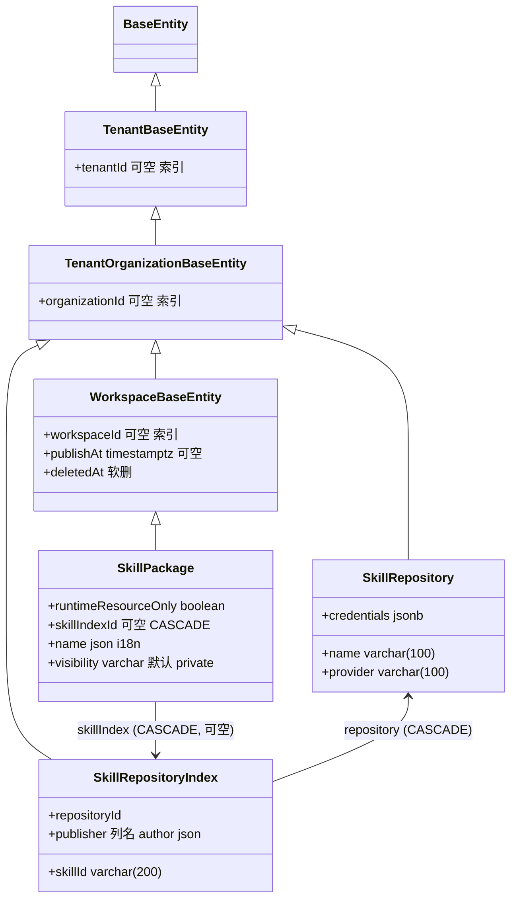

**本文引用的文件**
- [packages/server-ai/src/core/entities/base.entity.ts](file://packages/server-ai/src/core/entities/base.entity.ts)（`WorkspaceBaseEntity`）
- [packages/server/src/core/entities/tenant-base.entity.ts](file://packages/server/src/core/entities/tenant-base.entity.ts)（`TenantBaseEntity`）
- [packages/server/src/core/entities/tenant-organization-base.entity.ts](file://packages/server/src/core/entities/tenant-organization-base.entity.ts)（`TenantOrganizationBaseEntity`）
- [packages/server-ai/src/skill-package/skill-package.entity.ts](file://packages/server-ai/src/skill-package/skill-package.entity.ts)（表 `skill_package`）
- [packages/server-ai/src/skill-repository/skill-repository.entity.ts](file://packages/server-ai/src/skill-repository/skill-repository.entity.ts)（表 `skill_repository`）
- [packages/server-ai/src/skill-repository/repository-index/skill-repository-index.entity.ts](file://packages/server-ai/src/skill-repository/repository-index/skill-repository-index.entity.ts)（表 `skill_repository_index`）
- [packages/server-ai/src/skill-package/skill-package.service.ts](file://packages/server-ai/src/skill-package/skill-package.service.ts)
- [packages/server-ai/src/skill-repository/skill-repository.service.ts](file://packages/server-ai/src/skill-repository/skill-repository.service.ts)
- [packages/server-ai/src/skill-repository/repository-index/skill-repository-index.service.ts](file://packages/server-ai/src/skill-repository/repository-index/skill-repository-index.service.ts)
- [packages/server-ai/src/skill-repository/repository-index/skill-repository-index.controller.ts](file://packages/server-ai/src/skill-repository/repository-index/skill-repository-index.controller.ts)
- [packages/server-ai/src/skill-repository/dto/simple-skill-index.ts](file://packages/server-ai/src/skill-repository/dto/simple-skill-index.ts)
- [packages/server-ai/src/skill-package/dto/simple-skill.dto.ts](file://packages/server-ai/src/skill-package/dto/simple-skill.dto.ts)
- [packages/server-ai/src/skill-repository/plugins/workspace-public/strategy.ts](file://packages/server-ai/src/skill-repository/plugins/workspace-public/strategy.ts)
- [packages/server-ai/src/skill-repository/types.ts](file://packages/server-ai/src/skill-repository/types.ts)
- [packages/server-ai/src/xpert-workspace/guards/workspace-authoring.guard.ts](file://packages/server-ai/src/xpert-workspace/guards/workspace-authoring.guard.ts)
- [packages/server-ai/src/agent-plugin/migrations/20260921-agent-plugins.sql](file://packages/server-ai/src/agent-plugin/migrations/20260921-agent-plugins.sql)
- [docs/agent-plugins/README.md](file://docs/agent-plugins/README.md)
- [packages/server-ai/src/xpert-template/template.constants.ts](file://packages/server-ai/src/xpert-template/template.constants.ts)

## 目录
- [实体基类与继承链](#实体基类与继承链)
- [表 skill_package](#表-skill_package)
- [表 skill_repository](#表-skill_repository)
- [表 skill_repository_index](#表-skill_repository_index)
- [迁移与 seed 惯例](#迁移与-seed-惯例)
- [校验规则](#校验规则)
- [已知风险与坑](#已知风险与坑)

## 实体基类与继承链

图表来源：[base.entity.ts](file://packages/server-ai/src/core/entities/base.entity.ts)（关键符号：`WorkspaceBaseEntity`）、[skill-package.entity.ts](file://packages/server-ai/src/skill-package/skill-package.entity.ts)（关键符号：表 `skill_package`）、[skill-repository-index.entity.ts](file://packages/server-ai/src/skill-repository/repository-index/skill-repository-index.entity.ts)（关键符号：表 `skill_repository_index`）

`WorkspaceBaseEntity` 提供四项：`workspace`（`ManyToOne(XpertWorkspace, { nullable: true, onUpdate: 'CASCADE', onDelete: 'CASCADE' })`）、`workspaceId`（`@RelationId`，`@Index()`，可空）、`publishAt`（`timestamptz`，可空，本子域用作「已发布到公开仓库」的时间戳）、`deletedAt`（`@DeleteDateColumn()` 软删）。`TenantOrganizationBaseEntity` 在此之上再提供 `tenant` / `tenantId` 与 `organization` / `organizationId`（均可空 + 索引）。因此 `skill_package` 天然带租户、组织、工作区三层归属与软删；`skill_repository` 与 `skill_repository_index` 只到组织层（无 `workspaceId`）。
章节来源：[base.entity.ts](file://packages/server-ai/src/core/entities/base.entity.ts)（关键符号：`WorkspaceBaseEntity`）、[tenant-organization-base.entity.ts](file://packages/server/src/core/entities/tenant-organization-base.entity.ts)（关键符号：`TenantOrganizationBaseEntity`）

## 表 skill_package
| 列 | 类型 | 可空 | 默认 | 说明 |
| --- | --- | --- | --- | --- |
| `runtimeResourceOnly` | boolean | 否 | `false` | 标记「仅作为运行时资源存在」，并由插件资源安装写入（历史列，见 `20260921-agent-plugins.sql`） |
| `skillIndexId` | varchar | 是 | — | `@RelationId(skillIndex)`；为空表示工作区自建技能 |
| `skillIndex` 外键 | — | 是 | — | `@ManyToOne(() => SkillRepositoryIndex, { onDelete: 'CASCADE', nullable: true })` |
| `name` | json | 是 | — | i18n 对象（`en_US` / `zh_Hans`），服务层用 `readI18nText` 读取 |
| `visibility` | varchar | 否 | `'private'` | 业务取值 `private` / `team` / `tenant`（TS 联合类型，无 DB CHECK） |
| `packagePath` | varchar | 是 | — | 相对 `getWorkspaceSkillsRoot(tenantId, workspaceId)` 的目录名 |
| `sharedSkillId` | varchar | 是 | — | 共享标识，前缀约定见下 |
| `sharedPackagePath` | varchar | 是 | — | 当前实现恒等于 `sharedSkillId`（组织共享根下的目录名） |
| `metadata` | json | 是 | — | `SkillMetadata` 扩展：`skillMdPath` / `skillPath` / `source` / `resources` / `provenance` / `templateBundleHash` |
| `instructions` | json | 是 | — | `TSkillPackage['instructions']`，出参 `SimpleSkillPackageDTO` 用 `@Exclude` 屏蔽 |
| `tenantId` / `organizationId` / `workspaceId` | varchar | 是 | — | 继承自基类，均带索引 |
| `publishAt` / `deletedAt` | timestamptz | 是 | — | 发布时刻 / 软删时刻 |

关系与级联：`workspace` 多对一 CASCADE（删工作区即删行）；`skillIndex` 多对一 CASCADE 且可空（删索引行即删技能包行）。**业务约束（服务层）**：`skillIndexId` 非空 ⇒ 不可被 `shareSkillPackage` 分享、不可被 `saveWorkspaceSkillMarkdown` 编辑；`sharedSkillId` 的取值即来源契约——工作区分发 `shared-skill-<uuid>`、模板 bundle `template-bundle__…`、插件组件 `plugin:<pluginName>:skill:<componentKey>`、公开仓库 zip 直传 `workspace-public-upload__<编码路径>`；`visibility` 在创建与分享时都被显式写成 `private`。
章节来源：[skill-package.entity.ts](file://packages/server-ai/src/skill-package/skill-package.entity.ts)（关键符号：表 `skill_package`）、[skill-package.service.ts](file://packages/server-ai/src/skill-package/skill-package.service.ts)（关键符号：SkillPackageService.shareSkillPackage、buildWorkspacePublicSourceIdentifiers）

## 表 skill_repository
| 列 | 类型 | 可空 | 默认 | 说明 |
| --- | --- | --- | --- | --- |
| `name` | varchar(100) | 否 | — | `@IsString()` 必填 |
| `provider` | varchar(100) | 否 | — | `clawhub` / `github` / `workspace-public` / `file` 等策略名 |
| `credentials` | jsonb | 是 | — | `@IsJSON()`；github 用 `{ token }` |
| `options` | jsonb | 是 | — | `@IsJSON()`；clawhub 用 `officialOnly` / `maxSkills` 等 |
| `lastSyncAt` | timestamptz | 是 | — | 每次 `sync` 的 `finally` 中由 `updateLastSyncAt` 刷新 |
| `deletedAt` | timestamptz | 是 | — | `@DeleteDateColumn()` 软删 |
| `tenantId` / `organizationId` | varchar | 是 | — | 继承自基类，均带索引 |

索引与唯一约束：`@Index('IDX_skill_repository_workspace_public_tenant_unique', ['tenantId'], { unique: true, where: "provider = 'workspace-public' AND organizationId IS NULL AND deletedAt IS NULL" })`。语义是**每租户最多一行未软删的租户级公开仓库**：组织级公开仓库（`organizationId` 非空）不受此约束，软删后可以重建。业务约束：`register` 拒绝人工创建 `workspace-public` / `file`，`assertMutableRepository` 只在 `updateRepository` / `deleteRepository` 中拦截 `workspace-public`（`file` 类型行通常不存在，因 zip 上传不落仓库行）；`ensureWorkspacePublicRepository` 在 PostgreSQL 中先取 `pg_advisory_xact_lock(hashtext(tenantId), hashtext('workspace-public'))`，非 PostgreSQL 直接跳过锁。
章节来源：[skill-repository.entity.ts](file://packages/server-ai/src/skill-repository/skill-repository.entity.ts)（关键符号：`IDX_skill_repository_workspace_public_tenant_unique`）、[skill-repository.service.ts](file://packages/server-ai/src/skill-repository/skill-repository.service.ts)（关键符号：SkillRepositoryService.withWorkspacePublicRepositoryLock）

## 表 skill_repository_index
| 列 | 类型 | 可空 | 默认 | 说明 |
| --- | --- | --- | --- | --- |
| `repositoryId` | varchar | 否 | — | `@RelationId(repository)`，`repository` 为 `@ManyToOne(() => SkillRepository, { onDelete: 'CASCADE' })` |
| `skillPath` | varchar(300) | 否 | — | 仓库内路径；公开仓库场景等于 `sharedSkillId` |
| `skillId` | varchar(200) | 否 | — | 仓库内唯一技能标识（去重键的一半） |
| `name` | varchar | 是 | — | 展示名 |
| `link` | varchar(500) | 是 | — | 原始技能详情链接 |
| `publisher`（列名 `author`） | json | 是 | — | `@Column({ name: 'author' })`，`ISkillRepositoryIndexPublisher`（`handle` / `displayName` / `name`） |
| `description` | text | 是 | — | `@IsString()` |
| `license` | varchar | 是 | — | 许可证 |
| `tags` | json | 是 | — | `string[]`（`@IsArray()` + `@IsString({ each: true })`） |
| `version` | varchar(50) | 是 | — | 版本号，安装复用判据之一 |
| `stats` | json | 是 | — | `ISkillRepositoryIndexStats`（comments/downloads/installsAllTime/installsCurrent/stars/versions） |
| `resources` | json | 是 | — | `@IsJSON()`，文件清单（zip 上传时由 `collectResourcesFromFs` 生成） |
| `deletedAt` | timestamptz | 是 | — | 软删；`full` 同步与重复行清理都走 `softDelete` |
| `tenantId` / `organizationId` | varchar | 是 | — | 继承自基类 |

关系与级联：删 `skill_repository` 行会**物理 CASCADE 删除**本表行（软删仓库不会）；`skill_package.skillIndex` 反向 CASCADE 到技能包行。**业务约束**：本表**没有** `(repositoryId, skillId)` 唯一约束 —— 唯一性由 `SkillRepositoryIndexService.sync` 用 `buildSkillRepositoryIndexKey` 的 Map 去重，并把多余旧行（`compareSkillRepositoryIndexFreshness` 判定）在同步时软删；`findMarketplace` 读路径按 `tenantId` + `deletedAt IS NULL` 收敛，搜索的 `author` 三列提取必须用物理列名。公开仓库的索引行由 `WorkspacePublicSkillSourceProvider.listSkills` 从 `skill_package`（`skillIndexId IS NULL` 且 `sharedSkillId`/`sharedPackagePath`/`publishAt` 非空）反推生成。
章节来源：[skill-repository-index.entity.ts](file://packages/server-ai/src/skill-repository/repository-index/skill-repository-index.entity.ts)（关键符号：表 `skill_repository_index`）、[skill-repository-index.service.ts](file://packages/server-ai/src/skill-repository/repository-index/skill-repository-index.service.ts)（关键符号：SkillRepositoryIndexService.sync）、[workspace-public/strategy.ts](file://packages/server-ai/src/skill-repository/plugins/workspace-public/strategy.ts)（关键符号：WorkspacePublicSkillSourceProvider.listSkills）

## 迁移与 seed 惯例
本子域的 schema 走**双轨**，不是纯粹的 `synchronize`：

1. **实体声明为主**：三张表的列、索引、外键全部声明在实体装饰器上，由 TypeORM 的常规流程建表/加列。
2. **手工 SQL 补丁为辅**：仓库中存在 `packages/server-ai/src/agent-plugin/migrations/20260921-agent-plugins.sql`，其中包含 `ALTER TABLE skill_package ADD COLUMN IF NOT EXISTS "runtimeResourceOnly" boolean NOT NULL DEFAULT false;`（同文件还创建 `agent_plugin_package` 与 `agent_resource_binding`）。该文件由运维手工执行——`docs/agent-plugins/README.md` 明确写「Apply `packages/server-ai/src/agent-plugin/migrations/20260921-agent-plugins.sql`」。因此**新增列若同时提供实体声明与 SQL 补丁，必须保证二者一致**。
3. **无 seed 脚本**：`skill_repository` 的公开仓库不在 seed 中创建，而是在首次调用 `ensureWorkspacePublicRepository` / `initializeWorkspacePublicRepository` 时按「查空即建」+ partial unique + advisory lock 惰性创建，`name` 取策略 `meta.label` 的本地化结果（回落常量 `WORKSPACE_PUBLIC_SKILL_REPOSITORY_NAME`，由 `localizeRepository` 在读取时覆盖）。索引行则由 `sync`、分享发布（`publishSharedSkillPackage`）或 zip 直传（`publishUploadedWorkspacePublicSkill`）写入。
章节来源：[20260921-agent-plugins.sql](file://packages/server-ai/src/agent-plugin/migrations/20260921-agent-plugins.sql)（关键符号：`ALTER TABLE skill_package`）、[docs/agent-plugins/README.md](file://docs/agent-plugins/README.md)（关键符号：Storage and deployment 小节）、[skill-repository.service.ts](file://packages/server-ai/src/skill-repository/skill-repository.service.ts)（关键符号：SkillRepositoryService.ensureWorkspacePublicRepository）

## 校验规则
- **实体级（class-validator）**：`skill_repository` 与 `skill_repository_index` 带 `@IsString()` / `@IsOptional()` / `@IsJSON()` / `@IsObject()` / `@IsArray()` / `@IsDateString()`，并附 `@ApiProperty*`。**`SkillPackage` 实体没有任何 class-validator 或 Swagger 装饰器**，字段全部是裸 `@Column`，因此 `skill_package` 的取值合法性完全由服务层负责。
- **HTTP 级**：`WorkspaceAuthoringGuard` 要求 `request.params.workspaceId` 是 UUID，否则 400 `server-ai:Error.WorkspaceIdInvalid`（默认文案 `A valid Workspace ID is required.`），随后 `workspaceAccessService.assertCanAuthor(workspaceId)`。`SkillRepositoryIndexController.sync` 的 `repositoryId` 走 `UUIDValidationPipe`，`$take`/`$skip` 允许字符串数字并按非负整数校验，非法时回落到 `data.take` / `data.skip`。
- **服务级业务校验（异常均为 400）**：`workspaceId is required` / `indexId is required` / `repositoryId is required` / `Tenant context is missing` / `Tenant context is required to initialize the public skill repository` / `Tenant context is required to share workspace skills` / `A valid zip file is required` / `No skills found in the uploaded archive` / `Only workspace public repositories support direct zip uploads` / `Only workspace uploaded skills can be shared` / `Only workspace-authored skills can be edited` / `Skill file not found` / `File path is required` / `Invalid skill file path` / `This file type cannot be edited` / `Skill does not belong to the specified workspace` / `Missing tenant or workspace context for uninstall` / `Repository name and provider are required.` / `System managed repositories cannot be registered manually.` / `System managed repositories cannot be modified manually.` / `Skill repository index item.skillId is required.`
- **json 列结构（无 DDL 约束，仅约定）**：`skill_package.name` 为 i18n 对象；`metadata` 为 `SkillMetadata` + `skillMdPath`/`skillPath`/`source`/`resources`/`provenance`/`templateBundleHash`；`skill_repository.credentials|options` 为对象；`skill_repository_index.publisher` 为 `{ handle?, displayName?, name? }`；`stats` 为六个数值键；`tags` 为字符串数组。
- **partial unique 语义**：`IDX_skill_repository_workspace_public_tenant_unique` 只覆盖「未软删 + 租户级 + workspace-public」，它保证的是**每租户唯一公开仓库**，而不是「每租户唯一仓库」；其余 provider 可以有任意多行（github 直连安装甚至不落行）。
章节来源：[skill-repository.entity.ts](file://packages/server-ai/src/skill-repository/skill-repository.entity.ts)（关键符号：`IDX_skill_repository_workspace_public_tenant_unique`）、[workspace-authoring.guard.ts](file://packages/server-ai/src/xpert-workspace/guards/workspace-authoring.guard.ts)（关键符号：WorkspaceAuthoringGuard.canActivate）、[skill-package.service.ts](file://packages/server-ai/src/skill-package/skill-package.service.ts)（关键符号：SkillPackageService.assertWorkspaceWritePermission）

## 已知风险与坑
1. **`publisher` 与 `author` 的名字错位**：实体属性叫 `publisher`，列名是 `author`。手写 SQL、原生查询、`findMarketplace` 的搜索条件都必须用 `author`；`SimpleSkillIndexDto` 对外仍暴露 `publisher`，序列化与查询用名不一致。
2. **`skillIndexId` 的 CASCADE 不回收磁盘**：`onDelete: 'CASCADE'` 只作用于数据库。删除索引行（`full` 同步软删不触发；物理删仓库行会级联物理删索引）不会调用 `strategy.uninstallSkillPackage`，工作区 `skills/` 目录与组织共享快照都可能残留——服务层的卸载只有显式走 `uninstallSkillPackage` / `uninstallSkillPackageInWorkspace` 时才会清理。
3. **`skill_repository` 软删与索引的错位**：删除仓库走 `deletedAt` 软删，`skill_repository_index` 行不会被 CASCADE，也不会被同步清理，`findMarketplace` 仍能通过 `leftJoinAndSelect('skill.repository')` 读到已软删的仓库（除非调用方另行过滤）。
4. **无 `(repositoryId, skillId)` 唯一约束**：并发 `sync` 可能插入重复行，只能靠下一次 `sync` 的去重与软删收敛，期间市场会展示重复技能。
5. **json 列无数据库约束**：`metadata` / `stats` / `tags` / `resources` 都可以写入任意结构；`isSkillMetadataEqual` 用 `JSON.stringify` 比较，键顺序或空白差异会被判为「变了」并触发无意义重写。
6. **`visibility` 无 CHECK 且默认 `private`**：分享前存在「已发布但不可见」的窗口期，且历史脏值（任意字符串）不会被数据库拒绝。
7. **`runtimeResourceOnly` 是后加列**：只在手工 SQL 补丁里出现，若目标环境未执行该 SQL，实体与库结构会不一致（`synchronize` 之外无守卫）。
8. **github 直连安装的行没有 `skillIndexId`**：这类行在 `workspace-public` 策略眼里不算共享技能（还需要 `sharedSkillId` / `sharedPackagePath` / `publishAt`），但会被「工作区自建技能」的语义覆盖——因为它们 `skillIndexId` 为空，因此可编辑、可分享，卸载时依赖 `metadata.source` 反查 provider。
9. **模板 bundle 的 `sharedSkillId` 由 `xpert-template` 生成**：常量（`TEMPLATE_SKILL_BUNDLE_SHARED_PREFIX = 'template-bundle'`、`TEMPLATE_SKILL_BUNDLE_SEPARATOR = '__'`、`TEMPLATE_SKILL_BUNDLE_MANIFEST_FILE = 'bundle.yaml'`）与 `skill-package` 里的同名常量各有一份，改动需两边同步。
章节来源：[skill-repository-index.entity.ts](file://packages/server-ai/src/skill-repository/repository-index/skill-repository-index.entity.ts)（关键符号：`publisher` 列名 `author`）、[skill-package.service.ts](file://packages/server-ai/src/skill-package/skill-package.service.ts)（关键符号：SkillPackageService.uninstallResolvedSkillPackage、TEMPLATE_SKILL_BUNDLE_MANIFEST_FILE）、[template.constants.ts](file://packages/server-ai/src/xpert-template/template.constants.ts)（关键符号：TEMPLATE_SKILL_BUNDLE_SHARED_PREFIX）
