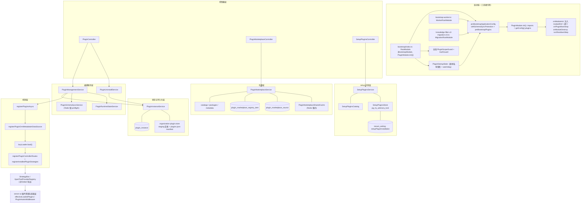

**本文引用的文件**
- [apps/api/src/bootstrap/index.ts](file://apps/api/src/bootstrap/index.ts)
- [apps/api/src/bootstrap-worker.ts](file://apps/api/src/bootstrap-worker.ts)
- [apps/api/src/knowledge-filter-v2-migration-cli.ts](file://apps/api/src/knowledge-filter-v2-migration-cli.ts)
- [apps/api/src/bootstrap/schema-sync-bootstrap.ts](file://apps/api/src/bootstrap/schema-sync-bootstrap.ts)
- [packages/server/src/plugin/plugin.module.ts](file://packages/server/src/plugin/plugin.module.ts)
- [packages/server/src/plugin/plugin-management.service.ts](file://packages/server/src/plugin/plugin-management.service.ts)
- [packages/server/src/plugin/plugin-instance.service.ts](file://packages/server/src/plugin/plugin-instance.service.ts)
- [packages/server/src/plugin/plugin-instance.entity.ts](file://packages/server/src/plugin/plugin-instance.entity.ts)
- [packages/server/src/plugin/plugin-instance.loader.ts](file://packages/server/src/plugin/plugin-instance.loader.ts)
- [packages/server/src/plugin/plugin.helper.ts](file://packages/server/src/plugin/plugin.helper.ts)
- [packages/server/src/plugin/plugin-orm-metadata.ts](file://packages/server/src/plugin/plugin-orm-metadata.ts)
- [packages/server/src/plugin/plugin-http-routes.ts](file://packages/server/src/plugin/plugin-http-routes.ts)
- [packages/server/src/plugin/plugin-strategy-registration.ts](file://packages/server/src/plugin/plugin-strategy-registration.ts)
- [packages/server/src/plugin/plugin-runtime-policy.ts](file://packages/server/src/plugin/plugin-runtime-policy.ts)
- [packages/server/src/plugin/plugin-scope.ts](file://packages/server/src/plugin/plugin-scope.ts)
- [packages/server/src/plugin/plugin-install-policy.ts](file://packages/server/src/plugin/plugin-install-policy.ts)
- [packages/server/src/plugin/plugin-update.utils.ts](file://packages/server/src/plugin/plugin-update.utils.ts)
- [packages/server/src/plugin/plugin-sdk-versioning.ts](file://packages/server/src/plugin/plugin-sdk-versioning.ts)
- [packages/server/src/plugin/source-config.ts](file://packages/server/src/plugin/source-config.ts)
- [packages/server/src/plugin/plugin-startup-step.ts](file://packages/server/src/plugin/plugin-startup-step.ts)
- [packages/server/src/plugin/plugin-startup-state.ts](file://packages/server/src/plugin/plugin-startup-state.ts)
- [packages/server/src/plugin/uninstall/plugin-uninstall.service.ts](file://packages/server/src/plugin/uninstall/plugin-uninstall.service.ts)
- [packages/server/src/plugin/setup/setup-plugins.service.ts](file://packages/server/src/plugin/setup/setup-plugins.service.ts)
- [packages/server/src/plugin/setup/setup-plugins.store.ts](file://packages/server/src/plugin/setup/setup-plugins.store.ts)
- [packages/server/src/plugin/marketplace/plugin-marketplace.service.ts](file://packages/server/src/plugin/marketplace/plugin-marketplace.service.ts)
- [packages/server/src/plugin/marketplace/plugin-marketplace.types.ts](file://packages/server/src/plugin/marketplace/plugin-marketplace.types.ts)
- [packages/server/src/shared/guards/plugin-scope.guard.ts](file://packages/server/src/shared/guards/plugin-scope.guard.ts)
- [packages/server-ai/src/plugin-resource/effective-loaded-plugins.ts](file://packages/server-ai/src/plugin-resource/effective-loaded-plugins.ts)

## 目录
- [子域职责边界](#子域职责边界)
- [内部分层](#内部分层)
- [依赖关系](#依赖关系)
- [关键不变量](#关键不变量)
- [架构总览](#架构总览)
- [结论](#结论)

## 子域职责边界
本子域 = `packages/server/src/plugin/` 全部源码（含 `marketplace/`、`setup/`、`permissions/`、`uninstall/`、`commands|queries/handlers/`）+ 进程启动链中插件相关的那一段。它回答的问题是「**这台机器上装了哪些插件、还能不能装、装完什么时候生效**」，即进程重启才生效的东西。

**拥有**：表 `plugin_instance`、`plugin_marketplace_source`、`plugin_marketplace_registry_item`，以及复用表 `tenant_setting` 的 setup 进度行；插件包在磁盘上的 staging 根、`plugins.json` manifest、`plugins/.runtime-plugin-state/<replica>.json` 启动快照；安装/卸载/刷新/升级的编排、SDK 兼容断言、artifact namespace 判定、level 归属判定、schema preflight、三段式动态装配、市场来源与目录聚合、setup 向导的四阶段状态机。

**不做什么**：不实现插件 SDK（`@xpert-ai/plugin-sdk` 是宿主提供的唯一运行时实例，必须以 `peerDependencies` 声明）；不实现内置插件本体（`packages/plugins/*`）；不做已加载组件到 workspace / organization / xpert / agent 的资源落点（那是子专家②`packages/server-ai/src/plugin-resource/`）；不做技能包、技能仓库与索引（子专家③）；**不拥有 DDL**——装配阶段只刷新 TypeORM metadata，建表由加锁的 preflight 负责。

**边界细则**：HTTP 输入永不接受 `packageDir`（仅服务端归档上传流程可用）；启动快照是副本本地私有副本，**绝不写回数据库中的期望配置**；无登录用户的后台路径（bootstrap、worker）必须显式解析 scope，缺 tenant 直接拒绝。

章节来源：[plugin-management.service.ts](file://packages/server/src/plugin/plugin-management.service.ts)（关键符号：PluginManagementService.installPlugin）、[plugin.module.ts](file://packages/server/src/plugin/plugin.module.ts)（关键符号：PluginModule.onModuleInit）、[plugin-schema-sync.service.ts](file://packages/server/src/plugin/plugin-schema-sync.service.ts)（关键符号：PluginSchemaSyncService.synchronize）

## 内部分层
子域内部共有七层，依赖方向自上而下单向，机制层不反向引用服务：

1. **控制器层**：`PluginController`（`plugin` 前缀，安装/归档/卸载/刷新/配置/升级）、`PluginMarketplaceController`（市场列表、来源 CRUD、registry、图标）、`SetupPluginsController`（`system/setup/plugins`）。只做 HTTP 解析、Zod/class-validator 校验与转调。
2. **编排服务层**：`PluginManagementService`（安装编排 + 三段式装配的唯一实现点）、`PluginUninstallService`（卸载护栏与重启分流）、`PluginSchemaSyncService`（preflight）、`PluginRuntimeStateService`（运行态上报）。
3. **状态与持久化层**：`PluginInstanceService`（`plugin_instance` 读写、level 归属、可见性、manifest/磁盘目录清理）+ `organization-plugin.store.ts`（staging 目录、manifest、workspace stage 指纹）。
4. **市场层**：`PluginMarketplaceService` 聚合 `plugin-marketplace-catalogs / -packages / -metadata / -registry / -assets / -summary / -cache / -shared-cache`。
5. **setup 向导层**：`SetupPluginsService` + `SetupPluginsCatalog` + `SetupPluginsStore`（PG advisory lock + `tenant_setting` 进度）。
6. **机制层**：`plugin.helper.ts`、`plugin-orm-metadata.ts`、`plugin-http-routes.ts`、`plugin-strategy-registration.ts`、`plugin-loader.ts`、`plugin-discovery.ts`、`plugin-runtime-policy.ts`、`plugin-update.utils.ts`、`plugin-install-policy.ts`、`plugin-sdk-versioning.ts`、`plugin-bundle-manifest.ts`、`source-config.ts`、`plugin-scope.ts`、`plugin-archive.ts`、`config.ts`、`lifecycle.ts`、`errors.ts`、`types.ts`。
7. **启动期层**：`plugin-startup-step.ts`、`plugin-startup-state.ts`、`plugin-startup-watchdog.ts`、`plugin-instance.loader.ts`、`plugin.module.ts`。

**守卫层**独立于以上分层：`PluginScopeGuard` 不在 `plugin/` 目录内，而是 `packages/server/src/shared/guards/` 的全局守卫，按插件控制器上的 `ORGANIZATION_METADATA_KEY` 判定请求 scope。

章节来源：[plugin.module.ts](file://packages/server/src/plugin/plugin.module.ts)（关键符号：PluginModule.providers）、[plugin.helper.ts](file://packages/server/src/plugin/plugin.helper.ts)（关键符号：registerPluginsAsync）、[plugin-scope.guard.ts](file://packages/server/src/shared/guards/plugin-scope.guard.ts)（关键符号：PluginScopeGuard.canActivate）

## 依赖关系
**启动链硬引用（三处 `PluginModule.init()`）**：`apps/api/src/bootstrap/index.ts` 的 `RootModule`、`apps/api/src/bootstrap-worker.ts` 的 `WorkerRootModule`、`apps/api/src/knowledge-filter-v2-migration-cli.ts` 的 `MigrationRootModule`。`PluginModule.init()` 只做一件事：`imports: [...getConfig().plugins]`。API 侧顺序为：`beginPluginStartup(getConfig().assetOptions.serverRoot)` → `preBootstrapApplicationConfig()`（内部 `withSchemaSyncProtection` 包裹 `preBootstrapPlugins` 与实体/订阅者注册）→ `NestFactory.create(RootModule)` → `app.useGlobalGuards(new AuthGuard(reflector), new PluginScopeGuard(reflector))` → `seedDBIfEmpty` + `setDefaultTenantId` → `useContainer(SharedModule)` → Swagger → `enableRuntimeShutdown` → `startPluginStartupStep('(application)','application-listen')` → `app.listen` → `markPluginStartupListening()`。worker 侧用 `createApplicationContext`，不开监听。

**模块依赖**：`PluginModule` 是 `@Global()`，imports 为 `ConfigModule`、`RedisModule`、`DiscoveryModule`、`RuntimeControlModule`、`TypeOrmModule.forFeature([PluginInstance, PluginMarketplaceSource, PluginMarketplaceRegistryItem])`、`CqrsModule`；导出 `StrategyBus`、`XpertToolProviderRegistry`、`PluginConfigResolver`、`PluginManagementService`、`PLUGIN_CONFIG_RESOLVER_TOKEN`、`PLUGIN_WEBHOOK_AUTH_SERVICE_TOKEN`、`LOADED_PLUGINS`。`LOADED_PLUGINS` 指向模块级可变数组 `loaded`。

**外部依赖**：PostgreSQL（setup advisory lock、市场 `xmin` 栅栏、`orIgnore` 语义）、Redis（schema 锁 `xpert:plugin:schema-sync`、市场共享缓存租约）、`git` 可执行文件（git 来源目录 clone）、npm registry（版本/tarball）、内置市场 JSON URL、文件系统（staging 根、manifest、快照、临时解包目录）。

**被跨子专家消费**：`LOADED_PLUGINS`、`StrategyBus`、`XpertToolProviderRegistry` 被 `packages/server-ai` 的插件资源与技能层读取；setup 向导向外发 `ImportDefaultAgentPluginsCommand`。

章节来源：[bootstrap/index.ts](file://apps/api/src/bootstrap/index.ts)（关键符号：bootstrap、preBootstrapPlugins）、[plugin.module.ts](file://packages/server/src/plugin/plugin.module.ts)（关键符号：PluginModule.init）、[bootstrap-worker.ts](file://apps/api/src/bootstrap-worker.ts)（关键符号：bootstrapWorker）

## 关键不变量
1. **三段式顺序不可颠倒**（`plugin-management.service.ts` 顶部不变量注释）：① `collectPluginOrmMetadata` + `validatePluginEntityTableNames` + `registerPluginOrmMetadataInDataSource`（内部 `buildMetadatas()`）→ ② `snapshotModuleIds` / `snapshotHttpRouteStack` 后 `lazyLoader.load(() => dynamicModule)` → ③ `registerPluginControllerRoutes` + `registerInstalledPluginStrategies`。顺序颠倒会得到 `EntityMetadataNotFoundError` 或挂在 404 之后的动态路由。
2. **level 与 restart 是正交语义**：`requiresPluginRestart(policy, level, operation)` 在未声明 `runtimePolicy` 时对 system/tenant 返回 true、organization 返回 false；同一次调用还要按 `existingRuntime ? 'update' : 'install'` 选择 operation。
3. **scopeKey 唯一来源**：`resolvePluginScope` —— 显式值优先；system → `system:global`；全局组织且非默认租户 → `tenant:<tenantId>:global`；其余为 organizationId。
4. **`packageDir` 是瞬态字段**：`omitTransientPluginSourceConfig` 落库前删除；HTTP 传入必须被拒绝（只有 `allowPackageDir` 的归档上传路径例外）。
5. **SDK 兼容是安装闸门**：`assertPluginSdkCompatibility` / `assertInstalledPluginSdkCompatibility` / `assertPluginSdkInstallCandidate` 三个入口；把 SDK 写进 `dependencies` 直接校验失败，跨 major/缺失 peer 只产出 warning 并由 `PluginInstance.meta.sdkCompatibilityWarnings` 上报。
6. **artifact namespace 唯一**：`assertPluginArtifactNamespaceAvailable` 阻止两个不同插件共用同一命名空间；实体表名必须匹配 `plugin_<namespace>_`（未声明 namespace 退化为 `plugin_`）。
7. **启动期超时/失败致命**：`runPluginStartupStep` 默认 30s，超时抛 `PluginStartupTimeoutError`；失败日志刻意不记录插件配置与异常文本。
8. **快照只读不写回**：快照是副本私有副本，未完成的候选 boot 只尝试一次，随后由 supervisor 恢复上次已准入配置。
9. **本子域不执行 DDL**：装配只 `buildMetadatas()`；DDL 在 Redis 锁内、用一次性 DataSource、只对插件自有实体打开 `synchronize`。
10. **无用户上下文的路径必须显式 scope**：tenant 缺失即失败，绝不做无 scope 的全局查询。

章节来源：[plugin-management.service.ts](file://packages/server/src/plugin/plugin-management.service.ts)（关键符号：PluginManagementService.installPlugin）、[plugin-runtime-policy.ts](file://packages/server/src/plugin/plugin-runtime-policy.ts)（关键符号：requiresPluginRestart）、[plugin-orm-metadata.ts](file://packages/server/src/plugin/plugin-orm-metadata.ts)（关键符号：registerPluginOrmMetadataInDataSource）、[plugin-startup-state.ts](file://packages/server/src/plugin/plugin-startup-state.ts)（关键符号：PluginStartupState.select）

## 架构总览

图表来源：[plugin.module.ts](file://packages/server/src/plugin/plugin.module.ts)（关键符号：PluginModule.init）、[bootstrap/index.ts](file://apps/api/src/bootstrap/index.ts)（关键符号：bootstrap）、[plugin-management.service.ts](file://packages/server/src/plugin/plugin-management.service.ts)（关键符号：PluginManagementService.installPlugin）

图中 MECH 子图的箭头是本子域最脆弱的时序契约：启动恢复（`preBootstrapPlugins` → `registerPluginsAsync`）与运行期安装（`installPlugin`）都必须依次经过 O1/O2/O3。另需注意 STATE 与 MKT 两张表的关系：`plugin_instance` 是「已装」的期望态，`plugin_marketplace_source` / `plugin_marketplace_registry_item` 只是「可选来源」的目录态，两者不共享唯一键。

章节来源：[plugin-helper.ts](file://packages/server/src/plugin/plugin.helper.ts)（关键符号：registerPluginsAsync）、[plugin-http-routes.ts](file://packages/server/src/plugin/plugin-http-routes.ts)（关键符号：registerPluginControllerRoutes）、[plugin-instance.service.ts](file://packages/server/src/plugin/plugin-instance.service.ts)（关键符号：PluginInstanceService.upsert）

## 结论
本子域的架构可以用五个「唯一」概括：**唯一**的装配实现点（`PluginManagementService` 内的三段式）、**唯一**的 scope 计算函数（`resolvePluginScope`）、**唯一**的 level 判定函数（`resolvePluginLevel` + `requiresPluginRestart`）、**唯一**的持久化真相（`plugin_instance`，`sourceConfig` 去掉瞬态字段后落库）、**唯一**的跨副本互斥机制（PG advisory lock / Redis 租约 / 唯一索引三选一，不引入 MQ）。读侧靠 `effectiveLoadedPlugins` 做「当前组织 > 本租户全局 > system 全局」收敛，写侧靠 level + runtimePolicy 决定「热装还是等重启」，两者互不推导，这正是本子域最需要维护的边界：任何把授权、可见性与生效时机混为一谈的改动，都会同时破坏安装闸门与请求隔离。

章节来源：[plugin-scope.ts](file://packages/server/src/plugin/plugin-scope.ts)（关键符号：resolvePluginScope）、[plugin-instance.entity.ts](file://packages/server/src/plugin/plugin-instance.entity.ts)（关键符号：resolvePluginLevel）、[effective-loaded-plugins.ts](file://packages/server-ai/src/plugin-resource/effective-loaded-plugins.ts)（关键符号：effectiveLoadedPlugins）
