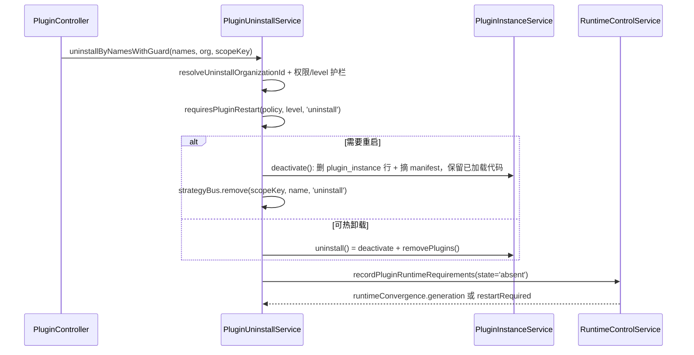

**本文引用的文件**
- [packages/server/src/plugin/plugin-management.service.ts](file://packages/server/src/plugin/plugin-management.service.ts)
- [packages/server/src/plugin/plugin.helper.ts](file://packages/server/src/plugin/plugin.helper.ts)
- [packages/server/src/plugin/plugin-loader.ts](file://packages/server/src/plugin/plugin-loader.ts)
- [packages/server/src/plugin/plugin-http-routes.ts](file://packages/server/src/plugin/plugin-http-routes.ts)
- [packages/server/src/plugin/plugin-orm-metadata.ts](file://packages/server/src/plugin/plugin-orm-metadata.ts)
- [packages/server/src/plugin/plugin-strategy-registration.ts](file://packages/server/src/plugin/plugin-strategy-registration.ts)
- [packages/server/src/plugin/plugin-archive.ts](file://packages/server/src/plugin/plugin-archive.ts)
- [packages/server/src/plugin/plugin-sdk-versioning.ts](file://packages/server/src/plugin/plugin-sdk-versioning.ts)
- [packages/server/src/plugin/plugin-schema-sync.service.ts](file://packages/server/src/plugin/plugin-schema-sync.service.ts)
- [packages/server/src/plugin/plugin-schema-scope.ts](file://packages/server/src/plugin/plugin-schema-scope.ts)
- [packages/server/src/plugin/plugin-runtime-policy.ts](file://packages/server/src/plugin/plugin-runtime-policy.ts)
- [packages/server/src/plugin/plugin-update.utils.ts](file://packages/server/src/plugin/plugin-update.utils.ts)
- [packages/server/src/plugin/plugin-install-policy.ts](file://packages/server/src/plugin/plugin-install-policy.ts)
- [packages/server/src/plugin/plugin-instance.service.ts](file://packages/server/src/plugin/plugin-instance.service.ts)
- [packages/server/src/plugin/source-config.ts](file://packages/server/src/plugin/source-config.ts)
- [packages/server/src/plugin/organization-plugin.store.ts](file://packages/server/src/plugin/organization-plugin.store.ts)
- [packages/server/src/plugin/uninstall/plugin-uninstall.service.ts](file://packages/server/src/plugin/uninstall/plugin-uninstall.service.ts)
- [packages/server/src/plugin/setup/setup-plugins.service.ts](file://packages/server/src/plugin/setup/setup-plugins.service.ts)
- [packages/server/src/plugin/setup/setup-plugins.store.ts](file://packages/server/src/plugin/setup/setup-plugins.store.ts)
- [packages/server/src/plugin/setup/setup-plugins.catalog.ts](file://packages/server/src/plugin/setup/setup-plugins.catalog.ts)
- [packages/server/src/plugin/plugin.module.ts](file://packages/server/src/plugin/plugin.module.ts)
- [packages/server/src/plugin/plugin-startup-step.ts](file://packages/server/src/plugin/plugin-startup-step.ts)
- [packages/server/src/plugin/plugin-startup-state.ts](file://packages/server/src/plugin/plugin-startup-state.ts)
- [packages/server/src/plugin/marketplace/plugin-marketplace.service.ts](file://packages/server/src/plugin/marketplace/plugin-marketplace.service.ts)
- [packages/server/src/plugin/marketplace/plugin-marketplace-shared-cache.ts](file://packages/server/src/plugin/marketplace/plugin-marketplace-shared-cache.ts)
- [packages/server/src/plugin/marketplace/plugin-marketplace.types.ts](file://packages/server/src/plugin/marketplace/plugin-marketplace.types.ts)
- [packages/server/src/plugin/marketplace/plugin-marketplace-registry.ts](file://packages/server/src/plugin/marketplace/plugin-marketplace-registry.ts)
- [packages/server/src/plugin/marketplace/plugin-marketplace.controller.ts](file://packages/server/src/plugin/marketplace/plugin-marketplace.controller.ts)
- [packages/server/src/plugin/plugin-runtime-state.service.ts](file://packages/server/src/plugin/plugin-runtime-state.service.ts)
- [apps/api/src/bootstrap/index.ts](file://apps/api/src/bootstrap/index.ts)
- [packages/server-ai/src/plugin-resource/plugin-hooks.middleware.ts](file://packages/server-ai/src/plugin-resource/plugin-hooks.middleware.ts)

## 目录
- [安装链逐段细节](#安装链逐段细节)
- [卸载与重启](#卸载与重启)
- [setup 向导](#setup-向导)
- [启动期 bootstrap 与快照恢复](#启动期-bootstrap-与快照恢复)
- [市场抓取与缓存](#市场抓取与缓存)
- [设计模式与热点路径](#设计模式与热点路径)
- [关键类清单](#关键类清单)
- [技术债与 hack](#技术债与-hack)
- [设计维度分析](#设计维度分析)
- [结论](#结论)

## 安装链逐段细节
**① 入口与参数校验**（`PluginManagementService.installPlugin`，被 `POST /plugin`、setup 向导、`refreshCodePlugin`、`installArchivePlugin` 共用）：`pluginName` 必填 → `source = body.source || 'marketplace'` → 顶层 `workspacePath` 已移除（出现即 400）→ `normalizePluginSourceConfig` 归一 `sourceConfig` → 当 `source === 'code'` 时 `packageDir` 需 `allowPackageDir` 才允许，且 `workspacePath` 与 `packageDir` 至少有一个 → 解析 `RequestContext.getScope()` 得到 tenant/organization，`defaultTenantId` 由 `PluginInstanceService.getDefaultTenantId()` 查 `tenant.name = DEFAULT_TENANT` 得到。

**② 来源形态六类**：内置 JSON 目录（`BUILTIN_MARKETPLACE_URL`，可用 `XPERT_PLUGIN_MARKETPLACE_URL` 覆盖）；远程 `github`（`fetchGithubCatalog`：raw 候选路径 × `ref` 轮询，refs 为 `source.ref` → 仓库 ref → `main` → `master`）；远程 `git`（`fetchGitCatalog`：`execFile('git', ['clone','--depth','1',...])` 到 `mkdtemp` 临时目录后按 `sparsePath` 找清单，`finally` 清理）；平台注册表（`PLATFORM_REGISTRY_SOURCE_URL = 'xpert-platform://plugins'`，数据来自 `plugin_marketplace_registry_item`）；npm（`assertPluginSdkInstallCandidate` → `fetchRegistryPluginManifest`，版本由 `queries/handlers/npm-plugin-version.ts` 解析）；本地上传归档（`POST /plugin/archive` → `extractPluginArchive` 按魔数判 zip/tgz/tar、`assertSafeArchiveEntries` 拒 `..`/绝对路径、要求唯一 `package.json`，`finally` 中 `cleanupExtractedPluginArchive`）。

**③ 兼容与归属判定**：`source === 'code' && packageDir` 走 `assertPluginSdkCompatibility(readPluginPackageJson(...))`，否则 `await assertPluginSdkInstallCandidate(...)`；`level = resolvePluginLevel(info.level)`（默认 organization）；setup 传 `requiredLevel` 且不一致即报 `server:Error.SetupPluginLevel`；非 system 且全局组织但缺 tenant → 400；system 需默认租户 + `canManageSystemPlugins`，并检查 `findTenantLevelOwner` 冲突（`PluginProcessLevelConflict`）；tenant 需 tenant + `canManageTenantPlugins`，并检查 `findSystemLevelRegistration` 与跨租户 `PluginTenantLevelAlreadyOwned`。

**④ staging（重启类）**：`requiresPluginRestart(compatibilityInfo.runtimePolicy, level, existingRuntime ? 'update' : 'install')`（或已加载实例自带 policy 判定 update）为真时，只做 `registerPluginsAsync({ stageOnly: true })`：code 插件先 `stagePackageDirectoryPlugin` / `stageWorkspacePlugin`，非 code 插件走 `installOrganizationPlugins` 并写 manifest（同包名后者覆盖）。随后 `assertInstalledPluginSdkCompatibility(packageName, pluginBaseDir)` 校验 staged 后的 level 是否与判定一致、解析 `artifactNamespace`（organization 级可用 `derivePluginArtifactNamespace` 兜底，system/tenant 必须显式声明）、`assertPluginArtifactNamespaceAvailable`、`pluginSchemaSync.synchronize(...)`，最后 `upsert({ pendingRestart: true, configurationStatus/Error 沿用旧行 })` 并按 `deferActivation` 决定是否 `runtimeControl.recordPluginRuntimeChange`，返回 `restartRequired: true` 或 `runtimeConvergence.generation`。

**⑤ 热路径**：先做一次 `stageOnly` 预检并 `loadPlugin`，若此时发现 `requiresPluginRestart(...)` 为真则抛 `server:Error.PluginRuntimePolicyChanged`（防止「声明 hot 却实际需要重启」）；`pluginSchemaSync.synchronize` 后 `uninstaller.uninstallByPackageNameWithGuard(..., 'refresh')` 清旧实例并置 `shouldCleanupPlugin = shouldPersistFailureState = true`；再 `registerPluginsAsync`（带 `configs`）拿到 `modules`；逐 module 执行三段式：`collectPluginOrmMetadata` → `validatePluginEntityTableNames` → `registerPluginOrmMetadataInDataSource` → `snapshotModuleIds` + `snapshotHttpRouteStack` → `lazyLoader.load(() => dynamicModule)` → `registerPluginControllerRoutes` → `registerInstalledPluginStrategies` → 手动调 `onPluginBootstrap`（若存在）。

**⑥ 收尾与失败补偿**：`inspectConfig(pluginName, body.config ?? {}, plugin.config)` 得到 `configurationStatus = valid|invalid`；`upsert({ pendingRestart: false })`、`clearPluginLoadFailure`、`runtimeState.report()`、`resolvePluginRuntimeRevision`（code 插件为 `runtime:<runtimeName>` 或 workspace stage 指纹）、`recordPluginRuntimeChange`。任何异常都会：`shouldCleanupPlugin` → `removePlugins`；`shouldPersistFailureState` → 写一条「失败行」+ `upsertPluginLoadFailure`；最终统一抛 `server:Error.PluginInstallFailed`。

**`registerPluginsAsync` 内部细节**：code 插件始终先 staging；`installOrganizationPlugins` 只接收非 code 插件；每个插件的加载与注册分别包在 `runPluginStartupStep(name, 'import')` 与 `'register'` 中；`resolvedLevel === 'system' && allowSystemPlugins === false` 时抛 `PluginLoadRejectedError`（code `plugin-system-level-install-forbidden`，日志降为 warn 且不写入 `loadFailures`）；tenant 级必须从 tenant-global scope 载入；成功后 `tagModuleWithPluginScope` 给模块与其 controllers/providers 打 `ORGANIZATION_METADATA_KEY` / `PLUGIN_METADATA_KEY` / `PLUGIN_VERSION_METADATA_KEY`，并 push 进 `loaded`（同 scope + 同名先 splice 旧记录）。

章节来源：[plugin-management.service.ts](file://packages/server/src/plugin/plugin-management.service.ts)（关键符号：PluginManagementService.installPlugin）、[plugin.helper.ts](file://packages/server/src/plugin/plugin.helper.ts)（关键符号：registerPluginsAsync）、[organization-plugin.store.ts](file://packages/server/src/plugin/organization-plugin.store.ts)（关键符号：stagePackageDirectoryPlugin、stageWorkspacePlugin、installOrganizationPlugins）

## 卸载与重启
入口 `PluginUninstallService.uninstallByNamesWithGuard(names, targetOrganizationId?, targetScopeKey?)`：先按 `RequestContext` 取当前 organization/tenant；`resolveUninstallOrganizationId` 只允许「当前组织」或「全局组织」（全局需 `canManageGlobalPlugins`）；`targetsLoadedSystemPlugin` 命中已加载 system 插件时把 `scopeKey` 强制为 `system:global`，否则全局组织取 `resolveTenantGlobalScopeKey(tenantId)`，其余取 organizationId。逐级护栏：`scopeKey === system:global` 需 `canManageSystemPlugins`；`assertNoSystemPlugins` 拒绝非授权者对 system 插件的卸载（`server:Error.PluginSystemUninstallForbidden`）；已加载的 tenant 级插件只允许「本租户全局 scope + SuperAdmin + `canManageTenantPlugins`」。

**分流判定**：对 `scopeKey` 命中的已加载目标逐个调 `requiresPluginRestart(plugin.instance.meta.runtimePolicy, resolvePluginLevel(...), 'uninstall')`，取「任一是 restart」的或语义；若目标未加载但 `scopeKey === system:global`，也按需重启处理。

图表来源：[plugin-uninstall.service.ts](file://packages/server/src/plugin/uninstall/plugin-uninstall.service.ts)（关键符号：PluginUninstallService.uninstallByNamesWithGuard）、[plugin-runtime-policy.ts](file://packages/server/src/plugin/plugin-runtime-policy.ts)（关键符号：requiresPluginRestart）

`deactivate` 除删 `(scopeKey, pluginName)` 行外，还会删除 `scopeKey IS NULL AND level='system'` 的历史遗留行（system 分支）或按 `buildTenantWhereVariants` 清理 `scopeKey IS NULL` 的其他遗留行。`removePlugins` 负责热卸载的磁盘与内存清理：`clearPluginLoadFailure` → `strategyBus.remove` → 从 `loaded` splice → `rmSync` 插件目录 → 额外递归清理根目录下 `pkg@version` / `@scope/pkg@version` 版本目录 → `removeFromManifest`。**更新侧**由 `canUpdatePlugin`（code 源不可更新；system 需 `canManageSystemPlugins`；tenant 需全局组织 + `canManageTenantPlugins`）、`supportsNpmRegistryUpdates`（排除 code/git/local/url）、`hasNewerVersion` 与 `POST /plugin/update`（`UpdatePluginCommand`）承担；`refreshCodePlugin` 专门重启 code 插件：要求已存在实例、`source === 'code'`、`sourceConfig.workspacePath` 可用，并复用当前 `ctx.config` 重新走一遍安装；code 插件的运行时目录名由 `createCodeRuntimePluginName` 生成（`<pkg>@runtime__<base36 时间戳>-<随机>`），保证每次刷新不覆盖仍被旧模块引用的目录。

章节来源：[plugin-instance.service.ts](file://packages/server/src/plugin/plugin-instance.service.ts)（关键符号：PluginInstanceService.deactivate、PluginInstanceService.removePlugins）、[plugin-update.utils.ts](file://packages/server/src/plugin/plugin-update.utils.ts)（关键符号：canUpdatePlugin、supportsNpmRegistryUpdates）

## setup 向导
`SetupPluginsCatalog` 明确「不维护第二份清单」：`all()` 直接调 `marketplace.listMarketplace({ targetApp: 'xpert' })` 按 packageName 去重，并推导 `unavailableReason`（非 npm/marketplace 源 → `unsupported-source`；无 organization 且 level 缺失或 organization → `organization-required`）；`list()` 做搜索/过滤/分组/分页并返回 `selectableNames` 与 facets；`resolve(names, organizationId)` 把用户选择解析为 `SetupPluginChoice`，命中不可用项直接 400 `server:Error.SetupPluginSelection`。

`SetupPluginsService.start(names, importDefaultAgentPlugins)`：`authorize()` 要求「非 API Key + 默认租户 + SuperAdmin」；`store.acquire(tenantId)` 用**专用 QueryRunner** 执行 `SELECT pg_try_advisory_lock(hashtext($1))`，键为 `xpert:setup-plugins:<tenantId>`，拿不到直接回退 `status()`（幂等）；`phase === 'idle'` 时 `resolve` 选择集、记录 `organizationId` 与 `defaultAgentPlugins`、置 `phase = 'installing'` 落库；随后**不等待**地 `void this.run(tenantId, progress).finally(release)`，HTTP 立刻返回 202。

`run()` 的续跑语义：逐项 `pending|installing` 才处理 → 已加载则标 `existing`；否则标 `installing`、调 `installPlugin({ pluginName, version, source: 'npm' }, { deferActivation: true, requiredLevel: item.level })`，成功标 `installed` 并记录 `runtimeRequirements`，失败标 `failed` 并写入 `error` 后**继续下一项**；每个状态变更前后都 `store.save`，因此刷新页面或换副本重试能在同一把 DB 锁下续跑。全部完成后执行 `ImportDefaultAgentPluginsCommand`（同样 pending → importing → completed/failed）；最后汇总 requirements：为空则 `phase = 'completed'`，否则 `phase = 'restarting'` 并 `runtime.requestRestart({ confirmation, reason, runtimeRequirements })`，把 `restartId` / `generation` 落库。`status()` 在 `restarting` 态用 `pluginConvergenceStatus(generation)` 或 `restartStatus(restartId)` 轮询，`completed` → completed、`failed` → attention、**无回执且 updatedAt 超过 30s** → attention、`NotFoundException` 也降级 attention；从其他 phase 收敛到 completed 时会在重新 `acquire` 后做一次乐观并发校验（`current.phase === savedPhase && current.updatedAt === progress.updatedAt`）才写回。

章节来源：[setup-plugins.service.ts](file://packages/server/src/plugin/setup/setup-plugins.service.ts)（关键符号：SetupPluginsService.start、SetupPluginsService.run）、[setup-plugins.store.ts](file://packages/server/src/plugin/setup/setup-plugins.store.ts)（关键符号：SetupPluginsStore.acquire）、[setup-plugins.catalog.ts](file://packages/server/src/plugin/setup/setup-plugins.catalog.ts)（关键符号：SetupPluginsCatalog.resolve）

## 启动期 bootstrap 与快照恢复
`preBootstrapPlugins` 是进程内第一个真正加载插件的环节：读 `process.env.PLUGINS`（`,`/`;` 分隔）与两个默认插件（`@xpert-ai/plugin-draft` organization、`@xpert-ai/plugin-vlm-default` system），然后 `selectPluginStartup(await loadOrganizationPluginConfigs({ strict: true }))` 决定本次尝试的配置；持久化的 global/system 组会把插件合并进默认映射（**已存在且 source 为 code 的条目不被覆盖**）；`XPERT_LOCAL_SANDBOX_ENABLED === 'true'` 时补 `@xpert-ai/plugin-local-shell-sandbox` 为 system 级并从 global 映射中删除，避免同一进程注册两次。随后按「持久化的各组织组 → system 组 → global 组」顺序逐组 `registerPluginsAsync`，`failOnPluginRegistrationError` 或 `PluginStartupTimeoutError` 时直接上抛（保持 readiness 关闭），最后 `setConfig({ plugins: modules, dbConnectionOptions.entities })` 把插件实体并入连接配置。

`PluginStartupState` 承载「只尝试一次」语义：`fingerprint` 对按 scopeKey / 插件名排序后的配置做 sha256（对象键也排序），`select()` 命中 `attempted`/`blocked` 时先补齐 `failure`（code 为 `PLUGIN_STARTUP_INTERRUPTED`），若 `recovering` 或无 `good` 则抛 `PluginStartupRecoveryRequiredError`，否则置 `recovering = true`、`blocked = hash`、`rolledBack = true` 并返回 `good` 的**解密副本**；未命中则把当前配置登记为 `attempted` 候选。`commit(runtime)` 只在存在 candidate 时才写 `good` 与 `goodRuntime`（插件三元组 scopeKey/pluginName/version/runtimeRevision + failures），`canRestore` 用于判断 supervisor 能否用当前 runtime 状态回滚。落盘为原子写（临时文件 + `renameSync`，文件 0600 / 目录 0700），文件名由 `sha256(XPERT_INSTANCE_ID || HOSTNAME || hostname())` 决定，因此**快照天然是副本私有的**。

`runPluginStartupStep`（`plugin-startup-step.ts`）用 `Promise.race` 给每个步骤套 30s 超时并抛 `PluginStartupTimeoutError`；文件头注释给出一句关键理由：超时的 hook 仍可能改动进程状态，所以进程不能对外服务；失败日志只输出 `{ event: 'plugin.startup.failed', pluginName, stage, durationMs, code }`，**不落插件配置与异常文本**（可能含凭据）。`PluginModule.onModuleInit` 先把 `moduleRef` 注入每一条 `loaded` 记录，再对 `getPluginModules(configService.plugins)` 逐个 `runPluginStartupStep(moduleName, 'onPluginBootstrap')`；`moduleRef.get(module, { strict: false })` 解析失败会直接上抛；`onModuleDestroy` 对每个插件走 `runShutdownStep('plugin.<name>.destroy')`，未 completed 就 `continue`，单个插件卡死不会阻断后续清理。API 侧另有两个边界步骤：`startPluginStartupStep('(application)', 'container-create')` 与 `'application-listen'`，以及监听成功后的 `markPluginStartupListening()` 与 `admitPluginStartup`。

章节来源：[plugin-startup-state.ts](file://packages/server/src/plugin/plugin-startup-state.ts)（关键符号：PluginStartupState.select、PluginStartupState.commit）、[plugin-startup-step.ts](file://packages/server/src/plugin/plugin-startup-step.ts)（关键符号：runPluginStartupStep）、[plugin.module.ts](file://packages/server/src/plugin/plugin.module.ts)（关键符号：PluginModule.bootstrapPluginLifecycleMethods）、[bootstrap/index.ts](file://apps/api/src/bootstrap/index.ts)（关键符号：preBootstrapPlugins）

## 市场抓取与缓存
`PluginMarketplaceService.listMarketplace` 的读路径不触发包 I/O：取来源记录 → 按 `query.sourceId` 过滤并丢弃 `enabled === false` → 判断是否包含平台注册表（`includesPlatformRegistry`）→ `buildInstalledContext` → 平台目录（`loadPlatformRegistryCatalog`）→ 逐来源抓取目录。来源分派在 `fetchSourceCatalog`：`github` → `fetchGithubCatalog`、`git` → `fetchGitCatalog`、其余按 `source.url` 抓 JSON 后 `normalizeCatalog`；`enrich` 为真时才叠加 npm 下载量与 bundle manifest 富化（`enrichCatalogWithNpmDownloads` / `enrichCatalogWithNpmPackageData`）。`fetchGitCatalog` 必须用系统 `git`：`clone --depth 1 [--branch ref]` 到 `mkdtemp(join(tmpdir(), 'xpert-plugin-marketplace-'))`，`finally` 递归删除；`readFirstCatalogFile` 会把候选路径 `resolve` 到 clone 根并用 `filePath.startsWith(root)` 收口，避免越出目录读取。

缓存分三层并全部以 Redis 为共享真相：进程内 `PluginMarketplaceCache`；`PluginMarketplaceSharedCache` 用 `acquireLock` 抢租约 → `withLease` 每 `leaseMs` 续租（续租失败即 `lost`）→ 成功后用 Lua `PUBLISH`（**仅当 `KEYS[1]` 的 token 与持有者一致**才写 `:data` 并删 `:failure`）发布、失败时 `FAIL` 只写负缓存；拿不到锁的分支每 100ms 轮询到 deadline 仍然无数据则抛 `marketplaceCacheUnavailable()`（ServiceUnavailable）。TTL 由环境变量控制：目录新鲜期 `MARKETPLACE_CACHE_TTL_MS`（默认 10min）、请求超时 `MARKETPLACE_REQUEST_TIMEOUT_MS`（默认 10s）、npm 富化并发 `NPM_DOWNLOADS_CONCURRENCY`（默认 6）、内置目录地址 `BUILTIN_MARKETPLACE_URL`。平台注册表来源由代码合成（`createPlatformRegistrySourceResponse`：`type: 'platform'`、`priority: -10`、`builtin: true`），不落 `plugin_marketplace_source` 行。市场图标的缓存头在控制器上用装饰器声明：`Cache-Control: private, max-age=86400, immutable` + `Vary: Authorization, tenant-id, organization-id, x-scope-level` + `X-Content-Type-Options: nosniff`，并强制 `hash` 为 64 位小写 hex、与实际资源 hash 不一致即 404。

章节来源：[plugin-marketplace.service.ts](file://packages/server/src/plugin/marketplace/plugin-marketplace.service.ts)（关键符号：PluginMarketplaceService.listMarketplace、PluginMarketplaceService.fetchGitCatalog）、[plugin-marketplace-shared-cache.ts](file://packages/server/src/plugin/marketplace/plugin-marketplace-shared-cache.ts)（关键符号：PluginMarketplaceSharedCache.withLease、PluginMarketplaceSharedCache.publish）、[plugin-marketplace.controller.ts](file://packages/server/src/plugin/marketplace/plugin-marketplace.controller.ts)（关键符号：PluginMarketplaceController.icon）

## 设计模式与热点路径
**落地的设计模式**：① 编排服务 + 纯函数机制层（`installPlugin` 只负责顺序，装配细节交给 `plugin-orm-metadata` / `plugin-http-routes` / `plugin-strategy-registration`），② 注册表模式（`StrategyBus.upsert(strategyMeta, { instance, sourceId, sourceKind: 'plugin' })`，`sourceId = scopeKey:pluginName@version:Target`；`PLUGIN_JOB_PROCESSOR_METADATA` 走同一总线），③ 装饰器元数据 + 反射扫描（`collectProvidersWithMetadata` 只扫描 `beforeModuleIds` 之后新增且 `PLUGIN_METADATA_KEY`/`ORGANIZATION_METADATA_KEY` 匹配的模块），④ 模板方法式 staging（`stageOnly` 复用同一 `registerPluginsAsync` 分支，避免出现第二套目录语义），⑤ 熔断式启动快照（`attempted`/`blocked`/`good`/`goodRuntime`），⑥ 租约 + 令牌校验的分布式缓存（Lua 脚本保证只有持锁者能发布）。

**热点路径**（按代价从高到低）：启动期逐插件 `import`/`register`/`onPluginBootstrap`（每步 30s 上限，串行 `for await`）；`fetchGitCatalog` 的 `git clone --depth 1`（45s 超时，含磁盘写入与清理）；归档解包（zip 走 `unzipper`，tar/tgz 通过 `execFileSync('tar', ...)` 且先 `-tf/-tzf` 列表校验）；动态路由注册（快照 Express `_router.stack`/`router.stack`、`RoutesResolver.registerRouters`、把新层 splice 到尾部 404 处理器之前）；`removePlugins` 的目录递归 `rmSync`（含版本目录扫描）；npm 富化的并发抓取（默认 6）。

章节来源：[plugin-strategy-registration.ts](file://packages/server/src/plugin/plugin-strategy-registration.ts)（关键符号：registerInstalledPluginStrategies）、[plugin-http-routes.ts](file://packages/server/src/plugin/plugin-http-routes.ts)（关键符号：moveNewExpressLayersAheadOfTailHandlers）、[plugin-archive.ts](file://packages/server/src/plugin/plugin-archive.ts)（关键符号：extractPluginArchive）

## 关键类清单
1. `PluginModule` — `plugin.module.ts` — 启动链入口、`@Global` 导出面、`onModuleInit`/`onModuleDestroy` 生命周期编排。
2. `PluginManagementService` — `plugin-management.service.ts` — 安装/归档安装/刷新编排、三段式装配唯一实现点、失败补偿。
3. `PluginInstanceService` — `plugin-instance.service.ts` — `plugin_instance` 读写、level 归属、可见性、manifest 与磁盘目录清理。
4. `PluginUninstallService` — `uninstall/plugin-uninstall.service.ts` — 卸载护栏、scopeKey 解析、重启/hot 分流。
5. `PluginSchemaSyncService` — `plugin-schema-sync.service.ts` — Redis 锁保护的 schema preflight。
6. `PluginRuntimeStateService` — `plugin-runtime-state.service.ts` — `loaded` + `loadFailures` 上报实例注册表，计算 `runtimeRevision`。
7. `SetupPluginsService` — `setup/setup-plugins.service.ts` — setup 状态机、顺序安装、重启交接。
8. `SetupPluginsStore` — `setup/setup-plugins.store.ts` — PG advisory lock 与 `tenant_setting` 进度持久化。
9. `SetupPluginsCatalog` — `setup/setup-plugins.catalog.ts` — 复用市场目录生成 setup 选择集。
10. `PluginMarketplaceService` — `marketplace/plugin-marketplace.service.ts` — 市场列表/详情/来源 CRUD 与来源抓取分派。
11. `PluginMarketplaceSharedCache` — `marketplace/plugin-marketplace-shared-cache.ts` — Redis 租约、Lua 发布与负缓存。
12. `PluginMarketplaceRegistry` — `marketplace/plugin-marketplace-registry.ts` — 平台注册表来源与目录合成。
13. `PluginController` — `plugin.controller.ts` — 插件本体 HTTP 面（含 100MB 归档上传）。
14. `SetupPluginsController` — `setup/setup-plugins.controller.ts` — setup HTTP 面（SuperAdmin + 默认租户）。
15. `registerPluginsAsync` — `plugin.helper.ts` — 全子域唯一的「安装 + 加载 + 注册 + 记录」流水线。
16. `registerPluginControllerRoutes` — `plugin-http-routes.ts` — 动态路由注册与 Express 层重排。
17. `registerPluginOrmMetadataInDataSource` — `plugin-orm-metadata.ts` — 向活 DataSource 合并实体并 `buildMetadatas()`。
18. `PluginStartupState` — `plugin-startup-state.ts` — 候选/回滚/提交的快照状态机。
19. `loadPlugin` — `plugin-loader.ts` — 模块解析、SDK link 保障、`meta.level`/`runtimePolicy` 注入。
20. `extractPluginArchive` — `plugin-archive.ts` — 归档解包与安全条目校验。

章节来源：[plugin.helper.ts](file://packages/server/src/plugin/plugin.helper.ts)（关键符号：registerPluginsAsync）、[plugin-management.service.ts](file://packages/server/src/plugin/plugin-management.service.ts)（关键符号：PluginManagementService.installPlugin）、[plugin-marketplace-shared-cache.ts](file://packages/server/src/plugin/marketplace/plugin-marketplace-shared-cache.ts)（关键符号：PluginMarketplaceSharedCache.acquire）

## 技术债与 hack
- **启动链三处硬编码 + 守卫单点注册**：`RootModule` / `WorkerRootModule` / `MigrationRootModule` 各自 `imports [..., PluginModule.init()]`，全局 `PluginScopeGuard` 又在 `bootstrap` 里单独 `useGlobalGuards`；改装配策略需要同时改多处，且无编译期约束。
- **对框架内部结构的直接操作**：路由注册依赖 `container.getModules()`、`moduleRef.injector`、Express 实例的 `_router.stack`/`router.stack` 与「尾部无 `route` 的层即 404/错误处理器」这一启发式；类型上大量 `as never` 强转，Nest/Express 升级即可能静默失效。
- **非生产环境用 ts-node 载入插件 TS 源码**：`loadTsEntry` 以 `transpileOnly: true` 注册 ts-node 后 `cjsRequire(tsEntry)`，与生产 `cjsRequire`/ESM 路径行为不同（`codeLoadMode: 'workspace-ts' | 'staged-package'`），本地能跑不代表产物能跑。
- **外部可执行文件依赖**：`fetchGitCatalog` 需要镜像里有 `git`；`extractTarArchive` 需要 `tar`；两者都靠 `execFile`/`execFileSync`，失败信息只能从异常文本推断。
- **code 插件运行时目录名不幂等**：`createCodeRuntimePluginName` 用 `Date.now()` + 随机串，每次刷新/安装都新建 `@runtime__*` 目录，只依赖 `removePlugins` 的前缀扫描回收；绕过卸载路径（如直接改库）会在磁盘留下孤儿目录。
- **快照只覆盖代码与配置**：注释已明示「数据库迁移必须保持向后兼容」，否则回滚后的旧代码会读到新 schema；恢复耗尽时 `holdFailedPluginStartup` 用 `setInterval` 保活而不是崩溃退出，需要运维介入。
- **`git`/`github` 来源的信任面**：来源 URL 与 `sparsePath` 完全由使用者填写，clone/raw 抓到什么就按什么解析目录；`PLUGIN_WORKSPACE_ROOTS` 只约束本地 code 插件的源路径白名单，**不是**远端内容的沙箱。
- **归档安全边界（部分未确认）**：`assertSafeArchiveEntries` 对 zip（`archive.files[].path`）与 tar（`tar -tf` 列表）都拒绝 `..`、`../` 前缀与绝对路径，需求「恰好一个 `package.json`」，且 multer 侧限额 100MB；但条目**符号链接/硬链接**等特殊类型未做显式拒绝（未在代码中确认有对应校验），解包仍可能把链接写到目标目录树内。
- **Hook 是可执行代码边界**：`PluginHooksMiddleware` 从 bundle 读 hook 的 `command`，拼成 `XPERT_PLUGIN_ROOT=... XPERT_PLUGIN_DATA=... <command>` 交给 sandbox backend 执行（无 backend 即 `fail` 并上报 `Plugin hook blocked`），并会 `mkdir` 插件数据目录；行为收敛依赖 sandbox 配置而非类型系统。

章节来源：[plugin-archive.ts](file://packages/server/src/plugin/plugin-archive.ts)（关键符号：assertSafeArchiveEntries）、[plugin-hooks.middleware.ts](file://packages/server-ai/src/plugin-resource/plugin-hooks.middleware.ts)（关键符号：PluginHooksMiddleware.executeCommand）、[plugin-http-routes.ts](file://packages/server/src/plugin/plugin-http-routes.ts)（关键符号：snapshotHttpRouteStack）

## 设计维度分析
### 维度一：生效时机（hot vs restart）的显式建模
本实现没有把「装上了」等同于「生效了」，而是把生效时机交给一个正交函数 `requiresPluginRestart(policy, level, operation)`：插件可通过 `package.json` 的 `xpert.plugin.runtimePolicy` 声明 install/update/uninstall 各自的 `hot|restart`；未声明时退回 level 默认（system/tenant 需重启、organization 热装）。由此派生出三件互相印证的状态：`plugin_instance.pendingRestart`（已落库未加载）、`runtimeRequirements[].state`（`loaded|absent`）、`restartRequired|runtimeConvergence.generation`（本次请求的可执行动作）。`deferActivation` 是第四种表达——setup 向导先只 staging，把「安装」与「收敛」拆成两段。风险也集中在这里：热路径会用 staged 后的 `meta.runtimePolicy` 复检并抛 `server:Error.PluginRuntimePolicyChanged`，说明「声明与实现不一致」是被显式视为错误的。
章节来源：[plugin-runtime-policy.ts](file://packages/server/src/plugin/plugin-runtime-policy.ts)（关键符号：requiresPluginRestart）、[plugin-management.service.ts](file://packages/server/src/plugin/plugin-management.service.ts)（关键符号：PluginManagementService.installPlugin）

### 维度二：一致性按「作用域长度」选锁
同一子域里三种锁各司其职，不互相替代：**数据库唯一键**承担业务幂等与并发收口（`plugin_instance` 的 `(scopeKey, pluginName)`、`(tenantId, organizationId, pluginName)`、`level='tenant'` 的 partial unique），**PG advisory lock** 承担跨副本的长事务互斥（setup 向导用专用连接持有到安装结束，进程退出自动释放），**Redis 锁 + Lua 令牌校验**承担短临界区（schema preflight 的 `xpert:plugin:schema-sync`、市场共享缓存的租约与发布）。此外 `PluginStartupState` 用「哈希候选 + 本地快照」承担进程级的一次性尝试，属于第四类——**文件级**一致性。四层叠加的结果是：并发安装不会写重复行、并发 setup 只会有一个赢家、并发 schema 迁移会串行、候选 boot 失败会自动回滚到已准入配置。
章节来源：[plugin-instance.entity.ts](file://packages/server/src/plugin/plugin-instance.entity.ts)（关键符号：IDX_plugin_instance_tenant_level_plugin_name）、[setup-plugins.store.ts](file://packages/server/src/plugin/setup/setup-plugins.store.ts)（关键符号：SetupPluginsStore.acquire）、[plugin-schema-sync.service.ts](file://packages/server/src/plugin/plugin-schema-sync.service.ts)（关键符号：PluginSchemaSyncService.synchronize）

### 维度三：staging 目录是唯一的跨期契约
「启动恢复」与「运行期安装」被刻意收敛到同一份目录结构（`getOrganizationPluginRoot` 按 scope 分支：system → `plugins/<scopeKey>`、租户全局 → `plugins/tenants/<tenantId>/<organizationId>`、其余 → `plugins/<organizationId>`）与同一份 manifest（`plugins.json`）。`plugin-instance.loader.ts` 在插件 ORM metadata 尚不存在时也能用一条原生 SQL 读回期望配置（含 `sourceConfig`），`plugin.helper.ts` 的头注释则要求本地 code 插件在加载前必须重新 staging（避免读到过期拷贝）。代价是：进程外的手工改动不被感知，`packageDir` 这类瞬态输入无法从库里复原。
章节来源：[organization-plugin.store.ts](file://packages/server/src/plugin/organization-plugin.store.ts)（关键符号：getOrganizationPluginRoot、getOrganizationPluginPath）、[plugin-instance.loader.ts](file://packages/server/src/plugin/plugin-instance.loader.ts)（关键符号：loadPluginInstances、buildOrganizationPluginConfigs）

## 结论
实现主干可以压缩成两条流水线。**写路径**：`installPlugin` 先判 SDK 兼容与 level，再按 `requiresPluginRestart` 分岔成「只 staging + 落 `pendingRestart: true`」或「staging 预检 → 清旧实例 → `registerPluginsAsync` → 逐模块 metadata/load/routes/strategies → 落 `pendingRestart: false` + 配置校验结果」，任何一环失败都走 `removePlugins` 补偿并把失败登记进 `loadFailures`。**读路径**：`plugins/.runtime-plugin-state/<replica>.json` 决定本次 boot 的候选，`preBootstrapPlugins` 用同一份 `registerPluginsAsync` 把它变成进程内模块，再由 `effectiveLoadedPlugins` 按组织 → 租户全局 → system 收敛给上层。要动这一层，最需要先回答三个问题：这段逻辑属于三段式中的哪一段、这次变更要不要重启、以及 scope 是否可被证明——三点任一含糊，都会立刻表现为启动失败、重复资源或跨租户泄漏。
章节来源：[plugin-management.service.ts](file://packages/server/src/plugin/plugin-management.service.ts)（关键符号：PluginManagementService.installPlugin）、[bootstrap/index.ts](file://apps/api/src/bootstrap/index.ts)（关键符号：preBootstrapPlugins）、[plugin.helper.ts](file://packages/server/src/plugin/plugin.helper.ts)（关键符号：registerPluginsAsync）
